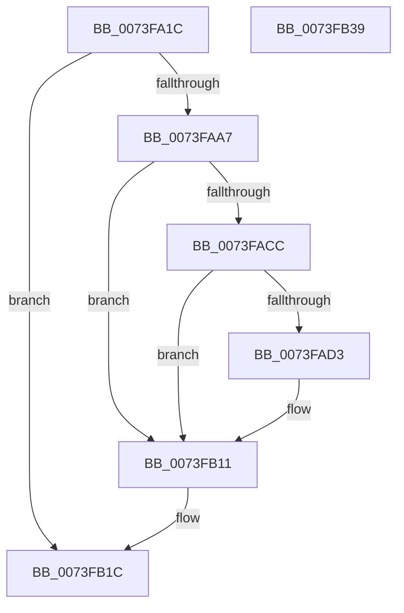

# IopFileUtilClearAttributes

- RVA: `0x0073FA1C`–`0x0073FB3A` (길이 `286` bytes)
- VA: `0x000000014073FA1C`
- 실행 섹션: `PAGE`
- PDB 이름 있음: `예`; PDB Function 태그: `아니요`
- unwind 정보 RVA: `0x000C9230`
- 디코드: `70`개 명령, `286/286` bytes 표시
- 미해석 바이트: `0` (있으면 어셈블리에 `.byte`로 보존)

> 이 문서는 커널 이미지의 기계어와 PDB 기호를 분석해 생성했습니다. 4번과 5번은 함수 원형과 자료형을 바이너리 사용 방식에서 추정한 C 해석이며 원본 소스 복구 결과는 아닙니다.

## 1. Dependencies

- 직접 호출 지점: **5**; 고유 호출 대상: **5**
- 직접 호출자로 확인된 함수: **3**
- RIP 상대 이미지 참조: **1**

### Outgoing calls
- `0x0073FA9E` → [ZwOpenFile](../../text/6A/ZwOpenFile_function_006AD730.md) (function, `0x006AD730`)
- `0x0073FAC1` → [ZwQueryInformationFile](../../text/6A/ZwQueryInformationFile_function_006AD2F0.md) (function, `0x006AD2F0`)
- `0x0073FB0A` → [ZwSetInformationFile](../../text/6A/ZwSetInformationFile_function_006AD5B0.md) (function, `0x006AD5B0`)
- `0x0073FB15` → [ZwClose](../../text/6A/ZwClose_function_006AD2B0.md) (function, `0x006AD2B0`)
- `0x0073FB23` → [_security_check_cookie](../../text/6A/_security_check_cookie_function_006AC640.md) (function, `0x006AC640`)

### Direct callers
- [PpLastGoodDeleteFilesCallback](../72/PpLastGoodDeleteFilesCallback_function_0072BD10.md) at `0x0072BD3E`
- [PiLastGoodRevertLastKnownDirectory](../../init/C3/PiLastGoodRevertLastKnownDirectory_function_00C33980.md) at `0x00C33B14`
- [IopFileUtilRename](../../init/C3/IopFileUtilRename_function_00C3662C.md) at `0x00C36692`

### Static image references
- `0x0073FA2E` → RVA `0x00E0A740` (`.data`; read)

## 2. Other-region calls and transfers

- 다른 실행 섹션으로 향하는 call: **5**
  - `0x0073FA9E` → [ZwOpenFile](../../text/6A/ZwOpenFile_function_006AD730.md) (`PAGE` → `.text`)
  - `0x0073FAC1` → [ZwQueryInformationFile](../../text/6A/ZwQueryInformationFile_function_006AD2F0.md) (`PAGE` → `.text`)
  - `0x0073FB0A` → [ZwSetInformationFile](../../text/6A/ZwSetInformationFile_function_006AD5B0.md) (`PAGE` → `.text`)
  - `0x0073FB15` → [ZwClose](../../text/6A/ZwClose_function_006AD2B0.md) (`PAGE` → `.text`)
  - `0x0073FB23` → [_security_check_cookie](../../text/6A/_security_check_cookie_function_006AC640.md) (`PAGE` → `.text`)
- 별도 외부 분기/꼬리 이동을 확인하지 못했습니다.

## 3. Assembly (complete function range)

```asm
0073FA1C  48 89 5C 24 10                  mov qword ptr [rsp + 0x10], rbx
0073FA21  55                              push rbp
0073FA22  48 8D 6C 24 A9                  lea rbp, [rsp - 0x57]
0073FA27  48 81 EC B0 00 00 00            sub rsp, 0xb0
0073FA2E  48 8B 05 0B AD 6C 00            mov rax, qword ptr [rip + 0x6cad0b]
0073FA35  48 33 C4                        xor rax, rsp
0073FA38  48 89 45 47                     mov qword ptr [rbp + 0x47], rax
0073FA3C  48 83 65 D7 00                  and qword ptr [rbp - 0x29], 0
0073FA41  4C 8D 4D DF                     lea r9, [rbp - 0x21]
0073FA45  83 65 0B 00                     and dword ptr [rbp + 0xb], 0
0073FA49  4C 8D 45 EF                     lea r8, [rbp - 0x11]
0073FA4D  0F 57 C0                        xorps xmm0, xmm0
0073FA50  48 89 4D FF                     mov qword ptr [rbp - 1], rcx
0073FA54  0F 57 C9                        xorps xmm1, xmm1
0073FA57  48 C7 45 EF 30 00 00 00         mov qword ptr [rbp - 0x11], 0x30
0073FA5F  83 65 F3 00                     and dword ptr [rbp - 0xd], 0
0073FA63  48 8D 4D D7                     lea rcx, [rbp - 0x29]
0073FA67  33 C0                           xor eax, eax
0073FA69  C7 44 24 28 22 40 20 00         mov dword ptr [rsp + 0x28], 0x204022
0073FA71  48 21 45 F7                     and qword ptr [rbp - 9], rax
0073FA75  BA 80 01 10 00                  mov edx, 0x100180
0073FA7A  0F 11 45 DF                     movups xmmword ptr [rbp - 0x21], xmm0
0073FA7E  48 89 45 3F                     mov qword ptr [rbp + 0x3f], rax
0073FA82  0F 11 4D 1F                     movups xmmword ptr [rbp + 0x1f], xmm1
0073FA86  C7 45 07 40 02 00 00            mov dword ptr [rbp + 7], 0x240
0073FA8D  0F 11 4D 2F                     movups xmmword ptr [rbp + 0x2f], xmm1
0073FA91  C7 44 24 20 03 00 00 00         mov dword ptr [rsp + 0x20], 3
0073FA99  F3 0F 7F 45 0F                  movdqu xmmword ptr [rbp + 0xf], xmm0
0073FA9E  E8 8D DC F6 FF                  call 0x1406ad730
0073FAA3  85 C0                           test eax, eax
0073FAA5  78 75                           js 0x14073fb1c
0073FAA7  48 8B 4D D7                     mov rcx, qword ptr [rbp - 0x29]
0073FAAB  4C 8D 45 1F                     lea r8, [rbp + 0x1f]
0073FAAF  41 B9 28 00 00 00               mov r9d, 0x28
0073FAB5  C7 44 24 20 04 00 00 00         mov dword ptr [rsp + 0x20], 4
0073FABD  48 8D 55 DF                     lea rdx, [rbp - 0x21]
0073FAC1  E8 2A D8 F6 FF                  call 0x1406ad2f0
0073FAC6  8B D8                           mov ebx, eax
0073FAC8  85 C0                           test eax, eax
0073FACA  78 45                           js 0x14073fb11
0073FACC  8B 45 3F                        mov eax, dword ptr [rbp + 0x3f]
0073FACF  A8 07                           test al, 7
0073FAD1  74 3E                           je 0x14073fb11
0073FAD3  0F 57 C0                        xorps xmm0, xmm0
0073FAD6  C7 44 24 20 04 00 00 00         mov dword ptr [rsp + 0x20], 4
0073FADE  83 E0 F8                        and eax, 0xfffffff8
0073FAE1  4C 8D 45 1F                     lea r8, [rbp + 0x1f]
0073FAE5  B9 80 00 00 00                  mov ecx, 0x80
0073FAEA  48 8D 55 DF                     lea rdx, [rbp - 0x21]
0073FAEE  0F 44 C1                        cmove eax, ecx
0073FAF1  33 C9                           xor ecx, ecx
0073FAF3  48 89 4D 3F                     mov qword ptr [rbp + 0x3f], rcx
0073FAF7  0F 11 45 1F                     movups xmmword ptr [rbp + 0x1f], xmm0
0073FAFB  89 45 3F                        mov dword ptr [rbp + 0x3f], eax
0073FAFE  44 8D 49 28                     lea r9d, [rcx + 0x28]
0073FB02  48 8B 4D D7                     mov rcx, qword ptr [rbp - 0x29]
0073FB06  0F 11 45 2F                     movups xmmword ptr [rbp + 0x2f], xmm0
0073FB0A  E8 A1 DA F6 FF                  call 0x1406ad5b0
0073FB0F  8B D8                           mov ebx, eax
0073FB11  48 8B 4D D7                     mov rcx, qword ptr [rbp - 0x29]
0073FB15  E8 96 D7 F6 FF                  call 0x1406ad2b0
0073FB1A  8B C3                           mov eax, ebx
0073FB1C  48 8B 4D 47                     mov rcx, qword ptr [rbp + 0x47]
0073FB20  48 33 CC                        xor rcx, rsp
0073FB23  E8 18 CB F6 FF                  call 0x1406ac640
0073FB28  48 8B 9C 24 C8 00 00 00         mov rbx, qword ptr [rsp + 0xc8]
0073FB30  48 81 C4 B0 00 00 00            add rsp, 0xb0
0073FB37  5D                              pop rbp
0073FB38  C3                              ret
0073FB39  CC                              int3
```

## 4. C-style interpretation (structured pseudocode)

```c
__int64 __fastcall IopFileUtilClearAttributes(__int64 a1)
{
    __int64 result;
    __int64 v_rbx;
    __int64 v_rsp;
    unsigned __int64 v_stack_m18;
    unsigned __int64 v_stack_m20;
    unsigned __int64 v_stack_m30;
    unsigned __int64 v_stack_m40;
    unsigned __int64 v_stack_m50;
    unsigned int v_stack_m54;
    unsigned int v_stack_m58;
    unsigned __int64 v_stack_m5F;
    unsigned __int64 v_stack_m60;
    unsigned __int64 v_stack_m68;
    unsigned int v_stack_m6C;
    unsigned __int64 v_stack_m70;
    unsigned __int64 v_stack_m80;
    unsigned __int64 v_stack_m88;
    unsigned int v_stack_m90;
    unsigned int v_stack_m98;
    unsigned __int64 v_stack_p10;

    v_stack_p10 = v_rbx;
    v_rsp = (v_rsp) - (176);
    result = (*(unsigned __int64 *)(v_rip + 7122187)) ^ (v_rsp);
    v_stack_m18 = result;
    v_stack_m60 = a1;
    v_stack_m70 = 48;
    result = 0;
    v_stack_m90 = 0x204022ULL;
    v_stack_m80 = v_xmm0;
    v_stack_m20 = 0;
    v_stack_m40 = v_xmm1;
    v_stack_m58 = 576;
    v_stack_m30 = v_xmm1;
    v_stack_m98 = 3;
    v_stack_m50 = v_xmm0;
    result = ZwOpenFile(v_stack_m88, (unsigned int)(0x100180ULL), v_stack_m70, v_stack_m80);
    if (sign_flag) goto loc_0073FB1C;
    v_stack_m98 = 4;
    result = ZwQueryInformationFile(v_stack_m88, v_stack_m80, v_stack_m40, 40);
    if (sign_flag) goto loc_0073FB11;
    result = (unsigned int)(v_stack_m20);
    v_rbx = (unsigned int)((unsigned int)(result));
    if ((((unsigned __int8)((unsigned int)(v_stack_m20))) & (7)) != 0) {
        v_stack_m98 = 4;
        result = (unsigned int)(((unsigned int)(v_stack_m20)) & (0xFFFFFFF8ULL));
        a3 = v_stack_m40;
        a1 = 128;
        a2 = v_stack_m80;
        if (condition_is_equal) { result = (unsigned int)(a1); }
        a1 = 0;
        v_stack_m20 = 0;
        v_stack_m40 = v_xmm0;
        v_stack_m20 = (unsigned int)(result);
        a4 = a1 + 40;
        a1 = v_stack_m88;
        v_stack_m30 = v_xmm0;
        result = ZwSetInformationFile(a1, a2, a3, a4);
        v_rbx = (unsigned int)(result);
    }
    result = ZwClose(v_stack_m88, a2, a3, a4);
loc_0073FB1C:
    a1 = (v_stack_m18) ^ (v_rsp);
    result = _security_check_cookie(a1, a2, a3, a4);
    v_rsp = (v_rsp) + (176);
    return result;
}
```

## 5. (Beta) C Style

```c
int64_t IopFileUtilClearAttributes(int64_t Arg1)
{
    int64_t result;
    int64_t local_rbx;
    int64_t local_rsp;
    uint64_t v_stack_m18;
    uint64_t v_stack_m20;
    uint64_t v_stack_m30;
    uint64_t v_stack_m40;
    uint64_t v_stack_m50;
    uint32_t v_stack_m54;
    uint32_t v_stack_m58;
    uint64_t v_stack_m5F;
    uint64_t v_stack_m60;
    uint64_t v_stack_m68;
    uint32_t v_stack_m6C;
    uint64_t v_stack_m70;
    uint64_t v_stack_m80;
    uint64_t v_stack_m88;
    uint32_t v_stack_m90;
    uint32_t v_stack_m98;
    uint64_t v_stack_p10;

    v_stack_p10 = local_rbx;
    local_rsp = (local_rsp) - (176);
    result = (*(uint64_t *)(v_rip + 0x6CAD0B)) ^ (local_rsp);
    v_stack_m18 = result;
    v_stack_m60 = Arg1;
    v_stack_m70 = 48;
    result = 0;
    v_stack_m90 = 0x204022ULL;
    v_stack_m80 = v_xmm0;
    v_stack_m20 = 0;
    v_stack_m40 = v_xmm1;
    v_stack_m58 = 576;
    v_stack_m30 = v_xmm1;
    v_stack_m98 = 3;
    v_stack_m50 = v_xmm0;
    result = ZwOpenFile(v_stack_m88, (uint32_t)(0x100180ULL), v_stack_m70, v_stack_m80);
    if (sign_flag) goto loc_0073FB1C;
    v_stack_m98 = 4;
    result = ZwQueryInformationFile(v_stack_m88, v_stack_m80, v_stack_m40, 40);
    if (sign_flag) goto loc_0073FB11;
    result = (uint32_t)(v_stack_m20);
    local_rbx = (uint32_t)((uint32_t)(result));
    if ((((uint8_t)((uint32_t)(v_stack_m20))) & (7)) != 0) {
        v_stack_m98 = 4;
        result = (uint32_t)(((uint32_t)(v_stack_m20)) & (0xFFFFFFF8ULL));
        a3 = v_stack_m40;
        Arg1 = 128;
        a2 = v_stack_m80;
        if (condition_is_equal) { result = (uint32_t)(Arg1); }
        Arg1 = 0;
        v_stack_m20 = 0;
        v_stack_m40 = v_xmm0;
        v_stack_m20 = (uint32_t)(result);
        a4 = Arg1 + 40;
        Arg1 = v_stack_m88;
        v_stack_m30 = v_xmm0;
        result = ZwSetInformationFile(Arg1, a2, a3, a4);
        local_rbx = (uint32_t)(result);
    }
    result = ZwClose(v_stack_m88, a2, a3, a4);
loc_0073FB1C:
    Arg1 = (v_stack_m18) ^ (local_rsp);
    result = _security_check_cookie(Arg1, a2, a3, a4);
    local_rsp = (local_rsp) + (176);
    return result;
}
```

## 6. Execution-region graph

[열기: 2D/3D 그래프와 함수 탐색 컨트롤 패널](../../../control-panel.html?section=page&rva=0x0073FA1C&view=graph)

- 2D 그래프는 위에서 아래로 흐르고, 3D 그래프는 빈 공간을 드래그해 회전합니다. Shift+드래그는 이동, 휠은 확대·축소, 함수 노드 선택은 대상 보고서 이동입니다.

### Static fallback


