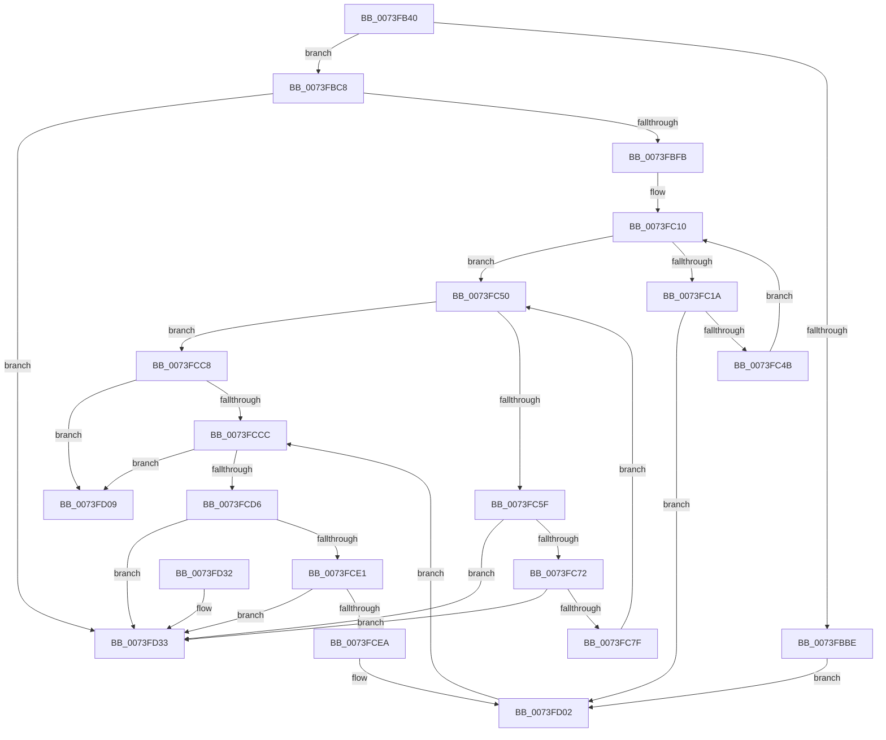

# IopFileUtilWalkDirectoryTreeBottomUp

- RVA: `0x0073FB40`–`0x0073FD3A` (길이 `506` bytes)
- VA: `0x000000014073FB40`
- 실행 섹션: `PAGE`
- PDB 이름 있음: `예`; PDB Function 태그: `아니요`
- unwind 정보 RVA: `0x000C91D4`
- 디코드: `126`개 명령, `506/506` bytes 표시
- 미해석 바이트: `0` (있으면 어셈블리에 `.byte`로 보존)

> 이 문서는 커널 이미지의 기계어와 PDB 기호를 분석해 생성했습니다. 4번과 5번은 함수 원형과 자료형을 바이너리 사용 방식에서 추정한 C 해석이며 원본 소스 복구 결과는 아닙니다.

## 1. Dependencies

- 직접 호출 지점: **7**; 고유 호출 대상: **5**
- 직접 호출자로 확인된 함수: **1**
- RIP 상대 이미지 참조: **2**

### Outgoing calls
- `0x0073FBB1` → [ExAllocatePool2](../../poolcode/B8/ExAllocatePool2_function_00B820F0.md) (function, `0x00B820F0`)
- `0x0073FBE2` → [RtlCopyUnicodeString](../../text/3F/RtlCopyUnicodeString_function_003FEF30.md) (function, `0x003FEF30`)
- `0x0073FC3C` → [IopFileUtilWalkDirectoryTreeHelper](IopFileUtilWalkDirectoryTreeHelper_function_0073FD40.md) (function, `0x0073FD40`)
- `0x0073FCB2` → [IopFileUtilWalkDirectoryTreeHelper](IopFileUtilWalkDirectoryTreeHelper_function_0073FD40.md) (function, `0x0073FD40`)
- `0x0073FCC1` → [ExFreePoolWithTag](../../poolcode/B8/ExFreePoolWithTag_function_00B82870.md) (function, `0x00B82870`)
- `0x0073FCFD` → [ExFreePoolWithTag](../../poolcode/B8/ExFreePoolWithTag_function_00B82870.md) (function, `0x00B82870`)
- `0x0073FD15` → [_security_check_cookie](../../text/6A/_security_check_cookie_function_006AC640.md) (function, `0x006AC640`)

### Direct callers
- [NtEnableLastKnownGood](../83/NtEnableLastKnownGood_function_0083C680.md) at `0x0083C882`
- [NtEnableLastKnownGood](../83/NtEnableLastKnownGood_function_0083C680.md) at `0x0083C8C4`

### Static image references
- `0x0073FB5D` → RVA `0x00E0A740` (`.data`; read)
- `0x0073FC8C` → RVA `0x0072BD10` (`PpLastGoodDeleteFilesCallback`; read)

## 2. Other-region calls and transfers

- 다른 실행 섹션으로 향하는 call: **5**
  - `0x0073FBB1` → [ExAllocatePool2](../../poolcode/B8/ExAllocatePool2_function_00B820F0.md) (`PAGE` → `POOLCODE`)
  - `0x0073FBE2` → [RtlCopyUnicodeString](../../text/3F/RtlCopyUnicodeString_function_003FEF30.md) (`PAGE` → `.text`)
  - `0x0073FCC1` → [ExFreePoolWithTag](../../poolcode/B8/ExFreePoolWithTag_function_00B82870.md) (`PAGE` → `POOLCODE`)
  - `0x0073FCFD` → [ExFreePoolWithTag](../../poolcode/B8/ExFreePoolWithTag_function_00B82870.md) (`PAGE` → `POOLCODE`)
  - `0x0073FD15` → [_security_check_cookie](../../text/6A/_security_check_cookie_function_006AC640.md) (`PAGE` → `.text`)
- 별도 외부 분기/꼬리 이동을 확인하지 못했습니다.

## 3. Assembly (complete function range)

```asm
0073FB40  48 89 5C 24 10                  mov qword ptr [rsp + 0x10], rbx
0073FB45  48 89 74 24 18                  mov qword ptr [rsp + 0x18], rsi
0073FB4A  55                              push rbp
0073FB4B  57                              push rdi
0073FB4C  41 56                           push r14
0073FB4E  48 8D AC 24 90 FC FF FF         lea rbp, [rsp - 0x370]
0073FB56  48 81 EC 70 04 00 00            sub rsp, 0x470
0073FB5D  48 8B 05 DC AB 6C 00            mov rax, qword ptr [rip + 0x6cabdc]
0073FB64  48 33 C4                        xor rax, rsp
0073FB67  48 89 85 60 03 00 00            mov qword ptr [rbp + 0x360], rax
0073FB6E  0F B7 11                        movzx edx, word ptr [rcx]
0073FB71  48 8D 44 24 40                  lea rax, [rsp + 0x40]
0073FB76  48 89 44 24 48                  mov qword ptr [rsp + 0x48], rax
0073FB7B  48 8B F1                        mov rsi, rcx
0073FB7E  48 8D 44 24 40                  lea rax, [rsp + 0x40]
0073FB83  45 33 F6                        xor r14d, r14d
0073FB86  48 89 44 24 40                  mov qword ptr [rsp + 0x40], rax
0073FB8B  48 83 C2 26                     add rdx, 0x26
0073FB8F  48 8D 44 24 50                  lea rax, [rsp + 0x50]
0073FB94  B9 00 01 00 00                  mov ecx, 0x100
0073FB99  48 89 44 24 58                  mov qword ptr [rsp + 0x58], rax
0073FB9E  41 B8 49 6F 46 75               mov r8d, 0x75466f49
0073FBA4  48 8D 44 24 50                  lea rax, [rsp + 0x50]
0073FBA9  41 8B FE                        mov edi, r14d
0073FBAC  48 89 44 24 50                  mov qword ptr [rsp + 0x50], rax
0073FBB1  E8 3A 25 44 00                  call 0x140b820f0
0073FBB6  48 8B D8                        mov rbx, rax
0073FBB9  48 85 C0                        test rax, rax
0073FBBC  75 0A                           jne 0x14073fbc8
0073FBBE  BF 9A 00 00 C0                  mov edi, 0xc000009a
0073FBC3  E9 3A 01 00 00                  jmp 0x14073fd02
0073FBC8  48 8D 48 10                     lea rcx, [rax + 0x10]
0073FBCC  48 8B D6                        mov rdx, rsi
0073FBCF  66 44 89 31                     mov word ptr [rcx], r14w
0073FBD3  0F B7 06                        movzx eax, word ptr [rsi]
0073FBD6  66 89 43 12                     mov word ptr [rbx + 0x12], ax
0073FBDA  48 8D 43 20                     lea rax, [rbx + 0x20]
0073FBDE  48 89 43 18                     mov qword ptr [rbx + 0x18], rax
0073FBE2  E8 49 F3 CB FF                  call 0x1403fef30
0073FBE7  48 8B 44 24 40                  mov rax, qword ptr [rsp + 0x40]
0073FBEC  48 8D 4C 24 40                  lea rcx, [rsp + 0x40]
0073FBF1  48 39 48 08                     cmp qword ptr [rax + 8], rcx
0073FBF5  0F 85 38 01 00 00               jne 0x14073fd33
0073FBFB  48 89 03                        mov qword ptr [rbx], rax
0073FBFE  48 8D 4C 24 40                  lea rcx, [rsp + 0x40]
0073FC03  48 89 4B 08                     mov qword ptr [rbx + 8], rcx
0073FC07  48 89 58 08                     mov qword ptr [rax + 8], rbx
0073FC0B  48 89 5C 24 40                  mov qword ptr [rsp + 0x40], rbx
0073FC10  48 8D 44 24 40                  lea rax, [rsp + 0x40]
0073FC15  48 3B D8                        cmp rbx, rax
0073FC18  74 36                           je 0x14073fc50
0073FC1A  45 33 C9                        xor r9d, r9d
0073FC1D  48 8D 44 24 40                  lea rax, [rsp + 0x40]
0073FC22  48 89 44 24 30                  mov qword ptr [rsp + 0x30], rax
0073FC27  48 8D 4B 10                     lea rcx, [rbx + 0x10]
0073FC2B  48 8D 44 24 60                  lea rax, [rsp + 0x60]
0073FC30  45 33 C0                        xor r8d, r8d
0073FC33  48 89 44 24 20                  mov qword ptr [rsp + 0x20], rax
0073FC38  41 8D 51 08                     lea edx, [r9 + 8]
0073FC3C  E8 FF 00 00 00                  call 0x14073fd40
0073FC41  8B F8                           mov edi, eax
0073FC43  85 C0                           test eax, eax
0073FC45  0F 88 B7 00 00 00               js 0x14073fd02
0073FC4B  48 8B 1B                        mov rbx, qword ptr [rbx]
0073FC4E  EB C0                           jmp 0x14073fc10
0073FC50  48 8B 4C 24 40                  mov rcx, qword ptr [rsp + 0x40]
0073FC55  48 8D 44 24 40                  lea rax, [rsp + 0x40]
0073FC5A  48 3B C8                        cmp rcx, rax
0073FC5D  74 69                           je 0x14073fcc8
0073FC5F  48 8B 5C 24 48                  mov rbx, qword ptr [rsp + 0x48]
0073FC64  48 8D 44 24 40                  lea rax, [rsp + 0x40]
0073FC69  48 39 03                        cmp qword ptr [rbx], rax
0073FC6C  0F 85 C1 00 00 00               jne 0x14073fd33
0073FC72  48 8B 43 08                     mov rax, qword ptr [rbx + 8]
0073FC76  48 39 18                        cmp qword ptr [rax], rbx
0073FC79  0F 85 B4 00 00 00               jne 0x14073fd33
0073FC7F  48 89 44 24 48                  mov qword ptr [rsp + 0x48], rax
0073FC84  48 8D 4C 24 40                  lea rcx, [rsp + 0x40]
0073FC89  48 89 08                        mov qword ptr [rax], rcx
0073FC8C  4C 8D 05 7D C0 FE FF            lea r8, [rip - 0x13f83]
0073FC93  45 33 C9                        xor r9d, r9d
0073FC96  48 8D 44 24 50                  lea rax, [rsp + 0x50]
0073FC9B  48 89 44 24 30                  mov qword ptr [rsp + 0x30], rax
0073FCA0  48 8D 4B 10                     lea rcx, [rbx + 0x10]
0073FCA4  48 8D 44 24 60                  lea rax, [rsp + 0x60]
0073FCA9  48 89 44 24 20                  mov qword ptr [rsp + 0x20], rax
0073FCAE  41 8D 51 07                     lea edx, [r9 + 7]
0073FCB2  E8 89 00 00 00                  call 0x14073fd40
0073FCB7  BA 49 6F 46 75                  mov edx, 0x75466f49
0073FCBC  48 8B CB                        mov rcx, rbx
0073FCBF  8B F8                           mov edi, eax
0073FCC1  E8 AA 2B 44 00                  call 0x140b82870
0073FCC6  EB 88                           jmp 0x14073fc50
0073FCC8  85 FF                           test edi, edi
0073FCCA  79 3D                           jns 0x14073fd09
0073FCCC  48 8D 44 24 40                  lea rax, [rsp + 0x40]
0073FCD1  48 3B C8                        cmp rcx, rax
0073FCD4  74 33                           je 0x14073fd09
0073FCD6  48 8D 44 24 40                  lea rax, [rsp + 0x40]
0073FCDB  48 39 41 08                     cmp qword ptr [rcx + 8], rax
0073FCDF  75 52                           jne 0x14073fd33
0073FCE1  48 8B 01                        mov rax, qword ptr [rcx]
0073FCE4  48 39 48 08                     cmp qword ptr [rax + 8], rcx
0073FCE8  75 49                           jne 0x14073fd33
0073FCEA  48 8D 54 24 40                  lea rdx, [rsp + 0x40]
0073FCEF  48 89 44 24 40                  mov qword ptr [rsp + 0x40], rax
0073FCF4  48 89 50 08                     mov qword ptr [rax + 8], rdx
0073FCF8  BA 49 6F 46 75                  mov edx, 0x75466f49
0073FCFD  E8 6E 2B 44 00                  call 0x140b82870
0073FD02  48 8B 4C 24 40                  mov rcx, qword ptr [rsp + 0x40]
0073FD07  EB C3                           jmp 0x14073fccc
0073FD09  8B C7                           mov eax, edi
0073FD0B  48 8B 8D 60 03 00 00            mov rcx, qword ptr [rbp + 0x360]
0073FD12  48 33 CC                        xor rcx, rsp
0073FD15  E8 26 C9 F6 FF                  call 0x1406ac640
0073FD1A  4C 8D 9C 24 70 04 00 00         lea r11, [rsp + 0x470]
0073FD22  49 8B 5B 28                     mov rbx, qword ptr [r11 + 0x28]
0073FD26  49 8B 73 30                     mov rsi, qword ptr [r11 + 0x30]
0073FD2A  49 8B E3                        mov rsp, r11
0073FD2D  41 5E                           pop r14
0073FD2F  5F                              pop rdi
0073FD30  5D                              pop rbp
0073FD31  C3                              ret
0073FD32  CC                              int3
0073FD33  B9 03 00 00 00                  mov ecx, 3
0073FD38  CD 29                           int 0x29
```

## 4. C-style interpretation (structured pseudocode)

```c
__int64 __fastcall IopFileUtilWalkDirectoryTreeBottomUp(__int64 a1, __int64 a2, __int64 a3, int a4)
{
    __int64 result;
    __int64 v_r14;
    __int64 v_rsp;
    unsigned __int64 v_stack_m18;
    unsigned __int64 v_stack_m28;
    unsigned __int64 v_stack_m388;
    unsigned __int64 v_stack_m428;
    unsigned __int64 v_stack_m430;
    unsigned __int64 v_stack_m438;
    unsigned __int64 v_stack_m440;
    unsigned __int64 v_stack_m448;
    unsigned __int64 v_stack_m458;
    unsigned __int64 v_stack_m468;
    unsigned __int64 v_stack_p10;
    unsigned __int64 v_stack_p18;

    v_stack_p10 = v_rbx;
    v_stack_p18 = v_rsi;
    v_rsp = (v_rsp) - (0x470ULL);
    result = (*(unsigned __int64 *)(v_rip + 7121884)) ^ (v_rsp);
    v_stack_m28 = result;
    v_stack_m440 = v_stack_m448;
    v_r14 = 0;
    v_stack_m448 = v_stack_m448;
    a2 = (*(unsigned __int16 *)(a1)) + (38);
    v_stack_m430 = v_stack_m438;
    v_stack_m438 = v_stack_m438;
    result = ExAllocatePool2(256, a2, (unsigned int)(0x75466F49ULL), a4);
    if (result != 0) goto loc_0073FBC8;
    goto loc_0073FD02;
loc_0073FBC8:
    *(unsigned __int16 *)(result + 16) = 0;
    *(unsigned __int16 *)(result + 18) = (unsigned __int16)(*(unsigned __int16 *)(a1));
    *(unsigned __int64 *)(result + 24) = result + 32;
    result = RtlCopyUnicodeString(result + 16, a1, (unsigned int)(0x75466F49ULL), a4);
    if ((*(unsigned __int64 *)(v_stack_m448 + 8)) != v_stack_m448) goto loc_0073FD33;
    *(unsigned __int64 *)(result) = v_stack_m448;
    *(unsigned __int64 *)(result + 8) = v_stack_m448;
    *(unsigned __int64 *)(v_stack_m448 + 8) = result;
    v_stack_m448 = result;
loc_0073FC10:
    if (result == v_stack_m448) goto loc_0073FC50;
    a4 = 0;
    v_stack_m458 = v_stack_m448;
    a3 = 0;
    v_stack_m468 = v_stack_m428;
    result = IopFileUtilWalkDirectoryTreeHelper(result + 16, a4 + 8, a3, a4);
    if (sign_flag) goto loc_0073FD02;
    goto loc_0073FC10;
loc_0073FC50:
    if (v_stack_m448 == v_stack_m448) goto loc_0073FCC8;
    if ((*(unsigned __int64 *)(v_stack_m440)) != v_stack_m448) goto loc_0073FD33;
    if ((*(unsigned __int64 *)(*(unsigned __int64 *)(v_stack_m440 + 8))) != v_stack_m440) goto loc_0073FD33;
    v_stack_m440 = *(unsigned __int64 *)(v_stack_m440 + 8);
    *(unsigned __int64 *)(*(unsigned __int64 *)(v_stack_m440 + 8)) = v_stack_m448;
    a4 = 0;
    v_stack_m458 = v_stack_m438;
    v_stack_m468 = v_stack_m428;
    result = IopFileUtilWalkDirectoryTreeHelper(v_stack_m440 + 16, a4 + 7, v_rip - 81795, a4);
    result = ExFreePoolWithTag(v_stack_m440, (unsigned int)(0x75466F49ULL), v_rip - 81795, a4);
    goto loc_0073FC50;
loc_0073FCC8:
    if (!sign_flag) goto loc_0073FD09;
loc_0073FCCC:
    if (v_stack_m440 == v_stack_m448) goto loc_0073FD09;
    if ((*(unsigned __int64 *)(v_stack_m440 + 8)) != v_stack_m448) goto loc_0073FD33;
    if ((*(unsigned __int64 *)(*(unsigned __int64 *)(v_stack_m440) + 8)) != v_stack_m440) goto loc_0073FD33;
    v_stack_m448 = *(unsigned __int64 *)(v_stack_m440);
    *(unsigned __int64 *)(*(unsigned __int64 *)(v_stack_m440) + 8) = v_stack_m448;
    result = ExFreePoolWithTag(v_stack_m440, (unsigned int)(0x75466F49ULL), v_rip - 81795, a4);
loc_0073FD02:
    goto loc_0073FCCC;
loc_0073FD09:
    a1 = (v_stack_m28) ^ (v_rsp);
    result = _security_check_cookie(a1, (unsigned int)(0x75466F49ULL), v_rip - 81795, a4);
    return result;
loc_0073FD33:
    return result;
}
```

## 5. (Beta) C Style

```c
int64_t IopFileUtilWalkDirectoryTreeBottomUp(void *Arg1, int64_t Arg2, int64_t Arg3, int32_t Arg4)
{
    uint8_t *arg1 = (uint8_t *)Arg1;

    int64_t result;
    int64_t local_r14;
    int64_t local_rsp;
    uint64_t v_stack_m18;
    uint64_t v_stack_m28;
    uint64_t v_stack_m388;
    uint64_t v_stack_m428;
    uint64_t v_stack_m430;
    uint64_t v_stack_m438;
    uint64_t v_stack_m440;
    uint64_t v_stack_m448;
    uint64_t v_stack_m458;
    uint64_t v_stack_m468;
    uint64_t v_stack_p10;
    uint64_t v_stack_p18;

    v_stack_p10 = local_rbx;
    v_stack_p18 = local_rsi;
    local_rsp = (local_rsp) - (0x470ULL);
    result = (*(uint64_t *)(v_rip + 0x6CABDC)) ^ (local_rsp);
    v_stack_m28 = result;
    v_stack_m440 = v_stack_m448;
    local_r14 = 0;
    v_stack_m448 = v_stack_m448;
    Arg2 = (*(uint16_t *)(arg1)) + (38);
    v_stack_m430 = v_stack_m438;
    v_stack_m438 = v_stack_m438;
    result = ExAllocatePool2(256, Arg2, (uint32_t)(0x75466F49ULL), Arg4);
    if (result != 0) goto loc_0073FBC8;
    goto loc_0073FD02;
loc_0073FBC8:
    *(uint16_t *)(result + 0x10) = 0;
    *(uint16_t *)(result + 0x12) = (uint16_t)(*(uint16_t *)(arg1));
    *(uint64_t *)(result + 0x18) = result + 32;
    result = RtlCopyUnicodeString(result + 16, Arg1, (uint32_t)(0x75466F49ULL), Arg4);
    if ((*(uint64_t *)(v_stack_m448 + 0x8)) != v_stack_m448) goto loc_0073FD33;
    *(uint64_t *)(result) = v_stack_m448;
    *(uint64_t *)(result + 0x8) = v_stack_m448;
    *(uint64_t *)(v_stack_m448 + 0x8) = result;
    v_stack_m448 = result;
loc_0073FC10:
    if (result == v_stack_m448) goto loc_0073FC50;
    Arg4 = 0;
    v_stack_m458 = v_stack_m448;
    Arg3 = 0;
    v_stack_m468 = v_stack_m428;
    result = IopFileUtilWalkDirectoryTreeHelper(result + 16, Arg4 + 8, Arg3, Arg4);
    if (sign_flag) goto loc_0073FD02;
    goto loc_0073FC10;
loc_0073FC50:
    if (v_stack_m448 == v_stack_m448) goto loc_0073FCC8;
    if ((*(uint64_t *)(v_stack_m440)) != v_stack_m448) goto loc_0073FD33;
    if ((*(uint64_t *)(*(uint64_t *)(v_stack_m440 + 0x8))) != v_stack_m440) goto loc_0073FD33;
    v_stack_m440 = *(uint64_t *)(v_stack_m440 + 0x8);
    *(uint64_t *)(*(uint64_t *)(v_stack_m440 + 0x8)) = v_stack_m448;
    Arg4 = 0;
    v_stack_m458 = v_stack_m438;
    v_stack_m468 = v_stack_m428;
    result = IopFileUtilWalkDirectoryTreeHelper(v_stack_m440 + 16, Arg4 + 7, v_rip - 81795, Arg4);
    result = ExFreePoolWithTag(v_stack_m440, (uint32_t)(0x75466F49ULL), v_rip - 81795, Arg4);
    goto loc_0073FC50;
loc_0073FCC8:
    if (!sign_flag) goto loc_0073FD09;
loc_0073FCCC:
    if (v_stack_m440 == v_stack_m448) goto loc_0073FD09;
    if ((*(uint64_t *)(v_stack_m440 + 0x8)) != v_stack_m448) goto loc_0073FD33;
    if ((*(uint64_t *)(*(uint64_t *)(v_stack_m440) + 0x8)) != v_stack_m440) goto loc_0073FD33;
    v_stack_m448 = *(uint64_t *)(v_stack_m440);
    *(uint64_t *)(*(uint64_t *)(v_stack_m440) + 0x8) = v_stack_m448;
    result = ExFreePoolWithTag(v_stack_m440, (uint32_t)(0x75466F49ULL), v_rip - 81795, Arg4);
loc_0073FD02:
    goto loc_0073FCCC;
loc_0073FD09:
    Arg1 = (v_stack_m28) ^ (local_rsp);
    result = _security_check_cookie(Arg1, (uint32_t)(0x75466F49ULL), v_rip - 81795, Arg4);
    return result;
loc_0073FD33:
    return result;
}
```

### 관측된 메모리 오프셋

구조체 형식이 확인되지 않은 접근은 인자 기준의 오프셋으로만 기록했습니다.

| 기준 인자 | 오프셋 표현 | 폭 (bit) | 접근 |
|---|---:|---:|---|
| `Arg1` | `+ 0x0` | `16` | `R` |

## 6. Execution-region graph

[열기: 2D/3D 그래프와 함수 탐색 컨트롤 패널](../../../control-panel.html?section=page&rva=0x0073FB40&view=graph)

- 2D 그래프는 위에서 아래로 흐르고, 3D 그래프는 빈 공간을 드래그해 회전합니다. Shift+드래그는 이동, 휠은 확대·축소, 함수 노드 선택은 대상 보고서 이동입니다.

### Static fallback


