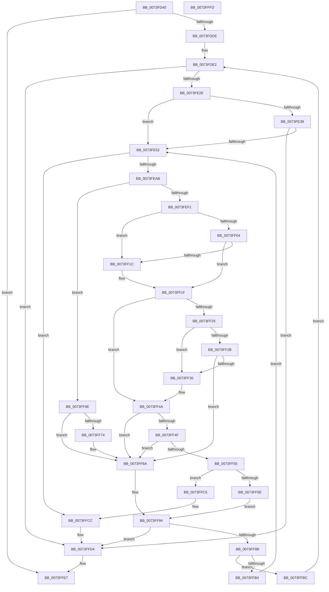

# IopFileUtilWalkDirectoryTreeHelper

- RVA: `0x0073FD40`–`0x0073FFFE` (길이 `702` bytes)
- VA: `0x000000014073FD40`
- 실행 섹션: `PAGE`
- PDB 이름 있음: `예`; PDB Function 태그: `아니요`
- unwind 정보 RVA: `0x000C91B8`
- 디코드: `193`개 명령, `702/702` bytes 표시
- 미해석 바이트: `0` (있으면 어셈블리에 `.byte`로 보존)

> 이 문서는 커널 이미지의 기계어와 PDB 기호를 분석해 생성했습니다. 4번과 5번은 함수 원형과 자료형을 바이너리 사용 방식에서 추정한 C 해석이며 원본 소스 복구 결과는 아닙니다.

## 1. Dependencies

- 직접 호출 지점: **14**; 고유 호출 대상: **12**
- 직접 호출자로 확인된 함수: **2**
- RIP 상대 이미지 참조: **3**

### Outgoing calls
- `0x0073FDCF` → [ZwOpenFile](../../text/6A/ZwOpenFile_function_006AD730.md) (function, `0x006AD730`)
- `0x0073FE1F` → [ZwQueryDirectoryFile](../../text/6A/ZwQueryDirectoryFile_function_006AD770.md) (function, `0x006AD770`)
- `0x0073FE42` → [ZwWaitForSingleObject](../../text/6A/ZwWaitForSingleObject_function_006AD150.md) (function, `0x006AD150`)
- `0x0073FE72` → [RtlInitUnicodeString](../../text/42/RtlInitUnicodeString_function_0042A780.md) (function, `0x0042A780`)
- `0x0073FE98` → [ExAllocatePool2](../../poolcode/B8/ExAllocatePool2_function_00B820F0.md) (function, `0x00B820F0`)
- `0x0073FEC7` → [RtlCopyUnicodeString](../../text/3F/RtlCopyUnicodeString_function_003FEF30.md) (function, `0x003FEF30`)
- `0x0073FED6` → [RtlAppendUnicodeToString](../../text/40/RtlAppendUnicodeToString_function_0040F990.md) (function, `0x0040F990`)
- `0x0073FEE2` → [RtlAppendUnicodeStringToString](../../text/40/RtlAppendUnicodeStringToString_function_0040FA50.md) (function, `0x0040FA50`)
- `0x0073FEFB` → [wcsicmp](../../text/50/wcsicmp_function_00500080.md) (function, `0x00500080`)
- `0x0073FF0E` → [wcsicmp](../../text/50/wcsicmp_function_00500080.md) (function, `0x00500080`)
- `0x0073FF43` → [guard_dispatch_icall](../../text/6B/guard_dispatch_icall_function_006BAAD0.md) (function, `0x006BAAD0`)
- `0x0073FF83` → [guard_dispatch_icall](../../text/6B/guard_dispatch_icall_function_006BAAD0.md) (function, `0x006BAAD0`)
- `0x0073FF8F` → [ExFreePoolWithTag](../../poolcode/B8/ExFreePoolWithTag_function_00B82870.md) (function, `0x00B82870`)
- `0x0073FFD8` → [ZwClose](../../text/6A/ZwClose_function_006AD2B0.md) (function, `0x006AD2B0`)

### Direct callers
- [IopFileUtilWalkDirectoryTreeBottomUp](IopFileUtilWalkDirectoryTreeBottomUp_function_0073FB40.md) at `0x0073FC3C`
- [IopFileUtilWalkDirectoryTreeBottomUp](IopFileUtilWalkDirectoryTreeBottomUp_function_0073FB40.md) at `0x0073FCB2`
- [IopFileUtilWalkDirectoryTreeTopDown](../../init/C3/IopFileUtilWalkDirectoryTreeTopDown_function_00C36760.md) at `0x00C367BF`
- [IopFileUtilWalkDirectoryTreeTopDown](../../init/C3/IopFileUtilWalkDirectoryTreeTopDown_function_00C36760.md) at `0x00C3682A`

### Static image references
- `0x0073FECC` → RVA `0x00AFC990` (` ?? ::NNGAKEGL::`string'`; read)
- `0x0073FEF1` → RVA `0x00B00260` (` ?? ::NNGAKEGL::`string'`; read)
- `0x0073FF04` → RVA `0x00B00270` (` ?? ::NNGAKEGL::`string'`; read)

## 2. Other-region calls and transfers

- 다른 실행 섹션으로 향하는 call: **14**
  - `0x0073FDCF` → [ZwOpenFile](../../text/6A/ZwOpenFile_function_006AD730.md) (`PAGE` → `.text`)
  - `0x0073FE1F` → [ZwQueryDirectoryFile](../../text/6A/ZwQueryDirectoryFile_function_006AD770.md) (`PAGE` → `.text`)
  - `0x0073FE42` → [ZwWaitForSingleObject](../../text/6A/ZwWaitForSingleObject_function_006AD150.md) (`PAGE` → `.text`)
  - `0x0073FE72` → [RtlInitUnicodeString](../../text/42/RtlInitUnicodeString_function_0042A780.md) (`PAGE` → `.text`)
  - `0x0073FE98` → [ExAllocatePool2](../../poolcode/B8/ExAllocatePool2_function_00B820F0.md) (`PAGE` → `POOLCODE`)
  - `0x0073FEC7` → [RtlCopyUnicodeString](../../text/3F/RtlCopyUnicodeString_function_003FEF30.md) (`PAGE` → `.text`)
  - `0x0073FED6` → [RtlAppendUnicodeToString](../../text/40/RtlAppendUnicodeToString_function_0040F990.md) (`PAGE` → `.text`)
  - `0x0073FEE2` → [RtlAppendUnicodeStringToString](../../text/40/RtlAppendUnicodeStringToString_function_0040FA50.md) (`PAGE` → `.text`)
  - `0x0073FEFB` → [wcsicmp](../../text/50/wcsicmp_function_00500080.md) (`PAGE` → `.text`)
  - `0x0073FF0E` → [wcsicmp](../../text/50/wcsicmp_function_00500080.md) (`PAGE` → `.text`)
  - `0x0073FF43` → [guard_dispatch_icall](../../text/6B/guard_dispatch_icall_function_006BAAD0.md) (`PAGE` → `.text`)
  - `0x0073FF83` → [guard_dispatch_icall](../../text/6B/guard_dispatch_icall_function_006BAAD0.md) (`PAGE` → `.text`)
  - `0x0073FF8F` → [ExFreePoolWithTag](../../poolcode/B8/ExFreePoolWithTag_function_00B82870.md) (`PAGE` → `POOLCODE`)
  - `0x0073FFD8` → [ZwClose](../../text/6A/ZwClose_function_006AD2B0.md) (`PAGE` → `.text`)
- 별도 외부 분기/꼬리 이동을 확인하지 못했습니다.

## 3. Assembly (complete function range)

```asm
0073FD40  48 8B C4                        mov rax, rsp
0073FD43  4C 89 48 20                     mov qword ptr [rax + 0x20], r9
0073FD47  4C 89 40 18                     mov qword ptr [rax + 0x18], r8
0073FD4B  48 89 48 08                     mov qword ptr [rax + 8], rcx
0073FD4F  55                              push rbp
0073FD50  53                              push rbx
0073FD51  56                              push rsi
0073FD52  57                              push rdi
0073FD53  41 54                           push r12
0073FD55  41 55                           push r13
0073FD57  41 56                           push r14
0073FD59  41 57                           push r15
0073FD5B  48 8D 68 B9                     lea rbp, [rax - 0x47]
0073FD5F  48 81 EC C8 00 00 00            sub rsp, 0xc8
0073FD66  8B C2                           mov eax, edx
0073FD68  48 89 4D D7                     mov qword ptr [rbp - 0x29], rcx
0073FD6C  C1 E0 11                        shl eax, 0x11
0073FD6F  4C 8D 4D B7                     lea r9, [rbp - 0x49]
0073FD73  F7 D0                           not eax
0073FD75  48 C7 45 C7 30 00 00 00         mov qword ptr [rbp - 0x39], 0x30
0073FD7D  0F 57 C0                        xorps xmm0, xmm0
0073FD80  48 C7 45 DF 40 02 00 00         mov qword ptr [rbp - 0x21], 0x240
0073FD88  25 00 00 20 00                  and eax, 0x200000
0073FD8D  4C 8D 45 C7                     lea r8, [rbp - 0x39]
0073FD91  0D 01 40 00 00                  or eax, 0x4001
0073FD96  44 8B EA                        mov r13d, edx
0073FD99  48 8B F1                        mov rsi, rcx
0073FD9C  89 44 24 28                     mov dword ptr [rsp + 0x28], eax
0073FDA0  45 33 F6                        xor r14d, r14d
0073FDA3  C7 44 24 20 01 00 00 00         mov dword ptr [rsp + 0x20], 1
0073FDAB  0F 57 C9                        xorps xmm1, xmm1
0073FDAE  4C 89 75 9F                     mov qword ptr [rbp - 0x61], r14
0073FDB2  BA 01 00 10 00                  mov edx, 0x100001
0073FDB7  4C 89 75 CF                     mov qword ptr [rbp - 0x31], r14
0073FDBB  48 8D 4D 9F                     lea rcx, [rbp - 0x61]
0073FDBF  40 B7 01                        mov dil, 1
0073FDC2  0F 11 45 B7                     movups xmmword ptr [rbp - 0x49], xmm0
0073FDC6  0F 11 4D A7                     movups xmmword ptr [rbp - 0x59], xmm1
0073FDCA  F3 0F 7F 45 E7                  movdqu xmmword ptr [rbp - 0x19], xmm0
0073FDCF  E8 5C D9 F6 FF                  call 0x1406ad730
0073FDD4  8B D8                           mov ebx, eax
0073FDD6  85 C0                           test eax, eax
0073FDD8  0F 88 09 02 00 00               js 0x14073ffe7
0073FDDE  4C 8B 7D 7F                     mov r15, qword ptr [rbp + 0x7f]
0073FDE2  48 8B 4D 9F                     mov rcx, qword ptr [rbp - 0x61]
0073FDE6  48 8D 45 B7                     lea rax, [rbp - 0x49]
0073FDEA  40 88 7C 24 50                  mov byte ptr [rsp + 0x50], dil
0073FDEF  45 33 C9                        xor r9d, r9d
0073FDF2  48 8B 7D 6F                     mov rdi, qword ptr [rbp + 0x6f]
0073FDF6  45 33 C0                        xor r8d, r8d
0073FDF9  4C 89 74 24 48                  mov qword ptr [rsp + 0x48], r14
0073FDFE  33 D2                           xor edx, edx
0073FE00  44 88 74 24 40                  mov byte ptr [rsp + 0x40], r14b
0073FE05  C7 44 24 38 03 00 00 00         mov dword ptr [rsp + 0x38], 3
0073FE0D  C7 44 24 30 FE 03 00 00         mov dword ptr [rsp + 0x30], 0x3fe
0073FE15  48 89 7C 24 28                  mov qword ptr [rsp + 0x28], rdi
0073FE1A  48 89 44 24 20                  mov qword ptr [rsp + 0x20], rax
0073FE1F  E8 4C D9 F6 FF                  call 0x1406ad770
0073FE24  8B D8                           mov ebx, eax
0073FE26  85 C0                           test eax, eax
0073FE28  0F 88 A6 01 00 00               js 0x14073ffd4
0073FE2E  44 88 75 57                     mov byte ptr [rbp + 0x57], r14b
0073FE32  3D 03 01 00 00                  cmp eax, 0x103
0073FE37  75 19                           jne 0x14073fe52
0073FE39  48 8B 4D 9F                     mov rcx, qword ptr [rbp - 0x61]
0073FE3D  45 33 C0                        xor r8d, r8d
0073FE40  B2 01                           mov dl, 1
0073FE42  E8 09 D3 F6 FF                  call 0x1406ad150
0073FE47  8B 5D B7                        mov ebx, dword ptr [rbp - 0x49]
0073FE4A  85 DB                           test ebx, ebx
0073FE4C  0F 88 82 01 00 00               js 0x14073ffd4
0073FE52  8B 47 3C                        mov eax, dword ptr [rdi + 0x3c]
0073FE55  48 D1 E8                        shr rax, 1
0073FE58  0F B7 4C 47 5E                  movzx ecx, word ptr [rdi + rax*2 + 0x5e]
0073FE5D  66 44 89 74 47 5E               mov word ptr [rdi + rax*2 + 0x5e], r14w
0073FE63  4C 8D 77 5E                     lea r14, [rdi + 0x5e]
0073FE67  66 89 4D 77                     mov word ptr [rbp + 0x77], cx
0073FE6B  49 8B D6                        mov rdx, r14
0073FE6E  48 8D 4D A7                     lea rcx, [rbp - 0x59]
0073FE72  E8 09 A9 CE FF                  call 0x14042a780
0073FE77  44 0F B7 65 A7                  movzx r12d, word ptr [rbp - 0x59]
0073FE7C  B9 00 01 00 00                  mov ecx, 0x100
0073FE81  66 41 83 C4 02                  add r12w, 2
0073FE86  41 B8 49 6F 46 75               mov r8d, 0x75466f49
0073FE8C  66 44 03 26                     add r12w, word ptr [rsi]
0073FE90  41 0F B7 D4                     movzx edx, r12w
0073FE94  48 83 C2 26                     add rdx, 0x26
0073FE98  E8 53 22 44 00                  call 0x140b820f0
0073FE9D  48 8B F0                        mov rsi, rax
0073FEA0  33 C0                           xor eax, eax
0073FEA2  48 85 F6                        test rsi, rsi
0073FEA5  0F 84 21 01 00 00               je 0x14073ffcc
0073FEAB  48 8B 55 4F                     mov rdx, qword ptr [rbp + 0x4f]
0073FEAF  48 8D 4E 20                     lea rcx, [rsi + 0x20]
0073FEB3  66 44 89 66 12                  mov word ptr [rsi + 0x12], r12w
0073FEB8  4C 8D 66 10                     lea r12, [rsi + 0x10]
0073FEBC  48 89 4E 18                     mov qword ptr [rsi + 0x18], rcx
0073FEC0  49 8B CC                        mov rcx, r12
0073FEC3  66 89 46 10                     mov word ptr [rsi + 0x10], ax
0073FEC7  E8 64 F0 CB FF                  call 0x1403fef30
0073FECC  48 8D 15 BD CA 3B 00            lea rdx, [rip + 0x3bcabd]
0073FED3  49 8B CC                        mov rcx, r12
0073FED6  E8 B5 FA CC FF                  call 0x14040f990
0073FEDB  48 8D 55 A7                     lea rdx, [rbp - 0x59]
0073FEDF  49 8B CC                        mov rcx, r12
0073FEE2  E8 69 FB CC FF                  call 0x14040fa50
0073FEE7  44 8B 47 38                     mov r8d, dword ptr [rdi + 0x38]
0073FEEB  41 F6 C0 10                     test r8b, 0x10
0073FEEF  74 7D                           je 0x14073ff6e
0073FEF1  48 8D 15 68 03 3C 00            lea rdx, [rip + 0x3c0368]
0073FEF8  49 8B CE                        mov rcx, r14
0073FEFB  E8 80 01 DC FF                  call 0x140500080
0073FF00  85 C0                           test eax, eax
0073FF02  74 18                           je 0x14073ff1c
0073FF04  48 8D 15 65 03 3C 00            lea rdx, [rip + 0x3c0365]
0073FF0B  49 8B CE                        mov rcx, r14
0073FF0E  E8 6D 01 DC FF                  call 0x140500080
0073FF13  33 C9                           xor ecx, ecx
0073FF15  44 8A F1                        mov r14b, cl
0073FF18  85 C0                           test eax, eax
0073FF1A  75 03                           jne 0x14073ff1f
0073FF1C  41 B6 01                        mov r14b, 1
0073FF1F  41 F6 C5 02                     test r13b, 2
0073FF23  74 25                           je 0x14073ff4a
0073FF25  41 F6 C5 04                     test r13b, 4
0073FF29  74 05                           je 0x14073ff30
0073FF2B  45 84 F6                        test r14b, r14b
0073FF2E  75 5A                           jne 0x14073ff8a
0073FF30  4C 8B 4D 67                     mov r9, qword ptr [rbp + 0x67]
0073FF34  48 8D 55 A7                     lea rdx, [rbp - 0x59]
0073FF38  44 8B 47 38                     mov r8d, dword ptr [rdi + 0x38]
0073FF3C  49 8B CC                        mov rcx, r12
0073FF3F  48 8B 45 5F                     mov rax, qword ptr [rbp + 0x5f]
0073FF43  E8 88 AB F7 FF                  call 0x1406baad0
0073FF48  8B D8                           mov ebx, eax
0073FF4A  45 84 F6                        test r14b, r14b
0073FF4D  75 3B                           jne 0x14073ff8a
0073FF4F  41 F6 C5 08                     test r13b, 8
0073FF53  74 35                           je 0x14073ff8a
0073FF55  49 8B 47 08                     mov rax, qword ptr [r15 + 8]
0073FF59  4C 39 38                        cmp qword ptr [rax], r15
0073FF5C  75 67                           jne 0x14073ffc5
0073FF5E  4C 89 3E                        mov qword ptr [rsi], r15
0073FF61  48 89 46 08                     mov qword ptr [rsi + 8], rax
0073FF65  48 89 30                        mov qword ptr [rax], rsi
0073FF68  49 89 77 08                     mov qword ptr [r15 + 8], rsi
0073FF6C  EB 26                           jmp 0x14073ff94
0073FF6E  41 F6 C5 01                     test r13b, 1
0073FF72  74 16                           je 0x14073ff8a
0073FF74  4C 8B 4D 67                     mov r9, qword ptr [rbp + 0x67]
0073FF78  48 8D 55 A7                     lea rdx, [rbp - 0x59]
0073FF7C  48 8B 45 5F                     mov rax, qword ptr [rbp + 0x5f]
0073FF80  49 8B CC                        mov rcx, r12
0073FF83  E8 48 AB F7 FF                  call 0x1406baad0
0073FF88  8B D8                           mov ebx, eax
0073FF8A  33 D2                           xor edx, edx
0073FF8C  48 8B CE                        mov rcx, rsi
0073FF8F  E8 DC 28 44 00                  call 0x140b82870
0073FF94  45 33 F6                        xor r14d, r14d
0073FF97  85 DB                           test ebx, ebx
0073FF99  78 39                           js 0x14073ffd4
0073FF9B  8B 47 3C                        mov eax, dword ptr [rdi + 0x3c]
0073FF9E  0F B7 4D 77                     movzx ecx, word ptr [rbp + 0x77]
0073FFA2  48 8B 75 4F                     mov rsi, qword ptr [rbp + 0x4f]
0073FFA6  48 D1 E8                        shr rax, 1
0073FFA9  66 89 4C 47 5E                  mov word ptr [rdi + rax*2 + 0x5e], cx
0073FFAE  8B 07                           mov eax, dword ptr [rdi]
0073FFB0  85 C0                           test eax, eax
0073FFB2  74 08                           je 0x14073ffbc
0073FFB4  48 03 F8                        add rdi, rax
0073FFB7  E9 96 FE FF FF                  jmp 0x14073fe52
0073FFBC  40 8A 7D 57                     mov dil, byte ptr [rbp + 0x57]
0073FFC0  E9 1D FE FF FF                  jmp 0x14073fde2
0073FFC5  B9 03 00 00 00                  mov ecx, 3
0073FFCA  CD 29                           int 0x29
0073FFCC  BB 9A 00 00 C0                  mov ebx, 0xc000009a
0073FFD1  45 33 F6                        xor r14d, r14d
0073FFD4  48 8B 4D 9F                     mov rcx, qword ptr [rbp - 0x61]
0073FFD8  E8 D3 D2 F6 FF                  call 0x1406ad2b0
0073FFDD  81 FB 06 00 00 80               cmp ebx, 0x80000006
0073FFE3  41 0F 44 DE                     cmove ebx, r14d
0073FFE7  8B C3                           mov eax, ebx
0073FFE9  48 81 C4 C8 00 00 00            add rsp, 0xc8
0073FFF0  41 5F                           pop r15
0073FFF2  41 5E                           pop r14
0073FFF4  41 5D                           pop r13
0073FFF6  41 5C                           pop r12
0073FFF8  5F                              pop rdi
0073FFF9  5E                              pop rsi
0073FFFA  5B                              pop rbx
0073FFFB  5D                              pop rbp
0073FFFC  C3                              ret
0073FFFD  CC                              int3
```

## 4. C-style interpretation (structured pseudocode)

```c
__int64 __fastcall IopFileUtilWalkDirectoryTreeHelper(__int64 a1, int a2, __int64 a3, __int64 a4)
{
    __int64 result;
    __int64 v_r12;
    __int64 v_r14;
    __int64 v_rbx;
    __int64 v_rdi;
    __int64 v_rsp;
    unsigned __int8 v_stack_mB8;
    unsigned __int64 v_stack_mC0;
    unsigned __int8 v_stack_mC8;
    unsigned int v_stack_mD0;
    unsigned int v_stack_mD8;
    unsigned int v_stack_mE0;
    unsigned int v_stack_mE8;

    *(unsigned __int64 *)(v_rsp + 32) = a4;
    *(unsigned __int64 *)(v_rsp + 24) = a3;
    *(unsigned __int64 *)(v_rsp + 8) = a1;
    v_rsp = (v_rsp) - (200);
    *(unsigned __int64 *)(v_rsp - 71 - 41) = a1;
    result = (unsigned int)(((unsigned int)(a2)) << (17));
    result = (unsigned int)(~(result));
    *(unsigned __int64 *)(v_rsp - 71 - 57) = 48;
    *(unsigned __int64 *)(v_rsp - 71 - 33) = 576;
    result = (unsigned int)((result) & (0x200000ULL));
    result = (unsigned int)((result) | (0x4001ULL));
    v_stack_mE0 = (unsigned int)(result);
    v_r14 = 0;
    v_stack_mE8 = 1;
    *(unsigned __int64 *)(v_rsp - 71 - 97) = 0;
    *(unsigned __int64 *)(v_rsp - 71 - 49) = 0;
    *(unsigned __int64 *)(v_rsp - 71 - 73) = v_xmm0;
    *(unsigned __int64 *)(v_rsp - 71 - 89) = v_xmm1;
    *(unsigned __int64 *)(v_rsp - 71 - 25) = v_xmm0;
    result = ZwOpenFile(v_rsp - 71 - 97, (unsigned int)(0x100001ULL), v_rsp - 71 - 57, v_rsp - 71 - 73);
    if (sign_flag) goto loc_0073FFE7;
loc_0073FDE2:
    v_stack_mB8 = 1;
    a4 = 0;
    a3 = 0;
    v_stack_mC0 = 0;
    a2 = 0;
    v_stack_mC8 = 0;
    v_stack_mD0 = 3;
    v_stack_mD8 = 0x3FEULL;
    v_stack_mE0 = *(unsigned __int64 *)(v_rsp - 71 + 111);
    v_stack_mE8 = v_rsp - 71 - 73;
    result = ZwQueryDirectoryFile(*(unsigned __int64 *)(v_rsp - 71 - 97), a2, a3, a4);
    if (sign_flag) goto loc_0073FFD4;
    *(unsigned __int8 *)(v_rsp - 71 + 87) = 0;
    if (((unsigned int)(result)) != 259) goto loc_0073FE52;
    a3 = 0;
    result = ZwWaitForSingleObject(*(unsigned __int64 *)(v_rsp - 71 - 97), 1, a3, a4);
    if (sign_flag) goto loc_0073FFD4;
loc_0073FE52:
    result = ((unsigned int)(*(unsigned int *)(*(unsigned __int64 *)(v_rsp - 71 + 111) + 60))) >> (1);
    *(unsigned __int16 *)(*(unsigned __int64 *)(v_rsp - 71 + 111) + result * 2 + 94) = 0;
    *(unsigned __int16 *)(v_rsp - 71 + 119) = (unsigned __int16)(*(unsigned __int16 *)(*(unsigned __int64 *)(v_rsp - 71 + 111) + result * 2 + 94));
    result = RtlInitUnicodeString(v_rsp - 71 - 89, *(unsigned __int64 *)(v_rsp - 71 + 111) + 94, a3, a4);
    v_r12 = (unsigned __int16)((*(unsigned __int16 *)(v_rsp - 71 - 89)) + (2));
    v_r12 = (unsigned __int16)((v_r12) + (*(unsigned __int16 *)(a1)));
    a2 = ((unsigned __int16)(v_r12)) + (38);
    result = ExAllocatePool2(256, a2, (unsigned int)(0x75466F49ULL), a4);
    result = 0;
    if (0 == 0) goto loc_0073FFCC;
    *(unsigned __int16 *)(result + 18) = (unsigned __int16)(v_r12);
    *(unsigned __int64 *)(result + 24) = result + 32;
    *(unsigned __int16 *)(result + 16) = 0;
    result = RtlCopyUnicodeString(result + 16, *(unsigned __int64 *)(v_rsp - 71 + 79), (unsigned int)(0x75466F49ULL), a4);
    result = RtlAppendUnicodeToString(result + 16, v_rip + 3918525, (unsigned int)(0x75466F49ULL), a4);
    result = RtlAppendUnicodeStringToString(result + 16, v_rsp - 71 - 89, (unsigned int)(0x75466F49ULL), a4);
    if ((((unsigned __int8)((unsigned int)(*(unsigned int *)(*(unsigned __int64 *)(v_rsp - 71 + 111) + 56)))) & (16)) == 0) goto loc_0073FF6E;
    result = wcsicmp(*(unsigned __int64 *)(v_rsp - 71 + 111) + 94, v_rip + 3933032, (unsigned int)(*(unsigned int *)(*(unsigned __int64 *)(v_rsp - 71 + 111) + 56)), a4);
    if ((unsigned int)(result) == 0) goto loc_0073FF1C;
    result = wcsicmp(*(unsigned __int64 *)(v_rsp - 71 + 111) + 94, v_rip + 3933029, (unsigned int)(*(unsigned int *)(*(unsigned __int64 *)(v_rsp - 71 + 111) + 56)), a4);
    a1 = 0;
    v_r14 = 0;
    if ((unsigned int)(result) == 0) {
        v_r14 = 1;
    }
    if ((((unsigned __int8)((unsigned int)(a2))) & (2)) == 0) goto loc_0073FF4A;
    if ((((unsigned __int8)((unsigned int)(a2))) & (4)) == 0) goto loc_0073FF30;
    if ((unsigned __int8)(v_r14) != 0) goto loc_0073FF8A;
loc_0073FF30:
    result = guard_dispatch_icall(result + 16, v_rsp - 71 - 89, (unsigned int)(*(unsigned int *)(*(unsigned __int64 *)(v_rsp - 71 + 111) + 56)), *(unsigned __int64 *)(v_rsp - 71 + 103));
loc_0073FF4A:
    if ((unsigned __int8)(v_r14) != 0) goto loc_0073FF8A;
    if ((((unsigned __int8)((unsigned int)(a2))) & (8)) == 0) goto loc_0073FF8A;
    if ((*(unsigned __int64 *)(*(unsigned __int64 *)(*(unsigned __int64 *)(v_rsp - 71 + 127) + 8))) != (*(unsigned __int64 *)(v_rsp - 71 + 127))) goto loc_0073FFC5;
    *(unsigned __int64 *)(result) = *(unsigned __int64 *)(v_rsp - 71 + 127);
    *(unsigned __int64 *)(result + 8) = *(unsigned __int64 *)(*(unsigned __int64 *)(v_rsp - 71 + 127) + 8);
    *(unsigned __int64 *)(*(unsigned __int64 *)(*(unsigned __int64 *)(v_rsp - 71 + 127) + 8)) = result;
    *(unsigned __int64 *)(*(unsigned __int64 *)(v_rsp - 71 + 127) + 8) = result;
    goto loc_0073FF94;
loc_0073FF6E:
    result = *(unsigned __int64 *)(*(unsigned __int64 *)(v_rsp - 71 + 127) + 8);
    v_rbx = (unsigned int)((unsigned int)(result));
    if ((((unsigned __int8)((unsigned int)(a2))) & (1)) != 0) {
        a4 = *(unsigned __int64 *)(v_rsp - 71 + 103);
        a2 = v_rsp - 71 - 89;
        result = *(unsigned __int64 *)(v_rsp - 71 + 95);
        a1 = result + 16;
        result = guard_dispatch_icall(a1, a2, (unsigned int)(*(unsigned int *)(*(unsigned __int64 *)(v_rsp - 71 + 111) + 56)), a4);
        v_rbx = (unsigned int)(result);
    }
    a2 = 0;
    result = ExFreePoolWithTag(result, a2, (unsigned int)(*(unsigned int *)(*(unsigned __int64 *)(v_rsp - 71 + 111) + 56)), a4);
loc_0073FF94:
    v_r14 = 0;
    if (sign_flag) goto loc_0073FFD4;
    result = ((unsigned int)(*(unsigned int *)(*(unsigned __int64 *)(v_rsp - 71 + 111) + 60))) >> (1);
    *(unsigned __int16 *)(*(unsigned __int64 *)(v_rsp - 71 + 111) + result * 2 + 94) = (unsigned __int16)(*(unsigned __int16 *)(v_rsp - 71 + 119));
    if ((unsigned int)((unsigned int)(*(unsigned int *)(*(unsigned __int64 *)(v_rsp - 71 + 111)))) == 0) goto loc_0073FFBC;
    v_rdi = (*(unsigned __int64 *)(v_rsp - 71 + 111)) + ((unsigned int)(*(unsigned int *)(*(unsigned __int64 *)(v_rsp - 71 + 111))));
    goto loc_0073FE52;
loc_0073FFBC:
    goto loc_0073FDE2;
loc_0073FFC5:
loc_0073FFCC:
    v_r14 = 0;
loc_0073FFD4:
    result = ZwClose(*(unsigned __int64 *)(v_rsp - 71 - 97), a2, (unsigned int)(*(unsigned int *)(*(unsigned __int64 *)(v_rsp - 71 + 111) + 56)), a4);
    v_rbx = (unsigned int)(0xC000009AULL);
    if (((unsigned int)((unsigned int)(0xC000009AULL))) == 0x80000006ULL) { v_rbx = 0; }
loc_0073FFE7:
    v_rsp = (v_rsp) + (200);
    return (unsigned int)((unsigned int)(v_rbx));
}
```

## 5. (Beta) C Style

```c
int64_t IopFileUtilWalkDirectoryTreeHelper(int64_t Arg1, int32_t Arg2, int64_t Arg3, int64_t Arg4)
{
    int64_t result;
    int64_t local_r12;
    int64_t local_r14;
    int64_t local_rbx;
    int64_t local_rdi;
    int64_t local_rsp;
    uint8_t v_stack_mB8;
    uint64_t v_stack_mC0;
    uint8_t v_stack_mC8;
    uint32_t v_stack_mD0;
    uint32_t v_stack_mD8;
    uint32_t v_stack_mE0;
    uint32_t v_stack_mE8;

    *(uint64_t *)(local_rsp + 0x20) = Arg4;
    *(uint64_t *)(local_rsp + 0x18) = Arg3;
    *(uint64_t *)(local_rsp + 0x8) = Arg1;
    local_rsp = (local_rsp) - (200);
    *(uint64_t *)(local_rsp - 0x47 - 0x29) = Arg1;
    result = (uint32_t)(((uint32_t)(Arg2)) << (17));
    result = (uint32_t)(~(result));
    *(uint64_t *)(local_rsp - 0x47 - 0x39) = 48;
    *(uint64_t *)(local_rsp - 0x47 - 0x21) = 576;
    result = (uint32_t)((result) & (0x200000ULL));
    result = (uint32_t)((result) | (0x4001ULL));
    v_stack_mE0 = (uint32_t)(result);
    local_r14 = 0;
    v_stack_mE8 = 1;
    *(uint64_t *)(local_rsp - 0x47 - 0x61) = 0;
    *(uint64_t *)(local_rsp - 0x47 - 0x31) = 0;
    *(uint64_t *)(local_rsp - 0x47 - 0x49) = v_xmm0;
    *(uint64_t *)(local_rsp - 0x47 - 0x59) = v_xmm1;
    *(uint64_t *)(local_rsp - 0x47 - 0x19) = v_xmm0;
    result = ZwOpenFile(local_rsp - 71 - 97, (uint32_t)(0x100001ULL), local_rsp - 71 - 57, local_rsp - 71 - 73);
    if (sign_flag) goto loc_0073FFE7;
loc_0073FDE2:
    v_stack_mB8 = 1;
    Arg4 = 0;
    Arg3 = 0;
    v_stack_mC0 = 0;
    Arg2 = 0;
    v_stack_mC8 = 0;
    v_stack_mD0 = 3;
    v_stack_mD8 = 0x3FEULL;
    v_stack_mE0 = *(uint64_t *)(local_rsp - 0x47 + 0x6F);
    v_stack_mE8 = local_rsp - 71 - 73;
    result = ZwQueryDirectoryFile(*(uint64_t *)(local_rsp - 0x47 - 0x61), Arg2, Arg3, Arg4);
    if (sign_flag) goto loc_0073FFD4;
    *(uint8_t *)(local_rsp - 0x47 + 0x57) = 0;
    if (((uint32_t)(result)) != 259) goto loc_0073FE52;
    Arg3 = 0;
    result = ZwWaitForSingleObject(*(uint64_t *)(local_rsp - 0x47 - 0x61), 1, Arg3, Arg4);
    if (sign_flag) goto loc_0073FFD4;
loc_0073FE52:
    result = ((uint32_t)(*(uint32_t *)(*(uint64_t *)(local_rsp - 0x47 + 0x6F) + 0x3C))) >> (1);
    *(uint16_t *)(*(uint64_t *)(local_rsp - 0x47 + 0x6F) + result * 2 + 0x5E) = 0;
    *(uint16_t *)(local_rsp - 0x47 + 0x77) = (uint16_t)(*(uint16_t *)(*(uint64_t *)(local_rsp - 0x47 + 0x6F) + result * 2 + 0x5E));
    result = RtlInitUnicodeString(local_rsp - 71 - 89, *(uint64_t *)(local_rsp - 0x47 + 0x6F) + 94, Arg3, Arg4);
    local_r12 = (uint16_t)((*(uint16_t *)(local_rsp - 0x47 - 0x59)) + (2));
    local_r12 = (uint16_t)((local_r12) + (*(uint16_t *)(Arg1)));
    Arg2 = ((uint16_t)(local_r12)) + (38);
    result = ExAllocatePool2(256, Arg2, (uint32_t)(0x75466F49ULL), Arg4);
    result = 0;
    if (0 == 0) goto loc_0073FFCC;
    *(uint16_t *)(result + 0x12) = (uint16_t)(local_r12);
    *(uint64_t *)(result + 0x18) = result + 32;
    *(uint16_t *)(result + 0x10) = 0;
    result = RtlCopyUnicodeString(result + 16, *(uint64_t *)(local_rsp - 0x47 + 0x4F), (uint32_t)(0x75466F49ULL), Arg4);
    result = RtlAppendUnicodeToString(result + 16, v_rip + 3918525, (uint32_t)(0x75466F49ULL), Arg4);
    result = RtlAppendUnicodeStringToString(result + 16, local_rsp - 71 - 89, (uint32_t)(0x75466F49ULL), Arg4);
    if ((((uint8_t)((uint32_t)(*(uint32_t *)(*(uint64_t *)(local_rsp - 0x47 + 0x6F) + 0x38)))) & (16)) == 0) goto loc_0073FF6E;
    result = wcsicmp(*(uint64_t *)(local_rsp - 0x47 + 0x6F) + 94, v_rip + 3933032, (uint32_t)(*(uint32_t *)(*(uint64_t *)(local_rsp - 0x47 + 0x6F) + 0x38)), Arg4);
    if ((uint32_t)(result) == 0) goto loc_0073FF1C;
    result = wcsicmp(*(uint64_t *)(local_rsp - 0x47 + 0x6F) + 94, v_rip + 3933029, (uint32_t)(*(uint32_t *)(*(uint64_t *)(local_rsp - 0x47 + 0x6F) + 0x38)), Arg4);
    Arg1 = 0;
    local_r14 = 0;
    if ((uint32_t)(result) == 0) {
        local_r14 = 1;
    }
    if ((((uint8_t)((uint32_t)(Arg2))) & (2)) == 0) goto loc_0073FF4A;
    if ((((uint8_t)((uint32_t)(Arg2))) & (4)) == 0) goto loc_0073FF30;
    if ((uint8_t)(local_r14) != 0) goto loc_0073FF8A;
loc_0073FF30:
    result = guard_dispatch_icall(result + 16, local_rsp - 71 - 89, (uint32_t)(*(uint32_t *)(*(uint64_t *)(local_rsp - 0x47 + 0x6F) + 0x38)), *(uint64_t *)(local_rsp - 0x47 + 0x67));
loc_0073FF4A:
    if ((uint8_t)(local_r14) != 0) goto loc_0073FF8A;
    if ((((uint8_t)((uint32_t)(Arg2))) & (8)) == 0) goto loc_0073FF8A;
    if ((*(uint64_t *)(*(uint64_t *)(*(uint64_t *)(local_rsp - 0x47 + 0x7F) + 0x8))) != (*(uint64_t *)(local_rsp - 0x47 + 0x7F))) goto loc_0073FFC5;
    *(uint64_t *)(result) = *(uint64_t *)(local_rsp - 0x47 + 0x7F);
    *(uint64_t *)(result + 0x8) = *(uint64_t *)(*(uint64_t *)(local_rsp - 0x47 + 0x7F) + 0x8);
    *(uint64_t *)(*(uint64_t *)(*(uint64_t *)(local_rsp - 0x47 + 0x7F) + 0x8)) = result;
    *(uint64_t *)(*(uint64_t *)(local_rsp - 0x47 + 0x7F) + 0x8) = result;
    goto loc_0073FF94;
loc_0073FF6E:
    result = *(uint64_t *)(*(uint64_t *)(local_rsp - 0x47 + 0x7F) + 0x8);
    local_rbx = (uint32_t)((uint32_t)(result));
    if ((((uint8_t)((uint32_t)(Arg2))) & (1)) != 0) {
        Arg4 = *(uint64_t *)(local_rsp - 0x47 + 0x67);
        Arg2 = local_rsp - 71 - 89;
        result = *(uint64_t *)(local_rsp - 0x47 + 0x5F);
        Arg1 = result + 16;
        result = guard_dispatch_icall(Arg1, Arg2, (uint32_t)(*(uint32_t *)(*(uint64_t *)(local_rsp - 0x47 + 0x6F) + 0x38)), Arg4);
        local_rbx = (uint32_t)(result);
    }
    Arg2 = 0;
    result = ExFreePoolWithTag(result, Arg2, (uint32_t)(*(uint32_t *)(*(uint64_t *)(local_rsp - 0x47 + 0x6F) + 0x38)), Arg4);
loc_0073FF94:
    local_r14 = 0;
    if (sign_flag) goto loc_0073FFD4;
    result = ((uint32_t)(*(uint32_t *)(*(uint64_t *)(local_rsp - 0x47 + 0x6F) + 0x3C))) >> (1);
    *(uint16_t *)(*(uint64_t *)(local_rsp - 0x47 + 0x6F) + result * 2 + 0x5E) = (uint16_t)(*(uint16_t *)(local_rsp - 0x47 + 0x77));
    if ((uint32_t)((uint32_t)(*(uint32_t *)(*(uint64_t *)(local_rsp - 0x47 + 0x6F)))) == 0) goto loc_0073FFBC;
    local_rdi = (*(uint64_t *)(local_rsp - 0x47 + 0x6F)) + ((uint32_t)(*(uint32_t *)(*(uint64_t *)(local_rsp - 0x47 + 0x6F))));
    goto loc_0073FE52;
loc_0073FFBC:
    goto loc_0073FDE2;
loc_0073FFC5:
loc_0073FFCC:
    local_r14 = 0;
loc_0073FFD4:
    result = ZwClose(*(uint64_t *)(local_rsp - 0x47 - 0x61), Arg2, (uint32_t)(*(uint32_t *)(*(uint64_t *)(local_rsp - 0x47 + 0x6F) + 0x38)), Arg4);
    local_rbx = (uint32_t)(0xC000009AULL);
    if (((uint32_t)((uint32_t)(0xC000009AULL))) == 0x80000006ULL) { local_rbx = 0; }
loc_0073FFE7:
    local_rsp = (local_rsp) + (200);
    return (uint32_t)((uint32_t)(local_rbx));
}
```

## 6. Execution-region graph

[열기: 2D/3D 그래프와 함수 탐색 컨트롤 패널](../../../control-panel.html?section=page&rva=0x0073FD40&view=graph)

- 2D 그래프는 위에서 아래로 흐르고, 3D 그래프는 빈 공간을 드래그해 회전합니다. Shift+드래그는 이동, 휠은 확대·축소, 함수 노드 선택은 대상 보고서 이동입니다.

### Static fallback


