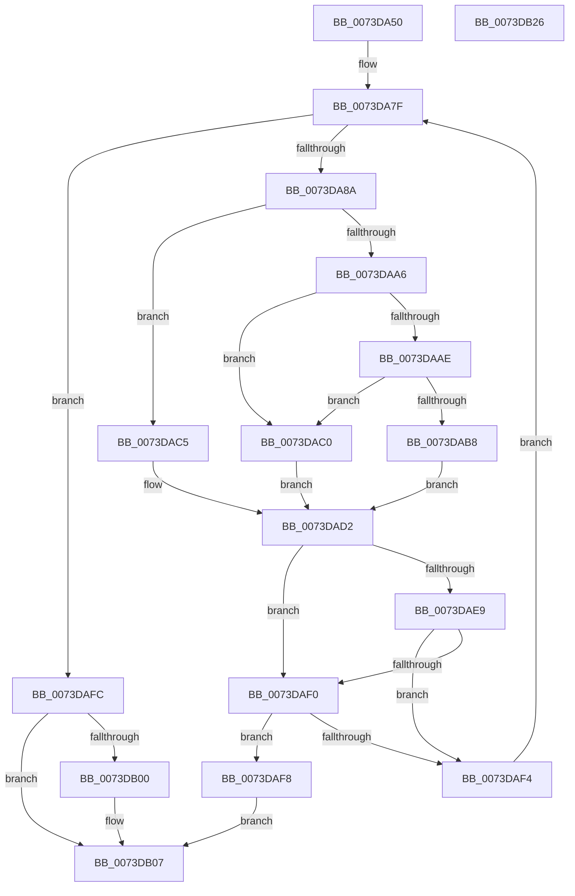

# IopMergeRelationLists

- RVA: `0x0073DA50`–`0x0073DB27` (길이 `215` bytes)
- VA: `0x000000014073DA50`
- 실행 섹션: `PAGE`
- PDB 이름 있음: `예`; PDB Function 태그: `아니요`
- unwind 정보 RVA: `0x0005D79C`
- 디코드: `71`개 명령, `215/215` bytes 표시
- 미해석 바이트: `0` (있으면 어셈블리에 `.byte`로 보존)

> 이 문서는 커널 이미지의 기계어와 PDB 기호를 분석해 생성했습니다. 4번과 5번은 함수 원형과 자료형을 바이너리 사용 방식에서 추정한 C 해석이며 원본 소스 복구 결과는 아닙니다.

## 1. Dependencies

- 직접 호출 지점: **2**; 고유 호출 대상: **2**
- 직접 호출자로 확인된 함수: **3**
- RIP 상대 이미지 참조: **0**

### Outgoing calls
- `0x0073DA9D` → [PipDeviceObjectListIndexOf](../A0/PipDeviceObjectListIndexOf_function_00A070F4.md) (function, `0x00A070F4`)
- `0x0073DADF` → [IopAddRelationToList](../A0/IopAddRelationToList_function_00A04D04.md) (function, `0x00A04D04`)

### Direct callers
- [PnpQueuePendingSurpriseRemoval](../A0/PnpQueuePendingSurpriseRemoval_function_00A05FAC.md) at `0x00A060C4`
- [sub_00B336B0](../B3/Unknown_function_00B336B0.md) at `0x00B339B0`
- [sub_00B344A6](../B3/Unknown_function_00B344A6.md) at `0x00B344B0`

### Static image references
- 디코드된 RIP-relative 메모리 참조가 없습니다.

## 2. Other-region calls and transfers

- 다른 실행 섹션으로 향하는 call: **0**
- 별도 외부 분기/꼬리 이동을 확인하지 못했습니다.

## 3. Assembly (complete function range)

```asm
0073DA50  48 89 5C 24 10                  mov qword ptr [rsp + 0x10], rbx
0073DA55  48 89 6C 24 18                  mov qword ptr [rsp + 0x18], rbp
0073DA5A  48 89 74 24 20                  mov qword ptr [rsp + 0x20], rsi
0073DA5F  57                              push rdi
0073DA60  41 54                           push r12
0073DA62  41 55                           push r13
0073DA64  41 56                           push r14
0073DA66  41 57                           push r15
0073DA68  48 83 EC 20                     sub rsp, 0x20
0073DA6C  48 8B 01                        mov rax, qword ptr [rcx]
0073DA6F  33 DB                           xor ebx, ebx
0073DA71  45 8A E0                        mov r12b, r8b
0073DA74  4C 8B F2                        mov r14, rdx
0073DA77  48 8B F9                        mov rdi, rcx
0073DA7A  8B F3                           mov esi, ebx
0073DA7C  44 8B 28                        mov r13d, dword ptr [rax]
0073DA7F  4D 8B 1E                        mov r11, qword ptr [r14]
0073DA82  48 8B 0F                        mov rcx, qword ptr [rdi]
0073DA85  41 3B 33                        cmp esi, dword ptr [r11]
0073DA88  73 72                           jae 0x14073dafc
0073DA8A  8B C6                           mov eax, esi
0073DA8C  4C 8D 4C 24 50                  lea r9, [rsp + 0x50]
0073DA91  45 8B C5                        mov r8d, r13d
0073DA94  48 8D 2C 40                     lea rbp, [rax + rax*2]
0073DA98  49 8B 54 EB 10                  mov rdx, qword ptr [r11 + rbp*8 + 0x10]
0073DA9D  E8 52 96 2C 00                  call 0x140a070f4
0073DAA2  85 C0                           test eax, eax
0073DAA4  78 1F                           js 0x14073dac5
0073DAA6  41 B7 01                        mov r15b, 1
0073DAA9  45 84 E4                        test r12b, r12b
0073DAAC  74 12                           je 0x14073dac0
0073DAAE  41 8B 44 EB 20                  mov eax, dword ptr [r11 + rbp*8 + 0x20]
0073DAB3  41 84 C7                        test r15b, al
0073DAB6  74 08                           je 0x14073dac0
0073DAB8  41 B9 01 00 00 00               mov r9d, 1
0073DABE  EB 12                           jmp 0x14073dad2
0073DAC0  44 8B CB                        mov r9d, ebx
0073DAC3  EB 0D                           jmp 0x14073dad2
0073DAC5  45 0F B6 4C EB 20               movzx r9d, byte ptr [r11 + rbp*8 + 0x20]
0073DACB  44 8A FB                        mov r15b, bl
0073DACE  41 83 E1 01                     and r9d, 1
0073DAD2  45 8B 44 EB 18                  mov r8d, dword ptr [r11 + rbp*8 + 0x18]
0073DAD7  48 8B CF                        mov rcx, rdi
0073DADA  49 8B 54 EB 10                  mov rdx, qword ptr [r11 + rbp*8 + 0x10]
0073DADF  E8 20 72 2C 00                  call 0x140a04d04
0073DAE4  45 84 FF                        test r15b, r15b
0073DAE7  74 07                           je 0x14073daf0
0073DAE9  3D 35 00 00 C0                  cmp eax, 0xc0000035
0073DAEE  74 04                           je 0x14073daf4
0073DAF0  85 C0                           test eax, eax
0073DAF2  78 04                           js 0x14073daf8
0073DAF4  FF C6                           inc esi
0073DAF6  EB 87                           jmp 0x14073da7f
0073DAF8  8B D8                           mov ebx, eax
0073DAFA  EB 0B                           jmp 0x14073db07
0073DAFC  39 19                           cmp dword ptr [rcx], ebx
0073DAFE  75 07                           jne 0x14073db07
0073DB00  41 8A 4E 08                     mov cl, byte ptr [r14 + 8]
0073DB04  88 4F 08                        mov byte ptr [rdi + 8], cl
0073DB07  48 8B 6C 24 60                  mov rbp, qword ptr [rsp + 0x60]
0073DB0C  8B C3                           mov eax, ebx
0073DB0E  48 8B 5C 24 58                  mov rbx, qword ptr [rsp + 0x58]
0073DB13  48 8B 74 24 68                  mov rsi, qword ptr [rsp + 0x68]
0073DB18  48 83 C4 20                     add rsp, 0x20
0073DB1C  41 5F                           pop r15
0073DB1E  41 5E                           pop r14
0073DB20  41 5D                           pop r13
0073DB22  41 5C                           pop r12
0073DB24  5F                              pop rdi
0073DB25  C3                              ret
0073DB26  CC                              int3
```

## 4. C-style interpretation (structured pseudocode)

```c
__int64 __fastcall IopMergeRelationLists(__int64 a1, __int64 a2, unsigned __int8 a3)
{
    __int64 result;
    __int64 v_rbx;
    __int64 v_rsi;
    __int64 v_rsp;
    unsigned __int64 v_stack_p10;
    unsigned __int64 v_stack_p18;
    unsigned __int64 v_stack_p20;
    unsigned __int64 v_stack_p8;

    v_stack_p10 = v_rbx;
    v_stack_p18 = v_rbp;
    v_stack_p20 = v_rsi;
    v_rsp = (v_rsp) - (32);
    v_rbx = 0;
loc_0073DA7F:
    if (0 >= (*(unsigned int *)(*(unsigned __int64 *)(a2)))) goto loc_0073DAFC;
    result = PipDeviceObjectListIndexOf(*(unsigned __int64 *)(a1), *(unsigned __int64 *)(*(unsigned __int64 *)(a2) + 0 + 0 * 2 * 8 + 16), (unsigned int)((unsigned int)((unsigned int)(*(unsigned int *)(*(unsigned __int64 *)(a1))))), v_stack_p8);
    if (sign_flag) goto loc_0073DAC5;
    if (a3 == 0) goto loc_0073DAC0;
    if (((1) & ((unsigned __int8)((unsigned int)(*(unsigned int *)(*(unsigned __int64 *)(a2) + 0 + 0 * 2 * 8 + 32))))) == 0) goto loc_0073DAC0;
    goto loc_0073DAD2;
loc_0073DAC0:
    goto loc_0073DAD2;
loc_0073DAC5:
    a4 = (unsigned int)((*(unsigned __int8 *)(*(unsigned __int64 *)(a2) + 0 + 0 * 2 * 8 + 32)) & (1));
loc_0073DAD2:
    result = IopAddRelationToList(a1, *(unsigned __int64 *)(*(unsigned __int64 *)(a2) + 0 + 0 * 2 * 8 + 16), (unsigned int)(*(unsigned int *)(*(unsigned __int64 *)(a2) + 0 + 0 * 2 * 8 + 24)), a4);
    if (0 == 0) goto loc_0073DAF0;
    if (((unsigned int)(result)) == 0xC0000035ULL) goto loc_0073DAF4;
loc_0073DAF0:
    if (sign_flag) goto loc_0073DAF8;
loc_0073DAF4:
    v_rsi = (unsigned int)((0) + 1);
    goto loc_0073DA7F;
loc_0073DAF8:
    goto loc_0073DB07;
loc_0073DAFC:
    if ((*(unsigned int *)(a1)) == ((unsigned int)((unsigned int)((unsigned int)(result))))) {
        a1 = *(unsigned __int8 *)(a2 + 8);
        *(unsigned __int8 *)(a1 + 8) = (unsigned __int8)(a1);
    }
    v_rsp = (v_rsp) + (32);
    return (unsigned int)((unsigned int)((unsigned int)((unsigned int)(result))));
}
```

## 5. (Beta) C Style

```c
int64_t IopMergeRelationLists(void *Arg1, void *Arg2, uint8_t Arg3)
{
    uint8_t *arg1 = (uint8_t *)Arg1;
    uint8_t *arg2 = (uint8_t *)Arg2;

    int64_t result;
    int64_t local_rbx;
    int64_t local_rsi;
    int64_t local_rsp;
    uint64_t v_stack_p10;
    uint64_t v_stack_p18;
    uint64_t v_stack_p20;
    uint64_t v_stack_p8;

    v_stack_p10 = local_rbx;
    v_stack_p18 = local_rbp;
    v_stack_p20 = local_rsi;
    local_rsp = (local_rsp) - (32);
    local_rbx = 0;
loc_0073DA7F:
    if (0 >= (*(uint32_t *)(*(uint64_t *)(arg2)))) goto loc_0073DAFC;
    result = PipDeviceObjectListIndexOf(*(uint64_t *)(arg1), *(uint64_t *)(*(uint64_t *)(arg2) + 0x0 + 0x0 * 2 * 8 + 0x10), (uint32_t)((uint32_t)((uint32_t)(*(uint32_t *)(*(uint64_t *)(arg1))))), v_stack_p8);
    if (sign_flag) goto loc_0073DAC5;
    if (Arg3 == 0) goto loc_0073DAC0;
    if (((1) & ((uint8_t)((uint32_t)(*(uint32_t *)(*(uint64_t *)(arg2) + 0x0 + 0x0 * 2 * 8 + 0x20))))) == 0) goto loc_0073DAC0;
    goto loc_0073DAD2;
loc_0073DAC0:
    goto loc_0073DAD2;
loc_0073DAC5:
    a4 = (uint32_t)((*(uint8_t *)(*(uint64_t *)(arg2) + 0x0 + 0x0 * 2 * 8 + 0x20)) & (1));
loc_0073DAD2:
    result = IopAddRelationToList(Arg1, *(uint64_t *)(*(uint64_t *)(arg2) + 0x0 + 0x0 * 2 * 8 + 0x10), (uint32_t)(*(uint32_t *)(*(uint64_t *)(arg2) + 0x0 + 0x0 * 2 * 8 + 0x18)), a4);
    if (0 == 0) goto loc_0073DAF0;
    if (((uint32_t)(result)) == 0xC0000035ULL) goto loc_0073DAF4;
loc_0073DAF0:
    if (sign_flag) goto loc_0073DAF8;
loc_0073DAF4:
    local_rsi = (uint32_t)((0) + 1);
    goto loc_0073DA7F;
loc_0073DAF8:
    goto loc_0073DB07;
loc_0073DAFC:
    if ((*(uint32_t *)(arg1)) == ((uint32_t)((uint32_t)((uint32_t)(result))))) {
        Arg1 = *(uint8_t *)(arg2 + 0x8);
        *(uint8_t *)(arg1 + 0x8) = (uint8_t)(Arg1);
    }
    local_rsp = (local_rsp) + (32);
    return (uint32_t)((uint32_t)((uint32_t)((uint32_t)(result))));
}
```

### 관측된 메모리 오프셋

구조체 형식이 확인되지 않은 접근은 인자 기준의 오프셋으로만 기록했습니다.

| 기준 인자 | 오프셋 표현 | 폭 (bit) | 접근 |
|---|---:|---:|---|
| `Arg1` | `+ 0x0` | `64` | `R` |
| `Arg1` | `+ 0x8` | `8` | `W` |
| `Arg2` | `+ 0x0` | `64` | `R` |
| `Arg2` | `+ 0x8` | `8` | `R` |

## 6. Execution-region graph

[열기: 2D/3D 그래프와 함수 탐색 컨트롤 패널](../../../control-panel.html?section=page&rva=0x0073DA50&view=graph)

- 2D 그래프는 위에서 아래로 흐르고, 3D 그래프는 빈 공간을 드래그해 회전합니다. Shift+드래그는 이동, 휠은 확대·축소, 함수 노드 선택은 대상 보고서 이동입니다.

### Static fallback


