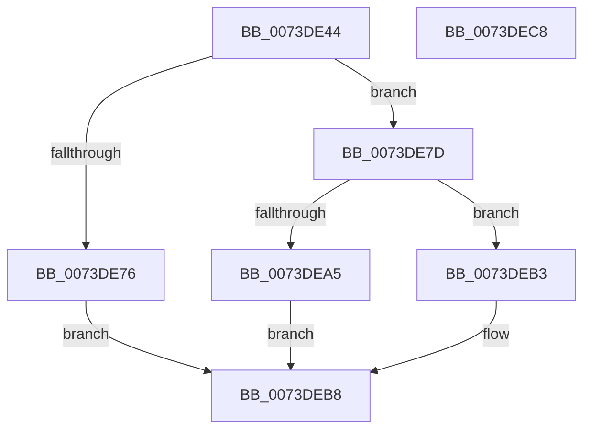

# IopQueryBusResourceUpdateInterface

- RVA: `0x0073DE44`–`0x0073DEC9` (길이 `133` bytes)
- VA: `0x000000014073DE44`
- 실행 섹션: `PAGE`
- PDB 이름 있음: `예`; PDB Function 태그: `아니요`
- unwind 정보 RVA: `0x000794E0`
- 디코드: `38`개 명령, `133/133` bytes 표시
- 미해석 바이트: `0` (있으면 어셈블리에 `.byte`로 보존)

> 이 문서는 커널 이미지의 기계어와 PDB 기호를 분석해 생성했습니다. 4번과 5번은 함수 원형과 자료형을 바이너리 사용 방식에서 추정한 C 해석이며 원본 소스 복구 결과는 아닙니다.

## 1. Dependencies

- 직접 호출 지점: **3**; 고유 호출 대상: **3**
- 직접 호출자로 확인된 함수: **1**
- RIP 상대 이미지 참조: **1**

### Outgoing calls
- `0x0073DE69` → [ExAllocatePool2](../../poolcode/B8/ExAllocatePool2_function_00B820F0.md) (function, `0x00B820F0`)
- `0x0073DE9A` → [PnpQueryInterface](../A2/PnpQueryInterface_function_00A28D38.md) (function, `0x00A28D38`)
- `0x0073DEAA` → [ExFreePoolWithTag](../../poolcode/B8/ExFreePoolWithTag_function_00B82870.md) (function, `0x00B82870`)

### Direct callers
- [PiUpdateDeviceResourceLists](../74/PiUpdateDeviceResourceLists_function_007406BC.md) at `0x007406E7`

### Static image references
- `0x0073DE8A` → RVA `0x00024068` (`.rdata`; read)

## 2. Other-region calls and transfers

- 다른 실행 섹션으로 향하는 call: **2**
  - `0x0073DE69` → [ExAllocatePool2](../../poolcode/B8/ExAllocatePool2_function_00B820F0.md) (`PAGE` → `POOLCODE`)
  - `0x0073DEAA` → [ExFreePoolWithTag](../../poolcode/B8/ExFreePoolWithTag_function_00B82870.md) (`PAGE` → `POOLCODE`)
- 별도 외부 분기/꼬리 이동을 확인하지 못했습니다.

## 3. Assembly (complete function range)

```asm
0073DE44  48 89 5C 24 08                  mov qword ptr [rsp + 8], rbx
0073DE49  48 89 74 24 10                  mov qword ptr [rsp + 0x10], rsi
0073DE4E  57                              push rdi
0073DE4F  48 83 EC 30                     sub rsp, 0x30
0073DE53  48 8B F2                        mov rsi, rdx
0073DE56  48 8B F9                        mov rdi, rcx
0073DE59  BA 28 00 00 00                  mov edx, 0x28
0073DE5E  B9 00 01 00 00                  mov ecx, 0x100
0073DE63  41 B8 50 70 20 20               mov r8d, 0x20207050
0073DE69  E8 82 42 44 00                  call 0x140b820f0
0073DE6E  48 8B D8                        mov rbx, rax
0073DE71  48 85 C0                        test rax, rax
0073DE74  75 07                           jne 0x14073de7d
0073DE76  B8 9A 00 00 C0                  mov eax, 0xc000009a
0073DE7B  EB 3B                           jmp 0x14073deb8
0073DE7D  45 33 C0                        xor r8d, r8d
0073DE80  48 89 5C 24 28                  mov qword ptr [rsp + 0x28], rbx
0073DE85  4C 21 44 24 20                  and qword ptr [rsp + 0x20], r8
0073DE8A  48 8D 15 D7 61 8E FF            lea rdx, [rip - 0x719e29]
0073DE91  41 B9 28 00 00 00               mov r9d, 0x28
0073DE97  48 8B CF                        mov rcx, rdi
0073DE9A  E8 99 AE 2E 00                  call 0x140a28d38
0073DE9F  8B F8                           mov edi, eax
0073DEA1  85 C0                           test eax, eax
0073DEA3  79 0E                           jns 0x14073deb3
0073DEA5  33 D2                           xor edx, edx
0073DEA7  48 8B CB                        mov rcx, rbx
0073DEAA  E8 C1 49 44 00                  call 0x140b82870
0073DEAF  8B C7                           mov eax, edi
0073DEB1  EB 05                           jmp 0x14073deb8
0073DEB3  48 89 1E                        mov qword ptr [rsi], rbx
0073DEB6  33 C0                           xor eax, eax
0073DEB8  48 8B 5C 24 40                  mov rbx, qword ptr [rsp + 0x40]
0073DEBD  48 8B 74 24 48                  mov rsi, qword ptr [rsp + 0x48]
0073DEC2  48 83 C4 30                     add rsp, 0x30
0073DEC6  5F                              pop rdi
0073DEC7  C3                              ret
0073DEC8  CC                              int3
```

## 4. C-style interpretation (structured pseudocode)

```c
__int64 __fastcall IopQueryBusResourceUpdateInterface(__int64 a1, __int64 a2)
{
    __int64 result;
    __int64 v_rsp;
    unsigned __int64 v_stack_m10;
    unsigned __int64 v_stack_m18;
    unsigned __int64 v_stack_p10;
    unsigned __int64 v_stack_p8;

    v_stack_p8 = v_rbx;
    v_stack_p10 = v_rsi;
    v_rsp = (v_rsp) - (48);
    result = ExAllocatePool2(256, 40, (unsigned int)(0x20207050ULL), a4);
    if (result != 0) goto loc_0073DE7D;
    goto loc_0073DEB8;
loc_0073DE7D:
    a3 = 0;
    v_stack_m10 = result;
    result = PnpQueryInterface(a1, v_rip - 7446057, a3, 40);
    if (!sign_flag) goto loc_0073DEB3;
    a2 = 0;
    result = ExFreePoolWithTag(result, a2, a3, 40);
    goto loc_0073DEB8;
loc_0073DEB3:
    *(unsigned __int64 *)(a2) = result;
    result = 0;
loc_0073DEB8:
    v_rsp = (v_rsp) + (48);
    return result;
}
```

## 5. (Beta) C Style

```c
int64_t IopQueryBusResourceUpdateInterface(int64_t Arg1, void *Arg2)
{
    uint8_t *arg2 = (uint8_t *)Arg2;

    int64_t result;
    int64_t local_rsp;
    uint64_t v_stack_m10;
    uint64_t v_stack_m18;
    uint64_t v_stack_p10;
    uint64_t v_stack_p8;

    v_stack_p8 = local_rbx;
    v_stack_p10 = local_rsi;
    local_rsp = (local_rsp) - (48);
    result = ExAllocatePool2(256, 40, (uint32_t)(0x20207050ULL), a4);
    if (result != 0) goto loc_0073DE7D;
    goto loc_0073DEB8;
loc_0073DE7D:
    a3 = 0;
    v_stack_m10 = result;
    result = PnpQueryInterface(Arg1, v_rip - 7446057, a3, 40);
    if (!sign_flag) goto loc_0073DEB3;
    Arg2 = 0;
    result = ExFreePoolWithTag(result, Arg2, a3, 40);
    goto loc_0073DEB8;
loc_0073DEB3:
    *(uint64_t *)(arg2) = result;
    result = 0;
loc_0073DEB8:
    local_rsp = (local_rsp) + (48);
    return result;
}
```

### 관측된 메모리 오프셋

구조체 형식이 확인되지 않은 접근은 인자 기준의 오프셋으로만 기록했습니다.

| 기준 인자 | 오프셋 표현 | 폭 (bit) | 접근 |
|---|---:|---:|---|
| `Arg2` | `+ 0x0` | `64` | `W` |

## 6. Execution-region graph

[열기: 2D/3D 그래프와 함수 탐색 컨트롤 패널](../../../control-panel.html?section=page&rva=0x0073DE44&view=graph)

- 2D 그래프는 위에서 아래로 흐르고, 3D 그래프는 빈 공간을 드래그해 회전합니다. Shift+드래그는 이동, 휠은 확대·축소, 함수 노드 선택은 대상 보고서 이동입니다.

### Static fallback


