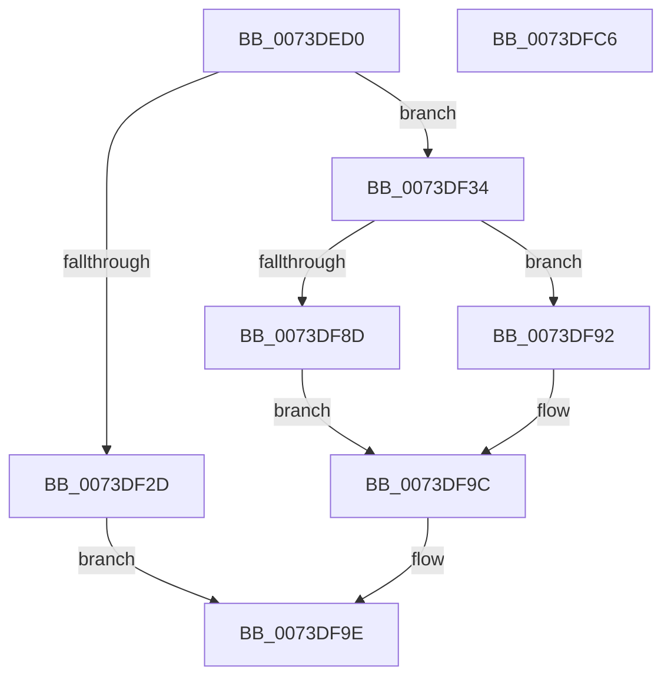

# IopQueryDockRemovalInterface

- RVA: `0x0073DED0`–`0x0073DFC7` (길이 `247` bytes)
- VA: `0x000000014073DED0`
- 실행 섹션: `PAGE`
- PDB 이름 있음: `예`; PDB Function 태그: `아니요`
- unwind 정보 RVA: `0x000C90D8`
- 디코드: `63`개 명령, `247/247` bytes 표시
- 미해석 바이트: `0` (있으면 어셈블리에 `.byte`로 보존)

> 이 문서는 커널 이미지의 기계어와 PDB 기호를 분석해 생성했습니다. 4번과 5번은 함수 원형과 자료형을 바이너리 사용 방식에서 추정한 C 해석이며 원본 소스 복구 결과는 아닙니다.

## 1. Dependencies

- 직접 호출 지점: **5**; 고유 호출 대상: **5**
- 직접 호출자로 확인된 함수: **1**
- RIP 상대 이미지 참조: **2**

### Outgoing calls
- `0x0073DF1E` → [ExAllocatePool2](../../poolcode/B8/ExAllocatePool2_function_00B820F0.md) (function, `0x00B820F0`)
- `0x0073DF43` → [memset](../../text/6C/memset_function_006C6C40.md) (function, `0x006C6C40`)
- `0x0073DF82` → [IopSynchronousCall](../8F/IopSynchronousCall_function_008FB018.md) (function, `0x008FB018`)
- `0x0073DF97` → [ExFreePoolWithTag](../../poolcode/B8/ExFreePoolWithTag_function_00B82870.md) (function, `0x00B82870`)
- `0x0073DFA9` → [_security_check_cookie](../../text/6A/_security_check_cookie_function_006AC640.md) (function, `0x006AC640`)

### Direct callers
- [PnpProcessQueryRemoveAndEject](../A0/PnpProcessQueryRemoveAndEject_function_00A05170.md) at `0x00A056BA`

### Static image references
- `0x0073DEE5` → RVA `0x00E0A740` (`.data`; read)
- `0x0073DEF7` → RVA `0x00026B20` (`.rdata`; read)

## 2. Other-region calls and transfers

- 다른 실행 섹션으로 향하는 call: **4**
  - `0x0073DF1E` → [ExAllocatePool2](../../poolcode/B8/ExAllocatePool2_function_00B820F0.md) (`PAGE` → `POOLCODE`)
  - `0x0073DF43` → [memset](../../text/6C/memset_function_006C6C40.md) (`PAGE` → `.text`)
  - `0x0073DF97` → [ExFreePoolWithTag](../../poolcode/B8/ExFreePoolWithTag_function_00B82870.md) (`PAGE` → `POOLCODE`)
  - `0x0073DFA9` → [_security_check_cookie](../../text/6A/_security_check_cookie_function_006AC640.md) (`PAGE` → `.text`)
- 별도 외부 분기/꼬리 이동을 확인하지 못했습니다.

## 3. Assembly (complete function range)

```asm
0073DED0  48 89 5C 24 18                  mov qword ptr [rsp + 0x18], rbx
0073DED5  48 89 6C 24 20                  mov qword ptr [rsp + 0x20], rbp
0073DEDA  56                              push rsi
0073DEDB  57                              push rdi
0073DEDC  41 56                           push r14
0073DEDE  48 81 EC 90 00 00 00            sub rsp, 0x90
0073DEE5  48 8B 05 54 C8 6C 00            mov rax, qword ptr [rip + 0x6cc854]
0073DEEC  48 33 C4                        xor rax, rsp
0073DEEF  48 89 84 24 88 00 00 00         mov qword ptr [rsp + 0x88], rax
0073DEF7  0F 10 05 22 8C 8E FF            movups xmm0, xmmword ptr [rip - 0x7173de]
0073DEFE  48 8B F2                        mov rsi, rdx
0073DF01  48 8B F9                        mov rdi, rcx
0073DF04  41 BE 30 00 00 00               mov r14d, 0x30
0073DF0A  41 B8 50 70 20 20               mov r8d, 0x20207050
0073DF10  41 8B D6                        mov edx, r14d
0073DF13  B9 00 01 00 00                  mov ecx, 0x100
0073DF18  F3 0F 7F 44 24 78               movdqu xmmword ptr [rsp + 0x78], xmm0
0073DF1E  E8 CD 41 44 00                  call 0x140b820f0
0073DF23  33 ED                           xor ebp, ebp
0073DF25  48 8B D8                        mov rbx, rax
0073DF28  48 85 C0                        test rax, rax
0073DF2B  75 07                           jne 0x14073df34
0073DF2D  B8 9A 00 00 C0                  mov eax, 0xc000009a
0073DF32  EB 6A                           jmp 0x14073df9e
0073DF34  33 D2                           xor edx, edx
0073DF36  66 44 89 30                     mov word ptr [rax], r14w
0073DF3A  48 8D 4C 24 30                  lea rcx, [rsp + 0x30]
0073DF3F  44 8D 42 48                     lea r8d, [rdx + 0x48]
0073DF43  E8 F8 8C F8 FF                  call 0x1406c6c40
0073DF48  48 8D 44 24 78                  lea rax, [rsp + 0x78]
0073DF4D  66 C7 44 24 30 1B 08            mov word ptr [rsp + 0x30], 0x81b
0073DF54  45 33 C9                        xor r9d, r9d
0073DF57  48 89 44 24 38                  mov qword ptr [rsp + 0x38], rax
0073DF5C  41 B8 BB 00 00 C0               mov r8d, 0xc00000bb
0073DF62  44 89 74 24 40                  mov dword ptr [rsp + 0x40], r14d
0073DF67  48 8D 54 24 30                  lea rdx, [rsp + 0x30]
0073DF6C  66 89 6B 02                     mov word ptr [rbx + 2], bp
0073DF70  48 8B CF                        mov rcx, rdi
0073DF73  48 89 5C 24 48                  mov qword ptr [rsp + 0x48], rbx
0073DF78  48 89 6C 24 50                  mov qword ptr [rsp + 0x50], rbp
0073DF7D  48 89 6C 24 20                  mov qword ptr [rsp + 0x20], rbp
0073DF82  E8 91 D0 1B 00                  call 0x1408fb018
0073DF87  8B F8                           mov edi, eax
0073DF89  85 C0                           test eax, eax
0073DF8B  78 05                           js 0x14073df92
0073DF8D  48 89 1E                        mov qword ptr [rsi], rbx
0073DF90  EB 0A                           jmp 0x14073df9c
0073DF92  33 D2                           xor edx, edx
0073DF94  48 8B CB                        mov rcx, rbx
0073DF97  E8 D4 48 44 00                  call 0x140b82870
0073DF9C  8B C7                           mov eax, edi
0073DF9E  48 8B 8C 24 88 00 00 00         mov rcx, qword ptr [rsp + 0x88]
0073DFA6  48 33 CC                        xor rcx, rsp
0073DFA9  E8 92 E6 F6 FF                  call 0x1406ac640
0073DFAE  4C 8D 9C 24 90 00 00 00         lea r11, [rsp + 0x90]
0073DFB6  49 8B 5B 30                     mov rbx, qword ptr [r11 + 0x30]
0073DFBA  49 8B 6B 38                     mov rbp, qword ptr [r11 + 0x38]
0073DFBE  49 8B E3                        mov rsp, r11
0073DFC1  41 5E                           pop r14
0073DFC3  5F                              pop rdi
0073DFC4  5E                              pop rsi
0073DFC5  C3                              ret
0073DFC6  CC                              int3
```

## 4. C-style interpretation (structured pseudocode)

```c
__int64 __fastcall IopQueryDockRemovalInterface(__int64 a1, __int64 a2, __int64 a3, int a4)
{
    __int64 result;
    __int64 v_rbp;
    __int64 v_rsp;
    unsigned __int64 v_stack_m18;
    unsigned __int64 v_stack_m20;
    unsigned __int64 v_stack_m30;
    unsigned __int64 v_stack_m58;
    unsigned __int64 v_stack_m60;
    unsigned int v_stack_m68;
    unsigned __int64 v_stack_m70;
    unsigned __int64 v_stack_m78;
    unsigned __int64 v_stack_m88;
    unsigned __int64 v_stack_p18;
    unsigned __int64 v_stack_p20;

    v_stack_p18 = v_rbx;
    v_stack_p20 = v_rbp;
    v_rsp = (v_rsp) - (144);
    result = (*(unsigned __int64 *)(v_rip + 7129172)) ^ (v_rsp);
    v_stack_m20 = result;
    v_stack_m30 = v_xmm0;
    result = ExAllocatePool2(256, 48, (unsigned int)(0x20207050ULL), a4);
    v_rbp = 0;
    if (result != 0) goto loc_0073DF34;
    goto loc_0073DF9E;
loc_0073DF34:
    a2 = 0;
    *(unsigned __int16 *)((unsigned int)(0xC000009AULL)) = 48;
    result = memset(v_stack_m78, a2, a2 + 72, a4);
    v_stack_m78 = 0x81BULL;
    a4 = 0;
    v_stack_m70 = v_stack_m30;
    v_stack_m68 = 48;
    *(unsigned __int16 *)(result + 2) = 0;
    v_stack_m60 = result;
    v_stack_m58 = 0;
    v_stack_m88 = 0;
    result = IopSynchronousCall(a1, v_stack_m78, (unsigned int)(0xC00000BBULL), a4);
    if (sign_flag) goto loc_0073DF92;
    *(unsigned __int64 *)(a2) = result;
    goto loc_0073DF9C;
loc_0073DF92:
    a2 = 0;
    result = ExFreePoolWithTag(result, a2, (unsigned int)(0xC00000BBULL), a4);
loc_0073DF9C:
loc_0073DF9E:
    a1 = (v_stack_m20) ^ (v_rsp);
    result = _security_check_cookie(a1, a2, (unsigned int)(0xC00000BBULL), a4);
    return result;
}
```

## 5. (Beta) C Style

```c
int64_t IopQueryDockRemovalInterface(int64_t Arg1, void *Arg2, int64_t Arg3, int32_t Arg4)
{
    uint8_t *arg2 = (uint8_t *)Arg2;

    int64_t result;
    int64_t local_rbp;
    int64_t local_rsp;
    uint64_t v_stack_m18;
    uint64_t v_stack_m20;
    uint64_t v_stack_m30;
    uint64_t v_stack_m58;
    uint64_t v_stack_m60;
    uint32_t v_stack_m68;
    uint64_t v_stack_m70;
    uint64_t v_stack_m78;
    uint64_t v_stack_m88;
    uint64_t v_stack_p18;
    uint64_t v_stack_p20;

    v_stack_p18 = local_rbx;
    v_stack_p20 = local_rbp;
    local_rsp = (local_rsp) - (144);
    result = (*(uint64_t *)(v_rip + 0x6CC854)) ^ (local_rsp);
    v_stack_m20 = result;
    v_stack_m30 = v_xmm0;
    result = ExAllocatePool2(256, 48, (uint32_t)(0x20207050ULL), Arg4);
    local_rbp = 0;
    if (result != 0) goto loc_0073DF34;
    goto loc_0073DF9E;
loc_0073DF34:
    Arg2 = 0;
    *(uint16_t *)((uint32_t)(0xC000009AULL)) = 48;
    result = memset(v_stack_m78, Arg2, Arg2 + 72, Arg4);
    v_stack_m78 = 0x81BULL;
    Arg4 = 0;
    v_stack_m70 = v_stack_m30;
    v_stack_m68 = 48;
    *(uint16_t *)(result + 0x2) = 0;
    v_stack_m60 = result;
    v_stack_m58 = 0;
    v_stack_m88 = 0;
    result = IopSynchronousCall(Arg1, v_stack_m78, (uint32_t)(0xC00000BBULL), Arg4);
    if (sign_flag) goto loc_0073DF92;
    *(uint64_t *)(arg2) = result;
    goto loc_0073DF9C;
loc_0073DF92:
    Arg2 = 0;
    result = ExFreePoolWithTag(result, Arg2, (uint32_t)(0xC00000BBULL), Arg4);
loc_0073DF9C:
loc_0073DF9E:
    Arg1 = (v_stack_m20) ^ (local_rsp);
    result = _security_check_cookie(Arg1, Arg2, (uint32_t)(0xC00000BBULL), Arg4);
    return result;
}
```

### 관측된 메모리 오프셋

구조체 형식이 확인되지 않은 접근은 인자 기준의 오프셋으로만 기록했습니다.

| 기준 인자 | 오프셋 표현 | 폭 (bit) | 접근 |
|---|---:|---:|---|
| `Arg2` | `+ 0x0` | `64` | `W` |

## 6. Execution-region graph

[열기: 2D/3D 그래프와 함수 탐색 컨트롤 패널](../../../control-panel.html?section=page&rva=0x0073DED0&view=graph)

- 2D 그래프는 위에서 아래로 흐르고, 3D 그래프는 빈 공간을 드래그해 회전합니다. Shift+드래그는 이동, 휠은 확대·축소, 함수 노드 선택은 대상 보고서 이동입니다.

### Static fallback


