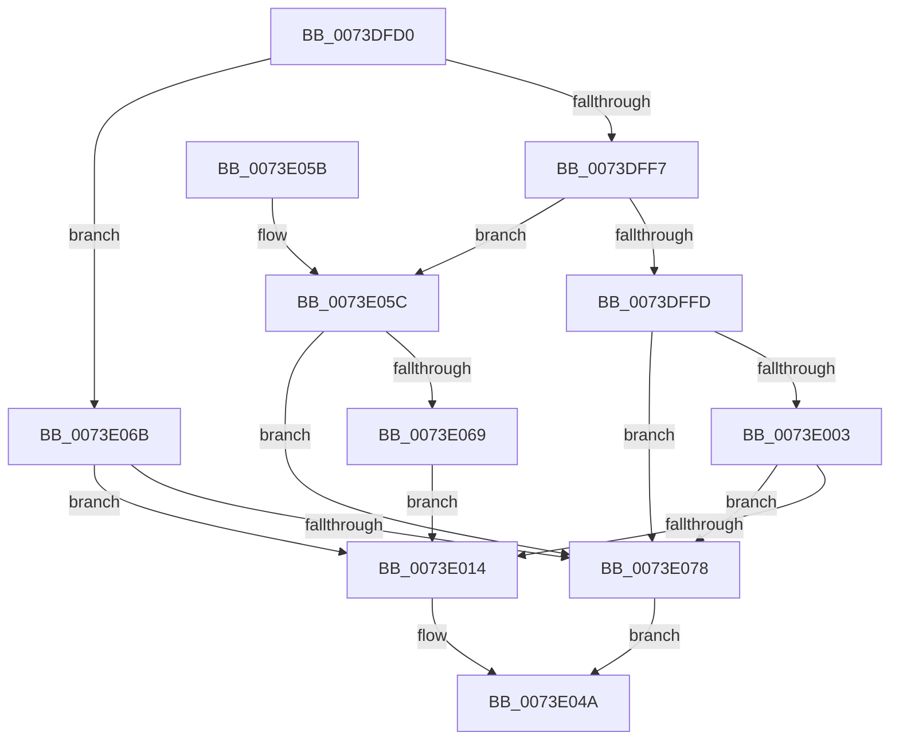

# IopQueryReconfiguration

- RVA: `0x0073DFD0`–`0x0073E07F` (길이 `175` bytes)
- VA: `0x000000014073DFD0`
- 실행 섹션: `PAGE`
- PDB 이름 있음: `예`; PDB Function 태그: `아니요`
- unwind 정보 RVA: `0x000C90C8`
- 디코드: `42`개 명령, `175/175` bytes 표시
- 미해석 바이트: `0` (있으면 어셈블리에 `.byte`로 보존)

> 이 문서는 커널 이미지의 기계어와 PDB 기호를 분석해 생성했습니다. 4번과 5번은 함수 원형과 자료형을 바이너리 사용 방식에서 추정한 C 해석이며 원본 소스 복구 결과는 아닙니다.

## 1. Dependencies

- 직접 호출 지점: **2**; 고유 호출 대상: **2**
- 직접 호출자로 확인된 함수: **3**
- RIP 상대 이미지 참조: **0**

### Outgoing calls
- `0x0073E01F` → [memset](../../text/6C/memset_function_006C6C40.md) (function, `0x006C6C40`)
- `0x0073E045` → [IopSynchronousCall](../8F/IopSynchronousCall_function_008FB018.md) (function, `0x008FB018`)

### Direct callers
- [PnpCancelStopDeviceNode](PnpCancelStopDeviceNode_function_0073F048.md) at `0x0073F09C`
- [PnpQueryStopDeviceNode](PnpQueryStopDeviceNode_function_0073F47C.md) at `0x0073F4DF`
- [PnpStopDeviceSubtree](PnpStopDeviceSubtree_function_0073F8AC.md) at `0x0073F8E1`

### Static image references
- 디코드된 RIP-relative 메모리 참조가 없습니다.

## 2. Other-region calls and transfers

- 다른 실행 섹션으로 향하는 call: **1**
  - `0x0073E01F` → [memset](../../text/6C/memset_function_006C6C40.md) (`PAGE` → `.text`)
- 별도 외부 분기/꼬리 이동을 확인하지 못했습니다.

## 3. Assembly (complete function range)

```asm
0073DFD0  48 89 5C 24 08                  mov qword ptr [rsp + 8], rbx
0073DFD5  57                              push rdi
0073DFD6  48 81 EC 80 00 00 00            sub rsp, 0x80
0073DFDD  48 8B 82 38 01 00 00            mov rax, qword ptr [rdx + 0x138]
0073DFE4  48 8B DA                        mov rbx, rdx
0073DFE7  0F B6 F9                        movzx edi, cl
0073DFEA  44 8B C7                        mov r8d, edi
0073DFED  4C 8B 48 28                     mov r9, qword ptr [rax + 0x28]
0073DFF1  41 83 E8 04                     sub r8d, 4
0073DFF5  74 74                           je 0x14073e06b
0073DFF7  41 83 E8 01                     sub r8d, 1
0073DFFB  74 5F                           je 0x14073e05c
0073DFFD  41 83 F8 01                     cmp r8d, 1
0073E001  75 75                           jne 0x14073e078
0073E003  41 8B 81 2C 01 00 00            mov eax, dword ptr [r9 + 0x12c]
0073E00A  2D 0A 03 00 00                  sub eax, 0x30a
0073E00F  41 3B C0                        cmp eax, r8d
0073E012  77 64                           ja 0x14073e078
0073E014  33 D2                           xor edx, edx
0073E016  48 8D 4C 24 30                  lea rcx, [rsp + 0x30]
0073E01B  44 8D 42 48                     lea r8d, [rdx + 0x48]
0073E01F  E8 1C 8C F8 FF                  call 0x1406c6c40
0073E024  48 83 64 24 20 00               and qword ptr [rsp + 0x20], 0
0073E02A  48 8D 54 24 30                  lea rdx, [rsp + 0x30]
0073E02F  45 33 C9                        xor r9d, r9d
0073E032  C6 44 24 30 1B                  mov byte ptr [rsp + 0x30], 0x1b
0073E037  41 B8 BB 00 00 C0               mov r8d, 0xc00000bb
0073E03D  40 88 7C 24 31                  mov byte ptr [rsp + 0x31], dil
0073E042  48 8B CB                        mov rcx, rbx
0073E045  E8 CE CF 1B 00                  call 0x1408fb018
0073E04A  48 8B 9C 24 90 00 00 00         mov rbx, qword ptr [rsp + 0x90]
0073E052  48 81 C4 80 00 00 00            add rsp, 0x80
0073E059  5F                              pop rdi
0073E05A  C3                              ret
0073E05B  CC                              int3
0073E05C  41 81 B9 2C 01 00 00 0A 03 00 00  cmp dword ptr [r9 + 0x12c], 0x30a
0073E067  75 0F                           jne 0x14073e078
0073E069  EB A9                           jmp 0x14073e014
0073E06B  41 81 B9 2C 01 00 00 0B 03 00 00  cmp dword ptr [r9 + 0x12c], 0x30b
0073E076  74 9C                           je 0x14073e014
0073E078  B8 01 00 00 C0                  mov eax, 0xc0000001
0073E07D  EB CB                           jmp 0x14073e04a
```

## 4. C-style interpretation (structured pseudocode)

```c
__int64 __fastcall IopQueryReconfiguration(unsigned __int8 a1, __int64 a2)
{
    __int64 result;
    __int64 v_rsp;
    unsigned __int8 v_stack_m57;
    unsigned __int64 v_stack_m58;
    unsigned __int64 v_stack_m68;
    unsigned __int64 v_stack_p8;

    v_stack_p8 = v_rbx;
    v_rsp = (v_rsp) - (128);
    a3 = (unsigned int)(((unsigned int)(a1)) - (4));
    if (condition_is_equal) goto loc_0073E06B;
    a3 = (unsigned int)((a3) - (1));
    if (condition_is_equal) goto loc_0073E05C;
    if (((unsigned int)(a3)) != 1) goto loc_0073E078;
    result = (unsigned int)(((unsigned int)(*(unsigned int *)(*(unsigned __int64 *)(*(unsigned __int64 *)(a2 + 312) + 40) + 300))) - (778));
    if (((unsigned int)(result)) > ((unsigned int)(a3))) goto loc_0073E078;
loc_0073E014:
    a2 = 0;
    result = memset(v_stack_m58, a2, a2 + 72, *(unsigned __int64 *)(*(unsigned __int64 *)(a2 + 312) + 40));
    a4 = 0;
    v_stack_m58 = 27;
    v_stack_m57 = a1;
    result = IopSynchronousCall(0, v_stack_m58, (unsigned int)(0xC00000BBULL), a4);
loc_0073E04A:
    v_rsp = (v_rsp) + (128);
    return result;
loc_0073E05C:
    if ((*(unsigned int *)(a4 + 300)) != 778) goto loc_0073E078;
    goto loc_0073E014;
loc_0073E06B:
    if ((*(unsigned int *)(a4 + 300)) == 779) goto loc_0073E014;
loc_0073E078:
    goto loc_0073E04A;
}
```

## 5. (Beta) C Style

```c
int64_t IopQueryReconfiguration(uint8_t Arg1, void *Arg2)
{
    uint8_t *arg2 = (uint8_t *)Arg2;

    int64_t result;
    int64_t local_rsp;
    uint8_t v_stack_m57;
    uint64_t v_stack_m58;
    uint64_t v_stack_m68;
    uint64_t v_stack_p8;

    v_stack_p8 = local_rbx;
    local_rsp = (local_rsp) - (128);
    a3 = (uint32_t)(((uint32_t)(Arg1)) - (4));
    if (condition_is_equal) goto loc_0073E06B;
    a3 = (uint32_t)((a3) - (1));
    if (condition_is_equal) goto loc_0073E05C;
    if (((uint32_t)(a3)) != 1) goto loc_0073E078;
    result = (uint32_t)(((uint32_t)(*(uint32_t *)(*(uint64_t *)(*(uint64_t *)(arg2 + 0x138) + 0x28) + 0x12C))) - (778));
    if (((uint32_t)(result)) > ((uint32_t)(a3))) goto loc_0073E078;
loc_0073E014:
    Arg2 = 0;
    result = memset(v_stack_m58, Arg2, Arg2 + 72, *(uint64_t *)(*(uint64_t *)(arg2 + 0x138) + 0x28));
    a4 = 0;
    v_stack_m58 = 27;
    v_stack_m57 = Arg1;
    result = IopSynchronousCall(0, v_stack_m58, (uint32_t)(0xC00000BBULL), a4);
loc_0073E04A:
    local_rsp = (local_rsp) + (128);
    return result;
loc_0073E05C:
    if ((*(uint32_t *)(a4 + 0x12C)) != 778) goto loc_0073E078;
    goto loc_0073E014;
loc_0073E06B:
    if ((*(uint32_t *)(a4 + 0x12C)) == 779) goto loc_0073E014;
loc_0073E078:
    goto loc_0073E04A;
}
```

### 관측된 메모리 오프셋

구조체 형식이 확인되지 않은 접근은 인자 기준의 오프셋으로만 기록했습니다.

| 기준 인자 | 오프셋 표현 | 폭 (bit) | 접근 |
|---|---:|---:|---|
| `Arg2` | `+ 0x138` | `64` | `R` |

## 6. Execution-region graph

[열기: 2D/3D 그래프와 함수 탐색 컨트롤 패널](../../../control-panel.html?section=page&rva=0x0073DFD0&view=graph)

- 2D 그래프는 위에서 아래로 흐르고, 3D 그래프는 빈 공간을 드래그해 회전합니다. Shift+드래그는 이동, 휠은 확대·축소, 함수 노드 선택은 대상 보고서 이동입니다.

### Static fallback


