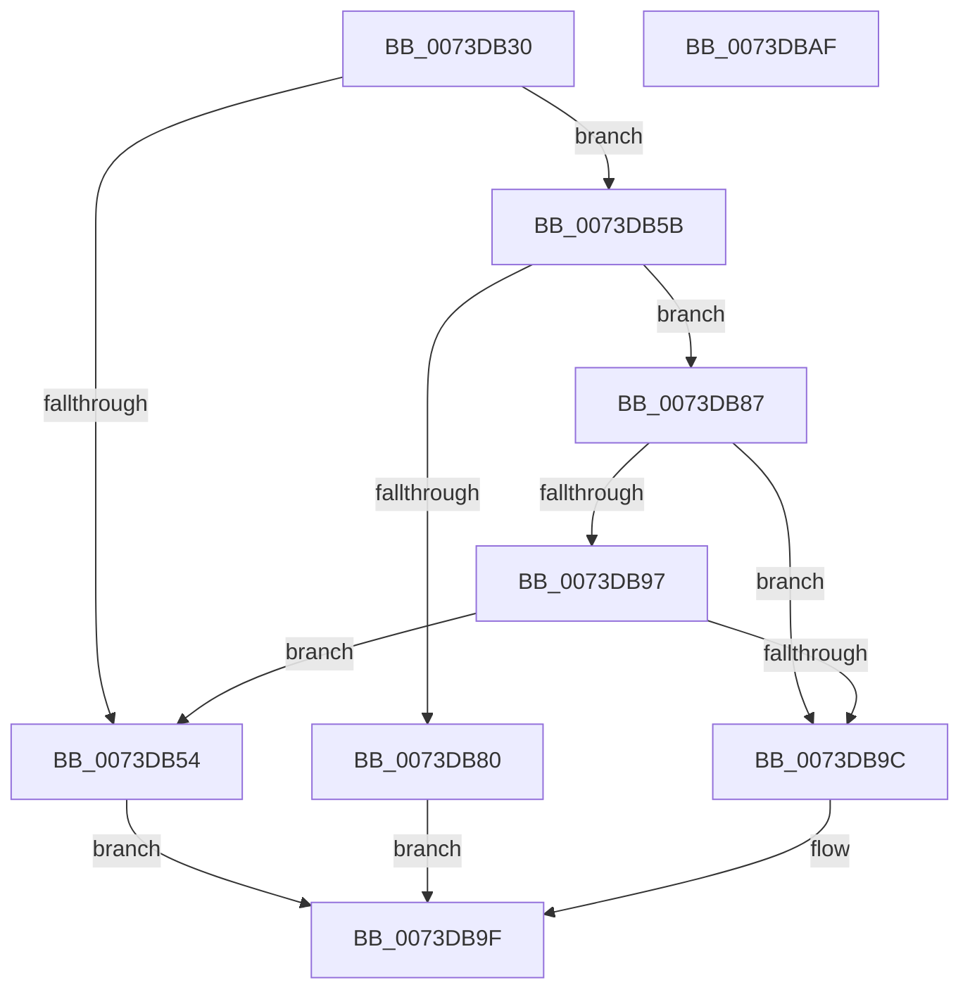

# IopRemoveCurrentRelationFromList

- RVA: `0x0073DB30`–`0x0073DBB0` (길이 `128` bytes)
- VA: `0x000000014073DB30`
- 실행 섹션: `PAGE`
- PDB 이름 있음: `예`; PDB Function 태그: `아니요`
- unwind 정보 RVA: `0x000794E0`
- 디코드: `39`개 명령, `128/128` bytes 표시
- 미해석 바이트: `0` (있으면 어셈블리에 `.byte`로 보존)

> 이 문서는 커널 이미지의 기계어와 PDB 기호를 분석해 생성했습니다. 4번과 5번은 함수 원형과 자료형을 바이너리 사용 방식에서 추정한 C 해석이며 원본 소스 복구 결과는 아닙니다.

## 1. Dependencies

- 직접 호출 지점: **2**; 고유 호출 대상: **2**
- 직접 호출자로 확인된 함수: **1**
- RIP 상대 이미지 참조: **0**

### Outgoing calls
- `0x0073DB74` → [PipDeviceObjectListElementAt](../A6/PipDeviceObjectListElementAt_function_00A6E450.md) (function, `0x00A6E450`)
- `0x0073DB8C` → [PipDeviceObjectListRemove](../AC/PipDeviceObjectListRemove_function_00ACA6D8.md) (function, `0x00ACA6D8`)

### Direct callers
- [PnpUnlinkDeviceRemovalRelations](../A0/PnpUnlinkDeviceRemovalRelations_function_00A063D8.md) at `0x00A06649`

### Static image references
- 디코드된 RIP-relative 메모리 참조가 없습니다.

## 2. Other-region calls and transfers

- 다른 실행 섹션으로 향하는 call: **0**
- 별도 외부 분기/꼬리 이동을 확인하지 못했습니다.

## 3. Assembly (complete function range)

```asm
0073DB30  48 89 5C 24 08                  mov qword ptr [rsp + 8], rbx
0073DB35  48 89 74 24 10                  mov qword ptr [rsp + 0x10], rsi
0073DB3A  57                              push rdi
0073DB3B  48 83 EC 30                     sub rsp, 0x30
0073DB3F  48 83 64 24 50 00               and qword ptr [rsp + 0x50], 0
0073DB45  49 8B D8                        mov rbx, r8
0073DB48  41 83 38 01                     cmp dword ptr [r8], 1
0073DB4C  48 8B F2                        mov rsi, rdx
0073DB4F  4C 8B D9                        mov r11, rcx
0073DB52  76 07                           jbe 0x14073db5b
0073DB54  B8 BB 00 00 C0                  mov eax, 0xc00000bb
0073DB59  EB 44                           jmp 0x14073db9f
0073DB5B  41 8B 78 04                     mov edi, dword ptr [r8 + 4]
0073DB5F  45 33 C9                        xor r9d, r9d
0073DB62  48 8B 09                        mov rcx, qword ptr [rcx]
0073DB65  4C 8D 44 24 50                  lea r8, [rsp + 0x50]
0073DB6A  48 83 64 24 20 00               and qword ptr [rsp + 0x20], 0
0073DB70  FF CF                           dec edi
0073DB72  8B D7                           mov edx, edi
0073DB74  E8 D7 08 33 00                  call 0x140a6e450
0073DB79  48 39 74 24 50                  cmp qword ptr [rsp + 0x50], rsi
0073DB7E  74 07                           je 0x14073db87
0073DB80  B8 0E 00 00 C0                  mov eax, 0xc000000e
0073DB85  EB 18                           jmp 0x14073db9f
0073DB87  49 8B 0B                        mov rcx, qword ptr [r11]
0073DB8A  8B D7                           mov edx, edi
0073DB8C  E8 47 CB 38 00                  call 0x140aca6d8
0073DB91  8B 13                           mov edx, dword ptr [rbx]
0073DB93  85 D2                           test edx, edx
0073DB95  74 05                           je 0x14073db9c
0073DB97  83 EA 01                        sub edx, 1
0073DB9A  75 B8                           jne 0x14073db54
0073DB9C  89 7B 04                        mov dword ptr [rbx + 4], edi
0073DB9F  48 8B 5C 24 40                  mov rbx, qword ptr [rsp + 0x40]
0073DBA4  48 8B 74 24 48                  mov rsi, qword ptr [rsp + 0x48]
0073DBA9  48 83 C4 30                     add rsp, 0x30
0073DBAD  5F                              pop rdi
0073DBAE  C3                              ret
0073DBAF  CC                              int3
```

## 4. C-style interpretation (structured pseudocode)

```c
__int64 __fastcall IopRemoveCurrentRelationFromList(__int64 a1, __int64 a2, __int64 a3, int a4)
{
    __int64 result;
    __int64 v_rdi;
    __int64 v_rsp;
    unsigned __int64 v_stack_m18;
    unsigned __int64 v_stack_p10;
    unsigned __int64 v_stack_p18;
    unsigned __int64 v_stack_p8;

    v_stack_p8 = v_rbx;
    v_stack_p10 = v_rsi;
    v_rsp = (v_rsp) - (48);
    if ((*(unsigned int *)(a3)) <= 1) goto loc_0073DB5B;
loc_0073DB54:
    goto loc_0073DB9F;
loc_0073DB5B:
    a4 = 0;
    v_rdi = (unsigned int)(((unsigned int)(*(unsigned int *)(a3 + 4))) - 1);
    result = PipDeviceObjectListElementAt(*(unsigned __int64 *)(a1), (unsigned int)((unsigned int)(v_rdi)), v_stack_p18, a4);
    if (v_stack_p18 == a2) goto loc_0073DB87;
    goto loc_0073DB9F;
loc_0073DB87:
    result = PipDeviceObjectListRemove(*(unsigned __int64 *)(a1), (unsigned int)((unsigned int)(v_rdi)), v_stack_p18, a4);
    if ((unsigned int)((unsigned int)(*(unsigned int *)(a3))) == 0) goto loc_0073DB9C;
    a2 = (unsigned int)(((unsigned int)(*(unsigned int *)(a3))) - (1));
    if (condition_is_not_equal) goto loc_0073DB54;
loc_0073DB9C:
    *(unsigned int *)(a3 + 4) = (unsigned int)(v_rdi);
loc_0073DB9F:
    v_rsp = (v_rsp) + (48);
    return result;
}
```

## 5. (Beta) C Style

```c
int64_t IopRemoveCurrentRelationFromList(void *Arg1, int64_t Arg2, void *Arg3, int32_t Arg4)
{
    uint8_t *arg1 = (uint8_t *)Arg1;
    uint8_t *arg3 = (uint8_t *)Arg3;

    int64_t result;
    int64_t local_rdi;
    int64_t local_rsp;
    uint64_t v_stack_m18;
    uint64_t v_stack_p10;
    uint64_t v_stack_p18;
    uint64_t v_stack_p8;

    v_stack_p8 = local_rbx;
    v_stack_p10 = local_rsi;
    local_rsp = (local_rsp) - (48);
    if ((*(uint32_t *)(arg3)) <= 1) goto loc_0073DB5B;
loc_0073DB54:
    goto loc_0073DB9F;
loc_0073DB5B:
    Arg4 = 0;
    local_rdi = (uint32_t)(((uint32_t)(*(uint32_t *)(arg3 + 0x4))) - 1);
    result = PipDeviceObjectListElementAt(*(uint64_t *)(arg1), (uint32_t)((uint32_t)(local_rdi)), v_stack_p18, Arg4);
    if (v_stack_p18 == Arg2) goto loc_0073DB87;
    goto loc_0073DB9F;
loc_0073DB87:
    result = PipDeviceObjectListRemove(*(uint64_t *)(arg1), (uint32_t)((uint32_t)(local_rdi)), v_stack_p18, Arg4);
    if ((uint32_t)((uint32_t)(*(uint32_t *)(arg3))) == 0) goto loc_0073DB9C;
    Arg2 = (uint32_t)(((uint32_t)(*(uint32_t *)(arg3))) - (1));
    if (condition_is_not_equal) goto loc_0073DB54;
loc_0073DB9C:
    *(uint32_t *)(arg3 + 0x4) = (uint32_t)(local_rdi);
loc_0073DB9F:
    local_rsp = (local_rsp) + (48);
    return result;
}
```

### 관측된 메모리 오프셋

구조체 형식이 확인되지 않은 접근은 인자 기준의 오프셋으로만 기록했습니다.

| 기준 인자 | 오프셋 표현 | 폭 (bit) | 접근 |
|---|---:|---:|---|
| `Arg1` | `+ 0x0` | `64` | `R` |
| `Arg3` | `+ 0x0` | `32` | `R` |
| `Arg3` | `+ 0x4` | `32` | `R` |
| `Arg3` | `+ 0x4` | `32` | `W` |

## 6. Execution-region graph

[열기: 2D/3D 그래프와 함수 탐색 컨트롤 패널](../../../control-panel.html?section=page&rva=0x0073DB30&view=graph)

- 2D 그래프는 위에서 아래로 흐르고, 3D 그래프는 빈 공간을 드래그해 회전합니다. Shift+드래그는 이동, 휠은 확대·축소, 함수 노드 선택은 대상 보고서 이동입니다.

### Static fallback


