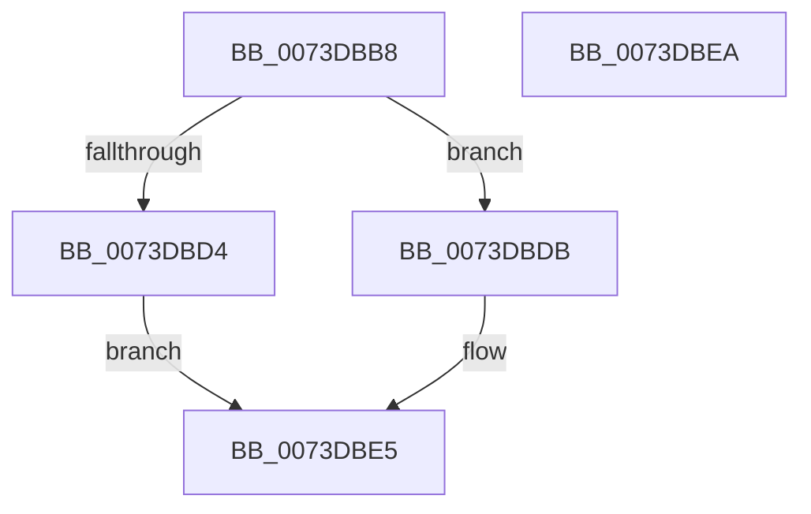

# IopRemoveRelationFromList

- RVA: `0x0073DBB8`–`0x0073DBEB` (길이 `51` bytes)
- VA: `0x000000014073DBB8`
- 실행 섹션: `PAGE`
- PDB 이름 있음: `예`; PDB Function 태그: `아니요`
- unwind 정보 RVA: `0x0005C788`
- 디코드: `16`개 명령, `51/51` bytes 표시
- 미해석 바이트: `0` (있으면 어셈블리에 `.byte`로 보존)

> 이 문서는 커널 이미지의 기계어와 PDB 기호를 분석해 생성했습니다. 4번과 5번은 함수 원형과 자료형을 바이너리 사용 방식에서 추정한 C 해석이며 원본 소스 복구 결과는 아닙니다.

## 1. Dependencies

- 직접 호출 지점: **2**; 고유 호출 대상: **2**
- 직접 호출자로 확인된 함수: **2**
- RIP 상대 이미지 참조: **0**

### Outgoing calls
- `0x0073DBCA` → [PipDeviceObjectListIndexOf](../A0/PipDeviceObjectListIndexOf_function_00A070F4.md) (function, `0x00A070F4`)
- `0x0073DBE0` → [PipDeviceObjectListRemove](../AC/PipDeviceObjectListRemove_function_00ACA6D8.md) (function, `0x00ACA6D8`)

### Direct callers
- [PipRemoveDevicesInRelationList](../A0/PipRemoveDevicesInRelationList_function_00A08CF0.md) at `0x00A08D99`
- [sub_00B336B0](../B3/Unknown_function_00B336B0.md) at `0x00B33996`
- [sub_00B336B0](../B3/Unknown_function_00B336B0.md) at `0x00B339F7`

### Static image references
- 디코드된 RIP-relative 메모리 참조가 없습니다.

## 2. Other-region calls and transfers

- 다른 실행 섹션으로 향하는 call: **0**
- 별도 외부 분기/꼬리 이동을 확인하지 못했습니다.

## 3. Assembly (complete function range)

```asm
0073DBB8  48 83 EC 28                     sub rsp, 0x28
0073DBBC  4C 8B D9                        mov r11, rcx
0073DBBF  4C 8D 4C 24 30                  lea r9, [rsp + 0x30]
0073DBC4  48 8B 09                        mov rcx, qword ptr [rcx]
0073DBC7  44 8B 01                        mov r8d, dword ptr [rcx]
0073DBCA  E8 25 95 2C 00                  call 0x140a070f4
0073DBCF  83 F8 FF                        cmp eax, -1
0073DBD2  75 07                           jne 0x14073dbdb
0073DBD4  B8 0E 00 00 C0                  mov eax, 0xc000000e
0073DBD9  EB 0A                           jmp 0x14073dbe5
0073DBDB  49 8B 0B                        mov rcx, qword ptr [r11]
0073DBDE  8B D0                           mov edx, eax
0073DBE0  E8 F3 CA 38 00                  call 0x140aca6d8
0073DBE5  48 83 C4 28                     add rsp, 0x28
0073DBE9  C3                              ret
0073DBEA  CC                              int3
```

## 4. C-style interpretation (structured pseudocode)

```c
__int64 __fastcall IopRemoveRelationFromList(__int64 a1)
{
    __int64 result;
    __int64 v_rsp;
    unsigned __int64 v_stack_p8;

    v_rsp = (v_rsp) - (40);
    result = PipDeviceObjectListIndexOf(*(unsigned __int64 *)(a1), a2, (unsigned int)(*(unsigned int *)(*(unsigned __int64 *)(a1))), v_stack_p8);
    if (((unsigned int)(result)) != -1) goto loc_0073DBDB;
    goto loc_0073DBE5;
loc_0073DBDB:
    result = PipDeviceObjectListRemove(*(unsigned __int64 *)(a1), (unsigned int)((unsigned int)((unsigned int)(0xC000000EULL))), (unsigned int)(*(unsigned int *)(*(unsigned __int64 *)(a1))), v_stack_p8);
loc_0073DBE5:
    v_rsp = (v_rsp) + (40);
    return result;
}
```

## 5. (Beta) C Style

```c
int64_t IopRemoveRelationFromList(void *Arg1)
{
    uint8_t *arg1 = (uint8_t *)Arg1;

    int64_t result;
    int64_t local_rsp;
    uint64_t v_stack_p8;

    local_rsp = (local_rsp) - (40);
    result = PipDeviceObjectListIndexOf(*(uint64_t *)(arg1), a2, (uint32_t)(*(uint32_t *)(*(uint64_t *)(arg1))), v_stack_p8);
    if (((uint32_t)(result)) != -1) goto loc_0073DBDB;
    goto loc_0073DBE5;
loc_0073DBDB:
    result = PipDeviceObjectListRemove(*(uint64_t *)(arg1), (uint32_t)((uint32_t)((uint32_t)(0xC000000EULL))), (uint32_t)(*(uint32_t *)(*(uint64_t *)(arg1))), v_stack_p8);
loc_0073DBE5:
    local_rsp = (local_rsp) + (40);
    return result;
}
```

### 관측된 메모리 오프셋

구조체 형식이 확인되지 않은 접근은 인자 기준의 오프셋으로만 기록했습니다.

| 기준 인자 | 오프셋 표현 | 폭 (bit) | 접근 |
|---|---:|---:|---|
| `Arg1` | `+ 0x0` | `64` | `R` |

## 6. Execution-region graph

[열기: 2D/3D 그래프와 함수 탐색 컨트롤 패널](../../../control-panel.html?section=page&rva=0x0073DBB8&view=graph)

- 2D 그래프는 위에서 아래로 흐르고, 3D 그래프는 빈 공간을 드래그해 회전합니다. Shift+드래그는 이동, 휠은 확대·축소, 함수 노드 선택은 대상 보고서 이동입니다.

### Static fallback


