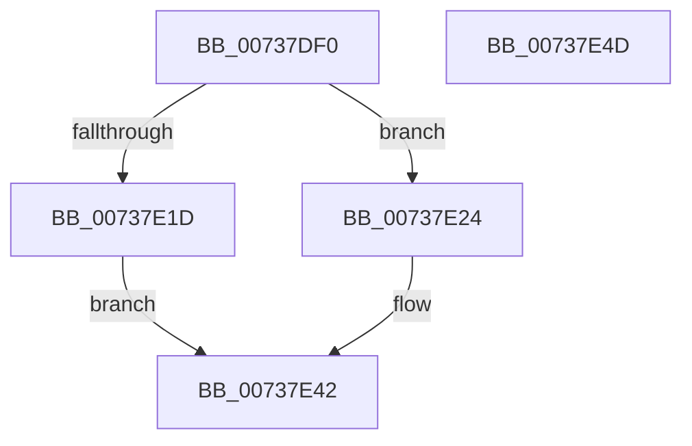

# IopTranslatorHandlerIo

- RVA: `0x00737DF0`–`0x00737E4E` (길이 `94` bytes)
- VA: `0x0000000140737DF0`
- 실행 섹션: `PAGE`
- PDB 이름 있음: `예`; PDB Function 태그: `아니요`
- unwind 정보 RVA: `0x0005CAAC`
- 디코드: `27`개 명령, `94/94` bytes 표시
- 미해석 바이트: `0` (있으면 어셈블리에 `.byte`로 보존)

> 이 문서는 커널 이미지의 기계어와 PDB 기호를 분석해 생성했습니다. 4번과 5번은 함수 원형과 자료형을 바이너리 사용 방식에서 추정한 C 해석이며 원본 소스 복구 결과는 아닙니다.

## 1. Dependencies

- 직접 호출 지점: **1**; 고유 호출 대상: **1**
- 직접 호출자로 확인된 함수: **0**
- RIP 상대 이미지 참조: **0**

### Outgoing calls
- `0x00737E10` → [ExAllocatePool2](../../poolcode/B8/ExAllocatePool2_function_00B820F0.md) (function, `0x00B820F0`)

### Direct callers
- 이 함수 시작 RVA로 연결되는 직접 call은 확인되지 않았습니다. 간접 호출은 완전히 역산할 수 없습니다.

### Static image references
- 디코드된 RIP-relative 메모리 참조가 없습니다.

## 2. Other-region calls and transfers

- 다른 실행 섹션으로 향하는 call: **1**
  - `0x00737E10` → [ExAllocatePool2](../../poolcode/B8/ExAllocatePool2_function_00B820F0.md) (`PAGE` → `POOLCODE`)
- 별도 외부 분기/꼬리 이동을 확인하지 못했습니다.

## 3. Assembly (complete function range)

```asm
00737DF0  48 89 5C 24 08                  mov qword ptr [rsp + 8], rbx
00737DF5  57                              push rdi
00737DF6  48 83 EC 20                     sub rsp, 0x20
00737DFA  48 8B DA                        mov rbx, rdx
00737DFD  B9 00 01 00 00                  mov ecx, 0x100
00737E02  BA 20 00 00 00                  mov edx, 0x20
00737E07  41 B8 50 70 64 64               mov r8d, 0x64647050
00737E0D  49 8B F9                        mov rdi, r9
00737E10  E8 DB A2 44 00                  call 0x140b820f0
00737E15  48 8B C8                        mov rcx, rax
00737E18  48 85 C0                        test rax, rax
00737E1B  75 07                           jne 0x140737e24
00737E1D  B8 9A 00 00 C0                  mov eax, 0xc000009a
00737E22  EB 1E                           jmp 0x140737e42
00737E24  C7 07 01 00 00 00               mov dword ptr [rdi], 1
00737E2A  0F 10 03                        movups xmm0, xmmword ptr [rbx]
00737E2D  0F 11 00                        movups xmmword ptr [rax], xmm0
00737E30  0F 10 4B 10                     movups xmm1, xmmword ptr [rbx + 0x10]
00737E34  0F 11 48 10                     movups xmmword ptr [rax + 0x10], xmm1
00737E38  48 8B 44 24 50                  mov rax, qword ptr [rsp + 0x50]
00737E3D  48 89 08                        mov qword ptr [rax], rcx
00737E40  33 C0                           xor eax, eax
00737E42  48 8B 5C 24 30                  mov rbx, qword ptr [rsp + 0x30]
00737E47  48 83 C4 20                     add rsp, 0x20
00737E4B  5F                              pop rdi
00737E4C  C3                              ret
00737E4D  CC                              int3
```

## 4. C-style interpretation (structured pseudocode)

```c
__int64 __fastcall IopTranslatorHandlerIo(__int64 a1, __int64 a2, __int64 a3, __int64 a4, __int64 a5)
{
    __int64 result;
    __int64 v_rsp;
    unsigned __int64 v_stack_p8;

    v_stack_p8 = v_rbx;
    v_rsp = (v_rsp) - (32);
    result = ExAllocatePool2(256, 32, (unsigned int)(0x64647050ULL), a4);
    if (result != 0) goto loc_00737E24;
    goto loc_00737E42;
loc_00737E24:
    *(unsigned int *)(a4) = 1;
    *(unsigned __int64 *)((unsigned int)(0xC000009AULL)) = v_xmm0;
    *(unsigned __int64 *)((unsigned int)(0xC000009AULL) + 16) = v_xmm1;
    *(unsigned __int64 *)(a5) = result;
    result = 0;
loc_00737E42:
    v_rsp = (v_rsp) + (32);
    return result;
}
```

## 5. (Beta) C Style

```c
int64_t IopTranslatorHandlerIo(int64_t Arg1, void *Arg2, int64_t Arg3, void *Arg4, void *Arg5)
{
    uint8_t *arg2 = (uint8_t *)Arg2;
    uint8_t *arg4 = (uint8_t *)Arg4;
    uint8_t *arg5 = (uint8_t *)Arg5;

    int64_t result;
    int64_t local_rsp;
    uint64_t v_stack_p8;

    v_stack_p8 = local_rbx;
    local_rsp = (local_rsp) - (32);
    result = ExAllocatePool2(256, 32, (uint32_t)(0x64647050ULL), Arg4);
    if (result != 0) goto loc_00737E24;
    goto loc_00737E42;
loc_00737E24:
    *(uint32_t *)(arg4) = 1;
    *(uint64_t *)((uint32_t)(0xC000009AULL)) = v_xmm0;
    *(uint64_t *)((uint32_t)(0xC000009AULL) + 0x10) = v_xmm1;
    *(uint64_t *)(arg5) = result;
    result = 0;
loc_00737E42:
    local_rsp = (local_rsp) + (32);
    return result;
}
```

### 관측된 메모리 오프셋

구조체 형식이 확인되지 않은 접근은 인자 기준의 오프셋으로만 기록했습니다.

| 기준 인자 | 오프셋 표현 | 폭 (bit) | 접근 |
|---|---:|---:|---|
| `Arg2` | `+ 0x0` | `128` | `R` |
| `Arg2` | `+ 0x10` | `128` | `R` |
| `Arg4` | `+ 0x0` | `32` | `W` |
| `Arg5` | `+ 0x0` | `64` | `W` |

## 6. Execution-region graph

[열기: 2D/3D 그래프와 함수 탐색 컨트롤 패널](../../../control-panel.html?section=page&rva=0x00737DF0&view=graph)

- 2D 그래프는 위에서 아래로 흐르고, 3D 그래프는 빈 공간을 드래그해 회전합니다. Shift+드래그는 이동, 휠은 확대·축소, 함수 노드 선택은 대상 보고서 이동입니다.

### Static fallback


