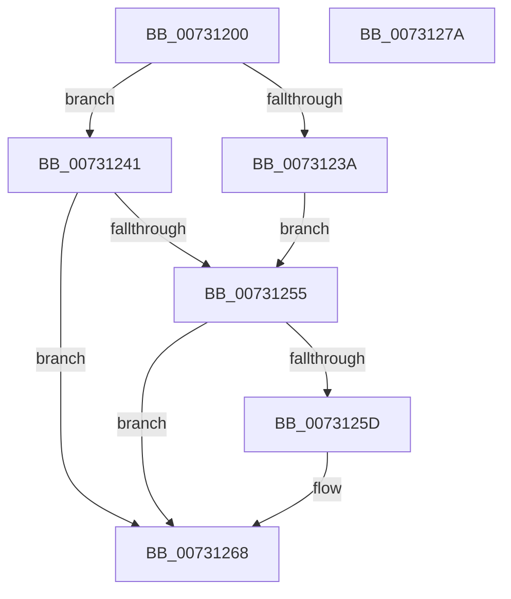

# PiAuAllocateAndInitializeSid

- RVA: `0x00731200`–`0x0073127B` (길이 `123` bytes)
- VA: `0x0000000140731200`
- 실행 섹션: `PAGE`
- PDB 이름 있음: `예`; PDB Function 태그: `아니요`
- unwind 정보 RVA: `0x00060BC4`
- 디코드: `38`개 명령, `123/123` bytes 표시
- 미해석 바이트: `0` (있으면 어셈블리에 `.byte`로 보존)

> 이 문서는 커널 이미지의 기계어와 PDB 기호를 분석해 생성했습니다. 4번과 5번은 함수 원형과 자료형을 바이너리 사용 방식에서 추정한 C 해석이며 원본 소스 복구 결과는 아닙니다.

## 1. Dependencies

- 직접 호출 지점: **4**; 고유 호출 대상: **4**
- 직접 호출자로 확인된 함수: **2**
- RIP 상대 이미지 참조: **0**

### Outgoing calls
- `0x0073121B` → [RtlLengthRequiredSid](../9C/RtlLengthRequiredSid_function_009CA4D0.md) (function, `0x009CA4D0`)
- `0x0073122D` → [ExAllocatePool2](../../poolcode/B8/ExAllocatePool2_function_00B820F0.md) (function, `0x00B820F0`)
- `0x0073124A` → [RtlInitializeSid](../9E/RtlInitializeSid_function_009EB720.md) (function, `0x009EB720`)
- `0x0073125F` → [ExFreePoolWithTag](../../poolcode/B8/ExFreePoolWithTag_function_00B82870.md) (function, `0x00B82870`)

### Direct callers
- [PiAuCreateStandardSecurityObject](../../init/C3/PiAuCreateStandardSecurityObject_function_00C34710.md) at `0x00C347C0`
- [PiAuCreateStandardSecurityObject](../../init/C3/PiAuCreateStandardSecurityObject_function_00C34710.md) at `0x00C34860`
- [PiAuCreateUserSids](../../init/C3/PiAuCreateUserSids_function_00C34C2C.md) at `0x00C34C7B`
- [PiAuCreateUserSids](../../init/C3/PiAuCreateUserSids_function_00C34C2C.md) at `0x00C34CB8`
- [PiAuCreateUserSids](../../init/C3/PiAuCreateUserSids_function_00C34C2C.md) at `0x00C34CEE`
- [PiAuCreateUserSids](../../init/C3/PiAuCreateUserSids_function_00C34C2C.md) at `0x00C34D2B`
- [PiAuCreateUserSids](../../init/C3/PiAuCreateUserSids_function_00C34C2C.md) at `0x00C34D5F`
- [PiAuCreateUserSids](../../init/C3/PiAuCreateUserSids_function_00C34C2C.md) at `0x00C34DA0`
- [PiAuCreateUserSids](../../init/C3/PiAuCreateUserSids_function_00C34C2C.md) at `0x00C34DD7`
- [PiAuCreateUserSids](../../init/C3/PiAuCreateUserSids_function_00C34C2C.md) at `0x00C34E07`

### Static image references
- 디코드된 RIP-relative 메모리 참조가 없습니다.

## 2. Other-region calls and transfers

- 다른 실행 섹션으로 향하는 call: **2**
  - `0x0073122D` → [ExAllocatePool2](../../poolcode/B8/ExAllocatePool2_function_00B820F0.md) (`PAGE` → `POOLCODE`)
  - `0x0073125F` → [ExFreePoolWithTag](../../poolcode/B8/ExFreePoolWithTag_function_00B82870.md) (`PAGE` → `POOLCODE`)
- 별도 외부 분기/꼬리 이동을 확인하지 못했습니다.

## 3. Assembly (complete function range)

```asm
00731200  48 89 5C 24 08                  mov qword ptr [rsp + 8], rbx
00731205  48 89 74 24 10                  mov qword ptr [rsp + 0x10], rsi
0073120A  57                              push rdi
0073120B  48 83 EC 20                     sub rsp, 0x20
0073120F  48 8B F9                        mov rdi, rcx
00731212  41 8B D8                        mov ebx, r8d
00731215  41 8B C8                        mov ecx, r8d
00731218  48 8B F2                        mov rsi, rdx
0073121B  E8 B0 92 29 00                  call 0x1409ca4d0
00731220  8B D0                           mov edx, eax
00731222  B9 00 01 00 00                  mov ecx, 0x100
00731227  41 B8 50 70 20 20               mov r8d, 0x20207050
0073122D  E8 BE 0E 45 00                  call 0x140b820f0
00731232  48 89 07                        mov qword ptr [rdi], rax
00731235  48 85 C0                        test rax, rax
00731238  75 07                           jne 0x140731241
0073123A  BB 9A 00 00 C0                  mov ebx, 0xc000009a
0073123F  EB 14                           jmp 0x140731255
00731241  44 8A C3                        mov r8b, bl
00731244  48 8B D6                        mov rdx, rsi
00731247  48 8B C8                        mov rcx, rax
0073124A  E8 D1 A4 2B 00                  call 0x1409eb720
0073124F  8B D8                           mov ebx, eax
00731251  85 C0                           test eax, eax
00731253  79 13                           jns 0x140731268
00731255  48 8B 0F                        mov rcx, qword ptr [rdi]
00731258  48 85 C9                        test rcx, rcx
0073125B  74 0B                           je 0x140731268
0073125D  33 D2                           xor edx, edx
0073125F  E8 0C 16 45 00                  call 0x140b82870
00731264  48 83 27 00                     and qword ptr [rdi], 0
00731268  48 8B 74 24 38                  mov rsi, qword ptr [rsp + 0x38]
0073126D  8B C3                           mov eax, ebx
0073126F  48 8B 5C 24 30                  mov rbx, qword ptr [rsp + 0x30]
00731274  48 83 C4 20                     add rsp, 0x20
00731278  5F                              pop rdi
00731279  C3                              ret
0073127A  CC                              int3
```

## 4. C-style interpretation (structured pseudocode)

```c
__int64 __fastcall PiAuAllocateAndInitializeSid(__int64 a1, __int64 a2, int a3)
{
    __int64 result;
    __int64 v_rsp;
    unsigned __int64 v_stack_p10;
    unsigned __int64 v_stack_p8;

    v_stack_p8 = v_rbx;
    v_stack_p10 = v_rsi;
    v_rsp = (v_rsp) - (32);
    result = RtlLengthRequiredSid((unsigned int)(a3), a2, a3, a4);
    result = ExAllocatePool2(256, (unsigned int)((unsigned int)(result)), (unsigned int)(0x20207050ULL), a4);
    *(unsigned __int64 *)(a1) = result;
    if (result != 0) goto loc_00731241;
    goto loc_00731255;
loc_00731241:
    result = RtlInitializeSid(result, a2, (unsigned __int8)((unsigned int)(0xC000009AULL)), a4);
    if (!sign_flag) goto loc_00731268;
loc_00731255:
    if (*(unsigned __int64 *)(a1) != 0) {
        a2 = 0;
        result = ExFreePoolWithTag(*(unsigned __int64 *)(a1), a2, (unsigned __int8)((unsigned int)(0xC000009AULL)), a4);
    }
    v_rsp = (v_rsp) + (32);
    return (unsigned int)((unsigned int)((unsigned int)((unsigned int)(result))));
}
```

## 5. (Beta) C Style

```c
int64_t PiAuAllocateAndInitializeSid(void *Arg1, int64_t Arg2, int32_t Arg3)
{
    uint8_t *arg1 = (uint8_t *)Arg1;

    int64_t result;
    int64_t local_rsp;
    uint64_t v_stack_p10;
    uint64_t v_stack_p8;

    v_stack_p8 = local_rbx;
    v_stack_p10 = local_rsi;
    local_rsp = (local_rsp) - (32);
    result = RtlLengthRequiredSid((uint32_t)(Arg3), Arg2, Arg3, a4);
    result = ExAllocatePool2(256, (uint32_t)((uint32_t)(result)), (uint32_t)(0x20207050ULL), a4);
    *(uint64_t *)(arg1) = result;
    if (result != 0) goto loc_00731241;
    goto loc_00731255;
loc_00731241:
    result = RtlInitializeSid(result, Arg2, (uint8_t)((uint32_t)(0xC000009AULL)), a4);
    if (!sign_flag) goto loc_00731268;
loc_00731255:
    if (*(uint64_t *)(arg1) != 0) {
        Arg2 = 0;
        result = ExFreePoolWithTag(*(uint64_t *)(arg1), Arg2, (uint8_t)((uint32_t)(0xC000009AULL)), a4);
    }
    local_rsp = (local_rsp) + (32);
    return (uint32_t)((uint32_t)((uint32_t)((uint32_t)(result))));
}
```

### 관측된 메모리 오프셋

구조체 형식이 확인되지 않은 접근은 인자 기준의 오프셋으로만 기록했습니다.

| 기준 인자 | 오프셋 표현 | 폭 (bit) | 접근 |
|---|---:|---:|---|
| `Arg1` | `+ 0x0` | `64` | `R` |
| `Arg1` | `+ 0x0` | `64` | `R/W` |
| `Arg1` | `+ 0x0` | `64` | `W` |

## 6. Execution-region graph

[열기: 2D/3D 그래프와 함수 탐색 컨트롤 패널](../../../control-panel.html?section=page&rva=0x00731200&view=graph)

- 2D 그래프는 위에서 아래로 흐르고, 3D 그래프는 빈 공간을 드래그해 회전합니다. Shift+드래그는 이동, 휠은 확대·축소, 함수 노드 선택은 대상 보고서 이동입니다.

### Static fallback


