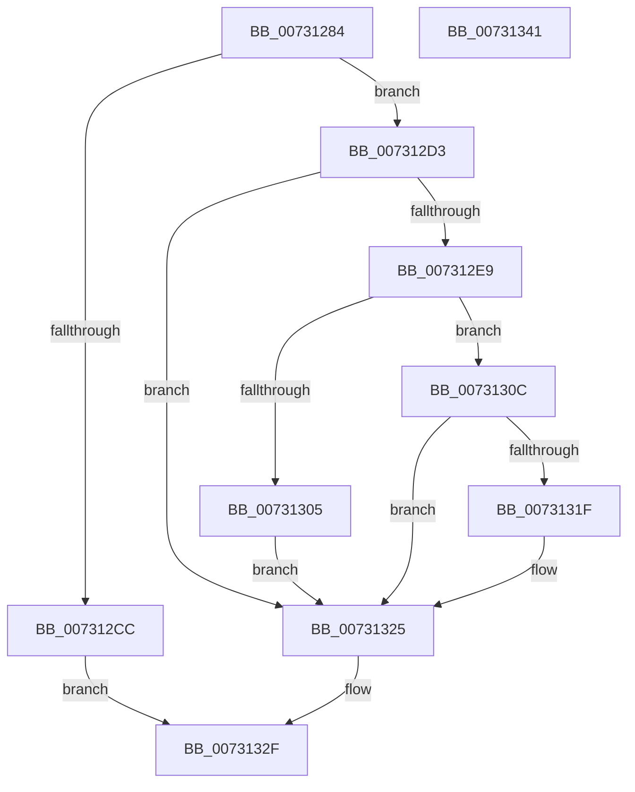

# PiAuCheckClientInteractive

- RVA: `0x00731284`–`0x00731342` (길이 `190` bytes)
- VA: `0x0000000140731284`
- 실행 섹션: `PAGE`
- PDB 이름 있음: `예`; PDB Function 태그: `아니요`
- unwind 정보 RVA: `0x000C88C4`
- 디코드: `56`개 명령, `190/190` bytes 표시
- 미해석 바이트: `0` (있으면 어셈블리에 `.byte`로 보존)

> 이 문서는 커널 이미지의 기계어와 PDB 기호를 분석해 생성했습니다. 4번과 5번은 함수 원형과 자료형을 바이너리 사용 방식에서 추정한 C 해석이며 원본 소스 복구 결과는 아닙니다.

## 1. Dependencies

- 직접 호출 지점: **7**; 고유 호출 대상: **7**
- 직접 호출자로 확인된 함수: **1**
- RIP 상대 이미지 참조: **0**

### Outgoing calls
- `0x007312AD` → [RtlLengthRequiredSid](../9C/RtlLengthRequiredSid_function_009CA4D0.md) (function, `0x009CA4D0`)
- `0x007312BF` → [ExAllocatePool2](../../poolcode/B8/ExAllocatePool2_function_00B820F0.md) (function, `0x00B820F0`)
- `0x007312DE` → [RtlInitializeSid](../9E/RtlInitializeSid_function_009EB720.md) (function, `0x009EB720`)
- `0x007312EE` → [RtlSubAuthoritySid](../../text/45/RtlSubAuthoritySid_function_00456D10.md) (function, `0x00456D10`)
- `0x007312FC` → [RtlValidSid](../92/RtlValidSid_function_00929710.md) (function, `0x00929710`)
- `0x00731314` → [PiAuCheckTokenMembership](PiAuCheckTokenMembership_function_00731348.md) (function, `0x00731348`)
- `0x0073132A` → [ExFreePoolWithTag](../../poolcode/B8/ExFreePoolWithTag_function_00B82870.md) (function, `0x00B82870`)

### Direct callers
- [PiCMQueryRemove](../AD/PiCMQueryRemove_function_00AD43F4.md) at `0x00AD465F`

### Static image references
- 디코드된 RIP-relative 메모리 참조가 없습니다.

## 2. Other-region calls and transfers

- 다른 실행 섹션으로 향하는 call: **3**
  - `0x007312BF` → [ExAllocatePool2](../../poolcode/B8/ExAllocatePool2_function_00B820F0.md) (`PAGE` → `POOLCODE`)
  - `0x007312EE` → [RtlSubAuthoritySid](../../text/45/RtlSubAuthoritySid_function_00456D10.md) (`PAGE` → `.text`)
  - `0x0073132A` → [ExFreePoolWithTag](../../poolcode/B8/ExFreePoolWithTag_function_00B82870.md) (`PAGE` → `POOLCODE`)
- 별도 외부 분기/꼬리 이동을 확인하지 못했습니다.

## 3. Assembly (complete function range)

```asm
00731284  48 8B C4                        mov rax, rsp
00731287  48 89 58 18                     mov qword ptr [rax + 0x18], rbx
0073128B  48 89 70 20                     mov qword ptr [rax + 0x20], rsi
0073128F  57                              push rdi
00731290  48 83 EC 20                     sub rsp, 0x20
00731294  83 60 10 00                     and dword ptr [rax + 0x10], 0
00731298  48 8B F1                        mov rsi, rcx
0073129B  C6 01 00                        mov byte ptr [rcx], 0
0073129E  B9 01 00 00 00                  mov ecx, 1
007312A3  66 C7 40 14 00 05               mov word ptr [rax + 0x14], 0x500
007312A9  C6 40 08 00                     mov byte ptr [rax + 8], 0
007312AD  E8 1E 92 29 00                  call 0x1409ca4d0
007312B2  8B D0                           mov edx, eax
007312B4  B9 00 01 00 00                  mov ecx, 0x100
007312B9  41 B8 50 70 20 20               mov r8d, 0x20207050
007312BF  E8 2C 0E 45 00                  call 0x140b820f0
007312C4  48 8B F8                        mov rdi, rax
007312C7  48 85 C0                        test rax, rax
007312CA  75 07                           jne 0x1407312d3
007312CC  BB 9A 00 00 C0                  mov ebx, 0xc000009a
007312D1  EB 5C                           jmp 0x14073132f
007312D3  41 B0 01                        mov r8b, 1
007312D6  48 8D 54 24 38                  lea rdx, [rsp + 0x38]
007312DB  48 8B CF                        mov rcx, rdi
007312DE  E8 3D A4 2B 00                  call 0x1409eb720
007312E3  8B D8                           mov ebx, eax
007312E5  85 C0                           test eax, eax
007312E7  78 3C                           js 0x140731325
007312E9  33 D2                           xor edx, edx
007312EB  48 8B CF                        mov rcx, rdi
007312EE  E8 1D 5A D2 FF                  call 0x140456d10
007312F3  48 8B CF                        mov rcx, rdi
007312F6  C7 00 04 00 00 00               mov dword ptr [rax], 4
007312FC  E8 0F 84 1F 00                  call 0x140929710
00731301  84 C0                           test al, al
00731303  75 07                           jne 0x14073130c
00731305  BB E5 00 00 C0                  mov ebx, 0xc00000e5
0073130A  EB 19                           jmp 0x140731325
0073130C  48 8D 54 24 30                  lea rdx, [rsp + 0x30]
00731311  48 8B CF                        mov rcx, rdi
00731314  E8 2F 00 00 00                  call 0x140731348
00731319  8B D8                           mov ebx, eax
0073131B  85 C0                           test eax, eax
0073131D  78 06                           js 0x140731325
0073131F  8A 44 24 30                     mov al, byte ptr [rsp + 0x30]
00731323  88 06                           mov byte ptr [rsi], al
00731325  33 D2                           xor edx, edx
00731327  48 8B CF                        mov rcx, rdi
0073132A  E8 41 15 45 00                  call 0x140b82870
0073132F  48 8B 74 24 48                  mov rsi, qword ptr [rsp + 0x48]
00731334  8B C3                           mov eax, ebx
00731336  48 8B 5C 24 40                  mov rbx, qword ptr [rsp + 0x40]
0073133B  48 83 C4 20                     add rsp, 0x20
0073133F  5F                              pop rdi
00731340  C3                              ret
00731341  CC                              int3
```

## 4. C-style interpretation (structured pseudocode)

```c
__int64 __fastcall PiAuCheckClientInteractive(__int64 a1)
{
    __int64 result;
    __int64 v_rsp;
    unsigned __int64 v_stack_p10;
    unsigned __int64 v_stack_p18;
    unsigned __int64 v_stack_p20;
    unsigned __int64 v_stack_p8;

    *(unsigned __int64 *)(v_rsp + 24) = v_rbx;
    *(unsigned __int64 *)(v_rsp + 32) = v_rsi;
    v_rsp = (v_rsp) - (32);
    *(unsigned __int8 *)(a1) = 0;
    *(unsigned __int16 *)(v_rsp + 20) = 0x500ULL;
    *(unsigned __int8 *)(v_rsp + 8) = 0;
    result = RtlLengthRequiredSid(1, a2, a3, a4);
    result = ExAllocatePool2(256, (unsigned int)((unsigned int)(result)), (unsigned int)(0x20207050ULL), a4);
    if (result != 0) goto loc_007312D3;
    goto loc_0073132F;
loc_007312D3:
    result = RtlInitializeSid(result, v_stack_p10, 1, a4);
    if (sign_flag) goto loc_00731325;
    a2 = 0;
    result = RtlSubAuthoritySid(result, a2, 1, a4);
    *(unsigned int *)(result) = 4;
    result = RtlValidSid(result, a2, 1, a4);
    if ((unsigned __int8)(result) != 0) goto loc_0073130C;
    goto loc_00731325;
loc_0073130C:
    result = PiAuCheckTokenMembership(result, v_stack_p8, 1, a4);
    if (!(sign_flag)) {
        result = v_stack_p8;
        *(unsigned __int8 *)(a1) = (unsigned __int8)(result);
    }
    a2 = 0;
    result = ExFreePoolWithTag(result, a2, 1, a4);
loc_0073132F:
    v_rsp = (v_rsp) + (32);
    return (unsigned int)((unsigned int)((unsigned int)((unsigned int)(result))));
}
```

## 5. (Beta) C Style

```c
int64_t PiAuCheckClientInteractive(void *Arg1)
{
    uint8_t *arg1 = (uint8_t *)Arg1;

    int64_t result;
    int64_t local_rsp;
    uint64_t v_stack_p10;
    uint64_t v_stack_p18;
    uint64_t v_stack_p20;
    uint64_t v_stack_p8;

    *(uint64_t *)(local_rsp + 0x18) = local_rbx;
    *(uint64_t *)(local_rsp + 0x20) = local_rsi;
    local_rsp = (local_rsp) - (32);
    *(uint8_t *)(arg1) = 0;
    *(uint16_t *)(local_rsp + 0x14) = 0x500ULL;
    *(uint8_t *)(local_rsp + 0x8) = 0;
    result = RtlLengthRequiredSid(1, a2, a3, a4);
    result = ExAllocatePool2(256, (uint32_t)((uint32_t)(result)), (uint32_t)(0x20207050ULL), a4);
    if (result != 0) goto loc_007312D3;
    goto loc_0073132F;
loc_007312D3:
    result = RtlInitializeSid(result, v_stack_p10, 1, a4);
    if (sign_flag) goto loc_00731325;
    a2 = 0;
    result = RtlSubAuthoritySid(result, a2, 1, a4);
    *(uint32_t *)(result) = 4;
    result = RtlValidSid(result, a2, 1, a4);
    if ((uint8_t)(result) != 0) goto loc_0073130C;
    goto loc_00731325;
loc_0073130C:
    result = PiAuCheckTokenMembership(result, v_stack_p8, 1, a4);
    if (!(sign_flag)) {
        result = v_stack_p8;
        *(uint8_t *)(arg1) = (uint8_t)(result);
    }
    a2 = 0;
    result = ExFreePoolWithTag(result, a2, 1, a4);
loc_0073132F:
    local_rsp = (local_rsp) + (32);
    return (uint32_t)((uint32_t)((uint32_t)((uint32_t)(result))));
}
```

### 관측된 메모리 오프셋

구조체 형식이 확인되지 않은 접근은 인자 기준의 오프셋으로만 기록했습니다.

| 기준 인자 | 오프셋 표현 | 폭 (bit) | 접근 |
|---|---:|---:|---|
| `Arg1` | `+ 0x0` | `8` | `W` |

## 6. Execution-region graph

[열기: 2D/3D 그래프와 함수 탐색 컨트롤 패널](../../../control-panel.html?section=page&rva=0x00731284&view=graph)

- 2D 그래프는 위에서 아래로 흐르고, 3D 그래프는 빈 공간을 드래그해 회전합니다. Shift+드래그는 이동, 휠은 확대·축소, 함수 노드 선택은 대상 보고서 이동입니다.

### Static fallback


