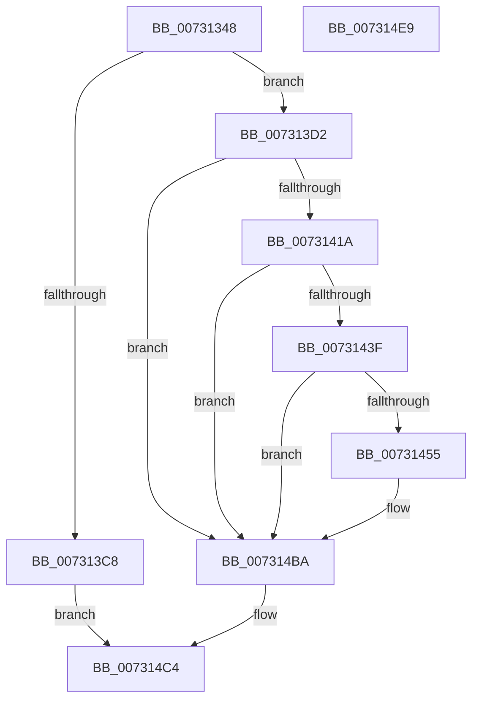

# PiAuCheckTokenMembership

- RVA: `0x00731348`–`0x007314EA` (길이 `418` bytes)
- VA: `0x0000000140731348`
- 실행 섹션: `PAGE`
- PDB 이름 있음: `예`; PDB Function 태그: `아니요`
- unwind 정보 RVA: `0x000C89D0`
- 디코드: `111`개 명령, `418/418` bytes 표시
- 미해석 바이트: `0` (있으면 어셈블리에 `.byte`로 보존)

> 이 문서는 커널 이미지의 기계어와 PDB 기호를 분석해 생성했습니다. 4번과 5번은 함수 원형과 자료형을 바이너리 사용 방식에서 추정한 C 해석이며 원본 소스 복구 결과는 아닙니다.

## 1. Dependencies

- 직접 호출 지점: **13**; 고유 호출 대상: **13**
- 직접 호출자로 확인된 함수: **1**
- RIP 상대 이미지 참조: **1**

### Outgoing calls
- `0x007313A3` → [RtlLengthSid](../../text/45/RtlLengthSid_function_0045D270.md) (function, `0x0045D270`)
- `0x007313BB` → [ExAllocatePool2](../../poolcode/B8/ExAllocatePool2_function_00B820F0.md) (function, `0x00B820F0`)
- `0x007313DE` → [RtlCreateSecurityDescriptor](../9F/RtlCreateSecurityDescriptor_function_009F1DF0.md) (function, `0x009F1DF0`)
- `0x007313EC` → [RtlSetOwnerSecurityDescriptor](../91/RtlSetOwnerSecurityDescriptor_function_00916F90.md) (function, `0x00916F90`)
- `0x007313FA` → [RtlSetGroupSecurityDescriptor](../A2/RtlSetGroupSecurityDescriptor_function_00A2EB10.md) (function, `0x00A2EB10`)
- `0x0073140B` → [RtlCreateAcl](../91/RtlCreateAcl_function_00916F00.md) (function, `0x00916F00`)
- `0x00731434` → [RtlpAddKnownAce](../92/RtlpAddKnownAce_function_00929A20.md) (function, `0x00929A20`)
- `0x0073144A` → [RtlSetDaclSecurityDescriptor](../9E/RtlSetDaclSecurityDescriptor_function_009EC210.md) (function, `0x009EC210`)
- `0x00731459` → [SeCaptureSubjectContext](../86/SeCaptureSubjectContext_function_0086B820.md) (function, `0x0086B820`)
- `0x007314A7` → [SeAccessCheck](../../text/3A/SeAccessCheck_function_003A6BC0.md) (function, `0x003A6BC0`)
- `0x007314B3` → [SeReleaseSubjectContext](../86/SeReleaseSubjectContext_function_0086B710.md) (function, `0x0086B710`)
- `0x007314BF` → [ExFreePoolWithTag](../../poolcode/B8/ExFreePoolWithTag_function_00B82870.md) (function, `0x00B82870`)
- `0x007314CD` → [_security_check_cookie](../../text/6A/_security_check_cookie_function_006AC640.md) (function, `0x006AC640`)

### Direct callers
- [PiAuCheckClientInteractive](PiAuCheckClientInteractive_function_00731284.md) at `0x00731314`

### Static image references
- `0x00731360` → RVA `0x00E0A740` (`.data`; read)

## 2. Other-region calls and transfers

- 다른 실행 섹션으로 향하는 call: **5**
  - `0x007313A3` → [RtlLengthSid](../../text/45/RtlLengthSid_function_0045D270.md) (`PAGE` → `.text`)
  - `0x007313BB` → [ExAllocatePool2](../../poolcode/B8/ExAllocatePool2_function_00B820F0.md) (`PAGE` → `POOLCODE`)
  - `0x007314A7` → [SeAccessCheck](../../text/3A/SeAccessCheck_function_003A6BC0.md) (`PAGE` → `.text`)
  - `0x007314BF` → [ExFreePoolWithTag](../../poolcode/B8/ExFreePoolWithTag_function_00B82870.md) (`PAGE` → `POOLCODE`)
  - `0x007314CD` → [_security_check_cookie](../../text/6A/_security_check_cookie_function_006AC640.md) (`PAGE` → `.text`)
- 별도 외부 분기/꼬리 이동을 확인하지 못했습니다.

## 3. Assembly (complete function range)

```asm
00731348  48 89 5C 24 18                  mov qword ptr [rsp + 0x18], rbx
0073134D  55                              push rbp
0073134E  56                              push rsi
0073134F  57                              push rdi
00731350  41 56                           push r14
00731352  41 57                           push r15
00731354  48 8D 6C 24 C9                  lea rbp, [rsp - 0x37]
00731359  48 81 EC 90 00 00 00            sub rsp, 0x90
00731360  48 8B 05 D9 93 6D 00            mov rax, qword ptr [rip + 0x6d93d9]
00731367  48 33 C4                        xor rax, rsp
0073136A  48 89 45 2F                     mov qword ptr [rbp + 0x2f], rax
0073136E  83 65 FB 00                     and dword ptr [rbp - 5], 0
00731372  0F 57 C0                        xorps xmm0, xmm0
00731375  83 65 F7 00                     and dword ptr [rbp - 9], 0
00731379  B8 00 00 02 00                  mov eax, 0x20000
0073137E  0F 11 45 FF                     movups xmmword ptr [rbp - 1], xmm0
00731382  89 45 23                        mov dword ptr [rbp + 0x23], eax
00731385  4C 8B FA                        mov r15, rdx
00731388  0F 11 45 0F                     movups xmmword ptr [rbp + 0xf], xmm0
0073138C  89 45 27                        mov dword ptr [rbp + 0x27], eax
0073138F  4C 8B F1                        mov r14, rcx
00731392  C7 45 1F 01 00 02 00            mov dword ptr [rbp + 0x1f], 0x20001
00731399  C7 45 2B 01 00 1F 00            mov dword ptr [rbp + 0x2b], 0x1f0001
007313A0  C6 02 00                        mov byte ptr [rdx], 0
007313A3  E8 C8 BE D2 FF                  call 0x14045d270
007313A8  83 C0 14                        add eax, 0x14
007313AB  B9 00 01 00 00                  mov ecx, 0x100
007313B0  41 B8 50 70 20 20               mov r8d, 0x20207050
007313B6  8D 1C 40                        lea ebx, [rax + rax*2]
007313B9  8B D3                           mov edx, ebx
007313BB  E8 30 0D 45 00                  call 0x140b820f0
007313C0  48 8B F8                        mov rdi, rax
007313C3  48 85 C0                        test rax, rax
007313C6  75 0A                           jne 0x1407313d2
007313C8  BB 9A 00 00 C0                  mov ebx, 0xc000009a
007313CD  E9 F2 00 00 00                  jmp 0x1407314c4
007313D2  BA 01 00 00 00                  mov edx, 1
007313D7  48 8D 70 28                     lea rsi, [rax + 0x28]
007313DB  48 8B CF                        mov rcx, rdi
007313DE  E8 0D 0A 2C 00                  call 0x1409f1df0
007313E3  45 33 C0                        xor r8d, r8d
007313E6  49 8B D6                        mov rdx, r14
007313E9  48 8B CF                        mov rcx, rdi
007313EC  E8 9F 5B 1E 00                  call 0x140916f90
007313F1  45 33 C0                        xor r8d, r8d
007313F4  49 8B D6                        mov rdx, r14
007313F7  48 8B CF                        mov rcx, rdi
007313FA  E8 11 D7 2F 00                  call 0x140a2eb10
007313FF  8D 53 D8                        lea edx, [rbx - 0x28]
00731402  41 B8 02 00 00 00               mov r8d, 2
00731408  48 8B CE                        mov rcx, rsi
0073140B  E8 F0 5A 1E 00                  call 0x140916f00
00731410  8B D8                           mov ebx, eax
00731412  85 C0                           test eax, eax
00731414  0F 88 A0 00 00 00               js 0x1407314ba
0073141A  41 B9 01 00 00 00               mov r9d, 1
00731420  C6 44 24 28 00                  mov byte ptr [rsp + 0x28], 0
00731425  45 33 C0                        xor r8d, r8d
00731428  4C 89 74 24 20                  mov qword ptr [rsp + 0x20], r14
0073142D  48 8B CE                        mov rcx, rsi
00731430  41 8D 51 01                     lea edx, [r9 + 1]
00731434  E8 E7 85 1F 00                  call 0x140929a20
00731439  8B D8                           mov ebx, eax
0073143B  85 C0                           test eax, eax
0073143D  78 7B                           js 0x1407314ba
0073143F  45 33 C9                        xor r9d, r9d
00731442  4C 8B C6                        mov r8, rsi
00731445  B2 01                           mov dl, 1
00731447  48 8B CF                        mov rcx, rdi
0073144A  E8 C1 AD 2B 00                  call 0x1409ec210
0073144F  8B D8                           mov ebx, eax
00731451  85 C0                           test eax, eax
00731453  78 65                           js 0x1407314ba
00731455  48 8D 4D FF                     lea rcx, [rbp - 1]
00731459  E8 C2 A3 13 00                  call 0x14086b820
0073145E  65 48 8B 04 25 88 01 00 00      mov rax, qword ptr gs:[0x188]
00731467  48 8D 55 FF                     lea rdx, [rbp - 1]
0073146B  41 B9 01 00 00 00               mov r9d, 1
00731471  45 33 C0                        xor r8d, r8d
00731474  8A 88 32 02 00 00               mov cl, byte ptr [rax + 0x232]
0073147A  48 8D 45 F7                     lea rax, [rbp - 9]
0073147E  48 89 44 24 48                  mov qword ptr [rsp + 0x48], rax
00731483  48 8D 45 FB                     lea rax, [rbp - 5]
00731487  48 89 44 24 40                  mov qword ptr [rsp + 0x40], rax
0073148C  48 8D 45 1F                     lea rax, [rbp + 0x1f]
00731490  88 4C 24 38                     mov byte ptr [rsp + 0x38], cl
00731494  48 8B CF                        mov rcx, rdi
00731497  48 89 44 24 30                  mov qword ptr [rsp + 0x30], rax
0073149C  48 83 64 24 28 00               and qword ptr [rsp + 0x28], 0
007314A2  83 64 24 20 00                  and dword ptr [rsp + 0x20], 0
007314A7  E8 14 57 C7 FF                  call 0x1403a6bc0
007314AC  48 8D 4D FF                     lea rcx, [rbp - 1]
007314B0  41 88 07                        mov byte ptr [r15], al
007314B3  E8 58 A2 13 00                  call 0x14086b710
007314B8  33 DB                           xor ebx, ebx
007314BA  33 D2                           xor edx, edx
007314BC  48 8B CF                        mov rcx, rdi
007314BF  E8 AC 13 45 00                  call 0x140b82870
007314C4  8B C3                           mov eax, ebx
007314C6  48 8B 4D 2F                     mov rcx, qword ptr [rbp + 0x2f]
007314CA  48 33 CC                        xor rcx, rsp
007314CD  E8 6E B1 F7 FF                  call 0x1406ac640
007314D2  48 8B 9C 24 D0 00 00 00         mov rbx, qword ptr [rsp + 0xd0]
007314DA  48 81 C4 90 00 00 00            add rsp, 0x90
007314E1  41 5F                           pop r15
007314E3  41 5E                           pop r14
007314E5  5F                              pop rdi
007314E6  5E                              pop rsi
007314E7  5D                              pop rbp
007314E8  C3                              ret
007314E9  CC                              int3
```

## 4. C-style interpretation (structured pseudocode)

```c
__int64 __fastcall PiAuCheckTokenMembership(__int64 a1, __int64 a2)
{
    __int64 result;
    __int64 v_rbx;
    __int64 v_rsp;
    unsigned __int64 v_stack_m30;
    unsigned int v_stack_m34;
    unsigned int v_stack_m38;
    unsigned int v_stack_m3C;
    unsigned int v_stack_m40;
    unsigned __int64 v_stack_m50;
    unsigned __int64 v_stack_m5F;
    unsigned __int64 v_stack_m60;
    unsigned int v_stack_m64;
    unsigned int v_stack_m68;
    unsigned __int64 v_stack_m70;
    unsigned __int64 v_stack_m78;
    unsigned __int8 v_stack_m80;
    unsigned __int64 v_stack_m88;
    unsigned __int8 v_stack_m90;
    unsigned __int64 v_stack_m98;
    unsigned __int64 v_stack_p18;

    v_stack_p18 = v_rbx;
    v_rsp = (v_rsp) - (144);
    result = (*(unsigned __int64 *)(v_rip + 7181273)) ^ (v_rsp);
    v_stack_m30 = result;
    v_stack_m60 = v_xmm0;
    v_stack_m3C = (unsigned int)((unsigned int)(0x20000ULL));
    v_stack_m50 = v_xmm0;
    v_stack_m38 = (unsigned int)((unsigned int)(0x20000ULL));
    v_stack_m40 = 0x20001ULL;
    v_stack_m34 = 0x1F0001ULL;
    *(unsigned __int8 *)(a2) = 0;
    result = RtlLengthSid(a1, a2, a3, a4);
    result = (unsigned int)((result) + (20));
    result = ExAllocatePool2(256, (unsigned int)((unsigned int)(result + result * 2)), (unsigned int)(0x20207050ULL), a4);
    if (result != 0) goto loc_007313D2;
    goto loc_007314C4;
loc_007313D2:
    result = RtlCreateSecurityDescriptor(result, 1, (unsigned int)(0x20207050ULL), a4);
    a3 = 0;
    result = RtlSetOwnerSecurityDescriptor(result, a1, a3, a4);
    a3 = 0;
    result = RtlSetGroupSecurityDescriptor(result, a1, a3, a4);
    result = RtlCreateAcl(result + 40, (unsigned int)(0xC000009AULL) - 40, 2, a4);
    if (sign_flag) goto loc_007314BA;
    v_stack_m90 = 0;
    a3 = 0;
    v_stack_m98 = a1;
    result = RtlpAddKnownAce(result + 40, 1 + 1, a3, 1);
    if (sign_flag) goto loc_007314BA;
    a4 = 0;
    result = RtlSetDaclSecurityDescriptor(result, 1, result + 40, a4);
    v_rbx = (unsigned int)((unsigned int)(result));
    if (!(sign_flag)) {
        a1 = v_stack_m60;
        result = SeCaptureSubjectContext(a1, 1, result + 40, a4);
        result = *(unsigned __int64 *)(gs_base + (0 + 392));
        a2 = v_stack_m60;
        a4 = 1;
        a3 = 0;
        a1 = *(unsigned __int8 *)(result + 562);
        result = v_stack_m68;
        v_stack_m70 = result;
        result = v_stack_m64;
        v_stack_m78 = result;
        result = v_stack_m40;
        v_stack_m80 = (unsigned __int8)(a1);
        a1 = result;
        v_stack_m88 = result;
        result = SeAccessCheck(a1, a2, a3, a4);
        a1 = v_stack_m60;
        *(unsigned __int8 *)(a2) = (unsigned __int8)(result);
        result = SeReleaseSubjectContext(a1, a2, a3, a4);
        v_rbx = 0;
    }
    a2 = 0;
    result = ExFreePoolWithTag(result, a2, a3, a4);
loc_007314C4:
    a1 = (v_stack_m30) ^ (v_rsp);
    result = _security_check_cookie(a1, a2, a3, a4);
    v_rsp = (v_rsp) + (144);
    return result;
}
```

## 5. (Beta) C Style

```c
int64_t PiAuCheckTokenMembership(int64_t Arg1, void *Arg2)
{
    uint8_t *arg2 = (uint8_t *)Arg2;

    int64_t result;
    int64_t local_rbx;
    int64_t local_rsp;
    uint64_t v_stack_m30;
    uint32_t v_stack_m34;
    uint32_t v_stack_m38;
    uint32_t v_stack_m3C;
    uint32_t v_stack_m40;
    uint64_t v_stack_m50;
    uint64_t v_stack_m5F;
    uint64_t v_stack_m60;
    uint32_t v_stack_m64;
    uint32_t v_stack_m68;
    uint64_t v_stack_m70;
    uint64_t v_stack_m78;
    uint8_t v_stack_m80;
    uint64_t v_stack_m88;
    uint8_t v_stack_m90;
    uint64_t v_stack_m98;
    uint64_t v_stack_p18;

    v_stack_p18 = local_rbx;
    local_rsp = (local_rsp) - (144);
    result = (*(uint64_t *)(v_rip + 0x6D93D9)) ^ (local_rsp);
    v_stack_m30 = result;
    v_stack_m60 = v_xmm0;
    v_stack_m3C = (uint32_t)((uint32_t)(0x20000ULL));
    v_stack_m50 = v_xmm0;
    v_stack_m38 = (uint32_t)((uint32_t)(0x20000ULL));
    v_stack_m40 = 0x20001ULL;
    v_stack_m34 = 0x1F0001ULL;
    *(uint8_t *)(arg2) = 0;
    result = RtlLengthSid(Arg1, Arg2, a3, a4);
    result = (uint32_t)((result) + (20));
    result = ExAllocatePool2(256, (uint32_t)((uint32_t)(result + result * 2)), (uint32_t)(0x20207050ULL), a4);
    if (result != 0) goto loc_007313D2;
    goto loc_007314C4;
loc_007313D2:
    result = RtlCreateSecurityDescriptor(result, 1, (uint32_t)(0x20207050ULL), a4);
    a3 = 0;
    result = RtlSetOwnerSecurityDescriptor(result, Arg1, a3, a4);
    a3 = 0;
    result = RtlSetGroupSecurityDescriptor(result, Arg1, a3, a4);
    result = RtlCreateAcl(result + 40, (uint32_t)(0xC000009AULL) - 40, 2, a4);
    if (sign_flag) goto loc_007314BA;
    v_stack_m90 = 0;
    a3 = 0;
    v_stack_m98 = Arg1;
    result = RtlpAddKnownAce(result + 40, 1 + 1, a3, 1);
    if (sign_flag) goto loc_007314BA;
    a4 = 0;
    result = RtlSetDaclSecurityDescriptor(result, 1, result + 40, a4);
    local_rbx = (uint32_t)((uint32_t)(result));
    if (!(sign_flag)) {
        Arg1 = v_stack_m60;
        result = SeCaptureSubjectContext(Arg1, 1, result + 40, a4);
        result = *(uint64_t *)(gs_base + (0 + 0x188));
        Arg2 = v_stack_m60;
        a4 = 1;
        a3 = 0;
        Arg1 = *(uint8_t *)(result + 0x232);
        result = v_stack_m68;
        v_stack_m70 = result;
        result = v_stack_m64;
        v_stack_m78 = result;
        result = v_stack_m40;
        v_stack_m80 = (uint8_t)(Arg1);
        Arg1 = result;
        v_stack_m88 = result;
        result = SeAccessCheck(Arg1, Arg2, a3, a4);
        Arg1 = v_stack_m60;
        *(uint8_t *)(arg2) = (uint8_t)(result);
        result = SeReleaseSubjectContext(Arg1, Arg2, a3, a4);
        local_rbx = 0;
    }
    Arg2 = 0;
    result = ExFreePoolWithTag(result, Arg2, a3, a4);
loc_007314C4:
    Arg1 = (v_stack_m30) ^ (local_rsp);
    result = _security_check_cookie(Arg1, Arg2, a3, a4);
    local_rsp = (local_rsp) + (144);
    return result;
}
```

### 관측된 메모리 오프셋

구조체 형식이 확인되지 않은 접근은 인자 기준의 오프셋으로만 기록했습니다.

| 기준 인자 | 오프셋 표현 | 폭 (bit) | 접근 |
|---|---:|---:|---|
| `Arg2` | `+ 0x0` | `8` | `W` |

## 6. Execution-region graph

[열기: 2D/3D 그래프와 함수 탐색 컨트롤 패널](../../../control-panel.html?section=page&rva=0x00731348&view=graph)

- 2D 그래프는 위에서 아래로 흐르고, 3D 그래프는 빈 공간을 드래그해 회전합니다. Shift+드래그는 이동, 휠은 확대·축소, 함수 노드 선택은 대상 보고서 이동입니다.

### Static fallback


