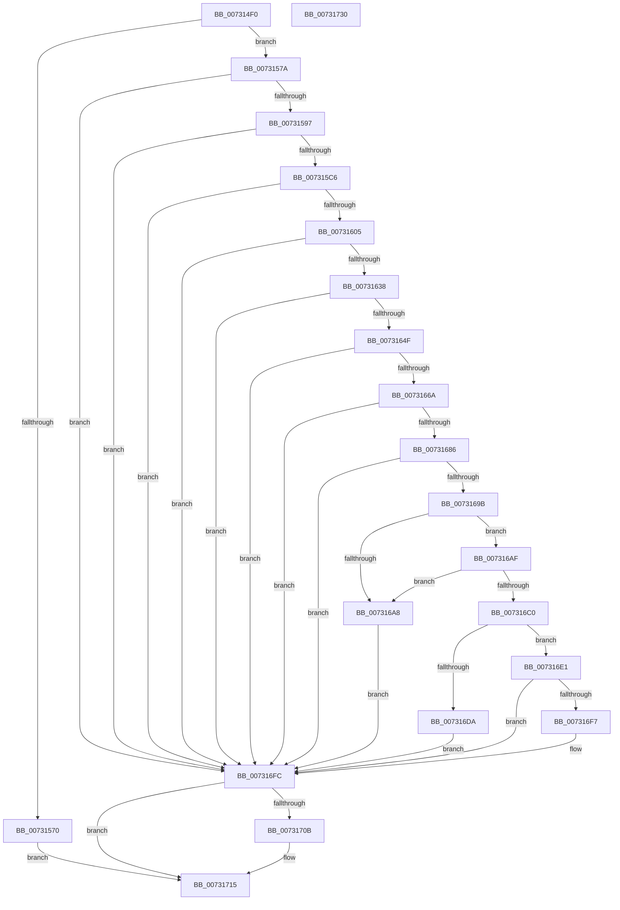

# PiAuGetServiceStateSecurityObject

- RVA: `0x007314F0`–`0x00731731` (길이 `577` bytes)
- VA: `0x00000001407314F0`
- 실행 섹션: `PAGE`
- PDB 이름 있음: `예`; PDB Function 태그: `아니요`
- unwind 정보 RVA: `0x000C8A50`
- 디코드: `161`개 명령, `577/577` bytes 표시
- 미해석 바이트: `0` (있으면 어셈블리에 `.byte`로 보존)

> 이 문서는 커널 이미지의 기계어와 PDB 기호를 분석해 생성했습니다. 4번과 5번은 함수 원형과 자료형을 바이너리 사용 방식에서 추정한 C 해석이며 원본 소스 복구 결과는 아닙니다.

## 1. Dependencies

- 직접 호출 지점: **18**; 고유 호출 대상: **12**
- 직접 호출자로 확인된 함수: **2**
- RIP 상대 이미지 참조: **3**

### Outgoing calls
- `0x00731530` → [RtlLengthSid](../../text/45/RtlLengthSid_function_0045D270.md) (function, `0x0045D270`)
- `0x0073153E` → [RtlLengthSid](../../text/45/RtlLengthSid_function_0045D270.md) (function, `0x0045D270`)
- `0x0073154C` → [RtlLengthSid](../../text/45/RtlLengthSid_function_0045D270.md) (function, `0x0045D270`)
- `0x00731563` → [ExAllocatePool2](../../poolcode/B8/ExAllocatePool2_function_00B820F0.md) (function, `0x00B820F0`)
- `0x00731588` → [RtlCreateAcl](../91/RtlCreateAcl_function_00916F00.md) (function, `0x00916F00`)
- `0x007315B7` → [RtlpAddKnownAce](../92/RtlpAddKnownAce_function_00929A20.md) (function, `0x00929A20`)
- `0x007315F6` → [RtlpAddKnownAce](../92/RtlpAddKnownAce_function_00929A20.md) (function, `0x00929A20`)
- `0x00731629` → [RtlpAddKnownAce](../92/RtlpAddKnownAce_function_00929A20.md) (function, `0x00929A20`)
- `0x00731640` → [RtlCreateSecurityDescriptor](../9F/RtlCreateSecurityDescriptor_function_009F1DF0.md) (function, `0x009F1DF0`)
- `0x0073165B` → [RtlSetDaclSecurityDescriptor](../9E/RtlSetDaclSecurityDescriptor_function_009EC210.md) (function, `0x009EC210`)
- `0x0073167B` → [RtlSetOwnerSecurityDescriptor](../91/RtlSetOwnerSecurityDescriptor_function_00916F90.md) (function, `0x00916F90`)
- `0x00731690` → [RtlSetGroupSecurityDescriptor](../A2/RtlSetGroupSecurityDescriptor_function_00A2EB10.md) (function, `0x00A2EB10`)
- `0x0073169F` → [RtlValidSecurityDescriptor](../8B/RtlValidSecurityDescriptor_function_008BD3F0.md) (function, `0x008BD3F0`)
- `0x007316B3` → [RtlLengthSecurityDescriptor](../8B/RtlLengthSecurityDescriptor_function_008BC870.md) (function, `0x008BC870`)
- `0x007316CD` → [ExAllocatePool2](../../poolcode/B8/ExAllocatePool2_function_00B820F0.md) (function, `0x00B820F0`)
- `0x007316EC` → [RtlAbsoluteToSelfRelativeSD](../A1/RtlAbsoluteToSelfRelativeSD_function_00A119B0.md) (function, `0x00A119B0`)
- `0x00731701` → [ExFreePoolWithTag](../../poolcode/B8/ExFreePoolWithTag_function_00B82870.md) (function, `0x00B82870`)
- `0x00731710` → [ExFreePoolWithTag](../../poolcode/B8/ExFreePoolWithTag_function_00B82870.md) (function, `0x00B82870`)

### Direct callers
- [PiCreateServiceKeyUnderPath](../72/PiCreateServiceKeyUnderPath_function_00728DEC.md) at `0x00728F37`
- [sub_00B2CD22](../B2/Unknown_function_00B2CD22.md) at `0x00B2CD32`

### Static image references
- `0x0073150F` → RVA `0x00FD9AA0` (`PAGEDATA`; read)
- `0x00731535` → RVA `0x00FD9A68` (`PAGEDATA`; read)
- `0x00731543` → RVA `0x00E67D58` (`.data`; read)

## 2. Other-region calls and transfers

- 다른 실행 섹션으로 향하는 call: **7**
  - `0x00731530` → [RtlLengthSid](../../text/45/RtlLengthSid_function_0045D270.md) (`PAGE` → `.text`)
  - `0x0073153E` → [RtlLengthSid](../../text/45/RtlLengthSid_function_0045D270.md) (`PAGE` → `.text`)
  - `0x0073154C` → [RtlLengthSid](../../text/45/RtlLengthSid_function_0045D270.md) (`PAGE` → `.text`)
  - `0x00731563` → [ExAllocatePool2](../../poolcode/B8/ExAllocatePool2_function_00B820F0.md) (`PAGE` → `POOLCODE`)
  - `0x007316CD` → [ExAllocatePool2](../../poolcode/B8/ExAllocatePool2_function_00B820F0.md) (`PAGE` → `POOLCODE`)
  - `0x00731701` → [ExFreePoolWithTag](../../poolcode/B8/ExFreePoolWithTag_function_00B82870.md) (`PAGE` → `POOLCODE`)
  - `0x00731710` → [ExFreePoolWithTag](../../poolcode/B8/ExFreePoolWithTag_function_00B82870.md) (`PAGE` → `POOLCODE`)
- 별도 외부 분기/꼬리 이동을 확인하지 못했습니다.

## 3. Assembly (complete function range)

```asm
007314F0  48 89 5C 24 08                  mov qword ptr [rsp + 8], rbx
007314F5  48 89 74 24 10                  mov qword ptr [rsp + 0x10], rsi
007314FA  55                              push rbp
007314FB  57                              push rdi
007314FC  41 55                           push r13
007314FE  41 56                           push r14
00731500  41 57                           push r15
00731502  48 8B EC                        mov rbp, rsp
00731505  48 83 EC 60                     sub rsp, 0x60
00731509  44 8A F1                        mov r14b, cl
0073150C  0F 57 C0                        xorps xmm0, xmm0
0073150F  48 8B 0D 8A 85 8A 00            mov rcx, qword ptr [rip + 0x8a858a]
00731516  33 C0                           xor eax, eax
00731518  4C 8B FA                        mov r15, rdx
0073151B  48 89 45 F0                     mov qword ptr [rbp - 0x10], rax
0073151F  0F 11 45 D0                     movups xmmword ptr [rbp - 0x30], xmm0
00731523  33 FF                           xor edi, edi
00731525  48 8B 89 10 02 00 00            mov rcx, qword ptr [rcx + 0x210]
0073152C  0F 11 45 E0                     movups xmmword ptr [rbp - 0x20], xmm0
00731530  E8 3B BD D2 FF                  call 0x14045d270
00731535  48 8B 0D 2C 85 8A 00            mov rcx, qword ptr [rip + 0x8a852c]
0073153C  8B D8                           mov ebx, eax
0073153E  E8 2D BD D2 FF                  call 0x14045d270
00731543  48 8B 0D 0E 68 73 00            mov rcx, qword ptr [rip + 0x73680e]
0073154A  03 D8                           add ebx, eax
0073154C  E8 1F BD D2 FF                  call 0x14045d270
00731551  83 C0 20                        add eax, 0x20
00731554  B9 00 01 00 00                  mov ecx, 0x100
00731559  03 D8                           add ebx, eax
0073155B  41 B8 50 70 20 20               mov r8d, 0x20207050
00731561  8B D3                           mov edx, ebx
00731563  E8 88 0B 45 00                  call 0x140b820f0
00731568  48 8B F0                        mov rsi, rax
0073156B  48 85 C0                        test rax, rax
0073156E  75 0A                           jne 0x14073157a
00731570  BB 9A 00 00 C0                  mov ebx, 0xc000009a
00731575  E9 9B 01 00 00                  jmp 0x140731715
0073157A  41 BD 02 00 00 00               mov r13d, 2
00731580  8B D3                           mov edx, ebx
00731582  45 8B C5                        mov r8d, r13d
00731585  48 8B CE                        mov rcx, rsi
00731588  E8 73 59 1E 00                  call 0x140916f00
0073158D  8B D8                           mov ebx, eax
0073158F  85 C0                           test eax, eax
00731591  0F 88 65 01 00 00               js 0x1407316fc
00731597  48 8B 05 BA 67 73 00            mov rax, qword ptr [rip + 0x7367ba]
0073159E  41 B9 3F 00 0F 00               mov r9d, 0xf003f
007315A4  40 88 7C 24 28                  mov byte ptr [rsp + 0x28], dil
007315A9  45 8B C5                        mov r8d, r13d
007315AC  41 8B D5                        mov edx, r13d
007315AF  48 89 44 24 20                  mov qword ptr [rsp + 0x20], rax
007315B4  48 8B CE                        mov rcx, rsi
007315B7  E8 64 84 1F 00                  call 0x140929a20
007315BC  8B D8                           mov ebx, eax
007315BE  85 C0                           test eax, eax
007315C0  0F 88 36 01 00 00               js 0x1407316fc
007315C6  48 8B 05 9B 84 8A 00            mov rax, qword ptr [rip + 0x8a849b]
007315CD  41 F6 DE                        neg r14b
007315D0  41 BE 19 00 02 00               mov r14d, 0x20019
007315D6  40 88 7C 24 28                  mov byte ptr [rsp + 0x28], dil
007315DB  45 1B C9                        sbb r9d, r9d
007315DE  48 89 44 24 20                  mov qword ptr [rsp + 0x20], rax
007315E3  41 81 E1 06 00 01 00            and r9d, 0x10006
007315EA  45 8B C5                        mov r8d, r13d
007315ED  45 03 CE                        add r9d, r14d
007315F0  41 8B D5                        mov edx, r13d
007315F3  48 8B CE                        mov rcx, rsi
007315F6  E8 25 84 1F 00                  call 0x140929a20
007315FB  8B D8                           mov ebx, eax
007315FD  85 C0                           test eax, eax
007315FF  0F 88 F7 00 00 00               js 0x1407316fc
00731605  48 8B 05 94 84 8A 00            mov rax, qword ptr [rip + 0x8a8494]
0073160C  45 8B CE                        mov r9d, r14d
0073160F  40 88 7C 24 28                  mov byte ptr [rsp + 0x28], dil
00731614  45 8B C5                        mov r8d, r13d
00731617  41 8B D5                        mov edx, r13d
0073161A  48 8B 88 10 02 00 00            mov rcx, qword ptr [rax + 0x210]
00731621  48 89 4C 24 20                  mov qword ptr [rsp + 0x20], rcx
00731626  48 8B CE                        mov rcx, rsi
00731629  E8 F2 83 1F 00                  call 0x140929a20
0073162E  8B D8                           mov ebx, eax
00731630  85 C0                           test eax, eax
00731632  0F 88 C4 00 00 00               js 0x1407316fc
00731638  41 8D 55 FF                     lea edx, [r13 - 1]
0073163C  48 8D 4D D0                     lea rcx, [rbp - 0x30]
00731640  E8 AB 07 2C 00                  call 0x1409f1df0
00731645  8B D8                           mov ebx, eax
00731647  85 C0                           test eax, eax
00731649  0F 88 AD 00 00 00               js 0x1407316fc
0073164F  45 33 C9                        xor r9d, r9d
00731652  48 8D 4D D0                     lea rcx, [rbp - 0x30]
00731656  4C 8B C6                        mov r8, rsi
00731659  B2 01                           mov dl, 1
0073165B  E8 B0 AB 2B 00                  call 0x1409ec210
00731660  8B D8                           mov ebx, eax
00731662  85 C0                           test eax, eax
00731664  0F 88 92 00 00 00               js 0x1407316fc
0073166A  4C 8B 35 E7 66 73 00            mov r14, qword ptr [rip + 0x7366e7]
00731671  48 8D 4D D0                     lea rcx, [rbp - 0x30]
00731675  49 8B D6                        mov rdx, r14
00731678  45 33 C0                        xor r8d, r8d
0073167B  E8 10 59 1E 00                  call 0x140916f90
00731680  8B D8                           mov ebx, eax
00731682  85 C0                           test eax, eax
00731684  78 76                           js 0x1407316fc
00731686  45 33 C0                        xor r8d, r8d
00731689  48 8D 4D D0                     lea rcx, [rbp - 0x30]
0073168D  49 8B D6                        mov rdx, r14
00731690  E8 7B D4 2F 00                  call 0x140a2eb10
00731695  8B D8                           mov ebx, eax
00731697  85 C0                           test eax, eax
00731699  78 61                           js 0x1407316fc
0073169B  48 8D 4D D0                     lea rcx, [rbp - 0x30]
0073169F  E8 4C BD 18 00                  call 0x1408bd3f0
007316A4  84 C0                           test al, al
007316A6  75 07                           jne 0x1407316af
007316A8  BB E5 00 00 C0                  mov ebx, 0xc00000e5
007316AD  EB 4D                           jmp 0x1407316fc
007316AF  48 8D 4D D0                     lea rcx, [rbp - 0x30]
007316B3  E8 B8 B1 18 00                  call 0x1408bc870
007316B8  89 45 40                        mov dword ptr [rbp + 0x40], eax
007316BB  83 F8 28                        cmp eax, 0x28
007316BE  72 E8                           jb 0x1407316a8
007316C0  8B D0                           mov edx, eax
007316C2  B9 00 01 00 00                  mov ecx, 0x100
007316C7  41 B8 50 70 20 20               mov r8d, 0x20207050
007316CD  E8 1E 0A 45 00                  call 0x140b820f0
007316D2  48 8B F8                        mov rdi, rax
007316D5  48 85 C0                        test rax, rax
007316D8  75 07                           jne 0x1407316e1
007316DA  BB 9A 00 00 C0                  mov ebx, 0xc000009a
007316DF  EB 1B                           jmp 0x1407316fc
007316E1  4C 8D 45 40                     lea r8, [rbp + 0x40]
007316E5  48 8B D7                        mov rdx, rdi
007316E8  48 8D 4D D0                     lea rcx, [rbp - 0x30]
007316EC  E8 BF 02 2E 00                  call 0x140a119b0
007316F1  8B D8                           mov ebx, eax
007316F3  85 C0                           test eax, eax
007316F5  78 05                           js 0x1407316fc
007316F7  49 89 3F                        mov qword ptr [r15], rdi
007316FA  33 FF                           xor edi, edi
007316FC  33 D2                           xor edx, edx
007316FE  48 8B CE                        mov rcx, rsi
00731701  E8 6A 11 45 00                  call 0x140b82870
00731706  48 85 FF                        test rdi, rdi
00731709  74 0A                           je 0x140731715
0073170B  33 D2                           xor edx, edx
0073170D  48 8B CF                        mov rcx, rdi
00731710  E8 5B 11 45 00                  call 0x140b82870
00731715  4C 8D 5C 24 60                  lea r11, [rsp + 0x60]
0073171A  8B C3                           mov eax, ebx
0073171C  49 8B 5B 30                     mov rbx, qword ptr [r11 + 0x30]
00731720  49 8B 73 38                     mov rsi, qword ptr [r11 + 0x38]
00731724  49 8B E3                        mov rsp, r11
00731727  41 5F                           pop r15
00731729  41 5E                           pop r14
0073172B  41 5D                           pop r13
0073172D  5F                              pop rdi
0073172E  5D                              pop rbp
0073172F  C3                              ret
00731730  CC                              int3
```

## 4. C-style interpretation (structured pseudocode)

```c
__int64 __fastcall PiAuGetServiceStateSecurityObject(unsigned __int8 a1, __int64 a2)
{
    __int64 result;
    __int64 v_r14;
    __int64 v_rbx;
    __int64 v_rdi;
    __int64 v_rsp;
    unsigned __int64 v_stack_m28;
    unsigned __int64 v_stack_m38;
    unsigned __int64 v_stack_m48;
    unsigned __int64 v_stack_m58;
    unsigned __int8 v_stack_m60;
    unsigned __int64 v_stack_m68;
    unsigned __int64 v_stack_p10;
    unsigned int v_stack_p18;
    unsigned __int64 v_stack_p8;

    v_stack_p8 = v_rbx;
    v_stack_p10 = v_rsi;
    v_rsp = (v_rsp) - (96);
    result = 0;
    v_stack_m38 = 0;
    v_stack_m58 = v_xmm0;
    v_rdi = 0;
    v_stack_m48 = v_xmm0;
    result = RtlLengthSid(*(unsigned __int64 *)(*(unsigned __int64 *)(v_rip + 9078154) + 528), a2, a3, a4);
    result = RtlLengthSid(*(unsigned __int64 *)(v_rip + 9078060), a2, a3, a4);
    v_rbx = (unsigned int)(((unsigned int)((unsigned int)(result))) + ((unsigned int)(result)));
    result = RtlLengthSid(*(unsigned __int64 *)(v_rip + 7563278), a2, a3, a4);
    result = (unsigned int)((result) + (32));
    v_rbx = (unsigned int)((v_rbx) + ((unsigned int)(result)));
    result = ExAllocatePool2(256, (unsigned int)((unsigned int)(v_rbx)), (unsigned int)(0x20207050ULL), a4);
    if (result != 0) goto loc_0073157A;
    goto loc_00731715;
loc_0073157A:
    result = RtlCreateAcl(result, (unsigned int)((unsigned int)((unsigned int)(0xC000009AULL))), 2, a4);
    if (sign_flag) goto loc_007316FC;
    v_stack_m60 = 0;
    v_stack_m68 = *(unsigned __int64 *)(v_rip + 7563194);
    result = RtlpAddKnownAce(result, 2, 2, (unsigned int)(0xF003FULL));
    if (sign_flag) goto loc_007316FC;
    v_r14 = (unsigned __int8)(-(a1));
    v_stack_m60 = 0;
    v_stack_m68 = *(unsigned __int64 *)(v_rip + 9077915);
    a4 = (unsigned int)(((unsigned int)(0xF003FULL)) & (0x10006ULL));
    a4 = (unsigned int)((a4) + ((unsigned int)((unsigned int)(0x20019ULL))));
    result = RtlpAddKnownAce(result, 2, 2, a4);
    if (sign_flag) goto loc_007316FC;
    v_stack_m60 = 0;
    v_stack_m68 = *(unsigned __int64 *)(*(unsigned __int64 *)(v_rip + 9077908) + 528);
    result = RtlpAddKnownAce(result, 2, 2, (unsigned int)((unsigned int)((unsigned int)(0x20019ULL))));
    if (sign_flag) goto loc_007316FC;
    result = RtlCreateSecurityDescriptor(v_stack_m58, 2 - 1, 2, (unsigned int)((unsigned int)((unsigned int)(0x20019ULL))));
    if (sign_flag) goto loc_007316FC;
    a4 = 0;
    result = RtlSetDaclSecurityDescriptor(v_stack_m58, 1, result, a4);
    if (sign_flag) goto loc_007316FC;
    a3 = 0;
    result = RtlSetOwnerSecurityDescriptor(v_stack_m58, *(unsigned __int64 *)(v_rip + 7562983), a3, a4);
    if (sign_flag) goto loc_007316FC;
    a3 = 0;
    result = RtlSetGroupSecurityDescriptor(v_stack_m58, *(unsigned __int64 *)(v_rip + 7562983), a3, a4);
    if (sign_flag) goto loc_007316FC;
    result = RtlValidSecurityDescriptor(v_stack_m58, *(unsigned __int64 *)(v_rip + 7562983), a3, a4);
    if ((unsigned __int8)(result) != 0) goto loc_007316AF;
loc_007316A8:
    goto loc_007316FC;
loc_007316AF:
    result = RtlLengthSecurityDescriptor(v_stack_m58, *(unsigned __int64 *)(v_rip + 7562983), a3, a4);
    v_stack_p18 = (unsigned int)(result);
    if (((unsigned int)(result)) < 40) goto loc_007316A8;
    result = ExAllocatePool2(256, (unsigned int)((unsigned int)(result)), (unsigned int)(0x20207050ULL), a4);
    if (result != 0) goto loc_007316E1;
    goto loc_007316FC;
loc_007316E1:
    result = RtlAbsoluteToSelfRelativeSD(v_stack_m58, result, v_stack_p18, a4);
    v_rdi = result;
    if (!(sign_flag)) {
        *(unsigned __int64 *)(a2) = result;
        v_rdi = 0;
    }
    a2 = 0;
    result = ExFreePoolWithTag(result, a2, v_stack_p18, a4);
    if (0 != 0) {
        a2 = 0;
        a1 = 0;
        result = ExFreePoolWithTag(a1, a2, v_stack_p18, a4);
    }
    return (unsigned int)((unsigned int)((unsigned int)((unsigned int)(result))));
}
```

## 5. (Beta) C Style

```c
int64_t PiAuGetServiceStateSecurityObject(uint8_t Arg1, void *Arg2)
{
    uint8_t *arg2 = (uint8_t *)Arg2;

    int64_t result;
    int64_t local_r14;
    int64_t local_rbx;
    int64_t local_rdi;
    int64_t local_rsp;
    uint64_t v_stack_m28;
    uint64_t v_stack_m38;
    uint64_t v_stack_m48;
    uint64_t v_stack_m58;
    uint8_t v_stack_m60;
    uint64_t v_stack_m68;
    uint64_t v_stack_p10;
    uint32_t v_stack_p18;
    uint64_t v_stack_p8;

    v_stack_p8 = local_rbx;
    v_stack_p10 = local_rsi;
    local_rsp = (local_rsp) - (96);
    result = 0;
    v_stack_m38 = 0;
    v_stack_m58 = v_xmm0;
    local_rdi = 0;
    v_stack_m48 = v_xmm0;
    result = RtlLengthSid(*(uint64_t *)(*(uint64_t *)(v_rip + 0x8A858A) + 0x210), Arg2, a3, a4);
    result = RtlLengthSid(*(uint64_t *)(v_rip + 0x8A852C), Arg2, a3, a4);
    local_rbx = (uint32_t)(((uint32_t)((uint32_t)(result))) + ((uint32_t)(result)));
    result = RtlLengthSid(*(uint64_t *)(v_rip + 0x73680E), Arg2, a3, a4);
    result = (uint32_t)((result) + (32));
    local_rbx = (uint32_t)((local_rbx) + ((uint32_t)(result)));
    result = ExAllocatePool2(256, (uint32_t)((uint32_t)(local_rbx)), (uint32_t)(0x20207050ULL), a4);
    if (result != 0) goto loc_0073157A;
    goto loc_00731715;
loc_0073157A:
    result = RtlCreateAcl(result, (uint32_t)((uint32_t)((uint32_t)(0xC000009AULL))), 2, a4);
    if (sign_flag) goto loc_007316FC;
    v_stack_m60 = 0;
    v_stack_m68 = *(uint64_t *)(v_rip + 0x7367BA);
    result = RtlpAddKnownAce(result, 2, 2, (uint32_t)(0xF003FULL));
    if (sign_flag) goto loc_007316FC;
    local_r14 = (uint8_t)(-(Arg1));
    v_stack_m60 = 0;
    v_stack_m68 = *(uint64_t *)(v_rip + 0x8A849B);
    a4 = (uint32_t)(((uint32_t)(0xF003FULL)) & (0x10006ULL));
    a4 = (uint32_t)((a4) + ((uint32_t)((uint32_t)(0x20019ULL))));
    result = RtlpAddKnownAce(result, 2, 2, a4);
    if (sign_flag) goto loc_007316FC;
    v_stack_m60 = 0;
    v_stack_m68 = *(uint64_t *)(*(uint64_t *)(v_rip + 0x8A8494) + 0x210);
    result = RtlpAddKnownAce(result, 2, 2, (uint32_t)((uint32_t)((uint32_t)(0x20019ULL))));
    if (sign_flag) goto loc_007316FC;
    result = RtlCreateSecurityDescriptor(v_stack_m58, 2 - 1, 2, (uint32_t)((uint32_t)((uint32_t)(0x20019ULL))));
    if (sign_flag) goto loc_007316FC;
    a4 = 0;
    result = RtlSetDaclSecurityDescriptor(v_stack_m58, 1, result, a4);
    if (sign_flag) goto loc_007316FC;
    a3 = 0;
    result = RtlSetOwnerSecurityDescriptor(v_stack_m58, *(uint64_t *)(v_rip + 0x7366E7), a3, a4);
    if (sign_flag) goto loc_007316FC;
    a3 = 0;
    result = RtlSetGroupSecurityDescriptor(v_stack_m58, *(uint64_t *)(v_rip + 0x7366E7), a3, a4);
    if (sign_flag) goto loc_007316FC;
    result = RtlValidSecurityDescriptor(v_stack_m58, *(uint64_t *)(v_rip + 0x7366E7), a3, a4);
    if ((uint8_t)(result) != 0) goto loc_007316AF;
loc_007316A8:
    goto loc_007316FC;
loc_007316AF:
    result = RtlLengthSecurityDescriptor(v_stack_m58, *(uint64_t *)(v_rip + 0x7366E7), a3, a4);
    v_stack_p18 = (uint32_t)(result);
    if (((uint32_t)(result)) < 40) goto loc_007316A8;
    result = ExAllocatePool2(256, (uint32_t)((uint32_t)(result)), (uint32_t)(0x20207050ULL), a4);
    if (result != 0) goto loc_007316E1;
    goto loc_007316FC;
loc_007316E1:
    result = RtlAbsoluteToSelfRelativeSD(v_stack_m58, result, v_stack_p18, a4);
    local_rdi = result;
    if (!(sign_flag)) {
        *(uint64_t *)(arg2) = result;
        local_rdi = 0;
    }
    Arg2 = 0;
    result = ExFreePoolWithTag(result, Arg2, v_stack_p18, a4);
    if (0 != 0) {
        Arg2 = 0;
        Arg1 = 0;
        result = ExFreePoolWithTag(Arg1, Arg2, v_stack_p18, a4);
    }
    return (uint32_t)((uint32_t)((uint32_t)((uint32_t)(result))));
}
```

### 관측된 메모리 오프셋

구조체 형식이 확인되지 않은 접근은 인자 기준의 오프셋으로만 기록했습니다.

| 기준 인자 | 오프셋 표현 | 폭 (bit) | 접근 |
|---|---:|---:|---|
| `Arg2` | `+ 0x0` | `64` | `W` |

## 6. Execution-region graph

[열기: 2D/3D 그래프와 함수 탐색 컨트롤 패널](../../../control-panel.html?section=page&rva=0x007314F0&view=graph)

- 2D 그래프는 위에서 아래로 흐르고, 3D 그래프는 빈 공간을 드래그해 회전합니다. Shift+드래그는 이동, 휠은 확대·축소, 함수 노드 선택은 대상 보고서 이동입니다.

### Static fallback


