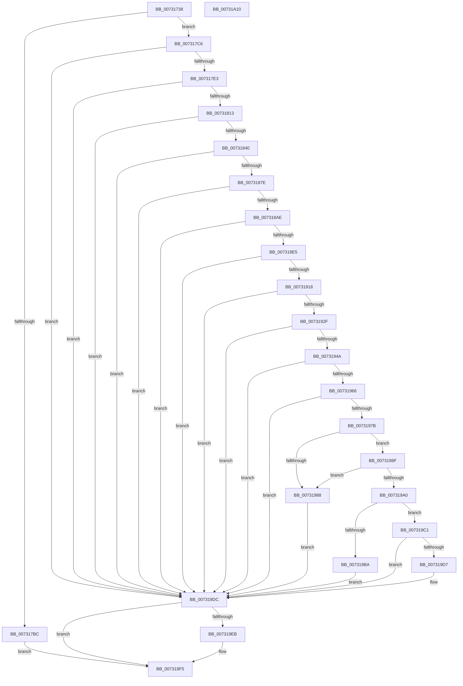

# PiAuGetStateDirectorySecurityObject

- RVA: `0x00731738`–`0x00731A11` (길이 `729` bytes)
- VA: `0x0000000140731738`
- 실행 섹션: `PAGE`
- PDB 이름 있음: `예`; PDB Function 태그: `아니요`
- unwind 정보 RVA: `0x000C8A50`
- 디코드: `195`개 명령, `729/729` bytes 표시
- 미해석 바이트: `0` (있으면 어셈블리에 `.byte`로 보존)

> 이 문서는 커널 이미지의 기계어와 PDB 기호를 분석해 생성했습니다. 4번과 5번은 함수 원형과 자료형을 바이너리 사용 방식에서 추정한 C 해석이며 원본 소스 복구 결과는 아닙니다.

## 1. Dependencies

- 직접 호출 지점: **21**; 고유 호출 대상: **12**
- 직접 호출자로 확인된 함수: **1**
- RIP 상대 이미지 참조: **3**

### Outgoing calls
- `0x00731778` → [RtlLengthSid](../../text/45/RtlLengthSid_function_0045D270.md) (function, `0x0045D270`)
- `0x00731786` → [RtlLengthSid](../../text/45/RtlLengthSid_function_0045D270.md) (function, `0x0045D270`)
- `0x00731794` → [RtlLengthSid](../../text/45/RtlLengthSid_function_0045D270.md) (function, `0x0045D270`)
- `0x007317AF` → [ExAllocatePool2](../../poolcode/B8/ExAllocatePool2_function_00B820F0.md) (function, `0x00B820F0`)
- `0x007317D4` → [RtlCreateAcl](../91/RtlCreateAcl_function_00916F00.md) (function, `0x00916F00`)
- `0x00731804` → [RtlpAddKnownAce](../92/RtlpAddKnownAce_function_00929A20.md) (function, `0x00929A20`)
- `0x00731831` → [RtlpAddKnownAce](../92/RtlpAddKnownAce_function_00929A20.md) (function, `0x00929A20`)
- `0x0073186F` → [RtlpAddKnownAce](../92/RtlpAddKnownAce_function_00929A20.md) (function, `0x00929A20`)
- `0x0073189F` → [RtlpAddKnownAce](../92/RtlpAddKnownAce_function_00929A20.md) (function, `0x00929A20`)
- `0x007318D6` → [RtlpAddKnownAce](../92/RtlpAddKnownAce_function_00929A20.md) (function, `0x00929A20`)
- `0x00731909` → [RtlpAddKnownAce](../92/RtlpAddKnownAce_function_00929A20.md) (function, `0x00929A20`)
- `0x00731920` → [RtlCreateSecurityDescriptor](../9F/RtlCreateSecurityDescriptor_function_009F1DF0.md) (function, `0x009F1DF0`)
- `0x0073193B` → [RtlSetDaclSecurityDescriptor](../9E/RtlSetDaclSecurityDescriptor_function_009EC210.md) (function, `0x009EC210`)
- `0x0073195B` → [RtlSetOwnerSecurityDescriptor](../91/RtlSetOwnerSecurityDescriptor_function_00916F90.md) (function, `0x00916F90`)
- `0x00731970` → [RtlSetGroupSecurityDescriptor](../A2/RtlSetGroupSecurityDescriptor_function_00A2EB10.md) (function, `0x00A2EB10`)
- `0x0073197F` → [RtlValidSecurityDescriptor](../8B/RtlValidSecurityDescriptor_function_008BD3F0.md) (function, `0x008BD3F0`)
- `0x00731993` → [RtlLengthSecurityDescriptor](../8B/RtlLengthSecurityDescriptor_function_008BC870.md) (function, `0x008BC870`)
- `0x007319AD` → [ExAllocatePool2](../../poolcode/B8/ExAllocatePool2_function_00B820F0.md) (function, `0x00B820F0`)
- `0x007319CC` → [RtlAbsoluteToSelfRelativeSD](../A1/RtlAbsoluteToSelfRelativeSD_function_00A119B0.md) (function, `0x00A119B0`)
- `0x007319E1` → [ExFreePoolWithTag](../../poolcode/B8/ExFreePoolWithTag_function_00B82870.md) (function, `0x00B82870`)
- `0x007319F0` → [ExFreePoolWithTag](../../poolcode/B8/ExFreePoolWithTag_function_00B82870.md) (function, `0x00B82870`)

### Direct callers
- [PiOpenDirectoryWithRoot](../72/PiOpenDirectoryWithRoot_function_00729198.md) at `0x0072928F`
- [PiOpenDirectoryWithRoot](../72/PiOpenDirectoryWithRoot_function_00729198.md) at `0x007292CD`

### Static image references
- `0x00731757` → RVA `0x00FD9AA0` (`PAGEDATA`; read)
- `0x0073177D` → RVA `0x00FD9A68` (`PAGEDATA`; read)
- `0x0073178B` → RVA `0x00E67D58` (`.data`; read)

## 2. Other-region calls and transfers

- 다른 실행 섹션으로 향하는 call: **7**
  - `0x00731778` → [RtlLengthSid](../../text/45/RtlLengthSid_function_0045D270.md) (`PAGE` → `.text`)
  - `0x00731786` → [RtlLengthSid](../../text/45/RtlLengthSid_function_0045D270.md) (`PAGE` → `.text`)
  - `0x00731794` → [RtlLengthSid](../../text/45/RtlLengthSid_function_0045D270.md) (`PAGE` → `.text`)
  - `0x007317AF` → [ExAllocatePool2](../../poolcode/B8/ExAllocatePool2_function_00B820F0.md) (`PAGE` → `POOLCODE`)
  - `0x007319AD` → [ExAllocatePool2](../../poolcode/B8/ExAllocatePool2_function_00B820F0.md) (`PAGE` → `POOLCODE`)
  - `0x007319E1` → [ExFreePoolWithTag](../../poolcode/B8/ExFreePoolWithTag_function_00B82870.md) (`PAGE` → `POOLCODE`)
  - `0x007319F0` → [ExFreePoolWithTag](../../poolcode/B8/ExFreePoolWithTag_function_00B82870.md) (`PAGE` → `POOLCODE`)
- 별도 외부 분기/꼬리 이동을 확인하지 못했습니다.

## 3. Assembly (complete function range)

```asm
00731738  48 89 5C 24 08                  mov qword ptr [rsp + 8], rbx
0073173D  48 89 74 24 10                  mov qword ptr [rsp + 0x10], rsi
00731742  55                              push rbp
00731743  57                              push rdi
00731744  41 55                           push r13
00731746  41 56                           push r14
00731748  41 57                           push r15
0073174A  48 8B EC                        mov rbp, rsp
0073174D  48 83 EC 60                     sub rsp, 0x60
00731751  44 8A F1                        mov r14b, cl
00731754  0F 57 C0                        xorps xmm0, xmm0
00731757  48 8B 0D 42 83 8A 00            mov rcx, qword ptr [rip + 0x8a8342]
0073175E  33 C0                           xor eax, eax
00731760  4C 8B FA                        mov r15, rdx
00731763  48 89 45 F0                     mov qword ptr [rbp - 0x10], rax
00731767  0F 11 45 D0                     movups xmmword ptr [rbp - 0x30], xmm0
0073176B  33 FF                           xor edi, edi
0073176D  48 8B 89 10 02 00 00            mov rcx, qword ptr [rcx + 0x210]
00731774  0F 11 45 E0                     movups xmmword ptr [rbp - 0x20], xmm0
00731778  E8 F3 BA D2 FF                  call 0x14045d270
0073177D  48 8B 0D E4 82 8A 00            mov rcx, qword ptr [rip + 0x8a82e4]
00731784  8B D8                           mov ebx, eax
00731786  E8 E5 BA D2 FF                  call 0x14045d270
0073178B  48 8B 0D C6 65 73 00            mov rcx, qword ptr [rip + 0x7365c6]
00731792  03 D8                           add ebx, eax
00731794  E8 D7 BA D2 FF                  call 0x14045d270
00731799  03 D8                           add ebx, eax
0073179B  B9 00 01 00 00                  mov ecx, 0x100
007317A0  41 B8 50 70 20 20               mov r8d, 0x20207050
007317A6  8D 1C 5D 38 00 00 00            lea ebx, [rbx*2 + 0x38]
007317AD  8B D3                           mov edx, ebx
007317AF  E8 3C 09 45 00                  call 0x140b820f0
007317B4  48 8B F0                        mov rsi, rax
007317B7  48 85 C0                        test rax, rax
007317BA  75 0A                           jne 0x1407317c6
007317BC  BB 9A 00 00 C0                  mov ebx, 0xc000009a
007317C1  E9 2F 02 00 00                  jmp 0x1407319f5
007317C6  41 BD 02 00 00 00               mov r13d, 2
007317CC  8B D3                           mov edx, ebx
007317CE  45 8B C5                        mov r8d, r13d
007317D1  48 8B CE                        mov rcx, rsi
007317D4  E8 27 57 1E 00                  call 0x140916f00
007317D9  8B D8                           mov ebx, eax
007317DB  85 C0                           test eax, eax
007317DD  0F 88 F9 01 00 00               js 0x1407319dc
007317E3  48 8B 05 6E 65 73 00            mov rax, qword ptr [rip + 0x73656e]
007317EA  45 8D 45 01                     lea r8d, [r13 + 1]
007317EE  40 88 7C 24 28                  mov byte ptr [rsp + 0x28], dil
007317F3  41 B9 9F 01 13 00               mov r9d, 0x13019f
007317F9  41 8B D5                        mov edx, r13d
007317FC  48 89 44 24 20                  mov qword ptr [rsp + 0x20], rax
00731801  48 8B CE                        mov rcx, rsi
00731804  E8 17 82 1F 00                  call 0x140929a20
00731809  8B D8                           mov ebx, eax
0073180B  85 C0                           test eax, eax
0073180D  0F 88 C9 01 00 00               js 0x1407319dc
00731813  48 8B 05 3E 65 73 00            mov rax, qword ptr [rip + 0x73653e]
0073181A  45 8D 4D 1E                     lea r9d, [r13 + 0x1e]
0073181E  40 88 7C 24 28                  mov byte ptr [rsp + 0x28], dil
00731823  45 8B C5                        mov r8d, r13d
00731826  41 8B D5                        mov edx, r13d
00731829  48 89 44 24 20                  mov qword ptr [rsp + 0x20], rax
0073182E  48 8B CE                        mov rcx, rsi
00731831  E8 EA 81 1F 00                  call 0x140929a20
00731836  8B D8                           mov ebx, eax
00731838  85 C0                           test eax, eax
0073183A  0F 88 9C 01 00 00               js 0x1407319dc
00731840  48 8B 05 21 82 8A 00            mov rax, qword ptr [rip + 0x8a8221]
00731847  45 8D 45 01                     lea r8d, [r13 + 1]
0073184B  41 F6 DE                        neg r14b
0073184E  40 88 7C 24 28                  mov byte ptr [rsp + 0x28], dil
00731853  41 8B D5                        mov edx, r13d
00731856  48 89 44 24 20                  mov qword ptr [rsp + 0x20], rax
0073185B  45 1B C9                        sbb r9d, r9d
0073185E  48 8B CE                        mov rcx, rsi
00731861  41 81 E1 16 01 01 00            and r9d, 0x10116
00731868  41 81 C1 89 00 12 00            add r9d, 0x120089
0073186F  E8 AC 81 1F 00                  call 0x140929a20
00731874  8B D8                           mov ebx, eax
00731876  85 C0                           test eax, eax
00731878  0F 88 5E 01 00 00               js 0x1407319dc
0073187E  48 8B 05 E3 81 8A 00            mov rax, qword ptr [rip + 0x8a81e3]
00731885  45 8D 75 1E                     lea r14d, [r13 + 0x1e]
00731889  45 8B CE                        mov r9d, r14d
0073188C  40 88 7C 24 28                  mov byte ptr [rsp + 0x28], dil
00731891  45 8B C5                        mov r8d, r13d
00731894  48 89 44 24 20                  mov qword ptr [rsp + 0x20], rax
00731899  41 8B D5                        mov edx, r13d
0073189C  48 8B CE                        mov rcx, rsi
0073189F  E8 7C 81 1F 00                  call 0x140929a20
007318A4  8B D8                           mov ebx, eax
007318A6  85 C0                           test eax, eax
007318A8  0F 88 2E 01 00 00               js 0x1407319dc
007318AE  48 8B 05 EB 81 8A 00            mov rax, qword ptr [rip + 0x8a81eb]
007318B5  45 8D 45 01                     lea r8d, [r13 + 1]
007318B9  40 88 7C 24 28                  mov byte ptr [rsp + 0x28], dil
007318BE  41 B9 89 00 12 00               mov r9d, 0x120089
007318C4  41 8B D5                        mov edx, r13d
007318C7  48 8B 88 10 02 00 00            mov rcx, qword ptr [rax + 0x210]
007318CE  48 89 4C 24 20                  mov qword ptr [rsp + 0x20], rcx
007318D3  48 8B CE                        mov rcx, rsi
007318D6  E8 45 81 1F 00                  call 0x140929a20
007318DB  8B D8                           mov ebx, eax
007318DD  85 C0                           test eax, eax
007318DF  0F 88 F7 00 00 00               js 0x1407319dc
007318E5  48 8B 05 B4 81 8A 00            mov rax, qword ptr [rip + 0x8a81b4]
007318EC  45 8B CE                        mov r9d, r14d
007318EF  40 88 7C 24 28                  mov byte ptr [rsp + 0x28], dil
007318F4  45 8B C5                        mov r8d, r13d
007318F7  41 8B D5                        mov edx, r13d
007318FA  48 8B 88 10 02 00 00            mov rcx, qword ptr [rax + 0x210]
00731901  48 89 4C 24 20                  mov qword ptr [rsp + 0x20], rcx
00731906  48 8B CE                        mov rcx, rsi
00731909  E8 12 81 1F 00                  call 0x140929a20
0073190E  8B D8                           mov ebx, eax
00731910  85 C0                           test eax, eax
00731912  0F 88 C4 00 00 00               js 0x1407319dc
00731918  41 8D 55 FF                     lea edx, [r13 - 1]
0073191C  48 8D 4D D0                     lea rcx, [rbp - 0x30]
00731920  E8 CB 04 2C 00                  call 0x1409f1df0
00731925  8B D8                           mov ebx, eax
00731927  85 C0                           test eax, eax
00731929  0F 88 AD 00 00 00               js 0x1407319dc
0073192F  45 33 C9                        xor r9d, r9d
00731932  48 8D 4D D0                     lea rcx, [rbp - 0x30]
00731936  4C 8B C6                        mov r8, rsi
00731939  B2 01                           mov dl, 1
0073193B  E8 D0 A8 2B 00                  call 0x1409ec210
00731940  8B D8                           mov ebx, eax
00731942  85 C0                           test eax, eax
00731944  0F 88 92 00 00 00               js 0x1407319dc
0073194A  4C 8B 35 07 64 73 00            mov r14, qword ptr [rip + 0x736407]
00731951  48 8D 4D D0                     lea rcx, [rbp - 0x30]
00731955  49 8B D6                        mov rdx, r14
00731958  45 33 C0                        xor r8d, r8d
0073195B  E8 30 56 1E 00                  call 0x140916f90
00731960  8B D8                           mov ebx, eax
00731962  85 C0                           test eax, eax
00731964  78 76                           js 0x1407319dc
00731966  45 33 C0                        xor r8d, r8d
00731969  48 8D 4D D0                     lea rcx, [rbp - 0x30]
0073196D  49 8B D6                        mov rdx, r14
00731970  E8 9B D1 2F 00                  call 0x140a2eb10
00731975  8B D8                           mov ebx, eax
00731977  85 C0                           test eax, eax
00731979  78 61                           js 0x1407319dc
0073197B  48 8D 4D D0                     lea rcx, [rbp - 0x30]
0073197F  E8 6C BA 18 00                  call 0x1408bd3f0
00731984  84 C0                           test al, al
00731986  75 07                           jne 0x14073198f
00731988  BB E5 00 00 C0                  mov ebx, 0xc00000e5
0073198D  EB 4D                           jmp 0x1407319dc
0073198F  48 8D 4D D0                     lea rcx, [rbp - 0x30]
00731993  E8 D8 AE 18 00                  call 0x1408bc870
00731998  89 45 40                        mov dword ptr [rbp + 0x40], eax
0073199B  83 F8 28                        cmp eax, 0x28
0073199E  72 E8                           jb 0x140731988
007319A0  8B D0                           mov edx, eax
007319A2  B9 00 01 00 00                  mov ecx, 0x100
007319A7  41 B8 50 70 20 20               mov r8d, 0x20207050
007319AD  E8 3E 07 45 00                  call 0x140b820f0
007319B2  48 8B F8                        mov rdi, rax
007319B5  48 85 C0                        test rax, rax
007319B8  75 07                           jne 0x1407319c1
007319BA  BB 9A 00 00 C0                  mov ebx, 0xc000009a
007319BF  EB 1B                           jmp 0x1407319dc
007319C1  4C 8D 45 40                     lea r8, [rbp + 0x40]
007319C5  48 8B D7                        mov rdx, rdi
007319C8  48 8D 4D D0                     lea rcx, [rbp - 0x30]
007319CC  E8 DF FF 2D 00                  call 0x140a119b0
007319D1  8B D8                           mov ebx, eax
007319D3  85 C0                           test eax, eax
007319D5  78 05                           js 0x1407319dc
007319D7  49 89 3F                        mov qword ptr [r15], rdi
007319DA  33 FF                           xor edi, edi
007319DC  33 D2                           xor edx, edx
007319DE  48 8B CE                        mov rcx, rsi
007319E1  E8 8A 0E 45 00                  call 0x140b82870
007319E6  48 85 FF                        test rdi, rdi
007319E9  74 0A                           je 0x1407319f5
007319EB  33 D2                           xor edx, edx
007319ED  48 8B CF                        mov rcx, rdi
007319F0  E8 7B 0E 45 00                  call 0x140b82870
007319F5  4C 8D 5C 24 60                  lea r11, [rsp + 0x60]
007319FA  8B C3                           mov eax, ebx
007319FC  49 8B 5B 30                     mov rbx, qword ptr [r11 + 0x30]
00731A00  49 8B 73 38                     mov rsi, qword ptr [r11 + 0x38]
00731A04  49 8B E3                        mov rsp, r11
00731A07  41 5F                           pop r15
00731A09  41 5E                           pop r14
00731A0B  41 5D                           pop r13
00731A0D  5F                              pop rdi
00731A0E  5D                              pop rbp
00731A0F  C3                              ret
00731A10  CC                              int3
```

## 4. C-style interpretation (structured pseudocode)

```c
__int64 __fastcall PiAuGetStateDirectorySecurityObject(unsigned __int8 a1, __int64 a2)
{
    __int64 result;
    __int64 v_r14;
    __int64 v_rbx;
    __int64 v_rdi;
    __int64 v_rsp;
    unsigned __int64 v_stack_m28;
    unsigned __int64 v_stack_m38;
    unsigned __int64 v_stack_m48;
    unsigned __int64 v_stack_m58;
    unsigned __int8 v_stack_m60;
    unsigned __int64 v_stack_m68;
    unsigned __int64 v_stack_p10;
    unsigned int v_stack_p18;
    unsigned __int64 v_stack_p8;

    v_stack_p8 = v_rbx;
    v_stack_p10 = v_rsi;
    v_rsp = (v_rsp) - (96);
    result = 0;
    v_stack_m38 = 0;
    v_stack_m58 = v_xmm0;
    v_rdi = 0;
    v_stack_m48 = v_xmm0;
    result = RtlLengthSid(*(unsigned __int64 *)(*(unsigned __int64 *)(v_rip + 9077570) + 528), a2, a3, a4);
    result = RtlLengthSid(*(unsigned __int64 *)(v_rip + 9077476), a2, a3, a4);
    v_rbx = (unsigned int)(((unsigned int)((unsigned int)(result))) + ((unsigned int)(result)));
    result = RtlLengthSid(*(unsigned __int64 *)(v_rip + 7562694), a2, a3, a4);
    v_rbx = (unsigned int)((v_rbx) + ((unsigned int)(result)));
    result = ExAllocatePool2(256, (unsigned int)((unsigned int)(v_rbx * 2 + 56)), (unsigned int)(0x20207050ULL), a4);
    if (result != 0) goto loc_007317C6;
    goto loc_007319F5;
loc_007317C6:
    result = RtlCreateAcl(result, (unsigned int)((unsigned int)((unsigned int)(0xC000009AULL))), 2, a4);
    if (sign_flag) goto loc_007319DC;
    v_stack_m60 = 0;
    v_stack_m68 = *(unsigned __int64 *)(v_rip + 7562606);
    result = RtlpAddKnownAce(result, 2, 2 + 1, (unsigned int)(0x13019FULL));
    if (sign_flag) goto loc_007319DC;
    v_stack_m60 = 0;
    v_stack_m68 = *(unsigned __int64 *)(v_rip + 7562558);
    result = RtlpAddKnownAce(result, 2, 2, 2 + 30);
    if (sign_flag) goto loc_007319DC;
    v_r14 = (unsigned __int8)(-(a1));
    v_stack_m60 = 0;
    v_stack_m68 = *(unsigned __int64 *)(v_rip + 9077281);
    a4 = (unsigned int)((2 + 30) & (0x10116ULL));
    a4 = (unsigned int)((a4) + (0x120089ULL));
    result = RtlpAddKnownAce(result, 2, 2 + 1, a4);
    if (sign_flag) goto loc_007319DC;
    v_stack_m60 = 0;
    v_stack_m68 = *(unsigned __int64 *)(v_rip + 9077219);
    result = RtlpAddKnownAce(result, 2, 2, (unsigned int)((unsigned int)(2 + 30)));
    if (sign_flag) goto loc_007319DC;
    v_stack_m60 = 0;
    v_stack_m68 = *(unsigned __int64 *)(*(unsigned __int64 *)(v_rip + 9077227) + 528);
    result = RtlpAddKnownAce(result, 2, 2 + 1, (unsigned int)(0x120089ULL));
    if (sign_flag) goto loc_007319DC;
    v_stack_m60 = 0;
    v_stack_m68 = *(unsigned __int64 *)(*(unsigned __int64 *)(v_rip + 9077172) + 528);
    result = RtlpAddKnownAce(result, 2, 2, (unsigned int)((unsigned int)(2 + 30)));
    if (sign_flag) goto loc_007319DC;
    result = RtlCreateSecurityDescriptor(v_stack_m58, 2 - 1, 2, (unsigned int)((unsigned int)(2 + 30)));
    if (sign_flag) goto loc_007319DC;
    a4 = 0;
    result = RtlSetDaclSecurityDescriptor(v_stack_m58, 1, result, a4);
    if (sign_flag) goto loc_007319DC;
    a3 = 0;
    result = RtlSetOwnerSecurityDescriptor(v_stack_m58, *(unsigned __int64 *)(v_rip + 7562247), a3, a4);
    if (sign_flag) goto loc_007319DC;
    a3 = 0;
    result = RtlSetGroupSecurityDescriptor(v_stack_m58, *(unsigned __int64 *)(v_rip + 7562247), a3, a4);
    if (sign_flag) goto loc_007319DC;
    result = RtlValidSecurityDescriptor(v_stack_m58, *(unsigned __int64 *)(v_rip + 7562247), a3, a4);
    if ((unsigned __int8)(result) != 0) goto loc_0073198F;
loc_00731988:
    goto loc_007319DC;
loc_0073198F:
    result = RtlLengthSecurityDescriptor(v_stack_m58, *(unsigned __int64 *)(v_rip + 7562247), a3, a4);
    v_stack_p18 = (unsigned int)(result);
    if (((unsigned int)(result)) < 40) goto loc_00731988;
    result = ExAllocatePool2(256, (unsigned int)((unsigned int)(result)), (unsigned int)(0x20207050ULL), a4);
    if (result != 0) goto loc_007319C1;
    goto loc_007319DC;
loc_007319C1:
    result = RtlAbsoluteToSelfRelativeSD(v_stack_m58, result, v_stack_p18, a4);
    v_rdi = result;
    if (!(sign_flag)) {
        *(unsigned __int64 *)(a2) = result;
        v_rdi = 0;
    }
    a2 = 0;
    result = ExFreePoolWithTag(result, a2, v_stack_p18, a4);
    if (0 != 0) {
        a2 = 0;
        a1 = 0;
        result = ExFreePoolWithTag(a1, a2, v_stack_p18, a4);
    }
    return (unsigned int)((unsigned int)((unsigned int)((unsigned int)(result))));
}
```

## 5. (Beta) C Style

```c
int64_t PiAuGetStateDirectorySecurityObject(uint8_t Arg1, void *Arg2)
{
    uint8_t *arg2 = (uint8_t *)Arg2;

    int64_t result;
    int64_t local_r14;
    int64_t local_rbx;
    int64_t local_rdi;
    int64_t local_rsp;
    uint64_t v_stack_m28;
    uint64_t v_stack_m38;
    uint64_t v_stack_m48;
    uint64_t v_stack_m58;
    uint8_t v_stack_m60;
    uint64_t v_stack_m68;
    uint64_t v_stack_p10;
    uint32_t v_stack_p18;
    uint64_t v_stack_p8;

    v_stack_p8 = local_rbx;
    v_stack_p10 = local_rsi;
    local_rsp = (local_rsp) - (96);
    result = 0;
    v_stack_m38 = 0;
    v_stack_m58 = v_xmm0;
    local_rdi = 0;
    v_stack_m48 = v_xmm0;
    result = RtlLengthSid(*(uint64_t *)(*(uint64_t *)(v_rip + 0x8A8342) + 0x210), Arg2, a3, a4);
    result = RtlLengthSid(*(uint64_t *)(v_rip + 0x8A82E4), Arg2, a3, a4);
    local_rbx = (uint32_t)(((uint32_t)((uint32_t)(result))) + ((uint32_t)(result)));
    result = RtlLengthSid(*(uint64_t *)(v_rip + 0x7365C6), Arg2, a3, a4);
    local_rbx = (uint32_t)((local_rbx) + ((uint32_t)(result)));
    result = ExAllocatePool2(256, (uint32_t)((uint32_t)(local_rbx * 2 + 56)), (uint32_t)(0x20207050ULL), a4);
    if (result != 0) goto loc_007317C6;
    goto loc_007319F5;
loc_007317C6:
    result = RtlCreateAcl(result, (uint32_t)((uint32_t)((uint32_t)(0xC000009AULL))), 2, a4);
    if (sign_flag) goto loc_007319DC;
    v_stack_m60 = 0;
    v_stack_m68 = *(uint64_t *)(v_rip + 0x73656E);
    result = RtlpAddKnownAce(result, 2, 2 + 1, (uint32_t)(0x13019FULL));
    if (sign_flag) goto loc_007319DC;
    v_stack_m60 = 0;
    v_stack_m68 = *(uint64_t *)(v_rip + 0x73653E);
    result = RtlpAddKnownAce(result, 2, 2, 2 + 30);
    if (sign_flag) goto loc_007319DC;
    local_r14 = (uint8_t)(-(Arg1));
    v_stack_m60 = 0;
    v_stack_m68 = *(uint64_t *)(v_rip + 0x8A8221);
    a4 = (uint32_t)((2 + 30) & (0x10116ULL));
    a4 = (uint32_t)((a4) + (0x120089ULL));
    result = RtlpAddKnownAce(result, 2, 2 + 1, a4);
    if (sign_flag) goto loc_007319DC;
    v_stack_m60 = 0;
    v_stack_m68 = *(uint64_t *)(v_rip + 0x8A81E3);
    result = RtlpAddKnownAce(result, 2, 2, (uint32_t)((uint32_t)(2 + 30)));
    if (sign_flag) goto loc_007319DC;
    v_stack_m60 = 0;
    v_stack_m68 = *(uint64_t *)(*(uint64_t *)(v_rip + 0x8A81EB) + 0x210);
    result = RtlpAddKnownAce(result, 2, 2 + 1, (uint32_t)(0x120089ULL));
    if (sign_flag) goto loc_007319DC;
    v_stack_m60 = 0;
    v_stack_m68 = *(uint64_t *)(*(uint64_t *)(v_rip + 0x8A81B4) + 0x210);
    result = RtlpAddKnownAce(result, 2, 2, (uint32_t)((uint32_t)(2 + 30)));
    if (sign_flag) goto loc_007319DC;
    result = RtlCreateSecurityDescriptor(v_stack_m58, 2 - 1, 2, (uint32_t)((uint32_t)(2 + 30)));
    if (sign_flag) goto loc_007319DC;
    a4 = 0;
    result = RtlSetDaclSecurityDescriptor(v_stack_m58, 1, result, a4);
    if (sign_flag) goto loc_007319DC;
    a3 = 0;
    result = RtlSetOwnerSecurityDescriptor(v_stack_m58, *(uint64_t *)(v_rip + 0x736407), a3, a4);
    if (sign_flag) goto loc_007319DC;
    a3 = 0;
    result = RtlSetGroupSecurityDescriptor(v_stack_m58, *(uint64_t *)(v_rip + 0x736407), a3, a4);
    if (sign_flag) goto loc_007319DC;
    result = RtlValidSecurityDescriptor(v_stack_m58, *(uint64_t *)(v_rip + 0x736407), a3, a4);
    if ((uint8_t)(result) != 0) goto loc_0073198F;
loc_00731988:
    goto loc_007319DC;
loc_0073198F:
    result = RtlLengthSecurityDescriptor(v_stack_m58, *(uint64_t *)(v_rip + 0x736407), a3, a4);
    v_stack_p18 = (uint32_t)(result);
    if (((uint32_t)(result)) < 40) goto loc_00731988;
    result = ExAllocatePool2(256, (uint32_t)((uint32_t)(result)), (uint32_t)(0x20207050ULL), a4);
    if (result != 0) goto loc_007319C1;
    goto loc_007319DC;
loc_007319C1:
    result = RtlAbsoluteToSelfRelativeSD(v_stack_m58, result, v_stack_p18, a4);
    local_rdi = result;
    if (!(sign_flag)) {
        *(uint64_t *)(arg2) = result;
        local_rdi = 0;
    }
    Arg2 = 0;
    result = ExFreePoolWithTag(result, Arg2, v_stack_p18, a4);
    if (0 != 0) {
        Arg2 = 0;
        Arg1 = 0;
        result = ExFreePoolWithTag(Arg1, Arg2, v_stack_p18, a4);
    }
    return (uint32_t)((uint32_t)((uint32_t)((uint32_t)(result))));
}
```

### 관측된 메모리 오프셋

구조체 형식이 확인되지 않은 접근은 인자 기준의 오프셋으로만 기록했습니다.

| 기준 인자 | 오프셋 표현 | 폭 (bit) | 접근 |
|---|---:|---:|---|
| `Arg2` | `+ 0x0` | `64` | `W` |

## 6. Execution-region graph

[열기: 2D/3D 그래프와 함수 탐색 컨트롤 패널](../../../control-panel.html?section=page&rva=0x00731738&view=graph)

- 2D 그래프는 위에서 아래로 흐르고, 3D 그래프는 빈 공간을 드래그해 회전합니다. Shift+드래그는 이동, 휠은 확대·축소, 함수 노드 선택은 대상 보고서 이동입니다.

### Static fallback


