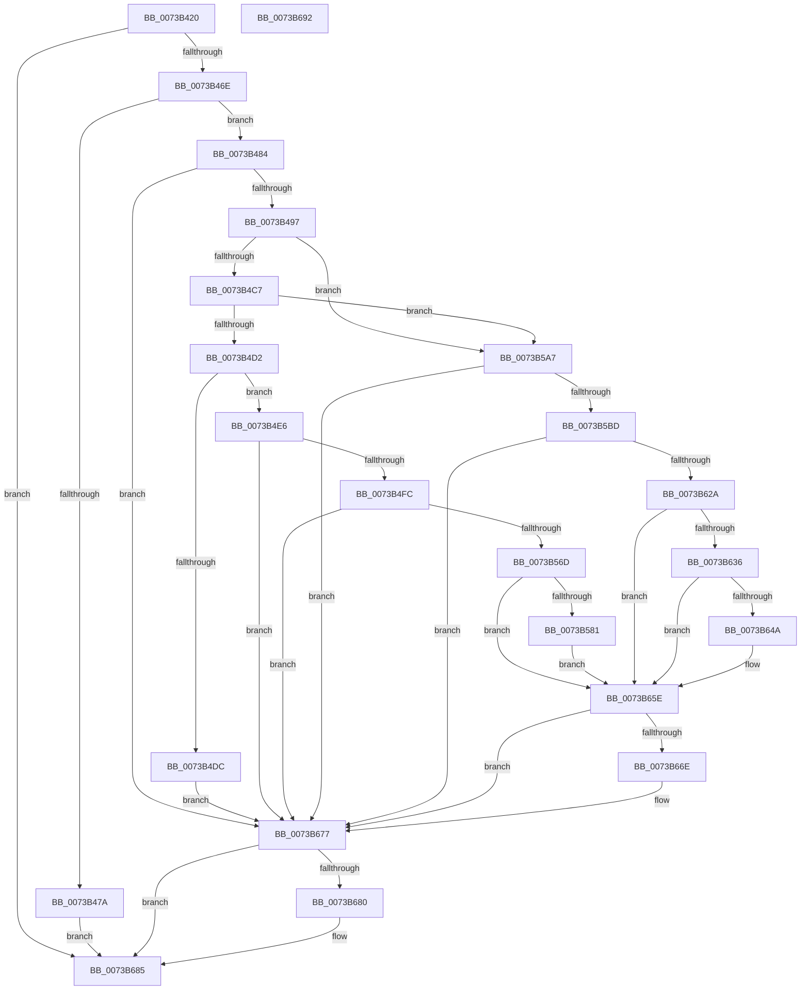

# PiCMDeleteDeviceWorker

- RVA: `0x0073B420`–`0x0073B693` (길이 `627` bytes)
- VA: `0x000000014073B420`
- 실행 섹션: `PAGE`
- PDB 이름 있음: `예`; PDB Function 태그: `아니요`
- unwind 정보 RVA: `0x000BF3E8`
- 디코드: `158`개 명령, `627/627` bytes 표시
- 미해석 바이트: `0` (있으면 어셈블리에 `.byte`로 보존)

> 이 문서는 커널 이미지의 기계어와 PDB 기호를 분석해 생성했습니다. 4번과 5번은 함수 원형과 자료형을 바이너리 사용 방식에서 추정한 C 해석이며 원본 소스 복구 결과는 아닙니다.

## 1. Dependencies

- 직접 호출 지점: **28**; 고유 호출 대상: **17**
- 직접 호출자로 확인된 함수: **2**
- RIP 상대 이미지 참조: **3**

### Outgoing calls
- `0x0073B45F` → [CmValidateDeviceName](../8F/CmValidateDeviceName_function_008F3CF0.md) (function, `0x008F3CF0`)
- `0x0073B471` → [CmIsRootDevice](../93/CmIsRootDevice_function_009325E4.md) (function, `0x009325E4`)
- `0x0073B488` → [PiPnpRtlBeginOperation](../8E/PiPnpRtlBeginOperation_function_008E033C.md) (function, `0x008E033C`)
- `0x0073B4BA` → [CmGetDeviceStatus](../9D/CmGetDeviceStatus_function_009D154C.md) (function, `0x009D154C`)
- `0x0073B4ED` → [RtlInitUnicodeStringEx](../../text/46/RtlInitUnicodeStringEx_function_00463960.md) (function, `0x00463960`)
- `0x0073B501` → [PpDevNodeLockTree](../A1/PpDevNodeLockTree_function_00A19310.md) (function, `0x00A19310`)
- `0x0073B520` → [ExAcquireResourceExclusiveLite](../../text/21/ExAcquireResourceExclusiveLite_function_00214E20.md) (function, `0x00214E20`)
- `0x0073B531` → [PpDeviceRegistration](../A0/PpDeviceRegistration_function_00A079D4.md) (function, `0x00A079D4`)
- `0x0073B543` → [CmDeleteDevice](../82/CmDeleteDevice_function_00829BB8.md) (function, `0x00829BB8`)
- `0x0073B551` → [ExReleaseResourceLite](../../text/25/ExReleaseResourceLite_function_0025FA10.md) (function, `0x0025FA10`)
- `0x0073B556` → [KeLeaveCriticalRegion](../../text/25/KeLeaveCriticalRegion_function_0025D8B0.md) (function, `0x0025D8B0`)
- `0x0073B560` → [PpDevNodeUnlockTree](../A2/PpDevNodeUnlockTree_function_00A21290.md) (function, `0x00A21290`)
- `0x0073B574` → [RtlInitUnicodeStringEx](../../text/46/RtlInitUnicodeStringEx_function_00463960.md) (function, `0x00463960`)
- `0x0073B59D` → [ZwPlugPlayControl](../../text/6A/ZwPlugPlayControl_function_006AF890.md) (function, `0x006AF890`)
- `0x0073B5AE` → [RtlInitUnicodeStringEx](../../text/46/RtlInitUnicodeStringEx_function_00463960.md) (function, `0x00463960`)
- `0x0073B5C2` → [PpDevNodeLockTree](../A1/PpDevNodeLockTree_function_00A19310.md) (function, `0x00A19310`)
- `0x0073B5E1` → [ExAcquireResourceExclusiveLite](../../text/21/ExAcquireResourceExclusiveLite_function_00214E20.md) (function, `0x00214E20`)
- `0x0073B5F2` → [PpDeviceRegistration](../A0/PpDeviceRegistration_function_00A079D4.md) (function, `0x00A079D4`)
- `0x0073B604` → [CmDeleteDevice](../82/CmDeleteDevice_function_00829BB8.md) (function, `0x00829BB8`)
- `0x0073B612` → [ExReleaseResourceLite](../../text/25/ExReleaseResourceLite_function_0025FA10.md) (function, `0x0025FA10`)
- `0x0073B617` → [KeLeaveCriticalRegion](../../text/25/KeLeaveCriticalRegion_function_0025D8B0.md) (function, `0x0025D8B0`)
- `0x0073B621` → [PpDevNodeUnlockTree](../A2/PpDevNodeUnlockTree_function_00A21290.md) (function, `0x00A21290`)
- `0x0073B62D` → [CmIsRootEnumeratedDevice](../8F/CmIsRootEnumeratedDevice_function_008F6E08.md) (function, `0x008F6E08`)
- `0x0073B641` → [RtlInitUnicodeStringEx](../../text/46/RtlInitUnicodeStringEx_function_00463960.md) (function, `0x00463960`)
- `0x0073B659` → [PiQueueDeviceRequest](../AD/PiQueueDeviceRequest_function_00AD1878.md) (function, `0x00AD1878`)
- `0x0073B665` → [RtlInitUnicodeStringEx](../../text/46/RtlInitUnicodeStringEx_function_00463960.md) (function, `0x00463960`)
- `0x0073B672` → [PnpSetDeviceInstancePropertyChangeEventFromDeviceInstance](../../text/49/PnpSetDeviceInstancePropertyChangeEventFromDeviceInstance_function_00493500.md) (function, `0x00493500`)
- `0x0073B680` → [PiPnpRtlEndOperation](../8E/PiPnpRtlEndOperation_function_008E0518.md) (function, `0x008E0518`)

### Direct callers
- [PiCMDeleteDevice](../70/PiCMDeleteDevice_function_007017A4.md) at `0x00701835`
- [PiSwIrpCleanup](PiSwIrpCleanup_function_0073AC10.md) at `0x0073AD44`

### Static image references
- `0x0073B497` → RVA `0x00E66398` (`.data`; read)
- `0x0073B50F` → RVA `0x00F8C600` (`.data`; read)
- `0x0073B636` → RVA `0x00AFFD10` (` ?? ::NNGAKEGL::`string'`; read)

## 2. Other-region calls and transfers

- 다른 실행 섹션으로 향하는 call: **13**
  - `0x0073B4ED` → [RtlInitUnicodeStringEx](../../text/46/RtlInitUnicodeStringEx_function_00463960.md) (`PAGE` → `.text`)
  - `0x0073B520` → [ExAcquireResourceExclusiveLite](../../text/21/ExAcquireResourceExclusiveLite_function_00214E20.md) (`PAGE` → `.text`)
  - `0x0073B551` → [ExReleaseResourceLite](../../text/25/ExReleaseResourceLite_function_0025FA10.md) (`PAGE` → `.text`)
  - `0x0073B556` → [KeLeaveCriticalRegion](../../text/25/KeLeaveCriticalRegion_function_0025D8B0.md) (`PAGE` → `.text`)
  - `0x0073B574` → [RtlInitUnicodeStringEx](../../text/46/RtlInitUnicodeStringEx_function_00463960.md) (`PAGE` → `.text`)
  - `0x0073B59D` → [ZwPlugPlayControl](../../text/6A/ZwPlugPlayControl_function_006AF890.md) (`PAGE` → `.text`)
  - `0x0073B5AE` → [RtlInitUnicodeStringEx](../../text/46/RtlInitUnicodeStringEx_function_00463960.md) (`PAGE` → `.text`)
  - `0x0073B5E1` → [ExAcquireResourceExclusiveLite](../../text/21/ExAcquireResourceExclusiveLite_function_00214E20.md) (`PAGE` → `.text`)
  - `0x0073B612` → [ExReleaseResourceLite](../../text/25/ExReleaseResourceLite_function_0025FA10.md) (`PAGE` → `.text`)
  - `0x0073B617` → [KeLeaveCriticalRegion](../../text/25/KeLeaveCriticalRegion_function_0025D8B0.md) (`PAGE` → `.text`)
  - `0x0073B641` → [RtlInitUnicodeStringEx](../../text/46/RtlInitUnicodeStringEx_function_00463960.md) (`PAGE` → `.text`)
  - `0x0073B665` → [RtlInitUnicodeStringEx](../../text/46/RtlInitUnicodeStringEx_function_00463960.md) (`PAGE` → `.text`)
  - `0x0073B672` → [PnpSetDeviceInstancePropertyChangeEventFromDeviceInstance](../../text/49/PnpSetDeviceInstancePropertyChangeEventFromDeviceInstance_function_00493500.md) (`PAGE` → `.text`)
- 별도 외부 분기/꼬리 이동을 확인하지 못했습니다.

## 3. Assembly (complete function range)

```asm
0073B420  40 55                           push rbp
0073B422  53                              push rbx
0073B423  57                              push rdi
0073B424  48 8D 6C 24 B9                  lea rbp, [rsp - 0x47]
0073B429  48 81 EC 90 00 00 00            sub rsp, 0x90
0073B430  83 65 6F 00                     and dword ptr [rbp + 0x6f], 0
0073B434  0F 57 C0                        xorps xmm0, xmm0
0073B437  83 65 7F 00                     and dword ptr [rbp + 0x7f], 0
0073B43B  33 C0                           xor eax, eax
0073B43D  48 21 45 F7                     and qword ptr [rbp - 9], rax
0073B441  48 8B D1                        mov rdx, rcx
0073B444  83 65 77 00                     and dword ptr [rbp + 0x77], 0
0073B448  48 8B F9                        mov rdi, rcx
0073B44B  0F 11 45 FF                     movups xmmword ptr [rbp - 1], xmm0
0073B44F  48 89 45 3F                     mov qword ptr [rbp + 0x3f], rax
0073B453  0F 11 45 1F                     movups xmmword ptr [rbp + 0x1f], xmm0
0073B457  0F 11 45 2F                     movups xmmword ptr [rbp + 0x2f], xmm0
0073B45B  0F 11 45 0F                     movups xmmword ptr [rbp + 0xf], xmm0
0073B45F  E8 8C 88 1B 00                  call 0x1408f3cf0
0073B464  8B D8                           mov ebx, eax
0073B466  85 C0                           test eax, eax
0073B468  0F 88 17 02 00 00               js 0x14073b685
0073B46E  48 8B CF                        mov rcx, rdi
0073B471  E8 6E 71 1F 00                  call 0x1409325e4
0073B476  84 C0                           test al, al
0073B478  74 0A                           je 0x14073b484
0073B47A  BB 0D 00 00 C0                  mov ebx, 0xc000000d
0073B47F  E9 01 02 00 00                  jmp 0x14073b685
0073B484  48 8D 4D F7                     lea rcx, [rbp - 9]
0073B488  E8 AF 4E 1A 00                  call 0x1408e033c
0073B48D  8B D8                           mov ebx, eax
0073B48F  85 C0                           test eax, eax
0073B491  0F 88 E0 01 00 00               js 0x14073b677
0073B497  48 8B 0D FA AE 72 00            mov rcx, qword ptr [rip + 0x72aefa]
0073B49E  48 8D 45 77                     lea rax, [rbp + 0x77]
0073B4A2  48 89 44 24 28                  mov qword ptr [rsp + 0x28], rax
0073B4A7  4C 8D 4D 6F                     lea r9, [rbp + 0x6f]
0073B4AB  48 8D 45 7F                     lea rax, [rbp + 0x7f]
0073B4AF  45 33 C0                        xor r8d, r8d
0073B4B2  48 8B D7                        mov rdx, rdi
0073B4B5  48 89 44 24 20                  mov qword ptr [rsp + 0x20], rax
0073B4BA  E8 8D 60 29 00                  call 0x1409d154c
0073B4BF  85 C0                           test eax, eax
0073B4C1  0F 88 E0 00 00 00               js 0x14073b5a7
0073B4C7  8B 45 6F                        mov eax, dword ptr [rbp + 0x6f]
0073B4CA  A8 02                           test al, 2
0073B4CC  0F 84 D5 00 00 00               je 0x14073b5a7
0073B4D2  25 01 20 00 00                  and eax, 0x2001
0073B4D7  83 F8 01                        cmp eax, 1
0073B4DA  75 0A                           jne 0x14073b4e6
0073B4DC  BB 10 00 00 C0                  mov ebx, 0xc0000010
0073B4E1  E9 91 01 00 00                  jmp 0x14073b677
0073B4E6  48 8B D7                        mov rdx, rdi
0073B4E9  48 8D 4D FF                     lea rcx, [rbp - 1]
0073B4ED  E8 6E 84 D2 FF                  call 0x140463960
0073B4F2  8B D8                           mov ebx, eax
0073B4F4  85 C0                           test eax, eax
0073B4F6  0F 88 7B 01 00 00               js 0x14073b677
0073B4FC  B9 03 00 00 00                  mov ecx, 3
0073B501  E8 0A DE 2D 00                  call 0x140a19310
0073B506  65 48 8B 04 25 88 01 00 00      mov rax, qword ptr gs:[0x188]
0073B50F  48 8D 0D EA 10 85 00            lea rcx, [rip + 0x8510ea]
0073B516  B2 01                           mov dl, 1
0073B518  66 FF 88 E4 01 00 00            dec word ptr [rax + 0x1e4]
0073B51F  90                              nop
0073B520  E8 FB 98 AD FF                  call 0x140214e20
0073B525  41 B1 01                        mov r9b, 1
0073B528  48 8D 4D FF                     lea rcx, [rbp - 1]
0073B52C  45 33 C0                        xor r8d, r8d
0073B52F  33 D2                           xor edx, edx
0073B531  E8 9E C4 2C 00                  call 0x140a079d4
0073B536  48 8B 0D 5B AE 72 00            mov rcx, qword ptr [rip + 0x72ae5b]
0073B53D  45 33 C0                        xor r8d, r8d
0073B540  48 8B D7                        mov rdx, rdi
0073B543  E8 70 E6 0E 00                  call 0x140829bb8
0073B548  48 8D 0D B1 10 85 00            lea rcx, [rip + 0x8510b1]
0073B54F  8B D8                           mov ebx, eax
0073B551  E8 BA 44 B2 FF                  call 0x14025fa10
0073B556  E8 55 23 B2 FF                  call 0x14025d8b0
0073B55B  B9 03 00 00 00                  mov ecx, 3
0073B560  E8 2B 5D 2E 00                  call 0x140a21290
0073B565  85 DB                           test ebx, ebx
0073B567  0F 88 0A 01 00 00               js 0x14073b677
0073B56D  48 8B D7                        mov rdx, rdi
0073B570  48 8D 4D 1F                     lea rcx, [rbp + 0x1f]
0073B574  E8 E7 83 D2 FF                  call 0x140463960
0073B579  85 C0                           test eax, eax
0073B57B  0F 88 DD 00 00 00               js 0x14073b65e
0073B581  41 B8 28 00 00 00               mov r8d, 0x28
0073B587  C7 45 2F 01 00 00 00            mov dword ptr [rbp + 0x2f], 1
0073B58E  48 8D 55 1F                     lea rdx, [rbp + 0x1f]
0073B592  C7 45 33 00 00 04 00            mov dword ptr [rbp + 0x33], 0x40000
0073B599  41 8D 48 E6                     lea ecx, [r8 - 0x1a]
0073B59D  E8 EE 42 F7 FF                  call 0x1406af890
0073B5A2  E9 B7 00 00 00                  jmp 0x14073b65e
0073B5A7  48 8B D7                        mov rdx, rdi
0073B5AA  48 8D 4D FF                     lea rcx, [rbp - 1]
0073B5AE  E8 AD 83 D2 FF                  call 0x140463960
0073B5B3  8B D8                           mov ebx, eax
0073B5B5  85 C0                           test eax, eax
0073B5B7  0F 88 BA 00 00 00               js 0x14073b677
0073B5BD  B9 03 00 00 00                  mov ecx, 3
0073B5C2  E8 49 DD 2D 00                  call 0x140a19310
0073B5C7  65 48 8B 04 25 88 01 00 00      mov rax, qword ptr gs:[0x188]
0073B5D0  48 8D 0D 29 10 85 00            lea rcx, [rip + 0x851029]
0073B5D7  B2 01                           mov dl, 1
0073B5D9  66 FF 88 E4 01 00 00            dec word ptr [rax + 0x1e4]
0073B5E0  90                              nop
0073B5E1  E8 3A 98 AD FF                  call 0x140214e20
0073B5E6  41 B1 01                        mov r9b, 1
0073B5E9  48 8D 4D FF                     lea rcx, [rbp - 1]
0073B5ED  45 33 C0                        xor r8d, r8d
0073B5F0  33 D2                           xor edx, edx
0073B5F2  E8 DD C3 2C 00                  call 0x140a079d4
0073B5F7  48 8B 0D 9A AD 72 00            mov rcx, qword ptr [rip + 0x72ad9a]
0073B5FE  45 33 C0                        xor r8d, r8d
0073B601  48 8B D7                        mov rdx, rdi
0073B604  E8 AF E5 0E 00                  call 0x140829bb8
0073B609  48 8D 0D F0 0F 85 00            lea rcx, [rip + 0x850ff0]
0073B610  8B D8                           mov ebx, eax
0073B612  E8 F9 43 B2 FF                  call 0x14025fa10
0073B617  E8 94 22 B2 FF                  call 0x14025d8b0
0073B61C  B9 03 00 00 00                  mov ecx, 3
0073B621  E8 6A 5C 2E 00                  call 0x140a21290
0073B626  85 DB                           test ebx, ebx
0073B628  78 4D                           js 0x14073b677
0073B62A  48 8B CF                        mov rcx, rdi
0073B62D  E8 D6 B7 1B 00                  call 0x1408f6e08
0073B632  84 C0                           test al, al
0073B634  74 28                           je 0x14073b65e
0073B636  48 8D 15 D3 46 3C 00            lea rdx, [rip + 0x3c46d3]
0073B63D  48 8D 4D FF                     lea rcx, [rbp - 1]
0073B641  E8 1A 83 D2 FF                  call 0x140463960
0073B646  85 C0                           test eax, eax
0073B648  78 14                           js 0x14073b65e
0073B64A  45 33 C9                        xor r9d, r9d
0073B64D  48 8D 4D FF                     lea rcx, [rbp - 1]
0073B651  41 8D 51 08                     lea edx, [r9 + 8]
0073B655  45 8D 41 01                     lea r8d, [r9 + 1]
0073B659  E8 1A 62 39 00                  call 0x140ad1878
0073B65E  48 8B D7                        mov rdx, rdi
0073B661  48 8D 4D 0F                     lea rcx, [rbp + 0xf]
0073B665  E8 F6 82 D2 FF                  call 0x140463960
0073B66A  85 C0                           test eax, eax
0073B66C  78 09                           js 0x14073b677
0073B66E  48 8D 4D 0F                     lea rcx, [rbp + 0xf]
0073B672  E8 89 7E D5 FF                  call 0x140493500
0073B677  48 8B 4D F7                     mov rcx, qword ptr [rbp - 9]
0073B67B  48 85 C9                        test rcx, rcx
0073B67E  74 05                           je 0x14073b685
0073B680  E8 93 4E 1A 00                  call 0x1408e0518
0073B685  8B C3                           mov eax, ebx
0073B687  48 81 C4 90 00 00 00            add rsp, 0x90
0073B68E  5F                              pop rdi
0073B68F  5B                              pop rbx
0073B690  5D                              pop rbp
0073B691  C3                              ret
0073B692  CC                              int3
```

## 4. C-style interpretation (structured pseudocode)

```c
__int64 __fastcall PiCMDeleteDeviceWorker(__int64 a1, __int64 a2, int a3)
{
    __int64 result;
    __int64 v_rsp;
    unsigned __int64 v_stack_m20;
    unsigned int v_stack_m2C;
    unsigned __int64 v_stack_m30;
    unsigned __int64 v_stack_m40;
    unsigned __int64 v_stack_m50;
    unsigned __int64 v_stack_m5F;
    unsigned __int64 v_stack_m60;
    unsigned __int64 v_stack_m68;
    unsigned __int64 v_stack_m80;
    unsigned __int64 v_stack_m88;
    unsigned int v_stack_p10;
    unsigned int v_stack_p18;
    unsigned int v_stack_p20;

    v_rsp = (v_rsp) - (144);
    result = 0;
    v_stack_m60 = v_xmm0;
    v_stack_m20 = 0;
    v_stack_m40 = v_xmm0;
    v_stack_m30 = v_xmm0;
    v_stack_m50 = v_xmm0;
    result = CmValidateDeviceName(a1, a1, a3, a4);
    if (sign_flag) goto loc_0073B685;
    result = CmIsRootDevice(a1, a1, a3, a4);
    if ((unsigned __int8)(result) == 0) goto loc_0073B484;
    goto loc_0073B685;
loc_0073B484:
    result = PiPnpRtlBeginOperation(v_stack_m68, a1, a3, a4);
    if (sign_flag) goto loc_0073B677;
    v_stack_m80 = v_stack_p18;
    a3 = 0;
    v_stack_m88 = v_stack_p20;
    result = CmGetDeviceStatus(*(unsigned __int64 *)(v_rip + 7515898), a1, a3, v_stack_p10);
    if (sign_flag) goto loc_0073B5A7;
    if ((((unsigned __int8)((unsigned int)(v_stack_p10))) & (2)) == 0) goto loc_0073B5A7;
    result = (unsigned int)(((unsigned int)(v_stack_p10)) & (0x2001ULL));
    if (((unsigned int)(result)) != 1) goto loc_0073B4E6;
    goto loc_0073B677;
loc_0073B4E6:
    result = RtlInitUnicodeStringEx(v_stack_m60, a1, a3, v_stack_p10);
    if (sign_flag) goto loc_0073B677;
    result = PpDevNodeLockTree(3, a1, a3, v_stack_p10);
    result = ExAcquireResourceExclusiveLite(v_rip + 8720618, 1, a3, v_stack_p10);
    a3 = 0;
    a2 = 0;
    result = PpDeviceRegistration(v_stack_m60, a2, a3, 1);
    a3 = 0;
    result = CmDeleteDevice(*(unsigned __int64 *)(v_rip + 7515739), a1, a3, 1);
    result = ExReleaseResourceLite(v_rip + 8720561, a1, a3, 1);
    result = KeLeaveCriticalRegion(v_rip + 8720561, a1, a3, 1);
    result = PpDevNodeUnlockTree(3, a1, a3, 1);
    if (sign_flag) goto loc_0073B677;
    result = RtlInitUnicodeStringEx(v_stack_m40, a1, a3, 1);
    if (sign_flag) goto loc_0073B65E;
    v_stack_m30 = 1;
    v_stack_m2C = 0x40000ULL;
    result = ZwPlugPlayControl(40 - 26, v_stack_m40, 40, 1);
    goto loc_0073B65E;
loc_0073B5A7:
    result = RtlInitUnicodeStringEx(v_stack_m60, a1, 40, 1);
    if (sign_flag) goto loc_0073B677;
    result = PpDevNodeLockTree(3, a1, 40, 1);
    result = ExAcquireResourceExclusiveLite(v_rip + 8720425, 1, 40, 1);
    a3 = 0;
    a2 = 0;
    result = PpDeviceRegistration(v_stack_m60, a2, a3, 1);
    a3 = 0;
    result = CmDeleteDevice(*(unsigned __int64 *)(v_rip + 7515546), a1, a3, 1);
    result = ExReleaseResourceLite(v_rip + 8720368, a1, a3, 1);
    result = KeLeaveCriticalRegion(v_rip + 8720368, a1, a3, 1);
    result = PpDevNodeUnlockTree(3, a1, a3, 1);
    if (sign_flag) goto loc_0073B677;
    result = CmIsRootEnumeratedDevice(a1, a1, a3, 1);
    if ((unsigned __int8)(result) == 0) goto loc_0073B65E;
    result = RtlInitUnicodeStringEx(v_stack_m60, v_rip + 3950291, a3, 1);
    if (!(sign_flag)) {
        a4 = 0;
        a1 = v_stack_m60;
        a2 = a4 + 8;
        a3 = a4 + 1;
        result = PiQueueDeviceRequest(a1, a2, a3, a4);
    }
    result = RtlInitUnicodeStringEx(v_stack_m50, a1, a3, a4);
    if (!(sign_flag)) {
        a1 = v_stack_m50;
        result = PnpSetDeviceInstancePropertyChangeEventFromDeviceInstance(a1, a1, a3, a4);
    }
    if (v_stack_m68 != 0) {
        result = PiPnpRtlEndOperation(v_stack_m68, a1, a3, a4);
    }
    v_rsp = (v_rsp) + (144);
    return (unsigned int)((unsigned int)((unsigned int)((unsigned int)(result))));
}
```

## 5. (Beta) C Style

```c
int64_t PiCMDeleteDeviceWorker(int64_t Arg1, int64_t Arg2, int32_t Arg3)
{
    int64_t result;
    int64_t local_rsp;
    uint64_t v_stack_m20;
    uint32_t v_stack_m2C;
    uint64_t v_stack_m30;
    uint64_t v_stack_m40;
    uint64_t v_stack_m50;
    uint64_t v_stack_m5F;
    uint64_t v_stack_m60;
    uint64_t v_stack_m68;
    uint64_t v_stack_m80;
    uint64_t v_stack_m88;
    uint32_t v_stack_p10;
    uint32_t v_stack_p18;
    uint32_t v_stack_p20;

    local_rsp = (local_rsp) - (144);
    result = 0;
    v_stack_m60 = v_xmm0;
    v_stack_m20 = 0;
    v_stack_m40 = v_xmm0;
    v_stack_m30 = v_xmm0;
    v_stack_m50 = v_xmm0;
    result = CmValidateDeviceName(Arg1, Arg1, Arg3, a4);
    if (sign_flag) goto loc_0073B685;
    result = CmIsRootDevice(Arg1, Arg1, Arg3, a4);
    if ((uint8_t)(result) == 0) goto loc_0073B484;
    goto loc_0073B685;
loc_0073B484:
    result = PiPnpRtlBeginOperation(v_stack_m68, Arg1, Arg3, a4);
    if (sign_flag) goto loc_0073B677;
    v_stack_m80 = v_stack_p18;
    Arg3 = 0;
    v_stack_m88 = v_stack_p20;
    result = CmGetDeviceStatus(*(uint64_t *)(v_rip + 0x72AEFA), Arg1, Arg3, v_stack_p10);
    if (sign_flag) goto loc_0073B5A7;
    if ((((uint8_t)((uint32_t)(v_stack_p10))) & (2)) == 0) goto loc_0073B5A7;
    result = (uint32_t)(((uint32_t)(v_stack_p10)) & (0x2001ULL));
    if (((uint32_t)(result)) != 1) goto loc_0073B4E6;
    goto loc_0073B677;
loc_0073B4E6:
    result = RtlInitUnicodeStringEx(v_stack_m60, Arg1, Arg3, v_stack_p10);
    if (sign_flag) goto loc_0073B677;
    result = PpDevNodeLockTree(3, Arg1, Arg3, v_stack_p10);
    result = ExAcquireResourceExclusiveLite(v_rip + 8720618, 1, Arg3, v_stack_p10);
    Arg3 = 0;
    Arg2 = 0;
    result = PpDeviceRegistration(v_stack_m60, Arg2, Arg3, 1);
    Arg3 = 0;
    result = CmDeleteDevice(*(uint64_t *)(v_rip + 0x72AE5B), Arg1, Arg3, 1);
    result = ExReleaseResourceLite(v_rip + 8720561, Arg1, Arg3, 1);
    result = KeLeaveCriticalRegion(v_rip + 8720561, Arg1, Arg3, 1);
    result = PpDevNodeUnlockTree(3, Arg1, Arg3, 1);
    if (sign_flag) goto loc_0073B677;
    result = RtlInitUnicodeStringEx(v_stack_m40, Arg1, Arg3, 1);
    if (sign_flag) goto loc_0073B65E;
    v_stack_m30 = 1;
    v_stack_m2C = 0x40000ULL;
    result = ZwPlugPlayControl(40 - 26, v_stack_m40, 40, 1);
    goto loc_0073B65E;
loc_0073B5A7:
    result = RtlInitUnicodeStringEx(v_stack_m60, Arg1, 40, 1);
    if (sign_flag) goto loc_0073B677;
    result = PpDevNodeLockTree(3, Arg1, 40, 1);
    result = ExAcquireResourceExclusiveLite(v_rip + 8720425, 1, 40, 1);
    Arg3 = 0;
    Arg2 = 0;
    result = PpDeviceRegistration(v_stack_m60, Arg2, Arg3, 1);
    Arg3 = 0;
    result = CmDeleteDevice(*(uint64_t *)(v_rip + 0x72AD9A), Arg1, Arg3, 1);
    result = ExReleaseResourceLite(v_rip + 8720368, Arg1, Arg3, 1);
    result = KeLeaveCriticalRegion(v_rip + 8720368, Arg1, Arg3, 1);
    result = PpDevNodeUnlockTree(3, Arg1, Arg3, 1);
    if (sign_flag) goto loc_0073B677;
    result = CmIsRootEnumeratedDevice(Arg1, Arg1, Arg3, 1);
    if ((uint8_t)(result) == 0) goto loc_0073B65E;
    result = RtlInitUnicodeStringEx(v_stack_m60, v_rip + 3950291, Arg3, 1);
    if (!(sign_flag)) {
        a4 = 0;
        Arg1 = v_stack_m60;
        Arg2 = a4 + 8;
        Arg3 = a4 + 1;
        result = PiQueueDeviceRequest(Arg1, Arg2, Arg3, a4);
    }
    result = RtlInitUnicodeStringEx(v_stack_m50, Arg1, Arg3, a4);
    if (!(sign_flag)) {
        Arg1 = v_stack_m50;
        result = PnpSetDeviceInstancePropertyChangeEventFromDeviceInstance(Arg1, Arg1, Arg3, a4);
    }
    if (v_stack_m68 != 0) {
        result = PiPnpRtlEndOperation(v_stack_m68, Arg1, Arg3, a4);
    }
    local_rsp = (local_rsp) + (144);
    return (uint32_t)((uint32_t)((uint32_t)((uint32_t)(result))));
}
```

## 6. Execution-region graph

[열기: 2D/3D 그래프와 함수 탐색 컨트롤 패널](../../../control-panel.html?section=page&rva=0x0073B420&view=graph)

- 2D 그래프는 위에서 아래로 흐르고, 3D 그래프는 빈 공간을 드래그해 회전합니다. Shift+드래그는 이동, 휠은 확대·축소, 함수 노드 선택은 대상 보고서 이동입니다.

### Static fallback


