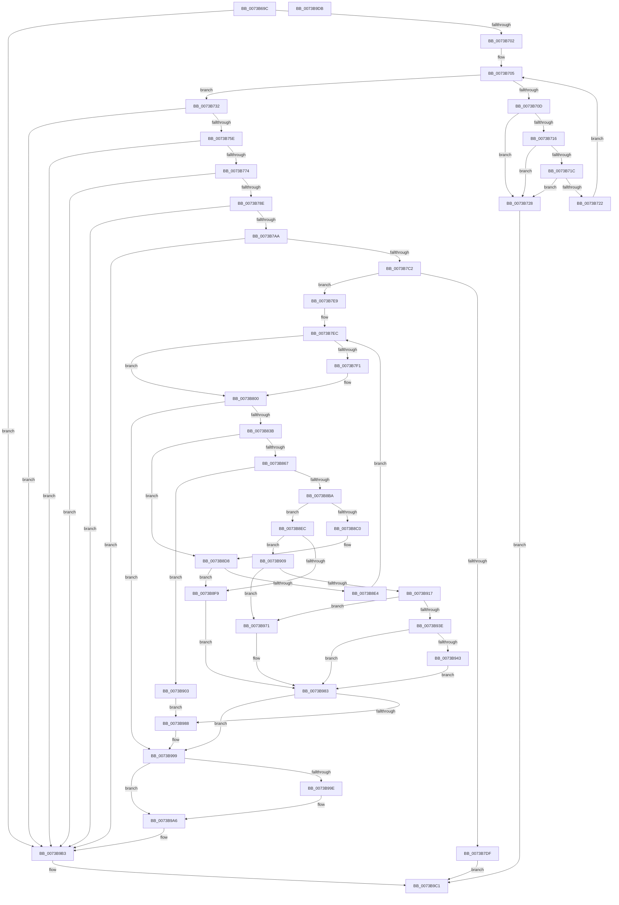

# PiCMGenerateDeviceInstance

- RVA: `0x0073B69C`–`0x0073B9DC` (길이 `832` bytes)
- VA: `0x000000014073B69C`
- 실행 섹션: `PAGE`
- PDB 이름 있음: `예`; PDB Function 태그: `아니요`
- unwind 정보 RVA: `0x000C8FB4`
- 디코드: `219`개 명령, `832/832` bytes 표시
- 미해석 바이트: `0` (있으면 어셈블리에 `.byte`로 보존)

> 이 문서는 커널 이미지의 기계어와 PDB 기호를 분석해 생성했습니다. 4번과 5번은 함수 원형과 자료형을 바이너리 사용 방식에서 추정한 C 해석이며 원본 소스 복구 결과는 아닙니다.

## 1. Dependencies

- 직접 호출 지점: **22**; 고유 호출 대상: **17**
- 직접 호출자로 확인된 함수: **1**
- RIP 상대 이미지 참조: **6**

### Outgoing calls
- `0x0073B6F3` → [RtlStringCchLengthW](../../text/43/RtlStringCchLengthW_function_00435A70.md) (function, `0x00435A70`)
- `0x0073B74F` → [RtlStringCchCopyExW](../../text/41/RtlStringCchCopyExW_function_0041E1C0.md) (function, `0x0041E1C0`)
- `0x0073B765` → [RtlInitUnicodeStringEx](../../text/46/RtlInitUnicodeStringEx_function_00463960.md) (function, `0x00463960`)
- `0x0073B77F` → [RtlUpcaseUnicodeString](../96/RtlUpcaseUnicodeString_function_00960780.md) (function, `0x00960780`)
- `0x0073B79B` → [RtlStringCchCatExW](../../text/48/RtlStringCchCatExW_function_00485910.md) (function, `0x00485910`)
- `0x0073B7B3` → [RtlStringCchCatExW](../../text/48/RtlStringCchCatExW_function_00485910.md) (function, `0x00485910`)
- `0x0073B7D2` → [ExAllocatePool2](../../poolcode/B8/ExAllocatePool2_function_00B820F0.md) (function, `0x00B820F0`)
- `0x0073B7F4` → [ZwClose](../../text/6A/ZwClose_function_006AD2B0.md) (function, `0x006AD2B0`)
- `0x0073B82C` → [RtlStringCchPrintfExW](../../text/42/RtlStringCchPrintfExW_function_0042B390.md) (function, `0x0042B390`)
- `0x0073B85E` → [CmGetDeviceStatus](../9D/CmGetDeviceStatus_function_009D154C.md) (function, `0x009D154C`)
- `0x0073B881` → [ExAcquireResourceExclusiveLite](../../text/21/ExAcquireResourceExclusiveLite_function_00214E20.md) (function, `0x00214E20`)
- `0x0073B8AF` → [CmCreateDevice](../8F/CmCreateDevice_function_008FFABC.md) (function, `0x008FFABC`)
- `0x0073B8C7` → [ExReleaseResourceLite](../../text/25/ExReleaseResourceLite_function_0025FA10.md) (function, `0x0025FA10`)
- `0x0073B8CC` → [KeLeaveCriticalRegion](../../text/25/KeLeaveCriticalRegion_function_0025D8B0.md) (function, `0x0025D8B0`)
- `0x0073B90C` → [CmValidateDeviceName](../8F/CmValidateDeviceName_function_008F3CF0.md) (function, `0x008F3CF0`)
- `0x0073B933` → [RtlStringCchCopyExW](../../text/41/RtlStringCchCopyExW_function_0041E1C0.md) (function, `0x0041E1C0`)
- `0x0073B968` → [PnpCtxRegSetValue](../99/PnpCtxRegSetValue_function_00991B8C.md) (function, `0x00991B8C`)
- `0x0073B97E` → [CmDeleteDevice](../82/CmDeleteDevice_function_00829BB8.md) (function, `0x00829BB8`)
- `0x0073B98F` → [ExReleaseResourceLite](../../text/25/ExReleaseResourceLite_function_0025FA10.md) (function, `0x0025FA10`)
- `0x0073B994` → [KeLeaveCriticalRegion](../../text/25/KeLeaveCriticalRegion_function_0025D8B0.md) (function, `0x0025D8B0`)
- `0x0073B9A1` → [ZwClose](../../text/6A/ZwClose_function_006AD2B0.md) (function, `0x006AD2B0`)
- `0x0073B9AE` → [ExFreePoolWithTag](../../poolcode/B8/ExFreePoolWithTag_function_00B82870.md) (function, `0x00B82870`)

### Direct callers
- [PiCMCreateDevice](../AC/PiCMCreateDevice_function_00ACB824.md) at `0x00ACB9A8`

### Static image references
- `0x0073B73A` → RVA `0x00AFE210` (` ?? ::NNGAKEGL::`string'`; read)
- `0x0073B78E` → RVA `0x00AFC990` (` ?? ::NNGAKEGL::`string'`; read)
- `0x0073B805` → RVA `0x00AFFD00` (` ?? ::NNGAKEGL::`string'`; read)
- `0x0073B83B` → RVA `0x00E66398` (`.data`; read)
- `0x0073B870` → RVA `0x00F8C600` (`.data`; read)
- `0x0073B959` → RVA `0x00AFF700` (` ?? ::NNGAKEGL::`string'`; read)

## 2. Other-region calls and transfers

- 다른 실행 섹션으로 향하는 call: **16**
  - `0x0073B6F3` → [RtlStringCchLengthW](../../text/43/RtlStringCchLengthW_function_00435A70.md) (`PAGE` → `.text`)
  - `0x0073B74F` → [RtlStringCchCopyExW](../../text/41/RtlStringCchCopyExW_function_0041E1C0.md) (`PAGE` → `.text`)
  - `0x0073B765` → [RtlInitUnicodeStringEx](../../text/46/RtlInitUnicodeStringEx_function_00463960.md) (`PAGE` → `.text`)
  - `0x0073B79B` → [RtlStringCchCatExW](../../text/48/RtlStringCchCatExW_function_00485910.md) (`PAGE` → `.text`)
  - `0x0073B7B3` → [RtlStringCchCatExW](../../text/48/RtlStringCchCatExW_function_00485910.md) (`PAGE` → `.text`)
  - `0x0073B7D2` → [ExAllocatePool2](../../poolcode/B8/ExAllocatePool2_function_00B820F0.md) (`PAGE` → `POOLCODE`)
  - `0x0073B7F4` → [ZwClose](../../text/6A/ZwClose_function_006AD2B0.md) (`PAGE` → `.text`)
  - `0x0073B82C` → [RtlStringCchPrintfExW](../../text/42/RtlStringCchPrintfExW_function_0042B390.md) (`PAGE` → `.text`)
  - `0x0073B881` → [ExAcquireResourceExclusiveLite](../../text/21/ExAcquireResourceExclusiveLite_function_00214E20.md) (`PAGE` → `.text`)
  - `0x0073B8C7` → [ExReleaseResourceLite](../../text/25/ExReleaseResourceLite_function_0025FA10.md) (`PAGE` → `.text`)
  - `0x0073B8CC` → [KeLeaveCriticalRegion](../../text/25/KeLeaveCriticalRegion_function_0025D8B0.md) (`PAGE` → `.text`)
  - `0x0073B933` → [RtlStringCchCopyExW](../../text/41/RtlStringCchCopyExW_function_0041E1C0.md) (`PAGE` → `.text`)
  - `0x0073B98F` → [ExReleaseResourceLite](../../text/25/ExReleaseResourceLite_function_0025FA10.md) (`PAGE` → `.text`)
  - `0x0073B994` → [KeLeaveCriticalRegion](../../text/25/KeLeaveCriticalRegion_function_0025D8B0.md) (`PAGE` → `.text`)
  - `0x0073B9A1` → [ZwClose](../../text/6A/ZwClose_function_006AD2B0.md) (`PAGE` → `.text`)
  - `0x0073B9AE` → [ExFreePoolWithTag](../../poolcode/B8/ExFreePoolWithTag_function_00B82870.md) (`PAGE` → `POOLCODE`)
- 별도 외부 분기/꼬리 이동을 확인하지 못했습니다.

## 3. Assembly (complete function range)

```asm
0073B69C  48 89 5C 24 08                  mov qword ptr [rsp + 8], rbx
0073B6A1  44 89 4C 24 20                  mov dword ptr [rsp + 0x20], r9d
0073B6A6  55                              push rbp
0073B6A7  56                              push rsi
0073B6A8  57                              push rdi
0073B6A9  41 54                           push r12
0073B6AB  41 55                           push r13
0073B6AD  41 56                           push r14
0073B6AF  41 57                           push r15
0073B6B1  48 8B EC                        mov rbp, rsp
0073B6B4  48 83 EC 70                     sub rsp, 0x70
0073B6B8  45 33 E4                        xor r12d, r12d
0073B6BB  44 8A EA                        mov r13b, dl
0073B6BE  66 45 89 20                     mov word ptr [r8], r12w
0073B6C2  41 BF C8 00 00 00               mov r15d, 0xc8
0073B6C8  4D 8B F0                        mov r14, r8
0073B6CB  44 89 65 D8                     mov dword ptr [rbp - 0x28], r12d
0073B6CF  0F 57 C0                        xorps xmm0, xmm0
0073B6D2  44 89 65 D4                     mov dword ptr [rbp - 0x2c], r12d
0073B6D6  4C 8D 45 E8                     lea r8, [rbp - 0x18]
0073B6DA  44 89 65 D0                     mov dword ptr [rbp - 0x30], r12d
0073B6DE  41 8B D7                        mov edx, r15d
0073B6E1  44 89 65 50                     mov dword ptr [rbp + 0x50], r12d
0073B6E5  48 8B F1                        mov rsi, rcx
0073B6E8  4C 89 65 E0                     mov qword ptr [rbp - 0x20], r12
0073B6EC  0F 11 45 F0                     movups xmmword ptr [rbp - 0x10], xmm0
0073B6F0  41 8B FC                        mov edi, r12d
0073B6F3  E8 78 A3 CF FF                  call 0x140435a70
0073B6F8  8B D8                           mov ebx, eax
0073B6FA  85 C0                           test eax, eax
0073B6FC  0F 88 B1 02 00 00               js 0x14073b9b3
0073B702  48 8B D6                        mov rdx, rsi
0073B705  0F B7 0A                        movzx ecx, word ptr [rdx]
0073B708  66 85 C9                        test cx, cx
0073B70B  74 25                           je 0x14073b732
0073B70D  8D 41 DF                        lea eax, [rcx - 0x21]
0073B710  66 83 F8 5E                     cmp ax, 0x5e
0073B714  77 12                           ja 0x14073b728
0073B716  66 83 F9 2C                     cmp cx, 0x2c
0073B71A  74 0C                           je 0x14073b728
0073B71C  66 83 F9 5C                     cmp cx, 0x5c
0073B720  74 06                           je 0x14073b728
0073B722  48 83 C2 02                     add rdx, 2
0073B726  EB DD                           jmp 0x14073b705
0073B728  BB 33 00 00 C0                  mov ebx, 0xc0000033
0073B72D  E9 8F 02 00 00                  jmp 0x14073b9c1
0073B732  C7 44 24 28 00 08 00 00         mov dword ptr [rsp + 0x28], 0x800
0073B73A  4C 8D 05 CF 2A 3C 00            lea r8, [rip + 0x3c2acf]
0073B741  45 33 C9                        xor r9d, r9d
0073B744  4C 89 64 24 20                  mov qword ptr [rsp + 0x20], r12
0073B749  49 8B D7                        mov rdx, r15
0073B74C  49 8B CE                        mov rcx, r14
0073B74F  E8 6C 2A CE FF                  call 0x14041e1c0
0073B754  8B D8                           mov ebx, eax
0073B756  85 C0                           test eax, eax
0073B758  0F 88 55 02 00 00               js 0x14073b9b3
0073B75E  49 8B D6                        mov rdx, r14
0073B761  48 8D 4D F0                     lea rcx, [rbp - 0x10]
0073B765  E8 F6 81 D2 FF                  call 0x140463960
0073B76A  8B D8                           mov ebx, eax
0073B76C  85 C0                           test eax, eax
0073B76E  0F 88 3F 02 00 00               js 0x14073b9b3
0073B774  45 33 C0                        xor r8d, r8d
0073B777  48 8D 55 F0                     lea rdx, [rbp - 0x10]
0073B77B  48 8D 4D F0                     lea rcx, [rbp - 0x10]
0073B77F  E8 FC 4F 22 00                  call 0x140960780
0073B784  8B D8                           mov ebx, eax
0073B786  85 C0                           test eax, eax
0073B788  0F 88 25 02 00 00               js 0x14073b9b3
0073B78E  4C 8D 05 FB 11 3C 00            lea r8, [rip + 0x3c11fb]
0073B795  49 8B D7                        mov rdx, r15
0073B798  49 8B CE                        mov rcx, r14
0073B79B  E8 70 A1 D4 FF                  call 0x140485910
0073B7A0  8B D8                           mov ebx, eax
0073B7A2  85 C0                           test eax, eax
0073B7A4  0F 88 09 02 00 00               js 0x14073b9b3
0073B7AA  4C 8B C6                        mov r8, rsi
0073B7AD  49 8B D7                        mov rdx, r15
0073B7B0  49 8B CE                        mov rcx, r14
0073B7B3  E8 58 A1 D4 FF                  call 0x140485910
0073B7B8  8B D8                           mov ebx, eax
0073B7BA  85 C0                           test eax, eax
0073B7BC  0F 88 F1 01 00 00               js 0x14073b9b3
0073B7C2  BA 90 01 00 00                  mov edx, 0x190
0073B7C7  B9 00 01 00 00                  mov ecx, 0x100
0073B7CC  41 B8 50 6E 70 34               mov r8d, 0x34706e50
0073B7D2  E8 19 69 44 00                  call 0x140b820f0
0073B7D7  48 8B F0                        mov rsi, rax
0073B7DA  48 85 C0                        test rax, rax
0073B7DD  75 0A                           jne 0x14073b7e9
0073B7DF  BB 9A 00 00 C0                  mov ebx, 0xc000009a
0073B7E4  E9 D8 01 00 00                  jmp 0x14073b9c1
0073B7E9  45 8B FC                        mov r15d, r12d
0073B7EC  48 85 FF                        test rdi, rdi
0073B7EF  74 0F                           je 0x14073b800
0073B7F1  48 8B CF                        mov rcx, rdi
0073B7F4  E8 B7 1A F7 FF                  call 0x1406ad2b0
0073B7F9  49 8B FC                        mov rdi, r12
0073B7FC  4C 89 65 E0                     mov qword ptr [rbp - 0x20], r12
0073B800  44 89 7C 24 38                  mov dword ptr [rsp + 0x38], r15d
0073B805  48 8D 05 F4 44 3C 00            lea rax, [rip + 0x3c44f4]
0073B80C  4C 89 74 24 30                  mov qword ptr [rsp + 0x30], r14
0073B811  45 33 C9                        xor r9d, r9d
0073B814  48 89 44 24 28                  mov qword ptr [rsp + 0x28], rax
0073B819  45 33 C0                        xor r8d, r8d
0073B81C  BA C8 00 00 00                  mov edx, 0xc8
0073B821  C7 44 24 20 00 08 00 00         mov dword ptr [rsp + 0x20], 0x800
0073B829  48 8B CE                        mov rcx, rsi
0073B82C  E8 5F FB CE FF                  call 0x14042b390
0073B831  8B D8                           mov ebx, eax
0073B833  85 C0                           test eax, eax
0073B835  0F 88 5E 01 00 00               js 0x14073b999
0073B83B  48 8B 0D 56 AB 72 00            mov rcx, qword ptr [rip + 0x72ab56]
0073B842  48 8D 45 D0                     lea rax, [rbp - 0x30]
0073B846  48 89 44 24 28                  mov qword ptr [rsp + 0x28], rax
0073B84B  4C 8D 4D D8                     lea r9, [rbp - 0x28]
0073B84F  48 8D 45 D4                     lea rax, [rbp - 0x2c]
0073B853  45 33 C0                        xor r8d, r8d
0073B856  48 8B D6                        mov rdx, rsi
0073B859  48 89 44 24 20                  mov qword ptr [rsp + 0x20], rax
0073B85E  E8 E9 5C 29 00                  call 0x1409d154c
0073B863  85 C0                           test eax, eax
0073B865  79 71                           jns 0x14073b8d8
0073B867  65 48 8B 04 25 88 01 00 00      mov rax, qword ptr gs:[0x188]
0073B870  48 8D 0D 89 0D 85 00            lea rcx, [rip + 0x850d89]
0073B877  B2 01                           mov dl, 1
0073B879  66 FF 88 E4 01 00 00            dec word ptr [rax + 0x1e4]
0073B880  90                              nop
0073B881  E8 9A 95 AD FF                  call 0x140214e20
0073B886  83 64 24 28 00                  and dword ptr [rsp + 0x28], 0
0073B88B  48 8D 45 58                     lea rax, [rbp + 0x58]
0073B88F  48 8B 0D 02 AB 72 00            mov rcx, qword ptr [rip + 0x72ab02]
0073B896  4C 8D 4D E0                     lea r9, [rbp - 0x20]
0073B89A  41 B8 06 00 02 00               mov r8d, 0x20006
0073B8A0  48 89 44 24 20                  mov qword ptr [rsp + 0x20], rax
0073B8A5  48 8B D6                        mov rdx, rsi
0073B8A8  C6 45 58 00                     mov byte ptr [rbp + 0x58], 0
0073B8AC  41 B4 01                        mov r12b, 1
0073B8AF  E8 08 42 1C 00                  call 0x1408ffabc
0073B8B4  8B D8                           mov ebx, eax
0073B8B6  85 C0                           test eax, eax
0073B8B8  78 49                           js 0x14073b903
0073B8BA  80 7D 58 00                     cmp byte ptr [rbp + 0x58], 0
0073B8BE  75 2C                           jne 0x14073b8ec
0073B8C0  48 8D 0D 39 0D 85 00            lea rcx, [rip + 0x850d39]
0073B8C7  E8 44 41 B2 FF                  call 0x14025fa10
0073B8CC  E8 DF 1F B2 FF                  call 0x14025d8b0
0073B8D1  48 8B 7D E0                     mov rdi, qword ptr [rbp - 0x20]
0073B8D5  45 33 E4                        xor r12d, r12d
0073B8D8  41 FF C7                        inc r15d
0073B8DB  41 81 FF 0F 27 00 00            cmp r15d, 0x270f
0073B8E2  77 15                           ja 0x14073b8f9
0073B8E4  45 33 E4                        xor r12d, r12d
0073B8E7  E9 00 FF FF FF                  jmp 0x14073b7ec
0073B8EC  48 8B 7D E0                     mov rdi, qword ptr [rbp - 0x20]
0073B8F0  41 81 FF 0F 27 00 00            cmp r15d, 0x270f
0073B8F7  76 10                           jbe 0x14073b909
0073B8F9  BB 1A 00 00 80                  mov ebx, 0x8000001a
0073B8FE  E9 80 00 00 00                  jmp 0x14073b983
0073B903  48 8B 7D E0                     mov rdi, qword ptr [rbp - 0x20]
0073B907  EB 7F                           jmp 0x14073b988
0073B909  48 8B D6                        mov rdx, rsi
0073B90C  E8 DF 83 1B 00                  call 0x1408f3cf0
0073B911  8B D8                           mov ebx, eax
0073B913  85 C0                           test eax, eax
0073B915  78 5A                           js 0x14073b971
0073B917  C7 44 24 28 00 08 00 00         mov dword ptr [rsp + 0x28], 0x800
0073B91F  45 33 C9                        xor r9d, r9d
0073B922  48 83 64 24 20 00               and qword ptr [rsp + 0x20], 0
0073B928  4C 8B C6                        mov r8, rsi
0073B92B  BA C8 00 00 00                  mov edx, 0xc8
0073B930  49 8B CE                        mov rcx, r14
0073B933  E8 88 28 CE FF                  call 0x14041e1c0
0073B938  8B D8                           mov ebx, eax
0073B93A  85 C0                           test eax, eax
0073B93C  78 33                           js 0x14073b971
0073B93E  45 84 ED                        test r13b, r13b
0073B941  74 40                           je 0x14073b983
0073B943  41 B9 04 00 00 00               mov r9d, 4
0073B949  C7 45 50 01 00 00 00            mov dword ptr [rbp + 0x50], 1
0073B950  48 8D 45 50                     lea rax, [rbp + 0x50]
0073B954  44 89 4C 24 28                  mov dword ptr [rsp + 0x28], r9d
0073B959  4C 8D 05 A0 3D 3C 00            lea r8, [rip + 0x3c3da0]
0073B960  48 89 44 24 20                  mov qword ptr [rsp + 0x20], rax
0073B965  48 8B D7                        mov rdx, rdi
0073B968  E8 1F 62 25 00                  call 0x140991b8c
0073B96D  8B D8                           mov ebx, eax
0073B96F  EB 12                           jmp 0x14073b983
0073B971  48 8B 0D 20 AA 72 00            mov rcx, qword ptr [rip + 0x72aa20]
0073B978  45 33 C0                        xor r8d, r8d
0073B97B  48 8B D6                        mov rdx, rsi
0073B97E  E8 35 E2 0E 00                  call 0x140829bb8
0073B983  45 84 E4                        test r12b, r12b
0073B986  74 11                           je 0x14073b999
0073B988  48 8D 0D 71 0C 85 00            lea rcx, [rip + 0x850c71]
0073B98F  E8 7C 40 B2 FF                  call 0x14025fa10
0073B994  E8 17 1F B2 FF                  call 0x14025d8b0
0073B999  48 85 FF                        test rdi, rdi
0073B99C  74 08                           je 0x14073b9a6
0073B99E  48 8B CF                        mov rcx, rdi
0073B9A1  E8 0A 19 F7 FF                  call 0x1406ad2b0
0073B9A6  BA 50 6E 70 34                  mov edx, 0x34706e50
0073B9AB  48 8B CE                        mov rcx, rsi
0073B9AE  E8 BD 6E 44 00                  call 0x140b82870
0073B9B3  81 FB 05 00 00 80               cmp ebx, 0x80000005
0073B9B9  B8 23 00 00 C0                  mov eax, 0xc0000023
0073B9BE  0F 44 D8                        cmove ebx, eax
0073B9C1  8B C3                           mov eax, ebx
0073B9C3  48 8B 9C 24 B0 00 00 00         mov rbx, qword ptr [rsp + 0xb0]
0073B9CB  48 83 C4 70                     add rsp, 0x70
0073B9CF  41 5F                           pop r15
0073B9D1  41 5E                           pop r14
0073B9D3  41 5D                           pop r13
0073B9D5  41 5C                           pop r12
0073B9D7  5F                              pop rdi
0073B9D8  5E                              pop rsi
0073B9D9  5D                              pop rbp
0073B9DA  C3                              ret
0073B9DB  CC                              int3
```

## 4. C-style interpretation (structured pseudocode)

```c
__int64 __fastcall PiCMGenerateDeviceInstance(__int64 a1, unsigned __int8 a2, __int64 a3, int a4)
{
    __int64 result;
    __int64 v_r12;
    __int64 v_r15;
    __int64 v_rbx;
    __int64 v_rdi;
    __int64 v_rsp;
    unsigned __int64 v_stack_m48;
    unsigned __int64 v_stack_m50;
    unsigned __int64 v_stack_m58;
    unsigned int v_stack_m60;
    unsigned int v_stack_m64;
    unsigned int v_stack_m68;
    unsigned int v_stack_m70;
    unsigned __int64 v_stack_m78;
    unsigned int v_stack_m80;
    unsigned __int64 v_stack_m88;
    unsigned int v_stack_p18;
    unsigned int v_stack_p20;
    unsigned __int64 v_stack_p8;

    v_stack_p8 = v_rbx;
    v_stack_p20 = a4;
    v_rsp = (v_rsp) - (112);
    v_r12 = 0;
    *(unsigned __int16 *)(a3) = 0;
    v_stack_m60 = 0;
    v_stack_m64 = 0;
    v_stack_m68 = 0;
    v_stack_p18 = 0;
    v_stack_m58 = 0;
    v_stack_m48 = v_xmm0;
    result = RtlStringCchLengthW(a1, 200, v_stack_m50, a4);
    if (sign_flag) goto loc_0073B9B3;
loc_0073B705:
    if ((unsigned __int16)(*(unsigned __int16 *)(a1)) == 0) goto loc_0073B732;
    if (((unsigned __int16)(*(unsigned __int16 *)(a1) - 33)) > 94) goto loc_0073B728;
    if (((unsigned __int16)(*(unsigned __int16 *)(a1))) == 44) goto loc_0073B728;
    if (((unsigned __int16)(*(unsigned __int16 *)(a1))) == 92) goto loc_0073B728;
    a2 = (a1) + (2);
    goto loc_0073B705;
loc_0073B728:
    goto loc_0073B9C1;
loc_0073B732:
    v_stack_m80 = 0x800ULL;
    a4 = 0;
    v_stack_m88 = 0;
    result = RtlStringCchCopyExW(a3, 200, v_rip + 3943119, a4);
    if (sign_flag) goto loc_0073B9B3;
    result = RtlInitUnicodeStringEx(v_stack_m48, a3, v_rip + 3943119, a4);
    if (sign_flag) goto loc_0073B9B3;
    a3 = 0;
    result = RtlUpcaseUnicodeString(v_stack_m48, v_stack_m48, a3, a4);
    if (sign_flag) goto loc_0073B9B3;
    result = RtlStringCchCatExW(0, 200, v_rip + 3936763, a4);
    if (sign_flag) goto loc_0073B9B3;
    result = RtlStringCchCatExW(0, 200, a1, a4);
    if (sign_flag) goto loc_0073B9B3;
    result = ExAllocatePool2(256, 400, (unsigned int)(0x34706E50ULL), a4);
    if (result != 0) goto loc_0073B7E9;
    goto loc_0073B9C1;
loc_0073B7E9:
loc_0073B7EC:
    v_rdi = 0;
    if (0 != 0) {
        a1 = 0;
        result = ZwClose(a1, 400, (unsigned int)(0x34706E50ULL), a4);
        v_rdi = 0;
        v_stack_m58 = 0;
    }
    v_stack_m70 = 0;
    v_stack_m78 = 0;
    a4 = 0;
    v_stack_m80 = v_rip + 3949812;
    a3 = 0;
    v_stack_m88 = 0x800ULL;
    result = RtlStringCchPrintfExW(result, 200, a3, a4);
    if (sign_flag) goto loc_0073B999;
    v_stack_m80 = v_stack_m68;
    a3 = 0;
    v_stack_m88 = v_stack_m64;
    result = CmGetDeviceStatus(*(unsigned __int64 *)(v_rip + 7514966), result, a3, v_stack_m60);
    if (!sign_flag) goto loc_0073B8D8;
    result = ExAcquireResourceExclusiveLite(v_rip + 8719753, 1, a3, v_stack_m60);
    v_stack_m88 = v_stack_p20;
    v_stack_p20 = 0;
    result = CmCreateDevice(*(unsigned __int64 *)(v_rip + 7514882), result, (unsigned int)(0x20006ULL), v_stack_m58);
    if (sign_flag) goto loc_0073B903;
    if (v_stack_p20 != 0) goto loc_0073B8EC;
    result = ExReleaseResourceLite(v_rip + 8719673, result, (unsigned int)(0x20006ULL), v_stack_m58);
    result = KeLeaveCriticalRegion(v_rip + 8719673, result, (unsigned int)(0x20006ULL), v_stack_m58);
    v_r12 = 0;
loc_0073B8D8:
    v_r15 = (unsigned int)((0) + 1);
    if (((unsigned int)(v_r15)) > 0x270FULL) goto loc_0073B8F9;
    v_r12 = 0;
    goto loc_0073B7EC;
loc_0073B8EC:
    if (((unsigned int)(v_r15)) <= 0x270FULL) goto loc_0073B909;
loc_0073B8F9:
    goto loc_0073B983;
loc_0073B903:
    goto loc_0073B988;
loc_0073B909:
    result = CmValidateDeviceName(v_rip + 8719673, result, (unsigned int)(0x20006ULL), v_stack_m58);
    if (sign_flag) goto loc_0073B971;
    v_stack_m80 = 0x800ULL;
    a4 = 0;
    result = RtlStringCchCopyExW(0, 200, result, a4);
    if (sign_flag) goto loc_0073B971;
    if (a2 == 0) goto loc_0073B983;
    v_stack_p18 = 1;
    v_stack_m80 = 4;
    v_stack_m88 = v_stack_p18;
    result = PnpCtxRegSetValue(0, v_stack_m58, v_rip + 3947936, 4);
    goto loc_0073B983;
loc_0073B971:
    a3 = 0;
    result = CmDeleteDevice(*(unsigned __int64 *)(v_rip + 7514656), result, a3, 4);
loc_0073B983:
    if (0 != 0) {
        a1 = v_rip + 8719473;
        result = ExReleaseResourceLite(a1, result, a3, 4);
        result = KeLeaveCriticalRegion(a1, result, a3, 4);
    }
    if (v_stack_m58 != 0) {
        a1 = v_stack_m58;
        result = ZwClose(a1, result, a3, 4);
    }
    result = ExFreePoolWithTag(result, (unsigned int)(0x34706E50ULL), a3, 4);
loc_0073B9B3:
    v_rbx = (unsigned int)((unsigned int)(result));
    if (((unsigned int)((unsigned int)((unsigned int)(result)))) == 0x80000005ULL) { v_rbx = (unsigned int)((unsigned int)(0xC0000023ULL)); }
loc_0073B9C1:
    v_rsp = (v_rsp) + (112);
    return (unsigned int)((unsigned int)(v_rbx));
}
```

## 5. (Beta) C Style

```c
int64_t PiCMGenerateDeviceInstance(void *Arg1, uint8_t Arg2, void *Arg3, int32_t Arg4)
{
    uint8_t *arg1 = (uint8_t *)Arg1;
    uint8_t *arg3 = (uint8_t *)Arg3;

    int64_t result;
    int64_t local_r12;
    int64_t local_r15;
    int64_t local_rbx;
    int64_t local_rdi;
    int64_t local_rsp;
    uint64_t v_stack_m48;
    uint64_t v_stack_m50;
    uint64_t v_stack_m58;
    uint32_t v_stack_m60;
    uint32_t v_stack_m64;
    uint32_t v_stack_m68;
    uint32_t v_stack_m70;
    uint64_t v_stack_m78;
    uint32_t v_stack_m80;
    uint64_t v_stack_m88;
    uint32_t v_stack_p18;
    uint32_t v_stack_p20;
    uint64_t v_stack_p8;

    v_stack_p8 = local_rbx;
    v_stack_p20 = Arg4;
    local_rsp = (local_rsp) - (112);
    local_r12 = 0;
    *(uint16_t *)(arg3) = 0;
    v_stack_m60 = 0;
    v_stack_m64 = 0;
    v_stack_m68 = 0;
    v_stack_p18 = 0;
    v_stack_m58 = 0;
    v_stack_m48 = v_xmm0;
    result = RtlStringCchLengthW(Arg1, 200, v_stack_m50, Arg4);
    if (sign_flag) goto loc_0073B9B3;
loc_0073B705:
    if ((uint16_t)(*(uint16_t *)(arg1)) == 0) goto loc_0073B732;
    if (((uint16_t)(*(uint16_t *)(arg1) - 33)) > 94) goto loc_0073B728;
    if (((uint16_t)(*(uint16_t *)(arg1))) == 44) goto loc_0073B728;
    if (((uint16_t)(*(uint16_t *)(arg1))) == 92) goto loc_0073B728;
    Arg2 = (Arg1) + (2);
    goto loc_0073B705;
loc_0073B728:
    goto loc_0073B9C1;
loc_0073B732:
    v_stack_m80 = 0x800ULL;
    Arg4 = 0;
    v_stack_m88 = 0;
    result = RtlStringCchCopyExW(Arg3, 200, v_rip + 3943119, Arg4);
    if (sign_flag) goto loc_0073B9B3;
    result = RtlInitUnicodeStringEx(v_stack_m48, Arg3, v_rip + 3943119, Arg4);
    if (sign_flag) goto loc_0073B9B3;
    Arg3 = 0;
    result = RtlUpcaseUnicodeString(v_stack_m48, v_stack_m48, Arg3, Arg4);
    if (sign_flag) goto loc_0073B9B3;
    result = RtlStringCchCatExW(0, 200, v_rip + 3936763, Arg4);
    if (sign_flag) goto loc_0073B9B3;
    result = RtlStringCchCatExW(0, 200, Arg1, Arg4);
    if (sign_flag) goto loc_0073B9B3;
    result = ExAllocatePool2(256, 400, (uint32_t)(0x34706E50ULL), Arg4);
    if (result != 0) goto loc_0073B7E9;
    goto loc_0073B9C1;
loc_0073B7E9:
loc_0073B7EC:
    local_rdi = 0;
    if (0 != 0) {
        Arg1 = 0;
        result = ZwClose(Arg1, 400, (uint32_t)(0x34706E50ULL), Arg4);
        local_rdi = 0;
        v_stack_m58 = 0;
    }
    v_stack_m70 = 0;
    v_stack_m78 = 0;
    Arg4 = 0;
    v_stack_m80 = v_rip + 3949812;
    Arg3 = 0;
    v_stack_m88 = 0x800ULL;
    result = RtlStringCchPrintfExW(result, 200, Arg3, Arg4);
    if (sign_flag) goto loc_0073B999;
    v_stack_m80 = v_stack_m68;
    Arg3 = 0;
    v_stack_m88 = v_stack_m64;
    result = CmGetDeviceStatus(*(uint64_t *)(v_rip + 0x72AB56), result, Arg3, v_stack_m60);
    if (!sign_flag) goto loc_0073B8D8;
    result = ExAcquireResourceExclusiveLite(v_rip + 8719753, 1, Arg3, v_stack_m60);
    v_stack_m88 = v_stack_p20;
    v_stack_p20 = 0;
    result = CmCreateDevice(*(uint64_t *)(v_rip + 0x72AB02), result, (uint32_t)(0x20006ULL), v_stack_m58);
    if (sign_flag) goto loc_0073B903;
    if (v_stack_p20 != 0) goto loc_0073B8EC;
    result = ExReleaseResourceLite(v_rip + 8719673, result, (uint32_t)(0x20006ULL), v_stack_m58);
    result = KeLeaveCriticalRegion(v_rip + 8719673, result, (uint32_t)(0x20006ULL), v_stack_m58);
    local_r12 = 0;
loc_0073B8D8:
    local_r15 = (uint32_t)((0) + 1);
    if (((uint32_t)(local_r15)) > 0x270FULL) goto loc_0073B8F9;
    local_r12 = 0;
    goto loc_0073B7EC;
loc_0073B8EC:
    if (((uint32_t)(local_r15)) <= 0x270FULL) goto loc_0073B909;
loc_0073B8F9:
    goto loc_0073B983;
loc_0073B903:
    goto loc_0073B988;
loc_0073B909:
    result = CmValidateDeviceName(v_rip + 8719673, result, (uint32_t)(0x20006ULL), v_stack_m58);
    if (sign_flag) goto loc_0073B971;
    v_stack_m80 = 0x800ULL;
    Arg4 = 0;
    result = RtlStringCchCopyExW(0, 200, result, Arg4);
    if (sign_flag) goto loc_0073B971;
    if (Arg2 == 0) goto loc_0073B983;
    v_stack_p18 = 1;
    v_stack_m80 = 4;
    v_stack_m88 = v_stack_p18;
    result = PnpCtxRegSetValue(0, v_stack_m58, v_rip + 3947936, 4);
    goto loc_0073B983;
loc_0073B971:
    Arg3 = 0;
    result = CmDeleteDevice(*(uint64_t *)(v_rip + 0x72AA20), result, Arg3, 4);
loc_0073B983:
    if (0 != 0) {
        Arg1 = v_rip + 8719473;
        result = ExReleaseResourceLite(Arg1, result, Arg3, 4);
        result = KeLeaveCriticalRegion(Arg1, result, Arg3, 4);
    }
    if (v_stack_m58 != 0) {
        Arg1 = v_stack_m58;
        result = ZwClose(Arg1, result, Arg3, 4);
    }
    result = ExFreePoolWithTag(result, (uint32_t)(0x34706E50ULL), Arg3, 4);
loc_0073B9B3:
    local_rbx = (uint32_t)((uint32_t)(result));
    if (((uint32_t)((uint32_t)((uint32_t)(result)))) == 0x80000005ULL) { local_rbx = (uint32_t)((uint32_t)(0xC0000023ULL)); }
loc_0073B9C1:
    local_rsp = (local_rsp) + (112);
    return (uint32_t)((uint32_t)(local_rbx));
}
```

### 관측된 메모리 오프셋

구조체 형식이 확인되지 않은 접근은 인자 기준의 오프셋으로만 기록했습니다.

| 기준 인자 | 오프셋 표현 | 폭 (bit) | 접근 |
|---|---:|---:|---|
| `Arg1` | `+ 0x0` | `16` | `R` |
| `Arg3` | `+ 0x0` | `16` | `W` |

## 6. Execution-region graph

[열기: 2D/3D 그래프와 함수 탐색 컨트롤 패널](../../../control-panel.html?section=page&rva=0x0073B69C&view=graph)

- 2D 그래프는 위에서 아래로 흐르고, 3D 그래프는 빈 공간을 드래그해 회전합니다. Shift+드래그는 이동, 휠은 확대·축소, 함수 노드 선택은 대상 보고서 이동입니다.

### Static fallback


