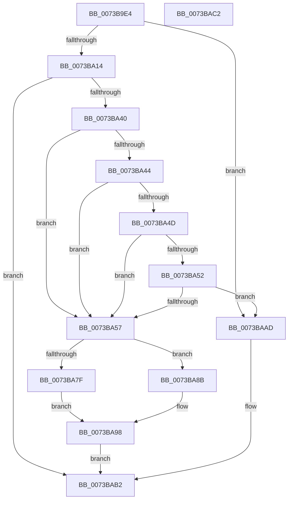

# PiCMSetProblem

- RVA: `0x0073B9E4`–`0x0073BAC3` (길이 `223` bytes)
- VA: `0x000000014073B9E4`
- 실행 섹션: `PAGE`
- PDB 이름 있음: `예`; PDB Function 태그: `아니요`
- unwind 정보 RVA: `0x000C4620`
- 디코드: `64`개 명령, `223/223` bytes 표시
- 미해석 바이트: `0` (있으면 어셈블리에 `.byte`로 보존)

> 이 문서는 커널 이미지의 기계어와 PDB 기호를 분석해 생성했습니다. 4번과 5번은 함수 원형과 자료형을 바이너리 사용 방식에서 추정한 C 해석이며 원본 소스 복구 결과는 아닙니다.

## 1. Dependencies

- 직접 호출 지점: **3**; 고유 호출 대상: **3**
- 직접 호출자로 확인된 함수: **2**
- RIP 상대 이미지 참조: **1**

### Outgoing calls
- `0x0073BA37` → [CmGetDeviceStatus](../9D/CmGetDeviceStatus_function_009D154C.md) (function, `0x009D154C`)
- `0x0073BA6F` → [RtlInitUnicodeString](../../text/42/RtlInitUnicodeString_function_0042A780.md) (function, `0x0042A780`)
- `0x0073BAA6` → [ZwPlugPlayControl](../../text/6A/ZwPlugPlayControl_function_006AF890.md) (function, `0x006AF890`)

### Direct callers
- [PiCMSetDeviceProblem](../AD/PiCMSetDeviceProblem_function_00ADA9E0.md) at `0x00ADAAA6`
- [sub_00B284C0](../B2/Unknown_function_00B284C0.md) at `0x00B2867D`

### Static image references
- `0x0073BA1B` → RVA `0x00E66398` (`.data`; read)

## 2. Other-region calls and transfers

- 다른 실행 섹션으로 향하는 call: **2**
  - `0x0073BA6F` → [RtlInitUnicodeString](../../text/42/RtlInitUnicodeString_function_0042A780.md) (`PAGE` → `.text`)
  - `0x0073BAA6` → [ZwPlugPlayControl](../../text/6A/ZwPlugPlayControl_function_006AF890.md) (`PAGE` → `.text`)
- 별도 외부 분기/꼬리 이동을 확인하지 못했습니다.

## 3. Assembly (complete function range)

```asm
0073B9E4  48 89 5C 24 08                  mov qword ptr [rsp + 8], rbx
0073B9E9  55                              push rbp
0073B9EA  56                              push rsi
0073B9EB  57                              push rdi
0073B9EC  48 8B EC                        mov rbp, rsp
0073B9EF  48 83 EC 70                     sub rsp, 0x70
0073B9F3  83 65 D0 00                     and dword ptr [rbp - 0x30], 0
0073B9F7  41 8D 40 FF                     lea eax, [r8 - 1]
0073B9FB  83 65 30 00                     and dword ptr [rbp + 0x30], 0
0073B9FF  41 8B F8                        mov edi, r8d
0073BA02  83 65 38 00                     and dword ptr [rbp + 0x38], 0
0073BA06  8B DA                           mov ebx, edx
0073BA08  48 8B F1                        mov rsi, rcx
0073BA0B  83 F8 01                        cmp eax, 1
0073BA0E  0F 87 99 00 00 00               ja 0x14073baad
0073BA14  48 8D 45 D0                     lea rax, [rbp - 0x30]
0073BA18  48 8B D1                        mov rdx, rcx
0073BA1B  48 8B 0D 76 A9 72 00            mov rcx, qword ptr [rip + 0x72a976]
0073BA22  4C 8D 4D 38                     lea r9, [rbp + 0x38]
0073BA26  48 89 44 24 28                  mov qword ptr [rsp + 0x28], rax
0073BA2B  45 33 C0                        xor r8d, r8d
0073BA2E  48 8D 45 30                     lea rax, [rbp + 0x30]
0073BA32  48 89 44 24 20                  mov qword ptr [rsp + 0x20], rax
0073BA37  E8 10 5B 29 00                  call 0x1409d154c
0073BA3C  85 C0                           test eax, eax
0073BA3E  78 72                           js 0x14073bab2
0073BA40  85 DB                           test ebx, ebx
0073BA42  74 13                           je 0x14073ba57
0073BA44  F7 45 38 00 04 00 00            test dword ptr [rbp + 0x38], 0x400
0073BA4B  74 0A                           je 0x14073ba57
0073BA4D  39 5D 30                        cmp dword ptr [rbp + 0x30], ebx
0073BA50  74 05                           je 0x14073ba57
0073BA52  83 FF 02                        cmp edi, 2
0073BA55  75 56                           jne 0x14073baad
0073BA57  0F 57 C0                        xorps xmm0, xmm0
0073BA5A  48 8D 4D D8                     lea rcx, [rbp - 0x28]
0073BA5E  33 C0                           xor eax, eax
0073BA60  48 8B D6                        mov rdx, rsi
0073BA63  0F 11 45 D8                     movups xmmword ptr [rbp - 0x28], xmm0
0073BA67  48 89 45 F8                     mov qword ptr [rbp - 8], rax
0073BA6B  0F 11 45 E8                     movups xmmword ptr [rbp - 0x18], xmm0
0073BA6F  E8 0C ED CE FF                  call 0x14042a780
0073BA74  C7 45 EC 00 04 00 00            mov dword ptr [rbp - 0x14], 0x400
0073BA7B  85 DB                           test ebx, ebx
0073BA7D  74 0C                           je 0x14073ba8b
0073BA7F  C7 45 E8 01 00 00 00            mov dword ptr [rbp - 0x18], 1
0073BA86  89 5D F0                        mov dword ptr [rbp - 0x10], ebx
0073BA89  EB 0D                           jmp 0x14073ba98
0073BA8B  8B 45 30                        mov eax, dword ptr [rbp + 0x30]
0073BA8E  89 45 F0                        mov dword ptr [rbp - 0x10], eax
0073BA91  C7 45 E8 02 00 00 00            mov dword ptr [rbp - 0x18], 2
0073BA98  41 B8 28 00 00 00               mov r8d, 0x28
0073BA9E  48 8D 55 D8                     lea rdx, [rbp - 0x28]
0073BAA2  41 8D 48 E6                     lea ecx, [r8 - 0x1a]
0073BAA6  E8 E5 3D F7 FF                  call 0x1406af890
0073BAAB  EB 05                           jmp 0x14073bab2
0073BAAD  B8 0D 00 00 C0                  mov eax, 0xc000000d
0073BAB2  48 8B 9C 24 90 00 00 00         mov rbx, qword ptr [rsp + 0x90]
0073BABA  48 83 C4 70                     add rsp, 0x70
0073BABE  5F                              pop rdi
0073BABF  5E                              pop rsi
0073BAC0  5D                              pop rbp
0073BAC1  C3                              ret
0073BAC2  CC                              int3
```

## 4. C-style interpretation (structured pseudocode)

```c
__int64 __fastcall PiCMSetProblem(__int64 a1, int a2, __int64 a3)
{
    __int64 result;
    __int64 v_rsp;
    unsigned __int64 v_stack_m20;
    unsigned int v_stack_m28;
    unsigned int v_stack_m2C;
    unsigned __int64 v_stack_m30;
    unsigned __int64 v_stack_m40;
    unsigned int v_stack_m48;
    unsigned __int64 v_stack_m60;
    unsigned __int64 v_stack_m68;
    unsigned int v_stack_p18;
    unsigned int v_stack_p20;
    unsigned __int64 v_stack_p8;

    v_stack_p8 = v_rbx;
    v_rsp = (v_rsp) - (112);
    if (((unsigned int)(a3 - 1)) > 1) goto loc_0073BAAD;
    v_stack_m60 = v_stack_m48;
    a3 = 0;
    v_stack_m68 = v_stack_p18;
    result = CmGetDeviceStatus(*(unsigned __int64 *)(v_rip + 7514486), a1, a3, v_stack_p20);
    if (sign_flag) goto loc_0073BAB2;
    if ((unsigned int)((unsigned int)(a2)) == 0) goto loc_0073BA57;
    if (((v_stack_p20) & (0x400ULL)) == 0) goto loc_0073BA57;
    if (v_stack_p18 == ((unsigned int)((unsigned int)(a2)))) goto loc_0073BA57;
    if (((unsigned int)((unsigned int)((unsigned int)(a3)))) != 2) goto loc_0073BAAD;
loc_0073BA57:
    result = 0;
    v_stack_m40 = v_xmm0;
    v_stack_m20 = 0;
    v_stack_m30 = v_xmm0;
    result = RtlInitUnicodeString(v_stack_m40, a1, a3, v_stack_p20);
    v_stack_m2C = 0x400ULL;
    if ((unsigned int)((unsigned int)(a2)) == 0) goto loc_0073BA8B;
    v_stack_m30 = 1;
    v_stack_m28 = (unsigned int)((unsigned int)(a2));
    goto loc_0073BA98;
loc_0073BA8B:
    v_stack_m28 = (unsigned int)((unsigned int)(v_stack_p18));
    v_stack_m30 = 2;
loc_0073BA98:
    result = ZwPlugPlayControl(40 - 26, v_stack_m40, 40, v_stack_p20);
    goto loc_0073BAB2;
loc_0073BAAD:
loc_0073BAB2:
    v_rsp = (v_rsp) + (112);
    return (unsigned int)(0xC000000DULL);
}
```

## 5. (Beta) C Style

```c
int64_t PiCMSetProblem(int64_t Arg1, int32_t Arg2, void *Arg3)
{
    uint8_t *arg3 = (uint8_t *)Arg3;

    int64_t result;
    int64_t local_rsp;
    uint64_t v_stack_m20;
    uint32_t v_stack_m28;
    uint32_t v_stack_m2C;
    uint64_t v_stack_m30;
    uint64_t v_stack_m40;
    uint32_t v_stack_m48;
    uint64_t v_stack_m60;
    uint64_t v_stack_m68;
    uint32_t v_stack_p18;
    uint32_t v_stack_p20;
    uint64_t v_stack_p8;

    v_stack_p8 = local_rbx;
    local_rsp = (local_rsp) - (112);
    if (((uint32_t)(Arg3 - 1)) > 1) goto loc_0073BAAD;
    v_stack_m60 = v_stack_m48;
    Arg3 = 0;
    v_stack_m68 = v_stack_p18;
    result = CmGetDeviceStatus(*(uint64_t *)(v_rip + 0x72A976), Arg1, Arg3, v_stack_p20);
    if (sign_flag) goto loc_0073BAB2;
    if ((uint32_t)((uint32_t)(Arg2)) == 0) goto loc_0073BA57;
    if (((v_stack_p20) & (0x400ULL)) == 0) goto loc_0073BA57;
    if (v_stack_p18 == ((uint32_t)((uint32_t)(Arg2)))) goto loc_0073BA57;
    if (((uint32_t)((uint32_t)((uint32_t)(Arg3)))) != 2) goto loc_0073BAAD;
loc_0073BA57:
    result = 0;
    v_stack_m40 = v_xmm0;
    v_stack_m20 = 0;
    v_stack_m30 = v_xmm0;
    result = RtlInitUnicodeString(v_stack_m40, Arg1, Arg3, v_stack_p20);
    v_stack_m2C = 0x400ULL;
    if ((uint32_t)((uint32_t)(Arg2)) == 0) goto loc_0073BA8B;
    v_stack_m30 = 1;
    v_stack_m28 = (uint32_t)((uint32_t)(Arg2));
    goto loc_0073BA98;
loc_0073BA8B:
    v_stack_m28 = (uint32_t)((uint32_t)(v_stack_p18));
    v_stack_m30 = 2;
loc_0073BA98:
    result = ZwPlugPlayControl(40 - 26, v_stack_m40, 40, v_stack_p20);
    goto loc_0073BAB2;
loc_0073BAAD:
loc_0073BAB2:
    local_rsp = (local_rsp) + (112);
    return (uint32_t)(0xC000000DULL);
}
```

### 관측된 메모리 오프셋

구조체 형식이 확인되지 않은 접근은 인자 기준의 오프셋으로만 기록했습니다.

| 기준 인자 | 오프셋 표현 | 폭 (bit) | 접근 |
|---|---:|---:|---|
| `Arg3` | `- 0x1` | `32` | `R` |

## 6. Execution-region graph

[열기: 2D/3D 그래프와 함수 탐색 컨트롤 패널](../../../control-panel.html?section=page&rva=0x0073B9E4&view=graph)

- 2D 그래프는 위에서 아래로 흐르고, 3D 그래프는 빈 공간을 드래그해 회전합니다. Shift+드래그는 이동, 휠은 확대·축소, 함수 노드 선택은 대상 보고서 이동입니다.

### Static fallback


