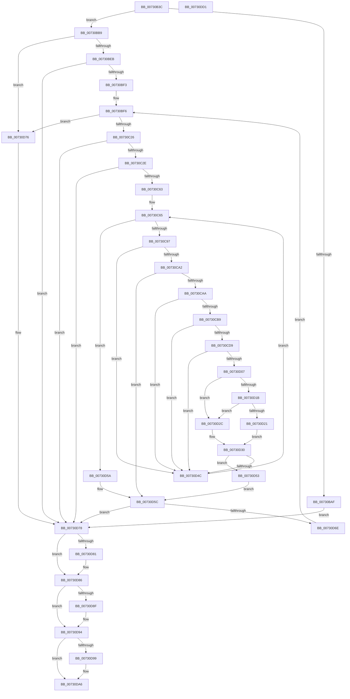

# PiDcInitUpdateProperties

- RVA: `0x00730B3C`–`0x00730DD2` (길이 `662` bytes)
- VA: `0x0000000140730B3C`
- 실행 섹션: `PAGE`
- PDB 이름 있음: `예`; PDB Function 태그: `아니요`
- unwind 정보 RVA: `0x000C89A8`
- 디코드: `172`개 명령, `662/662` bytes 표시
- 미해석 바이트: `0` (있으면 어셈블리에 `.byte`로 보존)

> 이 문서는 커널 이미지의 기계어와 PDB 기호를 분석해 생성했습니다. 4번과 5번은 함수 원형과 자료형을 바이너리 사용 방식에서 추정한 C 해석이며 원본 소스 복구 결과는 아닙니다.

## 1. Dependencies

- 직접 호출 지점: **14**; 고유 호출 대상: **11**
- 직접 호출자로 확인된 함수: **1**
- RIP 상대 이미지 참조: **3**

### Outgoing calls
- `0x00730BA2` → [ExAllocatePool2](../../poolcode/B8/ExAllocatePool2_function_00B820F0.md) (function, `0x00B820F0`)
- `0x00730BC4` → [RtlInitUnicodeString](../../text/42/RtlInitUnicodeString_function_0042A780.md) (function, `0x0042A780`)
- `0x00730BD9` → [IopOpenRegistryKeyEx](../A5/IopOpenRegistryKeyEx_function_00A51B44.md) (function, `0x00A51B44`)
- `0x00730C14` → [ZwEnumerateKey](../../text/6A/ZwEnumerateKey_function_006AD710.md) (function, `0x006AD710`)
- `0x00730C54` → [IopOpenRegistryKeyEx](../A5/IopOpenRegistryKeyEx_function_00A51B44.md) (function, `0x00A51B44`)
- `0x00730C85` → [ZwEnumerateValueKey](../../text/6A/ZwEnumerateValueKey_function_006AD330.md) (function, `0x006AD330`)
- `0x00730CD0` → [RtlGUIDFromString](../8F/RtlGUIDFromString_function_008F1EF0.md) (function, `0x008F1EF0`)
- `0x00730CFE` → [RtlUnicodeStringToInteger](../99/RtlUnicodeStringToInteger_function_00993480.md) (function, `0x00993480`)
- `0x00730D42` → [RtlInsertElementGenericTableAvl](../../text/3E/RtlInsertElementGenericTableAvl_function_003EE510.md) (function, `0x003EE510`)
- `0x00730D60` → [ZwClose](../../text/6A/ZwClose_function_006AD2B0.md) (function, `0x006AD2B0`)
- `0x00730D81` → [ZwClose](../../text/6A/ZwClose_function_006AD2B0.md) (function, `0x006AD2B0`)
- `0x00730D8F` → [ZwClose](../../text/6A/ZwClose_function_006AD2B0.md) (function, `0x006AD2B0`)
- `0x00730DA1` → [ExFreePoolWithTag](../../poolcode/B8/ExFreePoolWithTag_function_00B82870.md) (function, `0x00B82870`)
- `0x00730DAF` → [_security_check_cookie](../../text/6A/_security_check_cookie_function_006AC640.md) (function, `0x006AC640`)

### Direct callers
- [PiDcInit](../../init/C3/PiDcInit_function_00C344DC.md) at `0x00C344F1`

### Static image references
- `0x00730B5B` → RVA `0x00E0A740` (`.data`; read)
- `0x00730BB9` → RVA `0x00AFE430` (` ?? ::NNGAKEGL::`string'`; read)
- `0x00730D37` → RVA `0x00F8B3A0` (`.data`; read)

## 2. Other-region calls and transfers

- 다른 실행 섹션으로 향하는 call: **10**
  - `0x00730BA2` → [ExAllocatePool2](../../poolcode/B8/ExAllocatePool2_function_00B820F0.md) (`PAGE` → `POOLCODE`)
  - `0x00730BC4` → [RtlInitUnicodeString](../../text/42/RtlInitUnicodeString_function_0042A780.md) (`PAGE` → `.text`)
  - `0x00730C14` → [ZwEnumerateKey](../../text/6A/ZwEnumerateKey_function_006AD710.md) (`PAGE` → `.text`)
  - `0x00730C85` → [ZwEnumerateValueKey](../../text/6A/ZwEnumerateValueKey_function_006AD330.md) (`PAGE` → `.text`)
  - `0x00730D42` → [RtlInsertElementGenericTableAvl](../../text/3E/RtlInsertElementGenericTableAvl_function_003EE510.md) (`PAGE` → `.text`)
  - `0x00730D60` → [ZwClose](../../text/6A/ZwClose_function_006AD2B0.md) (`PAGE` → `.text`)
  - `0x00730D81` → [ZwClose](../../text/6A/ZwClose_function_006AD2B0.md) (`PAGE` → `.text`)
  - `0x00730D8F` → [ZwClose](../../text/6A/ZwClose_function_006AD2B0.md) (`PAGE` → `.text`)
  - `0x00730DA1` → [ExFreePoolWithTag](../../poolcode/B8/ExFreePoolWithTag_function_00B82870.md) (`PAGE` → `POOLCODE`)
  - `0x00730DAF` → [_security_check_cookie](../../text/6A/_security_check_cookie_function_006AC640.md) (`PAGE` → `.text`)
- 별도 외부 분기/꼬리 이동을 확인하지 못했습니다.

## 3. Assembly (complete function range)

```asm
00730B3C  48 8B C4                        mov rax, rsp
00730B3F  48 89 58 08                     mov qword ptr [rax + 8], rbx
00730B43  48 89 70 10                     mov qword ptr [rax + 0x10], rsi
00730B47  48 89 78 18                     mov qword ptr [rax + 0x18], rdi
00730B4B  55                              push rbp
00730B4C  41 56                           push r14
00730B4E  41 57                           push r15
00730B50  48 8D 68 A1                     lea rbp, [rax - 0x5f]
00730B54  48 81 EC 90 00 00 00            sub rsp, 0x90
00730B5B  48 8B 05 DE 9B 6D 00            mov rax, qword ptr [rip + 0x6d9bde]
00730B62  48 33 C4                        xor rax, rsp
00730B65  48 89 45 3F                     mov qword ptr [rbp + 0x3f], rax
00730B69  48 83 65 07 00                  and qword ptr [rbp + 7], 0
00730B6E  0F 57 C0                        xorps xmm0, xmm0
00730B71  48 83 65 FF 00                  and qword ptr [rbp - 1], 0
00730B76  33 C0                           xor eax, eax
00730B78  83 65 F7 00                     and dword ptr [rbp - 9], 0
00730B7C  0F 57 C9                        xorps xmm1, xmm1
00730B7F  BA 18 02 00 00                  mov edx, 0x218
00730B84  89 45 1F                        mov dword ptr [rbp + 0x1f], eax
00730B87  B9 00 01 00 00                  mov ecx, 0x100
00730B8C  48 89 45 37                     mov qword ptr [rbp + 0x37], rax
00730B90  41 B8 50 6E 70 47               mov r8d, 0x47706e50
00730B96  0F 11 45 E7                     movups xmmword ptr [rbp - 0x19], xmm0
00730B9A  0F 11 4D 0F                     movups xmmword ptr [rbp + 0xf], xmm1
00730B9E  0F 11 45 27                     movups xmmword ptr [rbp + 0x27], xmm0
00730BA2  E8 49 15 45 00                  call 0x140b820f0
00730BA7  48 8B F8                        mov rdi, rax
00730BAA  48 85 C0                        test rax, rax
00730BAD  75 0A                           jne 0x140730bb9
00730BAF  BB 9A 00 00 C0                  mov ebx, 0xc000009a
00730BB4  E9 BF 01 00 00                  jmp 0x140730d78
00730BB9  48 8D 15 70 D8 3C 00            lea rdx, [rip + 0x3cd870]
00730BC0  48 8D 4D E7                     lea rcx, [rbp - 0x19]
00730BC4  E8 B7 9B CF FF                  call 0x14042a780
00730BC9  41 B9 08 00 00 00               mov r9d, 8
00730BCF  4C 8D 45 E7                     lea r8, [rbp - 0x19]
00730BD3  33 D2                           xor edx, edx
00730BD5  48 8D 4D 07                     lea rcx, [rbp + 7]
00730BD9  E8 66 0F 32 00                  call 0x140a51b44
00730BDE  8B D8                           mov ebx, eax
00730BE0  3D 34 00 00 C0                  cmp eax, 0xc0000034
00730BE5  0F 84 8B 01 00 00               je 0x140730d76
00730BEB  85 C0                           test eax, eax
00730BED  0F 88 85 01 00 00               js 0x140730d78
00730BF3  45 33 F6                        xor r14d, r14d
00730BF6  48 8B 4D 07                     mov rcx, qword ptr [rbp + 7]
00730BFA  48 8D 45 F7                     lea rax, [rbp - 9]
00730BFE  48 89 44 24 28                  mov qword ptr [rsp + 0x28], rax
00730C03  4C 8B CF                        mov r9, rdi
00730C06  45 33 C0                        xor r8d, r8d
00730C09  C7 44 24 20 18 02 00 00         mov dword ptr [rsp + 0x20], 0x218
00730C11  41 8B D6                        mov edx, r14d
00730C14  E8 F7 CA F7 FF                  call 0x1406ad710
00730C19  8B D8                           mov ebx, eax
00730C1B  3D 1A 00 00 80                  cmp eax, 0x8000001a
00730C20  0F 84 50 01 00 00               je 0x140730d76
00730C26  85 C0                           test eax, eax
00730C28  0F 88 4A 01 00 00               js 0x140730d78
00730C2E  48 8B 55 07                     mov rdx, qword ptr [rbp + 7]
00730C32  4C 8D 7F 10                     lea r15, [rdi + 0x10]
00730C36  4C 89 7D EF                     mov qword ptr [rbp - 0x11], r15
00730C3A  4C 8D 45 E7                     lea r8, [rbp - 0x19]
00730C3E  0F B7 47 0C                     movzx eax, word ptr [rdi + 0xc]
00730C42  48 8D 4D FF                     lea rcx, [rbp - 1]
00730C46  41 B9 19 00 02 00               mov r9d, 0x20019
00730C4C  66 89 45 E7                     mov word ptr [rbp - 0x19], ax
00730C50  66 89 45 E9                     mov word ptr [rbp - 0x17], ax
00730C54  E8 EB 0E 32 00                  call 0x140a51b44
00730C59  8B D8                           mov ebx, eax
00730C5B  85 C0                           test eax, eax
00730C5D  0F 88 15 01 00 00               js 0x140730d78
00730C63  33 F6                           xor esi, esi
00730C65  48 8B 4D FF                     mov rcx, qword ptr [rbp - 1]
00730C69  48 8D 45 F7                     lea rax, [rbp - 9]
00730C6D  48 89 44 24 28                  mov qword ptr [rsp + 0x28], rax
00730C72  4C 8B CF                        mov r9, rdi
00730C75  41 B8 01 00 00 00               mov r8d, 1
00730C7B  C7 44 24 20 18 02 00 00         mov dword ptr [rsp + 0x20], 0x218
00730C83  8B D6                           mov edx, esi
00730C85  E8 A6 C6 F7 FF                  call 0x1406ad330
00730C8A  8B D8                           mov ebx, eax
00730C8C  3D 1A 00 00 80                  cmp eax, 0x8000001a
00730C91  0F 84 C3 00 00 00               je 0x140730d5a
00730C97  3D 05 00 00 80                  cmp eax, 0x80000005
00730C9C  0F 84 AA 00 00 00               je 0x140730d4c
00730CA2  85 C0                           test eax, eax
00730CA4  0F 88 B2 00 00 00               js 0x140730d5c
00730CAA  41 8B 07                        mov eax, dword ptr [r15]
00730CAD  83 E8 50                        sub eax, 0x50
00730CB0  83 F8 12                        cmp eax, 0x12
00730CB3  0F 87 93 00 00 00               ja 0x140730d4c
00730CB9  48 8D 47 14                     lea rax, [rdi + 0x14]
00730CBD  C7 45 E7 4C 00 4C 00            mov dword ptr [rbp - 0x19], 0x4c004c
00730CC4  48 8D 55 0F                     lea rdx, [rbp + 0xf]
00730CC8  48 89 45 EF                     mov qword ptr [rbp - 0x11], rax
00730CCC  48 8D 4D E7                     lea rcx, [rbp - 0x19]
00730CD0  E8 1B 12 1C 00                  call 0x1408f1ef0
00730CD5  85 C0                           test eax, eax
00730CD7  78 73                           js 0x140730d4c
00730CD9  48 8D 47 62                     lea rax, [rdi + 0x62]
00730CDD  BA 0A 00 00 00                  mov edx, 0xa
00730CE2  48 89 45 EF                     mov qword ptr [rbp - 0x11], rax
00730CE6  4C 8D 45 1F                     lea r8, [rbp + 0x1f]
00730CEA  41 0F B7 07                     movzx eax, word ptr [r15]
00730CEE  48 8D 4D E7                     lea rcx, [rbp - 0x19]
00730CF2  66 83 E8 4E                     sub ax, 0x4e
00730CF6  66 89 45 E7                     mov word ptr [rbp - 0x19], ax
00730CFA  66 89 45 E9                     mov word ptr [rbp - 0x17], ax
00730CFE  E8 7D 27 26 00                  call 0x140993480
00730D03  85 C0                           test eax, eax
00730D05  78 45                           js 0x140730d4c
00730D07  0F 10 45 0F                     movups xmm0, xmmword ptr [rbp + 0xf]
00730D0B  8B 45 1F                        mov eax, dword ptr [rbp + 0x1f]
00730D0E  89 45 37                        mov dword ptr [rbp + 0x37], eax
00730D11  0F 11 45 27                     movups xmmword ptr [rbp + 0x27], xmm0
00730D15  83 7F 04 04                     cmp dword ptr [rdi + 4], 4
00730D19  75 11                           jne 0x140730d2c
00730D1B  83 7F 0C 04                     cmp dword ptr [rdi + 0xc], 4
00730D1F  75 0B                           jne 0x140730d2c
00730D21  8B 47 08                        mov eax, dword ptr [rdi + 8]
00730D24  8B 0C 38                        mov ecx, dword ptr [rax + rdi]
00730D27  89 4D 3B                        mov dword ptr [rbp + 0x3b], ecx
00730D2A  EB 04                           jmp 0x140730d30
00730D2C  83 65 3B 00                     and dword ptr [rbp + 0x3b], 0
00730D30  45 33 C9                        xor r9d, r9d
00730D33  48 8D 55 27                     lea rdx, [rbp + 0x27]
00730D37  48 8D 0D 62 A6 85 00            lea rcx, [rip + 0x85a662]
00730D3E  45 8D 41 18                     lea r8d, [r9 + 0x18]
00730D42  E8 C9 D7 CB FF                  call 0x1403ee510
00730D47  48 85 C0                        test rax, rax
00730D4A  74 07                           je 0x140730d53
00730D4C  FF C6                           inc esi
00730D4E  E9 12 FF FF FF                  jmp 0x140730c65
00730D53  BB 9A 00 00 C0                  mov ebx, 0xc000009a
00730D58  EB 02                           jmp 0x140730d5c
00730D5A  33 DB                           xor ebx, ebx
00730D5C  48 8B 4D FF                     mov rcx, qword ptr [rbp - 1]
00730D60  E8 4B C5 F7 FF                  call 0x1406ad2b0
00730D65  48 83 65 FF 00                  and qword ptr [rbp - 1], 0
00730D6A  85 DB                           test ebx, ebx
00730D6C  78 0A                           js 0x140730d78
00730D6E  41 FF C6                        inc r14d
00730D71  E9 80 FE FF FF                  jmp 0x140730bf6
00730D76  33 DB                           xor ebx, ebx
00730D78  48 8B 4D 07                     mov rcx, qword ptr [rbp + 7]
00730D7C  48 85 C9                        test rcx, rcx
00730D7F  74 05                           je 0x140730d86
00730D81  E8 2A C5 F7 FF                  call 0x1406ad2b0
00730D86  48 8B 4D FF                     mov rcx, qword ptr [rbp - 1]
00730D8A  48 85 C9                        test rcx, rcx
00730D8D  74 05                           je 0x140730d94
00730D8F  E8 1C C5 F7 FF                  call 0x1406ad2b0
00730D94  48 85 FF                        test rdi, rdi
00730D97  74 0D                           je 0x140730da6
00730D99  BA 50 6E 70 47                  mov edx, 0x47706e50
00730D9E  48 8B CF                        mov rcx, rdi
00730DA1  E8 CA 1A 45 00                  call 0x140b82870
00730DA6  8B C3                           mov eax, ebx
00730DA8  48 8B 4D 3F                     mov rcx, qword ptr [rbp + 0x3f]
00730DAC  48 33 CC                        xor rcx, rsp
00730DAF  E8 8C B8 F7 FF                  call 0x1406ac640
00730DB4  4C 8D 9C 24 90 00 00 00         lea r11, [rsp + 0x90]
00730DBC  49 8B 5B 20                     mov rbx, qword ptr [r11 + 0x20]
00730DC0  49 8B 73 28                     mov rsi, qword ptr [r11 + 0x28]
00730DC4  49 8B 7B 30                     mov rdi, qword ptr [r11 + 0x30]
00730DC8  49 8B E3                        mov rsp, r11
00730DCB  41 5F                           pop r15
00730DCD  41 5E                           pop r14
00730DCF  5D                              pop rbp
00730DD0  C3                              ret
00730DD1  CC                              int3
```

## 4. C-style interpretation (structured pseudocode)

```c
__int64 __fastcall PiDcInitUpdateProperties(void)
{
    __int64 result;
    __int64 v_r14;
    __int64 v_rbx;
    __int64 v_rsi;
    __int64 v_rsp;
    unsigned __int64 v_stack_m18;
    unsigned __int64 v_stack_m80;
    unsigned int v_stack_m88;

    *(unsigned __int64 *)(v_rsp + 8) = v_rbx;
    *(unsigned __int64 *)(v_rsp + 16) = v_rsi;
    *(unsigned __int64 *)(v_rsp + 24) = v_rdi;
    v_rsp = (v_rsp) - (144);
    result = (*(unsigned __int64 *)(v_rip + 7183326)) ^ (v_rsp);
    *(unsigned __int64 *)(v_rsp - 95 + 63) = result;
    result = 0;
    *(unsigned int *)(v_rsp - 95 + 31) = 0;
    *(unsigned __int64 *)(v_rsp - 95 + 55) = 0;
    *(unsigned __int64 *)(v_rsp - 95 - 25) = v_xmm0;
    *(unsigned __int64 *)(v_rsp - 95 + 15) = v_xmm1;
    *(unsigned __int64 *)(v_rsp - 95 + 39) = v_xmm0;
    result = ExAllocatePool2(256, 536, (unsigned int)(0x47706E50ULL), a4);
    if (result != 0) goto loc_00730BB9;
    goto loc_00730D78;
loc_00730BB9:
    result = RtlInitUnicodeString(v_rsp - 95 - 25, v_rip + 3987568, (unsigned int)(0x47706E50ULL), a4);
    a2 = 0;
    result = IopOpenRegistryKeyEx(v_rsp - 95 + 7, a2, v_rsp - 95 - 25, 8);
    if (((unsigned int)(result)) == 0xC0000034ULL) goto loc_00730D76;
    if (sign_flag) goto loc_00730D78;
    v_r14 = 0;
loc_00730BF6:
    v_stack_m80 = v_rsp - 95 - 9;
    a3 = 0;
    v_stack_m88 = 536;
    result = ZwEnumerateKey(*(unsigned __int64 *)(v_rsp - 95 + 7), 0, a3, result);
    if (((unsigned int)(result)) == 0x8000001AULL) goto loc_00730D76;
    if (sign_flag) goto loc_00730D78;
    *(unsigned __int64 *)(v_rsp - 95 - 17) = result + 16;
    *(unsigned __int16 *)(v_rsp - 95 - 25) = (unsigned __int16)(*(unsigned __int16 *)(result + 12));
    *(unsigned __int16 *)(v_rsp - 95 - 23) = (unsigned __int16)(*(unsigned __int16 *)(result + 12));
    result = IopOpenRegistryKeyEx(v_rsp - 95 - 1, *(unsigned __int64 *)(v_rsp - 95 + 7), v_rsp - 95 - 25, (unsigned int)(0x20019ULL));
    if (sign_flag) goto loc_00730D78;
    v_rsi = 0;
loc_00730C65:
    v_stack_m80 = v_rsp - 95 - 9;
    v_stack_m88 = 536;
    result = ZwEnumerateValueKey(*(unsigned __int64 *)(v_rsp - 95 - 1), 0, 1, result);
    if (((unsigned int)(result)) == 0x8000001AULL) goto loc_00730D5A;
    if (((unsigned int)(result)) == 0x80000005ULL) goto loc_00730D4C;
    if (sign_flag) goto loc_00730D5C;
    result = (unsigned int)(((unsigned int)(*(unsigned int *)(result + 16))) - (80));
    if (((unsigned int)(result)) > 18) goto loc_00730D4C;
    *(unsigned int *)(v_rsp - 95 - 25) = 0x4C004CULL;
    *(unsigned __int64 *)(v_rsp - 95 - 17) = result + 20;
    result = RtlGUIDFromString(v_rsp - 95 - 25, v_rsp - 95 + 15, 1, result);
    if (sign_flag) goto loc_00730D4C;
    *(unsigned __int64 *)(v_rsp - 95 - 17) = result + 98;
    result = (unsigned __int16)((*(unsigned __int16 *)(result + 16)) - (78));
    *(unsigned __int16 *)(v_rsp - 95 - 25) = (unsigned __int16)(result);
    *(unsigned __int16 *)(v_rsp - 95 - 23) = (unsigned __int16)(result);
    result = RtlUnicodeStringToInteger(v_rsp - 95 - 25, 10, v_rsp - 95 + 31, result);
    if (sign_flag) goto loc_00730D4C;
    *(unsigned int *)(v_rsp - 95 + 55) = (unsigned int)((unsigned int)(*(unsigned int *)(v_rsp - 95 + 31)));
    *(unsigned __int64 *)(v_rsp - 95 + 39) = v_xmm0;
    if ((*(unsigned int *)(result + 4)) != 4) goto loc_00730D2C;
    if ((*(unsigned int *)(result + 12)) != 4) goto loc_00730D2C;
    *(unsigned int *)(v_rsp - 95 + 59) = (unsigned int)((unsigned int)(*(unsigned int *)((unsigned int)(*(unsigned int *)(result + 8)) + result * 1)));
    goto loc_00730D30;
loc_00730D2C:
loc_00730D30:
    a4 = 0;
    result = RtlInsertElementGenericTableAvl(v_rip + 8758882, v_rsp - 95 + 39, a4 + 24, a4);
    if (result == 0) goto loc_00730D53;
loc_00730D4C:
    v_rsi = (unsigned int)((v_rsi) + 1);
    goto loc_00730C65;
loc_00730D53:
    goto loc_00730D5C;
loc_00730D5A:
    v_rbx = 0;
loc_00730D5C:
    result = ZwClose(*(unsigned __int64 *)(v_rsp - 95 - 1), v_rsp - 95 + 39, a4 + 24, a4);
    if (sign_flag) goto loc_00730D78;
    v_r14 = (unsigned int)((v_r14) + 1);
    goto loc_00730BF6;
loc_00730D76:
    v_rbx = 0;
loc_00730D78:
    if (*(unsigned __int64 *)(v_rsp - 95 + 7) != 0) {
        result = ZwClose(*(unsigned __int64 *)(v_rsp - 95 + 7), v_rsp - 95 + 39, a4 + 24, a4);
    }
    if (*(unsigned __int64 *)(v_rsp - 95 - 1) != 0) {
        result = ZwClose(*(unsigned __int64 *)(v_rsp - 95 - 1), v_rsp - 95 + 39, a4 + 24, a4);
    }
    if (result != 0) {
        a2 = 0x47706E50ULL;
        a1 = result;
        result = ExFreePoolWithTag(a1, a2, a4 + 24, a4);
    }
    a1 = (*(unsigned __int64 *)(v_rsp - 95 + 63)) ^ (v_rsp);
    result = _security_check_cookie(a1, a2, a4 + 24, a4);
    return result;
}
```

## 5. (Beta) C Style

```c
void PiDcInitUpdateProperties(void)
{
    int64_t result;
    int64_t local_r14;
    int64_t local_rbx;
    int64_t local_rsi;
    int64_t local_rsp;
    uint64_t v_stack_m18;
    uint64_t v_stack_m80;
    uint32_t v_stack_m88;

    *(uint64_t *)(local_rsp + 0x8) = local_rbx;
    *(uint64_t *)(local_rsp + 0x10) = local_rsi;
    *(uint64_t *)(local_rsp + 0x18) = local_rdi;
    local_rsp = (local_rsp) - (144);
    result = (*(uint64_t *)(v_rip + 0x6D9BDE)) ^ (local_rsp);
    *(uint64_t *)(local_rsp - 0x5F + 0x3F) = result;
    result = 0;
    *(uint32_t *)(local_rsp - 0x5F + 0x1F) = 0;
    *(uint64_t *)(local_rsp - 0x5F + 0x37) = 0;
    *(uint64_t *)(local_rsp - 0x5F - 0x19) = v_xmm0;
    *(uint64_t *)(local_rsp - 0x5F + 0xF) = v_xmm1;
    *(uint64_t *)(local_rsp - 0x5F + 0x27) = v_xmm0;
    result = ExAllocatePool2(256, 536, (uint32_t)(0x47706E50ULL), a4);
    if (result != 0) goto loc_00730BB9;
    goto loc_00730D78;
loc_00730BB9:
    result = RtlInitUnicodeString(local_rsp - 95 - 25, v_rip + 3987568, (uint32_t)(0x47706E50ULL), a4);
    a2 = 0;
    result = IopOpenRegistryKeyEx(local_rsp - 95 + 7, a2, local_rsp - 95 - 25, 8);
    if (((uint32_t)(result)) == 0xC0000034ULL) goto loc_00730D76;
    if (sign_flag) goto loc_00730D78;
    local_r14 = 0;
loc_00730BF6:
    v_stack_m80 = local_rsp - 95 - 9;
    a3 = 0;
    v_stack_m88 = 536;
    result = ZwEnumerateKey(*(uint64_t *)(local_rsp - 0x5F + 0x7), 0, a3, result);
    if (((uint32_t)(result)) == 0x8000001AULL) goto loc_00730D76;
    if (sign_flag) goto loc_00730D78;
    *(uint64_t *)(local_rsp - 0x5F - 0x11) = result + 16;
    *(uint16_t *)(local_rsp - 0x5F - 0x19) = (uint16_t)(*(uint16_t *)(result + 0xC));
    *(uint16_t *)(local_rsp - 0x5F - 0x17) = (uint16_t)(*(uint16_t *)(result + 0xC));
    result = IopOpenRegistryKeyEx(local_rsp - 95 - 1, *(uint64_t *)(local_rsp - 0x5F + 0x7), local_rsp - 95 - 25, (uint32_t)(0x20019ULL));
    if (sign_flag) goto loc_00730D78;
    local_rsi = 0;
loc_00730C65:
    v_stack_m80 = local_rsp - 95 - 9;
    v_stack_m88 = 536;
    result = ZwEnumerateValueKey(*(uint64_t *)(local_rsp - 0x5F - 0x1), 0, 1, result);
    if (((uint32_t)(result)) == 0x8000001AULL) goto loc_00730D5A;
    if (((uint32_t)(result)) == 0x80000005ULL) goto loc_00730D4C;
    if (sign_flag) goto loc_00730D5C;
    result = (uint32_t)(((uint32_t)(*(uint32_t *)(result + 0x10))) - (80));
    if (((uint32_t)(result)) > 18) goto loc_00730D4C;
    *(uint32_t *)(local_rsp - 0x5F - 0x19) = 0x4C004CULL;
    *(uint64_t *)(local_rsp - 0x5F - 0x11) = result + 20;
    result = RtlGUIDFromString(local_rsp - 95 - 25, local_rsp - 95 + 15, 1, result);
    if (sign_flag) goto loc_00730D4C;
    *(uint64_t *)(local_rsp - 0x5F - 0x11) = result + 98;
    result = (uint16_t)((*(uint16_t *)(result + 0x10)) - (78));
    *(uint16_t *)(local_rsp - 0x5F - 0x19) = (uint16_t)(result);
    *(uint16_t *)(local_rsp - 0x5F - 0x17) = (uint16_t)(result);
    result = RtlUnicodeStringToInteger(local_rsp - 95 - 25, 10, local_rsp - 95 + 31, result);
    if (sign_flag) goto loc_00730D4C;
    *(uint32_t *)(local_rsp - 0x5F + 0x37) = (uint32_t)((uint32_t)(*(uint32_t *)(local_rsp - 0x5F + 0x1F)));
    *(uint64_t *)(local_rsp - 0x5F + 0x27) = v_xmm0;
    if ((*(uint32_t *)(result + 0x4)) != 4) goto loc_00730D2C;
    if ((*(uint32_t *)(result + 0xC)) != 4) goto loc_00730D2C;
    *(uint32_t *)(local_rsp - 0x5F + 0x3B) = (uint32_t)((uint32_t)(*(uint32_t *)((uint32_t)(*(uint32_t *)(result + 0x8)) + result * 1)));
    goto loc_00730D30;
loc_00730D2C:
loc_00730D30:
    a4 = 0;
    result = RtlInsertElementGenericTableAvl(v_rip + 8758882, local_rsp - 95 + 39, a4 + 24, a4);
    if (result == 0) goto loc_00730D53;
loc_00730D4C:
    local_rsi = (uint32_t)((local_rsi) + 1);
    goto loc_00730C65;
loc_00730D53:
    goto loc_00730D5C;
loc_00730D5A:
    local_rbx = 0;
loc_00730D5C:
    result = ZwClose(*(uint64_t *)(local_rsp - 0x5F - 0x1), local_rsp - 95 + 39, a4 + 24, a4);
    if (sign_flag) goto loc_00730D78;
    local_r14 = (uint32_t)((local_r14) + 1);
    goto loc_00730BF6;
loc_00730D76:
    local_rbx = 0;
loc_00730D78:
    if (*(uint64_t *)(local_rsp - 0x5F + 0x7) != 0) {
        result = ZwClose(*(uint64_t *)(local_rsp - 0x5F + 0x7), local_rsp - 95 + 39, a4 + 24, a4);
    }
    if (*(uint64_t *)(local_rsp - 0x5F - 0x1) != 0) {
        result = ZwClose(*(uint64_t *)(local_rsp - 0x5F - 0x1), local_rsp - 95 + 39, a4 + 24, a4);
    }
    if (result != 0) {
        a2 = 0x47706E50ULL;
        a1 = result;
        result = ExFreePoolWithTag(a1, a2, a4 + 24, a4);
    }
    a1 = (*(uint64_t *)(local_rsp - 0x5F + 0x3F)) ^ (local_rsp);
    result = _security_check_cookie(a1, a2, a4 + 24, a4);
    return result;
}
```

## 6. Execution-region graph

[열기: 2D/3D 그래프와 함수 탐색 컨트롤 패널](../../../control-panel.html?section=page&rva=0x00730B3C&view=graph)

- 2D 그래프는 위에서 아래로 흐르고, 3D 그래프는 빈 공간을 드래그해 회전합니다. Shift+드래그는 이동, 휠은 확대·축소, 함수 노드 선택은 대상 보고서 이동입니다.

### Static fallback


