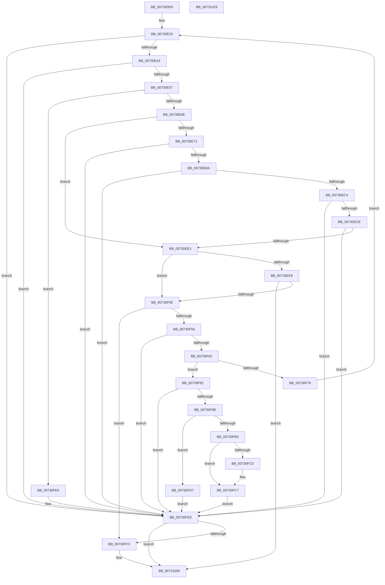

# PiDcResetChildDeviceContainerCallback

- RVA: `0x00730DE0`–`0x0073102A` (길이 `586` bytes)
- VA: `0x0000000140730DE0`
- 실행 섹션: `PAGE`
- PDB 이름 있음: `예`; PDB Function 태그: `아니요`
- unwind 정보 RVA: `0x000BD158`
- 디코드: `151`개 명령, `586/586` bytes 표시
- 미해석 바이트: `0` (있으면 어셈블리에 `.byte`로 보존)

> 이 문서는 커널 이미지의 기계어와 PDB 기호를 분석해 생성했습니다. 4번과 5번은 함수 원형과 자료형을 바이너리 사용 방식에서 추정한 C 해석이며 원본 소스 복구 결과는 아닙니다.

## 1. Dependencies

- 직접 호출 지점: **14**; 고유 호출 대상: **11**
- 직접 호출자로 확인된 함수: **0**
- RIP 상대 이미지 참조: **3**

### Outgoing calls
- `0x00730E36` → [CmIsRootDevice](../93/CmIsRootDevice_function_009325E4.md) (function, `0x009325E4`)
- `0x00730E4A` → [RtlInitUnicodeStringEx](../../text/46/RtlInitUnicodeStringEx_function_00463960.md) (function, `0x00463960`)
- `0x00730E60` → [PnpDeviceObjectFromDeviceInstanceWithTag](../8E/PnpDeviceObjectFromDeviceInstanceWithTag_function_008E7490.md) (function, `0x008E7490`)
- `0x00730EAD` → [CmGetDeviceRegProp](../8E/CmGetDeviceRegProp_function_008ED870.md) (function, `0x008ED870`)
- `0x00730ED6` → [wcsicmp](../../text/50/wcsicmp_function_00500080.md) (function, `0x00500080`)
- `0x00730EF8` → [ExAllocatePool2](../../poolcode/B8/ExAllocatePool2_function_00B820F0.md) (function, `0x00B820F0`)
- `0x00730F4B` → [PnpGetObjectProperty](../8E/PnpGetObjectProperty_function_008E2180.md) (function, `0x008E2180`)
- `0x00730F70` → [wcsicmp](../../text/50/wcsicmp_function_00500080.md) (function, `0x00500080`)
- `0x00730F91` → [ExAllocatePool2](../../poolcode/B8/ExAllocatePool2_function_00B820F0.md) (function, `0x00B820F0`)
- `0x00730FAA` → [RtlStringCbCopyW](../../text/43/RtlStringCbCopyW_function_0043B910.md) (function, `0x0043B910`)
- `0x00730FDF` → [ExFreePoolWithTag](../../poolcode/B8/ExFreePoolWithTag_function_00B82870.md) (function, `0x00B82870`)
- `0x00730FE9` → [ObfDereferenceObject](../../text/2F/ObfDereferenceObject_function_002F9350.md) (function, `0x002F9350`)
- `0x00730FFB` → [ExFreePoolWithTag](../../poolcode/B8/ExFreePoolWithTag_function_00B82870.md) (function, `0x00B82870`)
- `0x00731009` → [_security_check_cookie](../../text/6A/_security_check_cookie_function_006AC640.md) (function, `0x006AC640`)

### Direct callers
- 이 함수 시작 RVA로 연결되는 직접 call은 확인되지 않았습니다. 간접 호출은 완전히 역산할 수 없습니다.

### Static image references
- `0x00730DFC` → RVA `0x00E0A740` (`.data`; read)
- `0x00730E73` → RVA `0x00E66398` (`.data`; read)
- `0x00730F36` → RVA `0x00011F50` (`.rdata`; read)

## 2. Other-region calls and transfers

- 다른 실행 섹션으로 향하는 call: **10**
  - `0x00730E4A` → [RtlInitUnicodeStringEx](../../text/46/RtlInitUnicodeStringEx_function_00463960.md) (`PAGE` → `.text`)
  - `0x00730ED6` → [wcsicmp](../../text/50/wcsicmp_function_00500080.md) (`PAGE` → `.text`)
  - `0x00730EF8` → [ExAllocatePool2](../../poolcode/B8/ExAllocatePool2_function_00B820F0.md) (`PAGE` → `POOLCODE`)
  - `0x00730F70` → [wcsicmp](../../text/50/wcsicmp_function_00500080.md) (`PAGE` → `.text`)
  - `0x00730F91` → [ExAllocatePool2](../../poolcode/B8/ExAllocatePool2_function_00B820F0.md) (`PAGE` → `POOLCODE`)
  - `0x00730FAA` → [RtlStringCbCopyW](../../text/43/RtlStringCbCopyW_function_0043B910.md) (`PAGE` → `.text`)
  - `0x00730FDF` → [ExFreePoolWithTag](../../poolcode/B8/ExFreePoolWithTag_function_00B82870.md) (`PAGE` → `POOLCODE`)
  - `0x00730FE9` → [ObfDereferenceObject](../../text/2F/ObfDereferenceObject_function_002F9350.md) (`PAGE` → `.text`)
  - `0x00730FFB` → [ExFreePoolWithTag](../../poolcode/B8/ExFreePoolWithTag_function_00B82870.md) (`PAGE` → `POOLCODE`)
  - `0x00731009` → [_security_check_cookie](../../text/6A/_security_check_cookie_function_006AC640.md) (`PAGE` → `.text`)
- 별도 외부 분기/꼬리 이동을 확인하지 못했습니다.

## 3. Assembly (complete function range)

```asm
00730DE0  48 89 5C 24 20                  mov qword ptr [rsp + 0x20], rbx
00730DE5  55                              push rbp
00730DE6  56                              push rsi
00730DE7  57                              push rdi
00730DE8  41 54                           push r12
00730DEA  41 55                           push r13
00730DEC  41 56                           push r14
00730DEE  41 57                           push r15
00730DF0  48 8D 6C 24 D9                  lea rbp, [rsp - 0x27]
00730DF5  48 81 EC E0 00 00 00            sub rsp, 0xe0
00730DFC  48 8B 05 3D 99 6D 00            mov rax, qword ptr [rip + 0x6d993d]
00730E03  48 33 C4                        xor rax, rsp
00730E06  48 89 45 17                     mov qword ptr [rbp + 0x17], rax
00730E0A  45 33 ED                        xor r13d, r13d
00730E0D  0F 57 C0                        xorps xmm0, xmm0
00730E10  0F 11 45 B7                     movups xmmword ptr [rbp - 0x49], xmm0
00730E14  44 89 6D AB                     mov dword ptr [rbp - 0x55], r13d
00730E18  41 8B DD                        mov ebx, r13d
00730E1B  44 89 6D A7                     mov dword ptr [rbp - 0x59], r13d
00730E1F  4D 8B F0                        mov r14, r8
00730E22  44 89 6D AF                     mov dword ptr [rbp - 0x51], r13d
00730E26  4C 8B FA                        mov r15, rdx
00730E29  44 89 6D B3                     mov dword ptr [rbp - 0x4d], r13d
00730E2D  4C 8B E1                        mov r12, rcx
00730E30  48 8B FA                        mov rdi, rdx
00730E33  48 8B CF                        mov rcx, rdi
00730E36  E8 A9 17 20 00                  call 0x1409325e4
00730E3B  84 C0                           test al, al
00730E3D  0F 85 AB 01 00 00               jne 0x140730fee
00730E43  48 8B D7                        mov rdx, rdi
00730E46  48 8D 4D B7                     lea rcx, [rbp - 0x49]
00730E4A  E8 11 2B D3 FF                  call 0x140463960
00730E4F  85 C0                           test eax, eax
00730E51  0F 88 97 01 00 00               js 0x140730fee
00730E57  BA 44 66 6C 74                  mov edx, 0x746c6644
00730E5C  48 8D 4D B7                     lea rcx, [rbp - 0x49]
00730E60  E8 2B 66 1B 00                  call 0x1408e7490
00730E65  48 85 C0                        test rax, rax
00730E68  0F 85 78 01 00 00               jne 0x140730fe6
00730E6E  49 3B FF                        cmp rdi, r15
00730E71  74 70                           je 0x140730ee3
00730E73  48 8B 0D 1E 55 73 00            mov rcx, qword ptr [rip + 0x73551e]
00730E7A  48 8D 45 A7                     lea rax, [rbp - 0x59]
00730E7E  44 89 6C 24 38                  mov dword ptr [rsp + 0x38], r13d
00730E83  41 B9 25 00 00 00               mov r9d, 0x25
00730E89  48 89 44 24 30                  mov qword ptr [rsp + 0x30], rax
00730E8E  45 33 C0                        xor r8d, r8d
00730E91  48 8D 45 C7                     lea rax, [rbp - 0x39]
00730E95  C7 45 A7 4E 00 00 00            mov dword ptr [rbp - 0x59], 0x4e
00730E9C  48 89 44 24 28                  mov qword ptr [rsp + 0x28], rax
00730EA1  48 8B D7                        mov rdx, rdi
00730EA4  48 8D 45 AB                     lea rax, [rbp - 0x55]
00730EA8  48 89 44 24 20                  mov qword ptr [rsp + 0x20], rax
00730EAD  E8 BE C9 1B 00                  call 0x1408ed870
00730EB2  85 C0                           test eax, eax
00730EB4  0F 88 34 01 00 00               js 0x140730fee
00730EBA  83 7D AB 01                     cmp dword ptr [rbp - 0x55], 1
00730EBE  0F 85 2A 01 00 00               jne 0x140730fee
00730EC4  83 7D A7 4E                     cmp dword ptr [rbp - 0x59], 0x4e
00730EC8  0F 85 20 01 00 00               jne 0x140730fee
00730ECE  49 8B 56 08                     mov rdx, qword ptr [r14 + 8]
00730ED2  48 8D 4D C7                     lea rcx, [rbp - 0x39]
00730ED6  E8 A5 F1 DC FF                  call 0x140500080
00730EDB  85 C0                           test eax, eax
00730EDD  0F 85 0B 01 00 00               jne 0x140730fee
00730EE3  48 85 DB                        test rbx, rbx
00730EE6  75 21                           jne 0x140730f09
00730EE8  BA 90 01 00 00                  mov edx, 0x190
00730EED  B9 00 01 00 00                  mov ecx, 0x100
00730EF2  41 B8 50 6E 70 47               mov r8d, 0x47706e50
00730EF8  E8 F3 11 45 00                  call 0x140b820f0
00730EFD  48 8B D8                        mov rbx, rax
00730F00  48 85 C0                        test rax, rax
00730F03  0F 84 F7 00 00 00               je 0x140731000
00730F09  44 89 6C 24 50                  mov dword ptr [rsp + 0x50], r13d
00730F0E  48 8D 45 B3                     lea rax, [rbp - 0x4d]
00730F12  48 89 44 24 48                  mov qword ptr [rsp + 0x48], rax
00730F17  45 33 C9                        xor r9d, r9d
00730F1A  C7 44 24 40 90 01 00 00         mov dword ptr [rsp + 0x40], 0x190
00730F22  48 8D 45 AF                     lea rax, [rbp - 0x51]
00730F26  48 89 5C 24 38                  mov qword ptr [rsp + 0x38], rbx
00730F2B  48 8B D7                        mov rdx, rdi
00730F2E  48 89 44 24 30                  mov qword ptr [rsp + 0x30], rax
00730F33  49 8B CC                        mov rcx, r12
00730F36  48 8D 05 13 10 8E FF            lea rax, [rip - 0x71efed]
00730F3D  48 89 44 24 28                  mov qword ptr [rsp + 0x28], rax
00730F42  45 8D 41 01                     lea r8d, [r9 + 1]
00730F46  4C 89 6C 24 20                  mov qword ptr [rsp + 0x20], r13
00730F4B  E8 30 12 1B 00                  call 0x1408e2180
00730F50  85 C0                           test eax, eax
00730F52  0F 88 9B 00 00 00               js 0x140730ff3
00730F58  83 7D AF 12                     cmp dword ptr [rbp - 0x51], 0x12
00730F5C  0F 85 8C 00 00 00               jne 0x140730fee
00730F62  66 44 89 AB 8E 01 00 00         mov word ptr [rbx + 0x18e], r13w
00730F6A  48 8B CB                        mov rcx, rbx
00730F6D  49 8B 16                        mov rdx, qword ptr [r14]
00730F70  E8 0B F1 DC FF                  call 0x140500080
00730F75  85 C0                           test eax, eax
00730F77  74 08                           je 0x140730f81
00730F79  48 8B FB                        mov rdi, rbx
00730F7C  E9 B2 FE FF FF                  jmp 0x140730e33
00730F81  BA A0 01 00 00                  mov edx, 0x1a0
00730F86  B9 00 01 00 00                  mov ecx, 0x100
00730F8B  41 B8 50 6E 70 47               mov r8d, 0x47706e50
00730F91  E8 5A 11 45 00                  call 0x140b820f0
00730F96  48 8B F8                        mov rdi, rax
00730F99  48 85 C0                        test rax, rax
00730F9C  74 50                           je 0x140730fee
00730F9E  48 8D 48 10                     lea rcx, [rax + 0x10]
00730FA2  4D 8B C7                        mov r8, r15
00730FA5  BA 90 01 00 00                  mov edx, 0x190
00730FAA  E8 61 A9 D0 FF                  call 0x14043b910
00730FAF  85 C0                           test eax, eax
00730FB1  78 24                           js 0x140730fd7
00730FB3  49 8D 46 10                     lea rax, [r14 + 0x10]
00730FB7  48 8B 48 08                     mov rcx, qword ptr [rax + 8]
00730FBB  48 39 01                        cmp qword ptr [rcx], rax
00730FBE  74 07                           je 0x140730fc7
00730FC0  B9 03 00 00 00                  mov ecx, 3
00730FC5  CD 29                           int 0x29
00730FC7  48 89 07                        mov qword ptr [rdi], rax
00730FCA  48 89 4F 08                     mov qword ptr [rdi + 8], rcx
00730FCE  48 89 39                        mov qword ptr [rcx], rdi
00730FD1  48 89 78 08                     mov qword ptr [rax + 8], rdi
00730FD5  EB 17                           jmp 0x140730fee
00730FD7  BA 50 6E 70 47                  mov edx, 0x47706e50
00730FDC  48 8B CF                        mov rcx, rdi
00730FDF  E8 8C 18 45 00                  call 0x140b82870
00730FE4  EB 08                           jmp 0x140730fee
00730FE6  48 8B C8                        mov rcx, rax
00730FE9  E8 62 83 BC FF                  call 0x1402f9350
00730FEE  48 85 DB                        test rbx, rbx
00730FF1  74 0D                           je 0x140731000
00730FF3  BA 50 6E 70 47                  mov edx, 0x47706e50
00730FF8  48 8B CB                        mov rcx, rbx
00730FFB  E8 70 18 45 00                  call 0x140b82870
00731000  33 C0                           xor eax, eax
00731002  48 8B 4D 17                     mov rcx, qword ptr [rbp + 0x17]
00731006  48 33 CC                        xor rcx, rsp
00731009  E8 32 B6 F7 FF                  call 0x1406ac640
0073100E  48 8B 9C 24 38 01 00 00         mov rbx, qword ptr [rsp + 0x138]
00731016  48 81 C4 E0 00 00 00            add rsp, 0xe0
0073101D  41 5F                           pop r15
0073101F  41 5E                           pop r14
00731021  41 5D                           pop r13
00731023  41 5C                           pop r12
00731025  5F                              pop rdi
00731026  5E                              pop rsi
00731027  5D                              pop rbp
00731028  C3                              ret
00731029  CC                              int3
```

## 4. C-style interpretation (structured pseudocode)

```c
__int64 __fastcall PiDcResetChildDeviceContainerCallback(__int64 a1, __int64 a2, __int64 a3)
{
    __int64 result;
    __int64 v_r13;
    __int64 v_rsp;
    unsigned __int64 v_stack_m48;
    unsigned __int64 v_stack_m5F;
    unsigned __int64 v_stack_m98;
    unsigned __int64 v_stack_mA8;
    unsigned int v_stack_mAC;
    unsigned int v_stack_mB0;
    unsigned int v_stack_mB4;
    unsigned int v_stack_mB8;
    unsigned int v_stack_mC8;
    unsigned __int64 v_stack_mD0;
    unsigned int v_stack_mD8;
    unsigned int v_stack_mE0;
    unsigned __int64 v_stack_mE8;
    unsigned __int64 v_stack_mF0;
    unsigned __int64 v_stack_mF8;
    unsigned __int64 v_stack_p20;

    v_stack_p20 = v_rbx;
    v_rsp = (v_rsp) - (224);
    result = (*(unsigned __int64 *)(v_rip + 7182653)) ^ (v_rsp);
    v_stack_m48 = result;
    v_r13 = 0;
    v_stack_mA8 = v_xmm0;
    v_stack_mB4 = 0;
    v_stack_mB8 = 0;
    v_stack_mB0 = 0;
    v_stack_mAC = 0;
loc_00730E33:
    result = CmIsRootDevice(a2, a2, a3, a4);
    if ((unsigned __int8)(result) != 0) goto loc_00730FEE;
    result = RtlInitUnicodeStringEx(v_stack_mA8, a2, a3, a4);
    if (sign_flag) goto loc_00730FEE;
    result = PnpDeviceObjectFromDeviceInstanceWithTag(v_stack_mA8, (unsigned int)(0x746C6644ULL), a3, a4);
    if (result != 0) goto loc_00730FE6;
    if (a2 == a2) goto loc_00730EE3;
    v_stack_mE0 = 0;
    v_stack_mE8 = v_stack_mB8;
    a3 = 0;
    v_stack_mB8 = 78;
    v_stack_mF0 = v_stack_m98;
    v_stack_mF8 = v_stack_mB4;
    result = CmGetDeviceRegProp(*(unsigned __int64 *)(v_rip + 7558430), a2, a3, 37);
    if (sign_flag) goto loc_00730FEE;
    if (v_stack_mB4 != 1) goto loc_00730FEE;
    if (v_stack_mB8 != 78) goto loc_00730FEE;
    result = wcsicmp(v_stack_m98, *(unsigned __int64 *)(a3 + 8), a3, 37);
    if ((unsigned int)(result) != 0) goto loc_00730FEE;
loc_00730EE3:
    if (0 != 0) goto loc_00730F09;
    result = ExAllocatePool2(256, 400, (unsigned int)(0x47706E50ULL), 37);
    if (result == 0) goto loc_00731000;
loc_00730F09:
    v_stack_mC8 = 0;
    v_stack_mD0 = v_stack_mAC;
    a4 = 0;
    v_stack_mD8 = 400;
    v_stack_mE0 = result;
    v_stack_mE8 = v_stack_mB0;
    v_stack_mF0 = v_rip - 7466989;
    v_stack_mF8 = 0;
    result = PnpGetObjectProperty(a1, a2, a4 + 1, a4);
    if (sign_flag) goto loc_00730FF3;
    if (v_stack_mB0 != 18) goto loc_00730FEE;
    *(unsigned __int16 *)(result + 398) = 0;
    result = wcsicmp(result, *(unsigned __int64 *)(a3), a4 + 1, a4);
    if ((unsigned int)(result) == 0) goto loc_00730F81;
    goto loc_00730E33;
loc_00730F81:
    result = ExAllocatePool2(256, 416, (unsigned int)(0x47706E50ULL), a4);
    if (result == 0) goto loc_00730FEE;
    result = RtlStringCbCopyW(result + 16, 400, a2, a4);
    if (sign_flag) goto loc_00730FD7;
    if ((*(unsigned __int64 *)(*(unsigned __int64 *)(a3 + 16 + 8))) != (a3 + 16)) {
        a1 = 3;
    }
    *(unsigned __int64 *)(result) = a3 + 16;
    *(unsigned __int64 *)(result + 8) = a1;
    *(unsigned __int64 *)(a1) = result;
    *(unsigned __int64 *)(a3 + 16 + 8) = result;
    goto loc_00730FEE;
loc_00730FD7:
    result = ExFreePoolWithTag(result, (unsigned int)(0x47706E50ULL), a2, a4);
    goto loc_00730FEE;
loc_00730FE6:
    result = ObfDereferenceObject(result, (unsigned int)(0x47706E50ULL), a2, a4);
loc_00730FEE:
    if (result != 0) {
        a2 = 0x47706E50ULL;
        a1 = result;
        result = ExFreePoolWithTag(a1, a2, a2, a4);
    }
    result = 0;
    a1 = (v_stack_m48) ^ (v_rsp);
    result = _security_check_cookie(a1, a2, a2, a4);
    v_rsp = (v_rsp) + (224);
    return result;
}
```

## 5. (Beta) C Style

```c
int64_t PiDcResetChildDeviceContainerCallback(int64_t Arg1, int64_t Arg2, void *Arg3)
{
    uint8_t *arg3 = (uint8_t *)Arg3;

    int64_t result;
    int64_t local_r13;
    int64_t local_rsp;
    uint64_t v_stack_m48;
    uint64_t v_stack_m5F;
    uint64_t v_stack_m98;
    uint64_t v_stack_mA8;
    uint32_t v_stack_mAC;
    uint32_t v_stack_mB0;
    uint32_t v_stack_mB4;
    uint32_t v_stack_mB8;
    uint32_t v_stack_mC8;
    uint64_t v_stack_mD0;
    uint32_t v_stack_mD8;
    uint32_t v_stack_mE0;
    uint64_t v_stack_mE8;
    uint64_t v_stack_mF0;
    uint64_t v_stack_mF8;
    uint64_t v_stack_p20;

    v_stack_p20 = local_rbx;
    local_rsp = (local_rsp) - (224);
    result = (*(uint64_t *)(v_rip + 0x6D993D)) ^ (local_rsp);
    v_stack_m48 = result;
    local_r13 = 0;
    v_stack_mA8 = v_xmm0;
    v_stack_mB4 = 0;
    v_stack_mB8 = 0;
    v_stack_mB0 = 0;
    v_stack_mAC = 0;
loc_00730E33:
    result = CmIsRootDevice(Arg2, Arg2, Arg3, a4);
    if ((uint8_t)(result) != 0) goto loc_00730FEE;
    result = RtlInitUnicodeStringEx(v_stack_mA8, Arg2, Arg3, a4);
    if (sign_flag) goto loc_00730FEE;
    result = PnpDeviceObjectFromDeviceInstanceWithTag(v_stack_mA8, (uint32_t)(0x746C6644ULL), Arg3, a4);
    if (result != 0) goto loc_00730FE6;
    if (Arg2 == Arg2) goto loc_00730EE3;
    v_stack_mE0 = 0;
    v_stack_mE8 = v_stack_mB8;
    Arg3 = 0;
    v_stack_mB8 = 78;
    v_stack_mF0 = v_stack_m98;
    v_stack_mF8 = v_stack_mB4;
    result = CmGetDeviceRegProp(*(uint64_t *)(v_rip + 0x73551E), Arg2, Arg3, 37);
    if (sign_flag) goto loc_00730FEE;
    if (v_stack_mB4 != 1) goto loc_00730FEE;
    if (v_stack_mB8 != 78) goto loc_00730FEE;
    result = wcsicmp(v_stack_m98, *(uint64_t *)(arg3 + 0x8), Arg3, 37);
    if ((uint32_t)(result) != 0) goto loc_00730FEE;
loc_00730EE3:
    if (0 != 0) goto loc_00730F09;
    result = ExAllocatePool2(256, 400, (uint32_t)(0x47706E50ULL), 37);
    if (result == 0) goto loc_00731000;
loc_00730F09:
    v_stack_mC8 = 0;
    v_stack_mD0 = v_stack_mAC;
    a4 = 0;
    v_stack_mD8 = 400;
    v_stack_mE0 = result;
    v_stack_mE8 = v_stack_mB0;
    v_stack_mF0 = v_rip - 7466989;
    v_stack_mF8 = 0;
    result = PnpGetObjectProperty(Arg1, Arg2, a4 + 1, a4);
    if (sign_flag) goto loc_00730FF3;
    if (v_stack_mB0 != 18) goto loc_00730FEE;
    *(uint16_t *)(result + 0x18E) = 0;
    result = wcsicmp(result, *(uint64_t *)(arg3), a4 + 1, a4);
    if ((uint32_t)(result) == 0) goto loc_00730F81;
    goto loc_00730E33;
loc_00730F81:
    result = ExAllocatePool2(256, 416, (uint32_t)(0x47706E50ULL), a4);
    if (result == 0) goto loc_00730FEE;
    result = RtlStringCbCopyW(result + 16, 400, Arg2, a4);
    if (sign_flag) goto loc_00730FD7;
    if ((*(uint64_t *)(*(uint64_t *)(arg3 + 0x10 + 0x8))) != (Arg3 + 16)) {
        Arg1 = 3;
    }
    *(void **)(result) = Arg3 + 16;
    *(uint64_t *)(result + 0x8) = Arg1;
    *(uint64_t *)(Arg1) = result;
    *(uint64_t *)(arg3 + 0x10 + 0x8) = result;
    goto loc_00730FEE;
loc_00730FD7:
    result = ExFreePoolWithTag(result, (uint32_t)(0x47706E50ULL), Arg2, a4);
    goto loc_00730FEE;
loc_00730FE6:
    result = ObfDereferenceObject(result, (uint32_t)(0x47706E50ULL), Arg2, a4);
loc_00730FEE:
    if (result != 0) {
        Arg2 = 0x47706E50ULL;
        Arg1 = result;
        result = ExFreePoolWithTag(Arg1, Arg2, Arg2, a4);
    }
    result = 0;
    Arg1 = (v_stack_m48) ^ (local_rsp);
    result = _security_check_cookie(Arg1, Arg2, Arg2, a4);
    local_rsp = (local_rsp) + (224);
    return result;
}
```

### 관측된 메모리 오프셋

구조체 형식이 확인되지 않은 접근은 인자 기준의 오프셋으로만 기록했습니다.

| 기준 인자 | 오프셋 표현 | 폭 (bit) | 접근 |
|---|---:|---:|---|
| `Arg3` | `+ 0x0` | `64` | `R` |
| `Arg3` | `+ 0x8` | `64` | `R` |
| `Arg3` | `+ 0x8` | `64` | `W` |
| `Arg3` | `+ 0x10` | `64` | `R` |

## 6. Execution-region graph

[열기: 2D/3D 그래프와 함수 탐색 컨트롤 패널](../../../control-panel.html?section=page&rva=0x00730DE0&view=graph)

- 2D 그래프는 위에서 아래로 흐르고, 3D 그래프는 빈 공간을 드래그해 회전합니다. Shift+드래그는 이동, 휠은 확대·축소, 함수 노드 선택은 대상 보고서 이동입니다.

### Static fallback


