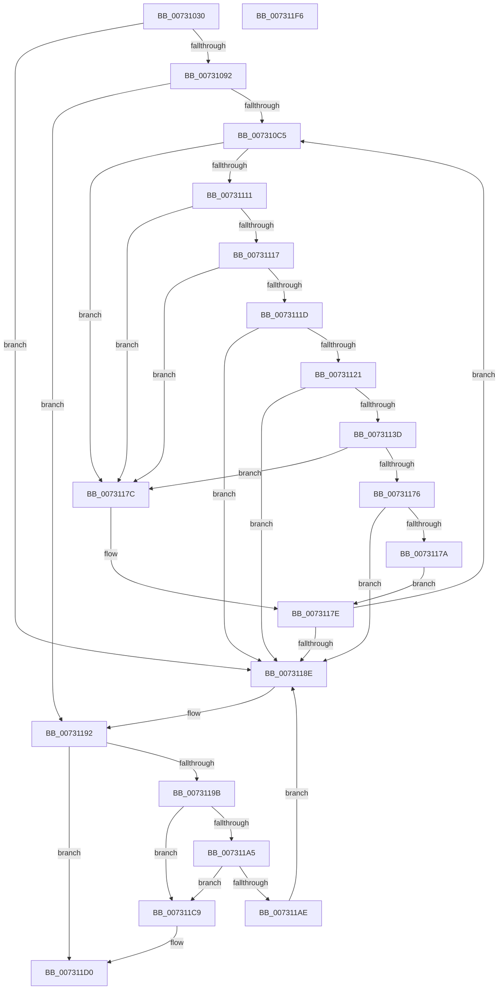

# PiDcResetChildDeviceContainers

- RVA: `0x00731030`–`0x007311F7` (길이 `455` bytes)
- VA: `0x0000000140731030`
- 실행 섹션: `PAGE`
- PDB 이름 있음: `예`; PDB Function 태그: `아니요`
- unwind 정보 RVA: `0x000ADA64`
- 디코드: `119`개 명령, `455/455` bytes 표시
- 미해석 바이트: `0` (있으면 어셈블리에 `.byte`로 보존)

> 이 문서는 커널 이미지의 기계어와 PDB 기호를 분석해 생성했습니다. 4번과 5번은 함수 원형과 자료형을 바이너리 사용 방식에서 추정한 C 해석이며 원본 소스 복구 결과는 아닙니다.

## 1. Dependencies

- 직접 호출 지점: **7**; 고유 호출 대상: **7**
- 직접 호출자로 확인된 함수: **1**
- RIP 상대 이미지 참조: **4**

### Outgoing calls
- `0x00731085` → [wcsicmp](../../text/50/wcsicmp_function_00500080.md) (function, `0x00500080`)
- `0x007310AF` → [CmEnumDevicesInContainerWithCallback](../82/CmEnumDevicesInContainerWithCallback_function_0082B538.md) (function, `0x0082B538`)
- `0x00731103` → [CmGetDeviceRegProp](../8E/CmGetDeviceRegProp_function_008ED870.md) (function, `0x008ED870`)
- `0x00731132` → [CmRemoveDeviceFromContainer](../82/CmRemoveDeviceFromContainer_function_0082BF40.md) (function, `0x0082BF40`)
- `0x00731168` → [CmSetDeviceRegProp](../8F/CmSetDeviceRegProp_function_008FD68C.md) (function, `0x008FD68C`)
- `0x007311C2` → [ExFreePoolWithTag](../../poolcode/B8/ExFreePoolWithTag_function_00B82870.md) (function, `0x00B82870`)
- `0x007311D9` → [_security_check_cookie](../../text/6A/_security_check_cookie_function_006AC640.md) (function, `0x006AC640`)

### Direct callers
- [PiDcUpdateDeviceContainerMembership](../8F/PiDcUpdateDeviceContainerMembership_function_008FD0A8.md) at `0x008FD298`

### Static image references
- `0x0073104A` → RVA `0x00E0A740` (`.data`; read)
- `0x0073106B` → RVA `0x00AFE270` (` ?? ::NNGAKEGL::`string'`; read)
- `0x00731092` → RVA `0x00E66398` (`.data`; read)
- `0x0073109D` → RVA `0x00730DE0` (`PiDcResetChildDeviceContainerCallback`; read)

## 2. Other-region calls and transfers

- 다른 실행 섹션으로 향하는 call: **3**
  - `0x00731085` → [wcsicmp](../../text/50/wcsicmp_function_00500080.md) (`PAGE` → `.text`)
  - `0x007311C2` → [ExFreePoolWithTag](../../poolcode/B8/ExFreePoolWithTag_function_00B82870.md) (`PAGE` → `POOLCODE`)
  - `0x007311D9` → [_security_check_cookie](../../text/6A/_security_check_cookie_function_006AC640.md) (`PAGE` → `.text`)
- 별도 외부 분기/꼬리 이동을 확인하지 못했습니다.

## 3. Assembly (complete function range)

```asm
00731030  48 89 5C 24 18                  mov qword ptr [rsp + 0x18], rbx
00731035  48 89 74 24 20                  mov qword ptr [rsp + 0x20], rsi
0073103A  55                              push rbp
0073103B  57                              push rdi
0073103C  41 56                           push r14
0073103E  48 8D 6C 24 B9                  lea rbp, [rsp - 0x47]
00731043  48 81 EC D0 00 00 00            sub rsp, 0xd0
0073104A  48 8B 05 EF 96 6D 00            mov rax, qword ptr [rip + 0x6d96ef]
00731051  48 33 C4                        xor rax, rsp
00731054  48 89 45 37                     mov qword ptr [rbp + 0x37], rax
00731058  48 8B F2                        mov rsi, rdx
0073105B  48 89 4D BF                     mov qword ptr [rbp - 0x41], rcx
0073105F  48 8D 45 CF                     lea rax, [rbp - 0x31]
00731063  48 89 55 C7                     mov qword ptr [rbp - 0x39], rdx
00731067  48 89 45 D7                     mov qword ptr [rbp - 0x29], rax
0073106B  48 8D 15 FE D1 3C 00            lea rdx, [rip + 0x3cd1fe]
00731072  48 8D 45 CF                     lea rax, [rbp - 0x31]
00731076  33 FF                           xor edi, edi
00731078  21 7D BB                        and dword ptr [rbp - 0x45], edi
0073107B  48 8B CE                        mov rcx, rsi
0073107E  21 7D B7                        and dword ptr [rbp - 0x49], edi
00731081  48 89 45 CF                     mov qword ptr [rbp - 0x31], rax
00731085  E8 F6 EF DC FF                  call 0x140500080
0073108A  85 C0                           test eax, eax
0073108C  0F 84 FC 00 00 00               je 0x14073118e
00731092  48 8B 0D FF 52 73 00            mov rcx, qword ptr [rip + 0x7352ff]
00731099  48 8D 45 BF                     lea rax, [rbp - 0x41]
0073109D  4C 8D 0D 3C FD FF FF            lea r9, [rip - 0x2c4]
007310A4  48 89 44 24 20                  mov qword ptr [rsp + 0x20], rax
007310A9  45 33 C0                        xor r8d, r8d
007310AC  48 8B D6                        mov rdx, rsi
007310AF  E8 84 A4 0F 00                  call 0x14082b538
007310B4  48 8B 5D CF                     mov rbx, qword ptr [rbp - 0x31]
007310B8  48 8D 45 CF                     lea rax, [rbp - 0x31]
007310BC  48 3B D8                        cmp rbx, rax
007310BF  0F 84 CD 00 00 00               je 0x140731192
007310C5  83 64 24 38 00                  and dword ptr [rsp + 0x38], 0
007310CA  48 8D 45 B7                     lea rax, [rbp - 0x49]
007310CE  48 8B 0D C3 52 73 00            mov rcx, qword ptr [rip + 0x7352c3]
007310D5  4C 8D 73 10                     lea r14, [rbx + 0x10]
007310D9  48 89 44 24 30                  mov qword ptr [rsp + 0x30], rax
007310DE  41 B9 25 00 00 00               mov r9d, 0x25
007310E4  48 8D 45 E7                     lea rax, [rbp - 0x19]
007310E8  C7 45 B7 4E 00 00 00            mov dword ptr [rbp - 0x49], 0x4e
007310EF  48 89 44 24 28                  mov qword ptr [rsp + 0x28], rax
007310F4  45 33 C0                        xor r8d, r8d
007310F7  48 8D 45 BB                     lea rax, [rbp - 0x45]
007310FB  49 8B D6                        mov rdx, r14
007310FE  48 89 44 24 20                  mov qword ptr [rsp + 0x20], rax
00731103  E8 68 C7 1B 00                  call 0x1408ed870
00731108  8B F8                           mov edi, eax
0073110A  3D 25 02 00 C0                  cmp eax, 0xc0000225
0073110F  74 6B                           je 0x14073117c
00731111  83 7D BB 01                     cmp dword ptr [rbp - 0x45], 1
00731115  75 65                           jne 0x14073117c
00731117  83 7D B7 4E                     cmp dword ptr [rbp - 0x49], 0x4e
0073111B  75 5F                           jne 0x14073117c
0073111D  85 C0                           test eax, eax
0073111F  78 6D                           js 0x14073118e
00731121  48 8B 0D 70 52 73 00            mov rcx, qword ptr [rip + 0x735270]
00731128  4C 8D 45 E7                     lea r8, [rbp - 0x19]
0073112C  4D 8B CE                        mov r9, r14
0073112F  48 8B D6                        mov rdx, rsi
00731132  E8 09 AE 0F 00                  call 0x14082bf40
00731137  8B F8                           mov edi, eax
00731139  85 C0                           test eax, eax
0073113B  78 51                           js 0x14073118e
0073113D  83 64 24 38 00                  and dword ptr [rsp + 0x38], 0
00731142  41 B9 25 00 00 00               mov r9d, 0x25
00731148  83 64 24 30 00                  and dword ptr [rsp + 0x30], 0
0073114D  45 33 C0                        xor r8d, r8d
00731150  48 83 64 24 28 00               and qword ptr [rsp + 0x28], 0
00731156  49 8B D6                        mov rdx, r14
00731159  48 8B 0D 38 52 73 00            mov rcx, qword ptr [rip + 0x735238]
00731160  C7 44 24 20 01 00 00 00         mov dword ptr [rsp + 0x20], 1
00731168  E8 1F C5 1C 00                  call 0x1408fd68c
0073116D  8B F8                           mov edi, eax
0073116F  3D 25 02 00 C0                  cmp eax, 0xc0000225
00731174  74 06                           je 0x14073117c
00731176  85 C0                           test eax, eax
00731178  78 14                           js 0x14073118e
0073117A  EB 02                           jmp 0x14073117e
0073117C  33 FF                           xor edi, edi
0073117E  48 8B 1B                        mov rbx, qword ptr [rbx]
00731181  48 8D 45 CF                     lea rax, [rbp - 0x31]
00731185  48 3B D8                        cmp rbx, rax
00731188  0F 85 37 FF FF FF               jne 0x1407310c5
0073118E  48 8B 5D CF                     mov rbx, qword ptr [rbp - 0x31]
00731192  48 8D 45 CF                     lea rax, [rbp - 0x31]
00731196  48 3B D8                        cmp rbx, rax
00731199  74 35                           je 0x1407311d0
0073119B  48 8D 45 CF                     lea rax, [rbp - 0x31]
0073119F  48 39 43 08                     cmp qword ptr [rbx + 8], rax
007311A3  75 24                           jne 0x1407311c9
007311A5  48 8B 03                        mov rax, qword ptr [rbx]
007311A8  48 39 58 08                     cmp qword ptr [rax + 8], rbx
007311AC  75 1B                           jne 0x1407311c9
007311AE  48 8D 4D CF                     lea rcx, [rbp - 0x31]
007311B2  48 89 45 CF                     mov qword ptr [rbp - 0x31], rax
007311B6  48 89 48 08                     mov qword ptr [rax + 8], rcx
007311BA  BA 50 6E 70 47                  mov edx, 0x47706e50
007311BF  48 8B CB                        mov rcx, rbx
007311C2  E8 A9 16 45 00                  call 0x140b82870
007311C7  EB C5                           jmp 0x14073118e
007311C9  B9 03 00 00 00                  mov ecx, 3
007311CE  CD 29                           int 0x29
007311D0  8B C7                           mov eax, edi
007311D2  48 8B 4D 37                     mov rcx, qword ptr [rbp + 0x37]
007311D6  48 33 CC                        xor rcx, rsp
007311D9  E8 62 B4 F7 FF                  call 0x1406ac640
007311DE  4C 8D 9C 24 D0 00 00 00         lea r11, [rsp + 0xd0]
007311E6  49 8B 5B 30                     mov rbx, qword ptr [r11 + 0x30]
007311EA  49 8B 73 38                     mov rsi, qword ptr [r11 + 0x38]
007311EE  49 8B E3                        mov rsp, r11
007311F1  41 5E                           pop r14
007311F3  5F                              pop rdi
007311F4  5D                              pop rbp
007311F5  C3                              ret
007311F6  CC                              int3
```

## 4. C-style interpretation (structured pseudocode)

```c
__int64 __fastcall PiDcResetChildDeviceContainers(__int64 a1, __int64 a2, int a3)
{
    __int64 result;
    __int64 v_rdi;
    __int64 v_rsp;
    unsigned __int64 v_stack_m18;
    unsigned __int64 v_stack_m28;
    unsigned __int64 v_stack_m5F;
    unsigned __int64 v_stack_m78;
    unsigned __int64 v_stack_m88;
    unsigned __int64 v_stack_m90;
    unsigned __int64 v_stack_m98;
    unsigned __int64 v_stack_mA0;
    unsigned int v_stack_mA4;
    unsigned int v_stack_mA8;
    unsigned int v_stack_mB0;
    unsigned __int64 v_stack_mB8;
    unsigned __int64 v_stack_mC0;
    unsigned __int64 v_stack_mC8;
    unsigned __int64 v_stack_p18;
    unsigned __int64 v_stack_p20;

    v_stack_p18 = v_rbx;
    v_stack_p20 = v_rsi;
    v_rsp = (v_rsp) - (208);
    result = (*(unsigned __int64 *)(v_rip + 7182063)) ^ (v_rsp);
    v_stack_m28 = result;
    v_stack_mA0 = a1;
    v_stack_m98 = a2;
    v_stack_m88 = v_stack_m90;
    v_rdi = 0;
    v_stack_m90 = v_stack_m90;
    result = wcsicmp(a2, v_rip + 3985918, a3, a4);
    if ((unsigned int)(result) == 0) goto loc_0073118E;
    v_stack_mC8 = v_stack_mA0;
    a3 = 0;
    result = CmEnumDevicesInContainerWithCallback(*(unsigned __int64 *)(v_rip + 7557887), a2, a3, v_rip - 708);
    if (v_stack_m90 == v_stack_m90) goto loc_00731192;
loc_007310C5:
    v_stack_mB8 = v_stack_mA8;
    v_stack_mA8 = 78;
    v_stack_mC0 = v_stack_m78;
    a3 = 0;
    v_stack_mC8 = v_stack_mA4;
    result = CmGetDeviceRegProp(*(unsigned __int64 *)(v_rip + 7557827), v_stack_m90 + 16, a3, 37);
    if (((unsigned int)(result)) == 0xC0000225ULL) goto loc_0073117C;
    if (v_stack_mA4 != 1) goto loc_0073117C;
    if (v_stack_mA8 != 78) goto loc_0073117C;
    if (sign_flag) goto loc_0073118E;
    result = CmRemoveDeviceFromContainer(*(unsigned __int64 *)(v_rip + 7557744), a2, v_stack_m78, v_stack_m90 + 16);
    if (sign_flag) goto loc_0073118E;
    a3 = 0;
    v_stack_mC8 = 1;
    result = CmSetDeviceRegProp(*(unsigned __int64 *)(v_rip + 7557688), v_stack_m90 + 16, a3, 37);
    if (((unsigned int)(result)) == 0xC0000225ULL) goto loc_0073117C;
    if (sign_flag) goto loc_0073118E;
    goto loc_0073117E;
loc_0073117C:
    v_rdi = 0;
loc_0073117E:
    if ((*(unsigned __int64 *)(v_stack_m90)) != v_stack_m90) goto loc_007310C5;
loc_0073118E:
loc_00731192:
    if (v_stack_m90 == v_stack_m90) goto loc_007311D0;
    if ((*(unsigned __int64 *)(v_stack_m90 + 8)) != v_stack_m90) goto loc_007311C9;
    if ((*(unsigned __int64 *)(*(unsigned __int64 *)(v_stack_m90) + 8)) != v_stack_m90) goto loc_007311C9;
    v_stack_m90 = *(unsigned __int64 *)(v_stack_m90);
    *(unsigned __int64 *)(*(unsigned __int64 *)(v_stack_m90) + 8) = v_stack_m90;
    result = ExFreePoolWithTag(v_stack_m90, (unsigned int)(0x47706E50ULL), a3, 37);
    goto loc_0073118E;
loc_007311C9:
loc_007311D0:
    a1 = (v_stack_m28) ^ (v_rsp);
    result = _security_check_cookie(a1, (unsigned int)(0x47706E50ULL), a3, 37);
    return result;
}
```

## 5. (Beta) C Style

```c
int64_t PiDcResetChildDeviceContainers(int64_t Arg1, int64_t Arg2, int32_t Arg3)
{
    int64_t result;
    int64_t local_rdi;
    int64_t local_rsp;
    uint64_t v_stack_m18;
    uint64_t v_stack_m28;
    uint64_t v_stack_m5F;
    uint64_t v_stack_m78;
    uint64_t v_stack_m88;
    uint64_t v_stack_m90;
    uint64_t v_stack_m98;
    uint64_t v_stack_mA0;
    uint32_t v_stack_mA4;
    uint32_t v_stack_mA8;
    uint32_t v_stack_mB0;
    uint64_t v_stack_mB8;
    uint64_t v_stack_mC0;
    uint64_t v_stack_mC8;
    uint64_t v_stack_p18;
    uint64_t v_stack_p20;

    v_stack_p18 = local_rbx;
    v_stack_p20 = local_rsi;
    local_rsp = (local_rsp) - (208);
    result = (*(uint64_t *)(v_rip + 0x6D96EF)) ^ (local_rsp);
    v_stack_m28 = result;
    v_stack_mA0 = Arg1;
    v_stack_m98 = Arg2;
    v_stack_m88 = v_stack_m90;
    local_rdi = 0;
    v_stack_m90 = v_stack_m90;
    result = wcsicmp(Arg2, v_rip + 3985918, Arg3, a4);
    if ((uint32_t)(result) == 0) goto loc_0073118E;
    v_stack_mC8 = v_stack_mA0;
    Arg3 = 0;
    result = CmEnumDevicesInContainerWithCallback(*(uint64_t *)(v_rip + 0x7352FF), Arg2, Arg3, v_rip - 708);
    if (v_stack_m90 == v_stack_m90) goto loc_00731192;
loc_007310C5:
    v_stack_mB8 = v_stack_mA8;
    v_stack_mA8 = 78;
    v_stack_mC0 = v_stack_m78;
    Arg3 = 0;
    v_stack_mC8 = v_stack_mA4;
    result = CmGetDeviceRegProp(*(uint64_t *)(v_rip + 0x7352C3), v_stack_m90 + 16, Arg3, 37);
    if (((uint32_t)(result)) == 0xC0000225ULL) goto loc_0073117C;
    if (v_stack_mA4 != 1) goto loc_0073117C;
    if (v_stack_mA8 != 78) goto loc_0073117C;
    if (sign_flag) goto loc_0073118E;
    result = CmRemoveDeviceFromContainer(*(uint64_t *)(v_rip + 0x735270), Arg2, v_stack_m78, v_stack_m90 + 16);
    if (sign_flag) goto loc_0073118E;
    Arg3 = 0;
    v_stack_mC8 = 1;
    result = CmSetDeviceRegProp(*(uint64_t *)(v_rip + 0x735238), v_stack_m90 + 16, Arg3, 37);
    if (((uint32_t)(result)) == 0xC0000225ULL) goto loc_0073117C;
    if (sign_flag) goto loc_0073118E;
    goto loc_0073117E;
loc_0073117C:
    local_rdi = 0;
loc_0073117E:
    if ((*(uint64_t *)(v_stack_m90)) != v_stack_m90) goto loc_007310C5;
loc_0073118E:
loc_00731192:
    if (v_stack_m90 == v_stack_m90) goto loc_007311D0;
    if ((*(uint64_t *)(v_stack_m90 + 0x8)) != v_stack_m90) goto loc_007311C9;
    if ((*(uint64_t *)(*(uint64_t *)(v_stack_m90) + 0x8)) != v_stack_m90) goto loc_007311C9;
    v_stack_m90 = *(uint64_t *)(v_stack_m90);
    *(uint64_t *)(*(uint64_t *)(v_stack_m90) + 0x8) = v_stack_m90;
    result = ExFreePoolWithTag(v_stack_m90, (uint32_t)(0x47706E50ULL), Arg3, 37);
    goto loc_0073118E;
loc_007311C9:
loc_007311D0:
    Arg1 = (v_stack_m28) ^ (local_rsp);
    result = _security_check_cookie(Arg1, (uint32_t)(0x47706E50ULL), Arg3, 37);
    return result;
}
```

## 6. Execution-region graph

[열기: 2D/3D 그래프와 함수 탐색 컨트롤 패널](../../../control-panel.html?section=page&rva=0x00731030&view=graph)

- 2D 그래프는 위에서 아래로 흐르고, 3D 그래프는 빈 공간을 드래그해 회전합니다. Shift+드래그는 이동, 휠은 확대·축소, 함수 노드 선택은 대상 보고서 이동입니다.

### Static fallback


