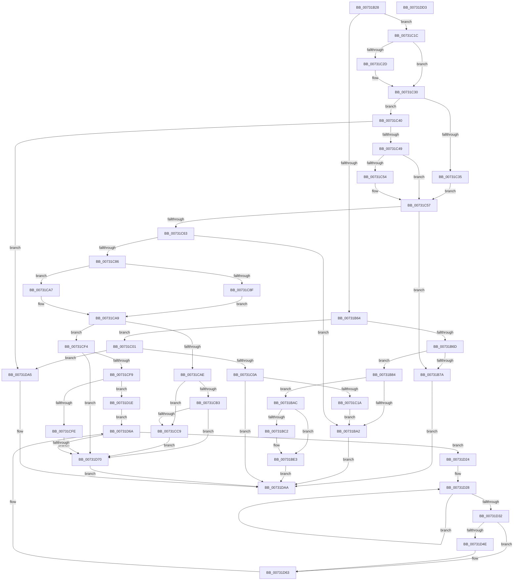

# PiDevCfgAppendMultiSz

- RVA: `0x00731B28`–`0x00731DD4` (길이 `684` bytes)
- VA: `0x0000000140731B28`
- 실행 섹션: `PAGE`
- PDB 이름 있음: `예`; PDB Function 태그: `아니요`
- unwind 정보 RVA: `0x0008C20C`
- 디코드: `192`개 명령, `684/684` bytes 표시
- 미해석 바이트: `0` (있으면 어셈블리에 `.byte`로 보존)

> 이 문서는 커널 이미지의 기계어와 PDB 기호를 분석해 생성했습니다. 4번과 5번은 함수 원형과 자료형을 바이너리 사용 방식에서 추정한 C 해석이며 원본 소스 복구 결과는 아닙니다.

## 1. Dependencies

- 직접 호출 지점: **12**; 고유 호출 대상: **5**
- 직접 호출자로 확인된 함수: **5**
- RIP 상대 이미지 참조: **0**

### Outgoing calls
- `0x00731B91` → [ExAllocatePool2](../../poolcode/B8/ExAllocatePool2_function_00B820F0.md) (function, `0x00B820F0`)
- `0x00731BC9` → [memcpy](../../text/6C/memcpy_function_006C6840.md) (function, `0x006C6840`)
- `0x00731C0D` → [PnpDuplicateUnicodeString](../../text/4C/PnpDuplicateUnicodeString_function_004CC044.md) (function, `0x004CC044`)
- `0x00731C70` → [ExAllocatePool2](../../poolcode/B8/ExAllocatePool2_function_00B820F0.md) (function, `0x00B820F0`)
- `0x00731C99` → [memcpy](../../text/6C/memcpy_function_006C6840.md) (function, `0x006C6840`)
- `0x00731CBB` → [PnpMultiSzContainsString](../../text/4C/PnpMultiSzContainsString_function_004C2740.md) (function, `0x004C2740`)
- `0x00731CD7` → [memcpy](../../text/6C/memcpy_function_006C6840.md) (function, `0x006C6840`)
- `0x00731D0C` → [memcpy](../../text/6C/memcpy_function_006C6840.md) (function, `0x006C6840`)
- `0x00731D44` → [PnpMultiSzContainsString](../../text/4C/PnpMultiSzContainsString_function_004C2740.md) (function, `0x004C2740`)
- `0x00731D5A` → [memcpy](../../text/6C/memcpy_function_006C6840.md) (function, `0x006C6840`)
- `0x00731D8D` → [RtlFreeAnsiString](../9C/RtlFreeAnsiString_function_009C0800.md) (function, `0x009C0800`)
- `0x00731DAF` → [RtlFreeAnsiString](../9C/RtlFreeAnsiString_function_009C0800.md) (function, `0x009C0800`)

### Direct callers
- [PiDevCfgRequestDriverConfigurations](PiDevCfgRequestDriverConfigurations_function_00735778.md) at `0x007357D7`
- [PiDevCfgRequestDriverConfigurations](PiDevCfgRequestDriverConfigurations_function_00735778.md) at `0x00735822`
- [PpDevCfgProcessDeviceExtensions](PpDevCfgProcessDeviceExtensions_function_00736C2C.md) at `0x00736E2C`
- [PpDevCfgProcessDeviceExtensions](PpDevCfgProcessDeviceExtensions_function_00736C2C.md) at `0x00736E54`
- [PpDevCfgProcessDeviceExtensions](PpDevCfgProcessDeviceExtensions_function_00736C2C.md) at `0x00736E7C`
- [PpDevCfgProcessDeviceExtensions](PpDevCfgProcessDeviceExtensions_function_00736C2C.md) at `0x00736EA4`
- [PpDevCfgProcessDeviceExtensions](PpDevCfgProcessDeviceExtensions_function_00736C2C.md) at `0x00736ECC`
- [PpDevCfgProcessDeviceExtensions](PpDevCfgProcessDeviceExtensions_function_00736C2C.md) at `0x00736EF0`
- [PpDevCfgProcessDeviceExtensions](PpDevCfgProcessDeviceExtensions_function_00736C2C.md) at `0x00736F10`
- [PpDevCfgProcessDeviceExtensions](PpDevCfgProcessDeviceExtensions_function_00736C2C.md) at `0x00737069`
- [PiDrvDbResolveFilePathKeyValues](../74/PiDrvDbResolveFilePathKeyValues_function_00742C00.md) at `0x007430DE`
- [PiDevCfgQueryIncludedDriverConfigurations](../97/PiDevCfgQueryIncludedDriverConfigurations_function_009754BC.md) at `0x0097575A`
- [PiDevCfgQueryIncludedDriverConfigurations](../97/PiDevCfgQueryIncludedDriverConfigurations_function_009754BC.md) at `0x00975785`
- [PiDevCfgQueryIncludedDriverConfigurations](../97/PiDevCfgQueryIncludedDriverConfigurations_function_009754BC.md) at `0x009757AC`
- [PiDevCfgConfigureDevice](../97/PiDevCfgConfigureDevice_function_00977BB4.md) at `0x00978098`
- [PiDevCfgConfigureDevice](../97/PiDevCfgConfigureDevice_function_00977BB4.md) at `0x009780C4`
- [PiDevCfgConfigureDevice](../97/PiDevCfgConfigureDevice_function_00977BB4.md) at `0x009780F3`
- [PiDevCfgConfigureDevice](../97/PiDevCfgConfigureDevice_function_00977BB4.md) at `0x00978122`
- [PiDevCfgConfigureDevice](../97/PiDevCfgConfigureDevice_function_00977BB4.md) at `0x00978151`
- [PiDevCfgConfigureDevice](../97/PiDevCfgConfigureDevice_function_00977BB4.md) at `0x0097819B`
- [PiDevCfgConfigureDevice](../97/PiDevCfgConfigureDevice_function_00977BB4.md) at `0x009781BC`
- [PiDevCfgConfigureDevice](../97/PiDevCfgConfigureDevice_function_00977BB4.md) at `0x009781EC`

### Static image references
- 디코드된 RIP-relative 메모리 참조가 없습니다.

## 2. Other-region calls and transfers

- 다른 실행 섹션으로 향하는 call: **10**
  - `0x00731B91` → [ExAllocatePool2](../../poolcode/B8/ExAllocatePool2_function_00B820F0.md) (`PAGE` → `POOLCODE`)
  - `0x00731BC9` → [memcpy](../../text/6C/memcpy_function_006C6840.md) (`PAGE` → `.text`)
  - `0x00731C0D` → [PnpDuplicateUnicodeString](../../text/4C/PnpDuplicateUnicodeString_function_004CC044.md) (`PAGE` → `.text`)
  - `0x00731C70` → [ExAllocatePool2](../../poolcode/B8/ExAllocatePool2_function_00B820F0.md) (`PAGE` → `POOLCODE`)
  - `0x00731C99` → [memcpy](../../text/6C/memcpy_function_006C6840.md) (`PAGE` → `.text`)
  - `0x00731CBB` → [PnpMultiSzContainsString](../../text/4C/PnpMultiSzContainsString_function_004C2740.md) (`PAGE` → `.text`)
  - `0x00731CD7` → [memcpy](../../text/6C/memcpy_function_006C6840.md) (`PAGE` → `.text`)
  - `0x00731D0C` → [memcpy](../../text/6C/memcpy_function_006C6840.md) (`PAGE` → `.text`)
  - `0x00731D44` → [PnpMultiSzContainsString](../../text/4C/PnpMultiSzContainsString_function_004C2740.md) (`PAGE` → `.text`)
  - `0x00731D5A` → [memcpy](../../text/6C/memcpy_function_006C6840.md) (`PAGE` → `.text`)
- 별도 외부 분기/꼬리 이동을 확인하지 못했습니다.

## 3. Assembly (complete function range)

```asm
00731B28  48 8B C4                        mov rax, rsp
00731B2B  48 89 58 08                     mov qword ptr [rax + 8], rbx
00731B2F  48 89 68 10                     mov qword ptr [rax + 0x10], rbp
00731B33  48 89 70 18                     mov qword ptr [rax + 0x18], rsi
00731B37  57                              push rdi
00731B38  41 54                           push r12
00731B3A  41 55                           push r13
00731B3C  41 56                           push r14
00731B3E  41 57                           push r15
00731B40  48 83 EC 30                     sub rsp, 0x30
00731B44  33 DB                           xor ebx, ebx
00731B46  41 8A E9                        mov bpl, r9b
00731B49  4D 8B F8                        mov r15, r8
00731B4C  4C 8B F2                        mov r14, rdx
00731B4F  48 8B F9                        mov rdi, rcx
00731B52  48 89 58 C8                     mov qword ptr [rax - 0x38], rbx
00731B56  48 89 58 D0                     mov qword ptr [rax - 0x30], rbx
00731B5A  48 39 59 08                     cmp qword ptr [rcx + 8], rbx
00731B5E  0F 85 B8 00 00 00               jne 0x140731c1c
00731B64  48 85 D2                        test rdx, rdx
00731B67  0F 84 94 00 00 00               je 0x140731c01
00731B6D  0F B7 02                        movzx eax, word ptr [rdx]
00731B70  83 C0 04                        add eax, 4
00731B73  3D FE FF 00 00                  cmp eax, 0xfffe
00731B78  76 0A                           jbe 0x140731b84
00731B7A  BB 05 00 00 80                  mov ebx, 0x80000005
00731B7F  E9 26 02 00 00                  jmp 0x140731daa
00731B84  8B D0                           mov edx, eax
00731B86  B9 00 01 00 00                  mov ecx, 0x100
00731B8B  41 B8 53 74 72 67               mov r8d, 0x67727453
00731B91  E8 5A 05 45 00                  call 0x140b820f0
00731B96  48 89 47 08                     mov qword ptr [rdi + 8], rax
00731B9A  48 8B C8                        mov rcx, rax
00731B9D  48 85 C0                        test rax, rax
00731BA0  75 0A                           jne 0x140731bac
00731BA2  BB 9A 00 00 C0                  mov ebx, 0xc000009a
00731BA7  E9 FE 01 00 00                  jmp 0x140731daa
00731BAC  41 0F B7 06                     movzx eax, word ptr [r14]
00731BB0  41 BC 02 00 00 00               mov r12d, 2
00731BB6  66 89 07                        mov word ptr [rdi], ax
00731BB9  41 0F B7 16                     movzx edx, word ptr [r14]
00731BBD  66 85 D2                        test dx, dx
00731BC0  74 21                           je 0x140731be3
00731BC2  44 8B C2                        mov r8d, edx
00731BC5  49 8B 56 08                     mov rdx, qword ptr [r14 + 8]
00731BC9  E8 72 4C F9 FF                  call 0x1406c6840
00731BCE  0F B7 0F                        movzx ecx, word ptr [rdi]
00731BD1  48 8B 47 08                     mov rax, qword ptr [rdi + 8]
00731BD5  48 D1 E9                        shr rcx, 1
00731BD8  66 89 1C 48                     mov word ptr [rax + rcx*2], bx
00731BDC  66 44 01 27                     add word ptr [rdi], r12w
00731BE0  0F B7 07                        movzx eax, word ptr [rdi]
00731BE3  0F B7 C8                        movzx ecx, ax
00731BE6  48 8B 47 08                     mov rax, qword ptr [rdi + 8]
00731BEA  48 D1 E9                        shr rcx, 1
00731BED  66 89 1C 48                     mov word ptr [rax + rcx*2], bx
00731BF1  66 44 01 27                     add word ptr [rdi], r12w
00731BF5  0F B7 07                        movzx eax, word ptr [rdi]
00731BF8  66 89 47 02                     mov word ptr [rdi + 2], ax
00731BFC  E9 A9 01 00 00                  jmp 0x140731daa
00731C01  4D 85 FF                        test r15, r15
00731C04  0F 84 9B 01 00 00               je 0x140731da5
00731C0A  49 8B D7                        mov rdx, r15
00731C0D  E8 32 A4 D9 FF                  call 0x1404cc044
00731C12  84 C0                           test al, al
00731C14  0F 85 90 01 00 00               jne 0x140731daa
00731C1A  EB 86                           jmp 0x140731ba2
00731C1C  0F B7 11                        movzx edx, word ptr [rcx]
00731C1F  41 BC 02 00 00 00               mov r12d, 2
00731C25  8B CA                           mov ecx, edx
00731C27  66 41 3B D4                     cmp dx, r12w
00731C2B  77 03                           ja 0x140731c30
00731C2D  41 8B CC                        mov ecx, r12d
00731C30  4D 85 F6                        test r14, r14
00731C33  74 0B                           je 0x140731c40
00731C35  41 0F B7 06                     movzx eax, word ptr [r14]
00731C39  41 03 C4                        add eax, r12d
00731C3C  03 C8                           add ecx, eax
00731C3E  EB 17                           jmp 0x140731c57
00731C40  4D 85 FF                        test r15, r15
00731C43  0F 84 5C 01 00 00               je 0x140731da5
00731C49  41 0F B7 00                     movzx eax, word ptr [r8]
00731C4D  03 C8                           add ecx, eax
00731C4F  66 85 D2                        test dx, dx
00731C52  74 03                           je 0x140731c57
00731C54  83 C1 FE                        add ecx, -2
00731C57  81 F9 FE FF 00 00               cmp ecx, 0xfffe
00731C5D  0F 87 17 FF FF FF               ja 0x140731b7a
00731C63  8B D1                           mov edx, ecx
00731C65  41 B8 53 74 72 67               mov r8d, 0x67727453
00731C6B  B9 00 01 00 00                  mov ecx, 0x100
00731C70  E8 7B 04 45 00                  call 0x140b820f0
00731C75  48 89 44 24 28                  mov qword ptr [rsp + 0x28], rax
00731C7A  4C 8B E8                        mov r13, rax
00731C7D  48 85 C0                        test rax, rax
00731C80  0F 84 1C FF FF FF               je 0x140731ba2
00731C86  0F B7 07                        movzx eax, word ptr [rdi]
00731C89  66 41 3B C4                     cmp ax, r12w
00731C8D  76 18                           jbe 0x140731ca7
00731C8F  48 8B 57 08                     mov rdx, qword ptr [rdi + 8]
00731C93  44 8B C0                        mov r8d, eax
00731C96  49 8B CD                        mov rcx, r13
00731C99  E8 A2 4B F9 FF                  call 0x1406c6840
00731C9E  0F B7 37                        movzx esi, word ptr [rdi]
00731CA1  66 41 2B F4                     sub si, r12w
00731CA5  EB 02                           jmp 0x140731ca9
00731CA7  8B F3                           mov esi, ebx
00731CA9  4D 85 F6                        test r14, r14
00731CAC  74 46                           je 0x140731cf4
00731CAE  40 84 ED                        test bpl, bpl
00731CB1  75 16                           jne 0x140731cc9
00731CB3  49 8B 56 08                     mov rdx, qword ptr [r14 + 8]
00731CB7  48 8B 4F 08                     mov rcx, qword ptr [rdi + 8]
00731CBB  E8 80 0A D9 FF                  call 0x1404c2740
00731CC0  48 85 C0                        test rax, rax
00731CC3  0F 85 A7 00 00 00               jne 0x140731d70
00731CC9  45 0F B7 06                     movzx r8d, word ptr [r14]
00731CCD  49 8B 56 08                     mov rdx, qword ptr [r14 + 8]
00731CD1  0F B7 CE                        movzx ecx, si
00731CD4  49 03 CD                        add rcx, r13
00731CD7  E8 64 4B F9 FF                  call 0x1406c6840
00731CDC  66 41 03 36                     add si, word ptr [r14]
00731CE0  0F B7 CE                        movzx ecx, si
00731CE3  8B C1                           mov eax, ecx
00731CE5  48 D1 E8                        shr rax, 1
00731CE8  41 8D 34 0C                     lea esi, [r12 + rcx]
00731CEC  66 41 89 5C 45 00               mov word ptr [r13 + rax*2], bx
00731CF2  EB 7C                           jmp 0x140731d70
00731CF4  4D 85 FF                        test r15, r15
00731CF7  74 77                           je 0x140731d70
00731CF9  40 84 ED                        test bpl, bpl
00731CFC  74 20                           je 0x140731d1e
00731CFE  45 0F B7 07                     movzx r8d, word ptr [r15]
00731D02  49 8B 57 08                     mov rdx, qword ptr [r15 + 8]
00731D06  0F B7 CE                        movzx ecx, si
00731D09  49 03 CD                        add rcx, r13
00731D0C  E8 2F 4B F9 FF                  call 0x1406c6840
00731D11  41 0F B7 07                     movzx eax, word ptr [r15]
00731D15  66 41 2B C4                     sub ax, r12w
00731D19  66 03 F0                        add si, ax
00731D1C  EB 52                           jmp 0x140731d70
00731D1E  4D 8B 77 08                     mov r14, qword ptr [r15 + 8]
00731D22  EB 46                           jmp 0x140731d6a
00731D24  48 83 C8 FF                     or rax, 0xffffffffffffffff
00731D28  48 FF C0                        inc rax
00731D2B  66 41 39 1C 46                  cmp word ptr [r14 + rax*2], bx
00731D30  75 F6                           jne 0x140731d28
00731D32  48 8B 4F 08                     mov rcx, qword ptr [rdi + 8]
00731D36  44 8D 3C 45 02 00 00 00         lea r15d, [rax*2 + 2]
00731D3E  49 8B D6                        mov rdx, r14
00731D41  41 8B EF                        mov ebp, r15d
00731D44  E8 F7 09 D9 FF                  call 0x1404c2740
00731D49  48 85 C0                        test rax, rax
00731D4C  75 15                           jne 0x140731d63
00731D4E  0F B7 CE                        movzx ecx, si
00731D51  44 8B C5                        mov r8d, ebp
00731D54  49 03 CD                        add rcx, r13
00731D57  49 8B D6                        mov rdx, r14
00731D5A  E8 E1 4A F9 FF                  call 0x1406c6840
00731D5F  66 41 03 F7                     add si, r15w
00731D63  48 D1 ED                        shr rbp, 1
00731D66  4D 8D 34 6E                     lea r14, [r14 + rbp*2]
00731D6A  66 41 39 1E                     cmp word ptr [r14], bx
00731D6E  75 B4                           jne 0x140731d24
00731D70  0F B7 C6                        movzx eax, si
00731D73  48 8B CF                        mov rcx, rdi
00731D76  66 41 03 F4                     add si, r12w
00731D7A  48 D1 E8                        shr rax, 1
00731D7D  66 89 74 24 20                  mov word ptr [rsp + 0x20], si
00731D82  66 89 74 24 22                  mov word ptr [rsp + 0x22], si
00731D87  66 41 89 5C 45 00               mov word ptr [r13 + rax*2], bx
00731D8D  E8 6E EA 28 00                  call 0x1409c0800
00731D92  0F 10 44 24 20                  movups xmm0, xmmword ptr [rsp + 0x20]
00731D97  0F 57 C9                        xorps xmm1, xmm1
00731D9A  F3 0F 7F 07                     movdqu xmmword ptr [rdi], xmm0
00731D9E  0F 11 4C 24 20                  movups xmmword ptr [rsp + 0x20], xmm1
00731DA3  EB 05                           jmp 0x140731daa
00731DA5  BB 0D 00 00 C0                  mov ebx, 0xc000000d
00731DAA  48 8D 4C 24 20                  lea rcx, [rsp + 0x20]
00731DAF  E8 4C EA 28 00                  call 0x1409c0800
00731DB4  48 8B 6C 24 68                  mov rbp, qword ptr [rsp + 0x68]
00731DB9  8B C3                           mov eax, ebx
00731DBB  48 8B 5C 24 60                  mov rbx, qword ptr [rsp + 0x60]
00731DC0  48 8B 74 24 70                  mov rsi, qword ptr [rsp + 0x70]
00731DC5  48 83 C4 30                     add rsp, 0x30
00731DC9  41 5F                           pop r15
00731DCB  41 5E                           pop r14
00731DCD  41 5D                           pop r13
00731DCF  41 5C                           pop r12
00731DD1  5F                              pop rdi
00731DD2  C3                              ret
00731DD3  CC                              int3
```

## 4. C-style interpretation (structured pseudocode)

```c
__int64 __fastcall PiDevCfgAppendMultiSz(__int64 a1, __int64 a2, __int64 a3, unsigned __int8 a4)
{
    __int64 result;
    __int64 v_rbp;
    __int64 v_rbx;
    __int64 v_rsi;
    __int64 v_rsp;
    unsigned __int64 v_stack_m30;
    unsigned __int16 v_stack_m36;
    unsigned __int16 v_stack_m38;
    unsigned __int64 v_stack_p10;
    unsigned __int64 v_stack_p18;
    unsigned __int64 v_stack_p8;

    *(unsigned __int64 *)(v_rsp + 8) = v_rbx;
    *(unsigned __int64 *)(v_rsp + 16) = v_rbp;
    *(unsigned __int64 *)(v_rsp + 24) = v_rsi;
    v_rsp = (v_rsp) - (48);
    v_rbx = 0;
    *(unsigned __int64 *)(v_rsp - 56) = 0;
    *(unsigned __int64 *)(v_rsp - 48) = 0;
    if ((*(unsigned __int64 *)(a1 + 8)) != 0) goto loc_00731C1C;
    if (a2 == 0) goto loc_00731C01;
    result = (unsigned int)((*(unsigned __int16 *)(a2)) + (4));
    if (((unsigned int)(result)) <= 0xFFFEULL) goto loc_00731B84;
loc_00731B7A:
    goto loc_00731DAA;
loc_00731B84:
    result = ExAllocatePool2(256, (unsigned int)((unsigned int)(result)), (unsigned int)(0x67727453ULL), a4);
    *(unsigned __int64 *)(a1 + 8) = result;
    if (result != 0) goto loc_00731BAC;
loc_00731BA2:
    goto loc_00731DAA;
loc_00731BAC:
    *(unsigned __int16 *)(a1) = (unsigned __int16)(*(unsigned __int16 *)(a2));
    result = *(unsigned __int16 *)(a2);
    if ((unsigned __int16)(*(unsigned __int16 *)(a2)) != 0) {
        a3 = (unsigned int)(*(unsigned __int16 *)(a2));
        a2 = *(unsigned __int64 *)(a2 + 8);
        result = memcpy(result, a2, a3, a4);
        a1 = *(unsigned __int16 *)(a1);
        result = *(unsigned __int64 *)(a1 + 8);
        a1 = (a1) >> (1);
        *(unsigned __int16 *)(result + a1 * 2) = (unsigned __int16)((unsigned int)(0xC000009AULL));
        result = *(unsigned __int16 *)(a1);
    }
    a1 = ((unsigned __int16)(result)) >> (1);
    *(unsigned __int16 *)(*(unsigned __int64 *)(a1 + 8) + a1 * 2) = (unsigned __int16)((unsigned int)(0xC000009AULL));
    *(unsigned __int16 *)(a1 + 2) = (unsigned __int16)(*(unsigned __int16 *)(a1));
    goto loc_00731DAA;
loc_00731C01:
    if (a3 == 0) goto loc_00731DA5;
    result = PnpDuplicateUnicodeString(a1, a3, a3, a4);
    if ((unsigned __int8)(result) != 0) goto loc_00731DAA;
    goto loc_00731BA2;
loc_00731C1C:
    if (((unsigned __int16)(*(unsigned __int16 *)(a1))) <= 2) {
        a1 = 2;
    }
    if (a2 == 0) goto loc_00731C40;
    result = (unsigned int)((*(unsigned __int16 *)(a2)) + (2));
    a1 = (unsigned int)((a1) + ((unsigned int)(result)));
    goto loc_00731C57;
loc_00731C40:
    if (a3 == 0) goto loc_00731DA5;
    a1 = (unsigned int)((a1) + ((unsigned int)(*(unsigned __int16 *)(a3))));
    if ((unsigned __int16)(*(unsigned __int16 *)(a1)) != 0) {
        a1 = (unsigned int)((a1) + (-2));
    }
    if (((unsigned int)(a1)) > 0xFFFEULL) goto loc_00731B7A;
    result = ExAllocatePool2(256, (unsigned int)((unsigned int)(a1)), (unsigned int)(0x67727453ULL), a4);
    v_stack_m30 = result;
    if (result == 0) goto loc_00731BA2;
    if (((unsigned __int16)(*(unsigned __int16 *)(a1))) <= 2) goto loc_00731CA7;
    result = memcpy(result, *(unsigned __int64 *)(a1 + 8), (unsigned int)((unsigned int)(*(unsigned __int16 *)(a1))), a4);
    v_rsi = (unsigned __int16)((*(unsigned __int16 *)(a1)) - (2));
    goto loc_00731CA9;
loc_00731CA7:
loc_00731CA9:
    if (a2 == 0) goto loc_00731CF4;
    if (a4 != 0) goto loc_00731CC9;
    result = PnpMultiSzContainsString(*(unsigned __int64 *)(a1 + 8), *(unsigned __int64 *)(a2 + 8), (unsigned int)((unsigned int)(*(unsigned __int16 *)(a1))), a4);
    if (result != 0) goto loc_00731D70;
loc_00731CC9:
    a1 = ((unsigned __int16)((unsigned int)((unsigned int)((unsigned int)(0xC000009AULL))))) + (result);
    result = memcpy(a1, *(unsigned __int64 *)(a2 + 8), *(unsigned __int16 *)(a2), a4);
    v_rsi = (unsigned __int16)(((unsigned int)((unsigned int)((unsigned int)(0xC000009AULL)))) + (*(unsigned __int16 *)(a2)));
    result = ((unsigned int)((unsigned int)((unsigned __int16)(v_rsi)))) >> (1);
    *(unsigned __int16 *)(result + result * 2) = (unsigned __int16)((unsigned int)(0xC000009AULL));
    goto loc_00731D70;
loc_00731CF4:
    if (a3 == 0) goto loc_00731D70;
    if (a4 == 0) goto loc_00731D1E;
    a1 = ((unsigned __int16)(2 + (unsigned __int16)(v_rsi) * 1)) + (result);
    result = memcpy(a1, *(unsigned __int64 *)(a3 + 8), *(unsigned __int16 *)(a3), a4);
    result = (unsigned __int16)((*(unsigned __int16 *)(a3)) - (2));
    v_rsi = (unsigned __int16)((2 + (unsigned __int16)(v_rsi) * 1) + ((unsigned __int16)(result)));
    goto loc_00731D70;
loc_00731D1E:
    goto loc_00731D6A;
loc_00731D24:
    result = (result) | (-1);
loc_00731D28:
    result = (result) + 1;
    if ((*(unsigned __int16 *)(*(unsigned __int64 *)(a3 + 8) + result * 2)) != ((unsigned __int16)((unsigned int)(0xC000009AULL)))) goto loc_00731D28;
    result = PnpMultiSzContainsString(*(unsigned __int64 *)(a1 + 8), *(unsigned __int64 *)(a3 + 8), *(unsigned __int16 *)(a3), a4);
    if (result == 0) {
        a1 = (unsigned __int16)(v_rsi);
        a3 = (unsigned int)((unsigned int)((unsigned int)(result * 2 + 2)));
        a1 = (a1) + (result);
        a2 = *(unsigned __int64 *)(a3 + 8);
        result = memcpy(a1, a2, a3, a4);
        v_rsi = (unsigned __int16)((v_rsi) + ((unsigned __int16)(result * 2 + 2)));
    }
    v_rbp = ((unsigned int)((unsigned int)(result * 2 + 2))) >> (1);
loc_00731D6A:
    if ((*(unsigned __int16 *)(*(unsigned __int64 *)(a3 + 8) + v_rbp * 2)) != ((unsigned __int16)((unsigned int)(0xC000009AULL)))) goto loc_00731D24;
loc_00731D70:
    v_rsi = (unsigned __int16)((v_rsi) + (2));
    result = ((unsigned __int16)(v_rsi)) >> (1);
    v_stack_m38 = (unsigned __int16)(v_rsi);
    v_stack_m36 = (unsigned __int16)(v_rsi);
    *(unsigned __int16 *)(result + result * 2) = (unsigned __int16)((unsigned int)(0xC000009AULL));
    result = RtlFreeAnsiString(a1, a2, a3, a4);
    *(unsigned __int64 *)(a1) = v_xmm0;
    v_stack_m38 = v_xmm1;
    goto loc_00731DAA;
loc_00731DA5:
loc_00731DAA:
    result = RtlFreeAnsiString(v_stack_m38, a2, a3, a4);
    v_rsp = (v_rsp) + (48);
    return (unsigned int)((unsigned int)((unsigned int)(0xC000000DULL)));
}
```

## 5. (Beta) C Style

```c
int64_t PiDevCfgAppendMultiSz(void *Arg1, void *Arg2, void *Arg3, uint8_t Arg4)
{
    uint8_t *arg1 = (uint8_t *)Arg1;
    uint8_t *arg2 = (uint8_t *)Arg2;
    uint8_t *arg3 = (uint8_t *)Arg3;

    int64_t result;
    int64_t local_rbp;
    int64_t local_rbx;
    int64_t local_rsi;
    int64_t local_rsp;
    uint64_t v_stack_m30;
    uint16_t v_stack_m36;
    uint16_t v_stack_m38;
    uint64_t v_stack_p10;
    uint64_t v_stack_p18;
    uint64_t v_stack_p8;

    *(uint64_t *)(local_rsp + 0x8) = local_rbx;
    *(uint64_t *)(local_rsp + 0x10) = local_rbp;
    *(uint64_t *)(local_rsp + 0x18) = local_rsi;
    local_rsp = (local_rsp) - (48);
    local_rbx = 0;
    *(uint64_t *)(local_rsp - 0x38) = 0;
    *(uint64_t *)(local_rsp - 0x30) = 0;
    if ((*(uint64_t *)(arg1 + 0x8)) != 0) goto loc_00731C1C;
    if (Arg2 == NULL) goto loc_00731C01;
    result = (uint32_t)((*(uint16_t *)(arg2)) + (4));
    if (((uint32_t)(result)) <= 0xFFFEULL) goto loc_00731B84;
loc_00731B7A:
    goto loc_00731DAA;
loc_00731B84:
    result = ExAllocatePool2(256, (uint32_t)((uint32_t)(result)), (uint32_t)(0x67727453ULL), Arg4);
    *(uint64_t *)(arg1 + 0x8) = result;
    if (result != 0) goto loc_00731BAC;
loc_00731BA2:
    goto loc_00731DAA;
loc_00731BAC:
    *(uint16_t *)(arg1) = (uint16_t)(*(uint16_t *)(arg2));
    result = *(uint16_t *)(arg2);
    if ((uint16_t)(*(uint16_t *)(arg2)) != 0) {
        Arg3 = (uint32_t)(*(uint16_t *)(arg2));
        Arg2 = *(uint64_t *)(arg2 + 0x8);
        result = memcpy(result, Arg2, Arg3, Arg4);
        Arg1 = *(uint16_t *)(arg1);
        result = *(uint64_t *)(arg1 + 0x8);
        Arg1 = (Arg1) >> (1);
        *(uint16_t *)(result + arg1 * 2) = (uint16_t)((uint32_t)(0xC000009AULL));
        result = *(uint16_t *)(arg1);
    }
    Arg1 = ((uint16_t)(result)) >> (1);
    *(uint16_t *)(*(uint64_t *)(arg1 + 0x8) + arg1 * 2) = (uint16_t)((uint32_t)(0xC000009AULL));
    *(uint16_t *)(arg1 + 0x2) = (uint16_t)(*(uint16_t *)(arg1));
    goto loc_00731DAA;
loc_00731C01:
    if (Arg3 == NULL) goto loc_00731DA5;
    result = PnpDuplicateUnicodeString(Arg1, Arg3, Arg3, Arg4);
    if ((uint8_t)(result) != 0) goto loc_00731DAA;
    goto loc_00731BA2;
loc_00731C1C:
    if (((uint16_t)(*(uint16_t *)(arg1))) <= 2) {
        Arg1 = 2;
    }
    if (Arg2 == NULL) goto loc_00731C40;
    result = (uint32_t)((*(uint16_t *)(arg2)) + (2));
    Arg1 = (uint32_t)((Arg1) + ((uint32_t)(result)));
    goto loc_00731C57;
loc_00731C40:
    if (Arg3 == NULL) goto loc_00731DA5;
    Arg1 = (uint32_t)((Arg1) + ((uint32_t)(*(uint16_t *)(arg3))));
    if ((uint16_t)(*(uint16_t *)(arg1)) != 0) {
        Arg1 = (uint32_t)((Arg1) + (-2));
    }
    if (((uint32_t)(Arg1)) > 0xFFFEULL) goto loc_00731B7A;
    result = ExAllocatePool2(256, (uint32_t)((uint32_t)(Arg1)), (uint32_t)(0x67727453ULL), Arg4);
    v_stack_m30 = result;
    if (result == 0) goto loc_00731BA2;
    if (((uint16_t)(*(uint16_t *)(arg1))) <= 2) goto loc_00731CA7;
    result = memcpy(result, *(uint64_t *)(arg1 + 0x8), (uint32_t)((uint32_t)(*(uint16_t *)(arg1))), Arg4);
    local_rsi = (uint16_t)((*(uint16_t *)(arg1)) - (2));
    goto loc_00731CA9;
loc_00731CA7:
loc_00731CA9:
    if (Arg2 == NULL) goto loc_00731CF4;
    if (Arg4 != 0) goto loc_00731CC9;
    result = PnpMultiSzContainsString(*(uint64_t *)(arg1 + 0x8), *(uint64_t *)(arg2 + 0x8), (uint32_t)((uint32_t)(*(uint16_t *)(arg1))), Arg4);
    if (result != 0) goto loc_00731D70;
loc_00731CC9:
    Arg1 = ((uint16_t)((uint32_t)((uint32_t)((uint32_t)(0xC000009AULL))))) + (result);
    result = memcpy(Arg1, *(uint64_t *)(arg2 + 0x8), *(uint16_t *)(arg2), Arg4);
    local_rsi = (uint16_t)(((uint32_t)((uint32_t)((uint32_t)(0xC000009AULL)))) + (*(uint16_t *)(arg2)));
    result = ((uint32_t)((uint32_t)((uint16_t)(local_rsi)))) >> (1);
    *(uint16_t *)(result + result * 2) = (uint16_t)((uint32_t)(0xC000009AULL));
    goto loc_00731D70;
loc_00731CF4:
    if (Arg3 == NULL) goto loc_00731D70;
    if (Arg4 == 0) goto loc_00731D1E;
    Arg1 = ((uint16_t)(2 + (uint16_t)(local_rsi) * 1)) + (result);
    result = memcpy(Arg1, *(uint64_t *)(arg3 + 0x8), *(uint16_t *)(arg3), Arg4);
    result = (uint16_t)((*(uint16_t *)(arg3)) - (2));
    local_rsi = (uint16_t)((2 + (uint16_t)(local_rsi) * 1) + ((uint16_t)(result)));
    goto loc_00731D70;
loc_00731D1E:
    goto loc_00731D6A;
loc_00731D24:
    result = (result) | (-1);
loc_00731D28:
    result = (result) + 1;
    if ((*(uint16_t *)(*(uint64_t *)(arg3 + 0x8) + result * 2)) != ((uint16_t)((uint32_t)(0xC000009AULL)))) goto loc_00731D28;
    result = PnpMultiSzContainsString(*(uint64_t *)(arg1 + 0x8), *(uint64_t *)(arg3 + 0x8), *(uint16_t *)(arg3), Arg4);
    if (result == 0) {
        Arg1 = (uint16_t)(local_rsi);
        Arg3 = (uint32_t)((uint32_t)((uint32_t)(result * 2 + 2)));
        Arg1 = (Arg1) + (result);
        Arg2 = *(uint64_t *)(arg3 + 0x8);
        result = memcpy(Arg1, Arg2, Arg3, Arg4);
        local_rsi = (uint16_t)((local_rsi) + ((uint16_t)(result * 2 + 2)));
    }
    local_rbp = ((uint32_t)((uint32_t)(result * 2 + 2))) >> (1);
loc_00731D6A:
    if ((*(uint16_t *)(*(uint64_t *)(arg3 + 0x8) + local_rbp * 2)) != ((uint16_t)((uint32_t)(0xC000009AULL)))) goto loc_00731D24;
loc_00731D70:
    local_rsi = (uint16_t)((local_rsi) + (2));
    result = ((uint16_t)(local_rsi)) >> (1);
    v_stack_m38 = (uint16_t)(local_rsi);
    v_stack_m36 = (uint16_t)(local_rsi);
    *(uint16_t *)(result + result * 2) = (uint16_t)((uint32_t)(0xC000009AULL));
    result = RtlFreeAnsiString(Arg1, Arg2, Arg3, Arg4);
    *(uint64_t *)(arg1) = v_xmm0;
    v_stack_m38 = v_xmm1;
    goto loc_00731DAA;
loc_00731DA5:
loc_00731DAA:
    result = RtlFreeAnsiString(v_stack_m38, Arg2, Arg3, Arg4);
    local_rsp = (local_rsp) + (48);
    return (uint32_t)((uint32_t)((uint32_t)(0xC000000DULL)));
}
```

### 관측된 메모리 오프셋

구조체 형식이 확인되지 않은 접근은 인자 기준의 오프셋으로만 기록했습니다.

| 기준 인자 | 오프셋 표현 | 폭 (bit) | 접근 |
|---|---:|---:|---|
| `Arg1` | `+ 0x0` | `16` | `R` |
| `Arg1` | `+ 0x0` | `16` | `R/W` |
| `Arg1` | `+ 0x0` | `16` | `W` |
| `Arg1` | `+ 0x0` | `128` | `W` |
| `Arg1` | `+ 0x2` | `16` | `W` |
| `Arg1` | `+ 0x8` | `64` | `R` |
| `Arg1` | `+ 0x8` | `64` | `W` |
| `Arg2` | `+ 0x0` | `16` | `R` |
| `Arg2` | `+ 0x8` | `64` | `R` |
| `Arg3` | `+ 0x0` | `16` | `R` |

## 6. Execution-region graph

[열기: 2D/3D 그래프와 함수 탐색 컨트롤 패널](../../../control-panel.html?section=page&rva=0x00731B28&view=graph)

- 2D 그래프는 위에서 아래로 흐르고, 3D 그래프는 빈 공간을 드래그해 회전합니다. Shift+드래그는 이동, 휠은 확대·축소, 함수 노드 선택은 대상 보고서 이동입니다.

### Static fallback


