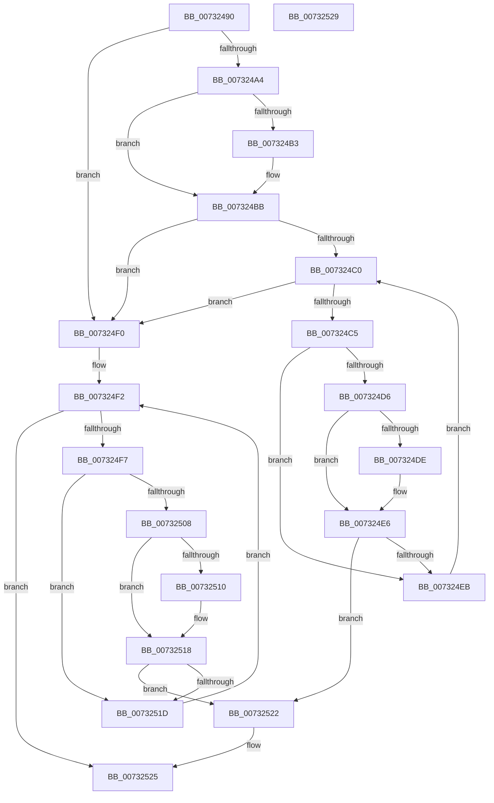

# PiDevCfgConfigurePropertyMatchCallback

- RVA: `0x00732490`–`0x0073252A` (길이 `154` bytes)
- VA: `0x0000000140732490`
- 실행 섹션: `PAGE`
- PDB 이름 있음: `예`; PDB Function 태그: `아니요`
- unwind 정보 RVA: `0x000DB714`
- 디코드: `48`개 명령, `154/154` bytes 표시
- 미해석 바이트: `0` (있으면 어셈블리에 `.byte`로 보존)

> 이 문서는 커널 이미지의 기계어와 PDB 기호를 분석해 생성했습니다. 4번과 5번은 함수 원형과 자료형을 바이너리 사용 방식에서 추정한 C 해석이며 원본 소스 복구 결과는 아닙니다.

## 1. Dependencies

- 직접 호출 지점: **0**; 고유 호출 대상: **0**
- 직접 호출자로 확인된 함수: **0**
- RIP 상대 이미지 참조: **2**

### Outgoing calls
- 직접 디코드된 call 명령이 없습니다.

### Direct callers
- 이 함수 시작 RVA로 연결되는 직접 call은 확인되지 않았습니다. 간접 호출은 완전히 역산할 수 없습니다.

### Static image references
- `0x00732493` → RVA `0x00000000` (`image boundary/outside`; read)
- `0x007324A4` → RVA `0x00FD8780` (`PAGEDATA`; read)

## 2. Other-region calls and transfers

- 다른 실행 섹션으로 향하는 call: **0**
- 별도 외부 분기/꼬리 이동을 확인하지 못했습니다.

## 3. Assembly (complete function range)

```asm
00732490  8B 42 68                        mov eax, dword ptr [rdx + 0x68]
00732493  4C 8D 1D 66 DB 8C FF            lea r11, [rip - 0x73249a]
0073249A  41 B8 01 00 00 00               mov r8d, 1
007324A0  A8 02                           test al, 2
007324A2  75 4C                           jne 0x1407324f0
007324A4  4C 8B 0D D5 62 8A 00            mov r9, qword ptr [rip + 0x8a62d5]
007324AB  48 8B 11                        mov rdx, qword ptr [rcx]
007324AE  49 2B 11                        sub rdx, qword ptr [r9]
007324B1  75 08                           jne 0x1407324bb
007324B3  48 8B 51 08                     mov rdx, qword ptr [rcx + 8]
007324B7  49 2B 51 08                     sub rdx, qword ptr [r9 + 8]
007324BB  48 85 D2                        test rdx, rdx
007324BE  75 30                           jne 0x1407324f0
007324C0  83 FA 0A                        cmp edx, 0xa
007324C3  73 2B                           jae 0x1407324f0
007324C5  4D 8B 94 D3 80 87 FD 00         mov r10, qword ptr [r11 + rdx*8 + 0xfd8780]
007324CD  8B 41 10                        mov eax, dword ptr [rcx + 0x10]
007324D0  41 39 42 10                     cmp dword ptr [r10 + 0x10], eax
007324D4  75 15                           jne 0x1407324eb
007324D6  4D 8B 0A                        mov r9, qword ptr [r10]
007324D9  4C 2B 09                        sub r9, qword ptr [rcx]
007324DC  75 08                           jne 0x1407324e6
007324DE  4D 8B 4A 08                     mov r9, qword ptr [r10 + 8]
007324E2  4C 2B 49 08                     sub r9, qword ptr [rcx + 8]
007324E6  4D 85 C9                        test r9, r9
007324E9  74 37                           je 0x140732522
007324EB  41 03 D0                        add edx, r8d
007324EE  EB D0                           jmp 0x1407324c0
007324F0  33 D2                           xor edx, edx
007324F2  41 3B D0                        cmp edx, r8d
007324F5  73 2E                           jae 0x140732525
007324F7  4D 8B 94 D3 A8 82 FD 00         mov r10, qword ptr [r11 + rdx*8 + 0xfd82a8]
007324FF  8B 41 10                        mov eax, dword ptr [rcx + 0x10]
00732502  41 39 42 10                     cmp dword ptr [r10 + 0x10], eax
00732506  75 15                           jne 0x14073251d
00732508  4D 8B 0A                        mov r9, qword ptr [r10]
0073250B  4C 2B 09                        sub r9, qword ptr [rcx]
0073250E  75 08                           jne 0x140732518
00732510  4D 8B 4A 08                     mov r9, qword ptr [r10 + 8]
00732514  4C 2B 49 08                     sub r9, qword ptr [rcx + 8]
00732518  4D 85 C9                        test r9, r9
0073251B  74 05                           je 0x140732522
0073251D  41 03 D0                        add edx, r8d
00732520  EB D0                           jmp 0x1407324f2
00732522  45 32 C0                        xor r8b, r8b
00732525  41 8A C0                        mov al, r8b
00732528  C3                              ret
00732529  CC                              int3
```

## 4. C-style interpretation (structured pseudocode)

```c
__int64 __fastcall PiDevCfgConfigurePropertyMatchCallback(__int64 a1, __int64 a2)
{
    if ((((unsigned __int8)((unsigned int)(*(unsigned int *)(a2 + 104)))) & (2)) != 0) goto loc_007324F0;
    a2 = (*(unsigned __int64 *)(a1)) - (*(unsigned __int64 *)(*(unsigned __int64 *)(v_rip + 9069269)));
    if (!(condition_is_not_equal)) {
        a2 = *(unsigned __int64 *)(a1 + 8);
        a2 = (a2) - (*(unsigned __int64 *)(*(unsigned __int64 *)(v_rip + 9069269) + 8));
    }
    if (a2 != 0) goto loc_007324F0;
loc_007324C0:
    if (((unsigned int)(a2)) >= 10) goto loc_007324F0;
    if ((*(unsigned int *)(*(unsigned __int64 *)(v_rip - 7546010 + a2 * 8 + 16615296) + 16)) != ((unsigned int)((unsigned int)(*(unsigned int *)(a1 + 16))))) goto loc_007324EB;
    a4 = (*(unsigned __int64 *)(*(unsigned __int64 *)(v_rip - 7546010 + a2 * 8 + 16615296))) - (*(unsigned __int64 *)(a1));
    if (!(condition_is_not_equal)) {
        a4 = *(unsigned __int64 *)(*(unsigned __int64 *)(v_rip - 7546010 + a2 * 8 + 16615296) + 8);
        a4 = (a4) - (*(unsigned __int64 *)(a1 + 8));
    }
    if (a4 == 0) goto loc_00732522;
loc_007324EB:
    a2 = (unsigned int)((a2) + (1));
    goto loc_007324C0;
loc_007324F0:
    a2 = 0;
loc_007324F2:
    if (0 >= 1) goto loc_00732525;
    if ((*(unsigned int *)(*(unsigned __int64 *)(v_rip - 7546010 + a2 * 8 + 16614056) + 16)) != ((unsigned int)((unsigned int)(*(unsigned int *)(a1 + 16))))) goto loc_0073251D;
    a4 = (*(unsigned __int64 *)(*(unsigned __int64 *)(v_rip - 7546010 + a2 * 8 + 16614056))) - (*(unsigned __int64 *)(a1));
    if (!(condition_is_not_equal)) {
        a4 = *(unsigned __int64 *)(*(unsigned __int64 *)(v_rip - 7546010 + a2 * 8 + 16614056) + 8);
        a4 = (a4) - (*(unsigned __int64 *)(a1 + 8));
    }
    if (a4 == 0) goto loc_00732522;
loc_0073251D:
    a2 = (unsigned int)((a2) + (1));
    goto loc_007324F2;
loc_00732522:
    a3 = 0;
loc_00732525:
    return 0;
}
```

## 5. (Beta) C Style

```c
int64_t PiDevCfgConfigurePropertyMatchCallback(void *Arg1, void *Arg2)
{
    uint8_t *arg1 = (uint8_t *)Arg1;
    uint8_t *arg2 = (uint8_t *)Arg2;

    if ((((uint8_t)((uint32_t)(*(uint32_t *)(arg2 + 0x68)))) & (2)) != 0) goto loc_007324F0;
    Arg2 = (*(uint64_t *)(arg1)) - (*(uint64_t *)(*(uint64_t *)(v_rip + 0x8A62D5)));
    if (!(condition_is_not_equal)) {
        Arg2 = *(uint64_t *)(arg1 + 0x8);
        Arg2 = (Arg2) - (*(uint64_t *)(*(uint64_t *)(v_rip + 0x8A62D5) + 0x8));
    }
    if (Arg2 != NULL) goto loc_007324F0;
loc_007324C0:
    if (((uint32_t)(Arg2)) >= 10) goto loc_007324F0;
    if ((*(uint32_t *)(*(uint64_t *)(v_rip - 0x73249A + arg2 * 8 + 0xFD8780) + 0x10)) != ((uint32_t)((uint32_t)(*(uint32_t *)(arg1 + 0x10))))) goto loc_007324EB;
    a4 = (*(uint64_t *)(*(uint64_t *)(v_rip - 0x73249A + arg2 * 8 + 0xFD8780))) - (*(uint64_t *)(arg1));
    if (!(condition_is_not_equal)) {
        a4 = *(uint64_t *)(*(uint64_t *)(v_rip - 0x73249A + arg2 * 8 + 0xFD8780) + 0x8);
        a4 = (a4) - (*(uint64_t *)(arg1 + 0x8));
    }
    if (a4 == 0) goto loc_00732522;
loc_007324EB:
    Arg2 = (uint32_t)((Arg2) + (1));
    goto loc_007324C0;
loc_007324F0:
    Arg2 = 0;
loc_007324F2:
    if (0 >= 1) goto loc_00732525;
    if ((*(uint32_t *)(*(uint64_t *)(v_rip - 0x73249A + arg2 * 8 + 0xFD82A8) + 0x10)) != ((uint32_t)((uint32_t)(*(uint32_t *)(arg1 + 0x10))))) goto loc_0073251D;
    a4 = (*(uint64_t *)(*(uint64_t *)(v_rip - 0x73249A + arg2 * 8 + 0xFD82A8))) - (*(uint64_t *)(arg1));
    if (!(condition_is_not_equal)) {
        a4 = *(uint64_t *)(*(uint64_t *)(v_rip - 0x73249A + arg2 * 8 + 0xFD82A8) + 0x8);
        a4 = (a4) - (*(uint64_t *)(arg1 + 0x8));
    }
    if (a4 == 0) goto loc_00732522;
loc_0073251D:
    Arg2 = (uint32_t)((Arg2) + (1));
    goto loc_007324F2;
loc_00732522:
    a3 = 0;
loc_00732525:
    return 0;
}
```

### 관측된 메모리 오프셋

구조체 형식이 확인되지 않은 접근은 인자 기준의 오프셋으로만 기록했습니다.

| 기준 인자 | 오프셋 표현 | 폭 (bit) | 접근 |
|---|---:|---:|---|
| `Arg1` | `+ 0x0` | `64` | `R` |
| `Arg1` | `+ 0x8` | `64` | `R` |
| `Arg1` | `+ 0x10` | `32` | `R` |
| `Arg2` | `+ 0x68` | `32` | `R` |

## 6. Execution-region graph

[열기: 2D/3D 그래프와 함수 탐색 컨트롤 패널](../../../control-panel.html?section=page&rva=0x00732490&view=graph)

- 2D 그래프는 위에서 아래로 흐르고, 3D 그래프는 빈 공간을 드래그해 회전합니다. Shift+드래그는 이동, 휠은 확대·축소, 함수 노드 선택은 대상 보고서 이동입니다.

### Static fallback


