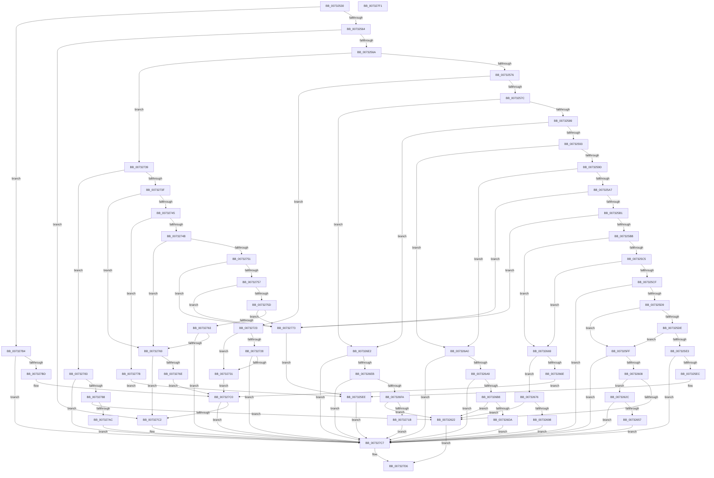

# PiDevCfgConvertPropertyFromValue

- RVA: `0x00732530`–`0x007327F2` (길이 `706` bytes)
- VA: `0x0000000140732530`
- 실행 섹션: `PAGE`
- PDB 이름 있음: `예`; PDB Function 태그: `아니요`
- unwind 정보 RVA: `0x00084C9C`
- 디코드: `189`개 명령, `706/706` bytes 표시
- 미해석 바이트: `0` (있으면 어셈블리에 `.byte`로 보존)

> 이 문서는 커널 이미지의 기계어와 PDB 기호를 분석해 생성했습니다. 4번과 5번은 함수 원형과 자료형을 바이너리 사용 방식에서 추정한 C 해석이며 원본 소스 복구 결과는 아닙니다.

## 1. Dependencies

- 직접 호출 지점: **7**; 고유 호출 대상: **3**
- 직접 호출자로 확인된 함수: **1**
- RIP 상대 이미지 참조: **0**

### Outgoing calls
- `0x00732615` → [ExAllocatePool2](../../poolcode/B8/ExAllocatePool2_function_00B820F0.md) (function, `0x00B820F0`)
- `0x0073264A` → [RtlGUIDFromString](../8F/RtlGUIDFromString_function_008F1EF0.md) (function, `0x008F1EF0`)
- `0x0073265C` → [ExFreePoolWithTag](../../poolcode/B8/ExFreePoolWithTag_function_00B82870.md) (function, `0x00B82870`)
- `0x0073268B` → [ExAllocatePool2](../../poolcode/B8/ExAllocatePool2_function_00B820F0.md) (function, `0x00B820F0`)
- `0x007326C9` → [ExAllocatePool2](../../poolcode/B8/ExAllocatePool2_function_00B820F0.md) (function, `0x00B820F0`)
- `0x0073270A` → [ExAllocatePool2](../../poolcode/B8/ExAllocatePool2_function_00B820F0.md) (function, `0x00B820F0`)
- `0x0073279B` → [ExAllocatePool2](../../poolcode/B8/ExAllocatePool2_function_00B820F0.md) (function, `0x00B820F0`)

### Direct callers
- [sub_00B2C5F4](../B2/Unknown_function_00B2C5F4.md) at `0x00B2C89E`

### Static image references
- 디코드된 RIP-relative 메모리 참조가 없습니다.

## 2. Other-region calls and transfers

- 다른 실행 섹션으로 향하는 call: **6**
  - `0x00732615` → [ExAllocatePool2](../../poolcode/B8/ExAllocatePool2_function_00B820F0.md) (`PAGE` → `POOLCODE`)
  - `0x0073265C` → [ExFreePoolWithTag](../../poolcode/B8/ExFreePoolWithTag_function_00B82870.md) (`PAGE` → `POOLCODE`)
  - `0x0073268B` → [ExAllocatePool2](../../poolcode/B8/ExAllocatePool2_function_00B820F0.md) (`PAGE` → `POOLCODE`)
  - `0x007326C9` → [ExAllocatePool2](../../poolcode/B8/ExAllocatePool2_function_00B820F0.md) (`PAGE` → `POOLCODE`)
  - `0x0073270A` → [ExAllocatePool2](../../poolcode/B8/ExAllocatePool2_function_00B820F0.md) (`PAGE` → `POOLCODE`)
  - `0x0073279B` → [ExAllocatePool2](../../poolcode/B8/ExAllocatePool2_function_00B820F0.md) (`PAGE` → `POOLCODE`)
- 별도 외부 분기/꼬리 이동을 확인하지 못했습니다.

## 3. Assembly (complete function range)

```asm
00732530  48 8B C4                        mov rax, rsp
00732533  48 89 58 08                     mov qword ptr [rax + 8], rbx
00732537  48 89 68 10                     mov qword ptr [rax + 0x10], rbp
0073253B  48 89 70 18                     mov qword ptr [rax + 0x18], rsi
0073253F  57                              push rdi
00732540  41 56                           push r14
00732542  41 57                           push r15
00732544  48 83 EC 30                     sub rsp, 0x30
00732548  33 FF                           xor edi, edi
0073254A  4D 8B F0                        mov r14, r8
0073254D  89 78 DC                        mov dword ptr [rax - 0x24], edi
00732550  8B EA                           mov ebp, edx
00732552  B8 03 10 00 00                  mov eax, 0x1003
00732557  8B F7                           mov esi, edi
00732559  8B DF                           mov ebx, edi
0073255B  44 3B C8                        cmp r9d, eax
0073255E  0F 87 50 02 00 00               ja 0x1407327b4
00732564  0F 84 58 02 00 00               je 0x1407327c2
0073256A  8D 57 10                        lea edx, [rdi + 0x10]
0073256D  44 3B CA                        cmp r9d, edx
00732570  0F 87 C3 01 00 00               ja 0x140732739
00732576  0F 84 A7 01 00 00               je 0x140732723
0073257C  44 8D 7F 02                     lea r15d, [rdi + 2]
00732580  45 2B CF                        sub r9d, r15d
00732583  0F 84 59 01 00 00               je 0x1407326e2
00732589  41 83 E9 01                     sub r9d, 1
0073258D  0F 84 4F 01 00 00               je 0x1407326e2
00732593  41 83 E9 01                     sub r9d, 1
00732597  0F 84 03 01 00 00               je 0x1407326a0
0073259D  41 83 E9 01                     sub r9d, 1
007325A1  0F 84 F9 00 00 00               je 0x1407326a0
007325A7  41 83 E9 01                     sub r9d, 1
007325AB  0F 84 C2 01 00 00               je 0x140732773
007325B1  41 83 E9 01                     sub r9d, 1
007325B5  0F 84 B8 01 00 00               je 0x140732773
007325BB  41 83 E9 01                     sub r9d, 1
007325BF  0F 84 A4 00 00 00               je 0x140732669
007325C5  41 83 E9 01                     sub r9d, 1
007325C9  0F 84 9A 00 00 00               je 0x140732669
007325CF  41 83 F9 04                     cmp r9d, 4
007325D3  0F 85 EE 01 00 00               jne 0x1407327c7
007325D9  83 E9 01                        sub ecx, 1
007325DC  74 21                           je 0x1407325ff
007325DE  83 E9 01                        sub ecx, 1
007325E1  74 1C                           je 0x1407325ff
007325E3  83 F9 01                        cmp ecx, 1
007325E6  0F 85 DB 01 00 00               jne 0x1407327c7
007325EC  3B EA                           cmp ebp, edx
007325EE  8B F5                           mov esi, ebp
007325F0  49 8B DE                        mov rbx, r14
007325F3  0F 45 F7                        cmovne esi, edi
007325F6  48 0F 45 DF                     cmovne rbx, rdi
007325FA  E9 C8 01 00 00                  jmp 0x1407327c7
007325FF  83 FD 4E                        cmp ebp, 0x4e
00732602  0F 85 BF 01 00 00               jne 0x1407327c7
00732608  B9 00 01 00 00                  mov ecx, 0x100
0073260D  41 B8 50 70 64 63               mov r8d, 0x63647050
00732613  8B F2                           mov esi, edx
00732615  E8 D6 FA 44 00                  call 0x140b820f0
0073261A  48 8B D8                        mov rbx, rax
0073261D  48 85 C0                        test rax, rax
00732620  75 0A                           jne 0x14073262c
00732622  BF 9A 00 00 C0                  mov edi, 0xc000009a
00732627  E9 AA 01 00 00                  jmp 0x1407327d6
0073262C  0F B7 C5                        movzx eax, bp
0073262F  4C 89 74 24 28                  mov qword ptr [rsp + 0x28], r14
00732634  66 41 2B C7                     sub ax, r15w
00732638  66 89 6C 24 22                  mov word ptr [rsp + 0x22], bp
0073263D  48 8B D3                        mov rdx, rbx
00732640  66 89 44 24 20                  mov word ptr [rsp + 0x20], ax
00732645  48 8D 4C 24 20                  lea rcx, [rsp + 0x20]
0073264A  E8 A1 F8 1B 00                  call 0x1408f1ef0
0073264F  85 C0                           test eax, eax
00732651  0F 89 70 01 00 00               jns 0x1407327c7
00732657  33 D2                           xor edx, edx
00732659  48 8B CB                        mov rcx, rbx
0073265C  E8 0F 02 45 00                  call 0x140b82870
00732661  48 8B DF                        mov rbx, rdi
00732664  E9 5E 01 00 00                  jmp 0x1407327c7
00732669  83 F9 04                        cmp ecx, 4
0073266C  74 08                           je 0x140732676
0073266E  83 F9 0B                        cmp ecx, 0xb
00732671  E9 4A 01 00 00                  jmp 0x1407327c0
00732676  41 8B 28                        mov ebp, dword ptr [r8]
00732679  BE 08 00 00 00                  mov esi, 8
0073267E  8B D6                           mov edx, esi
00732680  B9 00 01 00 00                  mov ecx, 0x100
00732685  41 B8 50 70 64 63               mov r8d, 0x63647050
0073268B  E8 60 FA 44 00                  call 0x140b820f0
00732690  48 8B D8                        mov rbx, rax
00732693  48 85 C0                        test rax, rax
00732696  74 8A                           je 0x140732622
00732698  48 89 28                        mov qword ptr [rax], rbp
0073269B  E9 27 01 00 00                  jmp 0x1407327c7
007326A0  83 F9 04                        cmp ecx, 4
007326A3  0F 85 1E 01 00 00               jne 0x1407327c7
007326A9  41 8B 28                        mov ebp, dword ptr [r8]
007326AC  81 FD FF FF 00 00               cmp ebp, 0xffff
007326B2  0F 87 0F 01 00 00               ja 0x1407327c7
007326B8  41 B8 50 70 64 63               mov r8d, 0x63647050
007326BE  49 8B D7                        mov rdx, r15
007326C1  B9 00 01 00 00                  mov ecx, 0x100
007326C6  41 8B F7                        mov esi, r15d
007326C9  E8 22 FA 44 00                  call 0x140b820f0
007326CE  48 8B D8                        mov rbx, rax
007326D1  48 85 C0                        test rax, rax
007326D4  0F 84 48 FF FF FF               je 0x140732622
007326DA  66 89 28                        mov word ptr [rax], bp
007326DD  E9 E5 00 00 00                  jmp 0x1407327c7
007326E2  83 F9 04                        cmp ecx, 4
007326E5  0F 85 DC 00 00 00               jne 0x1407327c7
007326EB  41 8B 28                        mov ebp, dword ptr [r8]
007326EE  81 FD FF 00 00 00               cmp ebp, 0xff
007326F4  0F 87 CD 00 00 00               ja 0x1407327c7
007326FA  8D 51 FD                        lea edx, [rcx - 3]
007326FD  41 B8 50 70 64 63               mov r8d, 0x63647050
00732703  B9 00 01 00 00                  mov ecx, 0x100
00732708  8B F2                           mov esi, edx
0073270A  E8 E1 F9 44 00                  call 0x140b820f0
0073270F  48 8B D8                        mov rbx, rax
00732712  48 85 C0                        test rax, rax
00732715  0F 84 07 FF FF FF               je 0x140732622
0073271B  40 88 28                        mov byte ptr [rax], bpl
0073271E  E9 A4 00 00 00                  jmp 0x1407327c7
00732723  83 F9 03                        cmp ecx, 3
00732726  74 09                           je 0x140732731
00732728  83 F9 0B                        cmp ecx, 0xb
0073272B  0F 85 96 00 00 00               jne 0x1407327c7
00732731  83 FD 08                        cmp ebp, 8
00732734  E9 87 00 00 00                  jmp 0x1407327c0
00732739  41 83 E9 11                     sub r9d, 0x11
0073273D  74 44                           je 0x140732783
0073273F  41 83 E9 01                     sub r9d, 1
00732743  74 24                           je 0x140732769
00732745  41 83 E9 01                     sub r9d, 1
00732749  74 30                           je 0x14073277b
0073274B  41 83 E9 01                     sub r9d, 1
0073274F  74 18                           je 0x140732769
00732751  41 83 E9 02                     sub r9d, 2
00732755  74 1C                           je 0x140732773
00732757  41 83 E9 01                     sub r9d, 1
0073275B  74 16                           je 0x140732773
0073275D  41 83 E9 01                     sub r9d, 1
00732761  74 10                           je 0x140732773
00732763  41 83 F9 01                     cmp r9d, 1
00732767  75 5E                           jne 0x1407327c7
00732769  83 E9 01                        sub ecx, 1
0073276C  74 54                           je 0x1407327c2
0073276E  83 F9 01                        cmp ecx, 1
00732771  EB 4D                           jmp 0x1407327c0
00732773  83 F9 04                        cmp ecx, 4
00732776  E9 73 FE FF FF                  jmp 0x1407325ee
0073277B  83 F9 03                        cmp ecx, 3
0073277E  E9 6B FE FF FF                  jmp 0x1407325ee
00732783  83 F9 04                        cmp ecx, 4
00732786  75 3F                           jne 0x1407327c7
00732788  41 8B 28                        mov ebp, dword ptr [r8]
0073278B  8D 51 FD                        lea edx, [rcx - 3]
0073278E  B9 00 01 00 00                  mov ecx, 0x100
00732793  41 B8 50 70 64 63               mov r8d, 0x63647050
00732799  8B F2                           mov esi, edx
0073279B  E8 50 F9 44 00                  call 0x140b820f0
007327A0  48 8B D8                        mov rbx, rax
007327A3  48 85 C0                        test rax, rax
007327A6  0F 84 76 FE FF FF               je 0x140732622
007327AC  F7 DD                           neg ebp
007327AE  1A C0                           sbb al, al
007327B0  88 03                           mov byte ptr [rbx], al
007327B2  EB 13                           jmp 0x1407327c7
007327B4  41 81 F9 12 20 00 00            cmp r9d, 0x2012
007327BB  75 0A                           jne 0x1407327c7
007327BD  83 F9 07                        cmp ecx, 7
007327C0  75 05                           jne 0x1407327c7
007327C2  8B F5                           mov esi, ebp
007327C4  49 8B DE                        mov rbx, r14
007327C7  48 8B 4C 24 70                  mov rcx, qword ptr [rsp + 0x70]
007327CC  89 31                           mov dword ptr [rcx], esi
007327CE  48 8B 4C 24 78                  mov rcx, qword ptr [rsp + 0x78]
007327D3  48 89 19                        mov qword ptr [rcx], rbx
007327D6  48 8B 5C 24 50                  mov rbx, qword ptr [rsp + 0x50]
007327DB  8B C7                           mov eax, edi
007327DD  48 8B 6C 24 58                  mov rbp, qword ptr [rsp + 0x58]
007327E2  48 8B 74 24 60                  mov rsi, qword ptr [rsp + 0x60]
007327E7  48 83 C4 30                     add rsp, 0x30
007327EB  41 5F                           pop r15
007327ED  41 5E                           pop r14
007327EF  5F                              pop rdi
007327F0  C3                              ret
007327F1  CC                              int3
```

## 4. C-style interpretation (structured pseudocode)

```c
__int64 __fastcall PiDevCfgConvertPropertyFromValue(int a1, int a2, __int64 a3, int a4, __int64 a5, __int64 a6)
{
    __int64 result;
    __int64 v_rbp;
    __int64 v_rbx;
    __int64 v_rdi;
    __int64 v_rsi;
    __int64 v_rsp;
    unsigned __int64 v_stack_m20;
    unsigned __int16 v_stack_m26;
    unsigned __int16 v_stack_m28;
    unsigned __int64 v_stack_p10;
    unsigned __int64 v_stack_p18;
    unsigned __int64 v_stack_p8;

    *(unsigned __int64 *)(v_rsp + 8) = v_rbx;
    *(unsigned __int64 *)(v_rsp + 16) = v_rbp;
    *(unsigned __int64 *)(v_rsp + 24) = v_rsi;
    v_rsp = (v_rsp) - (48);
    v_rdi = 0;
    *(unsigned int *)(v_rsp - 36) = 0;
    if (a4 > ((unsigned int)((unsigned int)(0x1003ULL)))) goto loc_007327B4;
    if (a4 == ((unsigned int)((unsigned int)(0x1003ULL)))) goto loc_007327C2;
    if (a4 > ((unsigned int)(v_rdi + 16))) goto loc_00732739;
    if (a4 == ((unsigned int)(v_rdi + 16))) goto loc_00732723;
    a4 = (unsigned int)((a4) - ((unsigned int)(v_rdi + 2)));
    if (condition_is_equal) goto loc_007326E2;
    a4 = (unsigned int)((a4) - (1));
    if (condition_is_equal) goto loc_007326E2;
    a4 = (unsigned int)((a4) - (1));
    if (condition_is_equal) goto loc_007326A0;
    a4 = (unsigned int)((a4) - (1));
    if (condition_is_equal) goto loc_007326A0;
    a4 = (unsigned int)((a4) - (1));
    if (condition_is_equal) goto loc_00732773;
    a4 = (unsigned int)((a4) - (1));
    if (condition_is_equal) goto loc_00732773;
    a4 = (unsigned int)((a4) - (1));
    if (condition_is_equal) goto loc_00732669;
    a4 = (unsigned int)((a4) - (1));
    if (condition_is_equal) goto loc_00732669;
    if (a4 != 4) goto loc_007327C7;
    a1 = (unsigned int)((a1) - (1));
    if (condition_is_equal) goto loc_007325FF;
    a1 = (unsigned int)((a1) - (1));
    if (condition_is_equal) goto loc_007325FF;
    if (a1 != 1) goto loc_007327C7;
loc_007325EE:
    v_rsi = (unsigned int)((unsigned int)((unsigned int)(a2)));
    if (((unsigned int)((unsigned int)(a2))) != ((unsigned int)(v_rdi + 16))) {
        v_rsi = 0;
        a3 = 0;
    }
    goto loc_007327C7;
loc_007325FF:
    if (((unsigned int)((unsigned int)(a2))) != 78) goto loc_007327C7;
    result = ExAllocatePool2(256, v_rdi + 16, (unsigned int)(0x63647050ULL), a4);
    if (result != 0) goto loc_0073262C;
loc_00732622:
    goto loc_007327D6;
loc_0073262C:
    v_stack_m20 = a3;
    result = (unsigned __int16)(((unsigned __int16)((unsigned int)(a2))) - ((unsigned __int16)(v_rdi + 2)));
    v_stack_m26 = (unsigned __int16)((unsigned int)(a2));
    v_stack_m28 = (unsigned __int16)(result);
    result = RtlGUIDFromString(v_stack_m28, result, (unsigned int)(0x63647050ULL), a4);
    if (!sign_flag) goto loc_007327C7;
    a2 = 0;
    result = ExFreePoolWithTag(result, a2, (unsigned int)(0x63647050ULL), a4);
    goto loc_007327C7;
loc_00732669:
    if (((unsigned int)(result)) == 4) goto loc_00732676;
    goto loc_007327C0;
loc_00732676:
    result = ExAllocatePool2(256, 8, (unsigned int)(0x63647050ULL), a4);
    if (result == 0) goto loc_00732622;
    *(unsigned __int64 *)(result) = (unsigned int)(*(unsigned int *)((unsigned int)(0x63647050ULL)));
    goto loc_007327C7;
loc_007326A0:
    if (256 != 4) goto loc_007327C7;
    if (((unsigned int)((unsigned int)(*(unsigned int *)((unsigned int)(0x63647050ULL))))) > 0xFFFFULL) goto loc_007327C7;
    result = ExAllocatePool2(256, v_rdi + 2, (unsigned int)(0x63647050ULL), a4);
    if (result == 0) goto loc_00732622;
    *(unsigned __int16 *)(result) = (unsigned __int16)((unsigned int)(*(unsigned int *)((unsigned int)(0x63647050ULL))));
    goto loc_007327C7;
loc_007326E2:
    if (256 != 4) goto loc_007327C7;
    if (((unsigned int)((unsigned int)(*(unsigned int *)((unsigned int)(0x63647050ULL))))) > 255) goto loc_007327C7;
    result = ExAllocatePool2(256, 256 - 3, (unsigned int)(0x63647050ULL), a4);
    if (result == 0) goto loc_00732622;
    *(unsigned __int8 *)(result) = (unsigned __int8)((unsigned int)(*(unsigned int *)((unsigned int)(0x63647050ULL))));
    goto loc_007327C7;
loc_00732723:
    if (256 == 3) goto loc_00732731;
    if (256 != 11) goto loc_007327C7;
loc_00732731:
    goto loc_007327C0;
loc_00732739:
    a4 = (unsigned int)((a4) - (17));
    if (condition_is_equal) goto loc_00732783;
    a4 = (unsigned int)((a4) - (1));
    if (condition_is_equal) goto loc_00732769;
    a4 = (unsigned int)((a4) - (1));
    if (condition_is_equal) goto loc_0073277B;
    a4 = (unsigned int)((a4) - (1));
    if (condition_is_equal) goto loc_00732769;
    a4 = (unsigned int)((a4) - (2));
    if (condition_is_equal) goto loc_00732773;
    a4 = (unsigned int)((a4) - (1));
    if (condition_is_equal) goto loc_00732773;
    a4 = (unsigned int)((a4) - (1));
    if (condition_is_equal) goto loc_00732773;
    if (a4 != 1) goto loc_007327C7;
loc_00732769:
    a1 = (unsigned int)((256) - (1));
    if (condition_is_equal) goto loc_007327C2;
    goto loc_007327C0;
loc_00732773:
    goto loc_007325EE;
loc_0073277B:
    goto loc_007325EE;
loc_00732783:
    if (a1 != 4) goto loc_007327C7;
    result = ExAllocatePool2(256, a1 - 3, (unsigned int)(0x63647050ULL), a4);
    if (result == 0) goto loc_00732622;
    v_rbp = (unsigned int)(-((unsigned int)(*(unsigned int *)((unsigned int)(0x63647050ULL)))));
    *(unsigned __int8 *)(result) = (unsigned __int8)(result);
    goto loc_007327C7;
loc_007327B4:
    if (a4 != 0x2012ULL) goto loc_007327C7;
loc_007327C0:
    v_rbx = result;
    v_rsi = (unsigned int)((unsigned int)(a1 - 3));
    if (256 == 7) {
        v_rsi = (unsigned int)(v_rbp);
        v_rbx = a3;
    }
    *(unsigned int *)(a5) = (unsigned int)(v_rsi);
    *(unsigned __int64 *)(a6) = v_rbx;
loc_007327D6:
    v_rsp = (v_rsp) + (48);
    return (unsigned int)((unsigned int)((unsigned int)(0xC000009AULL)));
}
```

## 5. (Beta) C Style

```c
int64_t PiDevCfgConvertPropertyFromValue(int32_t Arg1, int32_t Arg2, void *Arg3, int32_t Arg4, void *Arg5, void *Arg6)
{
    uint8_t *arg3 = (uint8_t *)Arg3;
    uint8_t *arg5 = (uint8_t *)Arg5;
    uint8_t *arg6 = (uint8_t *)Arg6;

    int64_t result;
    int64_t local_rbp;
    int64_t local_rbx;
    int64_t local_rdi;
    int64_t local_rsi;
    int64_t local_rsp;
    uint64_t v_stack_m20;
    uint16_t v_stack_m26;
    uint16_t v_stack_m28;
    uint64_t v_stack_p10;
    uint64_t v_stack_p18;
    uint64_t v_stack_p8;

    *(uint64_t *)(local_rsp + 0x8) = local_rbx;
    *(uint64_t *)(local_rsp + 0x10) = local_rbp;
    *(uint64_t *)(local_rsp + 0x18) = local_rsi;
    local_rsp = (local_rsp) - (48);
    local_rdi = 0;
    *(uint32_t *)(local_rsp - 0x24) = 0;
    if (Arg4 > ((uint32_t)((uint32_t)(0x1003ULL)))) goto loc_007327B4;
    if (Arg4 == ((uint32_t)((uint32_t)(0x1003ULL)))) goto loc_007327C2;
    if (Arg4 > ((uint32_t)(local_rdi + 16))) goto loc_00732739;
    if (Arg4 == ((uint32_t)(local_rdi + 16))) goto loc_00732723;
    Arg4 = (uint32_t)((Arg4) - ((uint32_t)(local_rdi + 2)));
    if (condition_is_equal) goto loc_007326E2;
    Arg4 = (uint32_t)((Arg4) - (1));
    if (condition_is_equal) goto loc_007326E2;
    Arg4 = (uint32_t)((Arg4) - (1));
    if (condition_is_equal) goto loc_007326A0;
    Arg4 = (uint32_t)((Arg4) - (1));
    if (condition_is_equal) goto loc_007326A0;
    Arg4 = (uint32_t)((Arg4) - (1));
    if (condition_is_equal) goto loc_00732773;
    Arg4 = (uint32_t)((Arg4) - (1));
    if (condition_is_equal) goto loc_00732773;
    Arg4 = (uint32_t)((Arg4) - (1));
    if (condition_is_equal) goto loc_00732669;
    Arg4 = (uint32_t)((Arg4) - (1));
    if (condition_is_equal) goto loc_00732669;
    if (Arg4 != 4) goto loc_007327C7;
    Arg1 = (uint32_t)((Arg1) - (1));
    if (condition_is_equal) goto loc_007325FF;
    Arg1 = (uint32_t)((Arg1) - (1));
    if (condition_is_equal) goto loc_007325FF;
    if (Arg1 != 1) goto loc_007327C7;
loc_007325EE:
    local_rsi = (uint32_t)((uint32_t)((uint32_t)(Arg2)));
    if (((uint32_t)((uint32_t)(Arg2))) != ((uint32_t)(local_rdi + 16))) {
        local_rsi = 0;
        Arg3 = 0;
    }
    goto loc_007327C7;
loc_007325FF:
    if (((uint32_t)((uint32_t)(Arg2))) != 78) goto loc_007327C7;
    result = ExAllocatePool2(256, local_rdi + 16, (uint32_t)(0x63647050ULL), Arg4);
    if (result != 0) goto loc_0073262C;
loc_00732622:
    goto loc_007327D6;
loc_0073262C:
    v_stack_m20 = Arg3;
    result = (uint16_t)(((uint16_t)((uint32_t)(Arg2))) - ((uint16_t)(local_rdi + 2)));
    v_stack_m26 = (uint16_t)((uint32_t)(Arg2));
    v_stack_m28 = (uint16_t)(result);
    result = RtlGUIDFromString(v_stack_m28, result, (uint32_t)(0x63647050ULL), Arg4);
    if (!sign_flag) goto loc_007327C7;
    Arg2 = 0;
    result = ExFreePoolWithTag(result, Arg2, (uint32_t)(0x63647050ULL), Arg4);
    goto loc_007327C7;
loc_00732669:
    if (((uint32_t)(result)) == 4) goto loc_00732676;
    goto loc_007327C0;
loc_00732676:
    result = ExAllocatePool2(256, 8, (uint32_t)(0x63647050ULL), Arg4);
    if (result == 0) goto loc_00732622;
    *(uint64_t *)(result) = (uint32_t)(*(uint32_t *)((uint32_t)(0x63647050ULL)));
    goto loc_007327C7;
loc_007326A0:
    if (256 != 4) goto loc_007327C7;
    if (((uint32_t)((uint32_t)(*(uint32_t *)((uint32_t)(0x63647050ULL))))) > 0xFFFFULL) goto loc_007327C7;
    result = ExAllocatePool2(256, local_rdi + 2, (uint32_t)(0x63647050ULL), Arg4);
    if (result == 0) goto loc_00732622;
    *(uint16_t *)(result) = (uint16_t)((uint32_t)(*(uint32_t *)((uint32_t)(0x63647050ULL))));
    goto loc_007327C7;
loc_007326E2:
    if (256 != 4) goto loc_007327C7;
    if (((uint32_t)((uint32_t)(*(uint32_t *)((uint32_t)(0x63647050ULL))))) > 255) goto loc_007327C7;
    result = ExAllocatePool2(256, 256 - 3, (uint32_t)(0x63647050ULL), Arg4);
    if (result == 0) goto loc_00732622;
    *(uint8_t *)(result) = (uint8_t)((uint32_t)(*(uint32_t *)((uint32_t)(0x63647050ULL))));
    goto loc_007327C7;
loc_00732723:
    if (256 == 3) goto loc_00732731;
    if (256 != 11) goto loc_007327C7;
loc_00732731:
    goto loc_007327C0;
loc_00732739:
    Arg4 = (uint32_t)((Arg4) - (17));
    if (condition_is_equal) goto loc_00732783;
    Arg4 = (uint32_t)((Arg4) - (1));
    if (condition_is_equal) goto loc_00732769;
    Arg4 = (uint32_t)((Arg4) - (1));
    if (condition_is_equal) goto loc_0073277B;
    Arg4 = (uint32_t)((Arg4) - (1));
    if (condition_is_equal) goto loc_00732769;
    Arg4 = (uint32_t)((Arg4) - (2));
    if (condition_is_equal) goto loc_00732773;
    Arg4 = (uint32_t)((Arg4) - (1));
    if (condition_is_equal) goto loc_00732773;
    Arg4 = (uint32_t)((Arg4) - (1));
    if (condition_is_equal) goto loc_00732773;
    if (Arg4 != 1) goto loc_007327C7;
loc_00732769:
    Arg1 = (uint32_t)((256) - (1));
    if (condition_is_equal) goto loc_007327C2;
    goto loc_007327C0;
loc_00732773:
    goto loc_007325EE;
loc_0073277B:
    goto loc_007325EE;
loc_00732783:
    if (Arg1 != 4) goto loc_007327C7;
    result = ExAllocatePool2(256, Arg1 - 3, (uint32_t)(0x63647050ULL), Arg4);
    if (result == 0) goto loc_00732622;
    local_rbp = (uint32_t)(-((uint32_t)(*(uint32_t *)((uint32_t)(0x63647050ULL)))));
    *(uint8_t *)(result) = (uint8_t)(result);
    goto loc_007327C7;
loc_007327B4:
    if (Arg4 != 0x2012ULL) goto loc_007327C7;
loc_007327C0:
    local_rbx = result;
    local_rsi = (uint32_t)((uint32_t)(Arg1 - 3));
    if (256 == 7) {
        local_rsi = (uint32_t)(local_rbp);
        local_rbx = Arg3;
    }
    *(uint32_t *)(arg5) = (uint32_t)(local_rsi);
    *(uint64_t *)(arg6) = local_rbx;
loc_007327D6:
    local_rsp = (local_rsp) + (48);
    return (uint32_t)((uint32_t)((uint32_t)(0xC000009AULL)));
}
```

### 관측된 메모리 오프셋

구조체 형식이 확인되지 않은 접근은 인자 기준의 오프셋으로만 기록했습니다.

| 기준 인자 | 오프셋 표현 | 폭 (bit) | 접근 |
|---|---:|---:|---|
| `Arg3` | `+ 0x0` | `32` | `R` |
| `Arg5` | `+ 0x0` | `32` | `W` |
| `Arg6` | `+ 0x0` | `64` | `W` |

## 6. Execution-region graph

[열기: 2D/3D 그래프와 함수 탐색 컨트롤 패널](../../../control-panel.html?section=page&rva=0x00732530&view=graph)

- 2D 그래프는 위에서 아래로 흐르고, 3D 그래프는 빈 공간을 드래그해 회전합니다. Shift+드래그는 이동, 휠은 확대·축소, 함수 노드 선택은 대상 보고서 이동입니다.

### Static fallback


