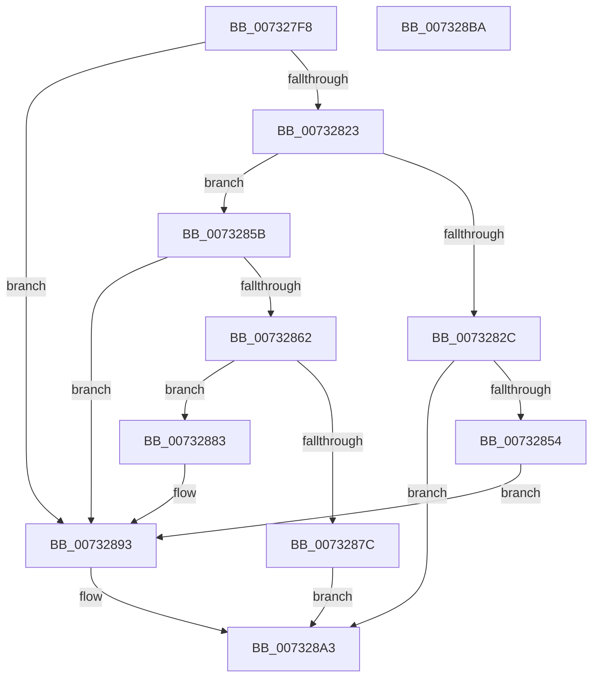

# PiDevCfgCopyVariableData

- RVA: `0x007327F8`–`0x007328BB` (길이 `195` bytes)
- VA: `0x00000001407327F8`
- 실행 섹션: `PAGE`
- PDB 이름 있음: `예`; PDB Function 태그: `아니요`
- unwind 정보 RVA: `0x000A7960`
- 디코드: `58`개 명령, `195/195` bytes 표시
- 미해석 바이트: `0` (있으면 어셈블리에 `.byte`로 보존)

> 이 문서는 커널 이미지의 기계어와 PDB 기호를 분석해 생성했습니다. 4번과 5번은 함수 원형과 자료형을 바이너리 사용 방식에서 추정한 C 해석이며 원본 소스 복구 결과는 아닙니다.

## 1. Dependencies

- 직접 호출 지점: **3**; 고유 호출 대상: **3**
- 직접 호출자로 확인된 함수: **2**
- RIP 상대 이미지 참조: **1**

### Outgoing calls
- `0x00732849` → [PnpCtxRegOpenKey](../8E/PnpCtxRegOpenKey_function_008EF7B8.md) (function, `0x008EF7B8`)
- `0x0073286F` → [ExAllocatePool2](../../poolcode/B8/ExAllocatePool2_function_00B820F0.md) (function, `0x00B820F0`)
- `0x0073288E` → [memcpy](../../text/6C/memcpy_function_006C6840.md) (function, `0x006C6840`)

### Direct callers
- [PiDevCfgResolveVariableSwitchCase](PiDevCfgResolveVariableSwitchCase_function_00736390.md) at `0x00736554`
- [PiDevCfgResolveVariableExpression](../AA/PiDevCfgResolveVariableExpression_function_00AA8C00.md) at `0x00AA9E0E`

### Static image references
- `0x0073282C` → RVA `0x00E66398` (`.data`; read)

## 2. Other-region calls and transfers

- 다른 실행 섹션으로 향하는 call: **2**
  - `0x0073286F` → [ExAllocatePool2](../../poolcode/B8/ExAllocatePool2_function_00B820F0.md) (`PAGE` → `POOLCODE`)
  - `0x0073288E` → [memcpy](../../text/6C/memcpy_function_006C6840.md) (`PAGE` → `.text`)
- 별도 외부 분기/꼬리 이동을 확인하지 못했습니다.

## 3. Assembly (complete function range)

```asm
007327F8  4C 8B DC                        mov r11, rsp
007327FB  49 89 5B 08                     mov qword ptr [r11 + 8], rbx
007327FF  49 89 6B 18                     mov qword ptr [r11 + 0x18], rbp
00732803  49 89 73 20                     mov qword ptr [r11 + 0x20], rsi
00732807  57                              push rdi
00732808  48 83 EC 30                     sub rsp, 0x30
0073280C  33 F6                           xor esi, esi
0073280E  48 8B DA                        mov rbx, rdx
00732811  49 21 73 10                     and qword ptr [r11 + 0x10], rsi
00732815  33 FF                           xor edi, edi
00732817  48 8B 52 28                     mov rdx, qword ptr [rdx + 0x28]
0073281B  48 8B E9                        mov rbp, rcx
0073281E  48 85 D2                        test rdx, rdx
00732821  74 70                           je 0x140732893
00732823  8B 43 20                        mov eax, dword ptr [rbx + 0x20]
00732826  66 3D 00 80                     cmp ax, 0x8000
0073282A  75 2F                           jne 0x14073285b
0073282C  48 8B 0D 65 3B 73 00            mov rcx, qword ptr [rip + 0x733b65]
00732833  49 8D 43 10                     lea rax, [r11 + 0x10]
00732837  49 89 43 F0                     mov qword ptr [r11 - 0x10], rax
0073283B  45 33 C9                        xor r9d, r9d
0073283E  45 33 C0                        xor r8d, r8d
00732841  C7 44 24 20 19 00 02 00         mov dword ptr [rsp + 0x20], 0x20019
00732849  E8 6A CF 1B 00                  call 0x1408ef7b8
0073284E  8B F0                           mov esi, eax
00732850  85 C0                           test eax, eax
00732852  78 4F                           js 0x1407328a3
00732854  48 8B 7C 24 48                  mov rdi, qword ptr [rsp + 0x48]
00732859  EB 38                           jmp 0x140732893
0073285B  8B 43 24                        mov eax, dword ptr [rbx + 0x24]
0073285E  85 C0                           test eax, eax
00732860  74 31                           je 0x140732893
00732862  8B D0                           mov edx, eax
00732864  B9 00 01 00 00                  mov ecx, 0x100
00732869  41 B8 50 70 64 63               mov r8d, 0x63647050
0073286F  E8 7C F8 44 00                  call 0x140b820f0
00732874  48 8B F8                        mov rdi, rax
00732877  48 85 C0                        test rax, rax
0073287A  75 07                           jne 0x140732883
0073287C  BE 9A 00 00 C0                  mov esi, 0xc000009a
00732881  EB 20                           jmp 0x1407328a3
00732883  44 8B 43 24                     mov r8d, dword ptr [rbx + 0x24]
00732887  48 8B C8                        mov rcx, rax
0073288A  48 8B 53 28                     mov rdx, qword ptr [rbx + 0x28]
0073288E  E8 AD 3F F9 FF                  call 0x1406c6840
00732893  8B 43 20                        mov eax, dword ptr [rbx + 0x20]
00732896  89 45 20                        mov dword ptr [rbp + 0x20], eax
00732899  8B 43 24                        mov eax, dword ptr [rbx + 0x24]
0073289C  89 45 24                        mov dword ptr [rbp + 0x24], eax
0073289F  48 89 7D 28                     mov qword ptr [rbp + 0x28], rdi
007328A3  48 8B 5C 24 40                  mov rbx, qword ptr [rsp + 0x40]
007328A8  8B C6                           mov eax, esi
007328AA  48 8B 74 24 58                  mov rsi, qword ptr [rsp + 0x58]
007328AF  48 8B 6C 24 50                  mov rbp, qword ptr [rsp + 0x50]
007328B4  48 83 C4 30                     add rsp, 0x30
007328B8  5F                              pop rdi
007328B9  C3                              ret
007328BA  CC                              int3
```

## 4. C-style interpretation (structured pseudocode)

```c
__int64 __fastcall PiDevCfgCopyVariableData(__int64 a1, __int64 a2, int a3, int a4)
{
    __int64 result;
    __int64 v_rdi;
    __int64 v_rsi;
    __int64 v_rsp;
    unsigned int v_stack_m18;
    unsigned __int64 v_stack_p10;
    unsigned __int64 v_stack_p18;
    unsigned __int64 v_stack_p20;
    unsigned __int64 v_stack_p8;

    *(unsigned __int64 *)(v_rsp + 8) = v_rbx;
    *(unsigned __int64 *)(v_rsp + 24) = v_rbp;
    *(unsigned __int64 *)(v_rsp + 32) = v_rsi;
    v_rsp = (v_rsp) - (48);
    v_rsi = 0;
    v_rdi = 0;
    if (*(unsigned __int64 *)(a2 + 40) == 0) goto loc_00732893;
    if (((unsigned __int16)((unsigned int)(*(unsigned int *)(a2 + 32)))) != 0x8000ULL) goto loc_0073285B;
    *(unsigned __int64 *)(v_rsp - 16) = v_rsp + 16;
    a4 = 0;
    a3 = 0;
    v_stack_m18 = 0x20019ULL;
    result = PnpCtxRegOpenKey(*(unsigned __int64 *)(v_rip + 7551845), *(unsigned __int64 *)(a2 + 40), a3, a4);
    if (sign_flag) goto loc_007328A3;
    goto loc_00732893;
loc_0073285B:
    if ((unsigned int)((unsigned int)(*(unsigned int *)(a2 + 36))) == 0) goto loc_00732893;
    result = ExAllocatePool2(256, (unsigned int)((unsigned int)((unsigned int)(*(unsigned int *)(a2 + 36)))), (unsigned int)(0x63647050ULL), a4);
    if (result != 0) goto loc_00732883;
    goto loc_007328A3;
loc_00732883:
    result = memcpy(result, *(unsigned __int64 *)(a2 + 40), (unsigned int)(*(unsigned int *)(a2 + 36)), a4);
loc_00732893:
    *(unsigned int *)(a1 + 32) = (unsigned int)((unsigned int)(*(unsigned int *)(a2 + 32)));
    *(unsigned int *)(a1 + 36) = (unsigned int)((unsigned int)(*(unsigned int *)(a2 + 36)));
    *(unsigned __int64 *)(a1 + 40) = result;
loc_007328A3:
    v_rsp = (v_rsp) + (48);
    return (unsigned int)((unsigned int)((unsigned int)(0xC000009AULL)));
}
```

## 5. (Beta) C Style

```c
int64_t PiDevCfgCopyVariableData(void *Arg1, void *Arg2, int32_t Arg3, int32_t Arg4)
{
    uint8_t *arg1 = (uint8_t *)Arg1;
    uint8_t *arg2 = (uint8_t *)Arg2;

    int64_t result;
    int64_t local_rdi;
    int64_t local_rsi;
    int64_t local_rsp;
    uint32_t v_stack_m18;
    uint64_t v_stack_p10;
    uint64_t v_stack_p18;
    uint64_t v_stack_p20;
    uint64_t v_stack_p8;

    *(uint64_t *)(local_rsp + 0x8) = local_rbx;
    *(uint64_t *)(local_rsp + 0x18) = local_rbp;
    *(uint64_t *)(local_rsp + 0x20) = local_rsi;
    local_rsp = (local_rsp) - (48);
    local_rsi = 0;
    local_rdi = 0;
    if (*(uint64_t *)(arg2 + 0x28) == 0) goto loc_00732893;
    if (((uint16_t)((uint32_t)(*(uint32_t *)(arg2 + 0x20)))) != 0x8000ULL) goto loc_0073285B;
    *(uint64_t *)(local_rsp - 0x10) = local_rsp + 16;
    Arg4 = 0;
    Arg3 = 0;
    v_stack_m18 = 0x20019ULL;
    result = PnpCtxRegOpenKey(*(uint64_t *)(v_rip + 0x733B65), *(uint64_t *)(arg2 + 0x28), Arg3, Arg4);
    if (sign_flag) goto loc_007328A3;
    goto loc_00732893;
loc_0073285B:
    if ((uint32_t)((uint32_t)(*(uint32_t *)(arg2 + 0x24))) == 0) goto loc_00732893;
    result = ExAllocatePool2(256, (uint32_t)((uint32_t)((uint32_t)(*(uint32_t *)(arg2 + 0x24)))), (uint32_t)(0x63647050ULL), Arg4);
    if (result != 0) goto loc_00732883;
    goto loc_007328A3;
loc_00732883:
    result = memcpy(result, *(uint64_t *)(arg2 + 0x28), (uint32_t)(*(uint32_t *)(arg2 + 0x24)), Arg4);
loc_00732893:
    *(uint32_t *)(arg1 + 0x20) = (uint32_t)((uint32_t)(*(uint32_t *)(arg2 + 0x20)));
    *(uint32_t *)(arg1 + 0x24) = (uint32_t)((uint32_t)(*(uint32_t *)(arg2 + 0x24)));
    *(uint64_t *)(arg1 + 0x28) = result;
loc_007328A3:
    local_rsp = (local_rsp) + (48);
    return (uint32_t)((uint32_t)((uint32_t)(0xC000009AULL)));
}
```

### 관측된 메모리 오프셋

구조체 형식이 확인되지 않은 접근은 인자 기준의 오프셋으로만 기록했습니다.

| 기준 인자 | 오프셋 표현 | 폭 (bit) | 접근 |
|---|---:|---:|---|
| `Arg1` | `+ 0x20` | `32` | `W` |
| `Arg1` | `+ 0x24` | `32` | `W` |
| `Arg1` | `+ 0x28` | `64` | `W` |
| `Arg2` | `+ 0x20` | `32` | `R` |
| `Arg2` | `+ 0x24` | `32` | `R` |
| `Arg2` | `+ 0x28` | `64` | `R` |

## 6. Execution-region graph

[열기: 2D/3D 그래프와 함수 탐색 컨트롤 패널](../../../control-panel.html?section=page&rva=0x007327F8&view=graph)

- 2D 그래프는 위에서 아래로 흐르고, 3D 그래프는 빈 공간을 드래그해 회전합니다. Shift+드래그는 이동, 휠은 확대·축소, 함수 노드 선택은 대상 보고서 이동입니다.

### Static fallback


