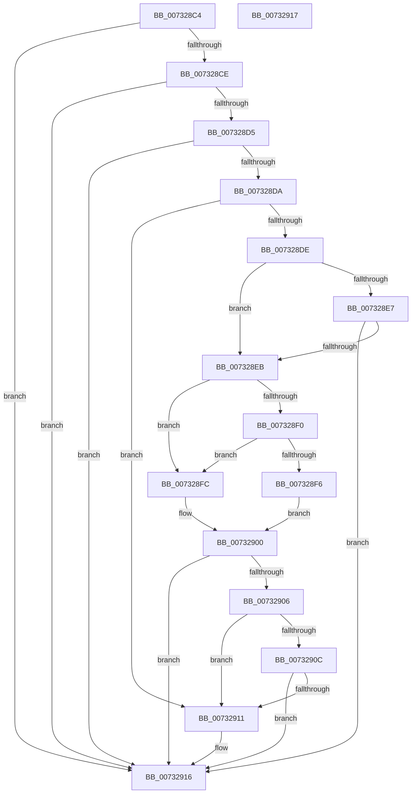

# PiDevCfgEnforceDriverPolicy

- RVA: `0x007328C4`–`0x00732918` (길이 `84` bytes)
- VA: `0x00000001407328C4`
- 실행 섹션: `PAGE`
- PDB 이름 있음: `예`; PDB Function 태그: `아니요`
- unwind 정보 RVA: `0x000DB714`
- 디코드: `32`개 명령, `84/84` bytes 표시
- 미해석 바이트: `0` (있으면 어셈블리에 `.byte`로 보존)

> 이 문서는 커널 이미지의 기계어와 PDB 기호를 분석해 생성했습니다. 4번과 5번은 함수 원형과 자료형을 바이너리 사용 방식에서 추정한 C 해석이며 원본 소스 복구 결과는 아닙니다.

## 1. Dependencies

- 직접 호출 지점: **0**; 고유 호출 대상: **0**
- 직접 호출자로 확인된 함수: **1**
- RIP 상대 이미지 참조: **0**

### Outgoing calls
- 직접 디코드된 call 명령이 없습니다.

### Direct callers
- [PiDevCfgQueryDriverNode](PiDevCfgQueryDriverNode_function_0073435C.md) at `0x00734997`

### Static image references
- 디코드된 RIP-relative 메모리 참조가 없습니다.

## 2. Other-region calls and transfers

- 다른 실행 섹션으로 향하는 call: **0**
- 별도 외부 분기/꼬리 이동을 확인하지 못했습니다.

## 3. Assembly (complete function range)

```asm
007328C4  33 C0                           xor eax, eax
007328C6  4C 8B D1                        mov r10, rcx
007328C9  45 84 C9                        test r9b, r9b
007328CC  75 48                           jne 0x140732916
007328CE  8B 09                           mov ecx, dword ptr [rcx]
007328D0  F6 C1 02                        test cl, 2
007328D3  74 41                           je 0x140732916
007328D5  83 FA FF                        cmp edx, -1
007328D8  74 3C                           je 0x140732916
007328DA  85 D2                           test edx, edx
007328DC  78 33                           js 0x140732911
007328DE  83 E1 04                        and ecx, 4
007328E1  49 83 F8 FF                     cmp r8, -1
007328E5  75 04                           jne 0x1407328eb
007328E7  85 C9                           test ecx, ecx
007328E9  75 2B                           jne 0x140732916
007328EB  F6 C2 08                        test dl, 8
007328EE  75 0C                           jne 0x1407328fc
007328F0  49 83 F8 FF                     cmp r8, -1
007328F4  74 06                           je 0x1407328fc
007328F6  49 8B 4A 10                     mov rcx, qword ptr [r10 + 0x10]
007328FA  EB 04                           jmp 0x140732900
007328FC  49 8B 4A 08                     mov rcx, qword ptr [r10 + 8]
00732900  48 83 F9 FF                     cmp rcx, -1
00732904  74 10                           je 0x140732916
00732906  49 83 F8 FF                     cmp r8, -1
0073290A  74 05                           je 0x140732911
0073290C  4C 3B C1                        cmp r8, rcx
0073290F  73 05                           jae 0x140732916
00732911  B8 6B 03 00 C0                  mov eax, 0xc000036b
00732916  C3                              ret
00732917  CC                              int3
```

## 4. C-style interpretation (structured pseudocode)

```c
__int64 __fastcall PiDevCfgEnforceDriverPolicy(__int64 a1, int a2, __int64 a3, unsigned __int8 a4)
{
    __int64 result;

    result = 0;
    if (a4 != 0) goto loc_00732916;
    if ((((unsigned __int8)((unsigned int)(*(unsigned int *)(a1)))) & (2)) == 0) goto loc_00732916;
    if (a2 == -1) goto loc_00732916;
    if (sign_flag) goto loc_00732911;
    a1 = (unsigned int)(((unsigned int)(*(unsigned int *)(a1))) & (4));
    if (a3 != -1) goto loc_007328EB;
    if ((unsigned int)(a1) != 0) goto loc_00732916;
loc_007328EB:
    if ((((unsigned __int8)(a2)) & (8)) != 0) goto loc_007328FC;
    if (a3 == -1) goto loc_007328FC;
    goto loc_00732900;
loc_007328FC:
loc_00732900:
    if ((*(unsigned __int64 *)(a1 + 8)) == -1) goto loc_00732916;
    if (a3 == -1) goto loc_00732911;
    if (a3 < (*(unsigned __int64 *)(a1 + 8))) {
        result = 0xC000036BULL;
    }
    return result;
}
```

## 5. (Beta) C Style

```c
int64_t PiDevCfgEnforceDriverPolicy(void *Arg1, int32_t Arg2, int64_t Arg3, uint8_t Arg4)
{
    uint8_t *arg1 = (uint8_t *)Arg1;

    int64_t result;

    result = 0;
    if (Arg4 != 0) goto loc_00732916;
    if ((((uint8_t)((uint32_t)(*(uint32_t *)(arg1)))) & (2)) == 0) goto loc_00732916;
    if (Arg2 == -1) goto loc_00732916;
    if (sign_flag) goto loc_00732911;
    Arg1 = (uint32_t)(((uint32_t)(*(uint32_t *)(arg1))) & (4));
    if (Arg3 != -1) goto loc_007328EB;
    if ((uint32_t)(Arg1) != 0) goto loc_00732916;
loc_007328EB:
    if ((((uint8_t)(Arg2)) & (8)) != 0) goto loc_007328FC;
    if (Arg3 == -1) goto loc_007328FC;
    goto loc_00732900;
loc_007328FC:
loc_00732900:
    if ((*(uint64_t *)(arg1 + 0x8)) == -1) goto loc_00732916;
    if (Arg3 == -1) goto loc_00732911;
    if (Arg3 < (*(uint64_t *)(arg1 + 0x8))) {
        result = 0xC000036BULL;
    }
    return result;
}
```

### 관측된 메모리 오프셋

구조체 형식이 확인되지 않은 접근은 인자 기준의 오프셋으로만 기록했습니다.

| 기준 인자 | 오프셋 표현 | 폭 (bit) | 접근 |
|---|---:|---:|---|
| `Arg1` | `+ 0x0` | `32` | `R` |
| `Arg1` | `+ 0x8` | `64` | `R` |
| `Arg1` | `+ 0x10` | `64` | `R` |

## 6. Execution-region graph

[열기: 2D/3D 그래프와 함수 탐색 컨트롤 패널](../../../control-panel.html?section=page&rva=0x007328C4&view=graph)

- 2D 그래프는 위에서 아래로 흐르고, 3D 그래프는 빈 공간을 드래그해 회전합니다. Shift+드래그는 이동, 휠은 확대·축소, 함수 노드 선택은 대상 보고서 이동입니다.

### Static fallback


