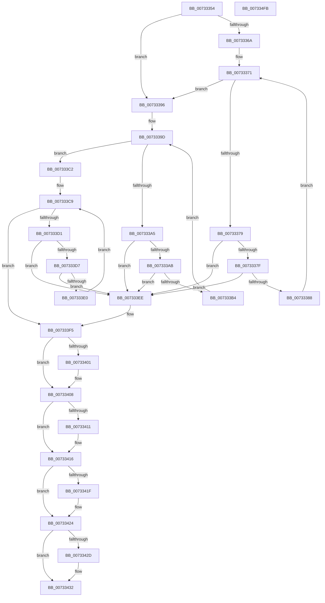

# PiDevCfgFreeDriverNode

- RVA: `0x00733354`–`0x007334FC` (길이 `424` bytes)
- VA: `0x0000000140733354`
- 실행 섹션: `PAGE`
- PDB 이름 있음: `예`; PDB Function 태그: `아니요`
- unwind 정보 RVA: `0x0005CAAC`
- 디코드: `105`개 명령, `424/424` bytes 표시
- 미해석 바이트: `0` (있으면 어셈블리에 `.byte`로 보존)

> 이 문서는 커널 이미지의 기계어와 PDB 기호를 분석해 생성했습니다. 4번과 5번은 함수 원형과 자료형을 바이너리 사용 방식에서 추정한 C 해석이며 원본 소스 복구 결과는 아닙니다.

## 1. Dependencies

- 직접 호출 지점: **25**; 고유 호출 대상: **5**
- 직접 호출자로 확인된 함수: **9**
- RIP 상대 이미지 참조: **0**

### Outgoing calls
- `0x00733361` → [Feature_KernelPnP_LogBlockedDrivers__private_IsEnabledDeviceUsageNoInline](../../text/4F/Feature_KernelPnP_LogBlockedDrivers__private_IsEnabledDeviceUsageNoInline_function_004F7944.md) (function, `0x004F7944`)
- `0x0073338F` → [PiDevCfgFreeDriverNode](PiDevCfgFreeDriverNode_function_00733354.md) (function, `0x00733354`)
- `0x007333BB` → [PiDevCfgFreeDriverNode](PiDevCfgFreeDriverNode_function_00733354.md) (function, `0x00733354`)
- `0x007333E7` → [PiDevCfgFreeDriverNode](PiDevCfgFreeDriverNode_function_00733354.md) (function, `0x00733354`)
- `0x00733403` → [ExFreePoolWithTag](../../poolcode/B8/ExFreePoolWithTag_function_00B82870.md) (function, `0x00B82870`)
- `0x00733411` → [ZwClose](../../text/6A/ZwClose_function_006AD2B0.md) (function, `0x006AD2B0`)
- `0x0073341F` → [ZwClose](../../text/6A/ZwClose_function_006AD2B0.md) (function, `0x006AD2B0`)
- `0x0073342D` → [ZwClose](../../text/6A/ZwClose_function_006AD2B0.md) (function, `0x006AD2B0`)
- `0x00733436` → [RtlFreeAnsiString](../9C/RtlFreeAnsiString_function_009C0800.md) (function, `0x009C0800`)
- `0x0073343F` → [RtlFreeAnsiString](../9C/RtlFreeAnsiString_function_009C0800.md) (function, `0x009C0800`)
- `0x00733448` → [RtlFreeAnsiString](../9C/RtlFreeAnsiString_function_009C0800.md) (function, `0x009C0800`)
- `0x00733451` → [RtlFreeAnsiString](../9C/RtlFreeAnsiString_function_009C0800.md) (function, `0x009C0800`)
- `0x0073345D` → [RtlFreeAnsiString](../9C/RtlFreeAnsiString_function_009C0800.md) (function, `0x009C0800`)
- `0x00733469` → [RtlFreeAnsiString](../9C/RtlFreeAnsiString_function_009C0800.md) (function, `0x009C0800`)
- `0x00733475` → [RtlFreeAnsiString](../9C/RtlFreeAnsiString_function_009C0800.md) (function, `0x009C0800`)
- `0x00733481` → [RtlFreeAnsiString](../9C/RtlFreeAnsiString_function_009C0800.md) (function, `0x009C0800`)
- `0x0073348D` → [RtlFreeAnsiString](../9C/RtlFreeAnsiString_function_009C0800.md) (function, `0x009C0800`)
- `0x00733499` → [RtlFreeAnsiString](../9C/RtlFreeAnsiString_function_009C0800.md) (function, `0x009C0800`)
- `0x007334A5` → [RtlFreeAnsiString](../9C/RtlFreeAnsiString_function_009C0800.md) (function, `0x009C0800`)
- `0x007334B1` → [RtlFreeAnsiString](../9C/RtlFreeAnsiString_function_009C0800.md) (function, `0x009C0800`)
- `0x007334BD` → [RtlFreeAnsiString](../9C/RtlFreeAnsiString_function_009C0800.md) (function, `0x009C0800`)
- `0x007334C9` → [RtlFreeAnsiString](../9C/RtlFreeAnsiString_function_009C0800.md) (function, `0x009C0800`)
- `0x007334D5` → [RtlFreeAnsiString](../9C/RtlFreeAnsiString_function_009C0800.md) (function, `0x009C0800`)
- `0x007334E1` → [RtlFreeAnsiString](../9C/RtlFreeAnsiString_function_009C0800.md) (function, `0x009C0800`)
- `0x007334EB` → [ExFreePoolWithTag](../../poolcode/B8/ExFreePoolWithTag_function_00B82870.md) (function, `0x00B82870`)

### Direct callers
- [PiDevCfgClearDeviceDrivers](../70/PiDevCfgClearDeviceDrivers_function_00704A60.md) at `0x00704A8E`
- [PiDevCfgCheckDeviceNeedsUpdate](PiDevCfgCheckDeviceNeedsUpdate_function_00731DDC.md) at `0x00732458`
- [PiDevCfgFreeDriverNode](PiDevCfgFreeDriverNode_function_00733354.md) at `0x0073338F`
- [PiDevCfgFreeDriverNode](PiDevCfgFreeDriverNode_function_00733354.md) at `0x007333BB`
- [PiDevCfgFreeDriverNode](PiDevCfgFreeDriverNode_function_00733354.md) at `0x007333E7`
- [PiDevCfgQueryDriverNode](PiDevCfgQueryDriverNode_function_0073435C.md) at `0x007345C4`
- [PiDevCfgQueryIncludedDriverNode](PiDevCfgQueryIncludedDriverNode_function_00734D88.md) at `0x00735094`
- [PpDevCfgProcessDeviceExtensions](PpDevCfgProcessDeviceExtensions_function_00736C2C.md) at `0x0073731E`
- [PiDevCfgQueryIncludedDriverConfigurations](../97/PiDevCfgQueryIncludedDriverConfigurations_function_009754BC.md) at `0x009756B8`
- [PiDevCfgFindDeviceDriver](../97/PiDevCfgFindDeviceDriver_function_0097602C.md) at `0x00976AC7`
- [PiDevCfgFindDeviceDriver](../97/PiDevCfgFindDeviceDriver_function_0097602C.md) at `0x00976B6E`
- [PiDevCfgFindDeviceDriver](../97/PiDevCfgFindDeviceDriver_function_0097602C.md) at `0x00976C08`
- [PiDevCfgFindDeviceDriver](../97/PiDevCfgFindDeviceDriver_function_0097602C.md) at `0x00976CA2`
- [PiDevCfgFindDeviceDriver](../97/PiDevCfgFindDeviceDriver_function_0097602C.md) at `0x00976CDA`
- [PiDevCfgFindDeviceDriver](../97/PiDevCfgFindDeviceDriver_function_0097602C.md) at `0x00976CF0`
- [PiDevCfgProcessDevice](../97/PiDevCfgProcessDevice_function_00976D34.md) at `0x00977508`

### Static image references
- 디코드된 RIP-relative 메모리 참조가 없습니다.

## 2. Other-region calls and transfers

- 다른 실행 섹션으로 향하는 call: **6**
  - `0x00733361` → [Feature_KernelPnP_LogBlockedDrivers__private_IsEnabledDeviceUsageNoInline](../../text/4F/Feature_KernelPnP_LogBlockedDrivers__private_IsEnabledDeviceUsageNoInline_function_004F7944.md) (`PAGE` → `.text`)
  - `0x00733403` → [ExFreePoolWithTag](../../poolcode/B8/ExFreePoolWithTag_function_00B82870.md) (`PAGE` → `POOLCODE`)
  - `0x00733411` → [ZwClose](../../text/6A/ZwClose_function_006AD2B0.md) (`PAGE` → `.text`)
  - `0x0073341F` → [ZwClose](../../text/6A/ZwClose_function_006AD2B0.md) (`PAGE` → `.text`)
  - `0x0073342D` → [ZwClose](../../text/6A/ZwClose_function_006AD2B0.md) (`PAGE` → `.text`)
  - `0x007334EB` → [ExFreePoolWithTag](../../poolcode/B8/ExFreePoolWithTag_function_00B82870.md) (`PAGE` → `POOLCODE`)
- 별도 외부 분기/꼬리 이동을 확인하지 못했습니다.

## 3. Assembly (complete function range)

```asm
00733354  48 89 5C 24 08                  mov qword ptr [rsp + 8], rbx
00733359  57                              push rdi
0073335A  48 83 EC 20                     sub rsp, 0x20
0073335E  48 8B D9                        mov rbx, rcx
00733361  E8 DE 45 DC FF                  call 0x1404f7944
00733366  85 C0                           test eax, eax
00733368  75 2C                           jne 0x140733396
0073336A  48 8D BB E0 00 00 00            lea rdi, [rbx + 0xe0]
00733371  48 8B 0F                        mov rcx, qword ptr [rdi]
00733374  48 3B CF                        cmp rcx, rdi
00733377  74 1D                           je 0x140733396
00733379  48 39 79 08                     cmp qword ptr [rcx + 8], rdi
0073337D  75 6F                           jne 0x1407333ee
0073337F  48 8B 01                        mov rax, qword ptr [rcx]
00733382  48 39 48 08                     cmp qword ptr [rax + 8], rcx
00733386  75 66                           jne 0x1407333ee
00733388  48 89 07                        mov qword ptr [rdi], rax
0073338B  48 89 78 08                     mov qword ptr [rax + 8], rdi
0073338F  E8 C0 FF FF FF                  call 0x140733354
00733394  EB DB                           jmp 0x140733371
00733396  48 8D BB D0 00 00 00            lea rdi, [rbx + 0xd0]
0073339D  48 8B 0F                        mov rcx, qword ptr [rdi]
007333A0  48 3B CF                        cmp rcx, rdi
007333A3  74 1D                           je 0x1407333c2
007333A5  48 39 79 08                     cmp qword ptr [rcx + 8], rdi
007333A9  75 43                           jne 0x1407333ee
007333AB  48 8B 01                        mov rax, qword ptr [rcx]
007333AE  48 39 48 08                     cmp qword ptr [rax + 8], rcx
007333B2  75 3A                           jne 0x1407333ee
007333B4  48 89 07                        mov qword ptr [rdi], rax
007333B7  48 89 78 08                     mov qword ptr [rax + 8], rdi
007333BB  E8 94 FF FF FF                  call 0x140733354
007333C0  EB DB                           jmp 0x14073339d
007333C2  48 8D BB 80 01 00 00            lea rdi, [rbx + 0x180]
007333C9  48 8B 0F                        mov rcx, qword ptr [rdi]
007333CC  48 3B CF                        cmp rcx, rdi
007333CF  74 24                           je 0x1407333f5
007333D1  48 39 79 08                     cmp qword ptr [rcx + 8], rdi
007333D5  75 17                           jne 0x1407333ee
007333D7  48 8B 01                        mov rax, qword ptr [rcx]
007333DA  48 39 48 08                     cmp qword ptr [rax + 8], rcx
007333DE  75 0E                           jne 0x1407333ee
007333E0  48 89 07                        mov qword ptr [rdi], rax
007333E3  48 89 78 08                     mov qword ptr [rax + 8], rdi
007333E7  E8 68 FF FF FF                  call 0x140733354
007333EC  EB DB                           jmp 0x1407333c9
007333EE  B9 03 00 00 00                  mov ecx, 3
007333F3  CD 29                           int 0x29
007333F5  48 8B 8B 90 00 00 00            mov rcx, qword ptr [rbx + 0x90]
007333FC  48 85 C9                        test rcx, rcx
007333FF  74 07                           je 0x140733408
00733401  33 D2                           xor edx, edx
00733403  E8 68 F4 44 00                  call 0x140b82870
00733408  48 8B 4B 10                     mov rcx, qword ptr [rbx + 0x10]
0073340C  48 85 C9                        test rcx, rcx
0073340F  74 05                           je 0x140733416
00733411  E8 9A 9E F7 FF                  call 0x1406ad2b0
00733416  48 8B 4B 18                     mov rcx, qword ptr [rbx + 0x18]
0073341A  48 85 C9                        test rcx, rcx
0073341D  74 05                           je 0x140733424
0073341F  E8 8C 9E F7 FF                  call 0x1406ad2b0
00733424  48 8B 4B 20                     mov rcx, qword ptr [rbx + 0x20]
00733428  48 85 C9                        test rcx, rcx
0073342B  74 05                           je 0x140733432
0073342D  E8 7E 9E F7 FF                  call 0x1406ad2b0
00733432  48 8D 4B 38                     lea rcx, [rbx + 0x38]
00733436  E8 C5 D3 28 00                  call 0x1409c0800
0073343B  48 8D 4B 28                     lea rcx, [rbx + 0x28]
0073343F  E8 BC D3 28 00                  call 0x1409c0800
00733444  48 8D 4B 48                     lea rcx, [rbx + 0x48]
00733448  E8 B3 D3 28 00                  call 0x1409c0800
0073344D  48 8D 4B 58                     lea rcx, [rbx + 0x58]
00733451  E8 AA D3 28 00                  call 0x1409c0800
00733456  48 8D 8B 80 00 00 00            lea rcx, [rbx + 0x80]
0073345D  E8 9E D3 28 00                  call 0x1409c0800
00733462  48 8D 8B A0 00 00 00            lea rcx, [rbx + 0xa0]
00733469  E8 92 D3 28 00                  call 0x1409c0800
0073346E  48 8D 8B 00 01 00 00            lea rcx, [rbx + 0x100]
00733475  E8 86 D3 28 00                  call 0x1409c0800
0073347A  48 8D 8B 10 01 00 00            lea rcx, [rbx + 0x110]
00733481  E8 7A D3 28 00                  call 0x1409c0800
00733486  48 8D 8B 20 01 00 00            lea rcx, [rbx + 0x120]
0073348D  E8 6E D3 28 00                  call 0x1409c0800
00733492  48 8D 8B 30 01 00 00            lea rcx, [rbx + 0x130]
00733499  E8 62 D3 28 00                  call 0x1409c0800
0073349E  48 8D 8B 40 01 00 00            lea rcx, [rbx + 0x140]
007334A5  E8 56 D3 28 00                  call 0x1409c0800
007334AA  48 8D 8B 50 01 00 00            lea rcx, [rbx + 0x150]
007334B1  E8 4A D3 28 00                  call 0x1409c0800
007334B6  48 8D 8B 60 01 00 00            lea rcx, [rbx + 0x160]
007334BD  E8 3E D3 28 00                  call 0x1409c0800
007334C2  48 8D 8B 70 01 00 00            lea rcx, [rbx + 0x170]
007334C9  E8 32 D3 28 00                  call 0x1409c0800
007334CE  48 8D 8B A8 01 00 00            lea rcx, [rbx + 0x1a8]
007334D5  E8 26 D3 28 00                  call 0x1409c0800
007334DA  48 8D 8B 90 01 00 00            lea rcx, [rbx + 0x190]
007334E1  E8 1A D3 28 00                  call 0x1409c0800
007334E6  33 D2                           xor edx, edx
007334E8  48 8B CB                        mov rcx, rbx
007334EB  E8 80 F3 44 00                  call 0x140b82870
007334F0  48 8B 5C 24 30                  mov rbx, qword ptr [rsp + 0x30]
007334F5  48 83 C4 20                     add rsp, 0x20
007334F9  5F                              pop rdi
007334FA  C3                              ret
007334FB  CC                              int3
```

## 4. C-style interpretation (structured pseudocode)

```c
__int64 __fastcall PiDevCfgFreeDriverNode(__int64 a1, int a2)
{
    __int64 result;
    __int64 v_rsp;
    unsigned __int64 v_stack_p8;

    v_stack_p8 = v_rbx;
    v_rsp = (v_rsp) - (32);
    result = Feature_KernelPnP_LogBlockedDrivers__private_IsEnabledDeviceUsageNoInline(a1, a2, a3, a4);
    if ((unsigned int)(result) != 0) goto loc_00733396;
loc_00733371:
    if ((*(unsigned __int64 *)(a1 + 224)) == (a1 + 224)) goto loc_00733396;
    if ((*(unsigned __int64 *)(*(unsigned __int64 *)(a1 + 224) + 8)) != (a1 + 224)) goto loc_007333EE;
    if ((*(unsigned __int64 *)(*(unsigned __int64 *)(*(unsigned __int64 *)(a1 + 224)) + 8)) != (*(unsigned __int64 *)(a1 + 224))) goto loc_007333EE;
    *(unsigned __int64 *)(a1 + 224) = *(unsigned __int64 *)(*(unsigned __int64 *)(a1 + 224));
    *(unsigned __int64 *)(*(unsigned __int64 *)(*(unsigned __int64 *)(a1 + 224)) + 8) = a1 + 224;
    result = PiDevCfgFreeDriverNode(*(unsigned __int64 *)(a1 + 224), a2, a3, a4);
    goto loc_00733371;
loc_00733396:
loc_0073339D:
    if ((*(unsigned __int64 *)(a1 + 208)) == (a1 + 208)) goto loc_007333C2;
    if ((*(unsigned __int64 *)(*(unsigned __int64 *)(a1 + 208) + 8)) != (a1 + 208)) goto loc_007333EE;
    if ((*(unsigned __int64 *)(*(unsigned __int64 *)(*(unsigned __int64 *)(a1 + 208)) + 8)) != (*(unsigned __int64 *)(a1 + 208))) goto loc_007333EE;
    *(unsigned __int64 *)(a1 + 208) = *(unsigned __int64 *)(*(unsigned __int64 *)(a1 + 208));
    *(unsigned __int64 *)(*(unsigned __int64 *)(*(unsigned __int64 *)(a1 + 208)) + 8) = a1 + 208;
    result = PiDevCfgFreeDriverNode(*(unsigned __int64 *)(a1 + 208), a2, a3, a4);
    goto loc_0073339D;
loc_007333C2:
loc_007333C9:
    if ((*(unsigned __int64 *)(a1 + 384)) == (a1 + 384)) goto loc_007333F5;
    if ((*(unsigned __int64 *)(*(unsigned __int64 *)(a1 + 384) + 8)) != (a1 + 384)) goto loc_007333EE;
    if ((*(unsigned __int64 *)(*(unsigned __int64 *)(*(unsigned __int64 *)(a1 + 384)) + 8)) != (*(unsigned __int64 *)(a1 + 384))) goto loc_007333EE;
    *(unsigned __int64 *)(a1 + 384) = *(unsigned __int64 *)(*(unsigned __int64 *)(a1 + 384));
    *(unsigned __int64 *)(*(unsigned __int64 *)(*(unsigned __int64 *)(a1 + 384)) + 8) = a1 + 384;
    result = PiDevCfgFreeDriverNode(*(unsigned __int64 *)(a1 + 384), a2, a3, a4);
    goto loc_007333C9;
loc_007333EE:
loc_007333F5:
    if (*(unsigned __int64 *)(a1 + 144) != 0) {
        a2 = 0;
        result = ExFreePoolWithTag(*(unsigned __int64 *)(a1 + 144), a2, a3, a4);
    }
    if (*(unsigned __int64 *)(a1 + 16) != 0) {
        result = ZwClose(*(unsigned __int64 *)(a1 + 16), a2, a3, a4);
    }
    if (*(unsigned __int64 *)(a1 + 24) != 0) {
        result = ZwClose(*(unsigned __int64 *)(a1 + 24), a2, a3, a4);
    }
    if (*(unsigned __int64 *)(a1 + 32) != 0) {
        result = ZwClose(*(unsigned __int64 *)(a1 + 32), a2, a3, a4);
    }
    result = RtlFreeAnsiString(a1 + 56, a2, a3, a4);
    result = RtlFreeAnsiString(a1 + 40, a2, a3, a4);
    result = RtlFreeAnsiString(a1 + 72, a2, a3, a4);
    result = RtlFreeAnsiString(a1 + 88, a2, a3, a4);
    result = RtlFreeAnsiString(a1 + 128, a2, a3, a4);
    result = RtlFreeAnsiString(a1 + 160, a2, a3, a4);
    result = RtlFreeAnsiString(a1 + 256, a2, a3, a4);
    result = RtlFreeAnsiString(a1 + 272, a2, a3, a4);
    result = RtlFreeAnsiString(a1 + 288, a2, a3, a4);
    result = RtlFreeAnsiString(a1 + 304, a2, a3, a4);
    result = RtlFreeAnsiString(a1 + 320, a2, a3, a4);
    result = RtlFreeAnsiString(a1 + 336, a2, a3, a4);
    result = RtlFreeAnsiString(a1 + 352, a2, a3, a4);
    result = RtlFreeAnsiString(a1 + 368, a2, a3, a4);
    result = RtlFreeAnsiString(a1 + 424, a2, a3, a4);
    result = RtlFreeAnsiString(a1 + 400, a2, a3, a4);
    a2 = 0;
    result = ExFreePoolWithTag(a1, a2, a3, a4);
    v_rsp = (v_rsp) + (32);
    return result;
}
```

## 5. (Beta) C Style

```c
int64_t PiDevCfgFreeDriverNode(void *Arg1, int32_t Arg2)
{
    uint8_t *arg1 = (uint8_t *)Arg1;

    int64_t result;
    int64_t local_rsp;
    uint64_t v_stack_p8;

    v_stack_p8 = local_rbx;
    local_rsp = (local_rsp) - (32);
    result = Feature_KernelPnP_LogBlockedDrivers__private_IsEnabledDeviceUsageNoInline(Arg1, Arg2, a3, a4);
    if ((uint32_t)(result) != 0) goto loc_00733396;
loc_00733371:
    if ((*(uint64_t *)(arg1 + 0xE0)) == (Arg1 + 224)) goto loc_00733396;
    if ((*(uint64_t *)(*(uint64_t *)(arg1 + 0xE0) + 0x8)) != (Arg1 + 224)) goto loc_007333EE;
    if ((*(uint64_t *)(*(uint64_t *)(*(uint64_t *)(arg1 + 0xE0)) + 0x8)) != (*(uint64_t *)(arg1 + 0xE0))) goto loc_007333EE;
    *(uint64_t *)(arg1 + 0xE0) = *(uint64_t *)(*(uint64_t *)(arg1 + 0xE0));
    *(void **)(*(uint64_t *)(*(uint64_t *)(arg1 + 0xE0)) + 0x8) = Arg1 + 224;
    result = PiDevCfgFreeDriverNode(*(uint64_t *)(arg1 + 0xE0), Arg2, a3, a4);
    goto loc_00733371;
loc_00733396:
loc_0073339D:
    if ((*(uint64_t *)(arg1 + 0xD0)) == (Arg1 + 208)) goto loc_007333C2;
    if ((*(uint64_t *)(*(uint64_t *)(arg1 + 0xD0) + 0x8)) != (Arg1 + 208)) goto loc_007333EE;
    if ((*(uint64_t *)(*(uint64_t *)(*(uint64_t *)(arg1 + 0xD0)) + 0x8)) != (*(uint64_t *)(arg1 + 0xD0))) goto loc_007333EE;
    *(uint64_t *)(arg1 + 0xD0) = *(uint64_t *)(*(uint64_t *)(arg1 + 0xD0));
    *(void **)(*(uint64_t *)(*(uint64_t *)(arg1 + 0xD0)) + 0x8) = Arg1 + 208;
    result = PiDevCfgFreeDriverNode(*(uint64_t *)(arg1 + 0xD0), Arg2, a3, a4);
    goto loc_0073339D;
loc_007333C2:
loc_007333C9:
    if ((*(uint64_t *)(arg1 + 0x180)) == (Arg1 + 384)) goto loc_007333F5;
    if ((*(uint64_t *)(*(uint64_t *)(arg1 + 0x180) + 0x8)) != (Arg1 + 384)) goto loc_007333EE;
    if ((*(uint64_t *)(*(uint64_t *)(*(uint64_t *)(arg1 + 0x180)) + 0x8)) != (*(uint64_t *)(arg1 + 0x180))) goto loc_007333EE;
    *(uint64_t *)(arg1 + 0x180) = *(uint64_t *)(*(uint64_t *)(arg1 + 0x180));
    *(void **)(*(uint64_t *)(*(uint64_t *)(arg1 + 0x180)) + 0x8) = Arg1 + 384;
    result = PiDevCfgFreeDriverNode(*(uint64_t *)(arg1 + 0x180), Arg2, a3, a4);
    goto loc_007333C9;
loc_007333EE:
loc_007333F5:
    if (*(uint64_t *)(arg1 + 0x90) != 0) {
        Arg2 = 0;
        result = ExFreePoolWithTag(*(uint64_t *)(arg1 + 0x90), Arg2, a3, a4);
    }
    if (*(uint64_t *)(arg1 + 0x10) != 0) {
        result = ZwClose(*(uint64_t *)(arg1 + 0x10), Arg2, a3, a4);
    }
    if (*(uint64_t *)(arg1 + 0x18) != 0) {
        result = ZwClose(*(uint64_t *)(arg1 + 0x18), Arg2, a3, a4);
    }
    if (*(uint64_t *)(arg1 + 0x20) != 0) {
        result = ZwClose(*(uint64_t *)(arg1 + 0x20), Arg2, a3, a4);
    }
    result = RtlFreeAnsiString(Arg1 + 56, Arg2, a3, a4);
    result = RtlFreeAnsiString(Arg1 + 40, Arg2, a3, a4);
    result = RtlFreeAnsiString(Arg1 + 72, Arg2, a3, a4);
    result = RtlFreeAnsiString(Arg1 + 88, Arg2, a3, a4);
    result = RtlFreeAnsiString(Arg1 + 128, Arg2, a3, a4);
    result = RtlFreeAnsiString(Arg1 + 160, Arg2, a3, a4);
    result = RtlFreeAnsiString(Arg1 + 256, Arg2, a3, a4);
    result = RtlFreeAnsiString(Arg1 + 272, Arg2, a3, a4);
    result = RtlFreeAnsiString(Arg1 + 288, Arg2, a3, a4);
    result = RtlFreeAnsiString(Arg1 + 304, Arg2, a3, a4);
    result = RtlFreeAnsiString(Arg1 + 320, Arg2, a3, a4);
    result = RtlFreeAnsiString(Arg1 + 336, Arg2, a3, a4);
    result = RtlFreeAnsiString(Arg1 + 352, Arg2, a3, a4);
    result = RtlFreeAnsiString(Arg1 + 368, Arg2, a3, a4);
    result = RtlFreeAnsiString(Arg1 + 424, Arg2, a3, a4);
    result = RtlFreeAnsiString(Arg1 + 400, Arg2, a3, a4);
    Arg2 = 0;
    result = ExFreePoolWithTag(Arg1, Arg2, a3, a4);
    local_rsp = (local_rsp) + (32);
    return result;
}
```

### 관측된 메모리 오프셋

구조체 형식이 확인되지 않은 접근은 인자 기준의 오프셋으로만 기록했습니다.

| 기준 인자 | 오프셋 표현 | 폭 (bit) | 접근 |
|---|---:|---:|---|
| `Arg1` | `+ 0x0` | `64` | `R` |
| `Arg1` | `+ 0x0` | `64` | `W` |
| `Arg1` | `+ 0x10` | `64` | `R` |
| `Arg1` | `+ 0x18` | `64` | `R` |
| `Arg1` | `+ 0x20` | `64` | `R` |
| `Arg1` | `+ 0x28` | `64` | `R` |
| `Arg1` | `+ 0x38` | `64` | `R` |
| `Arg1` | `+ 0x48` | `64` | `R` |
| `Arg1` | `+ 0x58` | `64` | `R` |
| `Arg1` | `+ 0x80` | `64` | `R` |
| `Arg1` | `+ 0x90` | `64` | `R` |
| `Arg1` | `+ 0xA0` | `64` | `R` |
| `Arg1` | `+ 0xD0` | `64` | `R` |
| `Arg1` | `+ 0xE0` | `64` | `R` |
| `Arg1` | `+ 0x100` | `64` | `R` |
| `Arg1` | `+ 0x110` | `64` | `R` |
| `Arg1` | `+ 0x120` | `64` | `R` |
| `Arg1` | `+ 0x130` | `64` | `R` |
| `Arg1` | `+ 0x140` | `64` | `R` |
| `Arg1` | `+ 0x150` | `64` | `R` |
| `Arg1` | `+ 0x160` | `64` | `R` |
| `Arg1` | `+ 0x170` | `64` | `R` |
| `Arg1` | `+ 0x180` | `64` | `R` |
| `Arg1` | `+ 0x190` | `64` | `R` |
| `Arg1` | `+ 0x1A8` | `64` | `R` |

## 6. Execution-region graph

[열기: 2D/3D 그래프와 함수 탐색 컨트롤 패널](../../../control-panel.html?section=page&rva=0x00733354&view=graph)

- 2D 그래프는 위에서 아래로 흐르고, 3D 그래프는 빈 공간을 드래그해 회전합니다. Shift+드래그는 이동, 휠은 확대·축소, 함수 노드 선택은 대상 보고서 이동입니다.

### Static fallback


