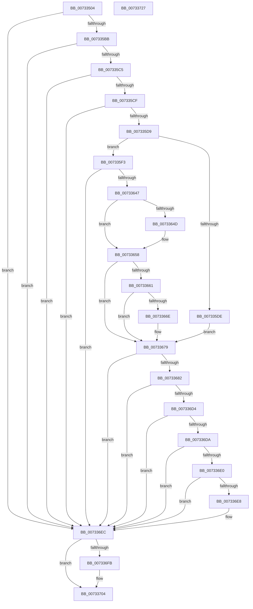

# PiDevCfgGetDeviceClassDriverConfigurable

- RVA: `0x00733504`–`0x00733728` (길이 `548` bytes)
- VA: `0x0000000140733504`
- 실행 섹션: `PAGE`
- PDB 이름 있음: `예`; PDB Function 태그: `아니요`
- unwind 정보 RVA: `0x000C8BD8`
- 디코드: `139`개 명령, `548/548` bytes 표시
- 미해석 바이트: `0` (있으면 어셈블리에 `.byte`로 보존)

> 이 문서는 커널 이미지의 기계어와 PDB 기호를 분석해 생성했습니다. 4번과 5번은 함수 원형과 자료형을 바이너리 사용 방식에서 추정한 C 해석이며 원본 소스 복구 결과는 아닙니다.

## 1. Dependencies

- 직접 호출 지점: **9**; 고유 호출 대상: **5**
- 직접 호출자로 확인된 함수: **2**
- RIP 상대 이미지 참조: **4**

### Outgoing calls
- `0x007335AA` → [PnpGetObjectProperty](../8E/PnpGetObjectProperty_function_008E2180.md) (function, `0x008E2180`)
- `0x007335E5` → [RtlInitUnicodeString](../../text/42/RtlInitUnicodeString_function_0042A780.md) (function, `0x0042A780`)
- `0x00733638` → [PiDevCfgQueryObjectProperties](../97/PiDevCfgQueryObjectProperties_function_0097776C.md) (function, `0x0097776C`)
- `0x00733653` → [RtlInitUnicodeString](../../text/42/RtlInitUnicodeString_function_0042A780.md) (function, `0x0042A780`)
- `0x00733665` → [PiDevCfgGetDriverPackageId](../97/PiDevCfgGetDriverPackageId_function_00977690.md) (function, `0x00977690`)
- `0x00733674` → [RtlInitUnicodeString](../../text/42/RtlInitUnicodeString_function_0042A780.md) (function, `0x0042A780`)
- `0x007336CB` → [PnpGetObjectProperty](../8E/PnpGetObjectProperty_function_008E2180.md) (function, `0x008E2180`)
- `0x007336F0` → [RtlFreeAnsiString](../9C/RtlFreeAnsiString_function_009C0800.md) (function, `0x009C0800`)
- `0x007336FF` → [RtlFreeAnsiString](../9C/RtlFreeAnsiString_function_009C0800.md) (function, `0x009C0800`)

### Direct callers
- [PpDevCfgProcessDeviceClass](PpDevCfgProcessDeviceClass_function_00736824.md) at `0x00736A50`
- [PiDevCfgConfigureDevice](../97/PiDevCfgConfigureDevice_function_00977BB4.md) at `0x0097853E`

### Static image references
- `0x0073356E` → RVA `0x00021270` (`.rdata`; read)
- `0x00733581` → RVA `0x00E66398` (`.data`; read)
- `0x00733600` → RVA `0x00012FA0` (`.rdata`; read)
- `0x007336BA` → RVA `0x000222B0` (`.rdata`; read)

## 2. Other-region calls and transfers

- 다른 실행 섹션으로 향하는 call: **3**
  - `0x007335E5` → [RtlInitUnicodeString](../../text/42/RtlInitUnicodeString_function_0042A780.md) (`PAGE` → `.text`)
  - `0x00733653` → [RtlInitUnicodeString](../../text/42/RtlInitUnicodeString_function_0042A780.md) (`PAGE` → `.text`)
  - `0x00733674` → [RtlInitUnicodeString](../../text/42/RtlInitUnicodeString_function_0042A780.md) (`PAGE` → `.text`)
- 별도 외부 분기/꼬리 이동을 확인하지 못했습니다.

## 3. Assembly (complete function range)

```asm
00733504  48 8B C4                        mov rax, rsp
00733507  48 89 58 08                     mov qword ptr [rax + 8], rbx
0073350B  48 89 70 10                     mov qword ptr [rax + 0x10], rsi
0073350F  48 89 78 18                     mov qword ptr [rax + 0x18], rdi
00733513  55                              push rbp
00733514  41 54                           push r12
00733516  41 55                           push r13
00733518  41 56                           push r14
0073351A  41 57                           push r15
0073351C  48 8D 68 B9                     lea rbp, [rax - 0x47]
00733520  48 81 EC C0 00 00 00            sub rsp, 0xc0
00733527  4C 8B 75 7F                     mov r14, qword ptr [rbp + 0x7f]
0073352B  48 8D 45 C3                     lea rax, [rbp - 0x3d]
0073352F  45 33 ED                        xor r13d, r13d
00733532  C7 45 BF 01 00 00 00            mov dword ptr [rbp - 0x41], 1
00733539  44 89 6C 24 50                  mov dword ptr [rsp + 0x50], r13d
0073353E  4D 8B F9                        mov r15, r9
00733541  48 89 44 24 48                  mov qword ptr [rsp + 0x48], rax
00733546  4C 8B CA                        mov r9, rdx
00733549  C7 44 24 40 04 00 00 00         mov dword ptr [rsp + 0x40], 4
00733551  48 8D 45 C7                     lea rax, [rbp - 0x39]
00733555  48 89 44 24 38                  mov qword ptr [rsp + 0x38], rax
0073355A  4D 8B E0                        mov r12, r8
0073355D  48 8D 45 BF                     lea rax, [rbp - 0x41]
00733561  4C 89 6D DF                     mov qword ptr [rbp - 0x21], r13
00733565  48 89 44 24 30                  mov qword ptr [rsp + 0x30], rax
0073356A  45 8D 45 02                     lea r8d, [r13 + 2]
0073356E  48 8D 05 FB DC 8E FF            lea rax, [rip - 0x712305]
00733575  4C 89 6D E7                     mov qword ptr [rbp - 0x19], r13
00733579  48 8B D1                        mov rdx, rcx
0073357C  48 89 44 24 28                  mov qword ptr [rsp + 0x28], rax
00733581  48 8B 0D 10 2E 73 00            mov rcx, qword ptr [rip + 0x732e10]
00733588  41 8B FD                        mov edi, r13d
0073358B  4C 89 6C 24 20                  mov qword ptr [rsp + 0x20], r13
00733590  41 8B F5                        mov esi, r13d
00733593  4C 89 6D CF                     mov qword ptr [rbp - 0x31], r13
00733597  4C 89 6D D7                     mov qword ptr [rbp - 0x29], r13
0073359B  44 89 6D C7                     mov dword ptr [rbp - 0x39], r13d
0073359F  44 89 6D CB                     mov dword ptr [rbp - 0x35], r13d
007335A3  44 89 6D C3                     mov dword ptr [rbp - 0x3d], r13d
007335A7  45 88 2E                        mov byte ptr [r14], r13b
007335AA  E8 D1 EB 1A 00                  call 0x1408e2180
007335AF  48 8B 5D 6F                     mov rbx, qword ptr [rbp + 0x6f]
007335B3  85 C0                           test eax, eax
007335B5  0F 88 31 01 00 00               js 0x1407336ec
007335BB  83 7D BF 07                     cmp dword ptr [rbp - 0x41], 7
007335BF  0F 85 27 01 00 00               jne 0x1407336ec
007335C5  83 7D C3 04                     cmp dword ptr [rbp - 0x3d], 4
007335C9  0F 85 1D 01 00 00               jne 0x1407336ec
007335CF  44 39 6D C7                     cmp dword ptr [rbp - 0x39], r13d
007335D3  0F 84 13 01 00 00               je 0x1407336ec
007335D9  48 85 DB                        test rbx, rbx
007335DC  74 15                           je 0x1407335f3
007335DE  48 8B D3                        mov rdx, rbx
007335E1  48 8D 4D CF                     lea rcx, [rbp - 0x31]
007335E5  E8 96 71 CF FF                  call 0x14042a780
007335EA  48 8B 75 77                     mov rsi, qword ptr [rbp + 0x77]
007335EE  E9 86 00 00 00                  jmp 0x140733679
007335F3  B9 01 00 00 00                  mov ecx, 1
007335F8  48 C7 45 F7 12 00 00 00         mov qword ptr [rbp - 9], 0x12
00733600  48 8D 05 99 F9 8D FF            lea rax, [rip - 0x720667]
00733607  89 4C 24 28                     mov dword ptr [rsp + 0x28], ecx
0073360B  48 89 45 EF                     mov qword ptr [rbp - 0x11], rax
0073360F  4D 8B CF                        mov r9, r15
00733612  48 8D 45 DF                     lea rax, [rbp - 0x21]
00733616  44 89 6D 07                     mov dword ptr [rbp + 7], r13d
0073361A  48 89 45 FF                     mov qword ptr [rbp - 1], rax
0073361E  44 8B C1                        mov r8d, ecx
00733621  48 8D 45 EF                     lea rax, [rbp - 0x11]
00733625  4C 89 6D 0F                     mov qword ptr [rbp + 0xf], r13
00733629  49 8B D4                        mov rdx, r12
0073362C  48 89 44 24 20                  mov qword ptr [rsp + 0x20], rax
00733631  C7 45 0B 06 00 00 00            mov dword ptr [rbp + 0xb], 6
00733638  E8 2F 41 24 00                  call 0x14097776c
0073363D  8B F8                           mov edi, eax
0073363F  85 C0                           test eax, eax
00733641  0F 88 A5 00 00 00               js 0x1407336ec
00733647  44 39 6D 0F                     cmp dword ptr [rbp + 0xf], r13d
0073364B  7D 0B                           jge 0x140733658
0073364D  33 D2                           xor edx, edx
0073364F  48 8D 4D DF                     lea rcx, [rbp - 0x21]
00733653  E8 28 71 CF FF                  call 0x14042a780
00733658  48 8B 4D E7                     mov rcx, qword ptr [rbp - 0x19]
0073365C  48 85 C9                        test rcx, rcx
0073365F  74 18                           je 0x140733679
00733661  48 8D 55 CF                     lea rdx, [rbp - 0x31]
00733665  E8 26 40 24 00                  call 0x140977690
0073366A  85 C0                           test eax, eax
0073366C  79 0B                           jns 0x140733679
0073366E  33 D2                           xor edx, edx
00733670  48 8D 4D CF                     lea rcx, [rbp - 0x31]
00733674  E8 07 71 CF FF                  call 0x14042a780
00733679  48 8B 55 D7                     mov rdx, qword ptr [rbp - 0x29]
0073367D  48 85 D2                        test rdx, rdx
00733680  74 6A                           je 0x1407336ec
00733682  48 8B 0D 0F 2D 73 00            mov rcx, qword ptr [rip + 0x732d0f]
00733689  48 8D 45 C3                     lea rax, [rbp - 0x3d]
0073368D  44 89 6C 24 50                  mov dword ptr [rsp + 0x50], r13d
00733692  4C 8B CE                        mov r9, rsi
00733695  48 89 44 24 48                  mov qword ptr [rsp + 0x48], rax
0073369A  41 B8 08 00 00 00               mov r8d, 8
007336A0  C7 44 24 40 04 00 00 00         mov dword ptr [rsp + 0x40], 4
007336A8  48 8D 45 CB                     lea rax, [rbp - 0x35]
007336AC  48 89 44 24 38                  mov qword ptr [rsp + 0x38], rax
007336B1  48 8D 45 BF                     lea rax, [rbp - 0x41]
007336B5  48 89 44 24 30                  mov qword ptr [rsp + 0x30], rax
007336BA  48 8D 05 EF EB 8E FF            lea rax, [rip - 0x711411]
007336C1  48 89 44 24 28                  mov qword ptr [rsp + 0x28], rax
007336C6  4C 89 6C 24 20                  mov qword ptr [rsp + 0x20], r13
007336CB  E8 B0 EA 1A 00                  call 0x1408e2180
007336D0  85 C0                           test eax, eax
007336D2  78 18                           js 0x1407336ec
007336D4  83 7D BF 07                     cmp dword ptr [rbp - 0x41], 7
007336D8  75 12                           jne 0x1407336ec
007336DA  83 7D C3 04                     cmp dword ptr [rbp - 0x3d], 4
007336DE  75 0C                           jne 0x1407336ec
007336E0  8B 45 C7                        mov eax, dword ptr [rbp - 0x39]
007336E3  39 45 CB                        cmp dword ptr [rbp - 0x35], eax
007336E6  72 04                           jb 0x1407336ec
007336E8  41 C6 06 01                     mov byte ptr [r14], 1
007336EC  48 8D 4D DF                     lea rcx, [rbp - 0x21]
007336F0  E8 0B D1 28 00                  call 0x1409c0800
007336F5  48 39 5D D7                     cmp qword ptr [rbp - 0x29], rbx
007336F9  74 09                           je 0x140733704
007336FB  48 8D 4D CF                     lea rcx, [rbp - 0x31]
007336FF  E8 FC D0 28 00                  call 0x1409c0800
00733704  4C 8D 9C 24 C0 00 00 00         lea r11, [rsp + 0xc0]
0073370C  8B C7                           mov eax, edi
0073370E  49 8B 5B 30                     mov rbx, qword ptr [r11 + 0x30]
00733712  49 8B 73 38                     mov rsi, qword ptr [r11 + 0x38]
00733716  49 8B 7B 40                     mov rdi, qword ptr [r11 + 0x40]
0073371A  49 8B E3                        mov rsp, r11
0073371D  41 5F                           pop r15
0073371F  41 5E                           pop r14
00733721  41 5D                           pop r13
00733723  41 5C                           pop r12
00733725  5D                              pop rbp
00733726  C3                              ret
00733727  CC                              int3
```

## 4. C-style interpretation (structured pseudocode)

```c
__int64 __fastcall PiDevCfgGetDeviceClassDriverConfigurable(__int64 a1, __int64 a2, __int64 a3, __int64 a4)
{
    __int64 result;
    __int64 v_r13;
    __int64 v_rsp;
    unsigned __int64 v_stack_m28;
    unsigned int v_stack_m98;
    unsigned __int64 v_stack_mA0;
    unsigned int v_stack_mA8;
    unsigned __int64 v_stack_mB0;
    unsigned __int64 v_stack_mB8;
    unsigned __int64 v_stack_mC0;
    unsigned __int64 v_stack_mC8;

    *(unsigned __int64 *)(v_rsp + 8) = v_rbx;
    *(unsigned __int64 *)(v_rsp + 16) = v_rsi;
    *(unsigned __int64 *)(v_rsp + 24) = v_rdi;
    v_rsp = (v_rsp) - (192);
    v_r13 = 0;
    *(unsigned int *)(v_rsp - 71 - 65) = 1;
    v_stack_m98 = 0;
    v_stack_mA0 = v_rsp - 71 - 61;
    v_stack_mA8 = 4;
    v_stack_mB0 = v_rsp - 71 - 57;
    *(unsigned __int64 *)(v_rsp - 71 - 33) = 0;
    v_stack_mB8 = v_rsp - 71 - 65;
    *(unsigned __int64 *)(v_rsp - 71 - 25) = 0;
    v_stack_mC0 = v_rip - 7414533;
    v_stack_mC8 = 0;
    *(unsigned __int64 *)(v_rsp - 71 - 49) = 0;
    *(unsigned __int64 *)(v_rsp - 71 - 41) = 0;
    *(unsigned int *)(v_rsp - 71 - 57) = 0;
    *(unsigned int *)(v_rsp - 71 - 53) = 0;
    *(unsigned int *)(v_rsp - 71 - 61) = 0;
    *(unsigned __int8 *)(*(unsigned __int64 *)(v_rsp - 71 + 127)) = 0;
    result = PnpGetObjectProperty(*(unsigned __int64 *)(v_rip + 7548432), a1, v_r13 + 2, a2);
    if (sign_flag) goto loc_007336EC;
    if ((*(unsigned int *)(v_rsp - 71 - 65)) != 7) goto loc_007336EC;
    if ((*(unsigned int *)(v_rsp - 71 - 61)) != 4) goto loc_007336EC;
    if ((*(unsigned int *)(v_rsp - 71 - 57)) == 0) goto loc_007336EC;
    if (*(unsigned __int64 *)(v_rsp - 71 + 111) == 0) goto loc_007335F3;
    result = RtlInitUnicodeString(v_rsp - 71 - 49, *(unsigned __int64 *)(v_rsp - 71 + 111), v_r13 + 2, a2);
    goto loc_00733679;
loc_007335F3:
    *(unsigned __int64 *)(v_rsp - 71 - 9) = 18;
    v_stack_mC0 = 1;
    *(unsigned __int64 *)(v_rsp - 71 - 17) = v_rip - 7472743;
    *(unsigned int *)(v_rsp - 71 + 7) = 0;
    *(unsigned __int64 *)(v_rsp - 71 - 1) = v_rsp - 71 - 33;
    *(unsigned __int64 *)(v_rsp - 71 + 15) = 0;
    v_stack_mC8 = v_rsp - 71 - 17;
    *(unsigned int *)(v_rsp - 71 + 11) = 6;
    result = PiDevCfgQueryObjectProperties(1, a3, 1, a4);
    if (sign_flag) goto loc_007336EC;
    if ((*(unsigned int *)(v_rsp - 71 + 15)) < 0) {
        a2 = 0;
        a1 = v_rsp - 71 - 33;
        result = RtlInitUnicodeString(a1, a2, 1, a4);
    }
    if (*(unsigned __int64 *)(v_rsp - 71 - 25) == 0) goto loc_00733679;
    result = PiDevCfgGetDriverPackageId(*(unsigned __int64 *)(v_rsp - 71 - 25), v_rsp - 71 - 49, 1, a4);
    if (sign_flag) {
        a2 = 0;
        a1 = v_rsp - 71 - 49;
        result = RtlInitUnicodeString(a1, a2, 1, a4);
    }
    if (*(unsigned __int64 *)(v_rsp - 71 - 41) == 0) goto loc_007336EC;
    v_stack_m98 = 0;
    v_stack_mA0 = v_rsp - 71 - 61;
    v_stack_mA8 = 4;
    v_stack_mB0 = v_rsp - 71 - 53;
    v_stack_mB8 = v_rsp - 71 - 65;
    v_stack_mC0 = v_rip - 7410705;
    v_stack_mC8 = 0;
    result = PnpGetObjectProperty(*(unsigned __int64 *)(v_rip + 7548175), *(unsigned __int64 *)(v_rsp - 71 - 41), 8, *(unsigned __int64 *)(v_rsp - 71 + 119));
    if (sign_flag) goto loc_007336EC;
    if ((*(unsigned int *)(v_rsp - 71 - 65)) != 7) goto loc_007336EC;
    if ((*(unsigned int *)(v_rsp - 71 - 61)) != 4) goto loc_007336EC;
    if ((*(unsigned int *)(v_rsp - 71 - 53)) >= ((unsigned int)((unsigned int)(*(unsigned int *)(v_rsp - 71 - 57))))) {
        *(unsigned __int8 *)(*(unsigned __int64 *)(v_rsp - 71 + 127)) = 1;
    }
    result = RtlFreeAnsiString(v_rsp - 71 - 33, *(unsigned __int64 *)(v_rsp - 71 - 41), 8, *(unsigned __int64 *)(v_rsp - 71 + 119));
    if ((*(unsigned __int64 *)(v_rsp - 71 - 41)) != (*(unsigned __int64 *)(v_rsp - 71 + 111))) {
        a1 = v_rsp - 71 - 49;
        result = RtlFreeAnsiString(a1, *(unsigned __int64 *)(v_rsp - 71 - 41), 8, *(unsigned __int64 *)(v_rsp - 71 + 119));
    }
    return (unsigned int)((unsigned int)((unsigned int)((unsigned int)(result))));
}
```

## 5. (Beta) C Style

```c
int64_t PiDevCfgGetDeviceClassDriverConfigurable(int64_t Arg1, int64_t Arg2, int64_t Arg3, int64_t Arg4)
{
    int64_t result;
    int64_t local_r13;
    int64_t local_rsp;
    uint64_t v_stack_m28;
    uint32_t v_stack_m98;
    uint64_t v_stack_mA0;
    uint32_t v_stack_mA8;
    uint64_t v_stack_mB0;
    uint64_t v_stack_mB8;
    uint64_t v_stack_mC0;
    uint64_t v_stack_mC8;

    *(uint64_t *)(local_rsp + 0x8) = local_rbx;
    *(uint64_t *)(local_rsp + 0x10) = local_rsi;
    *(uint64_t *)(local_rsp + 0x18) = local_rdi;
    local_rsp = (local_rsp) - (192);
    local_r13 = 0;
    *(uint32_t *)(local_rsp - 0x47 - 0x41) = 1;
    v_stack_m98 = 0;
    v_stack_mA0 = local_rsp - 71 - 61;
    v_stack_mA8 = 4;
    v_stack_mB0 = local_rsp - 71 - 57;
    *(uint64_t *)(local_rsp - 0x47 - 0x21) = 0;
    v_stack_mB8 = local_rsp - 71 - 65;
    *(uint64_t *)(local_rsp - 0x47 - 0x19) = 0;
    v_stack_mC0 = v_rip - 7414533;
    v_stack_mC8 = 0;
    *(uint64_t *)(local_rsp - 0x47 - 0x31) = 0;
    *(uint64_t *)(local_rsp - 0x47 - 0x29) = 0;
    *(uint32_t *)(local_rsp - 0x47 - 0x39) = 0;
    *(uint32_t *)(local_rsp - 0x47 - 0x35) = 0;
    *(uint32_t *)(local_rsp - 0x47 - 0x3D) = 0;
    *(uint8_t *)(*(uint64_t *)(local_rsp - 0x47 + 0x7F)) = 0;
    result = PnpGetObjectProperty(*(uint64_t *)(v_rip + 0x732E10), Arg1, local_r13 + 2, Arg2);
    if (sign_flag) goto loc_007336EC;
    if ((*(uint32_t *)(local_rsp - 0x47 - 0x41)) != 7) goto loc_007336EC;
    if ((*(uint32_t *)(local_rsp - 0x47 - 0x3D)) != 4) goto loc_007336EC;
    if ((*(uint32_t *)(local_rsp - 0x47 - 0x39)) == 0) goto loc_007336EC;
    if (*(uint64_t *)(local_rsp - 0x47 + 0x6F) == 0) goto loc_007335F3;
    result = RtlInitUnicodeString(local_rsp - 71 - 49, *(uint64_t *)(local_rsp - 0x47 + 0x6F), local_r13 + 2, Arg2);
    goto loc_00733679;
loc_007335F3:
    *(uint64_t *)(local_rsp - 0x47 - 0x9) = 18;
    v_stack_mC0 = 1;
    *(uint64_t *)(local_rsp - 0x47 - 0x11) = v_rip - 7472743;
    *(uint32_t *)(local_rsp - 0x47 + 0x7) = 0;
    *(uint64_t *)(local_rsp - 0x47 - 0x1) = local_rsp - 71 - 33;
    *(uint64_t *)(local_rsp - 0x47 + 0xF) = 0;
    v_stack_mC8 = local_rsp - 71 - 17;
    *(uint32_t *)(local_rsp - 0x47 + 0xB) = 6;
    result = PiDevCfgQueryObjectProperties(1, Arg3, 1, Arg4);
    if (sign_flag) goto loc_007336EC;
    if ((*(uint32_t *)(local_rsp - 0x47 + 0xF)) < 0) {
        Arg2 = 0;
        Arg1 = local_rsp - 71 - 33;
        result = RtlInitUnicodeString(Arg1, Arg2, 1, Arg4);
    }
    if (*(uint64_t *)(local_rsp - 0x47 - 0x19) == 0) goto loc_00733679;
    result = PiDevCfgGetDriverPackageId(*(uint64_t *)(local_rsp - 0x47 - 0x19), local_rsp - 71 - 49, 1, Arg4);
    if (sign_flag) {
        Arg2 = 0;
        Arg1 = local_rsp - 71 - 49;
        result = RtlInitUnicodeString(Arg1, Arg2, 1, Arg4);
    }
    if (*(uint64_t *)(local_rsp - 0x47 - 0x29) == 0) goto loc_007336EC;
    v_stack_m98 = 0;
    v_stack_mA0 = local_rsp - 71 - 61;
    v_stack_mA8 = 4;
    v_stack_mB0 = local_rsp - 71 - 53;
    v_stack_mB8 = local_rsp - 71 - 65;
    v_stack_mC0 = v_rip - 7410705;
    v_stack_mC8 = 0;
    result = PnpGetObjectProperty(*(uint64_t *)(v_rip + 0x732D0F), *(uint64_t *)(local_rsp - 0x47 - 0x29), 8, *(uint64_t *)(local_rsp - 0x47 + 0x77));
    if (sign_flag) goto loc_007336EC;
    if ((*(uint32_t *)(local_rsp - 0x47 - 0x41)) != 7) goto loc_007336EC;
    if ((*(uint32_t *)(local_rsp - 0x47 - 0x3D)) != 4) goto loc_007336EC;
    if ((*(uint32_t *)(local_rsp - 0x47 - 0x35)) >= ((uint32_t)((uint32_t)(*(uint32_t *)(local_rsp - 0x47 - 0x39))))) {
        *(uint8_t *)(*(uint64_t *)(local_rsp - 0x47 + 0x7F)) = 1;
    }
    result = RtlFreeAnsiString(local_rsp - 71 - 33, *(uint64_t *)(local_rsp - 0x47 - 0x29), 8, *(uint64_t *)(local_rsp - 0x47 + 0x77));
    if ((*(uint64_t *)(local_rsp - 0x47 - 0x29)) != (*(uint64_t *)(local_rsp - 0x47 + 0x6F))) {
        Arg1 = local_rsp - 71 - 49;
        result = RtlFreeAnsiString(Arg1, *(uint64_t *)(local_rsp - 0x47 - 0x29), 8, *(uint64_t *)(local_rsp - 0x47 + 0x77));
    }
    return (uint32_t)((uint32_t)((uint32_t)((uint32_t)(result))));
}
```

## 6. Execution-region graph

[열기: 2D/3D 그래프와 함수 탐색 컨트롤 패널](../../../control-panel.html?section=page&rva=0x00733504&view=graph)

- 2D 그래프는 위에서 아래로 흐르고, 3D 그래프는 빈 공간을 드래그해 회전합니다. Shift+드래그는 이동, 휠은 확대·축소, 함수 노드 선택은 대상 보고서 이동입니다.

### Static fallback


