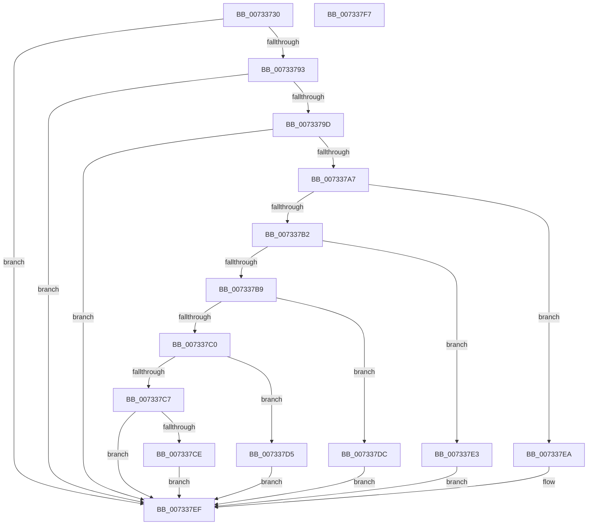

# PiDevCfgGetFailedInstallProblemStatus

- RVA: `0x00733730`–`0x007337F8` (길이 `200` bytes)
- VA: `0x0000000140733730`
- 실행 섹션: `PAGE`
- PDB 이름 있음: `예`; PDB Function 태그: `아니요`
- unwind 정보 RVA: `0x000B5DC4`
- 디코드: `54`개 명령, `200/200` bytes 표시
- 미해석 바이트: `0` (있으면 어셈블리에 `.byte`로 보존)

> 이 문서는 커널 이미지의 기계어와 PDB 기호를 분석해 생성했습니다. 4번과 5번은 함수 원형과 자료형을 바이너리 사용 방식에서 추정한 C 해석이며 원본 소스 복구 결과는 아닙니다.

## 1. Dependencies

- 직접 호출 지점: **1**; 고유 호출 대상: **1**
- 직접 호출자로 확인된 함수: **3**
- RIP 상대 이미지 참조: **2**

### Outgoing calls
- `0x0073378A` → [PnpGetObjectProperty](../8E/PnpGetObjectProperty_function_008E2180.md) (function, `0x008E2180`)

### Direct callers
- [PiInitializeDevice](PiInitializeDevice_function_0073EC5C.md) at `0x0073EF4E`
- [PiProcessNewDeviceNode](../A2/PiProcessNewDeviceNode_function_00A28F20.md) at `0x00A29AEA`
- [sub_00B420B0](../B4/Unknown_function_00B420B0.md) at `0x00B42236`

### Static image references
- `0x0073374C` → RVA `0x00E66398` (`.data`; read)
- `0x0073376F` → RVA `0x000116B8` (`.rdata`; read)

## 2. Other-region calls and transfers

- 다른 실행 섹션으로 향하는 call: **0**
- 별도 외부 분기/꼬리 이동을 확인하지 못했습니다.

## 3. Assembly (complete function range)

```asm
00733730  4C 8B DC                        mov r11, rsp
00733733  53                              push rbx
00733734  48 83 EC 70                     sub rsp, 0x70
00733738  33 DB                           xor ebx, ebx
0073373A  49 8D 43 20                     lea rax, [r11 + 0x20]
0073373E  89 5C 24 50                     mov dword ptr [rsp + 0x50], ebx
00733742  4C 8B CA                        mov r9, rdx
00733745  49 89 43 D0                     mov qword ptr [r11 - 0x30], rax
00733749  48 8B D1                        mov rdx, rcx
0073374C  48 8B 0D 45 2C 73 00            mov rcx, qword ptr [rip + 0x732c45]
00733753  49 8D 43 E8                     lea rax, [r11 - 0x18]
00733757  C7 44 24 40 04 00 00 00         mov dword ptr [rsp + 0x40], 4
0073375F  44 8D 43 01                     lea r8d, [rbx + 1]
00733763  49 89 43 C0                     mov qword ptr [r11 - 0x40], rax
00733767  49 8D 43 18                     lea rax, [r11 + 0x18]
0073376B  49 89 43 B8                     mov qword ptr [r11 - 0x48], rax
0073376F  48 8D 05 42 DF 8D FF            lea rax, [rip - 0x7220be]
00733776  49 89 43 B0                     mov qword ptr [r11 - 0x50], rax
0073377A  49 89 5B A8                     mov qword ptr [r11 - 0x58], rbx
0073377E  89 5C 24 60                     mov dword ptr [rsp + 0x60], ebx
00733782  45 89 43 18                     mov dword ptr [r11 + 0x18], r8d
00733786  41 89 5B 20                     mov dword ptr [r11 + 0x20], ebx
0073378A  E8 F1 E9 1A 00                  call 0x1408e2180
0073378F  85 C0                           test eax, eax
00733791  78 5C                           js 0x1407337ef
00733793  83 BC 24 90 00 00 00 17         cmp dword ptr [rsp + 0x90], 0x17
0073379B  75 52                           jne 0x1407337ef
0073379D  83 BC 24 98 00 00 00 04         cmp dword ptr [rsp + 0x98], 4
007337A5  75 48                           jne 0x1407337ef
007337A7  8B 44 24 60                     mov eax, dword ptr [rsp + 0x60]
007337AB  3D 19 02 00 E0                  cmp eax, 0xe0000219
007337B0  74 38                           je 0x1407337ea
007337B2  3D 28 02 00 E0                  cmp eax, 0xe0000228
007337B7  74 2A                           je 0x1407337e3
007337B9  3D 50 02 00 E0                  cmp eax, 0xe0000250
007337BE  74 1C                           je 0x1407337dc
007337C0  3D 51 02 00 E0                  cmp eax, 0xe0000251
007337C5  74 0E                           je 0x1407337d5
007337C7  3D 52 02 00 E0                  cmp eax, 0xe0000252
007337CC  75 21                           jne 0x1407337ef
007337CE  BB 93 04 00 C0                  mov ebx, 0xc0000493
007337D3  EB 1A                           jmp 0x1407337ef
007337D5  BB 92 04 00 C0                  mov ebx, 0xc0000492
007337DA  EB 13                           jmp 0x1407337ef
007337DC  BB 91 04 00 C0                  mov ebx, 0xc0000491
007337E1  EB 0C                           jmp 0x1407337ef
007337E3  BB 90 04 00 C0                  mov ebx, 0xc0000490
007337E8  EB 05                           jmp 0x1407337ef
007337EA  BB 94 04 00 C0                  mov ebx, 0xc0000494
007337EF  8B C3                           mov eax, ebx
007337F1  48 83 C4 70                     add rsp, 0x70
007337F5  5B                              pop rbx
007337F6  C3                              ret
007337F7  CC                              int3
```

## 4. C-style interpretation (structured pseudocode)

```c
__int64 __fastcall PiDevCfgGetFailedInstallProblemStatus(__int64 a1, __int64 a2)
{
    __int64 result;
    __int64 v_rbx;
    __int64 v_rsp;
    unsigned int v_stack_m18;
    unsigned int v_stack_m28;
    unsigned int v_stack_m38;
    unsigned int v_stack_p18;
    unsigned int v_stack_p20;

    v_rsp = (v_rsp) - (112);
    v_rbx = 0;
    v_stack_m28 = 0;
    *(unsigned __int64 *)(v_rsp - 48) = v_rsp + 32;
    v_stack_m38 = 4;
    *(unsigned __int64 *)(v_rsp - 64) = v_rsp - 24;
    *(unsigned __int64 *)(v_rsp - 72) = v_rsp + 24;
    *(unsigned __int64 *)(v_rsp - 80) = v_rip - 7479486;
    *(unsigned __int64 *)(v_rsp - 88) = 0;
    v_stack_m18 = 0;
    *(unsigned int *)(v_rsp + 24) = (unsigned int)(v_rbx + 1);
    *(unsigned int *)(v_rsp + 32) = 0;
    result = PnpGetObjectProperty(*(unsigned __int64 *)(v_rip + 7547973), a1, v_rbx + 1, a2);
    if (sign_flag) goto loc_007337EF;
    if (v_stack_p18 != 23) goto loc_007337EF;
    if (v_stack_p20 != 4) goto loc_007337EF;
    if (((unsigned int)((unsigned int)(v_stack_m18))) == 0xE0000219ULL) goto loc_007337EA;
    if (((unsigned int)((unsigned int)(v_stack_m18))) == 0xE0000228ULL) goto loc_007337E3;
    if (((unsigned int)((unsigned int)(v_stack_m18))) == 0xE0000250ULL) goto loc_007337DC;
    if (((unsigned int)((unsigned int)(v_stack_m18))) == 0xE0000251ULL) goto loc_007337D5;
    if (((unsigned int)((unsigned int)(v_stack_m18))) != 0xE0000252ULL) goto loc_007337EF;
    goto loc_007337EF;
loc_007337D5:
    goto loc_007337EF;
loc_007337DC:
    goto loc_007337EF;
loc_007337E3:
    goto loc_007337EF;
loc_007337EA:
loc_007337EF:
    v_rsp = (v_rsp) + (112);
    return (unsigned int)((unsigned int)((unsigned int)(0xC0000494ULL)));
}
```

## 5. (Beta) C Style

```c
int64_t PiDevCfgGetFailedInstallProblemStatus(int64_t Arg1, int64_t Arg2)
{
    int64_t result;
    int64_t local_rbx;
    int64_t local_rsp;
    uint32_t v_stack_m18;
    uint32_t v_stack_m28;
    uint32_t v_stack_m38;
    uint32_t v_stack_p18;
    uint32_t v_stack_p20;

    local_rsp = (local_rsp) - (112);
    local_rbx = 0;
    v_stack_m28 = 0;
    *(uint64_t *)(local_rsp - 0x30) = local_rsp + 32;
    v_stack_m38 = 4;
    *(uint64_t *)(local_rsp - 0x40) = local_rsp - 24;
    *(uint64_t *)(local_rsp - 0x48) = local_rsp + 24;
    *(uint64_t *)(local_rsp - 0x50) = v_rip - 7479486;
    *(uint64_t *)(local_rsp - 0x58) = 0;
    v_stack_m18 = 0;
    *(uint32_t *)(local_rsp + 0x18) = (uint32_t)(local_rbx + 1);
    *(uint32_t *)(local_rsp + 0x20) = 0;
    result = PnpGetObjectProperty(*(uint64_t *)(v_rip + 0x732C45), Arg1, local_rbx + 1, Arg2);
    if (sign_flag) goto loc_007337EF;
    if (v_stack_p18 != 23) goto loc_007337EF;
    if (v_stack_p20 != 4) goto loc_007337EF;
    if (((uint32_t)((uint32_t)(v_stack_m18))) == 0xE0000219ULL) goto loc_007337EA;
    if (((uint32_t)((uint32_t)(v_stack_m18))) == 0xE0000228ULL) goto loc_007337E3;
    if (((uint32_t)((uint32_t)(v_stack_m18))) == 0xE0000250ULL) goto loc_007337DC;
    if (((uint32_t)((uint32_t)(v_stack_m18))) == 0xE0000251ULL) goto loc_007337D5;
    if (((uint32_t)((uint32_t)(v_stack_m18))) != 0xE0000252ULL) goto loc_007337EF;
    goto loc_007337EF;
loc_007337D5:
    goto loc_007337EF;
loc_007337DC:
    goto loc_007337EF;
loc_007337E3:
    goto loc_007337EF;
loc_007337EA:
loc_007337EF:
    local_rsp = (local_rsp) + (112);
    return (uint32_t)((uint32_t)((uint32_t)(0xC0000494ULL)));
}
```

## 6. Execution-region graph

[열기: 2D/3D 그래프와 함수 탐색 컨트롤 패널](../../../control-panel.html?section=page&rva=0x00733730&view=graph)

- 2D 그래프는 위에서 아래로 흐르고, 3D 그래프는 빈 공간을 드래그해 회전합니다. Shift+드래그는 이동, 휠은 확대·축소, 함수 노드 선택은 대상 보고서 이동입니다.

### Static fallback


