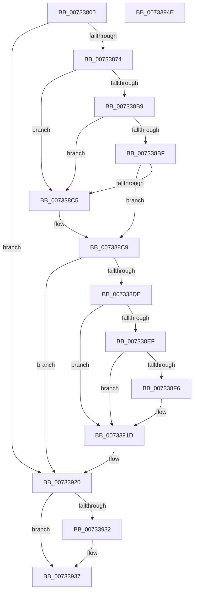

# PiDevCfgInitDeviceCallback

- RVA: `0x00733800`–`0x0073394F` (길이 `335` bytes)
- VA: `0x0000000140733800`
- 실행 섹션: `PAGE`
- PDB 이름 있음: `예`; PDB Function 태그: `아니요`
- unwind 정보 RVA: `0x000C8D00`
- 디코드: `83`개 명령, `335/335` bytes 표시
- 미해석 바이트: `0` (있으면 어셈블리에 `.byte`로 보존)

> 이 문서는 커널 이미지의 기계어와 PDB 기호를 분석해 생성했습니다. 4번과 5번은 함수 원형과 자료형을 바이너리 사용 방식에서 추정한 C 해석이며 원본 소스 복구 결과는 아닙니다.

## 1. Dependencies

- 직접 호출 지점: **8**; 고유 호출 대상: **8**
- 직접 호출자로 확인된 함수: **0**
- RIP 상대 이미지 참조: **1**

### Outgoing calls
- `0x00733827` → [memset](../../text/6C/memset_function_006C6C40.md) (function, `0x006C6C40`)
- `0x00733867` → [PnpOpenObjectRegKey](../8E/PnpOpenObjectRegKey_function_008E15E8.md) (function, `0x008E15E8`)
- `0x007338B0` → [CmGetDeviceRegProp](../8E/CmGetDeviceRegProp_function_008ED870.md) (function, `0x008ED870`)
- `0x007338D5` → [PiDevCfgInitDeviceContext](../97/PiDevCfgInitDeviceContext_function_00977518.md) (function, `0x00977518`)
- `0x007338E6` → [PiDevCfgCheckDeviceNeedsUpdate](PiDevCfgCheckDeviceNeedsUpdate_function_00731DDC.md) (function, `0x00731DDC`)
- `0x00733918` → [PiDevCfgSetDeviceRegProp](../96/PiDevCfgSetDeviceRegProp_function_009635C0.md) (function, `0x009635C0`)
- `0x00733924` → [PiDevCfgFreeDeviceContext](../70/PiDevCfgFreeDeviceContext_function_00704A00.md) (function, `0x00704A00`)
- `0x00733932` → [ZwClose](../../text/6A/ZwClose_function_006AD2B0.md) (function, `0x006AD2B0`)

### Direct callers
- 이 함수 시작 RVA로 연결되는 직접 call은 확인되지 않았습니다. 간접 호출은 완전히 역산할 수 없습니다.

### Static image references
- `0x0073383E` → RVA `0x00E66398` (`.data`; read)

## 2. Other-region calls and transfers

- 다른 실행 섹션으로 향하는 call: **2**
  - `0x00733827` → [memset](../../text/6C/memset_function_006C6C40.md) (`PAGE` → `.text`)
  - `0x00733932` → [ZwClose](../../text/6A/ZwClose_function_006AD2B0.md) (`PAGE` → `.text`)
- 별도 외부 분기/꼬리 이동을 확인하지 못했습니다.

## 3. Assembly (complete function range)

```asm
00733800  48 89 5C 24 10                  mov qword ptr [rsp + 0x10], rbx
00733805  48 89 7C 24 18                  mov qword ptr [rsp + 0x18], rdi
0073380A  55                              push rbp
0073380B  48 8D 6C 24 A9                  lea rbp, [rsp - 0x57]
00733810  48 81 EC B0 00 00 00            sub rsp, 0xb0
00733817  33 D2                           xor edx, edx
00733819  49 8B F8                        mov rdi, r8
0073381C  48 8B D9                        mov rbx, rcx
0073381F  48 8D 4D F7                     lea rcx, [rbp - 9]
00733823  44 8D 42 58                     lea r8d, [rdx + 0x58]
00733827  E8 14 34 F9 FF                  call 0x1406c6c40
0073382C  44 8B 43 1C                     mov r8d, dword ptr [rbx + 0x1c]
00733830  48 8D 45 EF                     lea rax, [rbp - 0x11]
00733834  48 8B 53 10                     mov rdx, qword ptr [rbx + 0x10]
00733838  41 B9 3F 00 0F 00               mov r9d, 0xf003f
0073383E  48 8B 0D 53 2B 73 00            mov rcx, qword ptr [rip + 0x732b53]
00733845  48 83 65 EF 00                  and qword ptr [rbp - 0x11], 0
0073384A  83 65 67 00                     and dword ptr [rbp + 0x67], 0
0073384E  83 65 EB 00                     and dword ptr [rbp - 0x15], 0
00733852  83 65 7F 00                     and dword ptr [rbp + 0x7f], 0
00733856  48 89 44 24 28                  mov qword ptr [rsp + 0x28], rax
0073385B  C6 44 24 20 00                  mov byte ptr [rsp + 0x20], 0
00733860  C7 45 E7 01 00 00 00            mov dword ptr [rbp - 0x19], 1
00733867  E8 7C DD 1A 00                  call 0x1408e15e8
0073386C  85 C0                           test eax, eax
0073386E  0F 88 AC 00 00 00               js 0x140733920
00733874  83 64 24 38 00                  and dword ptr [rsp + 0x38], 0
00733879  48 8D 45 7F                     lea rax, [rbp + 0x7f]
0073387D  4C 8B 45 EF                     mov r8, qword ptr [rbp - 0x11]
00733881  41 B9 0B 00 00 00               mov r9d, 0xb
00733887  48 8B 53 10                     mov rdx, qword ptr [rbx + 0x10]
0073388B  48 8B 0D 06 2B 73 00            mov rcx, qword ptr [rip + 0x732b06]
00733892  48 89 44 24 30                  mov qword ptr [rsp + 0x30], rax
00733897  48 8D 45 67                     lea rax, [rbp + 0x67]
0073389B  48 89 44 24 28                  mov qword ptr [rsp + 0x28], rax
007338A0  48 8D 45 E7                     lea rax, [rbp - 0x19]
007338A4  48 89 44 24 20                  mov qword ptr [rsp + 0x20], rax
007338A9  C7 45 7F 04 00 00 00            mov dword ptr [rbp + 0x7f], 4
007338B0  E8 BB 9F 1B 00                  call 0x1408ed870
007338B5  85 C0                           test eax, eax
007338B7  78 0C                           js 0x1407338c5
007338B9  83 7D E7 04                     cmp dword ptr [rbp - 0x19], 4
007338BD  75 06                           jne 0x1407338c5
007338BF  83 7D 7F 04                     cmp dword ptr [rbp + 0x7f], 4
007338C3  74 04                           je 0x1407338c9
007338C5  83 65 67 00                     and dword ptr [rbp + 0x67], 0
007338C9  48 8B 55 EF                     mov rdx, qword ptr [rbp - 0x11]
007338CD  4C 8D 45 F7                     lea r8, [rbp - 9]
007338D1  48 8B 4B 10                     mov rcx, qword ptr [rbx + 0x10]
007338D5  E8 3E 3C 24 00                  call 0x140977518
007338DA  85 C0                           test eax, eax
007338DC  78 42                           js 0x140733920
007338DE  48 8D 55 EB                     lea rdx, [rbp - 0x15]
007338E2  48 8D 4D F7                     lea rcx, [rbp - 9]
007338E6  E8 F1 E4 FF FF                  call 0x140731ddc
007338EB  85 C0                           test eax, eax
007338ED  78 2E                           js 0x14073391d
007338EF  8B 45 EB                        mov eax, dword ptr [rbp - 0x15]
007338F2  85 C0                           test eax, eax
007338F4  74 27                           je 0x14073391d
007338F6  09 45 67                        or dword ptr [rbp + 0x67], eax
007338F9  48 8D 55 F7                     lea rdx, [rbp - 9]
007338FD  41 B9 04 00 00 00               mov r9d, 4
00733903  C7 44 24 28 04 00 00 00         mov dword ptr [rsp + 0x28], 4
0073390B  48 8D 45 67                     lea rax, [rbp + 0x67]
0073390F  48 89 44 24 20                  mov qword ptr [rsp + 0x20], rax
00733914  45 8D 41 07                     lea r8d, [r9 + 7]
00733918  E8 A3 FC 22 00                  call 0x1409635c0
0073391D  C6 07 00                        mov byte ptr [rdi], 0
00733920  48 8D 4D F7                     lea rcx, [rbp - 9]
00733924  E8 D7 10 FD FF                  call 0x140704a00
00733929  48 8B 4D EF                     mov rcx, qword ptr [rbp - 0x11]
0073392D  48 85 C9                        test rcx, rcx
00733930  74 05                           je 0x140733937
00733932  E8 79 99 F7 FF                  call 0x1406ad2b0
00733937  4C 8D 9C 24 B0 00 00 00         lea r11, [rsp + 0xb0]
0073393F  33 C0                           xor eax, eax
00733941  49 8B 5B 18                     mov rbx, qword ptr [r11 + 0x18]
00733945  49 8B 7B 20                     mov rdi, qword ptr [r11 + 0x20]
00733949  49 8B E3                        mov rsp, r11
0073394C  5D                              pop rbp
0073394D  C3                              ret
0073394E  CC                              int3
```

## 4. C-style interpretation (structured pseudocode)

```c
__int64 __fastcall PiDevCfgInitDeviceCallback(__int64 a1, int a2, __int64 a3)
{
    __int64 result;
    __int64 v_rsp;
    unsigned __int64 v_stack_m5F;
    unsigned __int64 v_stack_m68;
    unsigned __int64 v_stack_m70;
    unsigned int v_stack_m74;
    unsigned int v_stack_m78;
    unsigned __int64 v_stack_m8;
    unsigned int v_stack_m80;
    unsigned __int64 v_stack_m88;
    unsigned __int64 v_stack_m90;
    unsigned __int8 v_stack_m98;
    unsigned __int64 v_stack_p10;
    unsigned __int64 v_stack_p18;
    unsigned int v_stack_p20;
    unsigned int v_stack_p8;

    v_stack_p10 = v_rbx;
    v_stack_p18 = v_rdi;
    v_rsp = (v_rsp) - (176);
    a2 = 0;
    result = memset(v_stack_m68, a2, a2 + 88, a4);
    v_stack_m90 = v_stack_m70;
    v_stack_m98 = 0;
    v_stack_m78 = 1;
    result = PnpOpenObjectRegKey(*(unsigned __int64 *)(v_rip + 7547731), *(unsigned __int64 *)(a1 + 16), (unsigned int)(*(unsigned int *)(a1 + 28)), (unsigned int)(0xF003FULL));
    if (sign_flag) goto loc_00733920;
    v_stack_m88 = v_stack_p20;
    v_stack_m90 = v_stack_p8;
    v_stack_m98 = v_stack_m78;
    v_stack_p20 = 4;
    result = CmGetDeviceRegProp(*(unsigned __int64 *)(v_rip + 7547654), *(unsigned __int64 *)(a1 + 16), v_stack_m70, 11);
    if (sign_flag) goto loc_007338C5;
    if (v_stack_m78 != 4) goto loc_007338C5;
    if (v_stack_p20 != 4) {
    }
    result = PiDevCfgInitDeviceContext(*(unsigned __int64 *)(a1 + 16), v_stack_m70, v_stack_m68, 11);
    if (sign_flag) goto loc_00733920;
    result = PiDevCfgCheckDeviceNeedsUpdate(v_stack_m68, v_stack_m74, v_stack_m68, 11);
    if (sign_flag) goto loc_0073391D;
    result = (unsigned int)(v_stack_m74);
    if ((unsigned int)((unsigned int)(v_stack_m74)) != 0) {
        a2 = v_stack_m68;
        a4 = 4;
        v_stack_m90 = 4;
        result = v_stack_p8;
        v_stack_m98 = result;
        a3 = a4 + 7;
        result = PiDevCfgSetDeviceRegProp(v_stack_m68, a2, a3, a4);
    }
    *(unsigned __int8 *)(a3) = 0;
loc_00733920:
    result = PiDevCfgFreeDeviceContext(v_stack_m68, a2, a3, a4);
    if (v_stack_m70 != 0) {
        result = ZwClose(v_stack_m70, a2, a3, a4);
    }
    result = 0;
    return result;
}
```

## 5. (Beta) C Style

```c
int64_t PiDevCfgInitDeviceCallback(void *Arg1, int32_t Arg2, void *Arg3)
{
    uint8_t *arg1 = (uint8_t *)Arg1;
    uint8_t *arg3 = (uint8_t *)Arg3;

    int64_t result;
    int64_t local_rsp;
    uint64_t v_stack_m5F;
    uint64_t v_stack_m68;
    uint64_t v_stack_m70;
    uint32_t v_stack_m74;
    uint32_t v_stack_m78;
    uint64_t v_stack_m8;
    uint32_t v_stack_m80;
    uint64_t v_stack_m88;
    uint64_t v_stack_m90;
    uint8_t v_stack_m98;
    uint64_t v_stack_p10;
    uint64_t v_stack_p18;
    uint32_t v_stack_p20;
    uint32_t v_stack_p8;

    v_stack_p10 = local_rbx;
    v_stack_p18 = local_rdi;
    local_rsp = (local_rsp) - (176);
    Arg2 = 0;
    result = memset(v_stack_m68, Arg2, Arg2 + 88, a4);
    v_stack_m90 = v_stack_m70;
    v_stack_m98 = 0;
    v_stack_m78 = 1;
    result = PnpOpenObjectRegKey(*(uint64_t *)(v_rip + 0x732B53), *(uint64_t *)(arg1 + 0x10), (uint32_t)(*(uint32_t *)(arg1 + 0x1C)), (uint32_t)(0xF003FULL));
    if (sign_flag) goto loc_00733920;
    v_stack_m88 = v_stack_p20;
    v_stack_m90 = v_stack_p8;
    v_stack_m98 = v_stack_m78;
    v_stack_p20 = 4;
    result = CmGetDeviceRegProp(*(uint64_t *)(v_rip + 0x732B06), *(uint64_t *)(arg1 + 0x10), v_stack_m70, 11);
    if (sign_flag) goto loc_007338C5;
    if (v_stack_m78 != 4) goto loc_007338C5;
    if (v_stack_p20 != 4) {
    }
    result = PiDevCfgInitDeviceContext(*(uint64_t *)(arg1 + 0x10), v_stack_m70, v_stack_m68, 11);
    if (sign_flag) goto loc_00733920;
    result = PiDevCfgCheckDeviceNeedsUpdate(v_stack_m68, v_stack_m74, v_stack_m68, 11);
    if (sign_flag) goto loc_0073391D;
    result = (uint32_t)(v_stack_m74);
    if ((uint32_t)((uint32_t)(v_stack_m74)) != 0) {
        Arg2 = v_stack_m68;
        a4 = 4;
        v_stack_m90 = 4;
        result = v_stack_p8;
        v_stack_m98 = result;
        Arg3 = a4 + 7;
        result = PiDevCfgSetDeviceRegProp(v_stack_m68, Arg2, Arg3, a4);
    }
    *(uint8_t *)(arg3) = 0;
loc_00733920:
    result = PiDevCfgFreeDeviceContext(v_stack_m68, Arg2, Arg3, a4);
    if (v_stack_m70 != 0) {
        result = ZwClose(v_stack_m70, Arg2, Arg3, a4);
    }
    result = 0;
    return result;
}
```

### 관측된 메모리 오프셋

구조체 형식이 확인되지 않은 접근은 인자 기준의 오프셋으로만 기록했습니다.

| 기준 인자 | 오프셋 표현 | 폭 (bit) | 접근 |
|---|---:|---:|---|
| `Arg1` | `+ 0x10` | `64` | `R` |
| `Arg1` | `+ 0x1C` | `32` | `R` |
| `Arg3` | `+ 0x0` | `8` | `W` |

## 6. Execution-region graph

[열기: 2D/3D 그래프와 함수 탐색 컨트롤 패널](../../../control-panel.html?section=page&rva=0x00733800&view=graph)

- 2D 그래프는 위에서 아래로 흐르고, 3D 그래프는 빈 공간을 드래그해 회전합니다. Shift+드래그는 이동, 휠은 확대·축소, 함수 노드 선택은 대상 보고서 이동입니다.

### Static fallback


