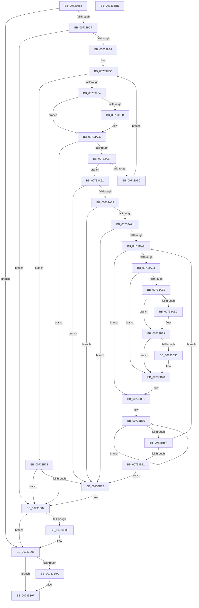

# PiDevCfgInitDriverDatabaseCallback

- RVA: `0x00733958`–`0x00733BBF` (길이 `615` bytes)
- VA: `0x0000000140733958`
- 실행 섹션: `PAGE`
- PDB 이름 있음: `예`; PDB Function 태그: `아니요`
- unwind 정보 RVA: `0x000C8CE0`
- 디코드: `155`개 명령, `615/615` bytes 표시
- 미해석 바이트: `0` (있으면 어셈블리에 `.byte`로 보존)

> 이 문서는 커널 이미지의 기계어와 PDB 기호를 분석해 생성했습니다. 4번과 5번은 함수 원형과 자료형을 바이너리 사용 방식에서 추정한 C 해석이며 원본 소스 복구 결과는 아닙니다.

## 1. Dependencies

- 직접 호출 지점: **14**; 고유 호출 대상: **11**
- 직접 호출자로 확인된 함수: **1**
- RIP 상대 이미지 참조: **2**

### Outgoing calls
- `0x007339BA` → [PnpCtxRegOpenKey](../8E/PnpCtxRegOpenKey_function_008EF7B8.md) (function, `0x008EF7B8`)
- `0x007339D7` → [PnpCtxOpenMachine](../82/PnpCtxOpenMachine_function_00828FB0.md) (function, `0x00828FB0`)
- `0x00733A00` → [ExFreePoolWithTag](../../poolcode/B8/ExFreePoolWithTag_function_00B82870.md) (function, `0x00B82870`)
- `0x00733A16` → [ExAllocatePool2](../../poolcode/B8/ExAllocatePool2_function_00B820F0.md) (function, `0x00B820F0`)
- `0x00733A50` → [CmGetMatchingFilteredDeviceList](../A2/CmGetMatchingFilteredDeviceList_function_00A2C11C.md) (function, `0x00A2C11C`)
- `0x00733AA7` → [_CmOpenDeviceRegKey](../8E/_CmOpenDeviceRegKey_function_008EE540.md) (function, `0x008EE540`)
- `0x00733AD6` → [CmCreateDevice](../8F/CmCreateDevice_function_008FFABC.md) (function, `0x008FFABC`)
- `0x00733B21` → [PiDevCfgCopyObjectProperties](../96/PiDevCfgCopyObjectProperties_function_009645D8.md) (function, `0x009645D8`)
- `0x00733B2C` → [ZwClose](../../text/6A/ZwClose_function_006AD2B0.md) (function, `0x006AD2B0`)
- `0x00733B43` → [CmDeleteDevice](../82/CmDeleteDevice_function_00829BB8.md) (function, `0x00829BB8`)
- `0x00733B4C` → [ZwClose](../../text/6A/ZwClose_function_006AD2B0.md) (function, `0x006AD2B0`)
- `0x00733B7D` → [ExFreePoolWithTag](../../poolcode/B8/ExFreePoolWithTag_function_00B82870.md) (function, `0x00B82870`)
- `0x00733B8C` → [PnpCtxCloseMachine](../82/PnpCtxCloseMachine_function_00828B10.md) (function, `0x00828B10`)
- `0x00733B9A` → [ZwClose](../../text/6A/ZwClose_function_006AD2B0.md) (function, `0x006AD2B0`)

### Direct callers
- [PiDrvDbEnumNodes](../74/PiDrvDbEnumNodes_function_0074103C.md) at `0x00741060`

### Static image references
- `0x00733985` → RVA `0x00E66398` (`.data`; read)
- `0x00733A34` → RVA `0x00AFE210` (` ?? ::NNGAKEGL::`string'`; read)

## 2. Other-region calls and transfers

- 다른 실행 섹션으로 향하는 call: **6**
  - `0x00733A00` → [ExFreePoolWithTag](../../poolcode/B8/ExFreePoolWithTag_function_00B82870.md) (`PAGE` → `POOLCODE`)
  - `0x00733A16` → [ExAllocatePool2](../../poolcode/B8/ExAllocatePool2_function_00B820F0.md) (`PAGE` → `POOLCODE`)
  - `0x00733B2C` → [ZwClose](../../text/6A/ZwClose_function_006AD2B0.md) (`PAGE` → `.text`)
  - `0x00733B4C` → [ZwClose](../../text/6A/ZwClose_function_006AD2B0.md) (`PAGE` → `.text`)
  - `0x00733B7D` → [ExFreePoolWithTag](../../poolcode/B8/ExFreePoolWithTag_function_00B82870.md) (`PAGE` → `POOLCODE`)
  - `0x00733B9A` → [ZwClose](../../text/6A/ZwClose_function_006AD2B0.md) (`PAGE` → `.text`)
- 별도 외부 분기/꼬리 이동을 확인하지 못했습니다.

## 3. Assembly (complete function range)

```asm
00733958  4C 8B DC                        mov r11, rsp
0073395B  49 89 5B 08                     mov qword ptr [r11 + 8], rbx
0073395F  49 89 7B 10                     mov qword ptr [r11 + 0x10], rdi
00733963  4D 89 63 18                     mov qword ptr [r11 + 0x18], r12
00733967  55                              push rbp
00733968  41 56                           push r14
0073396A  41 57                           push r15
0073396C  49 8D 6B A1                     lea rbp, [r11 - 0x5f]
00733970  48 81 EC 90 00 00 00            sub rsp, 0x90
00733977  45 33 E4                        xor r12d, r12d
0073397A  48 8D 45 2F                     lea rax, [rbp + 0x2f]
0073397E  4C 8B C1                        mov r8, rcx
00733981  49 89 43 80                     mov qword ptr [r11 - 0x80], rax
00733985  48 8B 0D 0C 2A 73 00            mov rcx, qword ptr [rip + 0x732a0c]
0073398C  45 33 C9                        xor r9d, r9d
0073398F  BA 02 00 00 80                  mov edx, 0x80000002
00733994  C7 44 24 20 00 00 00 02         mov dword ptr [rsp + 0x20], 0x2000000
0073399C  4C 89 65 2F                     mov qword ptr [rbp + 0x2f], r12
007339A0  41 8B DC                        mov ebx, r12d
007339A3  4C 89 65 1F                     mov qword ptr [rbp + 0x1f], r12
007339A7  41 8B FC                        mov edi, r12d
007339AA  44 89 65 17                     mov dword ptr [rbp + 0x17], r12d
007339AE  4C 89 65 27                     mov qword ptr [rbp + 0x27], r12
007339B2  4C 89 65 37                     mov qword ptr [rbp + 0x37], r12
007339B6  44 88 65 7F                     mov byte ptr [rbp + 0x7f], r12b
007339BA  E8 F9 BD 1B 00                  call 0x1408ef7b8
007339BF  85 C0                           test eax, eax
007339C1  0F 88 CA 01 00 00               js 0x140733b91
007339C7  48 8B 55 2F                     mov rdx, qword ptr [rbp + 0x2f]
007339CB  48 8D 45 1F                     lea rax, [rbp + 0x1f]
007339CF  45 33 C9                        xor r9d, r9d
007339D2  48 89 44 24 30                  mov qword ptr [rsp + 0x30], rax
007339D7  E8 D4 55 0F 00                  call 0x140828fb0
007339DC  85 C0                           test eax, eax
007339DE  0F 88 9E 01 00 00               js 0x140733b82
007339E4  B8 00 08 00 00                  mov eax, 0x800
007339E9  89 45 17                        mov dword ptr [rbp + 0x17], eax
007339EC  3B C7                           cmp eax, edi
007339EE  0F 86 7F 01 00 00               jbe 0x140733b73
007339F4  8B F8                           mov edi, eax
007339F6  48 85 DB                        test rbx, rbx
007339F9  74 0A                           je 0x140733a05
007339FB  33 D2                           xor edx, edx
007339FD  48 8B CB                        mov rcx, rbx
00733A00  E8 6B EE 44 00                  call 0x140b82870
00733A05  48 8B D7                        mov rdx, rdi
00733A08  B9 00 01 00 00                  mov ecx, 0x100
00733A0D  48 03 D2                        add rdx, rdx
00733A10  41 B8 50 70 64 63               mov r8d, 0x63647050
00733A16  E8 D5 E6 44 00                  call 0x140b820f0
00733A1B  48 8B D8                        mov rbx, rax
00733A1E  48 85 C0                        test rax, rax
00733A21  0F 84 5B 01 00 00               je 0x140733b82
00733A27  48 8B 4D 1F                     mov rcx, qword ptr [rbp + 0x1f]
00733A2B  48 8D 45 17                     lea rax, [rbp + 0x17]
00733A2F  48 89 44 24 38                  mov qword ptr [rsp + 0x38], rax
00733A34  48 8D 15 D5 A7 3C 00            lea rdx, [rip + 0x3ca7d5]
00733A3B  45 33 C9                        xor r9d, r9d
00733A3E  89 7C 24 30                     mov dword ptr [rsp + 0x30], edi
00733A42  48 89 5C 24 28                  mov qword ptr [rsp + 0x28], rbx
00733A47  4C 89 64 24 20                  mov qword ptr [rsp + 0x20], r12
00733A4C  45 8D 41 01                     lea r8d, [r9 + 1]
00733A50  E8 C7 86 2F 00                  call 0x140a2c11c
00733A55  3D 23 00 00 C0                  cmp eax, 0xc0000023
00733A5A  75 05                           jne 0x140733a61
00733A5C  8B 45 17                        mov eax, dword ptr [rbp + 0x17]
00733A5F  EB 8B                           jmp 0x1407339ec
00733A61  85 C0                           test eax, eax
00733A63  0F 88 0F 01 00 00               js 0x140733b78
00733A69  85 FF                           test edi, edi
00733A6B  0F 84 07 01 00 00               je 0x140733b78
00733A71  48 8B FB                        mov rdi, rbx
00733A74  66 44 39 23                     cmp word ptr [rbx], r12w
00733A78  0F 84 FA 00 00 00               je 0x140733b78
00733A7E  48 8B 4D 1F                     mov rcx, qword ptr [rbp + 0x1f]
00733A82  48 8D 45 27                     lea rax, [rbp + 0x27]
00733A86  4C 89 64 24 38                  mov qword ptr [rsp + 0x38], r12
00733A8B  45 33 C9                        xor r9d, r9d
00733A8E  48 89 44 24 30                  mov qword ptr [rsp + 0x30], rax
00733A93  48 8B D7                        mov rdx, rdi
00733A96  44 88 64 24 28                  mov byte ptr [rsp + 0x28], r12b
00733A9B  C7 44 24 20 00 00 00 02         mov dword ptr [rsp + 0x20], 0x2000000
00733AA3  45 8D 41 10                     lea r8d, [r9 + 0x10]
00733AA7  E8 94 AA 1B 00                  call 0x1408ee540
00733AAC  85 C0                           test eax, eax
00733AAE  0F 88 9D 00 00 00               js 0x140733b51
00733AB4  48 8B 0D DD 28 73 00            mov rcx, qword ptr [rip + 0x7328dd]
00733ABB  48 8D 45 7F                     lea rax, [rbp + 0x7f]
00733ABF  44 89 64 24 28                  mov dword ptr [rsp + 0x28], r12d
00733AC4  4C 8D 4D 37                     lea r9, [rbp + 0x37]
00733AC8  41 B8 1F 00 02 00               mov r8d, 0x2001f
00733ACE  48 89 44 24 20                  mov qword ptr [rsp + 0x20], rax
00733AD3  48 8B D7                        mov rdx, rdi
00733AD6  E8 E1 BF 1C 00                  call 0x1408ffabc
00733ADB  44 8B F0                        mov r14d, eax
00733ADE  85 C0                           test eax, eax
00733AE0  78 66                           js 0x140733b48
00733AE2  4C 8B 7D 37                     mov r15, qword ptr [rbp + 0x37]
00733AE6  44 38 65 7F                     cmp byte ptr [rbp + 0x7f], r12b
00733AEA  74 3D                           je 0x140733b29
00733AEC  4C 8B 4D 27                     mov r9, qword ptr [rbp + 0x27]
00733AF0  41 B8 01 00 00 00               mov r8d, 1
00733AF6  48 8B 4D 1F                     mov rcx, qword ptr [rbp + 0x1f]
00733AFA  48 8B D7                        mov rdx, rdi
00733AFD  C7 44 24 50 00 00 02 00         mov dword ptr [rsp + 0x50], 0x20000
00733B05  4C 89 64 24 48                  mov qword ptr [rsp + 0x48], r12
00733B0A  4C 89 64 24 40                  mov qword ptr [rsp + 0x40], r12
00733B0F  4C 89 7C 24 38                  mov qword ptr [rsp + 0x38], r15
00733B14  C7 44 24 30 01 00 00 00         mov dword ptr [rsp + 0x30], 1
00733B1C  48 89 7C 24 28                  mov qword ptr [rsp + 0x28], rdi
00733B21  E8 B2 0A 23 00                  call 0x1409645d8
00733B26  44 8B F0                        mov r14d, eax
00733B29  49 8B CF                        mov rcx, r15
00733B2C  E8 7F 97 F7 FF                  call 0x1406ad2b0
00733B31  45 85 F6                        test r14d, r14d
00733B34  79 12                           jns 0x140733b48
00733B36  48 8B 0D 5B 28 73 00            mov rcx, qword ptr [rip + 0x73285b]
00733B3D  45 33 C0                        xor r8d, r8d
00733B40  48 8B D7                        mov rdx, rdi
00733B43  E8 70 60 0F 00                  call 0x140829bb8
00733B48  48 8B 4D 27                     mov rcx, qword ptr [rbp + 0x27]
00733B4C  E8 5F 97 F7 FF                  call 0x1406ad2b0
00733B51  48 83 C8 FF                     or rax, 0xffffffffffffffff
00733B55  48 FF C0                        inc rax
00733B58  66 44 39 24 47                  cmp word ptr [rdi + rax*2], r12w
00733B5D  75 F6                           jne 0x140733b55
00733B5F  48 8D 3C 47                     lea rdi, [rdi + rax*2]
00733B63  48 83 C7 02                     add rdi, 2
00733B67  66 44 39 27                     cmp word ptr [rdi], r12w
00733B6B  0F 85 0D FF FF FF               jne 0x140733a7e
00733B71  EB 05                           jmp 0x140733b78
00733B73  48 85 DB                        test rbx, rbx
00733B76  74 0A                           je 0x140733b82
00733B78  33 D2                           xor edx, edx
00733B7A  48 8B CB                        mov rcx, rbx
00733B7D  E8 EE EC 44 00                  call 0x140b82870
00733B82  4C 39 65 1F                     cmp qword ptr [rbp + 0x1f], r12
00733B86  74 09                           je 0x140733b91
00733B88  48 8B 4D 1F                     mov rcx, qword ptr [rbp + 0x1f]
00733B8C  E8 7F 4F 0F 00                  call 0x140828b10
00733B91  48 8B 4D 2F                     mov rcx, qword ptr [rbp + 0x2f]
00733B95  48 85 C9                        test rcx, rcx
00733B98  74 05                           je 0x140733b9f
00733B9A  E8 11 97 F7 FF                  call 0x1406ad2b0
00733B9F  4C 8D 9C 24 90 00 00 00         lea r11, [rsp + 0x90]
00733BA7  B0 01                           mov al, 1
00733BA9  49 8B 5B 20                     mov rbx, qword ptr [r11 + 0x20]
00733BAD  49 8B 7B 28                     mov rdi, qword ptr [r11 + 0x28]
00733BB1  4D 8B 63 30                     mov r12, qword ptr [r11 + 0x30]
00733BB5  49 8B E3                        mov rsp, r11
00733BB8  41 5F                           pop r15
00733BBA  41 5E                           pop r14
00733BBC  5D                              pop rbp
00733BBD  C3                              ret
00733BBE  CC                              int3
```

## 4. C-style interpretation (structured pseudocode)

```c
__int64 __fastcall PiDevCfgInitDriverDatabaseCallback(__int64 a1, __int64 a2, __int64 a3, int a4)
{
    __int64 result;
    __int64 v_r12;
    __int64 v_r14;
    __int64 v_rdi;
    __int64 v_rsp;
    unsigned __int64 v_stack_m18;
    unsigned int v_stack_m58;
    unsigned __int64 v_stack_m60;
    unsigned __int64 v_stack_m68;
    unsigned __int64 v_stack_m70;
    unsigned __int64 v_stack_m78;
    unsigned __int64 v_stack_m80;
    unsigned int v_stack_m88;

    *(unsigned __int64 *)(v_rsp + 8) = v_rbx;
    *(unsigned __int64 *)(v_rsp + 16) = v_rdi;
    *(unsigned __int64 *)(v_rsp + 24) = v_r12;
    v_rsp = (v_rsp) - (144);
    v_r12 = 0;
    *(unsigned __int64 *)(v_rsp - 128) = v_rsp - 95 + 47;
    a4 = 0;
    v_stack_m88 = 0x2000000ULL;
    *(unsigned __int64 *)(v_rsp - 95 + 47) = 0;
    *(unsigned __int64 *)(v_rsp - 95 + 31) = 0;
    *(unsigned int *)(v_rsp - 95 + 23) = 0;
    *(unsigned __int64 *)(v_rsp - 95 + 39) = 0;
    *(unsigned __int64 *)(v_rsp - 95 + 55) = 0;
    *(unsigned __int8 *)(v_rsp - 95 + 127) = 0;
    result = PnpCtxRegOpenKey(*(unsigned __int64 *)(v_rip + 7547404), (unsigned int)(0x80000002ULL), a1, a4);
    if (sign_flag) goto loc_00733B91;
    a4 = 0;
    v_stack_m78 = v_rsp - 95 + 31;
    result = PnpCtxOpenMachine(*(unsigned __int64 *)(v_rip + 7547404), *(unsigned __int64 *)(v_rsp - 95 + 47), a1, a4);
    if (sign_flag) goto loc_00733B82;
    *(unsigned int *)(v_rsp - 95 + 23) = (unsigned int)((unsigned int)(0x800ULL));
loc_007339EC:
    if (((unsigned int)((unsigned int)(0x800ULL))) <= 0) goto loc_00733B73;
    result = (unsigned int)(0x800ULL);
    if (0 != 0) {
        a2 = 0;
        a1 = 0;
        result = ExFreePoolWithTag(a1, a2, a1, a4);
    }
    a2 = ((unsigned int)((unsigned int)((unsigned int)(0x800ULL)))) + ((unsigned int)((unsigned int)((unsigned int)(0x800ULL))));
    result = ExAllocatePool2(256, a2, (unsigned int)(0x63647050ULL), a4);
    if (result == 0) goto loc_00733B82;
    v_stack_m70 = v_rsp - 95 + 23;
    a4 = 0;
    v_stack_m78 = (unsigned int)((unsigned int)((unsigned int)((unsigned int)(0x800ULL))));
    v_stack_m80 = result;
    v_stack_m88 = 0;
    result = CmGetMatchingFilteredDeviceList(*(unsigned __int64 *)(v_rsp - 95 + 31), v_rip + 3975125, a4 + 1, a4);
    if (((unsigned int)(result)) != 0xC0000023ULL) goto loc_00733A61;
    goto loc_007339EC;
loc_00733A61:
    if (sign_flag) goto loc_00733B78;
    if ((unsigned int)((unsigned int)((unsigned int)((unsigned int)(0x800ULL)))) == 0) goto loc_00733B78;
    if ((*(unsigned __int16 *)(result)) == 0) goto loc_00733B78;
loc_00733A7E:
    v_stack_m70 = 0;
    a4 = 0;
    v_stack_m78 = v_rsp - 95 + 39;
    v_stack_m80 = 0;
    v_stack_m88 = 0x2000000ULL;
    result = _CmOpenDeviceRegKey(*(unsigned __int64 *)(v_rsp - 95 + 31), result, a4 + 16, a4);
    if (sign_flag) goto loc_00733B51;
    v_stack_m80 = 0;
    v_stack_m88 = v_rsp - 95 + 127;
    result = CmCreateDevice(*(unsigned __int64 *)(v_rip + 7547101), result, (unsigned int)(0x2001FULL), v_rsp - 95 + 55);
    if (sign_flag) goto loc_00733B48;
    v_r14 = (unsigned int)((unsigned int)(result));
    if ((*(unsigned __int8 *)(v_rsp - 95 + 127)) != 0) {
        a4 = *(unsigned __int64 *)(v_rsp - 95 + 39);
        a3 = 1;
        a1 = *(unsigned __int64 *)(v_rsp - 95 + 31);
        a2 = result;
        v_stack_m58 = 0x20000ULL;
        v_stack_m60 = 0;
        v_stack_m68 = 0;
        v_stack_m70 = *(unsigned __int64 *)(v_rsp - 95 + 55);
        v_stack_m78 = 1;
        v_stack_m80 = result;
        result = PiDevCfgCopyObjectProperties(a1, a2, a3, a4);
        v_r14 = (unsigned int)(result);
    }
    result = ZwClose(*(unsigned __int64 *)(v_rsp - 95 + 55), a2, a3, a4);
    if (sign_flag) {
        a1 = *(unsigned __int64 *)(v_rip + 7546971);
        a3 = 0;
        a2 = result;
        result = CmDeleteDevice(a1, a2, a3, a4);
    }
    result = ZwClose(*(unsigned __int64 *)(v_rsp - 95 + 39), a2, a3, a4);
loc_00733B51:
    result = (result) | (-1);
loc_00733B55:
    result = (result) + 1;
    if ((*(unsigned __int16 *)(result + result * 2)) != 0) goto loc_00733B55;
    v_rdi = (result + result * 2) + (2);
    if ((*(unsigned __int16 *)(v_rdi)) != 0) goto loc_00733A7E;
    goto loc_00733B78;
loc_00733B73:
    if (result != 0) {
        a2 = 0;
        a1 = result;
        result = ExFreePoolWithTag(a1, a2, a3, a4);
    }
    if ((*(unsigned __int64 *)(v_rsp - 95 + 31)) != 0) {
        a1 = *(unsigned __int64 *)(v_rsp - 95 + 31);
        result = PnpCtxCloseMachine(a1, a2, a3, a4);
    }
    if (*(unsigned __int64 *)(v_rsp - 95 + 47) != 0) {
        result = ZwClose(*(unsigned __int64 *)(v_rsp - 95 + 47), a2, a3, a4);
    }
    return 1;
}
```

## 5. (Beta) C Style

```c
int64_t PiDevCfgInitDriverDatabaseCallback(int64_t Arg1, int64_t Arg2, int64_t Arg3, int32_t Arg4)
{
    int64_t result;
    int64_t local_r12;
    int64_t local_r14;
    int64_t local_rdi;
    int64_t local_rsp;
    uint64_t v_stack_m18;
    uint32_t v_stack_m58;
    uint64_t v_stack_m60;
    uint64_t v_stack_m68;
    uint64_t v_stack_m70;
    uint64_t v_stack_m78;
    uint64_t v_stack_m80;
    uint32_t v_stack_m88;

    *(uint64_t *)(local_rsp + 0x8) = local_rbx;
    *(uint64_t *)(local_rsp + 0x10) = local_rdi;
    *(uint64_t *)(local_rsp + 0x18) = local_r12;
    local_rsp = (local_rsp) - (144);
    local_r12 = 0;
    *(uint64_t *)(local_rsp - 0x80) = local_rsp - 95 + 47;
    Arg4 = 0;
    v_stack_m88 = 0x2000000ULL;
    *(uint64_t *)(local_rsp - 0x5F + 0x2F) = 0;
    *(uint64_t *)(local_rsp - 0x5F + 0x1F) = 0;
    *(uint32_t *)(local_rsp - 0x5F + 0x17) = 0;
    *(uint64_t *)(local_rsp - 0x5F + 0x27) = 0;
    *(uint64_t *)(local_rsp - 0x5F + 0x37) = 0;
    *(uint8_t *)(local_rsp - 0x5F + 0x7F) = 0;
    result = PnpCtxRegOpenKey(*(uint64_t *)(v_rip + 0x732A0C), (uint32_t)(0x80000002ULL), Arg1, Arg4);
    if (sign_flag) goto loc_00733B91;
    Arg4 = 0;
    v_stack_m78 = local_rsp - 95 + 31;
    result = PnpCtxOpenMachine(*(uint64_t *)(v_rip + 0x732A0C), *(uint64_t *)(local_rsp - 0x5F + 0x2F), Arg1, Arg4);
    if (sign_flag) goto loc_00733B82;
    *(uint32_t *)(local_rsp - 0x5F + 0x17) = (uint32_t)((uint32_t)(0x800ULL));
loc_007339EC:
    if (((uint32_t)((uint32_t)(0x800ULL))) <= 0) goto loc_00733B73;
    result = (uint32_t)(0x800ULL);
    if (0 != 0) {
        Arg2 = 0;
        Arg1 = 0;
        result = ExFreePoolWithTag(Arg1, Arg2, Arg1, Arg4);
    }
    Arg2 = ((uint32_t)((uint32_t)((uint32_t)(0x800ULL)))) + ((uint32_t)((uint32_t)((uint32_t)(0x800ULL))));
    result = ExAllocatePool2(256, Arg2, (uint32_t)(0x63647050ULL), Arg4);
    if (result == 0) goto loc_00733B82;
    v_stack_m70 = local_rsp - 95 + 23;
    Arg4 = 0;
    v_stack_m78 = (uint32_t)((uint32_t)((uint32_t)((uint32_t)(0x800ULL))));
    v_stack_m80 = result;
    v_stack_m88 = 0;
    result = CmGetMatchingFilteredDeviceList(*(uint64_t *)(local_rsp - 0x5F + 0x1F), v_rip + 3975125, Arg4 + 1, Arg4);
    if (((uint32_t)(result)) != 0xC0000023ULL) goto loc_00733A61;
    goto loc_007339EC;
loc_00733A61:
    if (sign_flag) goto loc_00733B78;
    if ((uint32_t)((uint32_t)((uint32_t)((uint32_t)(0x800ULL)))) == 0) goto loc_00733B78;
    if ((*(uint16_t *)(result)) == 0) goto loc_00733B78;
loc_00733A7E:
    v_stack_m70 = 0;
    Arg4 = 0;
    v_stack_m78 = local_rsp - 95 + 39;
    v_stack_m80 = 0;
    v_stack_m88 = 0x2000000ULL;
    result = _CmOpenDeviceRegKey(*(uint64_t *)(local_rsp - 0x5F + 0x1F), result, Arg4 + 16, Arg4);
    if (sign_flag) goto loc_00733B51;
    v_stack_m80 = 0;
    v_stack_m88 = local_rsp - 95 + 127;
    result = CmCreateDevice(*(uint64_t *)(v_rip + 0x7328DD), result, (uint32_t)(0x2001FULL), local_rsp - 95 + 55);
    if (sign_flag) goto loc_00733B48;
    local_r14 = (uint32_t)((uint32_t)(result));
    if ((*(uint8_t *)(local_rsp - 0x5F + 0x7F)) != 0) {
        Arg4 = *(uint64_t *)(local_rsp - 0x5F + 0x27);
        Arg3 = 1;
        Arg1 = *(uint64_t *)(local_rsp - 0x5F + 0x1F);
        Arg2 = result;
        v_stack_m58 = 0x20000ULL;
        v_stack_m60 = 0;
        v_stack_m68 = 0;
        v_stack_m70 = *(uint64_t *)(local_rsp - 0x5F + 0x37);
        v_stack_m78 = 1;
        v_stack_m80 = result;
        result = PiDevCfgCopyObjectProperties(Arg1, Arg2, Arg3, Arg4);
        local_r14 = (uint32_t)(result);
    }
    result = ZwClose(*(uint64_t *)(local_rsp - 0x5F + 0x37), Arg2, Arg3, Arg4);
    if (sign_flag) {
        Arg1 = *(uint64_t *)(v_rip + 0x73285B);
        Arg3 = 0;
        Arg2 = result;
        result = CmDeleteDevice(Arg1, Arg2, Arg3, Arg4);
    }
    result = ZwClose(*(uint64_t *)(local_rsp - 0x5F + 0x27), Arg2, Arg3, Arg4);
loc_00733B51:
    result = (result) | (-1);
loc_00733B55:
    result = (result) + 1;
    if ((*(uint16_t *)(result + result * 2)) != 0) goto loc_00733B55;
    local_rdi = (result + result * 2) + (2);
    if ((*(uint16_t *)(local_rdi)) != 0) goto loc_00733A7E;
    goto loc_00733B78;
loc_00733B73:
    if (result != 0) {
        Arg2 = 0;
        Arg1 = result;
        result = ExFreePoolWithTag(Arg1, Arg2, Arg3, Arg4);
    }
    if ((*(uint64_t *)(local_rsp - 0x5F + 0x1F)) != 0) {
        Arg1 = *(uint64_t *)(local_rsp - 0x5F + 0x1F);
        result = PnpCtxCloseMachine(Arg1, Arg2, Arg3, Arg4);
    }
    if (*(uint64_t *)(local_rsp - 0x5F + 0x2F) != 0) {
        result = ZwClose(*(uint64_t *)(local_rsp - 0x5F + 0x2F), Arg2, Arg3, Arg4);
    }
    return 1;
}
```

## 6. Execution-region graph

[열기: 2D/3D 그래프와 함수 탐색 컨트롤 패널](../../../control-panel.html?section=page&rva=0x00733958&view=graph)

- 2D 그래프는 위에서 아래로 흐르고, 3D 그래프는 빈 공간을 드래그해 회전합니다. Shift+드래그는 이동, 휠은 확대·축소, 함수 노드 선택은 대상 보고서 이동입니다.

### Static fallback


