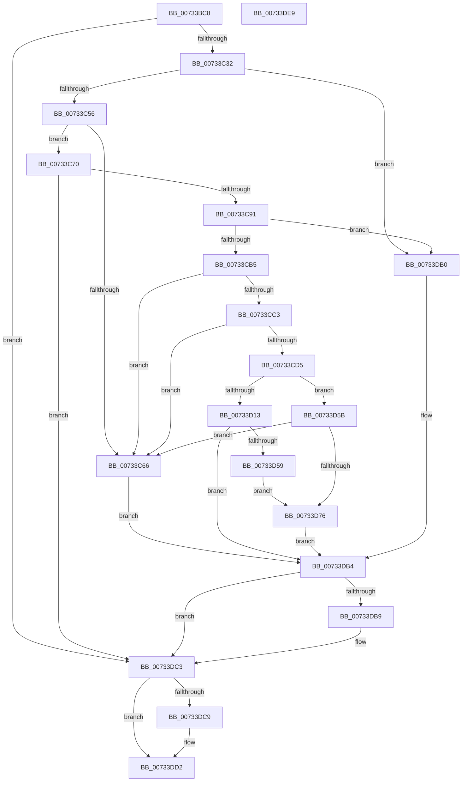

# PiDevCfgMakeServiceBootStart

- RVA: `0x00733BC8`–`0x00733DEA` (길이 `546` bytes)
- VA: `0x0000000140733BC8`
- 실행 섹션: `PAGE`
- PDB 이름 있음: `예`; PDB Function 태그: `아니요`
- unwind 정보 RVA: `0x000C8BC0`
- 디코드: `148`개 명령, `546/546` bytes 표시
- 미해석 바이트: `0` (있으면 어셈블리에 `.byte`로 보존)

> 이 문서는 커널 이미지의 기계어와 PDB 기호를 분석해 생성했습니다. 4번과 5번은 함수 원형과 자료형을 바이너리 사용 방식에서 추정한 C 해석이며 원본 소스 복구 결과는 아닙니다.

## 1. Dependencies

- 직접 호출 지점: **15**; 고유 호출 대상: **10**
- 직접 호출자로 확인된 함수: **1**
- RIP 상대 이미지 참조: **4**

### Outgoing calls
- `0x00733C09` → [RtlInitUnicodeString](../../text/42/RtlInitUnicodeString_function_0042A780.md) (function, `0x0042A780`)
- `0x00733C23` → [PipOpenServiceEnumKeys](../99/PipOpenServiceEnumKeys_function_00998E94.md) (function, `0x00998E94`)
- `0x00733C47` → [IopGetRegistryValue](../99/IopGetRegistryValue_function_009990EC.md) (function, `0x009990EC`)
- `0x00733C5D` → [PnpValidateRegistryDword](../../text/4D/PnpValidateRegistryDword_function_004D109C.md) (function, `0x004D109C`)
- `0x00733C7B` → [ExFreePoolWithTag](../../poolcode/B8/ExFreePoolWithTag_function_00B82870.md) (function, `0x00B82870`)
- `0x00733CA6` → [IopGetRegistryValue](../99/IopGetRegistryValue_function_009990EC.md) (function, `0x009990EC`)
- `0x00733CCC` → [PnpValidateStringData](../../text/4B/PnpValidateStringData_function_004B7678.md) (function, `0x004B7678`)
- `0x00733CDD` → [PnpRegSzToString](../A5/PnpRegSzToString_function_00A5DC40.md) (function, `0x00A5DC40`)
- `0x00733D0A` → [RtlPrefixUnicodeString](../8F/RtlPrefixUnicodeString_function_008F4F70.md) (function, `0x008F4F70`)
- `0x00733D1B` → [RtlInitUnicodeString](../../text/42/RtlInitUnicodeString_function_0042A780.md) (function, `0x0042A780`)
- `0x00733D4E` → [ZwSetValueKey](../../text/6A/ZwSetValueKey_function_006ADCD0.md) (function, `0x006ADCD0`)
- `0x00733D69` → [RtlPrefixUnicodeString](../8F/RtlPrefixUnicodeString_function_008F4F70.md) (function, `0x008F4F70`)
- `0x00733DA7` → [ZwSetValueKey](../../text/6A/ZwSetValueKey_function_006ADCD0.md) (function, `0x006ADCD0`)
- `0x00733DBE` → [ExFreePoolWithTag](../../poolcode/B8/ExFreePoolWithTag_function_00B82870.md) (function, `0x00B82870`)
- `0x00733DCD` → [ZwClose](../../text/6A/ZwClose_function_006AD2B0.md) (function, `0x006AD2B0`)

### Direct callers
- [PiDevCfgConfigureDevice](../97/PiDevCfgConfigureDevice_function_00977BB4.md) at `0x00979FE2`
- [PiDevCfgConfigureDevice](../97/PiDevCfgConfigureDevice_function_00977BB4.md) at `0x0097A03B`

### Static image references
- `0x00733C36` → RVA `0x00AFDF50` (` ?? ::NNGAKEGL::`string'`; read)
- `0x00733C95` → RVA `0x00AFC910` (` ?? ::NNGAKEGL::`string'`; read)
- `0x00733CFB` → RVA `0x00B4B600` (`PiDevCfgSystemRoot`; read)
- `0x00733D62` → RVA `0x00B4BFD8` (`PiDevCfgSystem32`; read)

## 2. Other-region calls and transfers

- 다른 실행 섹션으로 향하는 call: **9**
  - `0x00733C09` → [RtlInitUnicodeString](../../text/42/RtlInitUnicodeString_function_0042A780.md) (`PAGE` → `.text`)
  - `0x00733C5D` → [PnpValidateRegistryDword](../../text/4D/PnpValidateRegistryDword_function_004D109C.md) (`PAGE` → `.text`)
  - `0x00733C7B` → [ExFreePoolWithTag](../../poolcode/B8/ExFreePoolWithTag_function_00B82870.md) (`PAGE` → `POOLCODE`)
  - `0x00733CCC` → [PnpValidateStringData](../../text/4B/PnpValidateStringData_function_004B7678.md) (`PAGE` → `.text`)
  - `0x00733D1B` → [RtlInitUnicodeString](../../text/42/RtlInitUnicodeString_function_0042A780.md) (`PAGE` → `.text`)
  - `0x00733D4E` → [ZwSetValueKey](../../text/6A/ZwSetValueKey_function_006ADCD0.md) (`PAGE` → `.text`)
  - `0x00733DA7` → [ZwSetValueKey](../../text/6A/ZwSetValueKey_function_006ADCD0.md) (`PAGE` → `.text`)
  - `0x00733DBE` → [ExFreePoolWithTag](../../poolcode/B8/ExFreePoolWithTag_function_00B82870.md) (`PAGE` → `POOLCODE`)
  - `0x00733DCD` → [ZwClose](../../text/6A/ZwClose_function_006AD2B0.md) (`PAGE` → `.text`)
- 별도 외부 분기/꼬리 이동을 확인하지 못했습니다.

## 3. Assembly (complete function range)

```asm
00733BC8  48 89 5C 24 08                  mov qword ptr [rsp + 8], rbx
00733BCD  55                              push rbp
00733BCE  57                              push rdi
00733BCF  41 54                           push r12
00733BD1  41 56                           push r14
00733BD3  41 57                           push r15
00733BD5  48 8B EC                        mov rbp, rsp
00733BD8  48 83 EC 60                     sub rsp, 0x60
00733BDC  45 33 F6                        xor r14d, r14d
00733BDF  C7 45 38 04 00 00 00            mov dword ptr [rbp + 0x38], 4
00733BE6  0F 57 C0                        xorps xmm0, xmm0
00733BE9  4C 89 75 48                     mov qword ptr [rbp + 0x48], r14
00733BED  33 C0                           xor eax, eax
00733BEF  4C 89 75 40                     mov qword ptr [rbp + 0x40], r14
00733BF3  48 8B D1                        mov rdx, rcx
00733BF6  89 45 F4                        mov dword ptr [rbp - 0xc], eax
00733BF9  48 8D 4D D0                     lea rcx, [rbp - 0x30]
00733BFD  4C 89 75 E0                     mov qword ptr [rbp - 0x20], r14
00733C01  0F 11 45 D0                     movups xmmword ptr [rbp - 0x30], xmm0
00733C05  4C 89 75 E8                     mov qword ptr [rbp - 0x18], r14
00733C09  E8 72 6B CF FF                  call 0x14042a780
00733C0E  45 33 C9                        xor r9d, r9d
00733C11  44 88 74 24 20                  mov byte ptr [rsp + 0x20], r14b
00733C16  4C 8D 45 48                     lea r8, [rbp + 0x48]
00733C1A  BA 1F 00 02 00                  mov edx, 0x2001f
00733C1F  48 8D 4D D0                     lea rcx, [rbp - 0x30]
00733C23  E8 6C 52 26 00                  call 0x140998e94
00733C28  8B D8                           mov ebx, eax
00733C2A  85 C0                           test eax, eax
00733C2C  0F 88 91 01 00 00               js 0x140733dc3
00733C32  48 8B 4D 48                     mov rcx, qword ptr [rbp + 0x48]
00733C36  4C 8D 25 13 A3 3C 00            lea r12, [rip + 0x3ca313]
00733C3D  49 8B D4                        mov rdx, r12
00733C40  4C 8D 4D 40                     lea r9, [rbp + 0x40]
00733C44  45 33 C0                        xor r8d, r8d
00733C47  E8 A0 54 26 00                  call 0x1409990ec
00733C4C  8B D8                           mov ebx, eax
00733C4E  85 C0                           test eax, eax
00733C50  0F 88 5A 01 00 00               js 0x140733db0
00733C56  48 8B 7D 40                     mov rdi, qword ptr [rbp + 0x40]
00733C5A  48 8B CF                        mov rcx, rdi
00733C5D  E8 3A D4 D9 FF                  call 0x1404d109c
00733C62  84 C0                           test al, al
00733C64  75 0A                           jne 0x140733c70
00733C66  BB 01 00 00 C0                  mov ebx, 0xc0000001
00733C6B  E9 44 01 00 00                  jmp 0x140733db4
00733C70  8B 47 08                        mov eax, dword ptr [rdi + 8]
00733C73  8B 14 38                        mov edx, dword ptr [rax + rdi]
00733C76  89 55 38                        mov dword ptr [rbp + 0x38], edx
00733C79  33 D2                           xor edx, edx
00733C7B  E8 F0 EB 44 00                  call 0x140b82870
00733C80  F7 45 38 FB FF FF FF            test dword ptr [rbp + 0x38], 0xfffffffb
00733C87  4C 89 75 40                     mov qword ptr [rbp + 0x40], r14
00733C8B  0F 84 32 01 00 00               je 0x140733dc3
00733C91  48 8B 4D 48                     mov rcx, qword ptr [rbp + 0x48]
00733C95  4C 8D 3D 74 8C 3C 00            lea r15, [rip + 0x3c8c74]
00733C9C  49 8B D7                        mov rdx, r15
00733C9F  4C 8D 4D 40                     lea r9, [rbp + 0x40]
00733CA3  45 33 C0                        xor r8d, r8d
00733CA6  E8 41 54 26 00                  call 0x1409990ec
00733CAB  8B D8                           mov ebx, eax
00733CAD  85 C0                           test eax, eax
00733CAF  0F 88 FB 00 00 00               js 0x140733db0
00733CB5  48 8B 7D 40                     mov rdi, qword ptr [rbp + 0x40]
00733CB9  8B 47 04                        mov eax, dword ptr [rdi + 4]
00733CBC  FF C8                           dec eax
00733CBE  83 F8 01                        cmp eax, 1
00733CC1  77 A3                           ja 0x140733c66
00733CC3  8B 4F 08                        mov ecx, dword ptr [rdi + 8]
00733CC6  8B 57 0C                        mov edx, dword ptr [rdi + 0xc]
00733CC9  48 03 CF                        add rcx, rdi
00733CCC  E8 A7 39 D8 FF                  call 0x1404b7678
00733CD1  84 C0                           test al, al
00733CD3  74 91                           je 0x140733c66
00733CD5  4C 8D 45 40                     lea r8, [rbp + 0x40]
00733CD9  44 89 75 40                     mov dword ptr [rbp + 0x40], r14d
00733CDD  E8 5E 9F 32 00                  call 0x140a5dc40
00733CE2  0F B7 4D 40                     movzx ecx, word ptr [rbp + 0x40]
00733CE6  48 8D 55 F0                     lea rdx, [rbp - 0x10]
00733CEA  8B 5F 08                        mov ebx, dword ptr [rdi + 8]
00733CED  41 B0 01                        mov r8b, 1
00733CF0  0F B7 47 0C                     movzx eax, word ptr [rdi + 0xc]
00733CF4  48 03 DF                        add rbx, rdi
00733CF7  66 89 4D F0                     mov word ptr [rbp - 0x10], cx
00733CFB  48 8D 0D FE 78 41 00            lea rcx, [rip + 0x4178fe]
00733D02  48 89 5D F8                     mov qword ptr [rbp - 8], rbx
00733D06  66 89 45 F2                     mov word ptr [rbp - 0xe], ax
00733D0A  E8 61 12 1C 00                  call 0x1408f4f70
00733D0F  84 C0                           test al, al
00733D11  74 48                           je 0x140733d5b
00733D13  48 8D 53 18                     lea rdx, [rbx + 0x18]
00733D17  48 8D 4D E0                     lea rcx, [rbp - 0x20]
00733D1B  E8 60 6A CF FF                  call 0x14042a780
00733D20  0F B7 45 E0                     movzx eax, word ptr [rbp - 0x20]
00733D24  48 8D 55 D0                     lea rdx, [rbp - 0x30]
00733D28  48 8B 4D 48                     mov rcx, qword ptr [rbp + 0x48]
00733D2C  83 C0 02                        add eax, 2
00733D2F  89 44 24 28                     mov dword ptr [rsp + 0x28], eax
00733D33  45 33 C0                        xor r8d, r8d
00733D36  48 8B 45 E8                     mov rax, qword ptr [rbp - 0x18]
00733D3A  C7 45 D0 12 00 14 00            mov dword ptr [rbp - 0x30], 0x140012
00733D41  4C 89 7D D8                     mov qword ptr [rbp - 0x28], r15
00733D45  44 8B 4F 04                     mov r9d, dword ptr [rdi + 4]
00733D49  48 89 44 24 20                  mov qword ptr [rsp + 0x20], rax
00733D4E  E8 7D 9F F7 FF                  call 0x1406adcd0
00733D53  8B D8                           mov ebx, eax
00733D55  85 C0                           test eax, eax
00733D57  78 5B                           js 0x140733db4
00733D59  EB 1B                           jmp 0x140733d76
00733D5B  41 B0 01                        mov r8b, 1
00733D5E  48 8D 55 F0                     lea rdx, [rbp - 0x10]
00733D62  48 8D 0D 6F 82 41 00            lea rcx, [rip + 0x41826f]
00733D69  E8 02 12 1C 00                  call 0x1408f4f70
00733D6E  84 C0                           test al, al
00733D70  0F 84 F0 FE FF FF               je 0x140733c66
00733D76  48 8B 4D 48                     mov rcx, qword ptr [rbp + 0x48]
00733D7A  48 8D 45 38                     lea rax, [rbp + 0x38]
00733D7E  C7 44 24 28 04 00 00 00         mov dword ptr [rsp + 0x28], 4
00733D86  48 8D 55 D0                     lea rdx, [rbp - 0x30]
00733D8A  41 B9 04 00 00 00               mov r9d, 4
00733D90  48 89 44 24 20                  mov qword ptr [rsp + 0x20], rax
00733D95  45 33 C0                        xor r8d, r8d
00733D98  C7 45 D0 0A 00 0C 00            mov dword ptr [rbp - 0x30], 0xc000a
00733D9F  4C 89 65 D8                     mov qword ptr [rbp - 0x28], r12
00733DA3  44 89 75 38                     mov dword ptr [rbp + 0x38], r14d
00733DA7  E8 24 9F F7 FF                  call 0x1406adcd0
00733DAC  8B D8                           mov ebx, eax
00733DAE  EB 04                           jmp 0x140733db4
00733DB0  48 8B 7D 40                     mov rdi, qword ptr [rbp + 0x40]
00733DB4  48 85 FF                        test rdi, rdi
00733DB7  74 0A                           je 0x140733dc3
00733DB9  33 D2                           xor edx, edx
00733DBB  48 8B CF                        mov rcx, rdi
00733DBE  E8 AD EA 44 00                  call 0x140b82870
00733DC3  4C 39 75 48                     cmp qword ptr [rbp + 0x48], r14
00733DC7  74 09                           je 0x140733dd2
00733DC9  48 8B 4D 48                     mov rcx, qword ptr [rbp + 0x48]
00733DCD  E8 DE 94 F7 FF                  call 0x1406ad2b0
00733DD2  8B C3                           mov eax, ebx
00733DD4  48 8B 9C 24 90 00 00 00         mov rbx, qword ptr [rsp + 0x90]
00733DDC  48 83 C4 60                     add rsp, 0x60
00733DE0  41 5F                           pop r15
00733DE2  41 5E                           pop r14
00733DE4  41 5C                           pop r12
00733DE6  5F                              pop rdi
00733DE7  5D                              pop rbp
00733DE8  C3                              ret
00733DE9  CC                              int3
```

## 4. C-style interpretation (structured pseudocode)

```c
__int64 __fastcall PiDevCfgMakeServiceBootStart(__int64 a1, __int64 a2, __int64 a3, int a4)
{
    __int64 result;
    __int64 v_r14;
    __int64 v_rbx;
    __int64 v_rsp;
    unsigned __int64 v_stack_m30;
    unsigned int v_stack_m34;
    unsigned __int16 v_stack_m36;
    unsigned __int64 v_stack_m38;
    unsigned __int64 v_stack_m40;
    unsigned __int64 v_stack_m48;
    unsigned __int64 v_stack_m50;
    unsigned __int64 v_stack_m58;
    unsigned int v_stack_m60;
    unsigned __int8 v_stack_m68;
    unsigned int v_stack_p10;
    unsigned __int64 v_stack_p18;
    unsigned __int64 v_stack_p20;
    unsigned __int64 v_stack_p8;

    v_stack_p8 = v_rbx;
    v_rsp = (v_rsp) - (96);
    v_r14 = 0;
    v_stack_p10 = 4;
    v_stack_p20 = 0;
    result = 0;
    v_stack_p18 = 0;
    v_stack_m34 = 0;
    v_stack_m48 = 0;
    v_stack_m58 = v_xmm0;
    v_stack_m40 = 0;
    result = RtlInitUnicodeString(v_stack_m58, a1, a3, a4);
    a4 = 0;
    v_stack_m68 = 0;
    result = PipOpenServiceEnumKeys(v_stack_m58, (unsigned int)(0x2001FULL), v_stack_p20, a4);
    if (sign_flag) goto loc_00733DC3;
    a3 = 0;
    result = IopGetRegistryValue(v_stack_p20, v_rip + 3973907, a3, v_stack_p18);
    if (sign_flag) goto loc_00733DB0;
    result = PnpValidateRegistryDword(v_stack_p18, v_rip + 3973907, a3, v_stack_p18);
    if ((unsigned __int8)(result) != 0) goto loc_00733C70;
loc_00733C66:
    goto loc_00733DB4;
loc_00733C70:
    v_stack_p10 = (unsigned int)((unsigned int)(*(unsigned int *)((unsigned int)(*(unsigned int *)(v_stack_p18 + 8)) + v_stack_p18 * 1)));
    a2 = 0;
    result = ExFreePoolWithTag(v_stack_p18, a2, a3, v_stack_p18);
    v_stack_p18 = 0;
    if (((v_stack_p10) & (0xFFFFFFFBULL)) == 0) goto loc_00733DC3;
    a3 = 0;
    result = IopGetRegistryValue(v_stack_p20, v_rip + 3968116, a3, v_stack_p18);
    if (sign_flag) goto loc_00733DB0;
    result = (unsigned int)(((unsigned int)(*(unsigned int *)(v_stack_p18 + 4))) - 1);
    if (((unsigned int)(result)) > 1) goto loc_00733C66;
    a1 = ((unsigned int)(*(unsigned int *)(v_stack_p18 + 8))) + (v_stack_p18);
    result = PnpValidateStringData(a1, (unsigned int)(*(unsigned int *)(v_stack_p18 + 12)), a3, v_stack_p18);
    if ((unsigned __int8)(result) == 0) goto loc_00733C66;
    v_stack_p18 = 0;
    result = PnpRegSzToString(a1, (unsigned int)(*(unsigned int *)(v_stack_p18 + 12)), v_stack_p18, v_stack_p18);
    v_rbx = ((unsigned int)(*(unsigned int *)(v_stack_p18 + 8))) + (v_stack_p18);
    v_stack_m38 = (unsigned __int16)(v_stack_p18);
    v_stack_m30 = v_rbx;
    v_stack_m36 = (unsigned __int16)(*(unsigned __int16 *)(v_stack_p18 + 12));
    result = RtlPrefixUnicodeString(v_rip + 4290814, v_stack_m38, 1, v_stack_p18);
    if ((unsigned __int8)(result) == 0) goto loc_00733D5B;
    result = RtlInitUnicodeString(v_stack_m48, v_rbx + 24, 1, v_stack_p18);
    result = (unsigned int)((v_stack_m48) + (2));
    v_stack_m60 = (unsigned int)(result);
    a3 = 0;
    v_stack_m58 = 0x140012ULL;
    v_stack_m50 = v_rip + 3968116;
    v_stack_m68 = v_stack_m40;
    result = ZwSetValueKey(v_stack_p20, v_stack_m58, a3, (unsigned int)(*(unsigned int *)(v_stack_p18 + 4)));
    if (sign_flag) goto loc_00733DB4;
    goto loc_00733D76;
loc_00733D5B:
    result = RtlPrefixUnicodeString(v_rip + 4293231, v_stack_m38, 1, (unsigned int)(*(unsigned int *)(v_stack_p18 + 4)));
    if ((unsigned __int8)(result) == 0) goto loc_00733C66;
loc_00733D76:
    v_stack_m60 = 4;
    v_stack_m68 = v_stack_p10;
    a3 = 0;
    v_stack_m58 = 0xC000AULL;
    v_stack_m50 = v_rip + 3973907;
    v_stack_p10 = 0;
    result = ZwSetValueKey(v_stack_p20, v_stack_m58, a3, 4);
    goto loc_00733DB4;
loc_00733DB0:
loc_00733DB4:
    if (v_stack_p18 != 0) {
        a2 = 0;
        a1 = v_stack_p18;
        result = ExFreePoolWithTag(a1, a2, a3, 4);
    }
    if (v_stack_p20 != 0) {
        a1 = v_stack_p20;
        result = ZwClose(a1, a2, a3, 4);
    }
    v_rsp = (v_rsp) + (96);
    return (unsigned int)((unsigned int)((unsigned int)((unsigned int)(result))));
}
```

## 5. (Beta) C Style

```c
int64_t PiDevCfgMakeServiceBootStart(int64_t Arg1, int64_t Arg2, int64_t Arg3, int32_t Arg4)
{
    int64_t result;
    int64_t local_r14;
    int64_t local_rbx;
    int64_t local_rsp;
    uint64_t v_stack_m30;
    uint32_t v_stack_m34;
    uint16_t v_stack_m36;
    uint64_t v_stack_m38;
    uint64_t v_stack_m40;
    uint64_t v_stack_m48;
    uint64_t v_stack_m50;
    uint64_t v_stack_m58;
    uint32_t v_stack_m60;
    uint8_t v_stack_m68;
    uint32_t v_stack_p10;
    uint64_t v_stack_p18;
    uint64_t v_stack_p20;
    uint64_t v_stack_p8;

    v_stack_p8 = local_rbx;
    local_rsp = (local_rsp) - (96);
    local_r14 = 0;
    v_stack_p10 = 4;
    v_stack_p20 = 0;
    result = 0;
    v_stack_p18 = 0;
    v_stack_m34 = 0;
    v_stack_m48 = 0;
    v_stack_m58 = v_xmm0;
    v_stack_m40 = 0;
    result = RtlInitUnicodeString(v_stack_m58, Arg1, Arg3, Arg4);
    Arg4 = 0;
    v_stack_m68 = 0;
    result = PipOpenServiceEnumKeys(v_stack_m58, (uint32_t)(0x2001FULL), v_stack_p20, Arg4);
    if (sign_flag) goto loc_00733DC3;
    Arg3 = 0;
    result = IopGetRegistryValue(v_stack_p20, v_rip + 3973907, Arg3, v_stack_p18);
    if (sign_flag) goto loc_00733DB0;
    result = PnpValidateRegistryDword(v_stack_p18, v_rip + 3973907, Arg3, v_stack_p18);
    if ((uint8_t)(result) != 0) goto loc_00733C70;
loc_00733C66:
    goto loc_00733DB4;
loc_00733C70:
    v_stack_p10 = (uint32_t)((uint32_t)(*(uint32_t *)((uint32_t)(*(uint32_t *)(v_stack_p18 + 0x8)) + v_stack_p18 * 1)));
    Arg2 = 0;
    result = ExFreePoolWithTag(v_stack_p18, Arg2, Arg3, v_stack_p18);
    v_stack_p18 = 0;
    if (((v_stack_p10) & (0xFFFFFFFBULL)) == 0) goto loc_00733DC3;
    Arg3 = 0;
    result = IopGetRegistryValue(v_stack_p20, v_rip + 3968116, Arg3, v_stack_p18);
    if (sign_flag) goto loc_00733DB0;
    result = (uint32_t)(((uint32_t)(*(uint32_t *)(v_stack_p18 + 0x4))) - 1);
    if (((uint32_t)(result)) > 1) goto loc_00733C66;
    Arg1 = ((uint32_t)(*(uint32_t *)(v_stack_p18 + 0x8))) + (v_stack_p18);
    result = PnpValidateStringData(Arg1, (uint32_t)(*(uint32_t *)(v_stack_p18 + 0xC)), Arg3, v_stack_p18);
    if ((uint8_t)(result) == 0) goto loc_00733C66;
    v_stack_p18 = 0;
    result = PnpRegSzToString(Arg1, (uint32_t)(*(uint32_t *)(v_stack_p18 + 0xC)), v_stack_p18, v_stack_p18);
    local_rbx = ((uint32_t)(*(uint32_t *)(v_stack_p18 + 0x8))) + (v_stack_p18);
    v_stack_m38 = (uint16_t)(v_stack_p18);
    v_stack_m30 = local_rbx;
    v_stack_m36 = (uint16_t)(*(uint16_t *)(v_stack_p18 + 0xC));
    result = RtlPrefixUnicodeString(v_rip + 4290814, v_stack_m38, 1, v_stack_p18);
    if ((uint8_t)(result) == 0) goto loc_00733D5B;
    result = RtlInitUnicodeString(v_stack_m48, local_rbx + 24, 1, v_stack_p18);
    result = (uint32_t)((v_stack_m48) + (2));
    v_stack_m60 = (uint32_t)(result);
    Arg3 = 0;
    v_stack_m58 = 0x140012ULL;
    v_stack_m50 = v_rip + 3968116;
    v_stack_m68 = v_stack_m40;
    result = ZwSetValueKey(v_stack_p20, v_stack_m58, Arg3, (uint32_t)(*(uint32_t *)(v_stack_p18 + 0x4)));
    if (sign_flag) goto loc_00733DB4;
    goto loc_00733D76;
loc_00733D5B:
    result = RtlPrefixUnicodeString(v_rip + 4293231, v_stack_m38, 1, (uint32_t)(*(uint32_t *)(v_stack_p18 + 0x4)));
    if ((uint8_t)(result) == 0) goto loc_00733C66;
loc_00733D76:
    v_stack_m60 = 4;
    v_stack_m68 = v_stack_p10;
    Arg3 = 0;
    v_stack_m58 = 0xC000AULL;
    v_stack_m50 = v_rip + 3973907;
    v_stack_p10 = 0;
    result = ZwSetValueKey(v_stack_p20, v_stack_m58, Arg3, 4);
    goto loc_00733DB4;
loc_00733DB0:
loc_00733DB4:
    if (v_stack_p18 != 0) {
        Arg2 = 0;
        Arg1 = v_stack_p18;
        result = ExFreePoolWithTag(Arg1, Arg2, Arg3, 4);
    }
    if (v_stack_p20 != 0) {
        Arg1 = v_stack_p20;
        result = ZwClose(Arg1, Arg2, Arg3, 4);
    }
    local_rsp = (local_rsp) + (96);
    return (uint32_t)((uint32_t)((uint32_t)((uint32_t)(result))));
}
```

## 6. Execution-region graph

[열기: 2D/3D 그래프와 함수 탐색 컨트롤 패널](../../../control-panel.html?section=page&rva=0x00733BC8&view=graph)

- 2D 그래프는 위에서 아래로 흐르고, 3D 그래프는 빈 공간을 드래그해 회전합니다. Shift+드래그는 이동, 휠은 확대·축소, 함수 노드 선택은 대상 보고서 이동입니다.

### Static fallback


