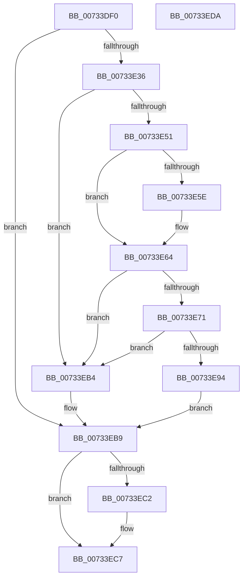

# PiDevCfgMigrateRootDevice

- RVA: `0x00733DF0`–`0x00733EDB` (길이 `235` bytes)
- VA: `0x0000000140733DF0`
- 실행 섹션: `PAGE`
- PDB 이름 있음: `예`; PDB Function 태그: `아니요`
- unwind 정보 RVA: `0x000C8B34`
- 디코드: `71`개 명령, `235/235` bytes 표시
- 미해석 바이트: `0` (있으면 어셈블리에 `.byte`로 보존)

> 이 문서는 커널 이미지의 기계어와 PDB 기호를 분석해 생성했습니다. 4번과 5번은 함수 원형과 자료형을 바이너리 사용 방식에서 추정한 C 해석이며 원본 소스 복구 결과는 아닙니다.

## 1. Dependencies

- 직접 호출 지점: **7**; 고유 호출 대상: **7**
- 직접 호출자로 확인된 함수: **1**
- RIP 상대 이미지 참조: **2**

### Outgoing calls
- `0x00733E27` → [PiDevCfgOpenDeviceMigrationKey](PiDevCfgOpenDeviceMigrationKey_function_00733EE4.md) (function, `0x00733EE4`)
- `0x00733E48` → [IopGetRegistryValue](../99/IopGetRegistryValue_function_009990EC.md) (function, `0x009990EC`)
- `0x00733E55` → [PnpValidateRegistryDword](../../text/4D/PnpValidateRegistryDword_function_004D109C.md) (function, `0x004D109C`)
- `0x00733E66` → [ExFreePoolWithTag](../../poolcode/B8/ExFreePoolWithTag_function_00B82870.md) (function, `0x00B82870`)
- `0x00733E8B` → [PnpRegistryValueExists](../../text/5A/PnpRegistryValueExists_function_005A81A0.md) (function, `0x005A81A0`)
- `0x00733EAB` → [PiDevCfgMigrateDevice](../96/PiDevCfgMigrateDevice_function_00963E60.md) (function, `0x00963E60`)
- `0x00733EC2` → [ZwClose](../../text/6A/ZwClose_function_006AD2B0.md) (function, `0x006AD2B0`)

### Direct callers
- [sub_00B29934](../B2/Unknown_function_00B29934.md) at `0x00B29A12`

### Static image references
- `0x00733E41` → RVA `0x00AFEE50` (` ?? ::NNGAKEGL::`string'`; read)
- `0x00733E75` → RVA `0x00AFF370` (` ?? ::NNGAKEGL::`string'`; read)

## 2. Other-region calls and transfers

- 다른 실행 섹션으로 향하는 call: **4**
  - `0x00733E55` → [PnpValidateRegistryDword](../../text/4D/PnpValidateRegistryDword_function_004D109C.md) (`PAGE` → `.text`)
  - `0x00733E66` → [ExFreePoolWithTag](../../poolcode/B8/ExFreePoolWithTag_function_00B82870.md) (`PAGE` → `POOLCODE`)
  - `0x00733E8B` → [PnpRegistryValueExists](../../text/5A/PnpRegistryValueExists_function_005A81A0.md) (`PAGE` → `.text`)
  - `0x00733EC2` → [ZwClose](../../text/6A/ZwClose_function_006AD2B0.md) (`PAGE` → `.text`)
- 별도 외부 분기/꼬리 이동을 확인하지 못했습니다.

## 3. Assembly (complete function range)

```asm
00733DF0  48 89 5C 24 08                  mov qword ptr [rsp + 8], rbx
00733DF5  55                              push rbp
00733DF6  56                              push rsi
00733DF7  57                              push rdi
00733DF8  41 56                           push r14
00733DFA  41 57                           push r15
00733DFC  48 8B EC                        mov rbp, rsp
00733DFF  48 83 EC 40                     sub rsp, 0x40
00733E03  48 83 65 38 00                  and qword ptr [rbp + 0x38], 0
00733E08  4D 8B F0                        mov r14, r8
00733E0B  48 83 65 48 00                  and qword ptr [rbp + 0x48], 0
00733E10  4C 8D 45 38                     lea r8, [rbp + 0x38]
00733E14  4C 8B F9                        mov r15, rcx
00733E17  0F 57 C0                        xorps xmm0, xmm0
00733E1A  48 8B 4A 08                     mov rcx, qword ptr [rdx + 8]
00733E1E  48 8B F2                        mov rsi, rdx
00733E21  0F 11 45 F0                     movups xmmword ptr [rbp - 0x10], xmm0
00733E25  33 FF                           xor edi, edi
00733E27  E8 B8 00 00 00                  call 0x140733ee4
00733E2C  8B D8                           mov ebx, eax
00733E2E  85 C0                           test eax, eax
00733E30  0F 88 83 00 00 00               js 0x140733eb9
00733E36  48 8B 4D 38                     mov rcx, qword ptr [rbp + 0x38]
00733E3A  4C 8D 4D 48                     lea r9, [rbp + 0x48]
00733E3E  45 33 C0                        xor r8d, r8d
00733E41  48 8D 15 08 B0 3C 00            lea rdx, [rip + 0x3cb008]
00733E48  E8 9F 52 26 00                  call 0x1409990ec
00733E4D  85 C0                           test eax, eax
00733E4F  78 63                           js 0x140733eb4
00733E51  48 8B 4D 48                     mov rcx, qword ptr [rbp + 0x48]
00733E55  E8 42 D2 D9 FF                  call 0x1404d109c
00733E5A  84 C0                           test al, al
00733E5C  74 06                           je 0x140733e64
00733E5E  8B 41 08                        mov eax, dword ptr [rcx + 8]
00733E61  8B 3C 08                        mov edi, dword ptr [rax + rcx]
00733E64  33 D2                           xor edx, edx
00733E66  E8 05 EA 44 00                  call 0x140b82870
00733E6B  40 F6 C7 01                     test dil, 1
00733E6F  74 43                           je 0x140733eb4
00733E71  48 8B 4D 38                     mov rcx, qword ptr [rbp + 0x38]
00733E75  48 8D 05 F4 B4 3C 00            lea rax, [rip + 0x3cb4f4]
00733E7C  48 8D 55 F0                     lea rdx, [rbp - 0x10]
00733E80  48 89 45 F8                     mov qword ptr [rbp - 8], rax
00733E84  C7 45 F0 1A 00 1C 00            mov dword ptr [rbp - 0x10], 0x1c001a
00733E8B  E8 10 43 E7 FF                  call 0x1405a81a0
00733E90  84 C0                           test al, al
00733E92  75 20                           jne 0x140733eb4
00733E94  48 83 64 24 28 00               and qword ptr [rsp + 0x28], 0
00733E9A  45 33 C9                        xor r9d, r9d
00733E9D  45 33 C0                        xor r8d, r8d
00733EA0  4C 89 74 24 20                  mov qword ptr [rsp + 0x20], r14
00733EA5  48 8B D6                        mov rdx, rsi
00733EA8  49 8B CF                        mov rcx, r15
00733EAB  E8 B0 FF 22 00                  call 0x140963e60
00733EB0  8B D8                           mov ebx, eax
00733EB2  EB 05                           jmp 0x140733eb9
00733EB4  BB 01 00 00 C0                  mov ebx, 0xc0000001
00733EB9  48 8B 4D 38                     mov rcx, qword ptr [rbp + 0x38]
00733EBD  48 85 C9                        test rcx, rcx
00733EC0  74 05                           je 0x140733ec7
00733EC2  E8 E9 93 F7 FF                  call 0x1406ad2b0
00733EC7  8B C3                           mov eax, ebx
00733EC9  48 8B 5C 24 70                  mov rbx, qword ptr [rsp + 0x70]
00733ECE  48 83 C4 40                     add rsp, 0x40
00733ED2  41 5F                           pop r15
00733ED4  41 5E                           pop r14
00733ED6  5F                              pop rdi
00733ED7  5E                              pop rsi
00733ED8  5D                              pop rbp
00733ED9  C3                              ret
00733EDA  CC                              int3
```

## 4. C-style interpretation (structured pseudocode)

```c
__int64 __fastcall PiDevCfgMigrateRootDevice(__int64 a1, __int64 a2, __int64 a3)
{
    __int64 result;
    __int64 v_rdi;
    __int64 v_rsp;
    unsigned __int64 v_stack_m30;
    unsigned __int64 v_stack_m38;
    unsigned __int64 v_stack_m40;
    unsigned __int64 v_stack_m48;
    unsigned __int64 v_stack_p10;
    unsigned __int64 v_stack_p20;
    unsigned __int64 v_stack_p8;

    v_stack_p8 = v_rbx;
    v_rsp = (v_rsp) - (64);
    v_stack_m38 = v_xmm0;
    v_rdi = 0;
    result = PiDevCfgOpenDeviceMigrationKey(*(unsigned __int64 *)(a2 + 8), a2, v_stack_p10, a4);
    if (sign_flag) goto loc_00733EB9;
    a3 = 0;
    result = IopGetRegistryValue(v_stack_p10, v_rip + 3977224, a3, v_stack_p20);
    if (sign_flag) goto loc_00733EB4;
    result = PnpValidateRegistryDword(v_stack_p20, v_rip + 3977224, a3, v_stack_p20);
    if ((unsigned __int8)(result) != 0) {
        result = *(unsigned int *)(v_stack_p20 + 8);
        v_rdi = *(unsigned int *)(result + v_stack_p20 * 1);
    }
    a2 = 0;
    result = ExFreePoolWithTag(v_stack_p20, a2, a3, v_stack_p20);
    if ((((unsigned __int8)(v_rdi)) & (1)) == 0) goto loc_00733EB4;
    v_stack_m30 = v_rip + 3978484;
    v_stack_m38 = 0x1C001AULL;
    result = PnpRegistryValueExists(v_stack_p10, v_stack_m38, a3, v_stack_p20);
    if ((unsigned __int8)(result) != 0) goto loc_00733EB4;
    a4 = 0;
    a3 = 0;
    v_stack_m48 = 0;
    result = PiDevCfgMigrateDevice(a1, 0, a3, a4);
    goto loc_00733EB9;
loc_00733EB4:
loc_00733EB9:
    if (v_stack_p10 != 0) {
        result = ZwClose(v_stack_p10, 0, a3, a4);
    }
    v_rsp = (v_rsp) + (64);
    return (unsigned int)((unsigned int)((unsigned int)(0xC0000001ULL)));
}
```

## 5. (Beta) C Style

```c
int64_t PiDevCfgMigrateRootDevice(int64_t Arg1, void *Arg2, int64_t Arg3)
{
    uint8_t *arg2 = (uint8_t *)Arg2;

    int64_t result;
    int64_t local_rdi;
    int64_t local_rsp;
    uint64_t v_stack_m30;
    uint64_t v_stack_m38;
    uint64_t v_stack_m40;
    uint64_t v_stack_m48;
    uint64_t v_stack_p10;
    uint64_t v_stack_p20;
    uint64_t v_stack_p8;

    v_stack_p8 = local_rbx;
    local_rsp = (local_rsp) - (64);
    v_stack_m38 = v_xmm0;
    local_rdi = 0;
    result = PiDevCfgOpenDeviceMigrationKey(*(uint64_t *)(arg2 + 0x8), Arg2, v_stack_p10, a4);
    if (sign_flag) goto loc_00733EB9;
    Arg3 = 0;
    result = IopGetRegistryValue(v_stack_p10, v_rip + 3977224, Arg3, v_stack_p20);
    if (sign_flag) goto loc_00733EB4;
    result = PnpValidateRegistryDword(v_stack_p20, v_rip + 3977224, Arg3, v_stack_p20);
    if ((uint8_t)(result) != 0) {
        result = *(uint32_t *)(v_stack_p20 + 0x8);
        local_rdi = *(uint32_t *)(result + v_stack_p20 * 1);
    }
    Arg2 = 0;
    result = ExFreePoolWithTag(v_stack_p20, Arg2, Arg3, v_stack_p20);
    if ((((uint8_t)(local_rdi)) & (1)) == 0) goto loc_00733EB4;
    v_stack_m30 = v_rip + 3978484;
    v_stack_m38 = 0x1C001AULL;
    result = PnpRegistryValueExists(v_stack_p10, v_stack_m38, Arg3, v_stack_p20);
    if ((uint8_t)(result) != 0) goto loc_00733EB4;
    a4 = 0;
    Arg3 = 0;
    v_stack_m48 = 0;
    result = PiDevCfgMigrateDevice(Arg1, 0, Arg3, a4);
    goto loc_00733EB9;
loc_00733EB4:
loc_00733EB9:
    if (v_stack_p10 != 0) {
        result = ZwClose(v_stack_p10, 0, Arg3, a4);
    }
    local_rsp = (local_rsp) + (64);
    return (uint32_t)((uint32_t)((uint32_t)(0xC0000001ULL)));
}
```

### 관측된 메모리 오프셋

구조체 형식이 확인되지 않은 접근은 인자 기준의 오프셋으로만 기록했습니다.

| 기준 인자 | 오프셋 표현 | 폭 (bit) | 접근 |
|---|---:|---:|---|
| `Arg2` | `+ 0x8` | `64` | `R` |

## 6. Execution-region graph

[열기: 2D/3D 그래프와 함수 탐색 컨트롤 패널](../../../control-panel.html?section=page&rva=0x00733DF0&view=graph)

- 2D 그래프는 위에서 아래로 흐르고, 3D 그래프는 빈 공간을 드래그해 회전합니다. Shift+드래그는 이동, 휠은 확대·축소, 함수 노드 선택은 대상 보고서 이동입니다.

### Static fallback


