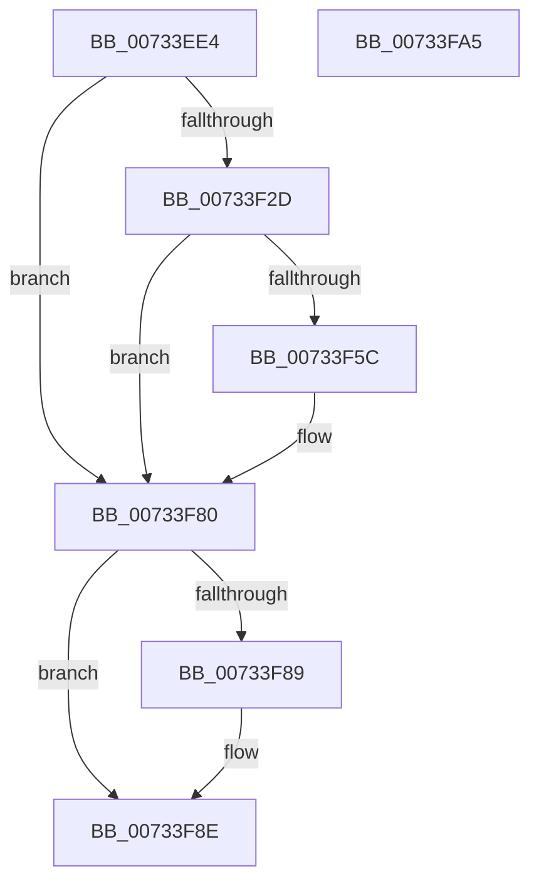

# PiDevCfgOpenDeviceMigrationKey

- RVA: `0x00733EE4`–`0x00733FA6` (길이 `194` bytes)
- VA: `0x0000000140733EE4`
- 실행 섹션: `PAGE`
- PDB 이름 있음: `예`; PDB Function 태그: `아니요`
- unwind 정보 RVA: `0x000C8B4C`
- 디코드: `51`개 명령, `194/194` bytes 표시
- 미해석 바이트: `0` (있으면 어셈블리에 `.byte`로 보존)

> 이 문서는 커널 이미지의 기계어와 PDB 기호를 분석해 생성했습니다. 4번과 5번은 함수 원형과 자료형을 바이너리 사용 방식에서 추정한 C 해석이며 원본 소스 복구 결과는 아닙니다.

## 1. Dependencies

- 직접 호출 지점: **5**; 고유 호출 대상: **4**
- 직접 호출자로 확인된 함수: **1**
- RIP 상대 이미지 참조: **2**

### Outgoing calls
- `0x00733F22` → [_PnpCtxGetCachedContextBaseKey](../8E/_PnpCtxGetCachedContextBaseKey_function_008EFB2C.md) (function, `0x008EFB2C`)
- `0x00733F51` → [IopOpenRegistryKeyEx](../A5/IopOpenRegistryKeyEx_function_00A51B44.md) (function, `0x00A51B44`)
- `0x00733F63` → [RtlInitUnicodeString](../../text/42/RtlInitUnicodeString_function_0042A780.md) (function, `0x0042A780`)
- `0x00733F79` → [IopOpenRegistryKeyEx](../A5/IopOpenRegistryKeyEx_function_00A51B44.md) (function, `0x00A51B44`)
- `0x00733F89` → [ZwClose](../../text/6A/ZwClose_function_006AD2B0.md) (function, `0x006AD2B0`)

### Direct callers
- [PiDevCfgMigrateRootDevice](PiDevCfgMigrateRootDevice_function_00733DF0.md) at `0x00733E27`

### Static image references
- `0x00733F12` → RVA `0x00E66398` (`.data`; read)
- `0x00733F31` → RVA `0x00AFF230` (` ?? ::NNGAKEGL::`string'`; read)

## 2. Other-region calls and transfers

- 다른 실행 섹션으로 향하는 call: **2**
  - `0x00733F63` → [RtlInitUnicodeString](../../text/42/RtlInitUnicodeString_function_0042A780.md) (`PAGE` → `.text`)
  - `0x00733F89` → [ZwClose](../../text/6A/ZwClose_function_006AD2B0.md) (`PAGE` → `.text`)
- 별도 외부 분기/꼬리 이동을 확인하지 못했습니다.

## 3. Assembly (complete function range)

```asm
00733EE4  48 89 5C 24 08                  mov qword ptr [rsp + 8], rbx
00733EE9  48 89 74 24 10                  mov qword ptr [rsp + 0x10], rsi
00733EEE  48 89 7C 24 18                  mov qword ptr [rsp + 0x18], rdi
00733EF3  55                              push rbp
00733EF4  48 8B EC                        mov rbp, rsp
00733EF7  48 83 EC 40                     sub rsp, 0x40
00733EFB  48 83 65 E0 00                  and qword ptr [rbp - 0x20], 0
00733F00  49 8B F8                        mov rdi, r8
00733F03  48 83 65 28 00                  and qword ptr [rbp + 0x28], 0
00733F08  4C 8D 45 E0                     lea r8, [rbp - 0x20]
00733F0C  48 8B F1                        mov rsi, rcx
00733F0F  0F 57 C0                        xorps xmm0, xmm0
00733F12  48 8B 0D 7F 24 73 00            mov rcx, qword ptr [rip + 0x73247f]
00733F19  BA 04 00 00 00                  mov edx, 4
00733F1E  0F 11 45 E8                     movups xmmword ptr [rbp - 0x18], xmm0
00733F22  E8 05 BC 1B 00                  call 0x1408efb2c
00733F27  8B D8                           mov ebx, eax
00733F29  85 C0                           test eax, eax
00733F2B  78 53                           js 0x140733f80
00733F2D  48 8B 55 E0                     mov rdx, qword ptr [rbp - 0x20]
00733F31  48 8D 05 F8 B2 3C 00            lea rax, [rip + 0x3cb2f8]
00733F38  41 B9 19 00 02 00               mov r9d, 0x20019
00733F3E  48 89 45 F0                     mov qword ptr [rbp - 0x10], rax
00733F42  4C 8D 45 E8                     lea r8, [rbp - 0x18]
00733F46  C7 45 E8 3E 00 40 00            mov dword ptr [rbp - 0x18], 0x40003e
00733F4D  48 8D 4D 28                     lea rcx, [rbp + 0x28]
00733F51  E8 EE DB 31 00                  call 0x140a51b44
00733F56  8B D8                           mov ebx, eax
00733F58  85 C0                           test eax, eax
00733F5A  78 24                           js 0x140733f80
00733F5C  48 8B D6                        mov rdx, rsi
00733F5F  48 8D 4D E8                     lea rcx, [rbp - 0x18]
00733F63  E8 18 68 CF FF                  call 0x14042a780
00733F68  48 8B 55 28                     mov rdx, qword ptr [rbp + 0x28]
00733F6C  4C 8D 45 E8                     lea r8, [rbp - 0x18]
00733F70  41 B9 19 00 02 00               mov r9d, 0x20019
00733F76  48 8B CF                        mov rcx, rdi
00733F79  E8 C6 DB 31 00                  call 0x140a51b44
00733F7E  8B D8                           mov ebx, eax
00733F80  48 8B 4D 28                     mov rcx, qword ptr [rbp + 0x28]
00733F84  48 85 C9                        test rcx, rcx
00733F87  74 05                           je 0x140733f8e
00733F89  E8 22 93 F7 FF                  call 0x1406ad2b0
00733F8E  48 8B 74 24 58                  mov rsi, qword ptr [rsp + 0x58]
00733F93  8B C3                           mov eax, ebx
00733F95  48 8B 5C 24 50                  mov rbx, qword ptr [rsp + 0x50]
00733F9A  48 8B 7C 24 60                  mov rdi, qword ptr [rsp + 0x60]
00733F9F  48 83 C4 40                     add rsp, 0x40
00733FA3  5D                              pop rbp
00733FA4  C3                              ret
00733FA5  CC                              int3
```

## 4. C-style interpretation (structured pseudocode)

```c
__int64 __fastcall PiDevCfgOpenDeviceMigrationKey(__int64 a1, __int64 a2, __int64 a3)
{
    __int64 result;
    __int64 v_rbx;
    __int64 v_rsp;
    unsigned __int64 v_stack_m18;
    unsigned __int64 v_stack_m20;
    unsigned __int64 v_stack_m28;
    unsigned __int64 v_stack_p10;
    unsigned __int64 v_stack_p18;
    unsigned __int64 v_stack_p20;
    unsigned __int64 v_stack_p8;

    v_stack_p8 = v_rbx;
    v_stack_p10 = v_rsi;
    v_stack_p18 = v_rdi;
    v_rsp = (v_rsp) - (64);
    v_stack_m20 = v_xmm0;
    result = _PnpCtxGetCachedContextBaseKey(*(unsigned __int64 *)(v_rip + 7545983), 4, v_stack_m28, a4);
    if (sign_flag) goto loc_00733F80;
    v_stack_m18 = v_rip + 3977976;
    v_stack_m20 = 0x40003EULL;
    result = IopOpenRegistryKeyEx(v_stack_p20, v_stack_m28, v_stack_m20, (unsigned int)(0x20019ULL));
    v_rbx = (unsigned int)((unsigned int)(result));
    if (!(sign_flag)) {
        a2 = a1;
        a1 = v_stack_m20;
        result = RtlInitUnicodeString(a1, a2, v_stack_m20, (unsigned int)(0x20019ULL));
        a2 = v_stack_p20;
        a3 = v_stack_m20;
        a4 = 0x20019ULL;
        a1 = a3;
        result = IopOpenRegistryKeyEx(a1, a2, a3, a4);
        v_rbx = (unsigned int)(result);
    }
    if (v_stack_p20 != 0) {
        result = ZwClose(v_stack_p20, a2, a3, a4);
    }
    v_rsp = (v_rsp) + (64);
    return (unsigned int)((unsigned int)(v_rbx));
}
```

## 5. (Beta) C Style

```c
int64_t PiDevCfgOpenDeviceMigrationKey(int64_t Arg1, int64_t Arg2, int64_t Arg3)
{
    int64_t result;
    int64_t local_rbx;
    int64_t local_rsp;
    uint64_t v_stack_m18;
    uint64_t v_stack_m20;
    uint64_t v_stack_m28;
    uint64_t v_stack_p10;
    uint64_t v_stack_p18;
    uint64_t v_stack_p20;
    uint64_t v_stack_p8;

    v_stack_p8 = local_rbx;
    v_stack_p10 = local_rsi;
    v_stack_p18 = local_rdi;
    local_rsp = (local_rsp) - (64);
    v_stack_m20 = v_xmm0;
    result = _PnpCtxGetCachedContextBaseKey(*(uint64_t *)(v_rip + 0x73247F), 4, v_stack_m28, a4);
    if (sign_flag) goto loc_00733F80;
    v_stack_m18 = v_rip + 3977976;
    v_stack_m20 = 0x40003EULL;
    result = IopOpenRegistryKeyEx(v_stack_p20, v_stack_m28, v_stack_m20, (uint32_t)(0x20019ULL));
    local_rbx = (uint32_t)((uint32_t)(result));
    if (!(sign_flag)) {
        Arg2 = Arg1;
        Arg1 = v_stack_m20;
        result = RtlInitUnicodeString(Arg1, Arg2, v_stack_m20, (uint32_t)(0x20019ULL));
        Arg2 = v_stack_p20;
        Arg3 = v_stack_m20;
        a4 = 0x20019ULL;
        Arg1 = Arg3;
        result = IopOpenRegistryKeyEx(Arg1, Arg2, Arg3, a4);
        local_rbx = (uint32_t)(result);
    }
    if (v_stack_p20 != 0) {
        result = ZwClose(v_stack_p20, Arg2, Arg3, a4);
    }
    local_rsp = (local_rsp) + (64);
    return (uint32_t)((uint32_t)(local_rbx));
}
```

## 6. Execution-region graph

[열기: 2D/3D 그래프와 함수 탐색 컨트롤 패널](../../../control-panel.html?section=page&rva=0x00733EE4&view=graph)

- 2D 그래프는 위에서 아래로 흐르고, 3D 그래프는 빈 공간을 드래그해 회전합니다. Shift+드래그는 이동, 휠은 확대·축소, 함수 노드 선택은 대상 보고서 이동입니다.

### Static fallback


