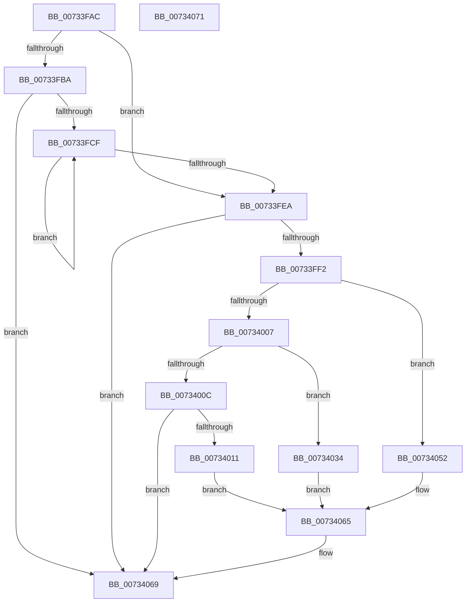

# PiDevCfgParseVersionString

- RVA: `0x00733FAC`–`0x00734072` (길이 `198` bytes)
- VA: `0x0000000140733FAC`
- 실행 섹션: `PAGE`
- PDB 이름 있음: `예`; PDB Function 태그: `아니요`
- unwind 정보 RVA: `0x0005D2F4`
- 디코드: `58`개 명령, `198/198` bytes 표시
- 미해석 바이트: `0` (있으면 어셈블리에 `.byte`로 보존)

> 이 문서는 커널 이미지의 기계어와 PDB 기호를 분석해 생성했습니다. 4번과 5번은 함수 원형과 자료형을 바이너리 사용 방식에서 추정한 C 해석이며 원본 소스 복구 결과는 아닙니다.

## 1. Dependencies

- 직접 호출 지점: **3**; 고유 호출 대상: **1**
- 직접 호출자로 확인된 함수: **3**
- RIP 상대 이미지 참조: **1**

### Outgoing calls
- `0x0073402A` → [swscanf_s](../../text/50/swscanf_s_function_005063B0.md) (function, `0x005063B0`)
- `0x00734048` → [swscanf_s](../../text/50/swscanf_s_function_005063B0.md) (function, `0x005063B0`)
- `0x0073405D` → [swscanf_s](../../text/50/swscanf_s_function_005063B0.md) (function, `0x005063B0`)

### Direct callers
- [PiDevCfgCheckDeviceNeedsUpdate](PiDevCfgCheckDeviceNeedsUpdate_function_00731DDC.md) at `0x00731FFB`
- [PiDevCfgQueryMinWhcpVersion](PiDevCfgQueryMinWhcpVersion_function_00735204.md) at `0x007352A4`
- [PiDevCfgSplitDriverConfigurationId](PiDevCfgSplitDriverConfigurationId_function_00736568.md) at `0x00736752`

### Static image references
- `0x00733FF2` → RVA `0x00B4B9B0` (`PAGE`; read)

## 2. Other-region calls and transfers

- 다른 실행 섹션으로 향하는 call: **3**
  - `0x0073402A` → [swscanf_s](../../text/50/swscanf_s_function_005063B0.md) (`PAGE` → `.text`)
  - `0x00734048` → [swscanf_s](../../text/50/swscanf_s_function_005063B0.md) (`PAGE` → `.text`)
  - `0x0073405D` → [swscanf_s](../../text/50/swscanf_s_function_005063B0.md) (`PAGE` → `.text`)
- 별도 외부 분기/꼬리 이동을 확인하지 못했습니다.

## 3. Assembly (complete function range)

```asm
00733FAC  48 83 EC 38                     sub rsp, 0x38
00733FB0  4D 8B D0                        mov r10, r8
00733FB3  45 33 C0                        xor r8d, r8d
00733FB6  85 D2                           test edx, edx
00733FB8  75 30                           jne 0x140733fea
00733FBA  44 0F B7 09                     movzx r9d, word ptr [rcx]
00733FBE  41 8D 50 01                     lea edx, [r8 + 1]
00733FC2  4C 8B D9                        mov r11, rcx
00733FC5  66 45 85 C9                     test r9w, r9w
00733FC9  0F 84 9A 00 00 00               je 0x140734069
00733FCF  66 41 83 F9 2E                  cmp r9w, 0x2e
00733FD4  8D 42 01                        lea eax, [rdx + 1]
00733FD7  4D 8D 5B 02                     lea r11, [r11 + 2]
00733FDB  45 0F B7 0B                     movzx r9d, word ptr [r11]
00733FDF  0F 45 C2                        cmovne eax, edx
00733FE2  8B D0                           mov edx, eax
00733FE4  66 45 85 C9                     test r9w, r9w
00733FE8  75 E5                           jne 0x140733fcf
00733FEA  8D 42 FE                        lea eax, [rdx - 2]
00733FED  83 F8 02                        cmp eax, 2
00733FF0  77 77                           ja 0x140734069
00733FF2  4C 8D 1D B7 79 41 00            lea r11, [rip + 0x4179b7]
00733FF9  4D 8B 1C C3                     mov r11, qword ptr [r11 + rax*8]
00733FFD  33 C0                           xor eax, eax
00733FFF  49 89 02                        mov qword ptr [r10], rax
00734002  83 EA 02                        sub edx, 2
00734005  74 4B                           je 0x140734052
00734007  83 EA 01                        sub edx, 1
0073400A  74 28                           je 0x140734034
0073400C  83 FA 01                        cmp edx, 1
0073400F  75 58                           jne 0x140734069
00734011  49 8D 42 02                     lea rax, [r10 + 2]
00734015  4C 89 54 24 28                  mov qword ptr [rsp + 0x28], r10
0073401A  4D 8D 4A 04                     lea r9, [r10 + 4]
0073401E  48 89 44 24 20                  mov qword ptr [rsp + 0x20], rax
00734023  4D 8D 42 06                     lea r8, [r10 + 6]
00734027  49 8B D3                        mov rdx, r11
0073402A  E8 81 23 DD FF                  call 0x1405063b0
0073402F  83 F8 04                        cmp eax, 4
00734032  EB 31                           jmp 0x140734065
00734034  49 8D 42 02                     lea rax, [r10 + 2]
00734038  49 8B D3                        mov rdx, r11
0073403B  4D 8D 4A 04                     lea r9, [r10 + 4]
0073403F  48 89 44 24 20                  mov qword ptr [rsp + 0x20], rax
00734044  4D 8D 42 06                     lea r8, [r10 + 6]
00734048  E8 63 23 DD FF                  call 0x1405063b0
0073404D  83 F8 03                        cmp eax, 3
00734050  EB 13                           jmp 0x140734065
00734052  4D 8D 4A 04                     lea r9, [r10 + 4]
00734056  49 8B D3                        mov rdx, r11
00734059  4D 8D 42 06                     lea r8, [r10 + 6]
0073405D  E8 4E 23 DD FF                  call 0x1405063b0
00734062  83 F8 02                        cmp eax, 2
00734065  41 0F 94 C0                     sete r8b
00734069  41 8A C0                        mov al, r8b
0073406C  48 83 C4 38                     add rsp, 0x38
00734070  C3                              ret
00734071  CC                              int3
```

## 4. C-style interpretation (structured pseudocode)

```c
__int64 __fastcall PiDevCfgParseVersionString(__int64 a1, int a2, __int64 a3)
{
    __int64 result;
    __int64 v_rsp;
    unsigned __int64 v_stack_m10;
    unsigned __int64 v_stack_m18;

    v_rsp = (v_rsp) - (56);
    a3 = 0;
    if (a2 != 0) goto loc_00733FEA;
    if ((unsigned __int16)(*(unsigned __int16 *)(a1)) == 0) goto loc_00734069;
loc_00733FCF:
    result = a3 + 1 + 1;
    if (((unsigned __int16)(*(unsigned __int16 *)(a1))) != 46) { result = (unsigned int)(a3 + 1); }
    if ((unsigned __int16)(*(unsigned __int16 *)(a1 + 2)) != 0) goto loc_00733FCF;
loc_00733FEA:
    if (((unsigned int)((unsigned int)((unsigned int)(result)) - 2)) > 2) goto loc_00734069;
    result = 0;
    *(unsigned __int64 *)(a3) = 0;
    a2 = (unsigned int)(((unsigned int)((unsigned int)(result))) - (2));
    if (condition_is_equal) goto loc_00734052;
    a2 = (unsigned int)((a2) - (1));
    if (condition_is_equal) goto loc_00734034;
    if (a2 != 1) goto loc_00734069;
    v_stack_m10 = 0;
    v_stack_m18 = a3 + 2;
    result = swscanf_s(a1, *(unsigned __int64 *)(v_rip + 4290999 + (unsigned int)((unsigned int)(result)) - 2 * 8), a3 + 6, a3 + 4);
    goto loc_00734065;
loc_00734034:
    v_stack_m18 = a3 + 2;
    result = swscanf_s(a1, *(unsigned __int64 *)(v_rip + 4290999 + (unsigned int)((unsigned int)(result)) - 2 * 8), a3 + 6, a3 + 4);
    goto loc_00734065;
loc_00734052:
    result = swscanf_s(a1, *(unsigned __int64 *)(v_rip + 4290999 + (unsigned int)((unsigned int)(result)) - 2 * 8), a3 + 6, a3 + 4);
loc_00734065:
    a3 = (((unsigned int)(result)) == 2) ? 1 : 0;
loc_00734069:
    v_rsp = (v_rsp) + (56);
    return (unsigned __int8)(a3);
}
```

## 5. (Beta) C Style

```c
int64_t PiDevCfgParseVersionString(void *Arg1, int32_t Arg2, void *Arg3)
{
    uint8_t *arg1 = (uint8_t *)Arg1;
    uint8_t *arg3 = (uint8_t *)Arg3;

    int64_t result;
    int64_t local_rsp;
    uint64_t v_stack_m10;
    uint64_t v_stack_m18;

    local_rsp = (local_rsp) - (56);
    Arg3 = 0;
    if (Arg2 != 0) goto loc_00733FEA;
    if ((uint16_t)(*(uint16_t *)(arg1)) == 0) goto loc_00734069;
loc_00733FCF:
    result = Arg3 + 1 + 1;
    if (((uint16_t)(*(uint16_t *)(arg1))) != 46) { result = (uint32_t)(Arg3 + 1); }
    if ((uint16_t)(*(uint16_t *)(arg1 + 0x2)) != 0) goto loc_00733FCF;
loc_00733FEA:
    if (((uint32_t)((uint32_t)((uint32_t)(result)) - 2)) > 2) goto loc_00734069;
    result = 0;
    *(uint64_t *)(arg3) = 0;
    Arg2 = (uint32_t)(((uint32_t)((uint32_t)(result))) - (2));
    if (condition_is_equal) goto loc_00734052;
    Arg2 = (uint32_t)((Arg2) - (1));
    if (condition_is_equal) goto loc_00734034;
    if (Arg2 != 1) goto loc_00734069;
    v_stack_m10 = 0;
    v_stack_m18 = Arg3 + 2;
    result = swscanf_s(Arg1, *(uint64_t *)(v_rip + 0x4179B7 + (uint32_t)((uint32_t)(result)) - 0x2 * 8), Arg3 + 6, Arg3 + 4);
    goto loc_00734065;
loc_00734034:
    v_stack_m18 = Arg3 + 2;
    result = swscanf_s(Arg1, *(uint64_t *)(v_rip + 0x4179B7 + (uint32_t)((uint32_t)(result)) - 0x2 * 8), Arg3 + 6, Arg3 + 4);
    goto loc_00734065;
loc_00734052:
    result = swscanf_s(Arg1, *(uint64_t *)(v_rip + 0x4179B7 + (uint32_t)((uint32_t)(result)) - 0x2 * 8), Arg3 + 6, Arg3 + 4);
loc_00734065:
    Arg3 = (((uint32_t)(result)) == 2) ? 1 : 0;
loc_00734069:
    local_rsp = (local_rsp) + (56);
    return (uint8_t)(Arg3);
}
```

### 관측된 메모리 오프셋

구조체 형식이 확인되지 않은 접근은 인자 기준의 오프셋으로만 기록했습니다.

| 기준 인자 | 오프셋 표현 | 폭 (bit) | 접근 |
|---|---:|---:|---|
| `Arg1` | `+ 0x0` | `16` | `R` |
| `Arg1` | `+ 0x2` | `64` | `R` |
| `Arg3` | `+ 0x0` | `64` | `W` |
| `Arg3` | `+ 0x2` | `64` | `R` |
| `Arg3` | `+ 0x4` | `64` | `R` |
| `Arg3` | `+ 0x6` | `64` | `R` |

## 6. Execution-region graph

[열기: 2D/3D 그래프와 함수 탐색 컨트롤 패널](../../../control-panel.html?section=page&rva=0x00733FAC&view=graph)

- 2D 그래프는 위에서 아래로 흐르고, 3D 그래프는 빈 공간을 드래그해 회전합니다. Shift+드래그는 이동, 휠은 확대·축소, 함수 노드 선택은 대상 보고서 이동입니다.

### Static fallback


