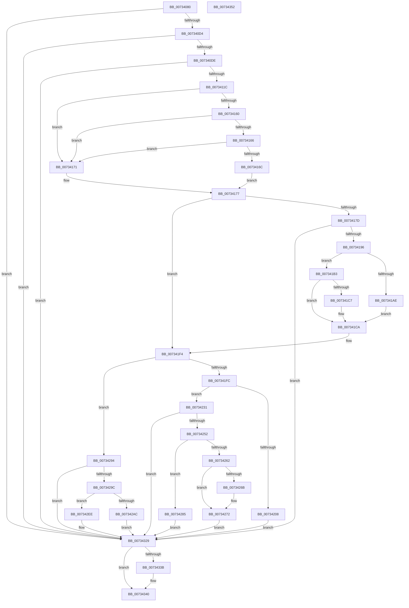

# PiDevCfgProcessDeviceCallback

- RVA: `0x00734080`–`0x00734353` (길이 `723` bytes)
- VA: `0x0000000140734080`
- 실행 섹션: `PAGE`
- PDB 이름 있음: `예`; PDB Function 태그: `아니요`
- unwind 정보 RVA: `0x000C8CC8`
- 디코드: `185`개 명령, `723/723` bytes 표시
- 미해석 바이트: `0` (있으면 어셈블리에 `.byte`로 보존)

> 이 문서는 커널 이미지의 기계어와 PDB 기호를 분석해 생성했습니다. 4번과 5번은 함수 원형과 자료형을 바이너리 사용 방식에서 추정한 C 해석이며 원본 소스 복구 결과는 아닙니다.

## 1. Dependencies

- 직접 호출 지점: **16**; 고유 호출 대상: **14**
- 직접 호출자로 확인된 함수: **0**
- RIP 상대 이미지 참조: **2**

### Outgoing calls
- `0x007340A5` → [memset](../../text/6C/memset_function_006C6C40.md) (function, `0x006C6C40`)
- `0x0073410F` → [_CmOpenDeviceRegKey](../8E/_CmOpenDeviceRegKey_function_008EE540.md) (function, `0x008EE540`)
- `0x00734157` → [CmGetDeviceRegProp](../8E/CmGetDeviceRegProp_function_008ED870.md) (function, `0x008ED870`)
- `0x00734189` → [PiDevCfgInitDeviceContext](../97/PiDevCfgInitDeviceContext_function_00977518.md) (function, `0x00977518`)
- `0x007341BB` → [PiDevCfgCheckDeviceNeedsUpdate](PiDevCfgCheckDeviceNeedsUpdate_function_00731DDC.md) (function, `0x00731DDC`)
- `0x007341EC` → [PiDevCfgSetDeviceRegProp](../96/PiDevCfgSetDeviceRegProp_function_009635C0.md) (function, `0x009635C0`)
- `0x007341FF` → [PipAreDriversLoaded](../../text/47/PipAreDriversLoaded_function_004708D4.md) (function, `0x004708D4`)
- `0x00734227` → [PiDevCfgSetDeviceRegProp](../96/PiDevCfgSetDeviceRegProp_function_009635C0.md) (function, `0x009635C0`)
- `0x00734241` → [ExAllocatePool2](../../poolcode/B8/ExAllocatePool2_function_00B820F0.md) (function, `0x00B820F0`)
- `0x00734259` → [PnpDuplicateUnicodeString](../../text/4C/PnpDuplicateUnicodeString_function_004CC044.md) (function, `0x004CC044`)
- `0x0073428A` → [ExFreePoolWithTag](../../poolcode/B8/ExFreePoolWithTag_function_00B82870.md) (function, `0x00B82870`)
- `0x007342C5` → [PnpRequestDeviceAction](../../text/47/PnpRequestDeviceAction_function_00477FF8.md) (function, `0x00477FF8`)
- `0x007342E7` → [PnpRequestDeviceAction](../../text/47/PnpRequestDeviceAction_function_00477FF8.md) (function, `0x00477FF8`)
- `0x00734324` → [PnpSetTargetDeviceRemove](../AA/PnpSetTargetDeviceRemove_function_00AA68CC.md) (function, `0x00AA68CC`)
- `0x0073432D` → [PiDevCfgFreeDeviceContext](../70/PiDevCfgFreeDeviceContext_function_00704A00.md) (function, `0x00704A00`)
- `0x0073433B` → [ZwClose](../../text/6A/ZwClose_function_006AD2B0.md) (function, `0x006AD2B0`)

### Direct callers
- 이 함수 시작 RVA로 연결되는 직접 call은 확인되지 않았습니다. 간접 호출은 완전히 역산할 수 없습니다.

### Static image references
- `0x007340DE` → RVA `0x00E66398` (`.data`; read)
- `0x00734196` → RVA `0x00FD8030` (`PAGEDATA`; read)

## 2. Other-region calls and transfers

- 다른 실행 섹션으로 향하는 call: **8**
  - `0x007340A5` → [memset](../../text/6C/memset_function_006C6C40.md) (`PAGE` → `.text`)
  - `0x007341FF` → [PipAreDriversLoaded](../../text/47/PipAreDriversLoaded_function_004708D4.md) (`PAGE` → `.text`)
  - `0x00734241` → [ExAllocatePool2](../../poolcode/B8/ExAllocatePool2_function_00B820F0.md) (`PAGE` → `POOLCODE`)
  - `0x00734259` → [PnpDuplicateUnicodeString](../../text/4C/PnpDuplicateUnicodeString_function_004CC044.md) (`PAGE` → `.text`)
  - `0x0073428A` → [ExFreePoolWithTag](../../poolcode/B8/ExFreePoolWithTag_function_00B82870.md) (`PAGE` → `POOLCODE`)
  - `0x007342C5` → [PnpRequestDeviceAction](../../text/47/PnpRequestDeviceAction_function_00477FF8.md) (`PAGE` → `.text`)
  - `0x007342E7` → [PnpRequestDeviceAction](../../text/47/PnpRequestDeviceAction_function_00477FF8.md) (`PAGE` → `.text`)
  - `0x0073433B` → [ZwClose](../../text/6A/ZwClose_function_006AD2B0.md) (`PAGE` → `.text`)
- 별도 외부 분기/꼬리 이동을 확인하지 못했습니다.

## 3. Assembly (complete function range)

```asm
00734080  40 55                           push rbp
00734082  53                              push rbx
00734083  56                              push rsi
00734084  57                              push rdi
00734085  41 56                           push r14
00734087  41 57                           push r15
00734089  48 8D 6C 24 D1                  lea rbp, [rsp - 0x2f]
0073408E  48 81 EC E8 00 00 00            sub rsp, 0xe8
00734095  48 8B FA                        mov rdi, rdx
00734098  48 8B D9                        mov rbx, rcx
0073409B  33 D2                           xor edx, edx
0073409D  48 8D 4D C7                     lea rcx, [rbp - 0x39]
007340A1  44 8D 42 58                     lea r8d, [rdx + 0x58]
007340A5  E8 96 2B F9 FF                  call 0x1406c6c40
007340AA  45 33 F6                        xor r14d, r14d
007340AD  C7 45 77 01 00 00 00            mov dword ptr [rbp + 0x77], 1
007340B4  F7 83 C0 02 00 00 00 10 00 00   test dword ptr [rbx + 0x2c0], 0x1000
007340BE  4C 89 75 B7                     mov qword ptr [rbp - 0x49], r14
007340C2  44 89 75 67                     mov dword ptr [rbp + 0x67], r14d
007340C6  44 89 75 7F                     mov dword ptr [rbp + 0x7f], r14d
007340CA  44 89 75 6F                     mov dword ptr [rbp + 0x6f], r14d
007340CE  0F 84 55 02 00 00               je 0x140734329
007340D4  4C 39 73 30                     cmp qword ptr [rbx + 0x30], r14
007340D8  0F 84 4B 02 00 00               je 0x140734329
007340DE  48 8B 0D B3 22 73 00            mov rcx, qword ptr [rip + 0x7322b3]
007340E5  48 8D 45 B7                     lea rax, [rbp - 0x49]
007340E9  4C 89 74 24 38                  mov qword ptr [rsp + 0x38], r14
007340EE  48 8D 73 28                     lea rsi, [rbx + 0x28]
007340F2  48 8B 56 08                     mov rdx, qword ptr [rsi + 8]
007340F6  45 8D 46 10                     lea r8d, [r14 + 0x10]
007340FA  48 89 44 24 30                  mov qword ptr [rsp + 0x30], rax
007340FF  45 33 C9                        xor r9d, r9d
00734102  44 88 74 24 28                  mov byte ptr [rsp + 0x28], r14b
00734107  C7 44 24 20 3F 00 0F 00         mov dword ptr [rsp + 0x20], 0xf003f
0073410F  E8 2C A4 1B 00                  call 0x1408ee540
00734114  85 C0                           test eax, eax
00734116  0F 88 0D 02 00 00               js 0x140734329
0073411C  4C 8B 45 B7                     mov r8, qword ptr [rbp - 0x49]
00734120  48 8D 45 6F                     lea rax, [rbp + 0x6f]
00734124  48 8B 56 08                     mov rdx, qword ptr [rsi + 8]
00734128  45 8D 7E 04                     lea r15d, [r14 + 4]
0073412C  48 8B 0D 65 22 73 00            mov rcx, qword ptr [rip + 0x732265]
00734133  45 8D 4E 0B                     lea r9d, [r14 + 0xb]
00734137  44 89 74 24 38                  mov dword ptr [rsp + 0x38], r14d
0073413C  48 89 44 24 30                  mov qword ptr [rsp + 0x30], rax
00734141  48 8D 45 67                     lea rax, [rbp + 0x67]
00734145  48 89 44 24 28                  mov qword ptr [rsp + 0x28], rax
0073414A  48 8D 45 77                     lea rax, [rbp + 0x77]
0073414E  48 89 44 24 20                  mov qword ptr [rsp + 0x20], rax
00734153  44 89 7D 6F                     mov dword ptr [rbp + 0x6f], r15d
00734157  E8 14 97 1B 00                  call 0x1408ed870
0073415C  85 C0                           test eax, eax
0073415E  78 11                           js 0x140734171
00734160  44 39 7D 77                     cmp dword ptr [rbp + 0x77], r15d
00734164  75 0B                           jne 0x140734171
00734166  44 39 7D 6F                     cmp dword ptr [rbp + 0x6f], r15d
0073416A  75 05                           jne 0x140734171
0073416C  8B 45 67                        mov eax, dword ptr [rbp + 0x67]
0073416F  EB 06                           jmp 0x140734177
00734171  41 8B C6                        mov eax, r14d
00734174  89 45 67                        mov dword ptr [rbp + 0x67], eax
00734177  0F BA E0 12                     bt eax, 0x12
0073417B  73 77                           jae 0x1407341f4
0073417D  48 8B 55 B7                     mov rdx, qword ptr [rbp - 0x49]
00734181  4C 8D 45 C7                     lea r8, [rbp - 0x39]
00734185  48 8B 4E 08                     mov rcx, qword ptr [rsi + 8]
00734189  E8 8A 33 24 00                  call 0x140977518
0073418E  85 C0                           test eax, eax
00734190  0F 88 93 01 00 00               js 0x140734329
00734196  F6 05 93 3E 8A 00 02            test byte ptr [rip + 0x8a3e93], 2
0073419D  8B 55 67                        mov edx, dword ptr [rbp + 0x67]
007341A0  0F 95 C1                        setne cl
007341A3  0F BA E2 0A                     bt edx, 0xa
007341A7  0F 92 C0                        setb al
007341AA  84 C8                           test al, cl
007341AC  74 05                           je 0x1407341b3
007341AE  83 E2 DF                        and edx, 0xffffffdf
007341B1  EB 17                           jmp 0x1407341ca
007341B3  48 8D 55 7F                     lea rdx, [rbp + 0x7f]
007341B7  48 8D 4D C7                     lea rcx, [rbp - 0x39]
007341BB  E8 1C DC FF FF                  call 0x140731ddc
007341C0  8B 55 67                        mov edx, dword ptr [rbp + 0x67]
007341C3  85 C0                           test eax, eax
007341C5  78 03                           js 0x1407341ca
007341C7  0B 55 7F                        or edx, dword ptr [rbp + 0x7f]
007341CA  0F BA F2 12                     btr edx, 0x12
007341CE  44 89 7C 24 28                  mov dword ptr [rsp + 0x28], r15d
007341D3  89 55 67                        mov dword ptr [rbp + 0x67], edx
007341D6  48 8D 45 67                     lea rax, [rbp + 0x67]
007341DA  48 8D 55 C7                     lea rdx, [rbp - 0x39]
007341DE  48 89 44 24 20                  mov qword ptr [rsp + 0x20], rax
007341E3  45 8B CF                        mov r9d, r15d
007341E6  41 B8 0B 00 00 00               mov r8d, 0xb
007341EC  E8 CF F3 22 00                  call 0x1409635c0
007341F1  8B 45 67                        mov eax, dword ptr [rbp + 0x67]
007341F4  A8 02                           test al, 2
007341F6  0F 84 98 00 00 00               je 0x140734294
007341FC  48 8B CB                        mov rcx, rbx
007341FF  E8 D0 C6 D3 FF                  call 0x1404708d4
00734204  85 C0                           test eax, eax
00734206  74 29                           je 0x140734231
00734208  83 65 67 FD                     and dword ptr [rbp + 0x67], 0xfffffffd
0073420C  48 8D 45 67                     lea rax, [rbp + 0x67]
00734210  44 89 7C 24 28                  mov dword ptr [rsp + 0x28], r15d
00734215  48 8D 55 C7                     lea rdx, [rbp - 0x39]
00734219  45 8B CF                        mov r9d, r15d
0073421C  48 89 44 24 20                  mov qword ptr [rsp + 0x20], rax
00734221  41 B8 0B 00 00 00               mov r8d, 0xb
00734227  E8 94 F3 22 00                  call 0x1409635c0
0073422C  E9 F8 00 00 00                  jmp 0x140734329
00734231  BA 20 00 00 00                  mov edx, 0x20
00734236  B9 00 01 00 00                  mov ecx, 0x100
0073423B  41 B8 50 70 64 63               mov r8d, 0x63647050
00734241  E8 AA DE 44 00                  call 0x140b820f0
00734246  48 8B D8                        mov rbx, rax
00734249  48 85 C0                        test rax, rax
0073424C  0F 84 D7 00 00 00               je 0x140734329
00734252  48 8D 48 10                     lea rcx, [rax + 0x10]
00734256  48 8B D6                        mov rdx, rsi
00734259  E8 E6 7D D9 FF                  call 0x1404cc044
0073425E  84 C0                           test al, al
00734260  74 23                           je 0x140734285
00734262  48 8B 47 08                     mov rax, qword ptr [rdi + 8]
00734266  48 39 38                        cmp qword ptr [rax], rdi
00734269  74 07                           je 0x140734272
0073426B  B9 03 00 00 00                  mov ecx, 3
00734270  CD 29                           int 0x29
00734272  48 89 3B                        mov qword ptr [rbx], rdi
00734275  48 89 43 08                     mov qword ptr [rbx + 8], rax
00734279  48 89 18                        mov qword ptr [rax], rbx
0073427C  48 89 5F 08                     mov qword ptr [rdi + 8], rbx
00734280  E9 A4 00 00 00                  jmp 0x140734329
00734285  33 D2                           xor edx, edx
00734287  48 8B CB                        mov rcx, rbx
0073428A  E8 E1 E5 44 00                  call 0x140b82870
0073428F  E9 95 00 00 00                  jmp 0x140734329
00734294  A8 20                           test al, 0x20
00734296  0F 84 8D 00 00 00               je 0x140734329
0073429C  F7 83 8C 01 00 00 00 60 00 00   test dword ptr [rbx + 0x18c], 0x6000
007342A6  48 8B 4B 20                     mov rcx, qword ptr [rbx + 0x20]
007342AA  74 42                           je 0x1407342ee
007342AC  45 33 C9                        xor r9d, r9d
007342AF  4C 89 74 24 30                  mov qword ptr [rsp + 0x30], r14
007342B4  4C 89 74 24 28                  mov qword ptr [rsp + 0x28], r14
007342B9  41 B0 01                        mov r8b, 1
007342BC  4C 89 74 24 20                  mov qword ptr [rsp + 0x20], r14
007342C1  41 8D 51 01                     lea edx, [r9 + 1]
007342C5  E8 2E 3D D4 FF                  call 0x140477ff8
007342CA  48 8B 4B 20                     mov rcx, qword ptr [rbx + 0x20]
007342CE  45 33 C9                        xor r9d, r9d
007342D1  4C 89 74 24 30                  mov qword ptr [rsp + 0x30], r14
007342D6  41 B0 01                        mov r8b, 1
007342D9  4C 89 74 24 28                  mov qword ptr [rsp + 0x28], r14
007342DE  4C 89 74 24 20                  mov qword ptr [rsp + 0x20], r14
007342E3  41 8D 51 10                     lea edx, [r9 + 0x10]
007342E7  E8 0C 3D D4 FF                  call 0x140477ff8
007342EC  EB 3B                           jmp 0x140734329
007342EE  4C 89 74 24 68                  mov qword ptr [rsp + 0x68], r14
007342F3  45 33 C9                        xor r9d, r9d
007342F6  4C 89 74 24 60                  mov qword ptr [rsp + 0x60], r14
007342FB  45 33 C0                        xor r8d, r8d
007342FE  4C 89 74 24 58                  mov qword ptr [rsp + 0x58], r14
00734303  33 D2                           xor edx, edx
00734305  4C 89 74 24 50                  mov qword ptr [rsp + 0x50], r14
0073430A  4C 89 74 24 38                  mov qword ptr [rsp + 0x38], r14
0073430F  C7 44 24 30 95 04 00 C0         mov dword ptr [rsp + 0x30], 0xc0000495
00734317  C7 44 24 28 12 00 00 00         mov dword ptr [rsp + 0x28], 0x12
0073431F  44 89 74 24 20                  mov dword ptr [rsp + 0x20], r14d
00734324  E8 A3 25 37 00                  call 0x140aa68cc
00734329  48 8D 4D C7                     lea rcx, [rbp - 0x39]
0073432D  E8 CE 06 FD FF                  call 0x140704a00
00734332  48 8B 4D B7                     mov rcx, qword ptr [rbp - 0x49]
00734336  48 85 C9                        test rcx, rcx
00734339  74 05                           je 0x140734340
0073433B  E8 70 8F F7 FF                  call 0x1406ad2b0
00734340  33 C0                           xor eax, eax
00734342  48 81 C4 E8 00 00 00            add rsp, 0xe8
00734349  41 5F                           pop r15
0073434B  41 5E                           pop r14
0073434D  5F                              pop rdi
0073434E  5E                              pop rsi
0073434F  5B                              pop rbx
00734350  5D                              pop rbp
00734351  C3                              ret
00734352  CC                              int3
```

## 4. C-style interpretation (structured pseudocode)

```c
__int64 __fastcall PiDevCfgProcessDeviceCallback(__int64 a1, __int64 a2, __int64 a3, int a4)
{
    __int64 result;
    __int64 v_r14;
    __int64 v_rsp;
    unsigned __int64 v_stack_m5F;
    unsigned __int64 v_stack_m98;
    unsigned __int64 v_stack_mA8;
    unsigned __int64 v_stack_mB0;
    unsigned __int64 v_stack_mB8;
    unsigned __int64 v_stack_mC0;
    unsigned __int64 v_stack_mC8;
    unsigned __int64 v_stack_mE0;
    unsigned __int64 v_stack_mE8;
    unsigned __int8 v_stack_mF0;
    unsigned int v_stack_mF8;
    unsigned int v_stack_p10;
    unsigned int v_stack_p18;
    unsigned int v_stack_p20;
    unsigned int v_stack_p8;

    v_rsp = (v_rsp) - (232);
    a2 = 0;
    result = memset(v_stack_m98, a2, a2 + 88, a4);
    v_r14 = 0;
    v_stack_p18 = 1;
    v_stack_mA8 = 0;
    v_stack_p8 = 0;
    v_stack_p20 = 0;
    v_stack_p10 = 0;
    if (((*(unsigned int *)(a1 + 704)) & (0x1000ULL)) == 0) goto loc_00734329;
    if ((*(unsigned __int64 *)(a1 + 48)) == 0) goto loc_00734329;
    v_stack_mE0 = 0;
    v_stack_mE8 = v_stack_mA8;
    a4 = 0;
    v_stack_mF0 = 0;
    v_stack_mF8 = 0xF003FULL;
    result = _CmOpenDeviceRegKey(*(unsigned __int64 *)(v_rip + 7545523), *(unsigned __int64 *)(a1 + 40 + 8), v_r14 + 16, a4);
    if (sign_flag) goto loc_00734329;
    v_stack_mE0 = 0;
    v_stack_mE8 = v_stack_p10;
    v_stack_mF0 = v_stack_p8;
    v_stack_mF8 = v_stack_p18;
    v_stack_p10 = (unsigned int)(v_r14 + 4);
    result = CmGetDeviceRegProp(*(unsigned __int64 *)(v_rip + 7545445), *(unsigned __int64 *)(a1 + 40 + 8), v_stack_mA8, v_r14 + 11);
    if (sign_flag) goto loc_00734171;
    if (v_stack_p18 != ((unsigned int)(v_r14 + 4))) goto loc_00734171;
    if (v_stack_p10 != ((unsigned int)(v_r14 + 4))) goto loc_00734171;
    goto loc_00734177;
loc_00734171:
    v_stack_p8 = 0;
loc_00734177:
    if (v_stack_p10 >= ((unsigned int)(v_r14 + 4))) goto loc_007341F4;
    result = PiDevCfgInitDeviceContext(*(unsigned __int64 *)(a1 + 40 + 8), v_stack_mA8, v_stack_m98, v_r14 + 11);
    if (sign_flag) goto loc_00734329;
    a1 = (((*(unsigned __int8 *)(v_rip + 9059987)) & (2)) != 0) ? 1 : 0;
    result = (condition_is_below) ? 1 : 0;
    if ((((unsigned __int8)(result)) & ((unsigned __int8)(a1))) == 0) goto loc_007341B3;
    a2 = (unsigned int)(((unsigned int)(v_stack_p8)) & (0xFFFFFFDFULL));
    goto loc_007341CA;
loc_007341B3:
    result = PiDevCfgCheckDeviceNeedsUpdate(v_stack_m98, v_stack_p20, v_stack_m98, v_r14 + 11);
    if (!(sign_flag)) {
        a2 = (unsigned int)(((unsigned int)(v_stack_p8)) | (v_stack_p20));
    }
    v_stack_mF0 = (unsigned int)(v_r14 + 4);
    v_stack_p8 = (unsigned int)(a2);
    v_stack_mF8 = v_stack_p8;
    result = PiDevCfgSetDeviceRegProp(v_stack_m98, v_stack_m98, 11, (unsigned int)((unsigned int)(v_r14 + 4)));
loc_007341F4:
    if ((((unsigned __int8)((unsigned int)(v_stack_p8))) & (2)) == 0) goto loc_00734294;
    result = PipAreDriversLoaded(a1, v_stack_m98, 11, (unsigned int)((unsigned int)(v_r14 + 4)));
    if ((unsigned int)(result) == 0) goto loc_00734231;
    v_stack_mF0 = (unsigned int)(v_r14 + 4);
    v_stack_mF8 = v_stack_p8;
    result = PiDevCfgSetDeviceRegProp(a1, v_stack_m98, 11, (unsigned int)((unsigned int)(v_r14 + 4)));
    goto loc_00734329;
loc_00734231:
    result = ExAllocatePool2(256, 32, (unsigned int)(0x63647050ULL), (unsigned int)((unsigned int)(v_r14 + 4)));
    if (result == 0) goto loc_00734329;
    result = PnpDuplicateUnicodeString(result + 16, a1 + 40, (unsigned int)(0x63647050ULL), (unsigned int)((unsigned int)(v_r14 + 4)));
    if ((unsigned __int8)(result) == 0) goto loc_00734285;
    if ((*(unsigned __int64 *)(*(unsigned __int64 *)(a2 + 8))) != a2) {
        a1 = 3;
    }
    *(unsigned __int64 *)(result) = a2;
    *(unsigned __int64 *)(result + 8) = *(unsigned __int64 *)(a2 + 8);
    *(unsigned __int64 *)(*(unsigned __int64 *)(a2 + 8)) = result;
    *(unsigned __int64 *)(a2 + 8) = result;
    goto loc_00734329;
loc_00734285:
    a2 = 0;
    result = ExFreePoolWithTag(result, a2, (unsigned int)(0x63647050ULL), (unsigned int)((unsigned int)(v_r14 + 4)));
    goto loc_00734329;
loc_00734294:
    if ((((unsigned __int8)(result)) & (32)) == 0) goto loc_00734329;
    if (((*(unsigned int *)(result + 396)) & (0x6000ULL)) == 0) goto loc_007342EE;
    a4 = 0;
    v_stack_mE8 = 0;
    v_stack_mF0 = 0;
    v_stack_mF8 = 0;
    result = PnpRequestDeviceAction(*(unsigned __int64 *)(result + 32), a4 + 1, 1, a4);
    a4 = 0;
    v_stack_mE8 = 0;
    v_stack_mF0 = 0;
    v_stack_mF8 = 0;
    result = PnpRequestDeviceAction(*(unsigned __int64 *)(result + 32), a4 + 16, 1, a4);
    goto loc_00734329;
loc_007342EE:
    v_stack_mB0 = 0;
    a4 = 0;
    v_stack_mB8 = 0;
    a3 = 0;
    v_stack_mC0 = 0;
    a2 = 0;
    v_stack_mC8 = 0;
    v_stack_mE0 = 0;
    v_stack_mE8 = 0xC0000495ULL;
    v_stack_mF0 = 18;
    v_stack_mF8 = 0;
    result = PnpSetTargetDeviceRemove(*(unsigned __int64 *)(result + 32), a2, a3, a4);
loc_00734329:
    result = PiDevCfgFreeDeviceContext(v_stack_m98, a2, a3, a4);
    if (v_stack_mA8 != 0) {
        result = ZwClose(v_stack_mA8, a2, a3, a4);
    }
    result = 0;
    v_rsp = (v_rsp) + (232);
    return result;
}
```

## 5. (Beta) C Style

```c
int64_t PiDevCfgProcessDeviceCallback(void *Arg1, void *Arg2, int64_t Arg3, int32_t Arg4)
{
    uint8_t *arg1 = (uint8_t *)Arg1;
    uint8_t *arg2 = (uint8_t *)Arg2;

    int64_t result;
    int64_t local_r14;
    int64_t local_rsp;
    uint64_t v_stack_m5F;
    uint64_t v_stack_m98;
    uint64_t v_stack_mA8;
    uint64_t v_stack_mB0;
    uint64_t v_stack_mB8;
    uint64_t v_stack_mC0;
    uint64_t v_stack_mC8;
    uint64_t v_stack_mE0;
    uint64_t v_stack_mE8;
    uint8_t v_stack_mF0;
    uint32_t v_stack_mF8;
    uint32_t v_stack_p10;
    uint32_t v_stack_p18;
    uint32_t v_stack_p20;
    uint32_t v_stack_p8;

    local_rsp = (local_rsp) - (232);
    Arg2 = 0;
    result = memset(v_stack_m98, Arg2, Arg2 + 88, Arg4);
    local_r14 = 0;
    v_stack_p18 = 1;
    v_stack_mA8 = 0;
    v_stack_p8 = 0;
    v_stack_p20 = 0;
    v_stack_p10 = 0;
    if (((*(uint32_t *)(arg1 + 0x2C0)) & (0x1000ULL)) == 0) goto loc_00734329;
    if ((*(uint64_t *)(arg1 + 0x30)) == 0) goto loc_00734329;
    v_stack_mE0 = 0;
    v_stack_mE8 = v_stack_mA8;
    Arg4 = 0;
    v_stack_mF0 = 0;
    v_stack_mF8 = 0xF003FULL;
    result = _CmOpenDeviceRegKey(*(uint64_t *)(v_rip + 0x7322B3), *(uint64_t *)(arg1 + 0x28 + 0x8), local_r14 + 16, Arg4);
    if (sign_flag) goto loc_00734329;
    v_stack_mE0 = 0;
    v_stack_mE8 = v_stack_p10;
    v_stack_mF0 = v_stack_p8;
    v_stack_mF8 = v_stack_p18;
    v_stack_p10 = (uint32_t)(local_r14 + 4);
    result = CmGetDeviceRegProp(*(uint64_t *)(v_rip + 0x732265), *(uint64_t *)(arg1 + 0x28 + 0x8), v_stack_mA8, local_r14 + 11);
    if (sign_flag) goto loc_00734171;
    if (v_stack_p18 != ((uint32_t)(local_r14 + 4))) goto loc_00734171;
    if (v_stack_p10 != ((uint32_t)(local_r14 + 4))) goto loc_00734171;
    goto loc_00734177;
loc_00734171:
    v_stack_p8 = 0;
loc_00734177:
    if (v_stack_p10 >= ((uint32_t)(local_r14 + 4))) goto loc_007341F4;
    result = PiDevCfgInitDeviceContext(*(uint64_t *)(arg1 + 0x28 + 0x8), v_stack_mA8, v_stack_m98, local_r14 + 11);
    if (sign_flag) goto loc_00734329;
    Arg1 = (((*(uint8_t *)(v_rip + 0x8A3E93)) & (2)) != 0) ? 1 : 0;
    result = (condition_is_below) ? 1 : 0;
    if ((((uint8_t)(result)) & ((uint8_t)(Arg1))) == 0) goto loc_007341B3;
    Arg2 = (uint32_t)(((uint32_t)(v_stack_p8)) & (0xFFFFFFDFULL));
    goto loc_007341CA;
loc_007341B3:
    result = PiDevCfgCheckDeviceNeedsUpdate(v_stack_m98, v_stack_p20, v_stack_m98, local_r14 + 11);
    if (!(sign_flag)) {
        Arg2 = (uint32_t)(((uint32_t)(v_stack_p8)) | (v_stack_p20));
    }
    v_stack_mF0 = (uint32_t)(local_r14 + 4);
    v_stack_p8 = (uint32_t)(Arg2);
    v_stack_mF8 = v_stack_p8;
    result = PiDevCfgSetDeviceRegProp(v_stack_m98, v_stack_m98, 11, (uint32_t)((uint32_t)(local_r14 + 4)));
loc_007341F4:
    if ((((uint8_t)((uint32_t)(v_stack_p8))) & (2)) == 0) goto loc_00734294;
    result = PipAreDriversLoaded(Arg1, v_stack_m98, 11, (uint32_t)((uint32_t)(local_r14 + 4)));
    if ((uint32_t)(result) == 0) goto loc_00734231;
    v_stack_mF0 = (uint32_t)(local_r14 + 4);
    v_stack_mF8 = v_stack_p8;
    result = PiDevCfgSetDeviceRegProp(Arg1, v_stack_m98, 11, (uint32_t)((uint32_t)(local_r14 + 4)));
    goto loc_00734329;
loc_00734231:
    result = ExAllocatePool2(256, 32, (uint32_t)(0x63647050ULL), (uint32_t)((uint32_t)(local_r14 + 4)));
    if (result == 0) goto loc_00734329;
    result = PnpDuplicateUnicodeString(result + 16, Arg1 + 40, (uint32_t)(0x63647050ULL), (uint32_t)((uint32_t)(local_r14 + 4)));
    if ((uint8_t)(result) == 0) goto loc_00734285;
    if ((*(uint64_t *)(*(uint64_t *)(arg2 + 0x8))) != Arg2) {
        Arg1 = 3;
    }
    *(void **)(result) = Arg2;
    *(uint64_t *)(result + 0x8) = *(uint64_t *)(arg2 + 0x8);
    *(uint64_t *)(*(uint64_t *)(arg2 + 0x8)) = result;
    *(uint64_t *)(arg2 + 0x8) = result;
    goto loc_00734329;
loc_00734285:
    Arg2 = 0;
    result = ExFreePoolWithTag(result, Arg2, (uint32_t)(0x63647050ULL), (uint32_t)((uint32_t)(local_r14 + 4)));
    goto loc_00734329;
loc_00734294:
    if ((((uint8_t)(result)) & (32)) == 0) goto loc_00734329;
    if (((*(uint32_t *)(result + 0x18C)) & (0x6000ULL)) == 0) goto loc_007342EE;
    Arg4 = 0;
    v_stack_mE8 = 0;
    v_stack_mF0 = 0;
    v_stack_mF8 = 0;
    result = PnpRequestDeviceAction(*(uint64_t *)(result + 0x20), Arg4 + 1, 1, Arg4);
    Arg4 = 0;
    v_stack_mE8 = 0;
    v_stack_mF0 = 0;
    v_stack_mF8 = 0;
    result = PnpRequestDeviceAction(*(uint64_t *)(result + 0x20), Arg4 + 16, 1, Arg4);
    goto loc_00734329;
loc_007342EE:
    v_stack_mB0 = 0;
    Arg4 = 0;
    v_stack_mB8 = 0;
    Arg3 = 0;
    v_stack_mC0 = 0;
    Arg2 = 0;
    v_stack_mC8 = 0;
    v_stack_mE0 = 0;
    v_stack_mE8 = 0xC0000495ULL;
    v_stack_mF0 = 18;
    v_stack_mF8 = 0;
    result = PnpSetTargetDeviceRemove(*(uint64_t *)(result + 0x20), Arg2, Arg3, Arg4);
loc_00734329:
    result = PiDevCfgFreeDeviceContext(v_stack_m98, Arg2, Arg3, Arg4);
    if (v_stack_mA8 != 0) {
        result = ZwClose(v_stack_mA8, Arg2, Arg3, Arg4);
    }
    result = 0;
    local_rsp = (local_rsp) + (232);
    return result;
}
```

### 관측된 메모리 오프셋

구조체 형식이 확인되지 않은 접근은 인자 기준의 오프셋으로만 기록했습니다.

| 기준 인자 | 오프셋 표현 | 폭 (bit) | 접근 |
|---|---:|---:|---|
| `Arg1` | `+ 0x8` | `64` | `R` |
| `Arg1` | `+ 0x20` | `64` | `R` |
| `Arg1` | `+ 0x28` | `64` | `R` |
| `Arg1` | `+ 0x30` | `64` | `R` |
| `Arg1` | `+ 0x18C` | `32` | `R` |
| `Arg1` | `+ 0x2C0` | `32` | `R` |
| `Arg2` | `+ 0x8` | `64` | `R` |
| `Arg2` | `+ 0x8` | `64` | `W` |

## 6. Execution-region graph

[열기: 2D/3D 그래프와 함수 탐색 컨트롤 패널](../../../control-panel.html?section=page&rva=0x00734080&view=graph)

- 2D 그래프는 위에서 아래로 흐르고, 3D 그래프는 빈 공간을 드래그해 회전합니다. Shift+드래그는 이동, 휠은 확대·축소, 함수 노드 선택은 대상 보고서 이동입니다.

### Static fallback


