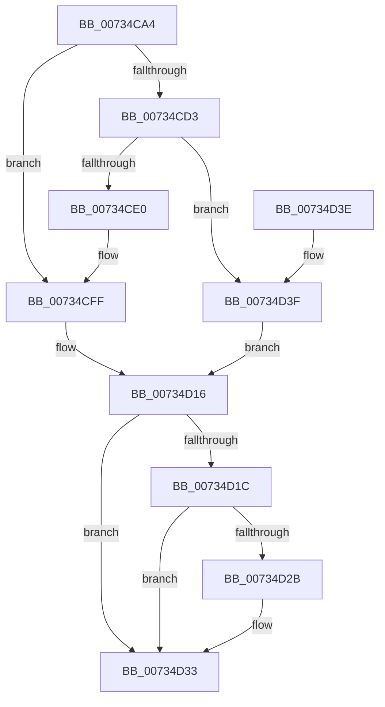

# PiDevCfgQueryDriverPolicy

- RVA: `0x00734CA4`–`0x00734D4D` (길이 `169` bytes)
- VA: `0x0000000140734CA4`
- 실행 섹션: `PAGE`
- PDB 이름 있음: `예`; PDB Function 태그: `아니요`
- unwind 정보 RVA: `0x000C8C48`
- 디코드: `50`개 명령, `169/169` bytes 표시
- 미해석 바이트: `0` (있으면 어셈블리에 `.byte`로 보존)

> 이 문서는 커널 이미지의 기계어와 PDB 기호를 분석해 생성했습니다. 4번과 5번은 함수 원형과 자료형을 바이너리 사용 방식에서 추정한 C 해석이며 원본 소스 복구 결과는 아닙니다.

## 1. Dependencies

- 직접 호출 지점: **2**; 고유 호출 대상: **1**
- 직접 호출자로 확인된 함수: **1**
- RIP 상대 이미지 참조: **5**

### Outgoing calls
- `0x00734CD7` → [PiDevCfgReadDriverPolicy](PiDevCfgReadDriverPolicy_function_00735638.md) (function, `0x00735638`)
- `0x00734D22` → [PiDevCfgReadDriverPolicy](PiDevCfgReadDriverPolicy_function_00735638.md) (function, `0x00735638`)

### Direct callers
- [PiDevCfgFindDeviceDriver](../97/PiDevCfgFindDeviceDriver_function_0097602C.md) at `0x0097611C`

### Static image references
- `0x00734CC1` → RVA `0x00FD82E0` (`PAGEDATA`; read)
- `0x00734CE4` → RVA `0x00FD82E8` (`PAGEDATA`; read/write)
- `0x00734CEF` → RVA `0x00FD82F0` (`PAGEDATA`; read/write)
- `0x00734CF9` → RVA `0x00FD82E0` (`PAGEDATA`; read/write)
- `0x00734D09` → RVA `0x00FD82F0` (`PAGEDATA`; read)

## 2. Other-region calls and transfers

- 다른 실행 섹션으로 향하는 call: **0**
- 별도 외부 분기/꼬리 이동을 확인하지 못했습니다.

## 3. Assembly (complete function range)

```asm
00734CA4  48 89 5C 24 08                  mov qword ptr [rsp + 8], rbx
00734CA9  55                              push rbp
00734CAA  48 8B EC                        mov rbp, rsp
00734CAD  48 83 EC 50                     sub rsp, 0x50
00734CB1  33 C0                           xor eax, eax
00734CB3  0F 57 C0                        xorps xmm0, xmm0
00734CB6  48 8B D9                        mov rbx, rcx
00734CB9  89 45 F8                        mov dword ptr [rbp - 8], eax
00734CBC  89 45 E0                        mov dword ptr [rbp - 0x20], eax
00734CBF  B1 01                           mov cl, 1
00734CC1  8B 05 19 36 8A 00               mov eax, dword ptr [rip + 0x8a3619]
00734CC7  0F 11 45 E8                     movups xmmword ptr [rbp - 0x18], xmm0
00734CCB  0F 11 45 D0                     movups xmmword ptr [rbp - 0x30], xmm0
00734CCF  84 C1                           test cl, al
00734CD1  75 2C                           jne 0x140734cff
00734CD3  48 8D 55 D0                     lea rdx, [rbp - 0x30]
00734CD7  E8 5C 09 00 00                  call 0x140735638
00734CDC  85 C0                           test eax, eax
00734CDE  78 5F                           js 0x140734d3f
00734CE0  48 8B 45 D8                     mov rax, qword ptr [rbp - 0x28]
00734CE4  48 87 05 FD 35 8A 00            xchg qword ptr [rip + 0x8a35fd], rax
00734CEB  48 8B 4D E0                     mov rcx, qword ptr [rbp - 0x20]
00734CEF  48 87 0D FA 35 8A 00            xchg qword ptr [rip + 0x8a35fa], rcx
00734CF6  8B 45 D0                        mov eax, dword ptr [rbp - 0x30]
00734CF9  87 05 E1 35 8A 00               xchg dword ptr [rip + 0x8a35e1], eax
00734CFF  0F 10 05 DA 35 8A 00            movups xmm0, xmmword ptr [rip + 0x8a35da]
00734D06  0F 11 03                        movups xmmword ptr [rbx], xmm0
00734D09  F2 0F 10 0D DF 35 8A 00         movsd xmm1, qword ptr [rip + 0x8a35df]
00734D11  F2 0F 11 4B 10                  movsd qword ptr [rbx + 0x10], xmm1
00734D16  8B 03                           mov eax, dword ptr [rbx]
00734D18  A8 02                           test al, 2
00734D1A  75 17                           jne 0x140734d33
00734D1C  48 8D 55 E8                     lea rdx, [rbp - 0x18]
00734D20  33 C9                           xor ecx, ecx
00734D22  E8 11 09 00 00                  call 0x140735638
00734D27  85 C0                           test eax, eax
00734D29  78 08                           js 0x140734d33
00734D2B  8B 45 E8                        mov eax, dword ptr [rbp - 0x18]
00734D2E  83 E0 02                        and eax, 2
00734D31  09 03                           or dword ptr [rbx], eax
00734D33  48 8B 5C 24 60                  mov rbx, qword ptr [rsp + 0x60]
00734D38  48 83 C4 50                     add rsp, 0x50
00734D3C  5D                              pop rbp
00734D3D  C3                              ret
00734D3E  CC                              int3
00734D3F  0F 57 C0                        xorps xmm0, xmm0
00734D42  33 C0                           xor eax, eax
00734D44  0F 11 03                        movups xmmword ptr [rbx], xmm0
00734D47  48 89 43 10                     mov qword ptr [rbx + 0x10], rax
00734D4B  EB C9                           jmp 0x140734d16
```

## 4. C-style interpretation (structured pseudocode)

```c
__int64 __fastcall PiDevCfgQueryDriverPolicy(__int64 a1)
{
    __int64 result;
    __int64 v_rsp;
    unsigned int v_stack_m10;
    unsigned __int64 v_stack_m20;
    unsigned int v_stack_m28;
    unsigned __int64 v_stack_m30;
    unsigned __int64 v_stack_m38;
    unsigned __int64 v_stack_p8;

    v_stack_p8 = v_rbx;
    v_rsp = (v_rsp) - (80);
    result = 0;
    v_stack_m10 = 0;
    v_stack_m28 = 0;
    v_stack_m20 = v_xmm0;
    v_stack_m38 = v_xmm0;
    if (((1) & ((unsigned __int8)((unsigned int)(*(unsigned int *)(v_rip + 9057817))))) != 0) goto loc_00734CFF;
    result = PiDevCfgReadDriverPolicy(1, v_stack_m38, a3, a4);
    if (sign_flag) goto loc_00734D3F;
loc_00734CFF:
    *(unsigned __int64 *)(a1) = v_xmm0;
    *(unsigned __int64 *)(a1 + 16) = v_xmm1;
loc_00734D16:
    if ((((unsigned __int8)((unsigned int)(*(unsigned int *)(a1)))) & (2)) != 0) goto loc_00734D33;
    a1 = 0;
    result = PiDevCfgReadDriverPolicy(a1, v_stack_m20, a3, a4);
    if (!(sign_flag)) {
        result = v_stack_m20;
        result = (unsigned int)((result) & (2));
    }
    v_rsp = (v_rsp) + (80);
    return result;
loc_00734D3F:
    result = 0;
    *(unsigned __int64 *)(v_stack_p8) = v_xmm0;
    *(unsigned __int64 *)(v_stack_p8 + 16) = 0;
    goto loc_00734D16;
}
```

## 5. (Beta) C Style

```c
int64_t PiDevCfgQueryDriverPolicy(void *Arg1)
{
    uint8_t *arg1 = (uint8_t *)Arg1;

    int64_t result;
    int64_t local_rsp;
    uint32_t v_stack_m10;
    uint64_t v_stack_m20;
    uint32_t v_stack_m28;
    uint64_t v_stack_m30;
    uint64_t v_stack_m38;
    uint64_t v_stack_p8;

    v_stack_p8 = local_rbx;
    local_rsp = (local_rsp) - (80);
    result = 0;
    v_stack_m10 = 0;
    v_stack_m28 = 0;
    v_stack_m20 = v_xmm0;
    v_stack_m38 = v_xmm0;
    if (((1) & ((uint8_t)((uint32_t)(*(uint32_t *)(v_rip + 0x8A3619))))) != 0) goto loc_00734CFF;
    result = PiDevCfgReadDriverPolicy(1, v_stack_m38, a3, a4);
    if (sign_flag) goto loc_00734D3F;
loc_00734CFF:
    *(uint64_t *)(arg1) = v_xmm0;
    *(uint64_t *)(arg1 + 0x10) = v_xmm1;
loc_00734D16:
    if ((((uint8_t)((uint32_t)(*(uint32_t *)(arg1)))) & (2)) != 0) goto loc_00734D33;
    Arg1 = 0;
    result = PiDevCfgReadDriverPolicy(Arg1, v_stack_m20, a3, a4);
    if (!(sign_flag)) {
        result = v_stack_m20;
        result = (uint32_t)((result) & (2));
    }
    local_rsp = (local_rsp) + (80);
    return result;
loc_00734D3F:
    result = 0;
    *(uint64_t *)(v_stack_p8) = v_xmm0;
    *(uint64_t *)(v_stack_p8 + 0x10) = 0;
    goto loc_00734D16;
}
```

### 관측된 메모리 오프셋

구조체 형식이 확인되지 않은 접근은 인자 기준의 오프셋으로만 기록했습니다.

| 기준 인자 | 오프셋 표현 | 폭 (bit) | 접근 |
|---|---:|---:|---|
| `Arg1` | `+ 0x0` | `32` | `R` |
| `Arg1` | `+ 0x0` | `32` | `R/W` |
| `Arg1` | `+ 0x0` | `128` | `R` |
| `Arg1` | `+ 0x10` | `64` | `W` |

## 6. Execution-region graph

[열기: 2D/3D 그래프와 함수 탐색 컨트롤 패널](../../../control-panel.html?section=page&rva=0x00734CA4&view=graph)

- 2D 그래프는 위에서 아래로 흐르고, 3D 그래프는 빈 공간을 드래그해 회전합니다. Shift+드래그는 이동, 휠은 확대·축소, 함수 노드 선택은 대상 보고서 이동입니다.

### Static fallback


