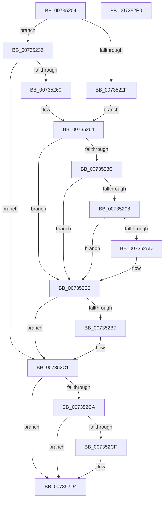

# PiDevCfgQueryMinWhcpVersion

- RVA: `0x00735204`–`0x007352E1` (길이 `221` bytes)
- VA: `0x0000000140735204`
- 실행 섹션: `PAGE`
- PDB 이름 있음: `예`; PDB Function 태그: `아니요`
- unwind 정보 RVA: `0x000C8CB8`
- 디코드: `67`개 명령, `221/221` bytes 표시
- 미해석 바이트: `0` (있으면 어셈블리에 `.byte`로 보존)

> 이 문서는 커널 이미지의 기계어와 PDB 기호를 분석해 생성했습니다. 4번과 5번은 함수 원형과 자료형을 바이너리 사용 방식에서 추정한 C 해석이며 원본 소스 복구 결과는 아닙니다.

## 1. Dependencies

- 직접 호출 지점: **6**; 고유 호출 대상: **6**
- 직접 호출자로 확인된 함수: **1**
- RIP 상대 이미지 참조: **3**

### Outgoing calls
- `0x00735257` → [IopOpenRegistryKeyEx](../A5/IopOpenRegistryKeyEx_function_00A51B44.md) (function, `0x00A51B44`)
- `0x0073527F` → [IopGetRegistryValue](../99/IopGetRegistryValue_function_009990EC.md) (function, `0x009990EC`)
- `0x0073528F` → [PnpValidateRegistryString](../../text/4B/PnpValidateRegistryString_function_004B763C.md) (function, `0x004B763C`)
- `0x007352A4` → [PiDevCfgParseVersionString](PiDevCfgParseVersionString_function_00733FAC.md) (function, `0x00733FAC`)
- `0x007352BC` → [ExFreePoolWithTag](../../poolcode/B8/ExFreePoolWithTag_function_00B82870.md) (function, `0x00B82870`)
- `0x007352CF` → [ZwClose](../../text/6A/ZwClose_function_006AD2B0.md) (function, `0x006AD2B0`)

### Direct callers
- [PiDevCfgReadDriverPolicy](PiDevCfgReadDriverPolicy_function_00735638.md) at `0x00735736`
- [PiDevCfgReadDriverPolicy](PiDevCfgReadDriverPolicy_function_00735638.md) at `0x00735745`

### Static image references
- `0x00735235` → RVA `0x00AFE910` (` ?? ::NNGAKEGL::`string'`; read)
- `0x00735264` → RVA `0x00AFE9E0` (` ?? ::NNGAKEGL::`string'`; read)
- `0x0073526D` → RVA `0x00AFE9B0` (` ?? ::NNGAKEGL::`string'`; read)

## 2. Other-region calls and transfers

- 다른 실행 섹션으로 향하는 call: **3**
  - `0x0073528F` → [PnpValidateRegistryString](../../text/4B/PnpValidateRegistryString_function_004B763C.md) (`PAGE` → `.text`)
  - `0x007352BC` → [ExFreePoolWithTag](../../poolcode/B8/ExFreePoolWithTag_function_00B82870.md) (`PAGE` → `POOLCODE`)
  - `0x007352CF` → [ZwClose](../../text/6A/ZwClose_function_006AD2B0.md) (`PAGE` → `.text`)
- 별도 외부 분기/꼬리 이동을 확인하지 못했습니다.

## 3. Assembly (complete function range)

```asm
00735204  40 55                           push rbp
00735206  53                              push rbx
00735207  57                              push rdi
00735208  48 8B EC                        mov rbp, rsp
0073520B  48 83 EC 30                     sub rsp, 0x30
0073520F  48 83 65 20 00                  and qword ptr [rbp + 0x20], 0
00735214  0F 57 C0                        xorps xmm0, xmm0
00735217  48 83 65 38 00                  and qword ptr [rbp + 0x38], 0
0073521C  8A DA                           mov bl, dl
0073521E  48 83 4D 30 FF                  or qword ptr [rbp + 0x30], 0xffffffffffffffff
00735223  48 8B F9                        mov rdi, rcx
00735226  0F 11 45 F0                     movups xmmword ptr [rbp - 0x10], xmm0
0073522A  48 85 C9                        test rcx, rcx
0073522D  74 06                           je 0x140735235
0073522F  48 89 4D 20                     mov qword ptr [rbp + 0x20], rcx
00735233  EB 2F                           jmp 0x140735264
00735235  48 8D 05 D4 96 3C 00            lea rax, [rip + 0x3c96d4]
0073523C  C7 45 F0 92 00 94 00            mov dword ptr [rbp - 0x10], 0x940092
00735243  41 B9 19 00 02 00               mov r9d, 0x20019
00735249  48 89 45 F8                     mov qword ptr [rbp - 8], rax
0073524D  4C 8D 45 F0                     lea r8, [rbp - 0x10]
00735251  33 D2                           xor edx, edx
00735253  48 8D 4D 20                     lea rcx, [rbp + 0x20]
00735257  E8 E8 C8 31 00                  call 0x140a51b44
0073525C  85 C0                           test eax, eax
0073525E  78 61                           js 0x1407352c1
00735260  48 8B 4D 20                     mov rcx, qword ptr [rbp + 0x20]
00735264  48 8D 05 75 97 3C 00            lea rax, [rip + 0x3c9775]
0073526B  84 DB                           test bl, bl
0073526D  48 8D 15 3C 97 3C 00            lea rdx, [rip + 0x3c973c]
00735274  48 0F 44 D0                     cmove rdx, rax
00735278  4C 8D 4D 38                     lea r9, [rbp + 0x38]
0073527C  45 33 C0                        xor r8d, r8d
0073527F  E8 68 3E 26 00                  call 0x1409990ec
00735284  48 8B 5D 38                     mov rbx, qword ptr [rbp + 0x38]
00735288  85 C0                           test eax, eax
0073528A  78 26                           js 0x1407352b2
0073528C  48 8B CB                        mov rcx, rbx
0073528F  E8 A8 23 D8 FF                  call 0x1404b763c
00735294  84 C0                           test al, al
00735296  74 1A                           je 0x1407352b2
00735298  8B 4B 08                        mov ecx, dword ptr [rbx + 8]
0073529B  4C 8D 45 30                     lea r8, [rbp + 0x30]
0073529F  48 03 CB                        add rcx, rbx
007352A2  33 D2                           xor edx, edx
007352A4  E8 03 ED FF FF                  call 0x140733fac
007352A9  84 C0                           test al, al
007352AB  75 05                           jne 0x1407352b2
007352AD  48 83 4D 30 FF                  or qword ptr [rbp + 0x30], 0xffffffffffffffff
007352B2  48 85 DB                        test rbx, rbx
007352B5  74 0A                           je 0x1407352c1
007352B7  33 D2                           xor edx, edx
007352B9  48 8B CB                        mov rcx, rbx
007352BC  E8 AF D5 44 00                  call 0x140b82870
007352C1  48 8B 4D 20                     mov rcx, qword ptr [rbp + 0x20]
007352C5  48 85 C9                        test rcx, rcx
007352C8  74 0A                           je 0x1407352d4
007352CA  48 3B CF                        cmp rcx, rdi
007352CD  74 05                           je 0x1407352d4
007352CF  E8 DC 7F F7 FF                  call 0x1406ad2b0
007352D4  48 8B 45 30                     mov rax, qword ptr [rbp + 0x30]
007352D8  48 83 C4 30                     add rsp, 0x30
007352DC  5F                              pop rdi
007352DD  5B                              pop rbx
007352DE  5D                              pop rbp
007352DF  C3                              ret
007352E0  CC                              int3
```

## 4. C-style interpretation (structured pseudocode)

```c
__int64 __fastcall PiDevCfgQueryMinWhcpVersion(__int64 a1, int a2)
{
    __int64 result;
    __int64 v_rsp;
    unsigned __int64 v_stack_m20;
    unsigned __int64 v_stack_m28;
    unsigned __int64 v_stack_p18;
    unsigned __int64 v_stack_p20;
    unsigned __int64 v_stack_p8;

    v_rsp = (v_rsp) - (48);
    v_stack_m28 = v_xmm0;
    if (a1 == 0) goto loc_00735235;
    v_stack_p8 = a1;
    goto loc_00735264;
loc_00735235:
    v_stack_m28 = 0x940092ULL;
    v_stack_m20 = v_rip + 3970772;
    a2 = 0;
    result = IopOpenRegistryKeyEx(v_stack_p8, a2, v_stack_m28, (unsigned int)(0x20019ULL));
    if (sign_flag) goto loc_007352C1;
loc_00735264:
    a2 = v_rip + 3970876;
    if ((unsigned __int8)((unsigned __int8)(a2)) == 0) { a2 = v_rip + 3970933; }
    a3 = 0;
    result = IopGetRegistryValue(v_stack_p8, a2, a3, v_stack_p20);
    if (sign_flag) goto loc_007352B2;
    result = PnpValidateRegistryString(v_stack_p20, a2, a3, v_stack_p20);
    if ((unsigned __int8)(result) == 0) goto loc_007352B2;
    a1 = ((unsigned int)(*(unsigned int *)(v_stack_p20 + 8))) + (v_stack_p20);
    a2 = 0;
    result = PiDevCfgParseVersionString(a1, a2, v_stack_p18, v_stack_p20);
    if ((unsigned __int8)(result) == 0) {
    }
    if (v_stack_p20 != 0) {
        a2 = 0;
        a1 = v_stack_p20;
        result = ExFreePoolWithTag(a1, a2, v_stack_p18, v_stack_p20);
    }
    if (v_stack_p8 == 0) goto loc_007352D4;
    if (v_stack_p8 != a1) {
        result = ZwClose(v_stack_p8, a2, v_stack_p18, v_stack_p20);
    }
    v_rsp = (v_rsp) + (48);
    return v_stack_p18;
}
```

## 5. (Beta) C Style

```c
int64_t PiDevCfgQueryMinWhcpVersion(int64_t Arg1, int32_t Arg2)
{
    int64_t result;
    int64_t local_rsp;
    uint64_t v_stack_m20;
    uint64_t v_stack_m28;
    uint64_t v_stack_p18;
    uint64_t v_stack_p20;
    uint64_t v_stack_p8;

    local_rsp = (local_rsp) - (48);
    v_stack_m28 = v_xmm0;
    if (Arg1 == 0) goto loc_00735235;
    v_stack_p8 = Arg1;
    goto loc_00735264;
loc_00735235:
    v_stack_m28 = 0x940092ULL;
    v_stack_m20 = v_rip + 3970772;
    Arg2 = 0;
    result = IopOpenRegistryKeyEx(v_stack_p8, Arg2, v_stack_m28, (uint32_t)(0x20019ULL));
    if (sign_flag) goto loc_007352C1;
loc_00735264:
    Arg2 = v_rip + 3970876;
    if ((uint8_t)((uint8_t)(Arg2)) == 0) { Arg2 = v_rip + 3970933; }
    a3 = 0;
    result = IopGetRegistryValue(v_stack_p8, Arg2, a3, v_stack_p20);
    if (sign_flag) goto loc_007352B2;
    result = PnpValidateRegistryString(v_stack_p20, Arg2, a3, v_stack_p20);
    if ((uint8_t)(result) == 0) goto loc_007352B2;
    Arg1 = ((uint32_t)(*(uint32_t *)(v_stack_p20 + 0x8))) + (v_stack_p20);
    Arg2 = 0;
    result = PiDevCfgParseVersionString(Arg1, Arg2, v_stack_p18, v_stack_p20);
    if ((uint8_t)(result) == 0) {
    }
    if (v_stack_p20 != 0) {
        Arg2 = 0;
        Arg1 = v_stack_p20;
        result = ExFreePoolWithTag(Arg1, Arg2, v_stack_p18, v_stack_p20);
    }
    if (v_stack_p8 == 0) goto loc_007352D4;
    if (v_stack_p8 != Arg1) {
        result = ZwClose(v_stack_p8, Arg2, v_stack_p18, v_stack_p20);
    }
    local_rsp = (local_rsp) + (48);
    return v_stack_p18;
}
```

## 6. Execution-region graph

[열기: 2D/3D 그래프와 함수 탐색 컨트롤 패널](../../../control-panel.html?section=page&rva=0x00735204&view=graph)

- 2D 그래프는 위에서 아래로 흐르고, 3D 그래프는 빈 공간을 드래그해 회전합니다. Shift+드래그는 이동, 휠은 확대·축소, 함수 노드 선택은 대상 보고서 이동입니다.

### Static fallback


