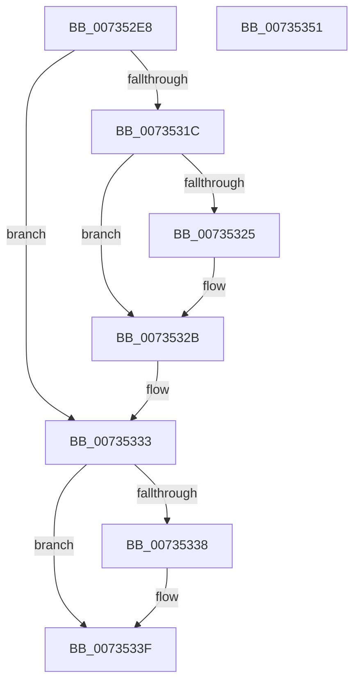

# PiDevCfgQueryPolicyEnabled

- RVA: `0x007352E8`–`0x00735352` (길이 `106` bytes)
- VA: `0x00000001407352E8`
- 실행 섹션: `PAGE`
- PDB 이름 있음: `예`; PDB Function 태그: `아니요`
- unwind 정보 RVA: `0x000BC3A0`
- 디코드: `35`개 명령, `106/106` bytes 표시
- 미해석 바이트: `0` (있으면 어셈블리에 `.byte`로 보존)

> 이 문서는 커널 이미지의 기계어와 PDB 기호를 분석해 생성했습니다. 4번과 5번은 함수 원형과 자료형을 바이너리 사용 방식에서 추정한 C 해석이며 원본 소스 복구 결과는 아닙니다.

## 1. Dependencies

- 직접 호출 지점: **3**; 고유 호출 대상: **3**
- 직접 호출자로 확인된 함수: **2**
- RIP 상대 이미지 참조: **0**

### Outgoing calls
- `0x0073530C` → [IopGetRegistryValue](../99/IopGetRegistryValue_function_009990EC.md) (function, `0x009990EC`)
- `0x0073531C` → [PnpValidateRegistryDword](../../text/4D/PnpValidateRegistryDword_function_004D109C.md) (function, `0x004D109C`)
- `0x0073533A` → [ExFreePoolWithTag](../../poolcode/B8/ExFreePoolWithTag_function_00B82870.md) (function, `0x00B82870`)

### Direct callers
- [PiDevCfgReadDriverPolicy](PiDevCfgReadDriverPolicy_function_00735638.md) at `0x007356D3`
- [PiDevCfgReadDriverPolicy](PiDevCfgReadDriverPolicy_function_00735638.md) at `0x0073570D`
- [sub_00B453C2](../B4/Unknown_function_00B453C2.md) at `0x00B45422`
- [sub_00B453C2](../B4/Unknown_function_00B453C2.md) at `0x00B4544F`
- [sub_00B453C2](../B4/Unknown_function_00B453C2.md) at `0x00B45773`

### Static image references
- 디코드된 RIP-relative 메모리 참조가 없습니다.

## 2. Other-region calls and transfers

- 다른 실행 섹션으로 향하는 call: **2**
  - `0x0073531C` → [PnpValidateRegistryDword](../../text/4D/PnpValidateRegistryDword_function_004D109C.md) (`PAGE` → `.text`)
  - `0x0073533A` → [ExFreePoolWithTag](../../poolcode/B8/ExFreePoolWithTag_function_00B82870.md) (`PAGE` → `POOLCODE`)
- 별도 외부 분기/꼬리 이동을 확인하지 못했습니다.

## 3. Assembly (complete function range)

```asm
007352E8  48 8B C4                        mov rax, rsp
007352EB  48 89 58 08                     mov qword ptr [rax + 8], rbx
007352EF  48 89 70 10                     mov qword ptr [rax + 0x10], rsi
007352F3  57                              push rdi
007352F4  48 83 EC 20                     sub rsp, 0x20
007352F8  48 83 60 18 00                  and qword ptr [rax + 0x18], 0
007352FD  4C 8D 48 18                     lea r9, [rax + 0x18]
00735301  49 8B F0                        mov rsi, r8
00735304  33 DB                           xor ebx, ebx
00735306  41 88 18                        mov byte ptr [r8], bl
00735309  45 33 C0                        xor r8d, r8d
0073530C  E8 DB 3D 26 00                  call 0x1409990ec
00735311  48 8B 4C 24 40                  mov rcx, qword ptr [rsp + 0x40]
00735316  8B F8                           mov edi, eax
00735318  85 C0                           test eax, eax
0073531A  78 17                           js 0x140735333
0073531C  E8 7B BD D9 FF                  call 0x1404d109c
00735321  84 C0                           test al, al
00735323  74 06                           je 0x14073532b
00735325  8B 51 08                        mov edx, dword ptr [rcx + 8]
00735328  8B 1C 0A                        mov ebx, dword ptr [rdx + rcx]
0073532B  83 FB 01                        cmp ebx, 1
0073532E  0F 94 C0                        sete al
00735331  88 06                           mov byte ptr [rsi], al
00735333  48 85 C9                        test rcx, rcx
00735336  74 07                           je 0x14073533f
00735338  33 D2                           xor edx, edx
0073533A  E8 31 D5 44 00                  call 0x140b82870
0073533F  48 8B 5C 24 30                  mov rbx, qword ptr [rsp + 0x30]
00735344  8B C7                           mov eax, edi
00735346  48 8B 74 24 38                  mov rsi, qword ptr [rsp + 0x38]
0073534B  48 83 C4 20                     add rsp, 0x20
0073534F  5F                              pop rdi
00735350  C3                              ret
00735351  CC                              int3
```

## 4. C-style interpretation (structured pseudocode)

```c
__int64 __fastcall PiDevCfgQueryPolicyEnabled(__int64 a1, __int64 a2, __int64 a3)
{
    __int64 result;
    __int64 v_rbx;
    __int64 v_rsp;
    unsigned __int64 v_stack_p10;
    unsigned __int64 v_stack_p18;
    unsigned __int64 v_stack_p8;

    *(unsigned __int64 *)(v_rsp + 8) = v_rbx;
    *(unsigned __int64 *)(v_rsp + 16) = v_rsi;
    v_rsp = (v_rsp) - (32);
    v_rbx = 0;
    *(unsigned __int8 *)(a3) = 0;
    a3 = 0;
    result = IopGetRegistryValue(a1, a2, a3, v_rsp + 24);
    if (sign_flag) goto loc_00735333;
    result = PnpValidateRegistryDword(v_stack_p18, a2, a3, v_rsp + 24);
    if ((unsigned __int8)(result) != 0) {
        a2 = *(unsigned int *)(v_stack_p18 + 8);
        v_rbx = *(unsigned int *)(a2 + v_stack_p18 * 1);
    }
    result = (((unsigned int)(v_rbx)) == 1) ? 1 : 0;
    *(unsigned __int8 *)(a3) = (unsigned __int8)(result);
loc_00735333:
    if (v_stack_p18 != 0) {
        a2 = 0;
        result = ExFreePoolWithTag(v_stack_p18, a2, a3, v_rsp + 24);
    }
    v_rsp = (v_rsp) + (32);
    return (unsigned int)((unsigned int)((unsigned int)((unsigned int)(result))));
}
```

## 5. (Beta) C Style

```c
int64_t PiDevCfgQueryPolicyEnabled(int64_t Arg1, int64_t Arg2, void *Arg3)
{
    uint8_t *arg3 = (uint8_t *)Arg3;

    int64_t result;
    int64_t local_rbx;
    int64_t local_rsp;
    uint64_t v_stack_p10;
    uint64_t v_stack_p18;
    uint64_t v_stack_p8;

    *(uint64_t *)(local_rsp + 0x8) = local_rbx;
    *(uint64_t *)(local_rsp + 0x10) = local_rsi;
    local_rsp = (local_rsp) - (32);
    local_rbx = 0;
    *(uint8_t *)(arg3) = 0;
    Arg3 = 0;
    result = IopGetRegistryValue(Arg1, Arg2, Arg3, local_rsp + 24);
    if (sign_flag) goto loc_00735333;
    result = PnpValidateRegistryDword(v_stack_p18, Arg2, Arg3, local_rsp + 24);
    if ((uint8_t)(result) != 0) {
        Arg2 = *(uint32_t *)(v_stack_p18 + 0x8);
        local_rbx = *(uint32_t *)(Arg2 + v_stack_p18 * 1);
    }
    result = (((uint32_t)(local_rbx)) == 1) ? 1 : 0;
    *(uint8_t *)(arg3) = (uint8_t)(result);
loc_00735333:
    if (v_stack_p18 != 0) {
        Arg2 = 0;
        result = ExFreePoolWithTag(v_stack_p18, Arg2, Arg3, local_rsp + 24);
    }
    local_rsp = (local_rsp) + (32);
    return (uint32_t)((uint32_t)((uint32_t)((uint32_t)(result))));
}
```

### 관측된 메모리 오프셋

구조체 형식이 확인되지 않은 접근은 인자 기준의 오프셋으로만 기록했습니다.

| 기준 인자 | 오프셋 표현 | 폭 (bit) | 접근 |
|---|---:|---:|---|
| `Arg3` | `+ 0x0` | `8` | `W` |

## 6. Execution-region graph

[열기: 2D/3D 그래프와 함수 탐색 컨트롤 패널](../../../control-panel.html?section=page&rva=0x007352E8&view=graph)

- 2D 그래프는 위에서 아래로 흐르고, 3D 그래프는 빈 공간을 드래그해 회전합니다. Shift+드래그는 이동, 휠은 확대·축소, 함수 노드 선택은 대상 보고서 이동입니다.

### Static fallback


