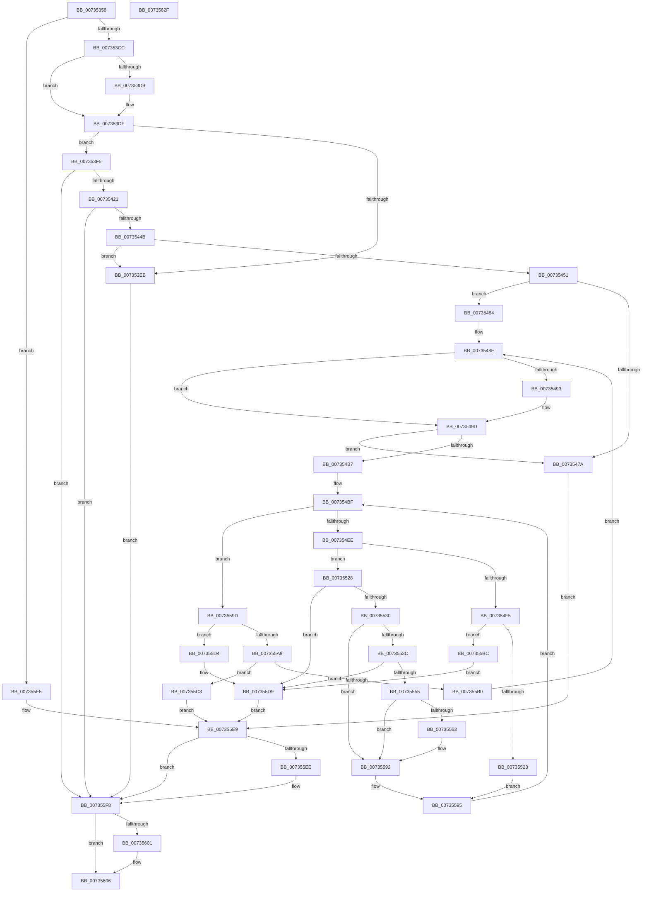

# PiDevCfgQueryPolicyStringList

- RVA: `0x00735358`–`0x00735630` (길이 `728` bytes)
- VA: `0x0000000140735358`
- 실행 섹션: `PAGE`
- PDB 이름 있음: `예`; PDB Function 태그: `아니요`
- unwind 정보 RVA: `0x000C8C6C`
- 디코드: `208`개 명령, `728/728` bytes 표시
- 미해석 바이트: `0` (있으면 어셈블리에 `.byte`로 보존)

> 이 문서는 커널 이미지의 기계어와 PDB 기호를 분석해 생성했습니다. 4번과 5번은 함수 원형과 자료형을 바이너리 사용 방식에서 추정한 C 해석이며 원본 소스 복구 결과는 아닙니다.

## 1. Dependencies

- 직접 호출 지점: **19**; 고유 호출 대상: **13**
- 직접 호출자로 확인된 함수: **1**
- RIP 상대 이미지 참조: **1**

### Outgoing calls
- `0x007353BD` → [IopGetRegistryValue](../99/IopGetRegistryValue_function_009990EC.md) (function, `0x009990EC`)
- `0x007353D0` → [PnpValidateRegistryDword](../../text/4D/PnpValidateRegistryDword_function_004D109C.md) (function, `0x004D109C`)
- `0x007353E1` → [ExFreePoolWithTag](../../poolcode/B8/ExFreePoolWithTag_function_00B82870.md) (function, `0x00B82870`)
- `0x007353FC` → [RtlInitUnicodeString](../../text/42/RtlInitUnicodeString_function_0042A780.md) (function, `0x0042A780`)
- `0x00735412` → [IopOpenRegistryKeyEx](../A5/IopOpenRegistryKeyEx_function_00A51B44.md) (function, `0x00A51B44`)
- `0x0073543C` → [NtQueryKey](../86/NtQueryKey_function_008676E0.md) (function, `0x008676E0`)
- `0x0073546D` → [ExAllocatePool2](../../poolcode/B8/ExAllocatePool2_function_00B820F0.md) (function, `0x00B820F0`)
- `0x00735498` → [ExFreePoolWithTag](../../poolcode/B8/ExFreePoolWithTag_function_00B82870.md) (function, `0x00B82870`)
- `0x007354AA` → [ExAllocatePool2](../../poolcode/B8/ExAllocatePool2_function_00B820F0.md) (function, `0x00B820F0`)
- `0x007354DC` → [ZwEnumerateValueKey](../../text/6A/ZwEnumerateValueKey_function_006AD330.md) (function, `0x006AD330`)
- `0x007354FA` → [ExFreePoolWithTag](../../poolcode/B8/ExFreePoolWithTag_function_00B82870.md) (function, `0x00B82870`)
- `0x00735512` → [ExAllocatePool2](../../poolcode/B8/ExAllocatePool2_function_00B820F0.md) (function, `0x00B820F0`)
- `0x00735533` → [PnpValidateRegistryString](../../text/4B/PnpValidateRegistryString_function_004B763C.md) (function, `0x004B763C`)
- `0x00735546` → [RtlInitUnicodeStringEx](../../text/46/RtlInitUnicodeStringEx_function_00463960.md) (function, `0x00463960`)
- `0x00735584` → [RtlStringCchCopyExW](../../text/41/RtlStringCchCopyExW_function_0041E1C0.md) (function, `0x0041E1C0`)
- `0x007355DE` → [ExFreePoolWithTag](../../poolcode/B8/ExFreePoolWithTag_function_00B82870.md) (function, `0x00B82870`)
- `0x007355F3` → [ExFreePoolWithTag](../../poolcode/B8/ExFreePoolWithTag_function_00B82870.md) (function, `0x00B82870`)
- `0x00735601` → [ZwClose](../../text/6A/ZwClose_function_006AD2B0.md) (function, `0x006AD2B0`)
- `0x0073560F` → [_security_check_cookie](../../text/6A/_security_check_cookie_function_006AC640.md) (function, `0x006AC640`)

### Direct callers
- [sub_00B453C2](../B4/Unknown_function_00B453C2.md) at `0x00B45478`
- [sub_00B453C2](../B4/Unknown_function_00B453C2.md) at `0x00B4549A`
- [sub_00B453C2](../B4/Unknown_function_00B453C2.md) at `0x00B45538`
- [sub_00B453C2](../B4/Unknown_function_00B453C2.md) at `0x00B4555A`
- [sub_00B453C2](../B4/Unknown_function_00B453C2.md) at `0x00B4568A`
- [sub_00B453C2](../B4/Unknown_function_00B453C2.md) at `0x00B456A8`

### Static image references
- `0x00735374` → RVA `0x00E0A740` (`.data`; read)

## 2. Other-region calls and transfers

- 다른 실행 섹션으로 향하는 call: **16**
  - `0x007353D0` → [PnpValidateRegistryDword](../../text/4D/PnpValidateRegistryDword_function_004D109C.md) (`PAGE` → `.text`)
  - `0x007353E1` → [ExFreePoolWithTag](../../poolcode/B8/ExFreePoolWithTag_function_00B82870.md) (`PAGE` → `POOLCODE`)
  - `0x007353FC` → [RtlInitUnicodeString](../../text/42/RtlInitUnicodeString_function_0042A780.md) (`PAGE` → `.text`)
  - `0x0073546D` → [ExAllocatePool2](../../poolcode/B8/ExAllocatePool2_function_00B820F0.md) (`PAGE` → `POOLCODE`)
  - `0x00735498` → [ExFreePoolWithTag](../../poolcode/B8/ExFreePoolWithTag_function_00B82870.md) (`PAGE` → `POOLCODE`)
  - `0x007354AA` → [ExAllocatePool2](../../poolcode/B8/ExAllocatePool2_function_00B820F0.md) (`PAGE` → `POOLCODE`)
  - `0x007354DC` → [ZwEnumerateValueKey](../../text/6A/ZwEnumerateValueKey_function_006AD330.md) (`PAGE` → `.text`)
  - `0x007354FA` → [ExFreePoolWithTag](../../poolcode/B8/ExFreePoolWithTag_function_00B82870.md) (`PAGE` → `POOLCODE`)
  - `0x00735512` → [ExAllocatePool2](../../poolcode/B8/ExAllocatePool2_function_00B820F0.md) (`PAGE` → `POOLCODE`)
  - `0x00735533` → [PnpValidateRegistryString](../../text/4B/PnpValidateRegistryString_function_004B763C.md) (`PAGE` → `.text`)
  - `0x00735546` → [RtlInitUnicodeStringEx](../../text/46/RtlInitUnicodeStringEx_function_00463960.md) (`PAGE` → `.text`)
  - `0x00735584` → [RtlStringCchCopyExW](../../text/41/RtlStringCchCopyExW_function_0041E1C0.md) (`PAGE` → `.text`)
  - `0x007355DE` → [ExFreePoolWithTag](../../poolcode/B8/ExFreePoolWithTag_function_00B82870.md) (`PAGE` → `POOLCODE`)
  - `0x007355F3` → [ExFreePoolWithTag](../../poolcode/B8/ExFreePoolWithTag_function_00B82870.md) (`PAGE` → `POOLCODE`)
  - `0x00735601` → [ZwClose](../../text/6A/ZwClose_function_006AD2B0.md) (`PAGE` → `.text`)
  - `0x0073560F` → [_security_check_cookie](../../text/6A/_security_check_cookie_function_006AC640.md) (`PAGE` → `.text`)
- 별도 외부 분기/꼬리 이동을 확인하지 못했습니다.

## 3. Assembly (complete function range)

```asm
00735358  48 89 5C 24 20                  mov qword ptr [rsp + 0x20], rbx
0073535D  55                              push rbp
0073535E  56                              push rsi
0073535F  57                              push rdi
00735360  41 54                           push r12
00735362  41 55                           push r13
00735364  41 56                           push r14
00735366  41 57                           push r15
00735368  48 8D 6C 24 D9                  lea rbp, [rsp - 0x27]
0073536D  48 81 EC 90 00 00 00            sub rsp, 0x90
00735374  48 8B 05 C5 53 6D 00            mov rax, qword ptr [rip + 0x6d53c5]
0073537B  48 33 C4                        xor rax, rsp
0073537E  48 89 45 1F                     mov qword ptr [rbp + 0x1f], rax
00735382  45 33 E4                        xor r12d, r12d
00735385  4C 89 45 EF                     mov qword ptr [rbp - 0x11], r8
00735389  0F 57 C0                        xorps xmm0, xmm0
0073538C  4C 89 65 D7                     mov qword ptr [rbp - 0x29], r12
00735390  33 C0                           xor eax, eax
00735392  4C 89 65 C7                     mov qword ptr [rbp - 0x39], r12
00735396  45 33 C0                        xor r8d, r8d
00735399  48 89 45 17                     mov qword ptr [rbp + 0x17], rax
0073539D  4C 8D 4D C7                     lea r9, [rbp - 0x39]
007353A1  44 89 65 CF                     mov dword ptr [rbp - 0x31], r12d
007353A5  0F 11 45 DF                     movups xmmword ptr [rbp - 0x21], xmm0
007353A9  41 8B FC                        mov edi, r12d
007353AC  45 8B FC                        mov r15d, r12d
007353AF  0F 11 45 F7                     movups xmmword ptr [rbp - 9], xmm0
007353B3  4C 8B F2                        mov r14, rdx
007353B6  48 8B F1                        mov rsi, rcx
007353B9  0F 11 45 07                     movups xmmword ptr [rbp + 7], xmm0
007353BD  E8 2A 3D 26 00                  call 0x1409990ec
007353C2  8B D8                           mov ebx, eax
007353C4  85 C0                           test eax, eax
007353C6  0F 88 19 02 00 00               js 0x1407355e5
007353CC  48 8B 4D C7                     mov rcx, qword ptr [rbp - 0x39]
007353D0  E8 C7 BC D9 FF                  call 0x1404d109c
007353D5  84 C0                           test al, al
007353D7  74 06                           je 0x1407353df
007353D9  8B 41 08                        mov eax, dword ptr [rcx + 8]
007353DC  8B 3C 08                        mov edi, dword ptr [rax + rcx]
007353DF  33 D2                           xor edx, edx
007353E1  E8 8A D4 44 00                  call 0x140b82870
007353E6  83 FF 01                        cmp edi, 1
007353E9  74 0A                           je 0x1407353f5
007353EB  BB 25 02 00 C0                  mov ebx, 0xc0000225
007353F0  E9 03 02 00 00                  jmp 0x1407355f8
007353F5  49 8B D6                        mov rdx, r14
007353F8  48 8D 4D DF                     lea rcx, [rbp - 0x21]
007353FC  E8 7F 53 CF FF                  call 0x14042a780
00735401  41 B9 19 00 02 00               mov r9d, 0x20019
00735407  4C 8D 45 DF                     lea r8, [rbp - 0x21]
0073540B  48 8B D6                        mov rdx, rsi
0073540E  48 8D 4D D7                     lea rcx, [rbp - 0x29]
00735412  E8 2D C7 31 00                  call 0x140a51b44
00735417  8B D8                           mov ebx, eax
00735419  85 C0                           test eax, eax
0073541B  0F 88 D7 01 00 00               js 0x1407355f8
00735421  48 8B 4D D7                     mov rcx, qword ptr [rbp - 0x29]
00735425  48 8D 45 CF                     lea rax, [rbp - 0x31]
00735429  41 B9 28 00 00 00               mov r9d, 0x28
0073542F  48 89 44 24 20                  mov qword ptr [rsp + 0x20], rax
00735434  4C 8D 45 F7                     lea r8, [rbp - 9]
00735438  41 8D 51 DC                     lea edx, [r9 - 0x24]
0073543C  E8 9F 22 13 00                  call 0x1408676e0
00735441  8B D8                           mov ebx, eax
00735443  85 C0                           test eax, eax
00735445  0F 88 AD 01 00 00               js 0x1407355f8
0073544B  44 39 65 0B                     cmp dword ptr [rbp + 0xb], r12d
0073544F  74 9A                           je 0x1407353eb
00735451  8B 4D 0F                        mov ecx, dword ptr [rbp + 0xf]
00735454  41 B8 50 70 64 63               mov r8d, 0x63647050
0073545A  8B 45 13                        mov eax, dword ptr [rbp + 0x13]
0073545D  83 C1 0C                        add ecx, 0xc
00735460  8D 1C 48                        lea ebx, [rax + rcx*2]
00735463  B9 00 01 00 00                  mov ecx, 0x100
00735468  8B D3                           mov edx, ebx
0073546A  89 5D C7                        mov dword ptr [rbp - 0x39], ebx
0073546D  E8 7E CC 44 00                  call 0x140b820f0
00735472  48 8B F0                        mov rsi, rax
00735475  48 85 C0                        test rax, rax
00735478  75 0A                           jne 0x140735484
0073547A  BB 9A 00 00 C0                  mov ebx, 0xc000009a
0073547F  E9 65 01 00 00                  jmp 0x1407355e9
00735484  8B 7D 13                        mov edi, dword ptr [rbp + 0x13]
00735487  0F AF 7D 0B                     imul edi, dword ptr [rbp + 0xb]
0073548B  83 C7 02                        add edi, 2
0073548E  4D 85 FF                        test r15, r15
00735491  74 0A                           je 0x14073549d
00735493  33 D2                           xor edx, edx
00735495  49 8B CF                        mov rcx, r15
00735498  E8 D3 D3 44 00                  call 0x140b82870
0073549D  8B D7                           mov edx, edi
0073549F  B9 00 01 00 00                  mov ecx, 0x100
007354A4  41 B8 50 70 64 63               mov r8d, 0x63647050
007354AA  E8 41 CC 44 00                  call 0x140b820f0
007354AF  4C 8B F8                        mov r15, rax
007354B2  48 85 C0                        test rax, rax
007354B5  74 C3                           je 0x14073547a
007354B7  D1 EF                           shr edi, 1
007354B9  45 8B F4                        mov r14d, r12d
007354BC  45 8B EC                        mov r13d, r12d
007354BF  48 8B 4D D7                     mov rcx, qword ptr [rbp - 0x29]
007354C3  48 8D 45 CF                     lea rax, [rbp - 0x31]
007354C7  48 89 44 24 28                  mov qword ptr [rsp + 0x28], rax
007354CC  4C 8B CE                        mov r9, rsi
007354CF  41 B8 01 00 00 00               mov r8d, 1
007354D5  89 5C 24 20                     mov dword ptr [rsp + 0x20], ebx
007354D9  41 8B D4                        mov edx, r12d
007354DC  E8 4F 7E F7 FF                  call 0x1406ad330
007354E1  8B D8                           mov ebx, eax
007354E3  3D 1A 00 00 80                  cmp eax, 0x8000001a
007354E8  0F 84 AF 00 00 00               je 0x14073559d
007354EE  3D 05 00 00 80                  cmp eax, 0x80000005
007354F3  75 33                           jne 0x140735528
007354F5  33 D2                           xor edx, edx
007354F7  48 8B CE                        mov rcx, rsi
007354FA  E8 71 D3 44 00                  call 0x140b82870
007354FF  8B 5D CF                        mov ebx, dword ptr [rbp - 0x31]
00735502  B9 00 01 00 00                  mov ecx, 0x100
00735507  8B D3                           mov edx, ebx
00735509  89 5D C7                        mov dword ptr [rbp - 0x39], ebx
0073550C  41 B8 50 70 64 63               mov r8d, 0x63647050
00735512  E8 D9 CB 44 00                  call 0x140b820f0
00735517  48 8B F0                        mov rsi, rax
0073551A  48 85 C0                        test rax, rax
0073551D  0F 84 99 00 00 00               je 0x1407355bc
00735523  41 FF CC                        dec r12d
00735526  EB 6D                           jmp 0x140735595
00735528  85 C0                           test eax, eax
0073552A  0F 88 A9 00 00 00               js 0x1407355d9
00735530  48 8B CE                        mov rcx, rsi
00735533  E8 04 21 D8 FF                  call 0x1404b763c
00735538  84 C0                           test al, al
0073553A  74 56                           je 0x140735592
0073553C  8B 56 08                        mov edx, dword ptr [rsi + 8]
0073553F  48 8D 4D DF                     lea rcx, [rbp - 0x21]
00735543  48 03 D6                        add rdx, rsi
00735546  E8 15 E4 D2 FF                  call 0x140463960
0073554B  8B D8                           mov ebx, eax
0073554D  85 C0                           test eax, eax
0073554F  0F 88 84 00 00 00               js 0x1407355d9
00735555  0F B7 45 E1                     movzx eax, word ptr [rbp - 0x1f]
00735559  D1 E8                           shr eax, 1
0073555B  44 03 F0                        add r14d, eax
0073555E  41 3B FE                        cmp edi, r14d
00735561  76 2F                           jbe 0x140735592
00735563  4C 8B 45 E7                     mov r8, qword ptr [rbp - 0x19]
00735567  8B D7                           mov edx, edi
00735569  41 8B C5                        mov eax, r13d
0073556C  41 2B D5                        sub edx, r13d
0073556F  C7 44 24 28 00 09 00 00         mov dword ptr [rsp + 0x28], 0x900
00735577  45 33 C9                        xor r9d, r9d
0073557A  48 83 64 24 20 00               and qword ptr [rsp + 0x20], 0
00735580  49 8D 0C 47                     lea rcx, [r15 + rax*2]
00735584  E8 37 8C CE FF                  call 0x14041e1c0
00735589  0F B7 45 E1                     movzx eax, word ptr [rbp - 0x1f]
0073558D  D1 E8                           shr eax, 1
0073558F  44 03 E8                        add r13d, eax
00735592  8B 5D C7                        mov ebx, dword ptr [rbp - 0x39]
00735595  41 FF C4                        inc r12d
00735598  E9 22 FF FF FF                  jmp 0x1407354bf
0073559D  45 33 E4                        xor r12d, r12d
007355A0  41 8B DC                        mov ebx, r12d
007355A3  45 85 F6                        test r14d, r14d
007355A6  74 2C                           je 0x1407355d4
007355A8  41 FF C6                        inc r14d
007355AB  41 3B FE                        cmp edi, r14d
007355AE  73 13                           jae 0x1407355c3
007355B0  8B 5D C7                        mov ebx, dword ptr [rbp - 0x39]
007355B3  43 8D 3C 36                     lea edi, [r14 + r14]
007355B7  E9 D2 FE FF FF                  jmp 0x14073548e
007355BC  BB 9A 00 00 C0                  mov ebx, 0xc000009a
007355C1  EB 16                           jmp 0x1407355d9
007355C3  41 8B C5                        mov eax, r13d
007355C6  66 45 89 24 47                  mov word ptr [r15 + rax*2], r12w
007355CB  48 8B 45 EF                     mov rax, qword ptr [rbp - 0x11]
007355CF  4C 89 38                        mov qword ptr [rax], r15
007355D2  EB 15                           jmp 0x1407355e9
007355D4  BB 25 02 00 C0                  mov ebx, 0xc0000225
007355D9  33 D2                           xor edx, edx
007355DB  49 8B CF                        mov rcx, r15
007355DE  E8 8D D2 44 00                  call 0x140b82870
007355E3  EB 04                           jmp 0x1407355e9
007355E5  48 8B 75 C7                     mov rsi, qword ptr [rbp - 0x39]
007355E9  48 85 F6                        test rsi, rsi
007355EC  74 0A                           je 0x1407355f8
007355EE  33 D2                           xor edx, edx
007355F0  48 8B CE                        mov rcx, rsi
007355F3  E8 78 D2 44 00                  call 0x140b82870
007355F8  48 8B 4D D7                     mov rcx, qword ptr [rbp - 0x29]
007355FC  48 85 C9                        test rcx, rcx
007355FF  74 05                           je 0x140735606
00735601  E8 AA 7C F7 FF                  call 0x1406ad2b0
00735606  8B C3                           mov eax, ebx
00735608  48 8B 4D 1F                     mov rcx, qword ptr [rbp + 0x1f]
0073560C  48 33 CC                        xor rcx, rsp
0073560F  E8 2C 70 F7 FF                  call 0x1406ac640
00735614  48 8B 9C 24 E8 00 00 00         mov rbx, qword ptr [rsp + 0xe8]
0073561C  48 81 C4 90 00 00 00            add rsp, 0x90
00735623  41 5F                           pop r15
00735625  41 5E                           pop r14
00735627  41 5D                           pop r13
00735629  41 5C                           pop r12
0073562B  5F                              pop rdi
0073562C  5E                              pop rsi
0073562D  5D                              pop rbp
0073562E  C3                              ret
0073562F  CC                              int3
```

## 4. C-style interpretation (structured pseudocode)

```c
__int64 __fastcall PiDevCfgQueryPolicyStringList(__int64 a1, __int64 a2, __int64 a3)
{
    __int64 result;
    __int64 v_r12;
    __int64 v_r13;
    __int64 v_r14;
    __int64 v_rdi;
    __int64 v_rsp;
    unsigned __int64 v_stack_m40;
    unsigned __int64 v_stack_m48;
    unsigned int v_stack_m4C;
    unsigned int v_stack_m50;
    unsigned int v_stack_m54;
    unsigned __int64 v_stack_m58;
    unsigned __int64 v_stack_m5F;
    unsigned __int64 v_stack_m68;
    unsigned __int64 v_stack_m70;
    unsigned __int64 v_stack_m78;
    unsigned __int16 v_stack_m7E;
    unsigned __int64 v_stack_m80;
    unsigned __int64 v_stack_m88;
    unsigned int v_stack_m90;
    unsigned __int64 v_stack_m98;
    unsigned __int64 v_stack_mA0;
    unsigned __int64 v_stack_mA8;
    unsigned __int64 v_stack_p20;

    v_stack_p20 = v_rbx;
    v_rsp = (v_rsp) - (144);
    result = (*(unsigned __int64 *)(v_rip + 7164869)) ^ (v_rsp);
    v_stack_m40 = result;
    v_r12 = 0;
    v_stack_m70 = a3;
    v_stack_m88 = 0;
    result = 0;
    v_stack_m98 = 0;
    a3 = 0;
    v_stack_m48 = 0;
    v_stack_m90 = 0;
    v_stack_m80 = v_xmm0;
    v_stack_m68 = v_xmm0;
    v_stack_m58 = v_xmm0;
    result = IopGetRegistryValue(a1, a2, a3, v_stack_m98);
    if (sign_flag) goto loc_007355E5;
    result = PnpValidateRegistryDword(v_stack_m98, a2, a3, v_stack_m98);
    v_rdi = 0;
    if ((unsigned __int8)(result) != 0) {
        result = *(unsigned int *)(v_stack_m98 + 8);
        v_rdi = *(unsigned int *)(result + v_stack_m98 * 1);
    }
    a2 = 0;
    result = ExFreePoolWithTag(v_stack_m98, a2, a3, v_stack_m98);
    if (((unsigned int)(v_rdi)) == 1) goto loc_007353F5;
loc_007353EB:
    goto loc_007355F8;
loc_007353F5:
    result = RtlInitUnicodeString(v_stack_m80, 0, a3, v_stack_m98);
    result = IopOpenRegistryKeyEx(v_stack_m88, a1, v_stack_m80, (unsigned int)(0x20019ULL));
    if (sign_flag) goto loc_007355F8;
    v_stack_mA8 = v_stack_m90;
    result = NtQueryKey(v_stack_m88, 40 - 36, v_stack_m68, 40);
    if (sign_flag) goto loc_007355F8;
    if (v_stack_m54 == 0) goto loc_007353EB;
    a1 = (unsigned int)(((unsigned int)(v_stack_m50)) + (12));
    v_stack_m98 = (unsigned int)((unsigned int)(v_stack_m4C) + a1 * 2);
    result = ExAllocatePool2(256, (unsigned int)((unsigned int)((unsigned int)(v_stack_m4C) + a1 * 2)), (unsigned int)(0x63647050ULL), 40);
    if (result != 0) goto loc_00735484;
loc_0073547A:
    goto loc_007355E9;
loc_00735484:
    v_rdi = (unsigned int)(((unsigned int)(v_stack_m4C)) * (v_stack_m54));
    v_rdi = (unsigned int)((v_rdi) + (2));
loc_0073548E:
    if (0 != 0) {
        a2 = 0;
        a1 = 0;
        result = ExFreePoolWithTag(a1, a2, (unsigned int)(0x63647050ULL), 40);
    }
    result = ExAllocatePool2(256, (unsigned int)((unsigned int)(v_rdi)), (unsigned int)(0x63647050ULL), 40);
    if (result == 0) goto loc_0073547A;
    v_rdi = (unsigned int)((v_rdi) >> (1));
loc_007354BF:
    v_stack_mA0 = v_stack_m90;
    v_stack_mA8 = (unsigned int)((unsigned int)(0xC000009AULL));
    result = ZwEnumerateValueKey(v_stack_m88, 0, 1, result);
    if (((unsigned int)(result)) == 0x8000001AULL) goto loc_0073559D;
    if (((unsigned int)(result)) != 0x80000005ULL) goto loc_00735528;
    a2 = 0;
    result = ExFreePoolWithTag(result, a2, 1, result);
    v_stack_m98 = (unsigned int)((unsigned int)(v_stack_m90));
    result = ExAllocatePool2(256, (unsigned int)((unsigned int)((unsigned int)(v_stack_m90))), (unsigned int)(0x63647050ULL), result);
    if (result == 0) goto loc_007355BC;
    v_r12 = (unsigned int)((v_r12) - 1);
    goto loc_00735595;
loc_00735528:
    if (sign_flag) goto loc_007355D9;
    result = PnpValidateRegistryString(result, (unsigned int)((unsigned int)((unsigned int)(v_stack_m90))), (unsigned int)(0x63647050ULL), result);
    if ((unsigned __int8)(result) == 0) goto loc_00735592;
    a2 = ((unsigned int)(*(unsigned int *)(result + 8))) + (result);
    result = RtlInitUnicodeStringEx(v_stack_m80, a2, (unsigned int)(0x63647050ULL), result);
    if (sign_flag) goto loc_007355D9;
    result = (unsigned int)((v_stack_m7E) >> (1));
    v_r14 = (unsigned int)((0) + ((unsigned int)(result)));
    v_r13 = 0;
    if (((unsigned int)(v_rdi)) >= = ((unsigned int)(v_r14))) {
        a3 = v_stack_m78;
        a2 = (unsigned int)(v_rdi);
        result = 0;
        a2 = (unsigned int)((a2) - (0));
        v_stack_mA0 = 0x900ULL;
        a4 = 0;
        a1 = result + result * 2;
        result = RtlStringCchCopyExW(a1, a2, a3, a4);
        result = v_stack_m7E;
        result = (unsigned int)((result) >> (1));
        v_r13 = (unsigned int)((0) + ((unsigned int)(result)));
    }
loc_00735595:
    v_r12 = (unsigned int)((v_r12) + 1);
    goto loc_007354BF;
loc_0073559D:
    v_r12 = 0;
    if ((unsigned int)(v_r14) == 0) goto loc_007355D4;
    v_r14 = (unsigned int)((v_r14) + 1);
    if (((unsigned int)(v_rdi)) >= ((unsigned int)(v_r14))) goto loc_007355C3;
    goto loc_0073548E;
loc_007355BC:
    goto loc_007355D9;
loc_007355C3:
    *(unsigned __int16 *)(result + (unsigned int)((unsigned int)(v_r13)) * 2) = 0;
    *(unsigned __int64 *)(v_stack_m70) = result;
    goto loc_007355E9;
loc_007355D4:
loc_007355D9:
    a2 = 0;
    result = ExFreePoolWithTag(result, a2, a3, a4);
    goto loc_007355E9;
loc_007355E5:
loc_007355E9:
    if (v_stack_m98 != 0) {
        a2 = 0;
        a1 = v_stack_m98;
        result = ExFreePoolWithTag(a1, a2, a3, a4);
    }
    if (v_stack_m88 != 0) {
        result = ZwClose(v_stack_m88, a2, a3, a4);
    }
    a1 = (v_stack_m40) ^ (v_rsp);
    result = _security_check_cookie(a1, a2, a3, a4);
    v_rsp = (v_rsp) + (144);
    return result;
}
```

## 5. (Beta) C Style

```c
int64_t PiDevCfgQueryPolicyStringList(int64_t Arg1, int64_t Arg2, int64_t Arg3)
{
    int64_t result;
    int64_t local_r12;
    int64_t local_r13;
    int64_t local_r14;
    int64_t local_rdi;
    int64_t local_rsp;
    uint64_t v_stack_m40;
    uint64_t v_stack_m48;
    uint32_t v_stack_m4C;
    uint32_t v_stack_m50;
    uint32_t v_stack_m54;
    uint64_t v_stack_m58;
    uint64_t v_stack_m5F;
    uint64_t v_stack_m68;
    uint64_t v_stack_m70;
    uint64_t v_stack_m78;
    uint16_t v_stack_m7E;
    uint64_t v_stack_m80;
    uint64_t v_stack_m88;
    uint32_t v_stack_m90;
    uint64_t v_stack_m98;
    uint64_t v_stack_mA0;
    uint64_t v_stack_mA8;
    uint64_t v_stack_p20;

    v_stack_p20 = local_rbx;
    local_rsp = (local_rsp) - (144);
    result = (*(uint64_t *)(v_rip + 0x6D53C5)) ^ (local_rsp);
    v_stack_m40 = result;
    local_r12 = 0;
    v_stack_m70 = Arg3;
    v_stack_m88 = 0;
    result = 0;
    v_stack_m98 = 0;
    Arg3 = 0;
    v_stack_m48 = 0;
    v_stack_m90 = 0;
    v_stack_m80 = v_xmm0;
    v_stack_m68 = v_xmm0;
    v_stack_m58 = v_xmm0;
    result = IopGetRegistryValue(Arg1, Arg2, Arg3, v_stack_m98);
    if (sign_flag) goto loc_007355E5;
    result = PnpValidateRegistryDword(v_stack_m98, Arg2, Arg3, v_stack_m98);
    local_rdi = 0;
    if ((uint8_t)(result) != 0) {
        result = *(uint32_t *)(v_stack_m98 + 0x8);
        local_rdi = *(uint32_t *)(result + v_stack_m98 * 1);
    }
    Arg2 = 0;
    result = ExFreePoolWithTag(v_stack_m98, Arg2, Arg3, v_stack_m98);
    if (((uint32_t)(local_rdi)) == 1) goto loc_007353F5;
loc_007353EB:
    goto loc_007355F8;
loc_007353F5:
    result = RtlInitUnicodeString(v_stack_m80, 0, Arg3, v_stack_m98);
    result = IopOpenRegistryKeyEx(v_stack_m88, Arg1, v_stack_m80, (uint32_t)(0x20019ULL));
    if (sign_flag) goto loc_007355F8;
    v_stack_mA8 = v_stack_m90;
    result = NtQueryKey(v_stack_m88, 40 - 36, v_stack_m68, 40);
    if (sign_flag) goto loc_007355F8;
    if (v_stack_m54 == 0) goto loc_007353EB;
    Arg1 = (uint32_t)(((uint32_t)(v_stack_m50)) + (12));
    v_stack_m98 = (uint32_t)((uint32_t)(v_stack_m4C) + Arg1 * 2);
    result = ExAllocatePool2(256, (uint32_t)((uint32_t)((uint32_t)(v_stack_m4C) + Arg1 * 2)), (uint32_t)(0x63647050ULL), 40);
    if (result != 0) goto loc_00735484;
loc_0073547A:
    goto loc_007355E9;
loc_00735484:
    local_rdi = (uint32_t)(((uint32_t)(v_stack_m4C)) * (v_stack_m54));
    local_rdi = (uint32_t)((local_rdi) + (2));
loc_0073548E:
    if (0 != 0) {
        Arg2 = 0;
        Arg1 = 0;
        result = ExFreePoolWithTag(Arg1, Arg2, (uint32_t)(0x63647050ULL), 40);
    }
    result = ExAllocatePool2(256, (uint32_t)((uint32_t)(local_rdi)), (uint32_t)(0x63647050ULL), 40);
    if (result == 0) goto loc_0073547A;
    local_rdi = (uint32_t)((local_rdi) >> (1));
loc_007354BF:
    v_stack_mA0 = v_stack_m90;
    v_stack_mA8 = (uint32_t)((uint32_t)(0xC000009AULL));
    result = ZwEnumerateValueKey(v_stack_m88, 0, 1, result);
    if (((uint32_t)(result)) == 0x8000001AULL) goto loc_0073559D;
    if (((uint32_t)(result)) != 0x80000005ULL) goto loc_00735528;
    Arg2 = 0;
    result = ExFreePoolWithTag(result, Arg2, 1, result);
    v_stack_m98 = (uint32_t)((uint32_t)(v_stack_m90));
    result = ExAllocatePool2(256, (uint32_t)((uint32_t)((uint32_t)(v_stack_m90))), (uint32_t)(0x63647050ULL), result);
    if (result == 0) goto loc_007355BC;
    local_r12 = (uint32_t)((local_r12) - 1);
    goto loc_00735595;
loc_00735528:
    if (sign_flag) goto loc_007355D9;
    result = PnpValidateRegistryString(result, (uint32_t)((uint32_t)((uint32_t)(v_stack_m90))), (uint32_t)(0x63647050ULL), result);
    if ((uint8_t)(result) == 0) goto loc_00735592;
    Arg2 = ((uint32_t)(*(uint32_t *)(result + 0x8))) + (result);
    result = RtlInitUnicodeStringEx(v_stack_m80, Arg2, (uint32_t)(0x63647050ULL), result);
    if (sign_flag) goto loc_007355D9;
    result = (uint32_t)((v_stack_m7E) >> (1));
    local_r14 = (uint32_t)((0) + ((uint32_t)(result)));
    local_r13 = 0;
    if (((uint32_t)(local_rdi)) >= = ((uint32_t)(local_r14))) {
        Arg3 = v_stack_m78;
        Arg2 = (uint32_t)(local_rdi);
        result = 0;
        Arg2 = (uint32_t)((Arg2) - (0));
        v_stack_mA0 = 0x900ULL;
        a4 = 0;
        Arg1 = result + result * 2;
        result = RtlStringCchCopyExW(Arg1, Arg2, Arg3, a4);
        result = v_stack_m7E;
        result = (uint32_t)((result) >> (1));
        local_r13 = (uint32_t)((0) + ((uint32_t)(result)));
    }
loc_00735595:
    local_r12 = (uint32_t)((local_r12) + 1);
    goto loc_007354BF;
loc_0073559D:
    local_r12 = 0;
    if ((uint32_t)(local_r14) == 0) goto loc_007355D4;
    local_r14 = (uint32_t)((local_r14) + 1);
    if (((uint32_t)(local_rdi)) >= ((uint32_t)(local_r14))) goto loc_007355C3;
    goto loc_0073548E;
loc_007355BC:
    goto loc_007355D9;
loc_007355C3:
    *(uint16_t *)(result + (uint32_t)((uint32_t)(local_r13)) * 2) = 0;
    *(uint64_t *)(v_stack_m70) = result;
    goto loc_007355E9;
loc_007355D4:
loc_007355D9:
    Arg2 = 0;
    result = ExFreePoolWithTag(result, Arg2, Arg3, a4);
    goto loc_007355E9;
loc_007355E5:
loc_007355E9:
    if (v_stack_m98 != 0) {
        Arg2 = 0;
        Arg1 = v_stack_m98;
        result = ExFreePoolWithTag(Arg1, Arg2, Arg3, a4);
    }
    if (v_stack_m88 != 0) {
        result = ZwClose(v_stack_m88, Arg2, Arg3, a4);
    }
    Arg1 = (v_stack_m40) ^ (local_rsp);
    result = _security_check_cookie(Arg1, Arg2, Arg3, a4);
    local_rsp = (local_rsp) + (144);
    return result;
}
```

## 6. Execution-region graph

[열기: 2D/3D 그래프와 함수 탐색 컨트롤 패널](../../../control-panel.html?section=page&rva=0x00735358&view=graph)

- 2D 그래프는 위에서 아래로 흐르고, 3D 그래프는 빈 공간을 드래그해 회전합니다. Shift+드래그는 이동, 휠은 확대·축소, 함수 노드 선택은 대상 보고서 이동입니다.

### Static fallback


