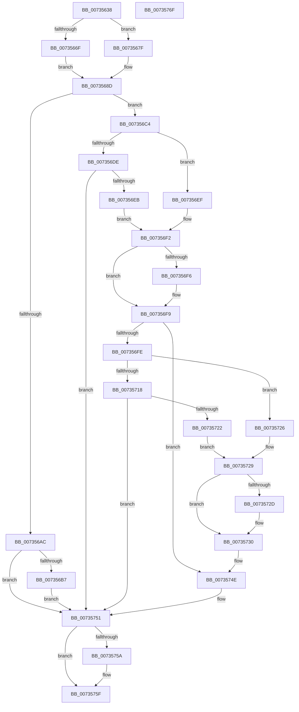

# PiDevCfgReadDriverPolicy

- RVA: `0x00735638`–`0x00735770` (길이 `312` bytes)
- VA: `0x0000000140735638`
- 실행 섹션: `PAGE`
- PDB 이름 있음: `예`; PDB Function 태그: `아니요`
- unwind 정보 RVA: `0x000C8C58`
- 디코드: `92`개 명령, `312/312` bytes 표시
- 미해석 바이트: `0` (있으면 어셈블리에 `.byte`로 보존)

> 이 문서는 커널 이미지의 기계어와 PDB 기호를 분석해 생성했습니다. 4번과 5번은 함수 원형과 자료형을 바이너리 사용 방식에서 추정한 C 해석이며 원본 소스 복구 결과는 아닙니다.

## 1. Dependencies

- 직접 호출 지점: **6**; 고유 호출 대상: **4**
- 직접 호출자로 확인된 함수: **2**
- RIP 상대 이미지 참조: **4**

### Outgoing calls
- `0x007356A1` → [IopOpenRegistryKeyEx](../A5/IopOpenRegistryKeyEx_function_00A51B44.md) (function, `0x00A51B44`)
- `0x007356D3` → [PiDevCfgQueryPolicyEnabled](PiDevCfgQueryPolicyEnabled_function_007352E8.md) (function, `0x007352E8`)
- `0x0073570D` → [PiDevCfgQueryPolicyEnabled](PiDevCfgQueryPolicyEnabled_function_007352E8.md) (function, `0x007352E8`)
- `0x00735736` → [PiDevCfgQueryMinWhcpVersion](PiDevCfgQueryMinWhcpVersion_function_00735204.md) (function, `0x00735204`)
- `0x00735745` → [PiDevCfgQueryMinWhcpVersion](PiDevCfgQueryMinWhcpVersion_function_00735204.md) (function, `0x00735204`)
- `0x0073575A` → [ZwClose](../../text/6A/ZwClose_function_006AD2B0.md) (function, `0x006AD2B0`)

### Direct callers
- [PiDevCfgQueryDriverPolicy](PiDevCfgQueryDriverPolicy_function_00734CA4.md) at `0x00734CD7`
- [PiDevCfgQueryDriverPolicy](PiDevCfgQueryDriverPolicy_function_00734CA4.md) at `0x00734D22`
- [PpDevCfgInit](../../init/C3/PpDevCfgInit_function_00C351A4.md) at `0x00C35423`

### Static image references
- `0x00735676` → RVA `0x00AFE910` (` ?? ::NNGAKEGL::`string'`; read)
- `0x00735686` → RVA `0x00AFEC70` (` ?? ::NNGAKEGL::`string'`; read)
- `0x007356CC` → RVA `0x00AFED40` (` ?? ::NNGAKEGL::`string'`; read)
- `0x00735706` → RVA `0x00AFEE80` (` ?? ::NNGAKEGL::`string'`; read)

## 2. Other-region calls and transfers

- 다른 실행 섹션으로 향하는 call: **1**
  - `0x0073575A` → [ZwClose](../../text/6A/ZwClose_function_006AD2B0.md) (`PAGE` → `.text`)
- 별도 외부 분기/꼬리 이동을 확인하지 못했습니다.

## 3. Assembly (complete function range)

```asm
00735638  48 89 5C 24 18                  mov qword ptr [rsp + 0x18], rbx
0073563D  55                              push rbp
0073563E  57                              push rdi
0073563F  41 56                           push r14
00735641  48 8B EC                        mov rbp, rsp
00735644  48 83 EC 30                     sub rsp, 0x30
00735648  48 83 65 28 00                  and qword ptr [rbp + 0x28], 0
0073564D  48 83 C8 FF                     or rax, 0xffffffffffffffff
00735651  83 65 F4 00                     and dword ptr [rbp - 0xc], 0
00735655  48 8B DA                        mov rbx, rdx
00735658  C6 45 20 00                     mov byte ptr [rbp + 0x20], 0
0073565C  44 8A F1                        mov r14b, cl
0073565F  48 83 22 00                     and qword ptr [rdx], 0
00735663  48 89 42 08                     mov qword ptr [rdx + 8], rax
00735667  48 89 42 10                     mov qword ptr [rdx + 0x10], rax
0073566B  84 C9                           test cl, cl
0073566D  74 10                           je 0x14073567f
0073566F  C7 45 F0 92 00 94 00            mov dword ptr [rbp - 0x10], 0x940092
00735676  48 8D 05 93 92 3C 00            lea rax, [rip + 0x3c9293]
0073567D  EB 0E                           jmp 0x14073568d
0073567F  C7 45 F0 C0 00 C2 00            mov dword ptr [rbp - 0x10], 0xc200c0
00735686  48 8D 05 E3 95 3C 00            lea rax, [rip + 0x3c95e3]
0073568D  41 B9 19 00 02 00               mov r9d, 0x20019
00735693  48 89 45 F8                     mov qword ptr [rbp - 8], rax
00735697  4C 8D 45 F0                     lea r8, [rbp - 0x10]
0073569B  33 D2                           xor edx, edx
0073569D  48 8D 4D 28                     lea rcx, [rbp + 0x28]
007356A1  E8 9E C4 31 00                  call 0x140a51b44
007356A6  8B F8                           mov edi, eax
007356A8  85 C0                           test eax, eax
007356AA  79 18                           jns 0x1407356c4
007356AC  3D 34 00 00 C0                  cmp eax, 0xc0000034
007356B1  0F 85 9A 00 00 00               jne 0x140735751
007356B7  C7 03 01 00 00 00               mov dword ptr [rbx], 1
007356BD  33 FF                           xor edi, edi
007356BF  E9 8D 00 00 00                  jmp 0x140735751
007356C4  48 8B 4D 28                     mov rcx, qword ptr [rbp + 0x28]
007356C8  4C 8D 45 20                     lea r8, [rbp + 0x20]
007356CC  48 8D 15 6D 96 3C 00            lea rdx, [rip + 0x3c966d]
007356D3  E8 10 FC FF FF                  call 0x1407352e8
007356D8  8B F8                           mov edi, eax
007356DA  85 C0                           test eax, eax
007356DC  79 11                           jns 0x1407356ef
007356DE  32 C0                           xor al, al
007356E0  88 45 20                        mov byte ptr [rbp + 0x20], al
007356E3  81 FF 34 00 00 C0               cmp edi, 0xc0000034
007356E9  75 66                           jne 0x140735751
007356EB  33 FF                           xor edi, edi
007356ED  EB 03                           jmp 0x1407356f2
007356EF  8A 45 20                        mov al, byte ptr [rbp + 0x20]
007356F2  84 C0                           test al, al
007356F4  74 03                           je 0x1407356f9
007356F6  83 0B 02                        or dword ptr [rbx], 2
007356F9  45 84 F6                        test r14b, r14b
007356FC  74 50                           je 0x14073574e
007356FE  48 8B 4D 28                     mov rcx, qword ptr [rbp + 0x28]
00735702  4C 8D 45 20                     lea r8, [rbp + 0x20]
00735706  48 8D 15 73 97 3C 00            lea rdx, [rip + 0x3c9773]
0073570D  E8 D6 FB FF FF                  call 0x1407352e8
00735712  8B F8                           mov edi, eax
00735714  85 C0                           test eax, eax
00735716  79 0E                           jns 0x140735726
00735718  32 C0                           xor al, al
0073571A  81 FF 34 00 00 C0               cmp edi, 0xc0000034
00735720  75 2F                           jne 0x140735751
00735722  33 FF                           xor edi, edi
00735724  EB 03                           jmp 0x140735729
00735726  8A 45 20                        mov al, byte ptr [rbp + 0x20]
00735729  84 C0                           test al, al
0073572B  74 03                           je 0x140735730
0073572D  83 0B 04                        or dword ptr [rbx], 4
00735730  48 8B 4D 28                     mov rcx, qword ptr [rbp + 0x28]
00735734  B2 01                           mov dl, 1
00735736  E8 C9 FA FF FF                  call 0x140735204
0073573B  48 8B 4D 28                     mov rcx, qword ptr [rbp + 0x28]
0073573F  33 D2                           xor edx, edx
00735741  48 89 43 08                     mov qword ptr [rbx + 8], rax
00735745  E8 BA FA FF FF                  call 0x140735204
0073574A  48 89 43 10                     mov qword ptr [rbx + 0x10], rax
0073574E  83 0B 01                        or dword ptr [rbx], 1
00735751  48 8B 4D 28                     mov rcx, qword ptr [rbp + 0x28]
00735755  48 85 C9                        test rcx, rcx
00735758  74 05                           je 0x14073575f
0073575A  E8 51 7B F7 FF                  call 0x1406ad2b0
0073575F  48 8B 5C 24 60                  mov rbx, qword ptr [rsp + 0x60]
00735764  8B C7                           mov eax, edi
00735766  48 83 C4 30                     add rsp, 0x30
0073576A  41 5E                           pop r14
0073576C  5F                              pop rdi
0073576D  5D                              pop rbp
0073576E  C3                              ret
0073576F  CC                              int3
```

## 4. C-style interpretation (structured pseudocode)

```c
__int64 __fastcall PiDevCfgReadDriverPolicy(unsigned __int8 a1, __int64 a2)
{
    __int64 result;
    __int64 v_rdi;
    __int64 v_rsp;
    unsigned __int64 v_stack_m20;
    unsigned int v_stack_m24;
    unsigned int v_stack_m28;
    unsigned __int64 v_stack_p10;
    unsigned __int64 v_stack_p18;
    unsigned __int8 v_stack_p8;

    v_stack_p18 = v_rbx;
    v_rsp = (v_rsp) - (48);
    result = (result) | (-1);
    v_stack_p8 = 0;
    *(unsigned __int64 *)(a2 + 8) = result;
    *(unsigned __int64 *)(a2 + 16) = result;
    if (a1 == 0) goto loc_0073567F;
    v_stack_m28 = 0x940092ULL;
    goto loc_0073568D;
loc_0073567F:
    v_stack_m28 = 0xC200C0ULL;
loc_0073568D:
    v_stack_m20 = v_rip + 3970531;
    a2 = 0;
    result = IopOpenRegistryKeyEx(v_stack_p10, a2, v_stack_m28, (unsigned int)(0x20019ULL));
    if (!sign_flag) goto loc_007356C4;
    if (((unsigned int)(result)) != 0xC0000034ULL) goto loc_00735751;
    *(unsigned int *)(a2) = 1;
    v_rdi = 0;
    goto loc_00735751;
loc_007356C4:
    result = PiDevCfgQueryPolicyEnabled(v_stack_p10, v_rip + 3970669, v_stack_p8, (unsigned int)(0x20019ULL));
    if (!sign_flag) goto loc_007356EF;
    result = 0;
    v_stack_p8 = 0;
    if (((unsigned int)((unsigned int)((unsigned int)(result)))) != 0xC0000034ULL) goto loc_00735751;
    v_rdi = 0;
    goto loc_007356F2;
loc_007356EF:
loc_007356F2:
    if ((unsigned __int8)(v_stack_p8) != 0) {
    }
    if (a1 == 0) goto loc_0073574E;
    result = PiDevCfgQueryPolicyEnabled(v_stack_p10, v_rip + 3970931, v_stack_p8, (unsigned int)(0x20019ULL));
    if (!sign_flag) goto loc_00735726;
    result = 0;
    if (((unsigned int)((unsigned int)((unsigned int)(result)))) != 0xC0000034ULL) goto loc_00735751;
    v_rdi = 0;
    goto loc_00735729;
loc_00735726:
loc_00735729:
    if ((unsigned __int8)(v_stack_p8) != 0) {
    }
    result = PiDevCfgQueryMinWhcpVersion(v_stack_p10, 1, v_stack_p8, (unsigned int)(0x20019ULL));
    a2 = 0;
    *(unsigned __int64 *)(a2 + 8) = result;
    result = PiDevCfgQueryMinWhcpVersion(v_stack_p10, a2, v_stack_p8, (unsigned int)(0x20019ULL));
    *(unsigned __int64 *)(a2 + 16) = result;
loc_0073574E:
loc_00735751:
    if (v_stack_p10 != 0) {
        result = ZwClose(v_stack_p10, a2, v_stack_p8, (unsigned int)(0x20019ULL));
    }
    v_rsp = (v_rsp) + (48);
    return 0;
}
```

## 5. (Beta) C Style

```c
int64_t PiDevCfgReadDriverPolicy(uint8_t Arg1, void *Arg2)
{
    uint8_t *arg2 = (uint8_t *)Arg2;

    int64_t result;
    int64_t local_rdi;
    int64_t local_rsp;
    uint64_t v_stack_m20;
    uint32_t v_stack_m24;
    uint32_t v_stack_m28;
    uint64_t v_stack_p10;
    uint64_t v_stack_p18;
    uint8_t v_stack_p8;

    v_stack_p18 = local_rbx;
    local_rsp = (local_rsp) - (48);
    result = (result) | (-1);
    v_stack_p8 = 0;
    *(uint64_t *)(arg2 + 0x8) = result;
    *(uint64_t *)(arg2 + 0x10) = result;
    if (Arg1 == 0) goto loc_0073567F;
    v_stack_m28 = 0x940092ULL;
    goto loc_0073568D;
loc_0073567F:
    v_stack_m28 = 0xC200C0ULL;
loc_0073568D:
    v_stack_m20 = v_rip + 3970531;
    Arg2 = 0;
    result = IopOpenRegistryKeyEx(v_stack_p10, Arg2, v_stack_m28, (uint32_t)(0x20019ULL));
    if (!sign_flag) goto loc_007356C4;
    if (((uint32_t)(result)) != 0xC0000034ULL) goto loc_00735751;
    *(uint32_t *)(arg2) = 1;
    local_rdi = 0;
    goto loc_00735751;
loc_007356C4:
    result = PiDevCfgQueryPolicyEnabled(v_stack_p10, v_rip + 3970669, v_stack_p8, (uint32_t)(0x20019ULL));
    if (!sign_flag) goto loc_007356EF;
    result = 0;
    v_stack_p8 = 0;
    if (((uint32_t)((uint32_t)((uint32_t)(result)))) != 0xC0000034ULL) goto loc_00735751;
    local_rdi = 0;
    goto loc_007356F2;
loc_007356EF:
loc_007356F2:
    if ((uint8_t)(v_stack_p8) != 0) {
    }
    if (Arg1 == 0) goto loc_0073574E;
    result = PiDevCfgQueryPolicyEnabled(v_stack_p10, v_rip + 3970931, v_stack_p8, (uint32_t)(0x20019ULL));
    if (!sign_flag) goto loc_00735726;
    result = 0;
    if (((uint32_t)((uint32_t)((uint32_t)(result)))) != 0xC0000034ULL) goto loc_00735751;
    local_rdi = 0;
    goto loc_00735729;
loc_00735726:
loc_00735729:
    if ((uint8_t)(v_stack_p8) != 0) {
    }
    result = PiDevCfgQueryMinWhcpVersion(v_stack_p10, 1, v_stack_p8, (uint32_t)(0x20019ULL));
    Arg2 = 0;
    *(uint64_t *)(arg2 + 0x8) = result;
    result = PiDevCfgQueryMinWhcpVersion(v_stack_p10, Arg2, v_stack_p8, (uint32_t)(0x20019ULL));
    *(uint64_t *)(arg2 + 0x10) = result;
loc_0073574E:
loc_00735751:
    if (v_stack_p10 != 0) {
        result = ZwClose(v_stack_p10, Arg2, v_stack_p8, (uint32_t)(0x20019ULL));
    }
    local_rsp = (local_rsp) + (48);
    return 0;
}
```

### 관측된 메모리 오프셋

구조체 형식이 확인되지 않은 접근은 인자 기준의 오프셋으로만 기록했습니다.

| 기준 인자 | 오프셋 표현 | 폭 (bit) | 접근 |
|---|---:|---:|---|
| `Arg2` | `+ 0x0` | `32` | `R/W` |
| `Arg2` | `+ 0x0` | `32` | `W` |
| `Arg2` | `+ 0x0` | `64` | `R/W` |
| `Arg2` | `+ 0x8` | `64` | `W` |
| `Arg2` | `+ 0x10` | `64` | `W` |

## 6. Execution-region graph

[열기: 2D/3D 그래프와 함수 탐색 컨트롤 패널](../../../control-panel.html?section=page&rva=0x00735638&view=graph)

- 2D 그래프는 위에서 아래로 흐르고, 3D 그래프는 빈 공간을 드래그해 회전합니다. Shift+드래그는 이동, 휠은 확대·축소, 함수 노드 선택은 대상 보고서 이동입니다.

### Static fallback


