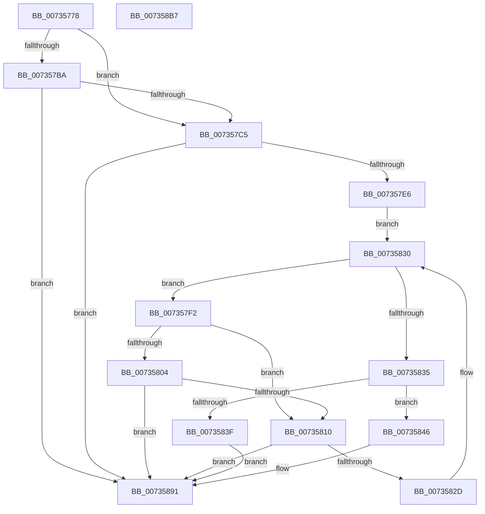

# PiDevCfgRequestDriverConfigurations

- RVA: `0x00735778`–`0x007358B8` (길이 `320` bytes)
- VA: `0x0000000140735778`
- 실행 섹션: `PAGE`
- PDB 이름 있음: `예`; PDB Function 태그: `아니요`
- unwind 정보 RVA: `0x000C8B84`
- 디코드: `85`개 명령, `320/320` bytes 표시
- 미해석 바이트: `0` (있으면 어셈블리에 `.byte`로 보존)

> 이 문서는 커널 이미지의 기계어와 PDB 기호를 분석해 생성했습니다. 4번과 5번은 함수 원형과 자료형을 바이너리 사용 방식에서 추정한 C 해석이며 원본 소스 복구 결과는 아닙니다.

## 1. Dependencies

- 직접 호출 지점: **6**; 고유 호출 대상: **4**
- 직접 호출자로 확인된 함수: **1**
- RIP 상대 이미지 참조: **2**

### Outgoing calls
- `0x007357A4` → [PiDevCfgQueryDriverConfiguration](../97/PiDevCfgQueryDriverConfiguration_function_0097584C.md) (function, `0x0097584C`)
- `0x007357D7` → [PiDevCfgAppendMultiSz](PiDevCfgAppendMultiSz_function_00731B28.md) (function, `0x00731B28`)
- `0x007357F5` → [PiDevCfgQueryDriverConfiguration](../97/PiDevCfgQueryDriverConfiguration_function_0097584C.md) (function, `0x0097584C`)
- `0x00735822` → [PiDevCfgAppendMultiSz](PiDevCfgAppendMultiSz_function_00731B28.md) (function, `0x00731B28`)
- `0x0073588A` → [PiDevCfgSetObjectProperty](../A8/PiDevCfgSetObjectProperty_function_00A8DB50.md) (function, `0x00A8DB50`)
- `0x00735896` → [RtlFreeAnsiString](../9C/RtlFreeAnsiString_function_009C0800.md) (function, `0x009C0800`)

### Direct callers
- [PiDevCfgProcessDevice](../97/PiDevCfgProcessDevice_function_00976D34.md) at `0x0097737C`

### Static image references
- `0x00735861` → RVA `0x00012E50` (`.rdata`; read)
- `0x0073586D` → RVA `0x00E66398` (`.data`; read)

## 2. Other-region calls and transfers

- 다른 실행 섹션으로 향하는 call: **0**
- 별도 외부 분기/꼬리 이동을 확인하지 못했습니다.

## 3. Assembly (complete function range)

```asm
00735778  48 8B C4                        mov rax, rsp
0073577B  48 89 58 08                     mov qword ptr [rax + 8], rbx
0073577F  48 89 68 10                     mov qword ptr [rax + 0x10], rbp
00735783  48 89 70 18                     mov qword ptr [rax + 0x18], rsi
00735787  57                              push rdi
00735788  41 54                           push r12
0073578A  41 56                           push r14
0073578C  48 83 EC 70                     sub rsp, 0x70
00735790  48 8B E9                        mov rbp, rcx
00735793  45 33 F6                        xor r14d, r14d
00735796  48 8B CA                        mov rcx, rdx
00735799  4C 89 70 D8                     mov qword ptr [rax - 0x28], r14
0073579D  4C 89 70 E0                     mov qword ptr [rax - 0x20], r14
007357A1  48 8B F2                        mov rsi, rdx
007357A4  E8 A3 00 24 00                  call 0x14097584c
007357A9  41 BC 00 00 00 80               mov r12d, 0x80000000
007357AF  8B D8                           mov ebx, eax
007357B1  42 8D 0C 20                     lea ecx, [rax + r12]
007357B5  41 85 CC                        test r12d, ecx
007357B8  75 0B                           jne 0x1407357c5
007357BA  3D 93 04 00 C0                  cmp eax, 0xc0000493
007357BF  0F 85 CC 00 00 00               jne 0x140735891
007357C5  48 8D 96 A8 01 00 00            lea rdx, [rsi + 0x1a8]
007357CC  41 B1 01                        mov r9b, 1
007357CF  45 33 C0                        xor r8d, r8d
007357D2  48 8D 4C 24 60                  lea rcx, [rsp + 0x60]
007357D7  E8 4C C3 FF FF                  call 0x140731b28
007357DC  8B D8                           mov ebx, eax
007357DE  85 C0                           test eax, eax
007357E0  0F 88 AB 00 00 00               js 0x140735891
007357E6  48 81 C6 D0 00 00 00            add rsi, 0xd0
007357ED  48 8B 3E                        mov rdi, qword ptr [rsi]
007357F0  EB 3E                           jmp 0x140735830
007357F2  48 8B CF                        mov rcx, rdi
007357F5  E8 52 00 24 00                  call 0x14097584c
007357FA  8B D8                           mov ebx, eax
007357FC  41 03 C4                        add eax, r12d
007357FF  41 85 C4                        test r12d, eax
00735802  75 0C                           jne 0x140735810
00735804  81 FB 93 04 00 C0               cmp ebx, 0xc0000493
0073580A  0F 85 81 00 00 00               jne 0x140735891
00735810  48 8D 97 A8 01 00 00            lea rdx, [rdi + 0x1a8]
00735817  41 B1 01                        mov r9b, 1
0073581A  45 33 C0                        xor r8d, r8d
0073581D  48 8D 4C 24 60                  lea rcx, [rsp + 0x60]
00735822  E8 01 C3 FF FF                  call 0x140731b28
00735827  8B D8                           mov ebx, eax
00735829  85 C0                           test eax, eax
0073582B  78 64                           js 0x140735891
0073582D  48 8B 3F                        mov rdi, qword ptr [rdi]
00735830  48 3B FE                        cmp rdi, rsi
00735833  75 BD                           jne 0x1407357f2
00735835  48 8B 4C 24 68                  mov rcx, qword ptr [rsp + 0x68]
0073583A  48 85 C9                        test rcx, rcx
0073583D  75 07                           jne 0x140735846
0073583F  BB 93 04 00 C0                  mov ebx, 0xc0000493
00735844  EB 4B                           jmp 0x140735891
00735846  0F B7 44 24 60                  movzx eax, word ptr [rsp + 0x60]
0073584B  41 B9 01 00 00 00               mov r9d, 1
00735851  4C 8B 45 08                     mov r8, qword ptr [rbp + 8]
00735855  48 8B D5                        mov rdx, rbp
00735858  44 89 74 24 50                  mov dword ptr [rsp + 0x50], r14d
0073585D  89 44 24 48                     mov dword ptr [rsp + 0x48], eax
00735861  48 8D 05 E8 D5 8D FF            lea rax, [rip - 0x722a18]
00735868  48 89 4C 24 40                  mov qword ptr [rsp + 0x40], rcx
0073586D  48 8B 0D 24 0B 73 00            mov rcx, qword ptr [rip + 0x730b24]
00735874  C7 44 24 38 12 20 00 00         mov dword ptr [rsp + 0x38], 0x2012
0073587C  48 89 44 24 30                  mov qword ptr [rsp + 0x30], rax
00735881  48 8B 45 10                     mov rax, qword ptr [rbp + 0x10]
00735885  48 89 44 24 20                  mov qword ptr [rsp + 0x20], rax
0073588A  E8 C1 82 35 00                  call 0x140a8db50
0073588F  8B D8                           mov ebx, eax
00735891  48 8D 4C 24 60                  lea rcx, [rsp + 0x60]
00735896  E8 65 AF 28 00                  call 0x1409c0800
0073589B  4C 8D 5C 24 70                  lea r11, [rsp + 0x70]
007358A0  8B C3                           mov eax, ebx
007358A2  49 8B 5B 20                     mov rbx, qword ptr [r11 + 0x20]
007358A6  49 8B 6B 28                     mov rbp, qword ptr [r11 + 0x28]
007358AA  49 8B 73 30                     mov rsi, qword ptr [r11 + 0x30]
007358AE  49 8B E3                        mov rsp, r11
007358B1  41 5E                           pop r14
007358B3  41 5C                           pop r12
007358B5  5F                              pop rdi
007358B6  C3                              ret
007358B7  CC                              int3
```

## 4. C-style interpretation (structured pseudocode)

```c
__int64 __fastcall PiDevCfgRequestDriverConfigurations(__int64 a1, __int64 a2, int a3)
{
    __int64 result;
    __int64 v_r14;
    __int64 v_rsi;
    __int64 v_rsp;
    unsigned __int64 v_stack_m18;
    unsigned __int64 v_stack_m20;
    unsigned __int64 v_stack_m28;
    unsigned int v_stack_m38;
    unsigned int v_stack_m40;
    unsigned __int64 v_stack_m48;
    unsigned int v_stack_m50;
    unsigned __int64 v_stack_m58;
    unsigned __int64 v_stack_m68;

    *(unsigned __int64 *)(v_rsp + 8) = v_rbx;
    *(unsigned __int64 *)(v_rsp + 16) = v_rbp;
    *(unsigned __int64 *)(v_rsp + 24) = v_rsi;
    v_rsp = (v_rsp) - (112);
    v_r14 = 0;
    *(unsigned __int64 *)(v_rsp - 40) = 0;
    *(unsigned __int64 *)(v_rsp - 32) = 0;
    result = PiDevCfgQueryDriverConfiguration(a2, a2, a3, a4);
    if ((((unsigned int)((unsigned int)(0x80000000ULL))) & ((unsigned int)(result + (unsigned int)(0x80000000ULL) * 1))) != 0) goto loc_007357C5;
    if (((unsigned int)(result)) != 0xC0000493ULL) goto loc_00735891;
loc_007357C5:
    a3 = 0;
    result = PiDevCfgAppendMultiSz(v_stack_m28, a2 + 424, a3, 1);
    if (sign_flag) goto loc_00735891;
    v_rsi = (a2) + (208);
    goto loc_00735830;
loc_007357F2:
    result = PiDevCfgQueryDriverConfiguration(*(unsigned __int64 *)(v_rsi), a2 + 424, a3, 1);
    result = (unsigned int)((result) + ((unsigned int)((unsigned int)(0x80000000ULL))));
    if ((((unsigned int)((unsigned int)(0x80000000ULL))) & ((unsigned int)(result))) != 0) goto loc_00735810;
    if (((unsigned int)((unsigned int)((unsigned int)(result)))) != 0xC0000493ULL) goto loc_00735891;
loc_00735810:
    a3 = 0;
    result = PiDevCfgAppendMultiSz(v_stack_m28, *(unsigned __int64 *)(v_rsi) + 424, a3, 1);
    if (sign_flag) goto loc_00735891;
loc_00735830:
    if ((*(unsigned __int64 *)(*(unsigned __int64 *)(v_rsi))) != v_rsi) goto loc_007357F2;
    if (v_stack_m20 != 0) goto loc_00735846;
    goto loc_00735891;
loc_00735846:
    v_stack_m38 = 0;
    v_stack_m40 = (unsigned int)(v_stack_m28);
    v_stack_m48 = v_stack_m20;
    v_stack_m50 = 0x2012ULL;
    v_stack_m58 = v_rip - 7481880;
    v_stack_m68 = *(unsigned __int64 *)(a1 + 16);
    result = PiDevCfgSetObjectProperty(*(unsigned __int64 *)(v_rip + 7539492), a1, *(unsigned __int64 *)(a1 + 8), 1);
loc_00735891:
    result = RtlFreeAnsiString(v_stack_m28, a1, *(unsigned __int64 *)(a1 + 8), 1);
    return (unsigned int)((unsigned int)((unsigned int)((unsigned int)(result))));
}
```

## 5. (Beta) C Style

```c
int64_t PiDevCfgRequestDriverConfigurations(void *Arg1, void *Arg2, int32_t Arg3)
{
    uint8_t *arg1 = (uint8_t *)Arg1;
    uint8_t *arg2 = (uint8_t *)Arg2;

    int64_t result;
    int64_t local_r14;
    int64_t local_rsi;
    int64_t local_rsp;
    uint64_t v_stack_m18;
    uint64_t v_stack_m20;
    uint64_t v_stack_m28;
    uint32_t v_stack_m38;
    uint32_t v_stack_m40;
    uint64_t v_stack_m48;
    uint32_t v_stack_m50;
    uint64_t v_stack_m58;
    uint64_t v_stack_m68;

    *(uint64_t *)(local_rsp + 0x8) = local_rbx;
    *(uint64_t *)(local_rsp + 0x10) = local_rbp;
    *(uint64_t *)(local_rsp + 0x18) = local_rsi;
    local_rsp = (local_rsp) - (112);
    local_r14 = 0;
    *(uint64_t *)(local_rsp - 0x28) = 0;
    *(uint64_t *)(local_rsp - 0x20) = 0;
    result = PiDevCfgQueryDriverConfiguration(Arg2, Arg2, Arg3, a4);
    if ((((uint32_t)((uint32_t)(0x80000000ULL))) & ((uint32_t)(result + (uint32_t)(0x80000000ULL) * 1))) != 0) goto loc_007357C5;
    if (((uint32_t)(result)) != 0xC0000493ULL) goto loc_00735891;
loc_007357C5:
    Arg3 = 0;
    result = PiDevCfgAppendMultiSz(v_stack_m28, Arg2 + 424, Arg3, 1);
    if (sign_flag) goto loc_00735891;
    local_rsi = (Arg2) + (208);
    goto loc_00735830;
loc_007357F2:
    result = PiDevCfgQueryDriverConfiguration(*(uint64_t *)(local_rsi), Arg2 + 424, Arg3, 1);
    result = (uint32_t)((result) + ((uint32_t)((uint32_t)(0x80000000ULL))));
    if ((((uint32_t)((uint32_t)(0x80000000ULL))) & ((uint32_t)(result))) != 0) goto loc_00735810;
    if (((uint32_t)((uint32_t)((uint32_t)(result)))) != 0xC0000493ULL) goto loc_00735891;
loc_00735810:
    Arg3 = 0;
    result = PiDevCfgAppendMultiSz(v_stack_m28, *(uint64_t *)(local_rsi) + 424, Arg3, 1);
    if (sign_flag) goto loc_00735891;
loc_00735830:
    if ((*(uint64_t *)(*(uint64_t *)(local_rsi))) != local_rsi) goto loc_007357F2;
    if (v_stack_m20 != 0) goto loc_00735846;
    goto loc_00735891;
loc_00735846:
    v_stack_m38 = 0;
    v_stack_m40 = (uint32_t)(v_stack_m28);
    v_stack_m48 = v_stack_m20;
    v_stack_m50 = 0x2012ULL;
    v_stack_m58 = v_rip - 7481880;
    v_stack_m68 = *(uint64_t *)(arg1 + 0x10);
    result = PiDevCfgSetObjectProperty(*(uint64_t *)(v_rip + 0x730B24), Arg1, *(uint64_t *)(arg1 + 0x8), 1);
loc_00735891:
    result = RtlFreeAnsiString(v_stack_m28, Arg1, *(uint64_t *)(arg1 + 0x8), 1);
    return (uint32_t)((uint32_t)((uint32_t)((uint32_t)(result))));
}
```

### 관측된 메모리 오프셋

구조체 형식이 확인되지 않은 접근은 인자 기준의 오프셋으로만 기록했습니다.

| 기준 인자 | 오프셋 표현 | 폭 (bit) | 접근 |
|---|---:|---:|---|
| `Arg1` | `+ 0x8` | `64` | `R` |
| `Arg1` | `+ 0x10` | `64` | `R` |
| `Arg2` | `+ 0x0` | `64` | `R` |
| `Arg2` | `+ 0x1A8` | `64` | `R` |

## 6. Execution-region graph

[열기: 2D/3D 그래프와 함수 탐색 컨트롤 패널](../../../control-panel.html?section=page&rva=0x00735778&view=graph)

- 2D 그래프는 위에서 아래로 흐르고, 3D 그래프는 빈 공간을 드래그해 회전합니다. Shift+드래그는 이동, 휠은 확대·축소, 함수 노드 선택은 대상 보고서 이동입니다.

### Static fallback


