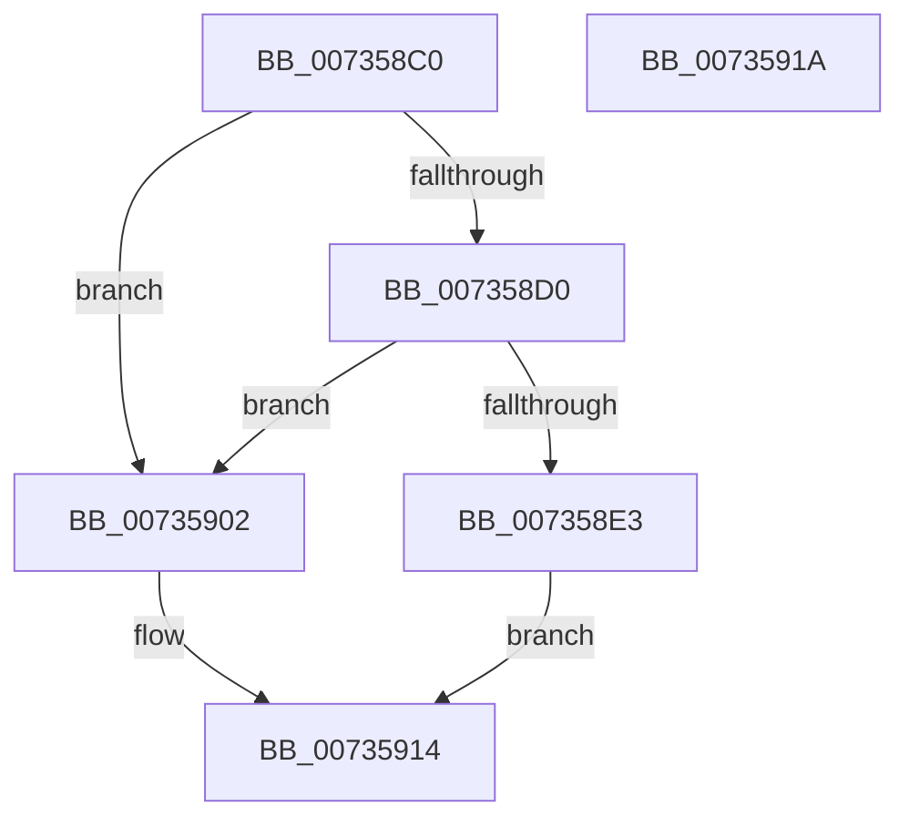

# PiDevCfgResetDeviceKeyCallback

- RVA: `0x007358C0`–`0x0073591B` (길이 `91` bytes)
- VA: `0x00000001407358C0`
- 실행 섹션: `PAGE`
- PDB 이름 있음: `예`; PDB Function 태그: `아니요`
- unwind 정보 RVA: `0x00064C80`
- 디코드: `25`개 명령, `91/91` bytes 표시
- 미해석 바이트: `0` (있으면 어셈블리에 `.byte`로 보존)

> 이 문서는 커널 이미지의 기계어와 PDB 기호를 분석해 생성했습니다. 4번과 5번은 함수 원형과 자료형을 바이너리 사용 방식에서 추정한 C 해석이며 원본 소스 복구 결과는 아닙니다.

## 1. Dependencies

- 직접 호출 지점: **3**; 고유 호출 대상: **3**
- 직접 호출자로 확인된 함수: **0**
- RIP 상대 이미지 참조: **1**

### Outgoing calls
- `0x007358DA` → [wcsicmp](../../text/50/wcsicmp_function_00500080.md) (function, `0x00500080`)
- `0x007358FB` → [PiDevCfgCopyDeviceProperties](../70/PiDevCfgCopyDeviceProperties_function_007044F0.md) (function, `0x007044F0`)
- `0x0073590F` → [PiDevCfgCopyDeviceKeys](../99/PiDevCfgCopyDeviceKeys_function_00995E1C.md) (function, `0x00995E1C`)

### Direct callers
- 이 함수 시작 RVA로 연결되는 직접 call은 확인되지 않았습니다. 간접 호출은 완전히 역산할 수 없습니다.

### Static image references
- `0x007358D3` → RVA `0x00AFCD40` (` ?? ::NNGAKEGL::`string'`; read)

## 2. Other-region calls and transfers

- 다른 실행 섹션으로 향하는 call: **1**
  - `0x007358DA` → [wcsicmp](../../text/50/wcsicmp_function_00500080.md) (`PAGE` → `.text`)
- 별도 외부 분기/꼬리 이동을 확인하지 못했습니다.

## 3. Assembly (complete function range)

```asm
007358C0  40 53                           push rbx
007358C2  48 83 EC 30                     sub rsp, 0x30
007358C6  41 83 78 10 10                  cmp dword ptr [r8 + 0x10], 0x10
007358CB  48 8B DA                        mov rbx, rdx
007358CE  75 32                           jne 0x140735902
007358D0  49 8B 08                        mov rcx, qword ptr [r8]
007358D3  48 8D 15 66 74 3C 00            lea rdx, [rip + 0x3c7466]
007358DA  E8 A1 A7 DC FF                  call 0x140500080
007358DF  85 C0                           test eax, eax
007358E1  75 1F                           jne 0x140735902
007358E3  48 83 64 24 28 00               and qword ptr [rsp + 0x28], 0
007358E9  44 8D 48 01                     lea r9d, [rax + 1]
007358ED  4C 8B 43 08                     mov r8, qword ptr [rbx + 8]
007358F1  48 8B 54 24 68                  mov rdx, qword ptr [rsp + 0x68]
007358F6  48 8B 4C 24 60                  mov rcx, qword ptr [rsp + 0x60]
007358FB  E8 F0 EB FC FF                  call 0x1407044f0
00735900  EB 12                           jmp 0x140735914
00735902  48 8B 54 24 68                  mov rdx, qword ptr [rsp + 0x68]
00735907  45 33 C9                        xor r9d, r9d
0073590A  48 8B 4C 24 60                  mov rcx, qword ptr [rsp + 0x60]
0073590F  E8 08 05 26 00                  call 0x140995e1c
00735914  48 83 C4 30                     add rsp, 0x30
00735918  5B                              pop rbx
00735919  C3                              ret
0073591A  CC                              int3
```

## 4. C-style interpretation (structured pseudocode)

```c
__int64 __fastcall PiDevCfgResetDeviceKeyCallback(__int64 a1, __int64 a2, __int64 a3, __int64 a4, __int64 a5, __int64 a6)
{
    __int64 result;
    __int64 v_rsp;
    unsigned __int64 v_stack_m10;

    v_rsp = (v_rsp) - (48);
    if ((*(unsigned int *)(a3 + 16)) != 16) goto loc_00735902;
    result = wcsicmp(*(unsigned __int64 *)(a3), v_rip + 3961958, a3, a4);
    if ((unsigned int)(result) != 0) goto loc_00735902;
    result = PiDevCfgCopyDeviceProperties(a5, a6, *(unsigned __int64 *)(a2 + 8), result + 1);
    goto loc_00735914;
loc_00735902:
    a4 = 0;
    result = PiDevCfgCopyDeviceKeys(a5, a6, *(unsigned __int64 *)(a2 + 8), a4);
loc_00735914:
    v_rsp = (v_rsp) + (48);
    return result;
}
```

## 5. (Beta) C Style

```c
int64_t PiDevCfgResetDeviceKeyCallback(int64_t Arg1, void *Arg2, void *Arg3, int64_t Arg4, int64_t Arg5, int64_t Arg6)
{
    uint8_t *arg2 = (uint8_t *)Arg2;
    uint8_t *arg3 = (uint8_t *)Arg3;

    int64_t result;
    int64_t local_rsp;
    uint64_t v_stack_m10;

    local_rsp = (local_rsp) - (48);
    if ((*(uint32_t *)(arg3 + 0x10)) != 16) goto loc_00735902;
    result = wcsicmp(*(uint64_t *)(arg3), v_rip + 3961958, Arg3, Arg4);
    if ((uint32_t)(result) != 0) goto loc_00735902;
    result = PiDevCfgCopyDeviceProperties(Arg5, Arg6, *(uint64_t *)(arg2 + 0x8), result + 1);
    goto loc_00735914;
loc_00735902:
    Arg4 = 0;
    result = PiDevCfgCopyDeviceKeys(Arg5, Arg6, *(uint64_t *)(arg2 + 0x8), Arg4);
loc_00735914:
    local_rsp = (local_rsp) + (48);
    return result;
}
```

### 관측된 메모리 오프셋

구조체 형식이 확인되지 않은 접근은 인자 기준의 오프셋으로만 기록했습니다.

| 기준 인자 | 오프셋 표현 | 폭 (bit) | 접근 |
|---|---:|---:|---|
| `Arg2` | `+ 0x8` | `64` | `R` |
| `Arg3` | `+ 0x0` | `64` | `R` |
| `Arg3` | `+ 0x10` | `32` | `R` |

## 6. Execution-region graph

[열기: 2D/3D 그래프와 함수 탐색 컨트롤 패널](../../../control-panel.html?section=page&rva=0x007358C0&view=graph)

- 2D 그래프는 위에서 아래로 흐르고, 3D 그래프는 빈 공간을 드래그해 회전합니다. Shift+드래그는 이동, 휠은 확대·축소, 함수 노드 선택은 대상 보고서 이동입니다.

### Static fallback


