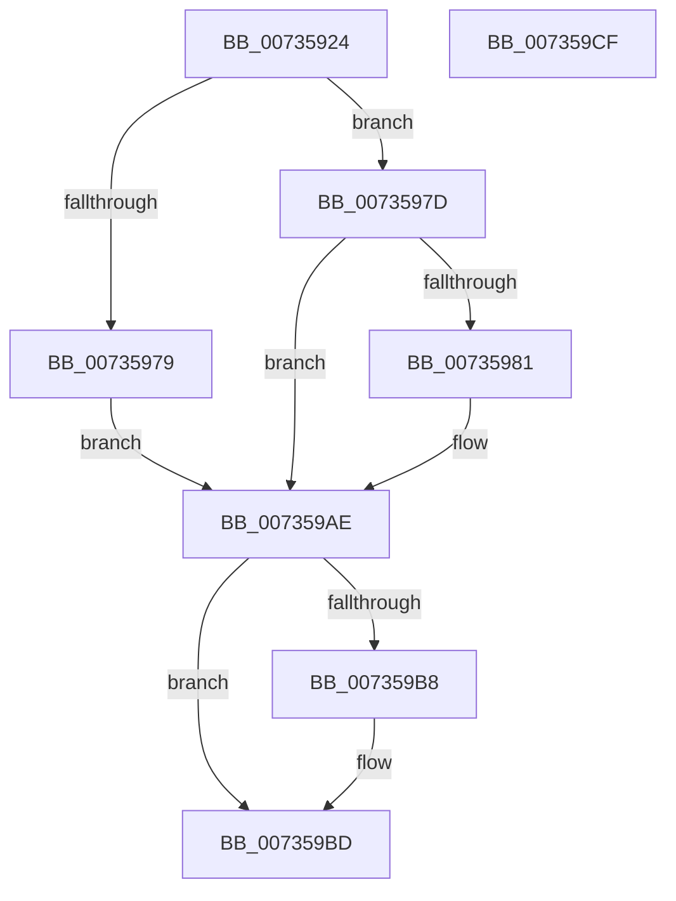

# PiDevCfgResetDeviceKeys

- RVA: `0x00735924`–`0x007359D0` (길이 `172` bytes)
- VA: `0x0000000140735924`
- 실행 섹션: `PAGE`
- PDB 이름 있음: `예`; PDB Function 태그: `아니요`
- unwind 정보 RVA: `0x0007F83C`
- 디코드: `46`개 명령, `172/172` bytes 표시
- 미해석 바이트: `0` (있으면 어셈블리에 `.byte`로 보존)

> 이 문서는 커널 이미지의 기계어와 PDB 기호를 분석해 생성했습니다. 4번과 5번은 함수 원형과 자료형을 바이너리 사용 방식에서 추정한 C 해석이며 원본 소스 복구 결과는 아닙니다.

## 1. Dependencies

- 직접 호출 지점: **3**; 고유 호출 대상: **3**
- 직접 호출자로 확인된 함수: **1**
- RIP 상대 이미지 참조: **2**

### Outgoing calls
- `0x0073596B` → [IopOpenRegistryKeyEx](../A5/IopOpenRegistryKeyEx_function_00A51B44.md) (function, `0x00A51B44`)
- `0x007359A7` → [PiDevCfgEnumDeviceKeys](../96/PiDevCfgEnumDeviceKeys_function_00964EE8.md) (function, `0x00964EE8`)
- `0x007359B8` → [ZwClose](../../text/6A/ZwClose_function_006AD2B0.md) (function, `0x006AD2B0`)

### Direct callers
- [PiDevCfgResetDeviceDriverSettings](../96/PiDevCfgResetDeviceDriverSettings_function_00966168.md) at `0x00966461`
- [PiDevCfgResetDeviceDriverSettings](../96/PiDevCfgResetDeviceDriverSettings_function_00966168.md) at `0x00966490`

### Static image references
- `0x00735941` → RVA `0x00AFF1A0` (` ?? ::NNGAKEGL::`string'`; read)
- `0x00735987` → RVA `0x007358C0` (`PiDevCfgResetDeviceKeyCallback`; read)

## 2. Other-region calls and transfers

- 다른 실행 섹션으로 향하는 call: **1**
  - `0x007359B8` → [ZwClose](../../text/6A/ZwClose_function_006AD2B0.md) (`PAGE` → `.text`)
- 별도 외부 분기/꼬리 이동을 확인하지 못했습니다.

## 3. Assembly (complete function range)

```asm
00735924  4C 8B DC                        mov r11, rsp
00735927  49 89 5B 08                     mov qword ptr [r11 + 8], rbx
0073592B  49 89 73 10                     mov qword ptr [r11 + 0x10], rsi
0073592F  57                              push rdi
00735930  48 83 EC 50                     sub rsp, 0x50
00735934  83 64 24 44 00                  and dword ptr [rsp + 0x44], 0
00735939  48 8B F1                        mov rsi, rcx
0073593C  49 83 63 20 00                  and qword ptr [r11 + 0x20], 0
00735941  48 8D 0D 58 98 3C 00            lea rcx, [rip + 0x3c9858]
00735948  49 8B C0                        mov rax, r8
0073594B  C7 44 24 40 26 00 28 00         mov dword ptr [rsp + 0x40], 0x280026
00735953  49 89 4B F0                     mov qword ptr [r11 - 0x10], rcx
00735957  4D 8D 43 E8                     lea r8, [r11 - 0x18]
0073595B  48 8B FA                        mov rdi, rdx
0073595E  49 8D 4B 20                     lea rcx, [r11 + 0x20]
00735962  41 B9 19 00 02 00               mov r9d, 0x20019
00735968  48 8B D0                        mov rdx, rax
0073596B  E8 D4 C1 31 00                  call 0x140a51b44
00735970  8B D8                           mov ebx, eax
00735972  3D 34 00 00 C0                  cmp eax, 0xc0000034
00735977  75 04                           jne 0x14073597d
00735979  33 DB                           xor ebx, ebx
0073597B  EB 31                           jmp 0x1407359ae
0073597D  85 C0                           test eax, eax
0073597F  78 2D                           js 0x1407359ae
00735981  48 83 64 24 30 00               and qword ptr [rsp + 0x30], 0
00735987  48 8D 05 32 FF FF FF            lea rax, [rip - 0xce]
0073598E  4C 8B 44 24 78                  mov r8, qword ptr [rsp + 0x78]
00735993  41 83 C9 FF                     or r9d, 0xffffffff
00735997  48 89 44 24 28                  mov qword ptr [rsp + 0x28], rax
0073599C  48 8B D7                        mov rdx, rdi
0073599F  48 8B CE                        mov rcx, rsi
007359A2  C6 44 24 20 00                  mov byte ptr [rsp + 0x20], 0
007359A7  E8 3C F5 22 00                  call 0x140964ee8
007359AC  8B D8                           mov ebx, eax
007359AE  48 8B 4C 24 78                  mov rcx, qword ptr [rsp + 0x78]
007359B3  48 85 C9                        test rcx, rcx
007359B6  74 05                           je 0x1407359bd
007359B8  E8 F3 78 F7 FF                  call 0x1406ad2b0
007359BD  48 8B 74 24 68                  mov rsi, qword ptr [rsp + 0x68]
007359C2  8B C3                           mov eax, ebx
007359C4  48 8B 5C 24 60                  mov rbx, qword ptr [rsp + 0x60]
007359C9  48 83 C4 50                     add rsp, 0x50
007359CD  5F                              pop rdi
007359CE  C3                              ret
007359CF  CC                              int3
```

## 4. C-style interpretation (structured pseudocode)

```c
__int64 __fastcall PiDevCfgResetDeviceKeys(__int64 a1, __int64 a2, __int64 a3)
{
    __int64 result;
    __int64 v_rbx;
    __int64 v_rsp;
    unsigned int v_stack_m14;
    unsigned int v_stack_m18;
    unsigned __int64 v_stack_m28;
    unsigned __int64 v_stack_m30;
    unsigned __int8 v_stack_m38;
    unsigned __int64 v_stack_p10;
    unsigned __int64 v_stack_p20;
    unsigned __int64 v_stack_p8;

    *(unsigned __int64 *)(v_rsp + 8) = v_rbx;
    *(unsigned __int64 *)(v_rsp + 16) = v_rsi;
    v_rsp = (v_rsp) - (80);
    v_stack_m18 = 0x280026ULL;
    *(unsigned __int64 *)(v_rsp - 16) = v_rip + 3971160;
    result = IopOpenRegistryKeyEx(v_rsp + 32, a3, v_rsp - 24, (unsigned int)(0x20019ULL));
    if (((unsigned int)(result)) != 0xC0000034ULL) goto loc_0073597D;
    v_rbx = 0;
    goto loc_007359AE;
loc_0073597D:
    if (!(sign_flag)) {
        result = v_rip - 206;
        a3 = v_stack_p20;
        a4 = (unsigned int)(((unsigned int)(0x20019ULL)) | (0xFFFFFFFFULL));
        v_stack_m30 = result;
        a2 = a2;
        a1 = a1;
        v_stack_m38 = 0;
        result = PiDevCfgEnumDeviceKeys(a1, a2, a3, a4);
        v_rbx = (unsigned int)(result);
    }
    if (v_stack_p20 != 0) {
        result = ZwClose(v_stack_p20, a2, a3, a4);
    }
    v_rsp = (v_rsp) + (80);
    return (unsigned int)((unsigned int)(v_rbx));
}
```

## 5. (Beta) C Style

```c
int64_t PiDevCfgResetDeviceKeys(int64_t Arg1, int64_t Arg2, int64_t Arg3)
{
    int64_t result;
    int64_t local_rbx;
    int64_t local_rsp;
    uint32_t v_stack_m14;
    uint32_t v_stack_m18;
    uint64_t v_stack_m28;
    uint64_t v_stack_m30;
    uint8_t v_stack_m38;
    uint64_t v_stack_p10;
    uint64_t v_stack_p20;
    uint64_t v_stack_p8;

    *(uint64_t *)(local_rsp + 0x8) = local_rbx;
    *(uint64_t *)(local_rsp + 0x10) = local_rsi;
    local_rsp = (local_rsp) - (80);
    v_stack_m18 = 0x280026ULL;
    *(uint64_t *)(local_rsp - 0x10) = v_rip + 3971160;
    result = IopOpenRegistryKeyEx(local_rsp + 32, Arg3, local_rsp - 24, (uint32_t)(0x20019ULL));
    if (((uint32_t)(result)) != 0xC0000034ULL) goto loc_0073597D;
    local_rbx = 0;
    goto loc_007359AE;
loc_0073597D:
    if (!(sign_flag)) {
        result = v_rip - 206;
        Arg3 = v_stack_p20;
        a4 = (uint32_t)(((uint32_t)(0x20019ULL)) | (0xFFFFFFFFULL));
        v_stack_m30 = result;
        Arg2 = Arg2;
        Arg1 = Arg1;
        v_stack_m38 = 0;
        result = PiDevCfgEnumDeviceKeys(Arg1, Arg2, Arg3, a4);
        local_rbx = (uint32_t)(result);
    }
    if (v_stack_p20 != 0) {
        result = ZwClose(v_stack_p20, Arg2, Arg3, a4);
    }
    local_rsp = (local_rsp) + (80);
    return (uint32_t)((uint32_t)(local_rbx));
}
```

## 6. Execution-region graph

[열기: 2D/3D 그래프와 함수 탐색 컨트롤 패널](../../../control-panel.html?section=page&rva=0x00735924&view=graph)

- 2D 그래프는 위에서 아래로 흐르고, 3D 그래프는 빈 공간을 드래그해 회전합니다. Shift+드래그는 이동, 휠은 확대·축소, 함수 노드 선택은 대상 보고서 이동입니다.

### Static fallback


