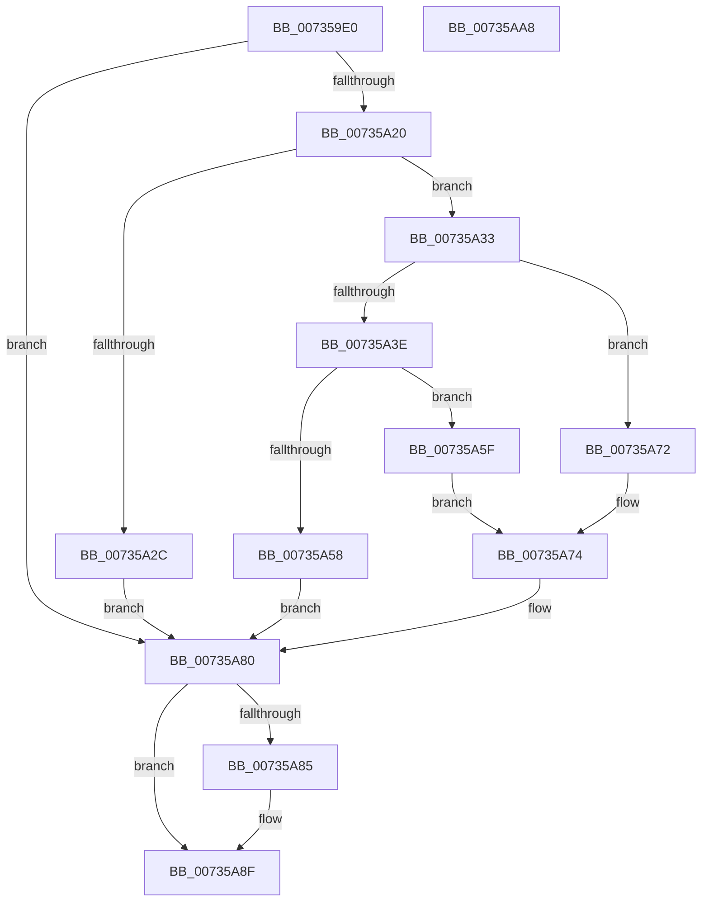

# PiDevCfgResolveVariableConstant

- RVA: `0x007359E0`–`0x00735AA9` (길이 `201` bytes)
- VA: `0x00000001407359E0`
- 실행 섹션: `PAGE`
- PDB 이름 있음: `예`; PDB Function 태그: `아니요`
- unwind 정보 RVA: `0x00085624`
- 디코드: `65`개 명령, `201/201` bytes 표시
- 미해석 바이트: `0` (있으면 어셈블리에 `.byte`로 보존)

> 이 문서는 커널 이미지의 기계어와 PDB 기호를 분석해 생성했습니다. 4번과 5번은 함수 원형과 자료형을 바이너리 사용 방식에서 추정한 C 해석이며 원본 소스 복구 결과는 아닙니다.

## 1. Dependencies

- 직접 호출 지점: **5**; 고유 호출 대상: **5**
- 직접 호출자로 확인된 함수: **0**
- RIP 상대 이미지 참조: **1**

### Outgoing calls
- `0x00735A10` → [IopGetRegistryValue](../99/IopGetRegistryValue_function_009990EC.md) (function, `0x009990EC`)
- `0x00735A23` → [PnpValidateRegistryValue](../../text/5A/PnpValidateRegistryValue_function_005A8218.md) (function, `0x005A8218`)
- `0x00735A4B` → [ExAllocatePool2](../../poolcode/B8/ExAllocatePool2_function_00B820F0.md) (function, `0x00B820F0`)
- `0x00735A6B` → [memcpy](../../text/6C/memcpy_function_006C6840.md) (function, `0x006C6840`)
- `0x00735A8A` → [ExFreePoolWithTag](../../poolcode/B8/ExFreePoolWithTag_function_00B82870.md) (function, `0x00B82870`)

### Direct callers
- 이 함수 시작 RVA로 연결되는 직접 call은 확인되지 않았습니다. 간접 호출은 완전히 역산할 수 없습니다.

### Static image references
- `0x00735A09` → RVA `0x00AFF560` (` ?? ::NNGAKEGL::`string'`; read)

## 2. Other-region calls and transfers

- 다른 실행 섹션으로 향하는 call: **4**
  - `0x00735A23` → [PnpValidateRegistryValue](../../text/5A/PnpValidateRegistryValue_function_005A8218.md) (`PAGE` → `.text`)
  - `0x00735A4B` → [ExAllocatePool2](../../poolcode/B8/ExAllocatePool2_function_00B820F0.md) (`PAGE` → `POOLCODE`)
  - `0x00735A6B` → [memcpy](../../text/6C/memcpy_function_006C6840.md) (`PAGE` → `.text`)
  - `0x00735A8A` → [ExFreePoolWithTag](../../poolcode/B8/ExFreePoolWithTag_function_00B82870.md) (`PAGE` → `POOLCODE`)
- 별도 외부 분기/꼬리 이동을 확인하지 못했습니다.

## 3. Assembly (complete function range)

```asm
007359E0  48 8B C4                        mov rax, rsp
007359E3  48 89 58 08                     mov qword ptr [rax + 8], rbx
007359E7  48 89 68 10                     mov qword ptr [rax + 0x10], rbp
007359EB  56                              push rsi
007359EC  57                              push rdi
007359ED  41 54                           push r12
007359EF  41 56                           push r14
007359F1  41 57                           push r15
007359F3  48 83 EC 20                     sub rsp, 0x20
007359F7  48 83 60 20 00                  and qword ptr [rax + 0x20], 0
007359FC  4C 8D 48 20                     lea r9, [rax + 0x20]
00735A00  4D 8B F0                        mov r14, r8
00735A03  48 8B CA                        mov rcx, rdx
00735A06  45 33 C0                        xor r8d, r8d
00735A09  48 8D 15 50 9B 3C 00            lea rdx, [rip + 0x3c9b50]
00735A10  E8 D7 36 26 00                  call 0x1409990ec
00735A15  48 8B 5C 24 68                  mov rbx, qword ptr [rsp + 0x68]
00735A1A  8B F8                           mov edi, eax
00735A1C  85 C0                           test eax, eax
00735A1E  78 60                           js 0x140735a80
00735A20  48 8B CB                        mov rcx, rbx
00735A23  E8 F0 27 E7 FF                  call 0x1405a8218
00735A28  84 C0                           test al, al
00735A2A  75 07                           jne 0x140735a33
00735A2C  BF 01 00 00 C0                  mov edi, 0xc0000001
00735A31  EB 4D                           jmp 0x140735a80
00735A33  8B 6B 0C                        mov ebp, dword ptr [rbx + 0xc]
00735A36  44 8B 7B 04                     mov r15d, dword ptr [rbx + 4]
00735A3A  85 ED                           test ebp, ebp
00735A3C  74 34                           je 0x140735a72
00735A3E  41 B8 50 70 64 63               mov r8d, 0x63647050
00735A44  8B D5                           mov edx, ebp
00735A46  B9 00 01 00 00                  mov ecx, 0x100
00735A4B  E8 A0 C6 44 00                  call 0x140b820f0
00735A50  48 8B F0                        mov rsi, rax
00735A53  48 85 C0                        test rax, rax
00735A56  75 07                           jne 0x140735a5f
00735A58  BF 9A 00 00 C0                  mov edi, 0xc000009a
00735A5D  EB 21                           jmp 0x140735a80
00735A5F  8B 53 08                        mov edx, dword ptr [rbx + 8]
00735A62  4C 8B C5                        mov r8, rbp
00735A65  48 03 D3                        add rdx, rbx
00735A68  48 8B C8                        mov rcx, rax
00735A6B  E8 D0 0D F9 FF                  call 0x1406c6840
00735A70  EB 02                           jmp 0x140735a74
00735A72  33 F6                           xor esi, esi
00735A74  45 89 7E 20                     mov dword ptr [r14 + 0x20], r15d
00735A78  41 89 6E 24                     mov dword ptr [r14 + 0x24], ebp
00735A7C  49 89 76 28                     mov qword ptr [r14 + 0x28], rsi
00735A80  48 85 DB                        test rbx, rbx
00735A83  74 0A                           je 0x140735a8f
00735A85  33 D2                           xor edx, edx
00735A87  48 8B CB                        mov rcx, rbx
00735A8A  E8 E1 CD 44 00                  call 0x140b82870
00735A8F  48 8B 5C 24 50                  mov rbx, qword ptr [rsp + 0x50]
00735A94  8B C7                           mov eax, edi
00735A96  48 8B 6C 24 58                  mov rbp, qword ptr [rsp + 0x58]
00735A9B  48 83 C4 20                     add rsp, 0x20
00735A9F  41 5F                           pop r15
00735AA1  41 5E                           pop r14
00735AA3  41 5C                           pop r12
00735AA5  5F                              pop rdi
00735AA6  5E                              pop rsi
00735AA7  C3                              ret
00735AA8  CC                              int3
```

## 4. C-style interpretation (structured pseudocode)

```c
__int64 __fastcall PiDevCfgResolveVariableConstant(__int64 a1, __int64 a2, __int64 a3)
{
    __int64 result;
    __int64 v_rsi;
    __int64 v_rsp;
    unsigned __int64 v_stack_p10;
    unsigned __int64 v_stack_p20;
    unsigned __int64 v_stack_p8;

    *(unsigned __int64 *)(v_rsp + 8) = v_rbx;
    *(unsigned __int64 *)(v_rsp + 16) = v_rbp;
    v_rsp = (v_rsp) - (32);
    a3 = 0;
    result = IopGetRegistryValue(a2, v_rip + 3971920, a3, v_rsp + 32);
    if (sign_flag) goto loc_00735A80;
    result = PnpValidateRegistryValue(v_stack_p20, v_rip + 3971920, a3, v_rsp + 32);
    if ((unsigned __int8)(result) != 0) goto loc_00735A33;
    goto loc_00735A80;
loc_00735A33:
    if ((unsigned int)((unsigned int)(*(unsigned int *)(v_stack_p20 + 12))) == 0) goto loc_00735A72;
    result = ExAllocatePool2(256, (unsigned int)((unsigned int)((unsigned int)(*(unsigned int *)(v_stack_p20 + 12)))), (unsigned int)(0x63647050ULL), v_rsp + 32);
    if (result != 0) goto loc_00735A5F;
    goto loc_00735A80;
loc_00735A5F:
    a2 = ((unsigned int)(*(unsigned int *)(v_stack_p20 + 8))) + (v_stack_p20);
    result = memcpy(result, a2, (unsigned int)(*(unsigned int *)(v_stack_p20 + 12)), v_rsp + 32);
    goto loc_00735A74;
loc_00735A72:
    v_rsi = 0;
loc_00735A74:
    *(unsigned int *)(a3 + 32) = (unsigned int)((unsigned int)(*(unsigned int *)(v_stack_p20 + 4)));
    *(unsigned int *)(a3 + 36) = (unsigned int)((unsigned int)(*(unsigned int *)(v_stack_p20 + 12)));
    *(unsigned __int64 *)(a3 + 40) = 0;
loc_00735A80:
    if (v_stack_p20 != 0) {
        a2 = 0;
        a1 = v_stack_p20;
        result = ExFreePoolWithTag(a1, a2, (unsigned int)(*(unsigned int *)(v_stack_p20 + 12)), v_rsp + 32);
    }
    v_rsp = (v_rsp) + (32);
    return (unsigned int)((unsigned int)((unsigned int)(0xC000009AULL)));
}
```

## 5. (Beta) C Style

```c
int64_t PiDevCfgResolveVariableConstant(int64_t Arg1, int64_t Arg2, void *Arg3)
{
    uint8_t *arg3 = (uint8_t *)Arg3;

    int64_t result;
    int64_t local_rsi;
    int64_t local_rsp;
    uint64_t v_stack_p10;
    uint64_t v_stack_p20;
    uint64_t v_stack_p8;

    *(uint64_t *)(local_rsp + 0x8) = local_rbx;
    *(uint64_t *)(local_rsp + 0x10) = local_rbp;
    local_rsp = (local_rsp) - (32);
    Arg3 = 0;
    result = IopGetRegistryValue(Arg2, v_rip + 3971920, Arg3, local_rsp + 32);
    if (sign_flag) goto loc_00735A80;
    result = PnpValidateRegistryValue(v_stack_p20, v_rip + 3971920, Arg3, local_rsp + 32);
    if ((uint8_t)(result) != 0) goto loc_00735A33;
    goto loc_00735A80;
loc_00735A33:
    if ((uint32_t)((uint32_t)(*(uint32_t *)(v_stack_p20 + 0xC))) == 0) goto loc_00735A72;
    result = ExAllocatePool2(256, (uint32_t)((uint32_t)((uint32_t)(*(uint32_t *)(v_stack_p20 + 0xC)))), (uint32_t)(0x63647050ULL), local_rsp + 32);
    if (result != 0) goto loc_00735A5F;
    goto loc_00735A80;
loc_00735A5F:
    Arg2 = ((uint32_t)(*(uint32_t *)(v_stack_p20 + 0x8))) + (v_stack_p20);
    result = memcpy(result, Arg2, (uint32_t)(*(uint32_t *)(v_stack_p20 + 0xC)), local_rsp + 32);
    goto loc_00735A74;
loc_00735A72:
    local_rsi = 0;
loc_00735A74:
    *(uint32_t *)(arg3 + 0x20) = (uint32_t)((uint32_t)(*(uint32_t *)(v_stack_p20 + 0x4)));
    *(uint32_t *)(arg3 + 0x24) = (uint32_t)((uint32_t)(*(uint32_t *)(v_stack_p20 + 0xC)));
    *(uint64_t *)(arg3 + 0x28) = 0;
loc_00735A80:
    if (v_stack_p20 != 0) {
        Arg2 = 0;
        Arg1 = v_stack_p20;
        result = ExFreePoolWithTag(Arg1, Arg2, (uint32_t)(*(uint32_t *)(v_stack_p20 + 0xC)), local_rsp + 32);
    }
    local_rsp = (local_rsp) + (32);
    return (uint32_t)((uint32_t)((uint32_t)(0xC000009AULL)));
}
```

### 관측된 메모리 오프셋

구조체 형식이 확인되지 않은 접근은 인자 기준의 오프셋으로만 기록했습니다.

| 기준 인자 | 오프셋 표현 | 폭 (bit) | 접근 |
|---|---:|---:|---|
| `Arg3` | `+ 0x20` | `32` | `W` |
| `Arg3` | `+ 0x24` | `32` | `W` |
| `Arg3` | `+ 0x28` | `64` | `W` |

## 6. Execution-region graph

[열기: 2D/3D 그래프와 함수 탐색 컨트롤 패널](../../../control-panel.html?section=page&rva=0x007359E0&view=graph)

- 2D 그래프는 위에서 아래로 흐르고, 3D 그래프는 빈 공간을 드래그해 회전합니다. Shift+드래그는 이동, 휠은 확대·축소, 함수 노드 선택은 대상 보고서 이동입니다.

### Static fallback


