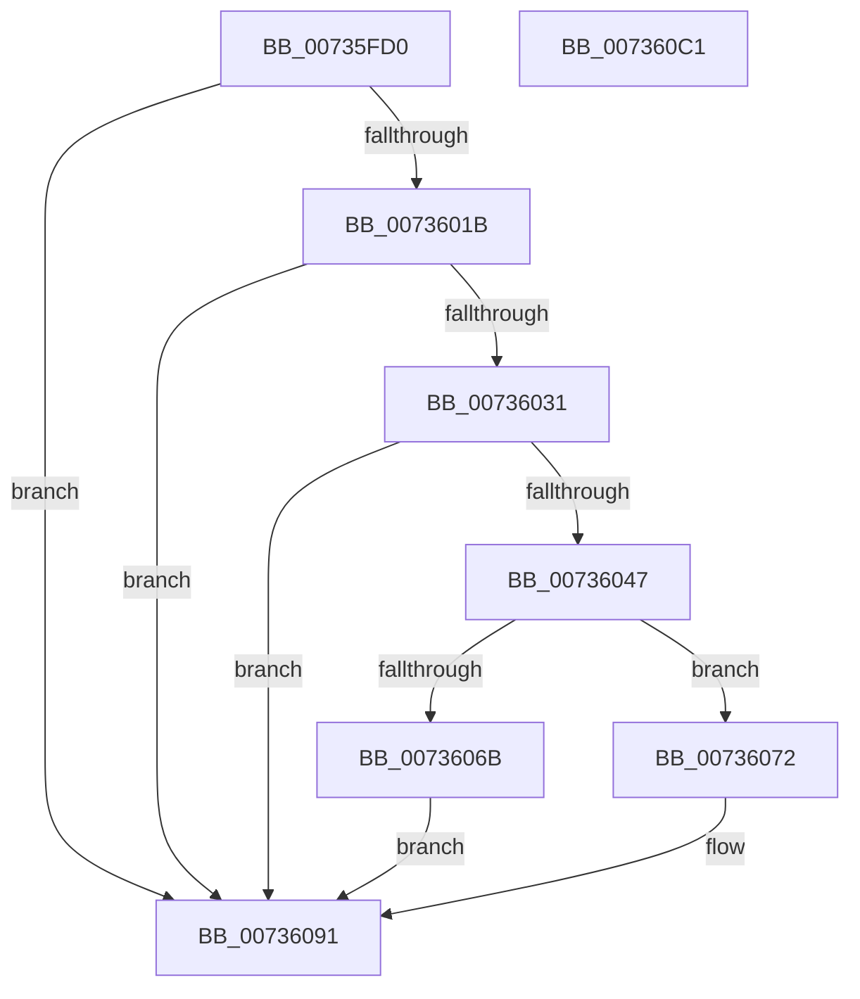

# PiDevCfgResolveVariableGenerateGuid

- RVA: `0x00735FD0`–`0x007360C2` (길이 `242` bytes)
- VA: `0x0000000140735FD0`
- 실행 섹션: `PAGE`
- PDB 이름 있음: `예`; PDB Function 태그: `아니요`
- unwind 정보 RVA: `0x000C8A88`
- 디코드: `73`개 명령, `242/242` bytes 표시
- 미해석 바이트: `0` (있으면 어셈블리에 `.byte`로 보존)

> 이 문서는 커널 이미지의 기계어와 PDB 기호를 분석해 생성했습니다. 4번과 5번은 함수 원형과 자료형을 바이너리 사용 방식에서 추정한 C 해석이며 원본 소스 복구 결과는 아닙니다.

## 1. Dependencies

- 직접 호출 지점: **7**; 고유 호출 대상: **7**
- 직접 호출자로 확인된 함수: **0**
- RIP 상대 이미지 참조: **1**

### Outgoing calls
- `0x00736010` → [ExUuidCreate](../91/ExUuidCreate_function_00917500.md) (function, `0x00917500`)
- `0x00736026` → [RtlStringFromGUIDEx](../91/RtlStringFromGUIDEx_function_00915450.md) (function, `0x00915450`)
- `0x0073603C` → [RtlUpcaseUnicodeString](../96/RtlUpcaseUnicodeString_function_00960780.md) (function, `0x00960780`)
- `0x0073605E` → [ExAllocatePool2](../../poolcode/B8/ExAllocatePool2_function_00B820F0.md) (function, `0x00B820F0`)
- `0x0073607C` → [memcpy](../../text/6C/memcpy_function_006C6840.md) (function, `0x006C6840`)
- `0x00736095` → [RtlFreeAnsiString](../9C/RtlFreeAnsiString_function_009C0800.md) (function, `0x009C0800`)
- `0x007360A3` → [_security_check_cookie](../../text/6A/_security_check_cookie_function_006AC640.md) (function, `0x006AC640`)

### Direct callers
- 이 함수 시작 RVA로 연결되는 직접 call은 확인되지 않았습니다. 간접 호출은 완전히 역산할 수 없습니다.

### Static image references
- `0x00735FE9` → RVA `0x00E0A740` (`.data`; read)

## 2. Other-region calls and transfers

- 다른 실행 섹션으로 향하는 call: **3**
  - `0x0073605E` → [ExAllocatePool2](../../poolcode/B8/ExAllocatePool2_function_00B820F0.md) (`PAGE` → `POOLCODE`)
  - `0x0073607C` → [memcpy](../../text/6C/memcpy_function_006C6840.md) (`PAGE` → `.text`)
  - `0x007360A3` → [_security_check_cookie](../../text/6A/_security_check_cookie_function_006AC640.md) (`PAGE` → `.text`)
- 별도 외부 분기/꼬리 이동을 확인하지 못했습니다.

## 3. Assembly (complete function range)

```asm
00735FD0  48 89 5C 24 08                  mov qword ptr [rsp + 8], rbx
00735FD5  48 89 74 24 10                  mov qword ptr [rsp + 0x10], rsi
00735FDA  55                              push rbp
00735FDB  57                              push rdi
00735FDC  41 54                           push r12
00735FDE  41 56                           push r14
00735FE0  41 57                           push r15
00735FE2  48 8B EC                        mov rbp, rsp
00735FE5  48 83 EC 50                     sub rsp, 0x50
00735FE9  48 8B 05 50 47 6D 00            mov rax, qword ptr [rip + 0x6d4750]
00735FF0  48 33 C4                        xor rax, rsp
00735FF3  48 89 45 F0                     mov qword ptr [rbp - 0x10], rax
00735FF7  0F 57 C0                        xorps xmm0, xmm0
00735FFA  48 8D 4D E0                     lea rcx, [rbp - 0x20]
00735FFE  45 33 E4                        xor r12d, r12d
00736001  4D 8B F0                        mov r14, r8
00736004  0F 11 45 E0                     movups xmmword ptr [rbp - 0x20], xmm0
00736008  4C 89 65 D0                     mov qword ptr [rbp - 0x30], r12
0073600C  4C 89 65 D8                     mov qword ptr [rbp - 0x28], r12
00736010  E8 EB 14 1E 00                  call 0x140917500
00736015  8B D8                           mov ebx, eax
00736017  85 C0                           test eax, eax
00736019  78 76                           js 0x140736091
0073601B  41 B0 01                        mov r8b, 1
0073601E  48 8D 55 D0                     lea rdx, [rbp - 0x30]
00736022  48 8D 4D E0                     lea rcx, [rbp - 0x20]
00736026  E8 25 F4 1D 00                  call 0x140915450
0073602B  8B D8                           mov ebx, eax
0073602D  85 C0                           test eax, eax
0073602F  78 60                           js 0x140736091
00736031  45 33 C0                        xor r8d, r8d
00736034  48 8D 55 D0                     lea rdx, [rbp - 0x30]
00736038  48 8D 4D D0                     lea rcx, [rbp - 0x30]
0073603C  E8 3F A7 22 00                  call 0x140960780
00736041  8B D8                           mov ebx, eax
00736043  85 C0                           test eax, eax
00736045  78 4A                           js 0x140736091
00736047  0F B7 7D D0                     movzx edi, word ptr [rbp - 0x30]
0073604B  41 B8 50 70 64 63               mov r8d, 0x63647050
00736051  83 C7 02                        add edi, 2
00736054  B9 00 01 00 00                  mov ecx, 0x100
00736059  8B D7                           mov edx, edi
0073605B  44 8B FF                        mov r15d, edi
0073605E  E8 8D C0 44 00                  call 0x140b820f0
00736063  48 8B F0                        mov rsi, rax
00736066  48 85 C0                        test rax, rax
00736069  75 07                           jne 0x140736072
0073606B  BB 9A 00 00 C0                  mov ebx, 0xc000009a
00736070  EB 1F                           jmp 0x140736091
00736072  48 8B 55 D8                     mov rdx, qword ptr [rbp - 0x28]
00736076  4D 8B C7                        mov r8, r15
00736079  48 8B CE                        mov rcx, rsi
0073607C  E8 BF 07 F9 FF                  call 0x1406c6840
00736081  41 C7 46 20 01 00 00 00         mov dword ptr [r14 + 0x20], 1
00736089  41 89 7E 24                     mov dword ptr [r14 + 0x24], edi
0073608D  49 89 76 28                     mov qword ptr [r14 + 0x28], rsi
00736091  48 8D 4D D0                     lea rcx, [rbp - 0x30]
00736095  E8 66 A7 28 00                  call 0x1409c0800
0073609A  8B C3                           mov eax, ebx
0073609C  48 8B 4D F0                     mov rcx, qword ptr [rbp - 0x10]
007360A0  48 33 CC                        xor rcx, rsp
007360A3  E8 98 65 F7 FF                  call 0x1406ac640
007360A8  4C 8D 5C 24 50                  lea r11, [rsp + 0x50]
007360AD  49 8B 5B 30                     mov rbx, qword ptr [r11 + 0x30]
007360B1  49 8B 73 38                     mov rsi, qword ptr [r11 + 0x38]
007360B5  49 8B E3                        mov rsp, r11
007360B8  41 5F                           pop r15
007360BA  41 5E                           pop r14
007360BC  41 5C                           pop r12
007360BE  5F                              pop rdi
007360BF  5D                              pop rbp
007360C0  C3                              ret
007360C1  CC                              int3
```

## 4. C-style interpretation (structured pseudocode)

```c
__int64 __fastcall PiDevCfgResolveVariableGenerateGuid(__int64 a1, __int64 a2, __int64 a3)
{
    __int64 result;
    __int64 v_r12;
    __int64 v_rdi;
    __int64 v_rsp;
    unsigned __int64 v_stack_m28;
    unsigned __int64 v_stack_m38;
    unsigned __int64 v_stack_m48;
    unsigned __int64 v_stack_m50;
    unsigned __int64 v_stack_m58;
    unsigned __int64 v_stack_p10;
    unsigned __int64 v_stack_p8;

    v_stack_p8 = v_rbx;
    v_stack_p10 = v_rsi;
    v_rsp = (v_rsp) - (80);
    result = (*(unsigned __int64 *)(v_rip + 7161680)) ^ (v_rsp);
    v_stack_m38 = result;
    v_r12 = 0;
    v_stack_m48 = v_xmm0;
    v_stack_m58 = 0;
    v_stack_m50 = 0;
    result = ExUuidCreate(v_stack_m48, a2, a3, a4);
    if (sign_flag) goto loc_00736091;
    result = RtlStringFromGUIDEx(v_stack_m48, v_stack_m58, 1, a4);
    if (sign_flag) goto loc_00736091;
    a3 = 0;
    result = RtlUpcaseUnicodeString(v_stack_m58, v_stack_m58, a3, a4);
    if (sign_flag) goto loc_00736091;
    v_rdi = (unsigned int)((v_stack_m58) + (2));
    result = ExAllocatePool2(256, (unsigned int)((unsigned int)(v_rdi)), (unsigned int)(0x63647050ULL), a4);
    if (result != 0) goto loc_00736072;
    goto loc_00736091;
loc_00736072:
    result = memcpy(result, v_stack_m50, (unsigned int)((unsigned int)(v_rdi)), a4);
    *(unsigned int *)(a3 + 32) = 1;
    *(unsigned int *)(a3 + 36) = (unsigned int)(v_rdi);
    *(unsigned __int64 *)(a3 + 40) = result;
loc_00736091:
    result = RtlFreeAnsiString(v_stack_m58, v_stack_m50, (unsigned int)((unsigned int)(v_rdi)), a4);
    a1 = (v_stack_m38) ^ (v_rsp);
    result = _security_check_cookie(a1, v_stack_m50, (unsigned int)((unsigned int)(v_rdi)), a4);
    return result;
}
```

## 5. (Beta) C Style

```c
int64_t PiDevCfgResolveVariableGenerateGuid(int64_t Arg1, int64_t Arg2, void *Arg3)
{
    uint8_t *arg3 = (uint8_t *)Arg3;

    int64_t result;
    int64_t local_r12;
    int64_t local_rdi;
    int64_t local_rsp;
    uint64_t v_stack_m28;
    uint64_t v_stack_m38;
    uint64_t v_stack_m48;
    uint64_t v_stack_m50;
    uint64_t v_stack_m58;
    uint64_t v_stack_p10;
    uint64_t v_stack_p8;

    v_stack_p8 = local_rbx;
    v_stack_p10 = local_rsi;
    local_rsp = (local_rsp) - (80);
    result = (*(uint64_t *)(v_rip + 0x6D4750)) ^ (local_rsp);
    v_stack_m38 = result;
    local_r12 = 0;
    v_stack_m48 = v_xmm0;
    v_stack_m58 = 0;
    v_stack_m50 = 0;
    result = ExUuidCreate(v_stack_m48, Arg2, Arg3, a4);
    if (sign_flag) goto loc_00736091;
    result = RtlStringFromGUIDEx(v_stack_m48, v_stack_m58, 1, a4);
    if (sign_flag) goto loc_00736091;
    Arg3 = 0;
    result = RtlUpcaseUnicodeString(v_stack_m58, v_stack_m58, Arg3, a4);
    if (sign_flag) goto loc_00736091;
    local_rdi = (uint32_t)((v_stack_m58) + (2));
    result = ExAllocatePool2(256, (uint32_t)((uint32_t)(local_rdi)), (uint32_t)(0x63647050ULL), a4);
    if (result != 0) goto loc_00736072;
    goto loc_00736091;
loc_00736072:
    result = memcpy(result, v_stack_m50, (uint32_t)((uint32_t)(local_rdi)), a4);
    *(uint32_t *)(arg3 + 0x20) = 1;
    *(uint32_t *)(arg3 + 0x24) = (uint32_t)(local_rdi);
    *(uint64_t *)(arg3 + 0x28) = result;
loc_00736091:
    result = RtlFreeAnsiString(v_stack_m58, v_stack_m50, (uint32_t)((uint32_t)(local_rdi)), a4);
    Arg1 = (v_stack_m38) ^ (local_rsp);
    result = _security_check_cookie(Arg1, v_stack_m50, (uint32_t)((uint32_t)(local_rdi)), a4);
    return result;
}
```

### 관측된 메모리 오프셋

구조체 형식이 확인되지 않은 접근은 인자 기준의 오프셋으로만 기록했습니다.

| 기준 인자 | 오프셋 표현 | 폭 (bit) | 접근 |
|---|---:|---:|---|
| `Arg3` | `+ 0x20` | `32` | `W` |
| `Arg3` | `+ 0x24` | `32` | `W` |
| `Arg3` | `+ 0x28` | `64` | `W` |

## 6. Execution-region graph

[열기: 2D/3D 그래프와 함수 탐색 컨트롤 패널](../../../control-panel.html?section=page&rva=0x00735FD0&view=graph)

- 2D 그래프는 위에서 아래로 흐르고, 3D 그래프는 빈 공간을 드래그해 회전합니다. Shift+드래그는 이동, 휠은 확대·축소, 함수 노드 선택은 대상 보고서 이동입니다.

### Static fallback


