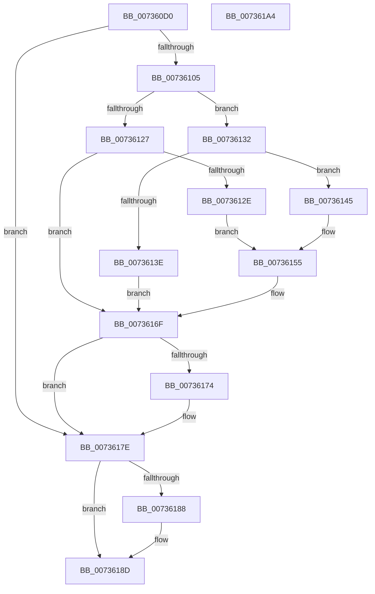

# PiDevCfgResolveVariableKeyCopy

- RVA: `0x007360D0`–`0x007361A5` (길이 `213` bytes)
- VA: `0x00000001407360D0`
- 실행 섹션: `PAGE`
- PDB 이름 있음: `예`; PDB Function 태그: `아니요`
- unwind 정보 RVA: `0x00066400`
- 디코드: `62`개 명령, `213/213` bytes 표시
- 미해석 바이트: `0` (있으면 어셈블리에 `.byte`로 보존)

> 이 문서는 커널 이미지의 기계어와 PDB 기호를 분석해 생성했습니다. 4번과 5번은 함수 원형과 자료형을 바이너리 사용 방식에서 추정한 C 해석이며 원본 소스 복구 결과는 아닙니다.

## 1. Dependencies

- 직접 호출 지점: **5**; 고유 호출 대상: **5**
- 직접 호출자로 확인된 함수: **0**
- RIP 상대 이미지 참조: **1**

### Outgoing calls
- `0x007360FA` → [PiDevCfgResolveVariableKeyHandle](../AB/PiDevCfgResolveVariableKeyHandle_function_00AB2A24.md) (function, `0x00AB2A24`)
- `0x00736117` → [IopGetRegistryValue](../99/IopGetRegistryValue_function_009990EC.md) (function, `0x009990EC`)
- `0x00736135` → [PnpValidateRegistryValue](../../text/5A/PnpValidateRegistryValue_function_005A8218.md) (function, `0x005A8218`)
- `0x00736179` → [ExFreePoolWithTag](../../poolcode/B8/ExFreePoolWithTag_function_00B82870.md) (function, `0x00B82870`)
- `0x00736188` → [ZwClose](../../text/6A/ZwClose_function_006AD2B0.md) (function, `0x006AD2B0`)

### Direct callers
- 이 함수 시작 RVA로 연결되는 직접 call은 확인되지 않았습니다. 간접 호출은 완전히 역산할 수 없습니다.

### Static image references
- `0x0073610D` → RVA `0x00AFF5E0` (` ?? ::NNGAKEGL::`string'`; read)

## 2. Other-region calls and transfers

- 다른 실행 섹션으로 향하는 call: **3**
  - `0x00736135` → [PnpValidateRegistryValue](../../text/5A/PnpValidateRegistryValue_function_005A8218.md) (`PAGE` → `.text`)
  - `0x00736179` → [ExFreePoolWithTag](../../poolcode/B8/ExFreePoolWithTag_function_00B82870.md) (`PAGE` → `POOLCODE`)
  - `0x00736188` → [ZwClose](../../text/6A/ZwClose_function_006AD2B0.md) (`PAGE` → `.text`)
- 별도 외부 분기/꼬리 이동을 확인하지 못했습니다.

## 3. Assembly (complete function range)

```asm
007360D0  48 8B C4                        mov rax, rsp
007360D3  48 89 58 08                     mov qword ptr [rax + 8], rbx
007360D7  48 89 68 10                     mov qword ptr [rax + 0x10], rbp
007360DB  48 89 70 18                     mov qword ptr [rax + 0x18], rsi
007360DF  57                              push rdi
007360E0  48 83 EC 30                     sub rsp, 0x30
007360E4  48 83 60 20 00                  and qword ptr [rax + 0x20], 0
007360E9  49 8B F0                        mov rsi, r8
007360EC  48 83 60 E8 00                  and qword ptr [rax - 0x18], 0
007360F1  4C 8D 40 20                     lea r8, [rax + 0x20]
007360F5  48 8B EA                        mov rbp, rdx
007360F8  33 FF                           xor edi, edi
007360FA  E8 25 C9 37 00                  call 0x140ab2a24
007360FF  8B D8                           mov ebx, eax
00736101  85 C0                           test eax, eax
00736103  78 79                           js 0x14073617e
00736105  4C 8D 4C 24 20                  lea r9, [rsp + 0x20]
0073610A  45 33 C0                        xor r8d, r8d
0073610D  48 8D 15 CC 94 3C 00            lea rdx, [rip + 0x3c94cc]
00736114  48 8B CD                        mov rcx, rbp
00736117  E8 D0 2F 26 00                  call 0x1409990ec
0073611C  4C 8B 4C 24 20                  mov r9, qword ptr [rsp + 0x20]
00736121  8B D8                           mov ebx, eax
00736123  85 C0                           test eax, eax
00736125  79 0B                           jns 0x140736132
00736127  3D 34 00 00 C0                  cmp eax, 0xc0000034
0073612C  75 41                           jne 0x14073616f
0073612E  33 DB                           xor ebx, ebx
00736130  EB 23                           jmp 0x140736155
00736132  49 8B C9                        mov rcx, r9
00736135  E8 DE 20 E7 FF                  call 0x1405a8218
0073613A  84 C0                           test al, al
0073613C  75 07                           jne 0x140736145
0073613E  BB 01 00 00 C0                  mov ebx, 0xc0000001
00736143  EB 2A                           jmp 0x14073616f
00736145  41 8B 41 08                     mov eax, dword ptr [r9 + 8]
00736149  B9 00 00 10 00                  mov ecx, 0x100000
0073614E  42 39 3C 08                     cmp dword ptr [rax + r9], edi
00736152  0F 45 F9                        cmovne edi, ecx
00736155  48 8B 44 24 58                  mov rax, qword ptr [rsp + 0x58]
0073615A  0F BA EF 0F                     bts edi, 0xf
0073615E  83 66 24 00                     and dword ptr [rsi + 0x24], 0
00736162  48 83 64 24 58 00               and qword ptr [rsp + 0x58], 0
00736168  89 7E 20                        mov dword ptr [rsi + 0x20], edi
0073616B  48 89 46 28                     mov qword ptr [rsi + 0x28], rax
0073616F  4D 85 C9                        test r9, r9
00736172  74 0A                           je 0x14073617e
00736174  33 D2                           xor edx, edx
00736176  49 8B C9                        mov rcx, r9
00736179  E8 F2 C6 44 00                  call 0x140b82870
0073617E  48 8B 4C 24 58                  mov rcx, qword ptr [rsp + 0x58]
00736183  48 85 C9                        test rcx, rcx
00736186  74 05                           je 0x14073618d
00736188  E8 23 71 F7 FF                  call 0x1406ad2b0
0073618D  48 8B 6C 24 48                  mov rbp, qword ptr [rsp + 0x48]
00736192  8B C3                           mov eax, ebx
00736194  48 8B 5C 24 40                  mov rbx, qword ptr [rsp + 0x40]
00736199  48 8B 74 24 50                  mov rsi, qword ptr [rsp + 0x50]
0073619E  48 83 C4 30                     add rsp, 0x30
007361A2  5F                              pop rdi
007361A3  C3                              ret
007361A4  CC                              int3
```

## 4. C-style interpretation (structured pseudocode)

```c
__int64 __fastcall PiDevCfgResolveVariableKeyCopy(__int64 a1, __int64 a2, __int64 a3)
{
    __int64 result;
    __int64 v_rbx;
    __int64 v_rdi;
    __int64 v_rsp;
    unsigned __int64 v_stack_m18;
    unsigned __int64 v_stack_p10;
    unsigned __int64 v_stack_p18;
    unsigned __int64 v_stack_p20;
    unsigned __int64 v_stack_p8;

    *(unsigned __int64 *)(v_rsp + 8) = v_rbx;
    *(unsigned __int64 *)(v_rsp + 16) = v_rbp;
    *(unsigned __int64 *)(v_rsp + 24) = v_rsi;
    v_rsp = (v_rsp) - (48);
    v_rdi = 0;
    result = PiDevCfgResolveVariableKeyHandle(a1, a2, v_rsp + 32, a4);
    if (sign_flag) goto loc_0073617E;
    a3 = 0;
    result = IopGetRegistryValue(a2, v_rip + 3970252, a3, v_stack_m18);
    if (!sign_flag) goto loc_00736132;
    if (((unsigned int)(result)) != 0xC0000034ULL) goto loc_0073616F;
    v_rbx = 0;
    goto loc_00736155;
loc_00736132:
    result = PnpValidateRegistryValue(v_stack_m18, v_rip + 3970252, a3, v_stack_m18);
    if ((unsigned __int8)(result) != 0) goto loc_00736145;
    goto loc_0073616F;
loc_00736145:
    if ((*(unsigned int *)((unsigned int)(*(unsigned int *)(v_stack_m18 + 8)) + v_stack_m18 * 1)) != 0) { v_rdi = (unsigned int)((unsigned int)(0x100000ULL)); }
loc_00736155:
    *(unsigned int *)(a3 + 32) = (unsigned int)(v_rdi);
    *(unsigned __int64 *)(a3 + 40) = v_stack_p20;
loc_0073616F:
    result = v_stack_p20;
    if (v_stack_m18 != 0) {
        a2 = 0;
        a1 = v_stack_m18;
        result = ExFreePoolWithTag(a1, a2, a3, v_stack_m18);
    }
    if (v_stack_p20 != 0) {
        result = ZwClose(v_stack_p20, a2, a3, v_stack_m18);
    }
    v_rsp = (v_rsp) + (48);
    return (unsigned int)((unsigned int)((unsigned int)(0xC0000001ULL)));
}
```

## 5. (Beta) C Style

```c
int64_t PiDevCfgResolveVariableKeyCopy(int64_t Arg1, int64_t Arg2, void *Arg3)
{
    uint8_t *arg3 = (uint8_t *)Arg3;

    int64_t result;
    int64_t local_rbx;
    int64_t local_rdi;
    int64_t local_rsp;
    uint64_t v_stack_m18;
    uint64_t v_stack_p10;
    uint64_t v_stack_p18;
    uint64_t v_stack_p20;
    uint64_t v_stack_p8;

    *(uint64_t *)(local_rsp + 0x8) = local_rbx;
    *(uint64_t *)(local_rsp + 0x10) = local_rbp;
    *(uint64_t *)(local_rsp + 0x18) = local_rsi;
    local_rsp = (local_rsp) - (48);
    local_rdi = 0;
    result = PiDevCfgResolveVariableKeyHandle(Arg1, Arg2, local_rsp + 32, a4);
    if (sign_flag) goto loc_0073617E;
    Arg3 = 0;
    result = IopGetRegistryValue(Arg2, v_rip + 3970252, Arg3, v_stack_m18);
    if (!sign_flag) goto loc_00736132;
    if (((uint32_t)(result)) != 0xC0000034ULL) goto loc_0073616F;
    local_rbx = 0;
    goto loc_00736155;
loc_00736132:
    result = PnpValidateRegistryValue(v_stack_m18, v_rip + 3970252, Arg3, v_stack_m18);
    if ((uint8_t)(result) != 0) goto loc_00736145;
    goto loc_0073616F;
loc_00736145:
    if ((*(uint32_t *)((uint32_t)(*(uint32_t *)(v_stack_m18 + 0x8)) + v_stack_m18 * 1)) != 0) { local_rdi = (uint32_t)((uint32_t)(0x100000ULL)); }
loc_00736155:
    *(uint32_t *)(arg3 + 0x20) = (uint32_t)(local_rdi);
    *(uint64_t *)(arg3 + 0x28) = v_stack_p20;
loc_0073616F:
    result = v_stack_p20;
    if (v_stack_m18 != 0) {
        Arg2 = 0;
        Arg1 = v_stack_m18;
        result = ExFreePoolWithTag(Arg1, Arg2, Arg3, v_stack_m18);
    }
    if (v_stack_p20 != 0) {
        result = ZwClose(v_stack_p20, Arg2, Arg3, v_stack_m18);
    }
    local_rsp = (local_rsp) + (48);
    return (uint32_t)((uint32_t)((uint32_t)(0xC0000001ULL)));
}
```

### 관측된 메모리 오프셋

구조체 형식이 확인되지 않은 접근은 인자 기준의 오프셋으로만 기록했습니다.

| 기준 인자 | 오프셋 표현 | 폭 (bit) | 접근 |
|---|---:|---:|---|
| `Arg3` | `+ 0x20` | `32` | `W` |
| `Arg3` | `+ 0x24` | `32` | `R/W` |
| `Arg3` | `+ 0x28` | `64` | `W` |

## 6. Execution-region graph

[열기: 2D/3D 그래프와 함수 탐색 컨트롤 패널](../../../control-panel.html?section=page&rva=0x007360D0&view=graph)

- 2D 그래프는 위에서 아래로 흐르고, 3D 그래프는 빈 공간을 드래그해 회전합니다. Shift+드래그는 이동, 휠은 확대·축소, 함수 노드 선택은 대상 보고서 이동입니다.

### Static fallback


