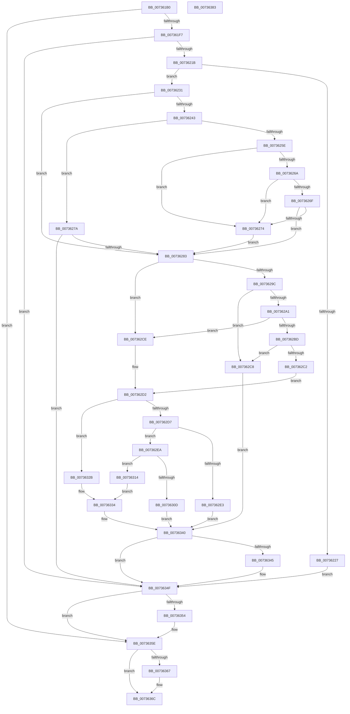

# PiDevCfgResolveVariableKeyValue

- RVA: `0x007361B0`–`0x00736384` (길이 `468` bytes)
- VA: `0x00000001407361B0`
- 실행 섹션: `PAGE`
- PDB 이름 있음: `예`; PDB Function 태그: `아니요`
- unwind 정보 RVA: `0x000C8AAC`
- 디코드: `146`개 명령, `468/468` bytes 표시
- 미해석 바이트: `0` (있으면 어셈블리에 `.byte`로 보존)

> 이 문서는 커널 이미지의 기계어와 PDB 기호를 분석해 생성했습니다. 4번과 5번은 함수 원형과 자료형을 바이너리 사용 방식에서 추정한 C 해석이며 원본 소스 복구 결과는 아닙니다.

## 1. Dependencies

- 직접 호출 지점: **12**; 고유 호출 대상: **9**
- 직접 호출자로 확인된 함수: **0**
- RIP 상대 이미지 참조: **2**

### Outgoing calls
- `0x007361E8` → [PiDevCfgResolveVariableKeyHandle](../AB/PiDevCfgResolveVariableKeyHandle_function_00AB2A24.md) (function, `0x00AB2A24`)
- `0x00736208` → [IopGetRegistryValue](../99/IopGetRegistryValue_function_009990EC.md) (function, `0x009990EC`)
- `0x0073621E` → [PnpValidateRegistryString](../../text/4B/PnpValidateRegistryString_function_004B763C.md) (function, `0x004B763C`)
- `0x00736253` → [PiDevCfgResolveVariable](../A8/PiDevCfgResolveVariable_function_00A81AB8.md) (function, `0x00A81AB8`)
- `0x00736291` → [IopGetRegistryValue](../99/IopGetRegistryValue_function_009990EC.md) (function, `0x009990EC`)
- `0x007362B2` → [IopGetRegistryValue](../99/IopGetRegistryValue_function_009990EC.md) (function, `0x009990EC`)
- `0x007362DA` → [PnpValidateRegistryValue](../../text/5A/PnpValidateRegistryValue_function_005A8218.md) (function, `0x005A8218`)
- `0x00736300` → [ExAllocatePool2](../../poolcode/B8/ExAllocatePool2_function_00B820F0.md) (function, `0x00B820F0`)
- `0x00736320` → [memcpy](../../text/6C/memcpy_function_006C6840.md) (function, `0x006C6840`)
- `0x0073634A` → [ExFreePoolWithTag](../../poolcode/B8/ExFreePoolWithTag_function_00B82870.md) (function, `0x00B82870`)
- `0x00736359` → [ExFreePoolWithTag](../../poolcode/B8/ExFreePoolWithTag_function_00B82870.md) (function, `0x00B82870`)
- `0x00736367` → [ZwClose](../../text/6A/ZwClose_function_006AD2B0.md) (function, `0x006AD2B0`)

### Direct callers
- 이 함수 시작 RVA로 연결되는 직접 call은 확인되지 않았습니다. 간접 호출은 완전히 역산할 수 없습니다.

### Static image references
- `0x007361FE` → RVA `0x00AFF5A0` (` ?? ::NNGAKEGL::`string'`; read)
- `0x007362A8` → RVA `0x00AFF5C0` (` ?? ::NNGAKEGL::`string'`; read)

## 2. Other-region calls and transfers

- 다른 실행 섹션으로 향하는 call: **7**
  - `0x0073621E` → [PnpValidateRegistryString](../../text/4B/PnpValidateRegistryString_function_004B763C.md) (`PAGE` → `.text`)
  - `0x007362DA` → [PnpValidateRegistryValue](../../text/5A/PnpValidateRegistryValue_function_005A8218.md) (`PAGE` → `.text`)
  - `0x00736300` → [ExAllocatePool2](../../poolcode/B8/ExAllocatePool2_function_00B820F0.md) (`PAGE` → `POOLCODE`)
  - `0x00736320` → [memcpy](../../text/6C/memcpy_function_006C6840.md) (`PAGE` → `.text`)
  - `0x0073634A` → [ExFreePoolWithTag](../../poolcode/B8/ExFreePoolWithTag_function_00B82870.md) (`PAGE` → `POOLCODE`)
  - `0x00736359` → [ExFreePoolWithTag](../../poolcode/B8/ExFreePoolWithTag_function_00B82870.md) (`PAGE` → `POOLCODE`)
  - `0x00736367` → [ZwClose](../../text/6A/ZwClose_function_006AD2B0.md) (`PAGE` → `.text`)
- 별도 외부 분기/꼬리 이동을 확인하지 못했습니다.

## 3. Assembly (complete function range)

```asm
007361B0  48 89 5C 24 08                  mov qword ptr [rsp + 8], rbx
007361B5  4C 89 44 24 18                  mov qword ptr [rsp + 0x18], r8
007361BA  55                              push rbp
007361BB  56                              push rsi
007361BC  57                              push rdi
007361BD  41 54                           push r12
007361BF  41 55                           push r13
007361C1  41 56                           push r14
007361C3  41 57                           push r15
007361C5  48 8B EC                        mov rbp, rsp
007361C8  48 83 EC 30                     sub rsp, 0x30
007361CC  48 83 65 F8 00                  and qword ptr [rbp - 8], 0
007361D1  4D 8B E8                        mov r13, r8
007361D4  48 83 65 58 00                  and qword ptr [rbp + 0x58], 0
007361D9  4C 8D 45 F0                     lea r8, [rbp - 0x10]
007361DD  48 83 65 F0 00                  and qword ptr [rbp - 0x10], 0
007361E2  4C 8B FA                        mov r15, rdx
007361E5  4C 8B F1                        mov r14, rcx
007361E8  E8 37 C8 37 00                  call 0x140ab2a24
007361ED  8B D8                           mov ebx, eax
007361EF  85 C0                           test eax, eax
007361F1  0F 88 67 01 00 00               js 0x14073635e
007361F7  4C 8D 4D F8                     lea r9, [rbp - 8]
007361FB  45 33 C0                        xor r8d, r8d
007361FE  48 8D 15 9B 93 3C 00            lea rdx, [rip + 0x3c939b]
00736205  49 8B CF                        mov rcx, r15
00736208  E8 DF 2E 26 00                  call 0x1409990ec
0073620D  48 8B 75 F8                     mov rsi, qword ptr [rbp - 8]
00736211  8B D8                           mov ebx, eax
00736213  85 C0                           test eax, eax
00736215  0F 88 34 01 00 00               js 0x14073634f
0073621B  48 8B CE                        mov rcx, rsi
0073621E  E8 19 14 D8 FF                  call 0x1404b763c
00736223  84 C0                           test al, al
00736225  75 0A                           jne 0x140736231
00736227  BB 01 00 00 C0                  mov ebx, 0xc0000001
0073622C  E9 1E 01 00 00                  jmp 0x14073634f
00736231  8B 7E 08                        mov edi, dword ptr [rsi + 8]
00736234  41 BC 34 00 00 C0               mov r12d, 0xc0000034
0073623A  48 03 FE                        add rdi, rsi
0073623D  66 83 3F 24                     cmp word ptr [rdi], 0x24
00736241  75 40                           jne 0x140736283
00736243  48 83 65 F8 00                  and qword ptr [rbp - 8], 0
00736248  48 8D 57 02                     lea rdx, [rdi + 2]
0073624C  4C 8D 45 F8                     lea r8, [rbp - 8]
00736250  49 8B CE                        mov rcx, r14
00736253  E8 60 B8 34 00                  call 0x140a81ab8
00736258  8B D8                           mov ebx, eax
0073625A  85 C0                           test eax, eax
0073625C  78 1C                           js 0x14073627a
0073625E  48 8B 55 F8                     mov rdx, qword ptr [rbp - 8]
00736262  8B 4A 20                        mov ecx, dword ptr [rdx + 0x20]
00736265  83 E9 01                        sub ecx, 1
00736268  74 0A                           je 0x140736274
0073626A  83 E9 01                        sub ecx, 1
0073626D  74 05                           je 0x140736274
0073626F  83 F9 05                        cmp ecx, 5
00736272  75 0F                           jne 0x140736283
00736274  48 8B 7A 28                     mov rdi, qword ptr [rdx + 0x28]
00736278  EB 09                           jmp 0x140736283
0073627A  41 3B C4                        cmp eax, r12d
0073627D  0F 85 CC 00 00 00               jne 0x14073634f
00736283  48 8B 4D F0                     mov rcx, qword ptr [rbp - 0x10]
00736287  4C 8D 4D 58                     lea r9, [rbp + 0x58]
0073628B  45 33 C0                        xor r8d, r8d
0073628E  48 8B D7                        mov rdx, rdi
00736291  E8 56 2E 26 00                  call 0x1409990ec
00736296  8B D8                           mov ebx, eax
00736298  85 C0                           test eax, eax
0073629A  79 32                           jns 0x1407362ce
0073629C  41 3B C4                        cmp eax, r12d
0073629F  75 27                           jne 0x1407362c8
007362A1  4C 8D 4D 58                     lea r9, [rbp + 0x58]
007362A5  45 33 C0                        xor r8d, r8d
007362A8  48 8D 15 11 93 3C 00            lea rdx, [rip + 0x3c9311]
007362AF  49 8B CF                        mov rcx, r15
007362B2  E8 35 2E 26 00                  call 0x1409990ec
007362B7  8B D8                           mov ebx, eax
007362B9  85 C0                           test eax, eax
007362BB  79 11                           jns 0x1407362ce
007362BD  41 3B C4                        cmp eax, r12d
007362C0  75 06                           jne 0x1407362c8
007362C2  33 DB                           xor ebx, ebx
007362C4  33 FF                           xor edi, edi
007362C6  EB 0A                           jmp 0x1407362d2
007362C8  48 8B 7D 58                     mov rdi, qword ptr [rbp + 0x58]
007362CC  EB 72                           jmp 0x140736340
007362CE  48 8B 7D 58                     mov rdi, qword ptr [rbp + 0x58]
007362D2  48 85 FF                        test rdi, rdi
007362D5  74 54                           je 0x14073632b
007362D7  48 8B CF                        mov rcx, rdi
007362DA  E8 39 1F E7 FF                  call 0x1405a8218
007362DF  84 C0                           test al, al
007362E1  75 07                           jne 0x1407362ea
007362E3  BB 01 00 00 C0                  mov ebx, 0xc0000001
007362E8  EB 56                           jmp 0x140736340
007362EA  44 8B 7F 0C                     mov r15d, dword ptr [rdi + 0xc]
007362EE  41 B8 50 70 64 63               mov r8d, 0x63647050
007362F4  44 8B 67 04                     mov r12d, dword ptr [rdi + 4]
007362F8  41 8B D7                        mov edx, r15d
007362FB  B9 00 01 00 00                  mov ecx, 0x100
00736300  E8 EB BD 44 00                  call 0x140b820f0
00736305  4C 8B F0                        mov r14, rax
00736308  48 85 C0                        test rax, rax
0073630B  75 07                           jne 0x140736314
0073630D  BB 9A 00 00 C0                  mov ebx, 0xc000009a
00736312  EB 2C                           jmp 0x140736340
00736314  8B 57 08                        mov edx, dword ptr [rdi + 8]
00736317  4D 8B C7                        mov r8, r15
0073631A  48 03 D7                        add rdx, rdi
0073631D  48 8B C8                        mov rcx, rax
00736320  E8 1B 05 F9 FF                  call 0x1406c6840
00736325  4C 8B 6D 50                     mov r13, qword ptr [rbp + 0x50]
00736329  EB 09                           jmp 0x140736334
0073632B  45 33 E4                        xor r12d, r12d
0073632E  45 33 FF                        xor r15d, r15d
00736331  45 33 F6                        xor r14d, r14d
00736334  45 89 65 20                     mov dword ptr [r13 + 0x20], r12d
00736338  45 89 7D 24                     mov dword ptr [r13 + 0x24], r15d
0073633C  4D 89 75 28                     mov qword ptr [r13 + 0x28], r14
00736340  48 85 FF                        test rdi, rdi
00736343  74 0A                           je 0x14073634f
00736345  33 D2                           xor edx, edx
00736347  48 8B CF                        mov rcx, rdi
0073634A  E8 21 C5 44 00                  call 0x140b82870
0073634F  48 85 F6                        test rsi, rsi
00736352  74 0A                           je 0x14073635e
00736354  33 D2                           xor edx, edx
00736356  48 8B CE                        mov rcx, rsi
00736359  E8 12 C5 44 00                  call 0x140b82870
0073635E  48 8B 4D F0                     mov rcx, qword ptr [rbp - 0x10]
00736362  48 85 C9                        test rcx, rcx
00736365  74 05                           je 0x14073636c
00736367  E8 44 6F F7 FF                  call 0x1406ad2b0
0073636C  8B C3                           mov eax, ebx
0073636E  48 8B 5C 24 70                  mov rbx, qword ptr [rsp + 0x70]
00736373  48 83 C4 30                     add rsp, 0x30
00736377  41 5F                           pop r15
00736379  41 5E                           pop r14
0073637B  41 5D                           pop r13
0073637D  41 5C                           pop r12
0073637F  5F                              pop rdi
00736380  5E                              pop rsi
00736381  5D                              pop rbp
00736382  C3                              ret
00736383  CC                              int3
```

## 4. C-style interpretation (structured pseudocode)

```c
__int64 __fastcall PiDevCfgResolveVariableKeyValue(__int64 a1, __int64 a2, __int64 a3)
{
    __int64 result;
    __int64 v_r12;
    __int64 v_r14;
    __int64 v_r15;
    __int64 v_rbx;
    __int64 v_rdi;
    __int64 v_rsp;
    unsigned __int64 v_stack_m40;
    unsigned __int64 v_stack_m48;
    unsigned __int64 v_stack_p18;
    unsigned __int64 v_stack_p20;
    unsigned __int64 v_stack_p8;

    v_stack_p8 = v_rbx;
    v_stack_p18 = a3;
    v_rsp = (v_rsp) - (48);
    result = PiDevCfgResolveVariableKeyHandle(a1, a2, v_stack_m48, a4);
    if (sign_flag) goto loc_0073635E;
    a3 = 0;
    result = IopGetRegistryValue(a2, v_rip + 3969947, a3, v_stack_m40);
    if (sign_flag) goto loc_0073634F;
    result = PnpValidateRegistryString(v_stack_m40, v_rip + 3969947, a3, v_stack_m40);
    if ((unsigned __int8)(result) != 0) goto loc_00736231;
    goto loc_0073634F;
loc_00736231:
    v_rdi = ((unsigned int)(*(unsigned int *)(v_stack_m40 + 8))) + (v_stack_m40);
    if ((*(unsigned __int16 *)(v_rdi)) != 36) goto loc_00736283;
    result = PiDevCfgResolveVariable(a1, v_rdi + 2, v_stack_m40, v_stack_m40);
    if (sign_flag) goto loc_0073627A;
    a1 = (unsigned int)(((unsigned int)(*(unsigned int *)(v_stack_m40 + 32))) - (1));
    if (condition_is_equal) goto loc_00736274;
    a1 = (unsigned int)((a1) - (1));
    if (condition_is_equal) goto loc_00736274;
    if (((unsigned int)(a1)) != 5) goto loc_00736283;
loc_00736274:
    goto loc_00736283;
loc_0073627A:
    if (((unsigned int)(result)) != ((unsigned int)((unsigned int)(0xC0000034ULL)))) goto loc_0073634F;
loc_00736283:
    a3 = 0;
    result = IopGetRegistryValue(v_stack_m48, *(unsigned __int64 *)(v_stack_m40 + 40), a3, v_stack_p20);
    if (!sign_flag) goto loc_007362CE;
    if (((unsigned int)(result)) != ((unsigned int)((unsigned int)(0xC0000034ULL)))) goto loc_007362C8;
    a3 = 0;
    result = IopGetRegistryValue(a2, v_rip + 3969809, a3, v_stack_p20);
    if (!sign_flag) goto loc_007362CE;
    if (((unsigned int)(result)) != ((unsigned int)((unsigned int)(0xC0000034ULL)))) goto loc_007362C8;
    v_rbx = 0;
    v_rdi = 0;
    goto loc_007362D2;
loc_007362C8:
    goto loc_00736340;
loc_007362CE:
loc_007362D2:
    if (v_stack_p20 == 0) goto loc_0073632B;
    result = PnpValidateRegistryValue(v_stack_p20, v_rip + 3969809, a3, v_stack_p20);
    if ((unsigned __int8)(result) != 0) goto loc_007362EA;
    goto loc_00736340;
loc_007362EA:
    result = ExAllocatePool2(256, (unsigned int)((unsigned int)((unsigned int)(*(unsigned int *)(v_stack_p20 + 12)))), (unsigned int)(0x63647050ULL), v_stack_p20);
    if (result != 0) goto loc_00736314;
    goto loc_00736340;
loc_00736314:
    a2 = ((unsigned int)(*(unsigned int *)(v_stack_p20 + 8))) + (v_stack_p20);
    result = memcpy(result, a2, (unsigned int)(*(unsigned int *)(v_stack_p20 + 12)), v_stack_p20);
    goto loc_00736334;
loc_0073632B:
    v_r12 = 0;
    v_r15 = 0;
    v_r14 = 0;
loc_00736334:
    *(unsigned int *)(v_stack_p18 + 32) = 0;
    *(unsigned int *)(v_stack_p18 + 36) = 0;
    *(unsigned __int64 *)(v_stack_p18 + 40) = 0;
loc_00736340:
    if (v_stack_p20 != 0) {
        a2 = 0;
        a1 = v_stack_p20;
        result = ExFreePoolWithTag(a1, a2, (unsigned int)(*(unsigned int *)(v_stack_p20 + 12)), v_stack_p20);
    }
    if (v_stack_m40 != 0) {
        a2 = 0;
        a1 = v_stack_m40;
        result = ExFreePoolWithTag(a1, a2, (unsigned int)(*(unsigned int *)(v_stack_p20 + 12)), v_stack_p20);
    }
    if (v_stack_m48 != 0) {
        result = ZwClose(v_stack_m48, a2, (unsigned int)(*(unsigned int *)(v_stack_p20 + 12)), v_stack_p20);
    }
    v_rsp = (v_rsp) + (48);
    return (unsigned int)((unsigned int)((unsigned int)(0xC000009AULL)));
}
```

## 5. (Beta) C Style

```c
int64_t PiDevCfgResolveVariableKeyValue(int64_t Arg1, int64_t Arg2, int64_t Arg3)
{
    int64_t result;
    int64_t local_r12;
    int64_t local_r14;
    int64_t local_r15;
    int64_t local_rbx;
    int64_t local_rdi;
    int64_t local_rsp;
    uint64_t v_stack_m40;
    uint64_t v_stack_m48;
    uint64_t v_stack_p18;
    uint64_t v_stack_p20;
    uint64_t v_stack_p8;

    v_stack_p8 = local_rbx;
    v_stack_p18 = Arg3;
    local_rsp = (local_rsp) - (48);
    result = PiDevCfgResolveVariableKeyHandle(Arg1, Arg2, v_stack_m48, a4);
    if (sign_flag) goto loc_0073635E;
    Arg3 = 0;
    result = IopGetRegistryValue(Arg2, v_rip + 3969947, Arg3, v_stack_m40);
    if (sign_flag) goto loc_0073634F;
    result = PnpValidateRegistryString(v_stack_m40, v_rip + 3969947, Arg3, v_stack_m40);
    if ((uint8_t)(result) != 0) goto loc_00736231;
    goto loc_0073634F;
loc_00736231:
    local_rdi = ((uint32_t)(*(uint32_t *)(v_stack_m40 + 0x8))) + (v_stack_m40);
    if ((*(uint16_t *)(local_rdi)) != 36) goto loc_00736283;
    result = PiDevCfgResolveVariable(Arg1, local_rdi + 2, v_stack_m40, v_stack_m40);
    if (sign_flag) goto loc_0073627A;
    Arg1 = (uint32_t)(((uint32_t)(*(uint32_t *)(v_stack_m40 + 0x20))) - (1));
    if (condition_is_equal) goto loc_00736274;
    Arg1 = (uint32_t)((Arg1) - (1));
    if (condition_is_equal) goto loc_00736274;
    if (((uint32_t)(Arg1)) != 5) goto loc_00736283;
loc_00736274:
    goto loc_00736283;
loc_0073627A:
    if (((uint32_t)(result)) != ((uint32_t)((uint32_t)(0xC0000034ULL)))) goto loc_0073634F;
loc_00736283:
    Arg3 = 0;
    result = IopGetRegistryValue(v_stack_m48, *(uint64_t *)(v_stack_m40 + 0x28), Arg3, v_stack_p20);
    if (!sign_flag) goto loc_007362CE;
    if (((uint32_t)(result)) != ((uint32_t)((uint32_t)(0xC0000034ULL)))) goto loc_007362C8;
    Arg3 = 0;
    result = IopGetRegistryValue(Arg2, v_rip + 3969809, Arg3, v_stack_p20);
    if (!sign_flag) goto loc_007362CE;
    if (((uint32_t)(result)) != ((uint32_t)((uint32_t)(0xC0000034ULL)))) goto loc_007362C8;
    local_rbx = 0;
    local_rdi = 0;
    goto loc_007362D2;
loc_007362C8:
    goto loc_00736340;
loc_007362CE:
loc_007362D2:
    if (v_stack_p20 == 0) goto loc_0073632B;
    result = PnpValidateRegistryValue(v_stack_p20, v_rip + 3969809, Arg3, v_stack_p20);
    if ((uint8_t)(result) != 0) goto loc_007362EA;
    goto loc_00736340;
loc_007362EA:
    result = ExAllocatePool2(256, (uint32_t)((uint32_t)((uint32_t)(*(uint32_t *)(v_stack_p20 + 0xC)))), (uint32_t)(0x63647050ULL), v_stack_p20);
    if (result != 0) goto loc_00736314;
    goto loc_00736340;
loc_00736314:
    Arg2 = ((uint32_t)(*(uint32_t *)(v_stack_p20 + 0x8))) + (v_stack_p20);
    result = memcpy(result, Arg2, (uint32_t)(*(uint32_t *)(v_stack_p20 + 0xC)), v_stack_p20);
    goto loc_00736334;
loc_0073632B:
    local_r12 = 0;
    local_r15 = 0;
    local_r14 = 0;
loc_00736334:
    *(uint32_t *)(v_stack_p18 + 0x20) = 0;
    *(uint32_t *)(v_stack_p18 + 0x24) = 0;
    *(uint64_t *)(v_stack_p18 + 0x28) = 0;
loc_00736340:
    if (v_stack_p20 != 0) {
        Arg2 = 0;
        Arg1 = v_stack_p20;
        result = ExFreePoolWithTag(Arg1, Arg2, (uint32_t)(*(uint32_t *)(v_stack_p20 + 0xC)), v_stack_p20);
    }
    if (v_stack_m40 != 0) {
        Arg2 = 0;
        Arg1 = v_stack_m40;
        result = ExFreePoolWithTag(Arg1, Arg2, (uint32_t)(*(uint32_t *)(v_stack_p20 + 0xC)), v_stack_p20);
    }
    if (v_stack_m48 != 0) {
        result = ZwClose(v_stack_m48, Arg2, (uint32_t)(*(uint32_t *)(v_stack_p20 + 0xC)), v_stack_p20);
    }
    local_rsp = (local_rsp) + (48);
    return (uint32_t)((uint32_t)((uint32_t)(0xC000009AULL)));
}
```

## 6. Execution-region graph

[열기: 2D/3D 그래프와 함수 탐색 컨트롤 패널](../../../control-panel.html?section=page&rva=0x007361B0&view=graph)

- 2D 그래프는 위에서 아래로 흐르고, 3D 그래프는 빈 공간을 드래그해 회전합니다. Shift+드래그는 이동, 휠은 확대·축소, 함수 노드 선택은 대상 보고서 이동입니다.

### Static fallback


