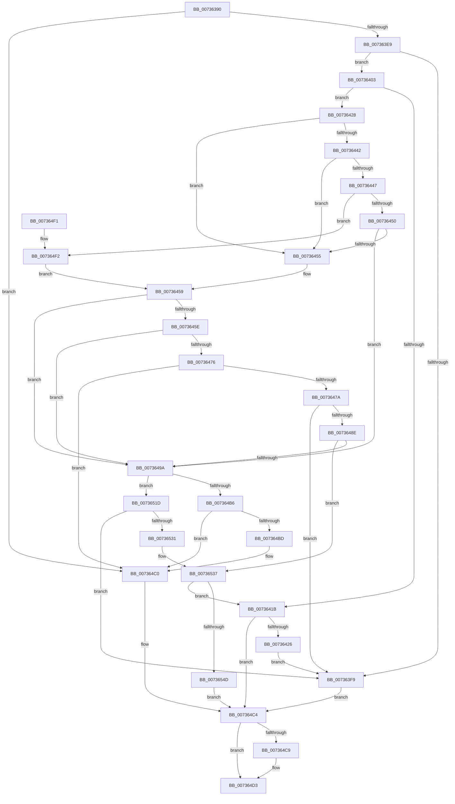

# PiDevCfgResolveVariableSwitchCase

- RVA: `0x00736390`–`0x00736560` (길이 `464` bytes)
- VA: `0x0000000140736390`
- 실행 섹션: `PAGE`
- PDB 이름 있음: `예`; PDB Function 태그: `아니요`
- unwind 정보 RVA: `0x000C8AEC`
- 디코드: `138`개 명령, `464/464` bytes 표시
- 미해석 바이트: `0` (있으면 어셈블리에 `.byte`로 보존)

> 이 문서는 커널 이미지의 기계어와 PDB 기호를 분석해 생성했습니다. 4번과 5번은 함수 원형과 자료형을 바이너리 사용 방식에서 추정한 C 해석이며 원본 소스 복구 결과는 아닙니다.

## 1. Dependencies

- 직접 호출 지점: **13**; 고유 호출 대상: **7**
- 직접 호출자로 확인된 함수: **0**
- RIP 상대 이미지 참조: **4**

### Outgoing calls
- `0x007363DA` → [IopGetRegistryValue](../99/IopGetRegistryValue_function_009990EC.md) (function, `0x009990EC`)
- `0x007363F0` → [PnpValidateRegistryString](../../text/4B/PnpValidateRegistryString_function_004B763C.md) (function, `0x004B763C`)
- `0x00736410` → [PiDevCfgResolveVariable](../A8/PiDevCfgResolveVariable_function_00A81AB8.md) (function, `0x00A81AB8`)
- `0x0073642D` → [ExFreePoolWithTag](../../poolcode/B8/ExFreePoolWithTag_function_00B82870.md) (function, `0x00B82870`)
- `0x00736468` → [IopGetRegistryValue](../99/IopGetRegistryValue_function_009990EC.md) (function, `0x009990EC`)
- `0x00736481` → [PnpValidateRegistryString](../../text/4B/PnpValidateRegistryString_function_004B763C.md) (function, `0x004B763C`)
- `0x007364AB` → [IopGetRegistryValue](../99/IopGetRegistryValue_function_009990EC.md) (function, `0x009990EC`)
- `0x007364CE` → [ExFreePoolWithTag](../../poolcode/B8/ExFreePoolWithTag_function_00B82870.md) (function, `0x00B82870`)
- `0x007364DC` → [_security_check_cookie](../../text/6A/_security_check_cookie_function_006AC640.md) (function, `0x006AC640`)
- `0x00736509` → [RtlStringCchPrintfW](../../text/48/RtlStringCchPrintfW_function_00482D5C.md) (function, `0x00482D5C`)
- `0x00736524` → [PnpValidateRegistryString](../../text/4B/PnpValidateRegistryString_function_004B763C.md) (function, `0x004B763C`)
- `0x0073653E` → [PiDevCfgResolveVariable](../A8/PiDevCfgResolveVariable_function_00A81AB8.md) (function, `0x00A81AB8`)
- `0x00736554` → [PiDevCfgCopyVariableData](PiDevCfgCopyVariableData_function_007327F8.md) (function, `0x007327F8`)

### Direct callers
- 이 함수 시작 RVA로 연결되는 직접 call은 확인되지 않았습니다. 간접 호출은 완전히 역산할 수 없습니다.

### Static image references
- `0x007363A3` → RVA `0x00E0A740` (`.data`; read)
- `0x007363BB` → RVA `0x00AFF5F0` (` ?? ::NNGAKEGL::`string'`; read)
- `0x007364A1` → RVA `0x00AFF600` (` ?? ::NNGAKEGL::`string'`; read)
- `0x007364F6` → RVA `0x00AFDAA0` (` ?? ::NNGAKEGL::`string'`; read)

## 2. Other-region calls and transfers

- 다른 실행 섹션으로 향하는 call: **7**
  - `0x007363F0` → [PnpValidateRegistryString](../../text/4B/PnpValidateRegistryString_function_004B763C.md) (`PAGE` → `.text`)
  - `0x0073642D` → [ExFreePoolWithTag](../../poolcode/B8/ExFreePoolWithTag_function_00B82870.md) (`PAGE` → `POOLCODE`)
  - `0x00736481` → [PnpValidateRegistryString](../../text/4B/PnpValidateRegistryString_function_004B763C.md) (`PAGE` → `.text`)
  - `0x007364CE` → [ExFreePoolWithTag](../../poolcode/B8/ExFreePoolWithTag_function_00B82870.md) (`PAGE` → `POOLCODE`)
  - `0x007364DC` → [_security_check_cookie](../../text/6A/_security_check_cookie_function_006AC640.md) (`PAGE` → `.text`)
  - `0x00736509` → [RtlStringCchPrintfW](../../text/48/RtlStringCchPrintfW_function_00482D5C.md) (`PAGE` → `.text`)
  - `0x00736524` → [PnpValidateRegistryString](../../text/4B/PnpValidateRegistryString_function_004B763C.md) (`PAGE` → `.text`)
- 별도 외부 분기/꼬리 이동을 확인하지 못했습니다.

## 3. Assembly (complete function range)

```asm
00736390  40 55                           push rbp
00736392  53                              push rbx
00736393  57                              push rdi
00736394  41 54                           push r12
00736396  41 55                           push r13
00736398  41 56                           push r14
0073639A  41 57                           push r15
0073639C  48 8B EC                        mov rbp, rsp
0073639F  48 83 EC 60                     sub rsp, 0x60
007363A3  48 8B 05 96 43 6D 00            mov rax, qword ptr [rip + 0x6d4396]
007363AA  48 33 C4                        xor rax, rsp
007363AD  48 89 45 F0                     mov qword ptr [rbp - 0x10], rax
007363B1  4C 8B F2                        mov r14, rdx
007363B4  4C 8D 4D C0                     lea r9, [rbp - 0x40]
007363B8  45 33 ED                        xor r13d, r13d
007363BB  48 8D 15 2E 92 3C 00            lea rdx, [rip + 0x3c922e]
007363C2  4D 8B E0                        mov r12, r8
007363C5  4C 89 6D C0                     mov qword ptr [rbp - 0x40], r13
007363C9  4C 8B F9                        mov r15, rcx
007363CC  4C 89 6D C8                     mov qword ptr [rbp - 0x38], r13
007363D0  49 8B CE                        mov rcx, r14
007363D3  4C 89 6D D0                     mov qword ptr [rbp - 0x30], r13
007363D7  45 33 C0                        xor r8d, r8d
007363DA  E8 0D 2D 26 00                  call 0x1409990ec
007363DF  8B D8                           mov ebx, eax
007363E1  85 C0                           test eax, eax
007363E3  0F 88 D7 00 00 00               js 0x1407364c0
007363E9  48 8B 7D C0                     mov rdi, qword ptr [rbp - 0x40]
007363ED  48 8B CF                        mov rcx, rdi
007363F0  E8 47 12 D8 FF                  call 0x1404b763c
007363F5  84 C0                           test al, al
007363F7  75 0A                           jne 0x140736403
007363F9  BB 01 00 00 C0                  mov ebx, 0xc0000001
007363FE  E9 C1 00 00 00                  jmp 0x1407364c4
00736403  8B 57 08                        mov edx, dword ptr [rdi + 8]
00736406  4C 8D 45 C8                     lea r8, [rbp - 0x38]
0073640A  48 03 D7                        add rdx, rdi
0073640D  49 8B CF                        mov rcx, r15
00736410  E8 A3 B6 34 00                  call 0x140a81ab8
00736415  8B D8                           mov ebx, eax
00736417  85 C0                           test eax, eax
00736419  79 0D                           jns 0x140736428
0073641B  3D 34 00 00 C0                  cmp eax, 0xc0000034
00736420  0F 85 9E 00 00 00               jne 0x1407364c4
00736426  EB D1                           jmp 0x1407363f9
00736428  33 D2                           xor edx, edx
0073642A  48 8B CF                        mov rcx, rdi
0073642D  E8 3E C4 44 00                  call 0x140b82870
00736432  48 8B 55 C8                     mov rdx, qword ptr [rbp - 0x38]
00736436  4C 89 6D C0                     mov qword ptr [rbp - 0x40], r13
0073643A  8B 4A 20                        mov ecx, dword ptr [rdx + 0x20]
0073643D  83 E9 01                        sub ecx, 1
00736440  74 13                           je 0x140736455
00736442  83 E9 01                        sub ecx, 1
00736445  74 0E                           je 0x140736455
00736447  83 E9 02                        sub ecx, 2
0073644A  0F 84 A2 00 00 00               je 0x1407364f2
00736450  83 F9 03                        cmp ecx, 3
00736453  75 45                           jne 0x14073649a
00736455  48 8B 52 28                     mov rdx, qword ptr [rdx + 0x28]
00736459  48 85 D2                        test rdx, rdx
0073645C  74 3C                           je 0x14073649a
0073645E  4C 8D 4D C0                     lea r9, [rbp - 0x40]
00736462  45 33 C0                        xor r8d, r8d
00736465  49 8B CE                        mov rcx, r14
00736468  E8 7F 2C 26 00                  call 0x1409990ec
0073646D  8B D8                           mov ebx, eax
0073646F  3D 34 00 00 C0                  cmp eax, 0xc0000034
00736474  74 24                           je 0x14073649a
00736476  85 C0                           test eax, eax
00736478  78 46                           js 0x1407364c0
0073647A  48 8B 7D C0                     mov rdi, qword ptr [rbp - 0x40]
0073647E  48 8B CF                        mov rcx, rdi
00736481  E8 B6 11 D8 FF                  call 0x1404b763c
00736486  84 C0                           test al, al
00736488  0F 84 6B FF FF FF               je 0x1407363f9
0073648E  8B 57 08                        mov edx, dword ptr [rdi + 8]
00736491  48 03 D7                        add rdx, rdi
00736494  0F 85 9D 00 00 00               jne 0x140736537
0073649A  4C 8D 4D C0                     lea r9, [rbp - 0x40]
0073649E  45 33 C0                        xor r8d, r8d
007364A1  48 8D 15 58 91 3C 00            lea rdx, [rip + 0x3c9158]
007364A8  49 8B CE                        mov rcx, r14
007364AB  E8 3C 2C 26 00                  call 0x1409990ec
007364B0  8B D8                           mov ebx, eax
007364B2  85 C0                           test eax, eax
007364B4  79 67                           jns 0x14073651d
007364B6  3D 34 00 00 C0                  cmp eax, 0xc0000034
007364BB  75 03                           jne 0x1407364c0
007364BD  8D 58 CD                        lea ebx, [rax - 0x33]
007364C0  48 8B 7D C0                     mov rdi, qword ptr [rbp - 0x40]
007364C4  48 85 FF                        test rdi, rdi
007364C7  74 0A                           je 0x1407364d3
007364C9  33 D2                           xor edx, edx
007364CB  48 8B CF                        mov rcx, rdi
007364CE  E8 9D C3 44 00                  call 0x140b82870
007364D3  8B C3                           mov eax, ebx
007364D5  48 8B 4D F0                     mov rcx, qword ptr [rbp - 0x10]
007364D9  48 33 CC                        xor rcx, rsp
007364DC  E8 5F 61 F7 FF                  call 0x1406ac640
007364E1  48 83 C4 60                     add rsp, 0x60
007364E5  41 5F                           pop r15
007364E7  41 5E                           pop r14
007364E9  41 5D                           pop r13
007364EB  41 5C                           pop r12
007364ED  5F                              pop rdi
007364EE  5B                              pop rbx
007364EF  5D                              pop rbp
007364F0  C3                              ret
007364F1  CC                              int3
007364F2  4C 8B 4A 28                     mov r9, qword ptr [rdx + 0x28]
007364F6  4C 8D 05 A3 75 3C 00            lea r8, [rip + 0x3c75a3]
007364FD  BA 0B 00 00 00                  mov edx, 0xb
00736502  48 8D 4D D8                     lea rcx, [rbp - 0x28]
00736506  45 8B 09                        mov r9d, dword ptr [r9]
00736509  E8 4E C8 D4 FF                  call 0x140482d5c
0073650E  85 C0                           test eax, eax
00736510  48 8D 55 D8                     lea rdx, [rbp - 0x28]
00736514  49 0F 48 D5                     cmovs rdx, r13
00736518  E9 3C FF FF FF                  jmp 0x140736459
0073651D  48 8B 7D C0                     mov rdi, qword ptr [rbp - 0x40]
00736521  48 8B CF                        mov rcx, rdi
00736524  E8 13 11 D8 FF                  call 0x1404b763c
00736529  84 C0                           test al, al
0073652B  0F 84 C8 FE FF FF               je 0x1407363f9
00736531  8B 57 08                        mov edx, dword ptr [rdi + 8]
00736534  48 03 D7                        add rdx, rdi
00736537  4C 8D 45 D0                     lea r8, [rbp - 0x30]
0073653B  49 8B CF                        mov rcx, r15
0073653E  E8 75 B5 34 00                  call 0x140a81ab8
00736543  8B D8                           mov ebx, eax
00736545  85 C0                           test eax, eax
00736547  0F 88 CE FE FF FF               js 0x14073641b
0073654D  48 8B 55 D0                     mov rdx, qword ptr [rbp - 0x30]
00736551  49 8B CC                        mov rcx, r12
00736554  E8 9F C2 FF FF                  call 0x1407327f8
00736559  8B D8                           mov ebx, eax
0073655B  E9 64 FF FF FF                  jmp 0x1407364c4
```

## 4. C-style interpretation (structured pseudocode)

```c
__int64 __fastcall PiDevCfgResolveVariableSwitchCase(__int64 a1, __int64 a2, __int64 a3)
{
    __int64 result;
    __int64 v_r13;
    __int64 v_rbx;
    __int64 v_rsp;
    unsigned __int64 v_stack_m48;
    unsigned __int64 v_stack_m60;
    unsigned __int64 v_stack_m68;
    unsigned __int64 v_stack_m70;
    unsigned __int64 v_stack_m78;

    v_rsp = (v_rsp) - (96);
    result = (*(unsigned __int64 *)(v_rip + 7160726)) ^ (v_rsp);
    v_stack_m48 = result;
    v_r13 = 0;
    v_stack_m78 = 0;
    v_stack_m70 = 0;
    v_stack_m68 = 0;
    a3 = 0;
    result = IopGetRegistryValue(a2, v_rip + 3969582, a3, v_stack_m78);
    if (sign_flag) goto loc_007364C0;
    result = PnpValidateRegistryString(v_stack_m78, v_rip + 3969582, a3, v_stack_m78);
    if ((unsigned __int8)(result) != 0) goto loc_00736403;
loc_007363F9:
    goto loc_007364C4;
loc_00736403:
    a2 = ((unsigned int)(*(unsigned int *)(v_stack_m78 + 8))) + (v_stack_m78);
    result = PiDevCfgResolveVariable(a1, a2, v_stack_m70, v_stack_m78);
    if (!sign_flag) goto loc_00736428;
loc_0073641B:
    if (((unsigned int)(result)) != 0xC0000034ULL) goto loc_007364C4;
    goto loc_007363F9;
loc_00736428:
    a2 = 0;
    result = ExFreePoolWithTag(v_stack_m78, a2, v_stack_m70, v_stack_m78);
    v_stack_m78 = 0;
    a1 = (unsigned int)(((unsigned int)(*(unsigned int *)(v_stack_m70 + 32))) - (1));
    if (condition_is_equal) goto loc_00736455;
    a1 = (unsigned int)((a1) - (1));
    if (condition_is_equal) goto loc_00736455;
    a1 = (unsigned int)((a1) - (2));
    if (condition_is_equal) goto loc_007364F2;
    if (((unsigned int)(a1)) != 3) goto loc_0073649A;
loc_00736455:
loc_00736459:
    if (*(unsigned __int64 *)(v_stack_m70 + 40) == 0) goto loc_0073649A;
    a3 = 0;
    result = IopGetRegistryValue(0, *(unsigned __int64 *)(v_stack_m70 + 40), a3, v_stack_m78);
    if (((unsigned int)(result)) == 0xC0000034ULL) goto loc_0073649A;
    if (sign_flag) goto loc_007364C0;
    result = PnpValidateRegistryString(v_stack_m78, *(unsigned __int64 *)(v_stack_m70 + 40), a3, v_stack_m78);
    if ((unsigned __int8)(result) == 0) goto loc_007363F9;
    a2 = ((unsigned int)(*(unsigned int *)(v_stack_m78 + 8))) + (v_stack_m78);
    if (condition_is_not_equal) goto loc_00736537;
loc_0073649A:
    a3 = 0;
    result = IopGetRegistryValue(a2, v_rip + 3969368, a3, v_stack_m78);
    if (!sign_flag) goto loc_0073651D;
    v_rbx = (unsigned int)((unsigned int)(result));
    if (((unsigned int)(result)) == 0xC0000034ULL) {
        v_rbx = result - 51;
    }
loc_007364C4:
    if (v_stack_m78 != 0) {
        a2 = 0;
        a1 = v_stack_m78;
        result = ExFreePoolWithTag(a1, a2, a3, v_stack_m78);
    }
    a1 = (v_stack_m48) ^ (v_rsp);
    result = _security_check_cookie(a1, a2, a3, v_stack_m78);
    v_rsp = (v_rsp) + (96);
    return result;
loc_007364F2:
    result = RtlStringCchPrintfW(v_stack_m60, 11, v_rip + 3962275, (unsigned int)(*(unsigned int *)(*(unsigned __int64 *)(a2 + 40))));
    a2 = v_stack_m60;
    if (sign_flag) { a2 = 0; }
    goto loc_00736459;
loc_0073651D:
    result = PnpValidateRegistryString(v_stack_m78, a2, v_rip + 3962275, (unsigned int)(*(unsigned int *)(*(unsigned __int64 *)(a2 + 40))));
    if ((unsigned __int8)(result) == 0) goto loc_007363F9;
    a2 = ((unsigned int)(*(unsigned int *)(v_stack_m78 + 8))) + (v_stack_m78);
loc_00736537:
    result = PiDevCfgResolveVariable(a1, a2, v_stack_m68, (unsigned int)(*(unsigned int *)(*(unsigned __int64 *)(a2 + 40))));
    if (sign_flag) goto loc_0073641B;
    result = PiDevCfgCopyVariableData(0, v_stack_m68, v_stack_m68, (unsigned int)(*(unsigned int *)(*(unsigned __int64 *)(a2 + 40))));
    goto loc_007364C4;
}
```

## 5. (Beta) C Style

```c
int64_t PiDevCfgResolveVariableSwitchCase(int64_t Arg1, int64_t Arg2, int64_t Arg3)
{
    int64_t result;
    int64_t local_r13;
    int64_t local_rbx;
    int64_t local_rsp;
    uint64_t v_stack_m48;
    uint64_t v_stack_m60;
    uint64_t v_stack_m68;
    uint64_t v_stack_m70;
    uint64_t v_stack_m78;

    local_rsp = (local_rsp) - (96);
    result = (*(uint64_t *)(v_rip + 0x6D4396)) ^ (local_rsp);
    v_stack_m48 = result;
    local_r13 = 0;
    v_stack_m78 = 0;
    v_stack_m70 = 0;
    v_stack_m68 = 0;
    Arg3 = 0;
    result = IopGetRegistryValue(Arg2, v_rip + 3969582, Arg3, v_stack_m78);
    if (sign_flag) goto loc_007364C0;
    result = PnpValidateRegistryString(v_stack_m78, v_rip + 3969582, Arg3, v_stack_m78);
    if ((uint8_t)(result) != 0) goto loc_00736403;
loc_007363F9:
    goto loc_007364C4;
loc_00736403:
    Arg2 = ((uint32_t)(*(uint32_t *)(v_stack_m78 + 0x8))) + (v_stack_m78);
    result = PiDevCfgResolveVariable(Arg1, Arg2, v_stack_m70, v_stack_m78);
    if (!sign_flag) goto loc_00736428;
loc_0073641B:
    if (((uint32_t)(result)) != 0xC0000034ULL) goto loc_007364C4;
    goto loc_007363F9;
loc_00736428:
    Arg2 = 0;
    result = ExFreePoolWithTag(v_stack_m78, Arg2, v_stack_m70, v_stack_m78);
    v_stack_m78 = 0;
    Arg1 = (uint32_t)(((uint32_t)(*(uint32_t *)(v_stack_m70 + 0x20))) - (1));
    if (condition_is_equal) goto loc_00736455;
    Arg1 = (uint32_t)((Arg1) - (1));
    if (condition_is_equal) goto loc_00736455;
    Arg1 = (uint32_t)((Arg1) - (2));
    if (condition_is_equal) goto loc_007364F2;
    if (((uint32_t)(Arg1)) != 3) goto loc_0073649A;
loc_00736455:
loc_00736459:
    if (*(uint64_t *)(v_stack_m70 + 0x28) == 0) goto loc_0073649A;
    Arg3 = 0;
    result = IopGetRegistryValue(0, *(uint64_t *)(v_stack_m70 + 0x28), Arg3, v_stack_m78);
    if (((uint32_t)(result)) == 0xC0000034ULL) goto loc_0073649A;
    if (sign_flag) goto loc_007364C0;
    result = PnpValidateRegistryString(v_stack_m78, *(uint64_t *)(v_stack_m70 + 0x28), Arg3, v_stack_m78);
    if ((uint8_t)(result) == 0) goto loc_007363F9;
    Arg2 = ((uint32_t)(*(uint32_t *)(v_stack_m78 + 0x8))) + (v_stack_m78);
    if (condition_is_not_equal) goto loc_00736537;
loc_0073649A:
    Arg3 = 0;
    result = IopGetRegistryValue(Arg2, v_rip + 3969368, Arg3, v_stack_m78);
    if (!sign_flag) goto loc_0073651D;
    local_rbx = (uint32_t)((uint32_t)(result));
    if (((uint32_t)(result)) == 0xC0000034ULL) {
        local_rbx = result - 51;
    }
loc_007364C4:
    if (v_stack_m78 != 0) {
        Arg2 = 0;
        Arg1 = v_stack_m78;
        result = ExFreePoolWithTag(Arg1, Arg2, Arg3, v_stack_m78);
    }
    Arg1 = (v_stack_m48) ^ (local_rsp);
    result = _security_check_cookie(Arg1, Arg2, Arg3, v_stack_m78);
    local_rsp = (local_rsp) + (96);
    return result;
loc_007364F2:
    result = RtlStringCchPrintfW(v_stack_m60, 11, v_rip + 3962275, (uint32_t)(*(uint32_t *)(*(uint64_t *)(Arg2 + 0x28))));
    Arg2 = v_stack_m60;
    if (sign_flag) { Arg2 = 0; }
    goto loc_00736459;
loc_0073651D:
    result = PnpValidateRegistryString(v_stack_m78, Arg2, v_rip + 3962275, (uint32_t)(*(uint32_t *)(*(uint64_t *)(Arg2 + 0x28))));
    if ((uint8_t)(result) == 0) goto loc_007363F9;
    Arg2 = ((uint32_t)(*(uint32_t *)(v_stack_m78 + 0x8))) + (v_stack_m78);
loc_00736537:
    result = PiDevCfgResolveVariable(Arg1, Arg2, v_stack_m68, (uint32_t)(*(uint32_t *)(*(uint64_t *)(Arg2 + 0x28))));
    if (sign_flag) goto loc_0073641B;
    result = PiDevCfgCopyVariableData(0, v_stack_m68, v_stack_m68, (uint32_t)(*(uint32_t *)(*(uint64_t *)(Arg2 + 0x28))));
    goto loc_007364C4;
}
```

## 6. Execution-region graph

[열기: 2D/3D 그래프와 함수 탐색 컨트롤 패널](../../../control-panel.html?section=page&rva=0x00736390&view=graph)

- 2D 그래프는 위에서 아래로 흐르고, 3D 그래프는 빈 공간을 드래그해 회전합니다. Shift+드래그는 이동, 휠은 확대·축소, 함수 노드 선택은 대상 보고서 이동입니다.

### Static fallback


