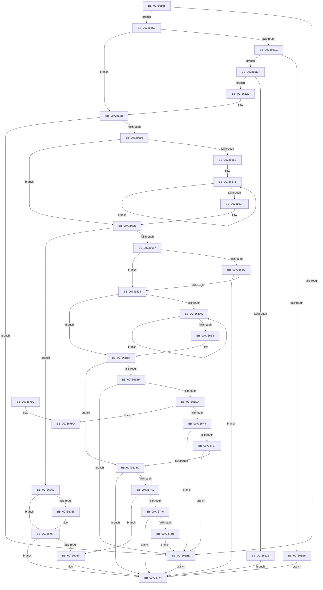

# PiDevCfgSplitDriverConfigurationId

- RVA: `0x00736568`–`0x007367A3` (길이 `571` bytes)
- VA: `0x0000000140736568`
- 실행 섹션: `PAGE`
- PDB 이름 있음: `예`; PDB Function 태그: `아니요`
- unwind 정보 RVA: `0x000C8BFC`
- 디코드: `158`개 명령, `571/571` bytes 표시
- 미해석 바이트: `0` (있으면 어셈블리에 `.byte`로 보존)

> 이 문서는 커널 이미지의 기계어와 PDB 기호를 분석해 생성했습니다. 4번과 5번은 함수 원형과 자료형을 바이너리 사용 방식에서 추정한 C 해석이며 원본 소스 복구 결과는 아닙니다.

## 1. Dependencies

- 직접 호출 지점: **12**; 고유 호출 대상: **8**
- 직접 호출자로 확인된 함수: **1**
- RIP 상대 이미지 참조: **2**

### Outgoing calls
- `0x007365B0` → [wcschr](../../text/50/wcschr_function_00501A60.md) (function, `0x00501A60`)
- `0x0073660A` → [ExAllocatePool2](../../poolcode/B8/ExAllocatePool2_function_00B820F0.md) (function, `0x00B820F0`)
- `0x0073662B` → [memcpy](../../text/6C/memcpy_function_006C6840.md) (function, `0x006C6840`)
- `0x00736648` → [wcschr](../../text/50/wcschr_function_00501A60.md) (function, `0x00501A60`)
- `0x00736660` → [wcschr](../../text/50/wcschr_function_00501A60.md) (function, `0x00501A60`)
- `0x0073669F` → [wcschr](../../text/50/wcschr_function_00501A60.md) (function, `0x00501A60`)
- `0x007366E5` → [memcpy](../../text/6C/memcpy_function_006C6840.md) (function, `0x006C6840`)
- `0x00736719` → [swscanf_s](../../text/50/swscanf_s_function_005063B0.md) (function, `0x005063B0`)
- `0x0073672F` → [RtlTimeFieldsToTime](../../text/42/RtlTimeFieldsToTime_function_0042E6B0.md) (function, `0x0042E6B0`)
- `0x00736752` → [PiDevCfgParseVersionString](PiDevCfgParseVersionString_function_00733FAC.md) (function, `0x00733FAC`)
- `0x0073677E` → [_security_check_cookie](../../text/6A/_security_check_cookie_function_006AC640.md) (function, `0x006AC640`)
- `0x0073679D` → [_report_rangecheckfailure](../../text/4F/_report_rangecheckfailure_function_004F5FDC.md) (function, `0x004F5FDC`)

### Direct callers
- [PiDevCfgCheckDeviceNeedsUpdate](PiDevCfgCheckDeviceNeedsUpdate_function_00731DDC.md) at `0x0073220A`

### Static image references
- `0x0073657E` → RVA `0x00E0A740` (`.data`; read)
- `0x0073670D` → RVA `0x00AFEF60` (` ?? ::NNGAKEGL::`string'`; read)

## 2. Other-region calls and transfers

- 다른 실행 섹션으로 향하는 call: **11**
  - `0x007365B0` → [wcschr](../../text/50/wcschr_function_00501A60.md) (`PAGE` → `.text`)
  - `0x0073660A` → [ExAllocatePool2](../../poolcode/B8/ExAllocatePool2_function_00B820F0.md) (`PAGE` → `POOLCODE`)
  - `0x0073662B` → [memcpy](../../text/6C/memcpy_function_006C6840.md) (`PAGE` → `.text`)
  - `0x00736648` → [wcschr](../../text/50/wcschr_function_00501A60.md) (`PAGE` → `.text`)
  - `0x00736660` → [wcschr](../../text/50/wcschr_function_00501A60.md) (`PAGE` → `.text`)
  - `0x0073669F` → [wcschr](../../text/50/wcschr_function_00501A60.md) (`PAGE` → `.text`)
  - `0x007366E5` → [memcpy](../../text/6C/memcpy_function_006C6840.md) (`PAGE` → `.text`)
  - `0x00736719` → [swscanf_s](../../text/50/swscanf_s_function_005063B0.md) (`PAGE` → `.text`)
  - `0x0073672F` → [RtlTimeFieldsToTime](../../text/42/RtlTimeFieldsToTime_function_0042E6B0.md) (`PAGE` → `.text`)
  - `0x0073677E` → [_security_check_cookie](../../text/6A/_security_check_cookie_function_006AC640.md) (`PAGE` → `.text`)
  - `0x0073679D` → [_report_rangecheckfailure](../../text/4F/_report_rangecheckfailure_function_004F5FDC.md) (`PAGE` → `.text`)
- 별도 외부 분기/꼬리 이동을 확인하지 못했습니다.

## 3. Assembly (complete function range)

```asm
00736568  48 89 5C 24 18                  mov qword ptr [rsp + 0x18], rbx
0073656D  48 89 6C 24 20                  mov qword ptr [rsp + 0x20], rbp
00736572  56                              push rsi
00736573  57                              push rdi
00736574  41 54                           push r12
00736576  41 56                           push r14
00736578  41 57                           push r15
0073657A  48 83 EC 60                     sub rsp, 0x60
0073657E  48 8B 05 BB 41 6D 00            mov rax, qword ptr [rip + 0x6d41bb]
00736585  48 33 C4                        xor rax, rsp
00736588  48 89 44 24 58                  mov qword ptr [rsp + 0x58], rax
0073658D  4C 8B BC 24 B0 00 00 00         mov r15, qword ptr [rsp + 0xb0]
00736595  4C 8B F2                        mov r14, rdx
00736598  48 8B BC 24 B8 00 00 00         mov rdi, qword ptr [rsp + 0xb8]
007365A0  0F 57 C0                        xorps xmm0, xmm0
007365A3  33 DB                           xor ebx, ebx
007365A5  4C 8B E1                        mov r12, rcx
007365A8  0F 11 44 24 30                  movups xmmword ptr [rsp + 0x30], xmm0
007365AD  8D 53 3A                        lea edx, [rbx + 0x3a]
007365B0  E8 AB B4 DC FF                  call 0x140501a60
007365B5  48 8B E8                        mov rbp, rax
007365B8  48 85 C0                        test rax, rax
007365BB  75 0A                           jne 0x1407365c7
007365BD  BB 01 00 00 C0                  mov ebx, 0xc0000001
007365C2  E9 AD 01 00 00                  jmp 0x140736774
007365C7  4D 85 F6                        test r14, r14
007365CA  74 6F                           je 0x14073663b
007365CC  48 8B CD                        mov rcx, rbp
007365CF  49 2B CC                        sub rcx, r12
007365D2  48 D1 F9                        sar rcx, 1
007365D5  03 C9                           add ecx, ecx
007365D7  8B F1                           mov esi, ecx
007365D9  48 8D 41 02                     lea rax, [rcx + 2]
007365DD  48 3D FE FF 00 00               cmp rax, 0xfffe
007365E3  76 0A                           jbe 0x1407365ef
007365E5  BB 06 01 00 C0                  mov ebx, 0xc0000106
007365EA  E9 85 01 00 00                  jmp 0x140736774
007365EF  66 41 89 0E                     mov word ptr [r14], cx
007365F3  41 B8 53 74 72 67               mov r8d, 0x67727453
007365F9  66 83 C1 02                     add cx, 2
007365FD  0F B7 D1                        movzx edx, cx
00736600  B9 00 01 00 00                  mov ecx, 0x100
00736605  66 41 89 56 02                  mov word ptr [r14 + 2], dx
0073660A  E8 E1 BA 44 00                  call 0x140b820f0
0073660F  49 89 46 08                     mov qword ptr [r14 + 8], rax
00736613  48 85 C0                        test rax, rax
00736616  75 0A                           jne 0x140736622
00736618  BB 9A 00 00 C0                  mov ebx, 0xc000009a
0073661D  E9 52 01 00 00                  jmp 0x140736774
00736622  4C 8B C6                        mov r8, rsi
00736625  49 8B D4                        mov rdx, r12
00736628  48 8B C8                        mov rcx, rax
0073662B  E8 10 02 F9 FF                  call 0x1406c6840
00736630  49 8B 46 08                     mov rax, qword ptr [r14 + 8]
00736634  48 D1 EE                        shr rsi, 1
00736637  66 89 1C 70                     mov word ptr [rax + rsi*2], bx
0073663B  41 BC 2C 00 00 00               mov r12d, 0x2c
00736641  48 8D 4D 02                     lea rcx, [rbp + 2]
00736645  41 8B D4                        mov edx, r12d
00736648  E8 13 B4 DC FF                  call 0x140501a60
0073664D  48 85 C0                        test rax, rax
00736650  0F 84 67 FF FF FF               je 0x1407365bd
00736656  48 8D 70 02                     lea rsi, [rax + 2]
0073665A  41 8B D4                        mov edx, r12d
0073665D  48 8B CE                        mov rcx, rsi
00736660  E8 FB B3 DC FF                  call 0x140501a60
00736665  48 83 CD FF                     or rbp, 0xffffffffffffffff
00736669  48 85 C0                        test rax, rax
0073666C  75 10                           jne 0x14073667e
0073666E  48 8B C5                        mov rax, rbp
00736671  48 FF C0                        inc rax
00736674  66 39 1C 46                     cmp word ptr [rsi + rax*2], bx
00736678  75 F7                           jne 0x140736671
0073667A  48 8D 04 46                     lea rax, [rsi + rax*2]
0073667E  66 39 18                        cmp word ptr [rax], bx
00736681  0F 84 D9 00 00 00               je 0x140736760
00736687  4D 85 FF                        test r15, r15
0073668A  75 09                           jne 0x140736695
0073668C  48 85 FF                        test rdi, rdi
0073668F  0F 84 DF 00 00 00               je 0x140736774
00736695  4C 8D 70 02                     lea r14, [rax + 2]
00736699  41 8B D4                        mov edx, r12d
0073669C  49 8B CE                        mov rcx, r14
0073669F  E8 BC B3 DC FF                  call 0x140501a60
007366A4  48 8B F0                        mov rsi, rax
007366A7  48 85 C0                        test rax, rax
007366AA  75 0E                           jne 0x1407366ba
007366AC  48 FF C5                        inc rbp
007366AF  66 41 39 1C 6E                  cmp word ptr [r14 + rbp*2], bx
007366B4  75 F6                           jne 0x1407366ac
007366B6  49 8D 34 6E                     lea rsi, [r14 + rbp*2]
007366BA  4D 85 FF                        test r15, r15
007366BD  74 7D                           je 0x14073673c
007366BF  48 8B C6                        mov rax, rsi
007366C2  49 2B C6                        sub rax, r14
007366C5  48 D1 F8                        sar rax, 1
007366C8  03 C0                           add eax, eax
007366CA  8B E8                           mov ebp, eax
007366CC  48 83 C0 02                     add rax, 2
007366D0  48 83 F8 16                     cmp rax, 0x16
007366D4  0F 87 E3 FE FF FF               ja 0x1407365bd
007366DA  44 8B C5                        mov r8d, ebp
007366DD  48 8D 4C 24 40                  lea rcx, [rsp + 0x40]
007366E2  49 8B D6                        mov rdx, r14
007366E5  E8 56 01 F9 FF                  call 0x1406c6840
007366EA  48 83 FD 16                     cmp rbp, 0x16
007366EE  0F 83 A9 00 00 00               jae 0x14073679d
007366F4  48 8D 44 24 30                  lea rax, [rsp + 0x30]
007366F9  66 89 5C 2C 40                  mov word ptr [rsp + rbp + 0x40], bx
007366FE  4C 8D 4C 24 34                  lea r9, [rsp + 0x34]
00736703  48 89 44 24 20                  mov qword ptr [rsp + 0x20], rax
00736708  4C 8D 44 24 32                  lea r8, [rsp + 0x32]
0073670D  48 8D 15 4C 88 3C 00            lea rdx, [rip + 0x3c884c]
00736714  48 8D 4C 24 40                  lea rcx, [rsp + 0x40]
00736719  E8 92 FC DC FF                  call 0x1405063b0
0073671E  83 F8 03                        cmp eax, 3
00736721  0F 85 96 FE FF FF               jne 0x1407365bd
00736727  49 8B D7                        mov rdx, r15
0073672A  48 8D 4C 24 30                  lea rcx, [rsp + 0x30]
0073672F  E8 7C 7F CF FF                  call 0x14042e6b0
00736734  84 C0                           test al, al
00736736  0F 84 81 FE FF FF               je 0x1407365bd
0073673C  48 85 FF                        test rdi, rdi
0073673F  74 33                           je 0x140736774
00736741  66 39 1E                        cmp word ptr [rsi], bx
00736744  74 29                           je 0x14073676f
00736746  48 8D 4E 02                     lea rcx, [rsi + 2]
0073674A  4C 8B C7                        mov r8, rdi
0073674D  BA 04 00 00 00                  mov edx, 4
00736752  E8 55 D8 FF FF                  call 0x140733fac
00736757  84 C0                           test al, al
00736759  75 19                           jne 0x140736774
0073675B  E9 5D FE FF FF                  jmp 0x1407365bd
00736760  4D 85 FF                        test r15, r15
00736763  74 05                           je 0x14073676a
00736765  33 C0                           xor eax, eax
00736767  49 89 07                        mov qword ptr [r15], rax
0073676A  48 85 FF                        test rdi, rdi
0073676D  74 05                           je 0x140736774
0073676F  33 C0                           xor eax, eax
00736771  48 89 07                        mov qword ptr [rdi], rax
00736774  8B C3                           mov eax, ebx
00736776  48 8B 4C 24 58                  mov rcx, qword ptr [rsp + 0x58]
0073677B  48 33 CC                        xor rcx, rsp
0073677E  E8 BD 5E F7 FF                  call 0x1406ac640
00736783  4C 8D 5C 24 60                  lea r11, [rsp + 0x60]
00736788  49 8B 5B 40                     mov rbx, qword ptr [r11 + 0x40]
0073678C  49 8B 6B 48                     mov rbp, qword ptr [r11 + 0x48]
00736790  49 8B E3                        mov rsp, r11
00736793  41 5F                           pop r15
00736795  41 5E                           pop r14
00736797  41 5C                           pop r12
00736799  5F                              pop rdi
0073679A  5E                              pop rsi
0073679B  C3                              ret
0073679C  CC                              int3
0073679D  E8 3A F8 DB FF                  call 0x1404f5fdc
007367A2  CC                              int3
```

## 4. C-style interpretation (structured pseudocode)

```c
__int64 __fastcall PiDevCfgSplitDriverConfigurationId(__int64 a1, __int64 a2, __int64 a3, __int64 a4, __int64 a5, __int64 a6)
{
    __int64 result;
    __int64 v_rbp;
    __int64 v_rbx;
    __int64 v_rsi;
    __int64 v_rsp;
    unsigned __int64 v_stack_m28;
    unsigned __int64 v_stack_m30;
    unsigned __int64 v_stack_m48;
    unsigned __int64 v_stack_m54;
    unsigned __int64 v_stack_m56;
    unsigned __int64 v_stack_m58;
    unsigned __int64 v_stack_m68;
    unsigned __int64 v_stack_p18;
    unsigned __int64 v_stack_p20;

    v_stack_p18 = v_rbx;
    v_stack_p20 = v_rbp;
    v_rsp = (v_rsp) - (96);
    result = (*(unsigned __int64 *)(v_rip + 7160251)) ^ (v_rsp);
    v_stack_m30 = result;
    v_rbx = 0;
    v_stack_m58 = v_xmm0;
    result = wcschr(a1, v_rbx + 58, a3, a4);
    if (result != 0) goto loc_007365C7;
loc_007365BD:
    goto loc_00736774;
loc_007365C7:
    if (a2 == 0) goto loc_0073663B;
    a1 = (result) - (a1);
    a1 = (a1) >> (1);
    a1 = (unsigned int)((a1) + ((unsigned int)(a1)));
    if ((a1 + 2) <= 0xFFFEULL) goto loc_007365EF;
    goto loc_00736774;
loc_007365EF:
    *(unsigned __int16 *)(a2) = (unsigned __int16)(a1);
    a1 = (unsigned __int16)((a1) + (2));
    *(unsigned __int16 *)(a2 + 2) = (unsigned __int16)((unsigned __int16)(a1));
    result = ExAllocatePool2(256, (unsigned __int16)(a1), (unsigned int)(0x67727453ULL), a4);
    *(unsigned __int64 *)(a2 + 8) = result;
    if (result != 0) goto loc_00736622;
    goto loc_00736774;
loc_00736622:
    result = memcpy(result, a1, (unsigned int)((unsigned int)(a1)), a4);
    v_rsi = ((unsigned int)((unsigned int)(a1))) >> (1);
    *(unsigned __int16 *)(*(unsigned __int64 *)(a2 + 8) + v_rsi * 2) = (unsigned __int16)((unsigned int)(0xC000009AULL));
loc_0073663B:
    result = wcschr(result + 2, 44, (unsigned int)((unsigned int)(a1)), a4);
    if (result == 0) goto loc_007365BD;
    result = wcschr(result + 2, 44, (unsigned int)((unsigned int)(a1)), a4);
    v_rbp = (result) | (-1);
    if (result != 0) goto loc_0073667E;
loc_00736671:
    result = (v_rbp) + 1;
    if ((*(unsigned __int16 *)(result + 2 + result * 2)) != ((unsigned __int16)((unsigned int)(0xC000009AULL)))) goto loc_00736671;
loc_0073667E:
    if ((*(unsigned __int16 *)(result + 2 + result * 2)) == ((unsigned __int16)((unsigned int)(0xC000009AULL)))) goto loc_00736760;
    if (a5 != 0) goto loc_00736695;
    if (a6 == 0) goto loc_00736774;
loc_00736695:
    result = wcschr(result + 2 + result * 2 + 2, 44, (unsigned int)((unsigned int)(a1)), a4);
    if (result != 0) goto loc_007366BA;
loc_007366AC:
    v_rbp = (v_rbp) + 1;
    if ((*(unsigned __int16 *)(result + 2 + result * 2 + 2 + v_rbp * 2)) != ((unsigned __int16)((unsigned int)(0xC000009AULL)))) goto loc_007366AC;
loc_007366BA:
    if (a5 == 0) goto loc_0073673C;
    result = (result + 2 + result * 2 + 2 + v_rbp * 2) - (result + 2 + result * 2 + 2);
    result = (result) >> (1);
    result = (unsigned int)((result) + ((unsigned int)(result)));
    result = (result) + (2);
    if (result > 22) goto loc_007365BD;
    result = memcpy(v_stack_m48, result + 2 + result * 2 + 2, (unsigned int)((unsigned int)((unsigned int)((unsigned int)(result)))), a4);
    if (((unsigned int)((unsigned int)(result))) >= 22) goto loc_0073679D;
    *(unsigned __int16 *)(v_rsp + (unsigned int)((unsigned int)(result)) * 1 + 64) = (unsigned __int16)((unsigned int)(0xC000009AULL));
    v_stack_m68 = v_stack_m58;
    result = swscanf_s(v_stack_m48, v_rip + 3967052, v_stack_m56, v_stack_m54);
    if (((unsigned int)(result)) != 3) goto loc_007365BD;
    result = RtlTimeFieldsToTime(v_stack_m58, a5, v_stack_m56, v_stack_m54);
    if ((unsigned __int8)(result) == 0) goto loc_007365BD;
loc_0073673C:
    if (a6 == 0) goto loc_00736774;
    if ((*(unsigned __int16 *)(result + 2 + result * 2 + 2 + v_rbp * 2)) == ((unsigned __int16)((unsigned int)(0xC000009AULL)))) goto loc_0073676F;
    result = PiDevCfgParseVersionString(result + 2 + result * 2 + 2 + v_rbp * 2 + 2, 4, a6, v_stack_m54);
    if ((unsigned __int8)(result) != 0) goto loc_00736774;
    goto loc_007365BD;
loc_00736760:
    if (a5 != 0) {
        result = 0;
        *(unsigned __int64 *)(a5) = 0;
    }
    if (a6 != 0) {
        result = 0;
        *(unsigned __int64 *)(a6) = 0;
    }
    a1 = (v_stack_m30) ^ (v_rsp);
    result = _security_check_cookie(a1, 4, a6, v_stack_m54);
    return result;
loc_0073679D:
    result = _report_rangecheckfailure(a1, 4, a6, v_stack_m54);
    return result;
}
```

## 5. (Beta) C Style

```c
int64_t PiDevCfgSplitDriverConfigurationId(int64_t Arg1, int64_t Arg2, int64_t Arg3, int64_t Arg4, int64_t Arg5, int64_t Arg6)
{
    int64_t result;
    int64_t local_rbp;
    int64_t local_rbx;
    int64_t local_rsi;
    int64_t local_rsp;
    uint64_t v_stack_m28;
    uint64_t v_stack_m30;
    uint64_t v_stack_m48;
    uint64_t v_stack_m54;
    uint64_t v_stack_m56;
    uint64_t v_stack_m58;
    uint64_t v_stack_m68;
    uint64_t v_stack_p18;
    uint64_t v_stack_p20;

    v_stack_p18 = local_rbx;
    v_stack_p20 = local_rbp;
    local_rsp = (local_rsp) - (96);
    result = (*(uint64_t *)(v_rip + 0x6D41BB)) ^ (local_rsp);
    v_stack_m30 = result;
    local_rbx = 0;
    v_stack_m58 = v_xmm0;
    result = wcschr(Arg1, local_rbx + 58, Arg3, Arg4);
    if (result != 0) goto loc_007365C7;
loc_007365BD:
    goto loc_00736774;
loc_007365C7:
    if (Arg2 == 0) goto loc_0073663B;
    Arg1 = (result) - (Arg1);
    Arg1 = (Arg1) >> (1);
    Arg1 = (uint32_t)((Arg1) + ((uint32_t)(Arg1)));
    if ((Arg1 + 2) <= 0xFFFEULL) goto loc_007365EF;
    goto loc_00736774;
loc_007365EF:
    *(uint16_t *)(Arg2) = (uint16_t)(Arg1);
    Arg1 = (uint16_t)((Arg1) + (2));
    *(uint16_t *)(Arg2 + 0x2) = (uint16_t)((uint16_t)(Arg1));
    result = ExAllocatePool2(256, (uint16_t)(Arg1), (uint32_t)(0x67727453ULL), Arg4);
    *(uint64_t *)(Arg2 + 0x8) = result;
    if (result != 0) goto loc_00736622;
    goto loc_00736774;
loc_00736622:
    result = memcpy(result, Arg1, (uint32_t)((uint32_t)(Arg1)), Arg4);
    local_rsi = ((uint32_t)((uint32_t)(Arg1))) >> (1);
    *(uint16_t *)(*(uint64_t *)(Arg2 + 0x8) + local_rsi * 2) = (uint16_t)((uint32_t)(0xC000009AULL));
loc_0073663B:
    result = wcschr(result + 2, 44, (uint32_t)((uint32_t)(Arg1)), Arg4);
    if (result == 0) goto loc_007365BD;
    result = wcschr(result + 2, 44, (uint32_t)((uint32_t)(Arg1)), Arg4);
    local_rbp = (result) | (-1);
    if (result != 0) goto loc_0073667E;
loc_00736671:
    result = (local_rbp) + 1;
    if ((*(uint16_t *)(result + 0x2 + result * 2)) != ((uint16_t)((uint32_t)(0xC000009AULL)))) goto loc_00736671;
loc_0073667E:
    if ((*(uint16_t *)(result + 0x2 + result * 2)) == ((uint16_t)((uint32_t)(0xC000009AULL)))) goto loc_00736760;
    if (Arg5 != 0) goto loc_00736695;
    if (Arg6 == 0) goto loc_00736774;
loc_00736695:
    result = wcschr(result + 2 + result * 2 + 2, 44, (uint32_t)((uint32_t)(Arg1)), Arg4);
    if (result != 0) goto loc_007366BA;
loc_007366AC:
    local_rbp = (local_rbp) + 1;
    if ((*(uint16_t *)(result + 0x2 + result * 2 + 0x2 + local_rbp * 2)) != ((uint16_t)((uint32_t)(0xC000009AULL)))) goto loc_007366AC;
loc_007366BA:
    if (Arg5 == 0) goto loc_0073673C;
    result = (result + 2 + result * 2 + 2 + local_rbp * 2) - (result + 2 + result * 2 + 2);
    result = (result) >> (1);
    result = (uint32_t)((result) + ((uint32_t)(result)));
    result = (result) + (2);
    if (result > 22) goto loc_007365BD;
    result = memcpy(v_stack_m48, result + 2 + result * 2 + 2, (uint32_t)((uint32_t)((uint32_t)((uint32_t)(result)))), Arg4);
    if (((uint32_t)((uint32_t)(result))) >= 22) goto loc_0073679D;
    *(uint16_t *)(local_rsp + (uint32_t)((uint32_t)(result)) * 1 + 0x40) = (uint16_t)((uint32_t)(0xC000009AULL));
    v_stack_m68 = v_stack_m58;
    result = swscanf_s(v_stack_m48, v_rip + 3967052, v_stack_m56, v_stack_m54);
    if (((uint32_t)(result)) != 3) goto loc_007365BD;
    result = RtlTimeFieldsToTime(v_stack_m58, Arg5, v_stack_m56, v_stack_m54);
    if ((uint8_t)(result) == 0) goto loc_007365BD;
loc_0073673C:
    if (Arg6 == 0) goto loc_00736774;
    if ((*(uint16_t *)(result + 0x2 + result * 2 + 0x2 + local_rbp * 2)) == ((uint16_t)((uint32_t)(0xC000009AULL)))) goto loc_0073676F;
    result = PiDevCfgParseVersionString(result + 2 + result * 2 + 2 + local_rbp * 2 + 2, 4, Arg6, v_stack_m54);
    if ((uint8_t)(result) != 0) goto loc_00736774;
    goto loc_007365BD;
loc_00736760:
    if (Arg5 != 0) {
        result = 0;
        *(uint64_t *)(Arg5) = 0;
    }
    if (Arg6 != 0) {
        result = 0;
        *(uint64_t *)(Arg6) = 0;
    }
    Arg1 = (v_stack_m30) ^ (local_rsp);
    result = _security_check_cookie(Arg1, 4, Arg6, v_stack_m54);
    return result;
loc_0073679D:
    result = _report_rangecheckfailure(Arg1, 4, Arg6, v_stack_m54);
    return result;
}
```

## 6. Execution-region graph

[열기: 2D/3D 그래프와 함수 탐색 컨트롤 패널](../../../control-panel.html?section=page&rva=0x00736568&view=graph)

- 2D 그래프는 위에서 아래로 흐르고, 3D 그래프는 빈 공간을 드래그해 회전합니다. Shift+드래그는 이동, 휠은 확대·축소, 함수 노드 선택은 대상 보고서 이동입니다.

### Static fallback


